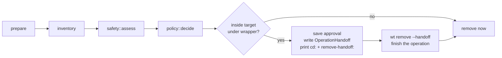

# `wt remove`

Load before changing `worktree::remove` (`lib/src/remove/`) or
`cli/src/commands/remove/` (`mod.rs` flow, `policy.rs`, `report.rs`). The
user-facing rules are in `worktree/docs/cli/remove.md`; keep it in step.

## Inventory

- One `git status --porcelain=v1 -z -uall --ignored=matching`.
- `included::classify_included` evaluates the target's own rules or, **only when
  missing**, the base checkout's rules.
- New, changed, and unknown selected ignored files need consent. Unchanged
  copies and ordinary ignored files are disposable and omitted from the report.
  Git's collapsed ignored directories do not need expansion for display.

- Status paths are parsed as exact bytes (`git::git_from_bytes`,
  `inventory::path_from_git`); on Windows a path that is not UTF-8 is
  `GitParse`. Non-UTF-8 file-name tests skip on macOS (APFS refuses the
  names) and run on Linux.
- Nothing hashes the inventory: the handoff's second run compares no content
  (R18), so there is no fingerprint.

## Safety tiers (`safety::assess`)

- Classifies Safe / Pretty safe / Not safe / Unknown from one
  `for-each-ref --contains <tip>`, with the PR lookup (sniff, 2 s) on a parallel
  thread.
- An `origin/*` ref other than `origin/<default>` counts only after the live
  check (`live_remote::LsRemote`).
- With `force_remote`, the destination (`remote_branch`, which an upstream can
  make `origin/<default>`) is dropped from the ref set before every tier, and
  `lost_commits` always excludes `origin/HEAD` (an alias that would bring the
  destination back).
- Tests inject `PrSource` and `RemoteHeads` stubs.

`safety::reconfirm` is the handoff's second-run proof:

1. a local default branch, other local branch, or tag proves the tip with no PR
   lookup and no network;
2. otherwise an exact-tip PR;
3. then only an `origin/*` ref whose live head verifies, `origin/<default>`
   included (`assess` trusts that one as of the last fetch).

A branch approved only because it was safe must still be safe.

## Network access

`worktree::live_remote::run_noninteractive` (top-level module, shared with the
`wt list` live-head store `worktree::remote_head`) is the **only** way removal
code touches the network.

- Disables every credential prompt.
- Kills the whole process tree at the deadline (process group on Unix,
  `taskkill /T /F` on Windows). A plain `Child::kill` leaves the transport
  holding the pipe.
- Output is complete or `Err`: stdout not read to its end is an error, never
  `Ok("")`.
- `LsRemote` rejects any line that is not `<40 or 64 lowercase hex>\t<refname>`,
  so only a complete answer without the exact ref is `Ok(None)` (absent).

## Policy and process

- `default_target::select_default_target` picks `main` or `origin/main` (the
  descendant; origin when diverged). `wt list` reuses it.
- `policy::decide` is pure: (situation, flags, scripted answers) → actions. Its
  L1 matrix covers every tier × contents × flag subset × mode.
- Git runs through `git::git_from(base, dir, ..)` (`git -C`, cwd = base). `run`
  calls `set_current_dir(base)` right after resolving the target, so neither
  `wt` nor a git child holds the worktree on Windows.
- A checkout that exists is removed by `remove::lifecycle` after the
  question ([lifecycle.md](lifecycle.md) has the order and the CLI wiring).
  Usage is queried once, by `facts::gather` before the report; nothing
  refuses on it.

## Concurrent writers during removal

A GitNexus watcher (`gitnexus analyze <target> --watch`) can recreate
`.gitnexus/` while the checkout is deleted. Before the removal lifecycle, Git
then failed with `Directory not empty` after unregistering the worktree. Now
`remove::delete` relists and empties a refilled directory up to
`REFILL_PASSES` (3) times, then names the writer through one usage query and
waits until it stops or the user presses Ctrl-C (R24, [deletion.md](deletion.md)).
The registry sweep in `just gitnexus` runs on its next invocation, so it does
not end such a watcher.

## Git facts about broken worktree records

Observed with Git 2.56 on macOS. These describe Git, not `wt`:

- `prunable <reason>` appears only when the admin `gitdir` back-reference
  points somewhere that no longer exists (the directory is gone, or its `.git`
  file is). A **locked** entry whose directory is gone is never `prunable`, and
  neither is a checkout whose `.git` file holds garbage. In both cases
  `git status` fails on an entry the listing reports as normal.
- The admin `index` outlives a deleted checkout. `git worktree remove` of a
  missing directory exits 0 and silently discards staged work in that index.
- `GIT_INDEX_FILE=<absent> git diff-index --cached` reads the missing file as an
  empty index without error. Prove the index exists before trusting the diff.
- A **split index** (`update-index --split-index`) keeps its entries in a
  `sharedindex.<oid>` file that `index` only references, so hashing `index`
  alone misses edits to the entries. Git (2.56 measured) exits 128 when that
  file is corrupt, removed, empty, has trailing bytes, or is a directory; it
  looks for it in the running process's git dir, then beside the
  `GIT_INDEX_FILE`. Only `ls-files --debug` shows entry flags
  (intent-to-add, skip-worktree); `--stage` alone does not.
- Test shims that capture Git output with `$(...)` drop NUL bytes, mangling
  any non-empty `-z` output; the `one_shot_git_shim` buffers through a file.
- `git -C <base> worktree repair <path>` can exit 1 even when it has fully
  restored the link, and **it also repairs every other broken worktree link**,
  not only `<path>`. That includes **overwriting another worktree's existing
  `.git` file** that holds something Git can't use (checked 2026-10-03: a
  `gitdir: /nowhere` file was rewritten to the right record), a state `wt`
  itself refuses to touch. Judge repair by postconditions, never by exit code,
  and never describe it as touching only the target.
- **Trap for manual testing:** because of that, one `wt remove` of an unlinked
  worktree silently heals every other broken fixture in the same repository.
  Give each broken-state scenario its own repository, or break it after the
  last repair.
- One `--force` does not remove a locked record (`remove -f -f` is required).
- **A checkout moved away and replaced by a directory link to it is not
  `prunable`**: Git reads it through the link. `git worktree remove` then
  deletes the files behind the link and fails on the link itself ("Not a
  directory"), so a failing Git exit is too late to serve as a guard.
- In a directory whose `.git` is gone, `git rev-parse --show-toplevel` finds
  any enclosing repository (for example the base, when the worktree is nested
  inside it). A Git command that succeeds there does not prove the worktree is
  healthy.

Checked 2026-10-11 with Git 2.47.3, 2.53.0, and 2.56.0 (spike S3 of
`2026-10-05-graceful-file-contention`; its script is in that fix's
`spikes/`):

- **`git worktree move` replaces an existing empty directory.** It accepts
  an empty directory as a destination (as `worktree add` does), turns a
  directory destination into `<dir>/<name>`, and renames over it. It refuses
  only a file or a non-empty directory. It cannot serve as a
  no-replacement move.
- A move rewrites exactly the admin `gitdir` and the checkout's `.git` file.
  It writes the `.git` file in the *invoking* config's link format, so a
  relative-link record can come out absolute.
- With relative links (Git ≥ 2.48, `extensions.relativeWorktrees`), the
  admin `gitdir` is relative to the admin directory itself
  (`../../../../<checkout>/.git` from `<common>/worktrees/<id>/`), and the
  `.git` file is relative to the checkout. After a native rename to a
  same-depth sibling, rewriting only the admin `gitdir` restores the record.
  An off-by-one `..` makes the record `prunable`. Git 2.47 ignores
  `worktree.useRelativePaths`.
- A lock survives a native rename (the `locked` file stays in the admin
  directory). `move` and `move -f` refuse a locked worktree.
- Worktrees containing submodules: `move` and plain `remove` refuse, but
  `remove --force` deletes them. The submodule's git directory lives in
  `<common>/worktrees/<id>/modules/<name>`.
- A split index's `sharedindex.<oid>` files live in the per-worktree admin
  directory, not the common directory.
- A plain `git worktree remove` of a checkout holding only its `.git` file
  **refuses**, because the deleted tracked files count as modifications. A
  plain remove of the **absent** directory is record-only. A directory
  recreated at the recorded path without a `.git` file is refused
  ("validation failed").

## Preparing a target Git can't read (`remove::prepare`)

`prepare(base, entry, &repair::Git)` classifies the entry afresh and returns
`CheckoutState::{Healthy, Missing, Repaired}` or a `PrepareRefusal`.
`facts::gather` calls it before any inventory and turns each refusal into
a warning and a `facts::Target` (a link, an occupied path, an unreadable
`.git`); nothing refuses the removal itself.

- **Trap: no `prunable` marker is not proof of a safe target.**
  `availability::classify_with` inspects the recorded path itself
  (`symlink_metadata`, plus `FILE_ATTRIBUTE_REPARSE_POINT` on Windows) for
  every entry and returns `Other(OtherCondition::Link)` for a link even when
  Git reads through it. That one check is what `prepare`, both handoff runs,
  and `wt list` rely on. Repair adds `Postcondition::NotADirectory` (every
  Git-side postcondition resolves links and passes), and the move refuses
  (`MoveRefusal::NotARealDirectory`) unless the path is a real directory
  immediately before it. Only the final component
  counts: an ancestor alias such as macOS `/tmp` stays healthy. Tests make
  the link with `replace_with_link` (a junction on Windows, which needs no
  privilege).

- **Association** (`admin_entry::admin_entry_for`): the common dir is
  `admin_entry::common_git_dir`, read in-process (`git_metadata::common_dir`,
  symlinks resolved as `rev-parse --path-format=absolute --git-common-dir`
  does; native separators on Windows) with that command as the fallback.
  Every directory under
  `worktrees/` is read, and an unreadable or linked record refuses the whole
  association. Exactly one record must match. Compare the **checkout
  directories** (`canonical_worktree_path`, which canonicalizes the longest
  existing ancestor), never the `.git` paths: another record whose checkout
  was replaced by a file makes `<file>/.git` fail with ENOTDIR and blocked
  every association until this was fixed.
- **Repair** (`repair::repair_unlinked`) goes through the `RepairGit` seam.
  The attempt's exit code and output are diagnostics only. The verdict is
  that all of these hold: `--git-dir` is the associated record,
  `--git-common-dir` is this repository's, the back-reference names the
  target, `--show-toplevel` is the target, and a fresh listing shows the same
  branch or detached HEAD with no `prunable`. All failures are collected. Only
  `RepairRefusal::Unverified` follows an attempt (`repair_attempted()`).
- **Missing** (`missing::inspect_missing`): the admin `index` must be a
  regular file (`IndexAbsent` otherwise). It is diffed with
  `GIT_INDEX_FILE=<admin>/index git diff-index --cached --name-status -z <head>`
  against the branch tip, or the recorded HEAD when detached; Git reads a
  split index's shared file too, and refuses a corrupt one
  (`IndexUninspectable`). Differences become `DirtyEntry`s with
  index-column statuses (`"A "`, `"M "`). An empty `staged` list means
  "index matches HEAD", never "checkout checked". The record itself is
  removed by the lifecycle's plain `git worktree remove` of the absent path;
  nothing re-reads the index first (a confirmed removal deletes whatever is
  there).
- Git receives paths as `OsStr` (`git::git_from_output`), never through a
  lossy `String`.

### How `wt remove` uses it

- `facts::gather` runs `prepare` after the main-checkout guard and
  `set_current_dir(base)`. A `Repaired` checkout is a note in the report; a
  `Missing` one shows its staged entries (`StagedChanges`, or `StagedUnknown`) as warnings and is
  removed record-only by the lifecycle (`ApprovedTarget::Absent`,
  [lifecycle.md](lifecycle.md#targets-without-a-checkout-directory)).
- `remove_local_branch(base, branch, expected_tip)` refuses with
  `WorktreeError::BranchMoved` when the tip is no longer the one the tier
  and any approval were decided on; the lifecycle keeps the branch and the
  run exits 1 after the checkout is gone.
- **Trap: a shell standing in an unlinked worktree can't reach the
  repository** unless the worktree is nested in another checkout of it.
  `find_worktree` runs Git in the caller's directory and fails with a bare
  `not a git repository` before `prepare`. Handoff-after-repair tests nest
  the worktree in the base checkout for this reason.
- **Trap: a locked record is never `prunable`.** A locked worktree whose
  path is gone, holds a file, or cannot be inspected reads as `Healthy` to
  `availability`. `facts::gather` marks any unmarked entry whose path is not
  a directory or link as prunable before `prepare`, so it is gathered as
  `Missing`, `NotADirectory`, or `Uninspectable` with the lock warning;
  never infer a directory from the missing marker.

## Move-first handoff

Inside the target with `WT_SHELL_WRAPPER=1`, the first run saves the
approval (`lifecycle::save_approval`) and writes
`handoff::OperationHandoff` (`<repo hash>.handoff-<token>.json`, 10 min,
format version 6) carrying only the operation id, the repository, the
target, and `shown_dirty`: the dirty paths the question listed
(`lifecycle::late::shown`), so the second run's `late::unseen` can name
the rest (R14). `shown_dirty` is required (absent, another type, or a
non-path element reads as missing); `null` means the question showed no
inventory and names nothing, `[]` that it showed no dirty files. Paths are
`NativeString`, so non-UTF-8 names survive. `--handoff` **consumes the file
before judging it**;
`verify_operation` checks only that the caller left the target and that the
repository is the same, then `lifecycle::finish_handoff` finishes the
operation from its compact record, whose identities bind the checkout and
the worktree record. No content is compared (R18); a branch or endpoint
that changed between the runs keeps the branch and exits 1. An earlier
`wt`'s content-comparing handoff (version 4) and a version 5 handoff
without `shown_dirty` read as missing.

## `--force-remote` endpoint rules

- The endpoint is `remote::push_endpoints`
  (`git remote get-url --push --all origin`, git's own spelling, never
  canonicalized).
- The deletion's `ls-remote` and `push` address that **URL**, not the `origin`
  nickname (which `ls-remote` would resolve to the fetch URL).
- Several push URLs make `--force-remote` refuse (exit 3) before anything is
  removed.
- Git may still reinterpret the URL, with no switch to stop it: `ls-remote`
  rewrites by `insteadOf`, `push` by `pushInsteadOf` else `insteadOf`, and a
  name matching a configured remote is read as that remote (fetch URL for
  `ls-remote`, push URL for `push`). So `remote::endpoint_reinterpretation`
  (`git config --null --list`, every scope and `-c`) must find:
  - no rewrite rule whose value prefixes the endpoint;
  - no `remote.<endpoint>.*` key of any kind (section and variable come back
    lowercased; the remote name keeps its case and git matches it
    case-sensitively);
  - no legacy `remotes/<endpoint>` or `branches/<endpoint>` file
    (`rev-parse --git-path`).
  Otherwise preflight yields `RemoteState::ReinterpretedEndpoint` and both runs
  refuse (exit 3) before any mutation; `delete_remote_branch` re-checks before
  pushing.
- `git remote get-url <name>` **cannot** answer "is this a remote": it says "No
  such remote" for remotes defined in global scope or by `-c`, which `push`
  still uses.
- The safety tiers' `origin/*` live checks still use `origin`, matching the
  fetch that made those refs.

## Recovery store (`remove::recovery`)

The compact record and the store API are in
[lifecycle.md](lifecycle.md#compact-record-and-store-record_version-3); the
module docs of `recovery` state the crash guarantees. The facts below are
the ones that cost time.

- **Layout:** `<common-git-dir>/wt-removal/<operation-id>/record.json`;
  `wt-removal/locks/` holds one `fs4` lock file per worktree record (key:
  BLAKE3 of the admin directory name, 32 hex). A lock file is never
  deleted; only a held lock is an active operation.
- **Trap (macOS): std's `sync_all`/`sync_data` issue `F_FULLFSYNC`, ~25 ms a
  call.** `storage::flush` uses plain `fsync` on Apple platforms; the store
  claims process-crash durability, not power loss.
- **Legacy records are read strictly, only to migrate them:**
  `record::parse` reads `record_version` through `strict_json::members`
  first, then the typed struct; every field is required, with no `Option`
  and no `serde(default)`. Its robustness matrix is in
  `recovery/store/tests.rs`, asserted through `RecoveryStore::resume`. A
  legacy `report.json` and journals are never read beyond the report's
  version and operation id, and are deleted on migration.

## Usage (`remove::usage`)

`UsageSource::query(path)` is one Sniff query (`SniffUsage`: default
options, no tree index); `usage::holders(&report)` lists every process
lifetime with evidence in the checkout, and `CoverageSummary::of` says how
much of the host was seen. Nothing here refuses: `facts::gather` turns
holders into `Warning::Processes` (minus the caller's own shell) and only a
real miss of the query into `Warning::UsageIncomplete`; the deletion engine
names holders while it waits on a held file.

- **Cost:** the real-query test takes about 0.5 s on macOS and about 2 s on
  native Windows, where Sniff opens each path to ask for its holders.

## No-replacement move (`remove::quarantine::rename`)

`rename_no_replace(from, to)` is the only move the quarantine may use:
`renameat2(RENAME_NOREPLACE)` (raw syscall) on Linux, `renamex_np(RENAME_EXCL)`
on macOS, and `SetFileInformationByHandle(FileRenameInfo)` with
`ReplaceIfExists = FALSE` after a `DELETE` open on Windows. Failures carry a
`RenameFailure`; match on it, never on the message. `identity(path)` reads the
no-follow identity in Sniff's `FileIdentity` encoding (the Windows file ID is
`u128::from_le_bytes`), so it compares equal to identities in a Sniff report
or a recovery record.

- **Never `std::fs::rename`, and never `git worktree move`, for the
  quarantine.** Both replace an existing empty directory.
- **Windows 5/32 depends on the stage.** From the `DELETE` open it is
  `Permission`; from the rename after a successful open it is `Sharing`
  (something in the tree is open, or is a process's working directory). An
  ACL denial at the rename stage is indistinguishable and is reported as
  `Sharing`; nothing moved either way.
- **`EINVAL` is `Unsupported`** (WSL drvfs rejects `RENAME_NOREPLACE` for every
  move), as are `ENOSYS` and `ENOTSUP`. `EEXIST` is still `Collision` there, so
  a collision never proves the flag is supported.
- **Unix in-use trees move freely**; only Windows blocks the move.
- Tests for codes a host cannot produce (drvfs, another volume, a denied open)
  go through `classify(Stage, &io::Error)`, which is `pub(crate)`.

## Quarantine move with Git association (`remove::quarantine::association`)

`naming::quarantine_path(original, operation)` gives
`<parent>/.wt-remove-<ascii-slug>-<first 16 hex of the operation id>`.
`plan_move` checks and fixes it (a lock and submodules do not refuse there);
the move (`placement::place_with` → `move_with`) re-runs every check, the
lock included, renames, rewrites the admin `gitdir`, and verifies with a
fresh `git worktree list`. The lifecycle saves the compact record and
unlocks between the two calls ([lifecycle.md](lifecycle.md)).

- **Only the admin `gitdir` is rewritten, byte for byte except the checkout's
  name** (`rewrite_back_reference`): absolute or relative, separators, and
  line ending are kept, so Git's own spelling (`C:/…` on Windows) survives.
  A record that does not end in `<sep><name><sep>.git` refuses. The file is
  replaced by temp + rename and keeps its permissions (not the store's 0600).
- **The `.git` file is kept unless its link breaks after the move (R8).**
  Absolute, or relative with only leading `..` steps, survives. `../x/../…`
  resolves *physically* through the checkout's own name and breaks after the
  move (lexical comparison would accept it — do not "simplify" to that), so
  `plan_move` plans `gitdir: <absolute admin dir>` (original line ending,
  `/` separators on Windows) and `move_with` replaces `<quarantine>/.git`
  atomically (`replace_file`) after the rename; rollback restores the
  original bytes *before* moving back. A link that resolves to this
  worktree's record but cannot be written absolutely refuses
  `MoveRefusal::LinkNotMovable`; one naming another record stays `Changed`.
- **Moved or in place: `quarantine::placement::place(base, &plan, mounts)`.**
  A mount strictly inside the
  checkout → `InPlace(NestedMounts)` without trying the rename;
  `RenameFailure::{Unsupported, Sharing}` → `InPlace` (drvfs, a Windows
  holder), checkout untouched; `LinkNotMovable` → `InPlace` (callers apply
  `in_place_for_refusal` to `plan_move`'s error too, since no plan exists
  then). Every other failure stays an error. Never fall back to a
  check-then-`std::fs::rename`. Tests inject the rename's OS error with
  `Faults::rename_instead`.
- **Submodules never refuse** (they are deleted with the checkout, which
  Git's own `validate_no_submodules` does not allow). Any entry named
  `locked` in the admin directory refuses the move; the move never removes a
  lock (the lifecycle unlocks first, only when the question showed it).
- **Rollback** happens only when the moved directory still has the planned
  identity and nothing is at the original path. It moves back with `rename_no_replace` (never over a recreated
  original), restores the exact `gitdir` bytes, and re-verifies. Otherwise
  `MoveError::Stranded` carries an observed `MoveState`.
- **Exit classes (`MoveError::class`):** `Refused` (3); rename `Sharing` and
  `Unsupported` → `BlockedByEnvironment` (4); every other rename failure, a
  rollback, and a stranded move → `Failed`. `nothing_changed()` is true for
  all but `Stranded`.
- **Test seam:** `move_with(.., &Faults)` fails or replaces the `gitdir`
  write and runs a hook after the rename. The relative-format test skips on
  Git < 2.48 (build-linux has 2.47.3).
- **macOS test trap:** a `TestRepo` path is `/var/…` while Git's listing (and
  so `plan.original`) is `/private/var/…`; compare with `same_location` or
  with `plan.original`, never with the path `add_worktree` returned.

## Git processes

A clean removal starts 7 (10 before 2026-10-22): see
`worktree/docs/performance-testing.md#git-processes` for what each one is
and the CLI test that pins them (`remove::a_clean_removal_starts_7_git_processes`). The tips `wt remove` compares
(`remove::branch_tip`, `missing::recorded_head`, `default_target`), origin's
URL (`remote::origin_url`), and `branch.<name>.*` are read in-process and
fresh on every call, so a recheck still sees a concurrent change; Git runs
only when that read cannot answer (a missing branch keeps Git's own error).
The CLI lists the worktrees once to find `base` and resolve the name
(`lifecycle::resolve_in`). Every other listing in the lifecycle is a
deliberate re-read; do not merge one into another without the spec's
say-so. The listings and `ls-files --stage -z` reads are answered in-process
at their steps (`git::worktree_list_from`, `git::staged_entries_*`); a
listing of a `prunable` entry still runs Git.

## Tests

See [testing.md](testing.md#wt-remove).
