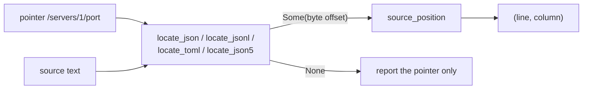

# Data Formats and Readers

biscuit-file names the data formats it knows (`DataFormat`, `FileType`),
detects a file's format from its extension, reads two line-oriented
formats that need more than a serde parser (JSON Lines and delimited text,
CSV and TSV), and reports where in the source text a value was written. This
page covers what each piece accepts and what it returns.

The readers parse text only. They never read files, strip a byte-order mark,
or interpret the values: mapping CSV rows to objects or lists, checking header
names, and converting numbers belong to the caller (Darkmatter's data loader
is one).

## Detecting a format from a path

`detect_from_extension(&Path) -> FileType` looks only at the extension, so it
works for a URL path as well as a local file and never touches the
filesystem. Matching ignores case.

```rust
use std::path::Path;
use biscuit_file::{FileType, detect_from_extension};

assert_eq!(detect_from_extension(Path::new("DATA.CSV")), FileType::Csv);
assert_eq!(detect_from_extension(Path::new("events.ndjson")), FileType::Jsonl);
assert_eq!(detect_from_extension(Path::new("notes.txt")), FileType::Unknown);
```

| Extension | `FileType` | `DataFormat` | MIME type |
|---|---|---|---|
| `.toml` | `Toml` | `Toml` | `application/toml` |
| `.yaml`, `.yml` | `Yaml` | `Yaml` | `application/yaml` |
| `.json` | `Json` | `Json` | `application/json` |
| `.json5` | `Json5` | `Json5` | `application/json5` |
| `.jsonl`, `.ndjson` | `Jsonl` | `Jsonl` | `application/x-ndjson` |
| `.csv` | `Csv` | `Csv` | `text/csv` |
| `.tsv` | `Tsv` | `Tsv` | `text/tab-separated-values` |
| `.md`, `.markdown`, `.mdx` | `Markdown` | `Markdown` | `text/markdown` |
| `.pdf` | `Pdf` | `Pdf` | `application/pdf` |
| anything else, or none | `Unknown` | — | — |

`detect_file_type(path)` reads the file's first bytes first (only PDF has
magic bytes) and falls back to the same extension table.

JSONL, CSV, and TSV are UTF-8 text (`requires_utf8()`) and structured data
(`is_structured()`). The `bf` CLI detects them but does not convert them: it
exits with an error such as `CSV input is not supported for conversion;
supported inputs: TOML, YAML, JSON, JSON5, Markdown, PDF`.

## JSON Lines

`biscuit_file::json_lines::read_json_lines(text)` needs no feature. Each
physical line holds one JSON value.

```rust
use biscuit_file::json_lines::read_json_lines;

let text = "{\"id\": 1}\n\n{\"id\": 2.50}\r\n";
let rows = read_json_lines(text)?;

assert_eq!(rows.values.len(), 2);
let second = &rows.line_offsets[1];
assert_eq!((second.line, second.offset), (3, 11));
assert_eq!(&text[second.text.clone()], "{\"id\": 2.50}"); // original spelling
# Ok::<(), biscuit_file::json_lines::JsonLinesError>(())
```

- **Result.** `JsonLines { values, line_offsets }`. The two vectors are
  parallel; each `JsonLineRecord` has the 1-based `line`, the byte `offset` of
  that line's start, and `text`, the byte range of the record with
  surrounding whitespace trimmed. Use `text` to re-read a number exactly as
  written.
- **Lines.** LF ends a line; a CRLF's CR is trimmed with the record. A line
  holding only spaces, tabs, or CRs is skipped but still counted, so line
  numbers stay physical. Empty text gives no values.
- **Errors.** The first line that is not exactly one JSON value fails with
  `JsonLinesError::InvalidRecord { line, offset, source }`. `offset` is the
  byte offset of the parser error in the whole text, not serde_json's column.

## Delimited text (CSV and TSV)

`biscuit_file::delimited::read_delimited(text, delimiter)` is behind the
opt-in `delimited` feature (not in `default`; in `full`), which adds the `csv`
and `csv-core` crates. Pass `b','` for CSV and `b'\t'` for TSV; both use
CSV-style quoting.

```toml
biscuit-file = { path = "../../biscuit-file/lib", features = ["delimited"] }
```

```rust
use biscuit_file::delimited::read_delimited;

let data = read_delimited("a,\"x\"\"y,z\",q\n1,2,3\n", b',')?;
let header = data.headers.expect("a header row");

assert_eq!(header.fields[1].text, "x\"y,z");
assert_eq!(header.fields[1].offset, 2);  // the opening quote
assert_eq!(header.fields[2].offset, 11); // a raw source offset
assert_eq!(data.rows[0].line, 2);
# Ok::<(), biscuit_file::delimited::DelimitedError>(())
```

- **Result.** `DelimitedData { headers, rows }`. The first record is
  `headers`; it is `None` only when the text has no records at all (empty, or
  blank lines only). A header-only text has `rows` empty. Each
  `DelimitedRecord` has its start `line` (1-based), start byte `offset`, and
  `fields`; each `DelimitedField` has the decoded `text` and the raw byte
  `offset` where the field starts in the source, which for a quoted field is
  its opening quote.
- **Quoting.** A field that starts with `"` is quoted. It may contain the
  delimiter and line breaks, and `""` inside it is one quote. Cell text is
  never trimmed.
- **Records.** LF, CRLF, and a lone CR end a record outside quotes. Line
  numbers count LF only. An empty line is skipped (still counted); a line of
  only delimiters is a record of empty cells. A record that spans lines
  reports the line it starts on.
- **Strict rules.** The reader rejects input the `csv` crate would accept:

  | Input | Error |
  |---|---|
  | `a,"oops` (no closing quote) | `UnterminatedQuote`, at the opening quote |
  | `a,b"c,d` | `QuoteInUnquotedField`, at the quote |
  | `"a"x,b` | `TextAfterClosingQuote`, at `x` |
  | a data row with more or fewer fields than the header | `RaggedRow`, at the row's start, with both counts |
  | a delimiter of `"`, CR, LF, or a non-ASCII byte | `InvalidDelimiter` |

  Every positional error carries the byte `offset` and its `line`. The first
  violation in source order wins.

The reader does not check header names: whether duplicate or empty names are
allowed depends on how the caller maps rows.

## Source positions and data locators

When a value in a data file is wrong, a caller usually has a JSON Pointer to
it (such as `/servers/1/port`) and wants to tell the user the line and column
an editor shows. Two pieces do this, and neither needs a feature:

1. A **locator** finds the byte offset where the value at a pointer was
   written. There is one per format, because each parser keeps positions
   differently.
2. `source_position(text, offset)` turns any byte offset into a 1-based
   `(line, column)`.



```rust
use biscuit_file::{locate_json, source_position};

let text = "{\n  \"servers\": [{\"port\": 1}, {\"port\": \"x\"}]\n}";
let offset = locate_json(text, "/servers/1/port").expect("located");
assert_eq!(source_position(text, offset), Some((2, 37)));
```

### Lines and columns

`source_position` counts the same way for every format:

| Text before the offset | Rule | Example |
|---|---|---|
| LF (`\n`) or CRLF (`\r\n`) | ends a line | `"a\r\nb"`, offset 3 → `(2, 1)` |
| a CR not followed by LF | an ordinary character; no new line | `"a\rb"`, offset 2 → `(1, 3)` |
| a multibyte character | one column, however many bytes | `"é: x"`, offset 4 → `(1, 4)` |

A CRLF file and its LF twin give the same position for the same token. An
offset equal to the text's length is the end position; an offset past the
end, or one that falls inside a multibyte character, gives `None`.

Offsets index exactly the text passed in. Strip a byte-order mark before
parsing and locate against the stripped text, so line 1 columns match what an
editor shows.

Normalize a parser error to a byte offset before calling `source_position`;
parsers report columns differently (serde_json counts bytes, json-five counts
characters). For JSON5, `json5_parse_error_offset(text)` (feature `json5`)
returns the byte offset of the first syntax error, or `None` when the text is
grammatical:

```rust
use biscuit_file::{json5_parse_error_offset, source_position};

let text = "{\n  名前: 'é', bad: ]\n}";
let offset = json5_parse_error_offset(text).expect("a syntax error");
assert_eq!(source_position(text, offset), Some((2, 17)));
```

### Locators

Every locator has the signature `(text: &str, pointer: &str) -> Option<usize>`
and is re-exported at the crate root. Pointers follow RFC 6901: `""` is the
root, each segment starts with `/`, `~1` decodes to `/`, `~0` to `~`, and an
array index is `0` or digits without a leading zero.

| Function | Feature | Format | Notes |
|---|---|---|---|
| `locate_json` | none | JSON | A duplicate key resolves to its last occurrence, the value serde_json keeps. The root is its first non-whitespace byte. |
| `locate_jsonl` | none | JSON Lines | The first segment indexes the non-blank records (`/0` is the first record even after blank lines); the rest is located inside that record. The root is the first record. |
| `locate_toml` | `toml` | TOML | Handles `[[array of tables]]`, dotted keys, inline tables and arrays, and a `[super]` table written after its `[super.sub]` table. A table written as a header starts at its header line. The root is byte 0. |
| `locate_json5` | `json5` | JSON5 | Comments, trailing commas, unquoted and single-quoted keys, and escapes are handled; a signed number starts at its sign; a duplicate key resolves to its last occurrence. |

```rust
use biscuit_file::{locate_toml, source_position};

let text = "[[servers]]\nport = 80\n\n[[servers]]\nport = \"bad\"\n";
let offset = locate_toml(text, "/servers/1/port").expect("located");
assert_eq!(source_position(text, offset), Some((5, 8)));
```

CSV and TSV need no locator: each `DelimitedField::offset` from
`read_delimited` is already a raw source offset, so pass it straight to
`source_position`. A cell after a quoted field holding a delimiter, a doubled
quote, or a line break still gets its true line and column.

### When a locator returns `None`

A `None` means "report the pointer without a line and column". It is returned
when:

- the text does not parse in that format;
- the pointer is malformed: not empty and not starting with `/`, a `~` not
  followed by `0` or `1`, or an array index such as `01`, `-1`, or `+1`;
- nothing exists at the pointer, for example `/servers/2` in a two-element
  list, or a child of a string.

A caller whose pointer names a missing property (a required key that was never
written) should locate the parent pointer instead: `/servers/0` when
`/servers/0/host` is absent.

`locate_json` reads JSON the way serde_json's raw-value reader does, which
skips over string contents: a string value holding a lone surrogate escape
such as `"\ud83d"` is still located, although parsing the same text into a
`serde_json::Value` fails. Callers locate text they have already parsed.
