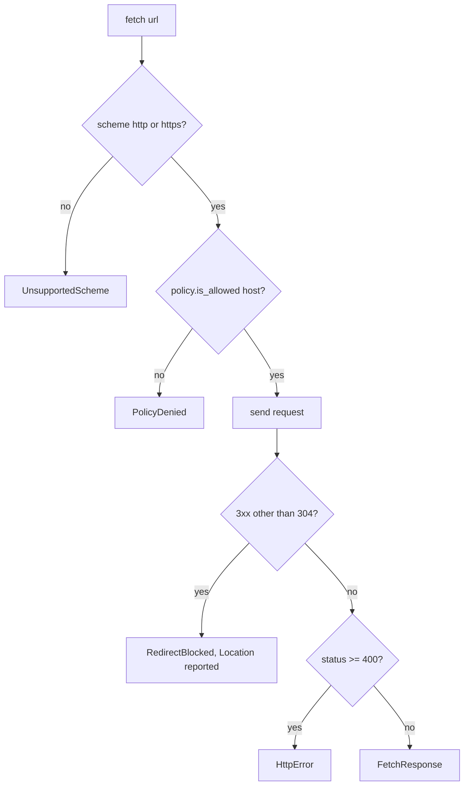

# Fetching Remote Content (`fetch` feature)

`biscuit_file::fetch` is the one HTTP primitive every remote read or write in
this repository goes through, so host consent is enforced in a single place.
It is off by default; enable it with the `fetch` Cargo feature:

```toml
biscuit-file = { path = "../biscuit-file/lib", features = ["fetch"] }
```

A request needs three things:

- a `PolicyClient`, the only client type the primitive accepts; it never
  follows a redirect;
- a URL;
- a `FetchPolicy`, which says which hosts the caller consents to contact.

```rust,ignore
use biscuit_file::{Conditional, FetchPolicy, PolicyClient, fetch};

let client = PolicyClient::new()?;
let policy = FetchPolicy::deny_all().allow_host("docs.example.com");
let url = url::Url::parse("https://docs.example.com/guide.md")?;
let response = fetch(&client, &url, &policy, &Conditional::default()).await?;
```

`fetch_blocking` and `post_blocking` are synchronous wrappers for callers
without a Tokio runtime; `post` sends a body under the same rules.

## Choosing a policy

| Constructor | Allows | Use when |
|---|---|---|
| `FetchPolicy::default()` / `FetchPolicy::deny_all()` | no host | the default; add hosts explicitly |
| `.allow_host("example.com")` | that host, ASCII case-insensitively | the user named one host (`--allow host=HOST`) |
| `.allow(HostPattern::Wildcard("example.com"))` | every subdomain (`a.example.com`), **not** `example.com` itself | a delegated subdomain zone |
| `FetchPolicy::allow_all()` | every host | the user configured blanket consent |

`allow_all()` is an explicit mode, not a pattern: there is no wildcard
hostname that means "every host", and `HostPattern::Wildcard` never widens to
one. `allows_every_host()` reports the mode, so a caller can tell blanket
consent from a list that happens to cover a host. Patterns added to an
`allow_all()` policy change nothing.

```rust
use biscuit_file::FetchPolicy;

assert!(!FetchPolicy::default().is_allowed("example.com"));
assert!(FetchPolicy::deny_all().allow_host("example.com").is_allowed("EXAMPLE.com"));
assert!(FetchPolicy::allow_all().is_allowed("anything.test"));
assert!(FetchPolicy::allow_all().allows_every_host());
```

## What a policy never changes

A policy grants consent; it never relaxes the transport rules, whichever
constructor built it.



- **Only HTTP(S).** Any other scheme is `UnsupportedScheme`, even under
  `allow_all()`.
- **Every request is checked.** The host is checked before anything is sent.
- **Redirects are never followed.** A 3xx (other than `304 Not Modified`) is
  `RedirectBlocked` with its `Location`. A caller that wants to follow it
  issues a new `fetch` for that location, which checks the scheme and asks
  the policy about the new host again.
- **Caches are the caller's to guard.** The primitive keeps no cache. A
  caller that stores bodies must check `is_allowed` for the URL's host before
  serving a stored body, so a policy that denies a host also denies its
  cached content.
