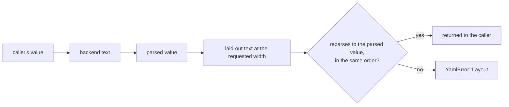

# Writing YAML

biscuit-file has one entry point for producing YAML text,
`to_yaml_string`, plus a matching method on the `Yaml` wrapper. Both
take an `Indentation`, so a writer can lay out a new document the way
its destination wants (four spaces in one repository, two in another)
rather than in the YAML backend's fixed two-space layout.

This page covers what the indentation types are, how a document is
laid out, which scalar spellings change and why, and what the writer
checks before it hands text back.

## Choosing an indentation

`Indentation` is a style and a width (the number of columns one level
takes). `IndentStyle` is `Spaces` or `Tabs`, serialized as `space` and
`tab`. Both types live at the crate root and build without any format
feature, so a crate that only passes a preference around does not pull
in a YAML parser.

```rust
use std::num::NonZeroU8;
use biscuit_file::{IndentStyle, Indentation};

let default = Indentation::default(); // four spaces
let two = Indentation::spaces(NonZeroU8::new(2).unwrap());
let tabs = Indentation::new(IndentStyle::Tabs, NonZeroU8::new(4).unwrap());
```

- A writer that knows its destination file asks Sniff for that file's
  preference and passes the result. biscuit-file never looks at a
  repository itself.
- A writer with no destination (standard output, a string returned to
  a caller) uses `Indentation::default()`: four spaces.
- **YAML forbids tab indentation**, so a `Tabs` preference writes
  `width` spaces per level. `Tabs` with width 4 and `Spaces` with width
  4 produce the same YAML.

## Writing a value

```rust
use biscuit_file::{Indentation, to_yaml_string};

let value: serde_yaml_ng::Value = serde_yaml_ng::from_str(
    "permissions:\n  file-read:\n  - ./*.txt\n  servers:\n  - name: local\n    url: http://localhost\n",
)?;
let text = to_yaml_string(&value, Indentation::default())?;
assert_eq!(
    text,
    "permissions:\n    file-read:\n        - ./*.txt\n    servers:\n        - name: local\n          url: http://localhost\n",
);
```

`to_yaml_string` accepts any `Serialize` value. `Yaml::to_yaml_string`
writes the wrapper's parsed value. It does not reproduce the file the
wrapper was read from: comments and the authored layout are not carried
over. `Yaml::source_text` still returns the authored text unchanged.

## How a document is laid out

The value is serialized once by the existing backend (`serde_yaml_ng`).
That text is parsed back, and the layout walks the parsed value's
structure, never the text. A string that happens to contain `key: value`
or `- item` is therefore always content, never structure.



The rules, with `>` standing for one level of the requested width:

| What | Rule | Example (width 4) |
| --- | --- | --- |
| A block mapping or sequence under a key | one level under the key | `a:` / `>b: 1`, `list:` / `>- x` |
| A mapping inside a sequence item | compact: the first key follows `- `, the rest align with it, two columns past the dash at any width | `- name: local` / `  url: http` |
| A sequence inside a sequence item | the same compact rule | `- - a` / `  - b` |
| An empty collection | kept in flow form | `a: []`, `b: {}` |
| A tag | kept, on the node's first line | `k: !Tag` / `>z: 1`, `- !Named x` |
| A non-string key | kept with its type | `1: int`, `true: bool`, `'1': text` |
| A collection key, or a key longer than 1024 characters | the explicit `?` / `:` form, laid out like a sequence item | `? - a` / `  - b` / `: seq` |
| A multiline string key | double-quoted on one line | `"multi\nline": 1` |
| The document root | starts at column 0 | `- a: 1` |

Mapping order is the value's order. Width 1 is valid, and the compact
rule still puts continuation keys two columns past the dash.

## How scalars are spelled

Each scalar keeps the spelling the backend gives it: `'123'` stays a
quoted string, `123` stays a number, `.nan`, `.inf`, and `-.inf` stay
non-finite numbers, and Unicode is written as itself. Only indentation
changes, with one exception: a block scalar that cannot express its
content at the requested level.

A multiline string keeps the backend's literal block form (`|`, `|-`,
or `|+`) so prose stays readable, and its lines move to one level under
the key or dash. Blank lines inside the block stay empty, with no
trailing spaces. When the first non-empty line starts with a space, YAML
needs an **indentation indicator**, a single digit giving the content's
offset from its parent:

```yaml
lead: |4-
     leading space
    second line
```

The writer spells the string as a **double-quoted string**, using only
JSON-compatible escapes (`\n`, `\t`, `\"`, `\\`, `\uXXXX`) and keeping
any tag, when a block cannot carry it:

- the content needs an indentation indicator and the width is above 9
  (the indicator is one digit), or the string is the whole document
  (there is no parent column to count from);
- the content is only line breaks, which a block scalar would read back
  as trailing breaks that chomping removes;
- the content holds a character a block scalar cannot carry as itself:
  a carriage return, a byte-order mark, U+0085, U+2028, U+2029, or a
  character outside YAML's printable set.

```yaml
# width 10
indicator: " lead\nx"
only_breaks: "\n\n"
separator: "a
b\n"
```

The choice depends only on the string and the width, so the same value
always produces the same text.

## What the writer checks, and its errors

Before returning, the writer parses its own output and compares it with
the parsed backend output, node by node: scalar values and types, tags,
non-string keys, and mapping order (the backend's own value equality
ignores order, so order is compared separately). A NaN equals a NaN.

| Error | When |
| --- | --- |
| `YamlError::Serialize` | the backend cannot serialize the value (for example, a `Serialize` implementation returns an error) |
| `YamlError::Layout` | the laid-out text cannot be produced, does not parse, or parses to a different value or order |

Either error is returned before the caller has any text, so a writer
that replaces a file only after `to_yaml_string` succeeds never writes
a document the check rejected. `YamlError::Parse` remains the error for
reading YAML; a serialization failure is never reported as a parse
error.

## Related

- [YAML Library Design](../design/yaml-design.md): parsing, conversion,
  and validation.
