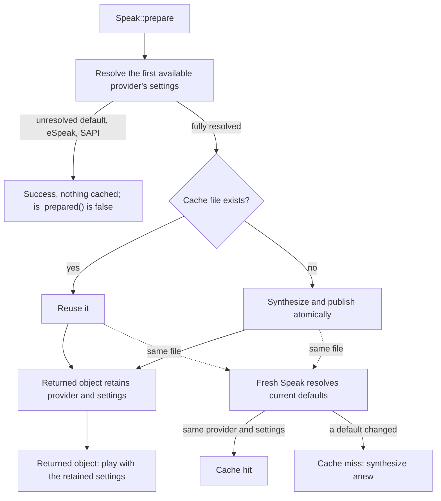

# TTS Caching

The biscuit-speaks library uses two independent caching systems, both implemented at the library level. The CLI (`so-you-say`) is a consumer only -- it does not implement caching logic.

## Audio File Cache

The audio file cache avoids redundant TTS generation by storing rendered audio in the system temp directory. When the same text is spoken with the same provider, voice, format, and (where applicable) speed, the cached file is returned immediately instead of re-rendering.

### Cache Key

A `CacheKey` (`audio_cache.rs`) is built from:

| Component | Description |
|-----------|-------------|
| Provider  | Name string (e.g., `"kokoro"`, `"gtts"`, `"elevenlabs"`) |
| Voice ID  | Provider-specific identifier |
| Text      | The text to be spoken |
| Format    | Audio file extension (`"wav"`, `"mp3"`) |
| Speed     | Optional -- only for providers that bake speed into audio |

The key is hashed with xxHash (via `biscuit-hash`) to produce a 16-character hex string. The final cache path is:

```
{temp_dir}/biscuit-speaks-{hash}.{format}
```

For example: `/tmp/biscuit-speaks-a1b2c3d4e5f60718.wav`

### Speed Inclusion Rules

Whether speed is included in the cache key depends on how the provider handles speed:

| Provider    | Speed in Key | Reason |
|-------------|--------------|--------|
| Kokoro      | No           | Playa adjusts playback speed at play time |
| gTTS        | No           | Playa adjusts playback speed at play time |
| EchoGarden  | Yes          | Speed baked into audio via `--speed` flag |
| ElevenLabs  | Yes          | Speed baked into audio via API parameter |
| Say         | Yes          | Speed baked into PCM WAV by `say -r` |

Providers where playa handles speed can share a single cached file across different speed settings. Providers that bake speed into the generated audio need separate cache entries per speed value.

### Provider Integration

Kokoro, gTTS, EchoGarden, and ElevenLabs implement a `generate_to_cache` method following the same pattern:

1. Build a `CacheKey` from provider-specific inputs
2. Call `cache_exists()` -- if `true`, return `(cache_path, true)` immediately
3. Generate the audio into a staging file beside `cache_path`, then rename it into place (or use `write_atomic()` for byte data)
4. Return `(cache_path, false)`

A cache entry therefore only ever appears complete. If synthesis fails, or the
caller drops the future mid-synthesis, the tool's child process is killed and
the staging file (named `.biscuit-speaks-staging-*`) is deleted:

```text
kokoro-tts input.txt /tmp/.biscuit-speaks-staging-a1B2c3.wav --voice af_heart
  ok   -> rename to /tmp/biscuit-speaks-<hash>.wav
  fail -> delete staging file, no cache entry
```

The return tuple is `(PathBuf, bool)` where the bool indicates a cache hit. This flows into `SpeakResult.cache_hit` which the CLI displays as `Cache: hit` or `Cache: miss`.

Providers that use audio caching:

- **Kokoro** -- generates WAV via `kokoro-tts`; keyed by the voice, which is the requested voice or the best built-in voice for the language and gender
- **gTTS** -- generates MP3 via `gtts-cli --output`; keyed by the language code
- **EchoGarden** -- generates WAV via `echogarden speak`; keyed by engine, voice, and speed. The voice is the requested one, the Kokoro engine's English default for the gender (`Heart` or `Michael`), or the best match from `echogarden list-voices <engine>`. When none of these yields a voice, echogarden picks its own default, which can change outside this library, so that audio is synthesized into a temporary file and never cached
- **ElevenLabs** -- fetches MP3 bytes from API, uses `write_atomic()` to persist; keyed by voice, model, and speed. Without a requested voice, the voice is selected from the account's voice list, and each selection from a successful listing is recorded locally (beside the voice-capability cache file) for 24 hours so a detached request can find the file without listing voices again
- **Say** -- generates PCM WAV via `say -o`; keyed by the voice and the exact integer words per minute, in foreground and detached playback alike. The voice is the requested one, `Alex`/`Samantha` for a gender, or the system voice read through AppKit's `NSSpeechSynthesizer`; the rate comes from an explicit speed (175 WPM times the multiplier). The system's own rate is not read yet, so normal-speed Say speech is synthesized into a temporary file and never cached. Volume is applied at playback

Audio for a voice or rate the library cannot pin down (an unresolved system
default) is never read from or published to the cache, since those defaults can
change independently of the request. Foreground playback deletes that temporary
file afterwards; a detached job keeps it, because Playa deletes only files it
owns. Say never reads legacy `system-default` cache entries.

Providers that do **not** use audio caching:

- **eSpeak** -- speaks directly through the audio system, no intermediate file
- **SAPI** (Windows) -- speaks directly through the audio system, no intermediate file

### Atomic Writes

`write_atomic()` in `audio_cache.rs` writes byte responses into a uniquely
named temporary file beside the final entry, flushes them with `sync_all()`,
and publishes the complete file by renaming it into place. A failed write,
flush, or publication removes the temporary file and leaves an existing entry
untouched. Readers never see a partially written replacement.

ElevenLabs uses this for API response bytes and default-voice records. Both
publications run on Tokio's blocking pool and are awaited, so a file write
never stalls the async worker that is running the request, even on a
single-threaded runtime. They fail differently:

| Publication | Write fails, or the blocking task panics |
| --- | --- |
| Synthesized audio | preparation fails with `TtsError::TempFileError` |
| Default-voice record | a warning is logged and preparation continues |

A record failure only costs a later detached request its network-free voice
lookup, so it never fails the speech. Dropping the caller while a publication
is running does not cancel it: the blocking task owns its bytes and
destination and finishes the write and rename, so the entry ends complete or
absent, never partial. The caller just never sees the result. The network
request, playback, and the cache-hit check stay on the async side.

The command-line providers instead ask their tool to write a staging file beside
the entry and rename it into place, as described above.

### Cache Lifetime

Files live in the OS temp directory and are cleaned up by the operating system on its own schedule. There is no explicit TTL, eviction policy, or manual cleanup. The cache is opportunistic -- it helps when repeated expressions happen before the OS clears temp files.

## Provider Capability Cache

A separate cache at `~/.biscuit-speaks-cache.json` stores discovered TTS provider capabilities (installed voices, available voices). This avoids expensive re-enumeration of the host system on every TTS operation.

### Location

`BISCUIT_SPEAKS_CACHE` names the cache file directly and takes priority over the home-directory default; an empty value is treated as unset. Its parent directory must already exist.

Because environment is inherited by child processes, setting it also confines
the detached preparation helper used by `--background` cache misses.

`cache_file_path()` reads the variable; `resolve_cache_path()` applies the precedence rule and is what the tests exercise, so the rule can be asserted without mutating process-global environment state.

### Structure

The cache file is a JSON envelope with:

- `schema_version` -- integer for forward compatibility (currently `1`). A version mismatch causes a cache miss, forcing re-enumeration.
- `capabilities` -- a `HostTtsCapabilities` struct containing a list of `HostTtsCapability` entries, each with a provider, its installed voices, and its available (not-yet-installed) voices.
- `last_updated` -- Unix timestamp of the last write.

### Operations

| Function | Purpose |
|----------|---------|
| `read_from_cache()` | Load capabilities; returns error on missing file, parse failure, or schema mismatch |
| `update_provider_in_cache()` | Upsert a single provider's voice data |
| `bust_host_capability_cache()` | Delete the cache file entirely |
| `populate_cache_for_all_providers()` | Re-enumerate all providers and rebuild the cache |

All writes use the temp file + rename pattern (via `tempfile::NamedTempFile::persist()`).

### CLI Interaction

The CLI exposes `--refresh-cache` which:

1. Calls `bust_host_capability_cache()` to delete the file
2. Calls `populate_cache_for_all_providers()` to rebuild from scratch
3. Continues with normal operation (does not exit early)

This is the only cache the CLI interacts with directly. The audio file cache is fully transparent to the CLI.

## Playback Flow

After caching, the audio file is played through `playback.rs`, which bridges to
Playa's native-first builder pipeline:

1. Provider returns `(PathBuf, cache_hit)` from `generate_to_cache()`
2. `play_audio_file()` converts biscuit-speaks types to playa types via `playa_bridge.rs`
3. `Playa::play_async_with_report()` performs playback and returns route/timing evidence

The playa bridge maps volume (`VolumeLevel` to `f32`) and speed (`SpeedLevel` to `f32`) for providers where playa controls playback speed. Say, EchoGarden, and ElevenLabs already contain the requested tempo, so they play at normal speed and the speed is applied once.

For detached cache misses, the requested sequence is reserved before synthesis.
A private helper creates or reuses the cache file, atomically publishes the
ready job into the same slot, or records failure. The preparation deadline is
ten minutes; later audio cannot overtake the reserved sequence while it is
pending. Preparation records may contain speech text and are never projected
into Playa's journal or `playa spool` output. A record the helper cannot
decode fails its slot immediately rather than holding the queue until the
deadline.

## Preparing Speech

Call `Speak::prepare` when you know a phrase before you need to speak it. It
synthesizes the phrase into the audio file cache without playing anything,
starting a scheduler, or reserving a playback slot. Later playback with the
same resolved settings can skip synthesis. Detached playback still waits its
turn in Playa's ordered queue, so a cache hit does not guarantee immediate
audible output.

Preparation is an awaited operation, available with or without the `playa`
feature. It does not start background work for the caller; applications such
as Claudine decide when to run it in a background task. `play_detached`
requires `playa` and returns after handing a job to the playback queue.

For example, with Kokoro installed and its model configured, prepare a
specific voice and play it later:

```rust
use biscuit_speaks::{HostTtsProvider, Speak, TtsConfig, TtsFailoverStrategy, TtsProvider};

let config = TtsConfig::new()
    .with_voice("af_heart")
    .with_failover(TtsFailoverStrategy::SpecificProvider(
        TtsProvider::Host(HostTtsProvider::KokoroTts),
    ));
let prepared = Speak::new("the build is green")
    .with_config(config.clone())
    .prepare().await?;

// Later, in a build with the playa feature:
prepared.play_detached().await?;
// A new builder can reuse the same cached file too.
Speak::new("the build is green").with_config(config).play_detached().await?;
```

The returned builder retains its selected settings. On macOS, this matters
when the system voice changes between preparation and playback:

```rust
use biscuit_speaks::{HostTtsProvider, Speak, SpeedLevel, TtsConfig, TtsFailoverStrategy, TtsProvider};

let config = TtsConfig::new()
    .with_speed(SpeedLevel::Fast)
    .with_failover(TtsFailoverStrategy::SpecificProvider(
        TtsProvider::Host(HostTtsProvider::Say),
    ));
let prepared = Speak::new("the build is green").with_config(config.clone()).prepare().await?;
// The system voice changes here.
prepared.play().await?; // still the voice it prepared with: a cache hit
Speak::new("the build is green").with_config(config).play().await?; // the new voice: a miss
```

Normal-speed Say never prepares (see [Say's system defaults](#says-system-defaults)),
which is why the example asks for an explicit speed. This example also assumes
the system voice lookup succeeds; otherwise preparation succeeds without a
file and playback synthesizes normally.

### The returned object and a fresh object



- **The returned object** keeps the provider and the settings that provider
  resolved (for example Say's voice and rate, or ElevenLabs' voice and model).
  It uses them first in `play`, `play_with_result`, and `play_detached`, even
  if a system or account default changed since.
- **A fresh object** resolves the current defaults itself. When it resolves the
  same provider and settings, it computes the same cache key and reuses the
  file. The returned object can therefore be discarded, as Claudine's pre-warm
  does. If a default changed, the fresh object misses and synthesizes new audio.
- `is_prepared()` is true only when this object's `prepare` published or found a
  cache file. It records completed work: the operating system may still have
  deleted the temporary file since. Cloning keeps it.
- `with_volume` keeps the preparation, because volume is applied at playback
  and is never part of a cache key. `with_voice`, `with_gender`,
  `with_language`, `with_failover`, and `with_config` clear it; a later
  `prepare` resolves again and consults the cache.

### What gets prepared

Only the first available provider for the failover strategy is prepared. If
that provider fails to construct, resolve, or synthesize, `prepare` returns the
error and tries no other provider. That is narrower than playback, which fails
over. A strategy with no candidate returns `NoProvidersAvailable`.
Preparation uses the normal provider ordering and availability rules. It does
not add cloud providers to automatic host selection; choose a cloud provider
through the failover configuration when you want to use one. A provider listed
in the enum but not implemented returns its unsupported-provider error.

`prepare` succeeds without caching anything when:

| Case | Why |
| --- | --- |
| eSpeak or SAPI is the first provider | They speak directly and produce no file |
| Say at normal speed | The system rate is not read yet |
| Say with no voice or gender, when the system voice lookup fails | The voice is unknown |
| Echogarden with no voice it can resolve | The engine picks its own default, which can change |
| ElevenLabs with no requested voice, when the voice list fails to load | The voice is unknown |
| `PLAYA_DRY_RUN` is `1`, `true`, `TRUE`, or `yes` | Dry run |

A dry run is checked before any provider is chosen: no provider detection,
voice listing, network request, subprocess, cache read, or cache write happens,
and the builder is returned unchanged (an earlier preparation is kept). The
same holds for a direct `TtsExecutor::prepare` call, with or without the
`playa` feature.

Provider implementations expose the same operation through
`TtsExecutor::prepare(&self, text, config)`, whose returned future is `Send`.
Its default implementation succeeds without work, as used by eSpeak and SAPI.
File-producing providers override it to fill the shared cache. The trait
method returns `Result<(), TtsError>` rather than a retained builder; use
`Speak::prepare` when you need to keep the resolved settings for later playback.

Preparation can make a billed ElevenLabs request. Two concurrent preparations
of the same phrase may both synthesize; atomic publication still leaves one
complete file. A failed or cancelled preparation leaves no partial entry.

### Playback after preparation

- `play` and `play_with_result` play the retained file, or synthesize it again
  with the retained settings if it vanished. If that fails, the failover
  strategy's other providers run with the caller's original configuration,
  never with the retained voice; `SpecificProvider` never switches.
  `SpeakResult` names the provider and voice that actually spoke.
- `play_detached` publishes the retained file as a ready job. If it vanished,
  the reserved slot's preparation record carries the retained settings, and
  the helper synthesizes them, falling back the same way. Synthesis never runs
  in the requesting process.
- Speed is applied once: Say, Echogarden, and ElevenLabs bake it into the
  file and play at normal speed; Kokoro and gTTS apply it at playback.

### Say's system defaults

With no requested voice or gender, Say speaks with the system voice. The
library reads that voice through AppKit's `NSSpeechSynthesizer` (a short
`osascript` call) and accepts it only if `say -v '?'` lists it. This lookup was
verified to match the audio `say` produces without `-v`. Any other answer (the
call fails, the output is malformed, or the voice is unlisted) leaves the voice
unresolved, so nothing is cached for that request.

The system *rate* is not read, because no lookup has been verified to describe
it. A normal-speed Say request therefore stays uncached, and the lookup is
skipped for it. An explicit speed sets the rate to 175 words per minute times
the multiplier.

### The ElevenLabs default-voice record

Without a requested voice, ElevenLabs picks a voice from the account's voice
list. That listing is a network request, and a fresh `play_detached` call must
find prepared default speech without one. So each selection from a successful
listing is recorded:

- **Where:** `.biscuit-speaks-elevenlabs-voice-{hash}.json`, beside the
  provider capability cache file (so `BISCUIT_SPEAKS_CACHE` moves it too),
  written atomically.
- **What:** the chosen voice and model, the inputs that chose them (gender,
  language, model, and the configured fallback voice), an account context, and
  the time it was written. The account context is the API address, the name
  of the environment variable the key came from, and the
  `BISCUIT_SPEAKS_ELEVENLABS_ACCOUNT` label. No API key or other credential is
  stored or hashed.
- **When:** only while `BISCUIT_SPEAKS_ELEVENLABS_ACCOUNT` holds a non-blank,
  non-secret label that differs per account. Without it no record is written
  or trusted (see below).
- **Trust window:** 24 hours from when it was written. A missing, unreadable,
  mismatched, or expired record is a cache miss, and the detached helper
  selects the voice through the API as before.
- **Refresh:** every `prepare` lists the voices again and rewrites the record,
  even when the record is fresh. Ordinary playback also rewrites it.

The record never changes which voice is selected; it only remembers what the
selection chose.

Because the key is never stored, nothing local tells two API keys under the
same environment variable apart except the label. So with the label unset,
empty, or blank, a fresh `play_detached` call for a default voice always
misses, and the helper lists the voices through the API; the audio cache still
reuses the file for the voice that listing selects, so speech is not
synthesized again. Set a distinct label per account to make the lookup
network-free:

```sh
export ELEVENLABS_API_KEY=...            # the work account's key
export BISCUIT_SPEAKS_ELEVENLABS_ACCOUNT=work
```

A requested voice never needs the record or the label.
