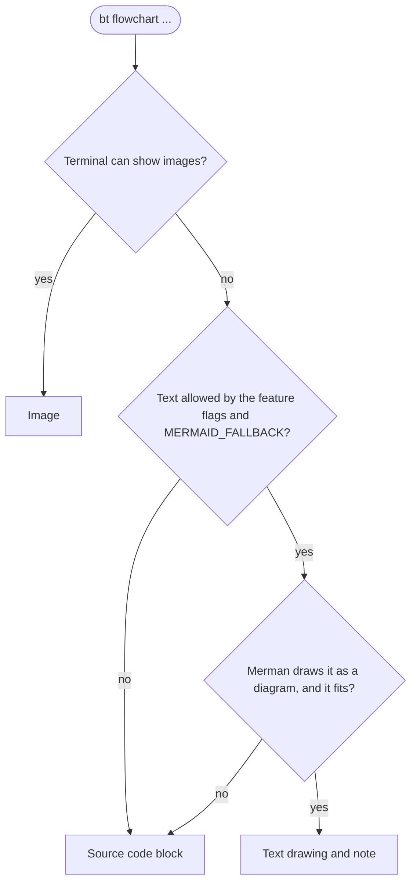

# The `bt` CLI

`bt` is the command-line front end of biscuit-terminal. Run it with no
arguments to see what the library detects about your terminal, or with a
subcommand to render components and diagrams. This page covers how the
diagram commands behave when the terminal cannot show images, the
`--feature` flag that controls that, and how `bt` highlights code blocks.
For every subcommand's own options, see the
[CLI README](../cli/README.md) or `bt <command> --help`.

## Mermaid commands

These nine commands build a [Mermaid](https://mermaid.js.org/) diagram and
show it:

| Command | Diagram |
| --- | --- |
| `bt flowchart` | flowchart |
| `bt state-diagram` | state diagram |
| `bt erd` | entity relationship diagram |
| `bt pie-chart` | pie chart |
| `bt quadrant` | quadrant chart |
| `bt timeline` | timeline |
| `bt bar-chart` | bar chart (Mermaid `xychart`) |
| `bt line-chart` | line chart (Mermaid `xychart`) |
| `bt git-graph` | git history (Mermaid `gitGraph`) |

`bt graph-expression` draws graphs too, but not through Mermaid, so nothing
on this page applies to it.

## Mermaid text fallback

When the terminal can show images (Kitty, iTerm2, or Sixel, through its
[graphics route](./discovery/graphics-routes.md)), a Mermaid command prints
the diagram as an image. When it cannot (a pipe, tmux without passthrough,
Apple Terminal, `BISCUIT_GRAPHICS=none`), `bt` prints one of two code blocks
instead:

- the **text drawing**: the diagram drawn with box-drawing characters (ASCII
  when the terminal lacks Unicode), in a `txt` code block, followed by a note
  saying the drawing may miss details the image would show;
- the **source**: the Mermaid code `bt` generated, in a `mermaid` code block.



`bt --plain flowchart "A --> B"` in a pipe prints:

````text
```txt
┌───┐     ┌───┐
│   │     │   │
│ A ├────►│ B │
│   │     │   │
└───┘     └───┘
```

> **Note:** this textual representation is provided because the current terminal settings do not allow for a graphical image to be used. ...
````

What decides between the two:

- Only diagrams that Merman, the Rust Mermaid engine behind these commands,
  draws as a diagram become text: today that includes flowcharts, state
  diagrams, and entity relationship diagrams. Pie charts, quadrant charts,
  timelines, and git graphs always show their source. So do bar and line
  charts: Merman draws an XY chart as text only when its y-axis states a
  range, and the source these commands generate states none.
- A drawing wider than the available columns shows the source instead. The
  columns are the terminal width, narrowed by `--width` and the margin flags,
  less two columns for the code block's padding.
- A diagram that does not parse is an error (exit 1, the error and the
  source on stderr), as it is with images, and also when `--feature` forbids
  text: the source is then parsed without being drawn. A diagram that parses
  but is not drawn as text, or does not fit, is not an error unless the
  image route would refuse it too: a math label (`$$…$$`, Merman's math
  support is not built in) is the same error whenever the source is shown,
  whether `--feature`, `MERMAID_FALLBACK=code-block`, or a narrow `--width`
  chose it. A drawing that fits shows the formula literally and exits 0.

  ```bash
  bt flowchart --feature no-mermaid-fallbacks 'A["$$x^2$$"] --> B'  # exit 1, lacks capability `math`
  bt flowchart 'A["$$x^2$$"] --> B'                                 # text drawing, exit 0
  ```
- `--title` is shown once on every route: drawn in the image, as a bold line
  above a text drawing (which never draws the title itself), and inside the
  source, which already gives it, with no line added.
- `--meta` and `--debug` describe a rendered image, so they print nothing for
  a text or source fallback. `--json` prints the generated Mermaid code and
  renders nothing, with or without images.

## `--feature`

Every Mermaid command takes `--feature <NAME>` to change the fallback:

| Name | Effect |
| --- | --- |
| `no-mermaid-fallbacks` | Never draw text; show the source |
| `no-mermaid-partial-fallbacks` | Never draw a drawing that may miss details; show the source. Every drawing Merman makes today may miss details, so this currently behaves like `no-mermaid-fallbacks` |
| `no-mermaid-partial-warning` | Draw text as usual but leave out the note |

```bash
bt flowchart --feature no-mermaid-fallbacks "A --> B"          # source
bt flowchart --feature no-mermaid-partial-warning "A --> B"    # drawing, no note
```

The rules:

- The flag repeats and takes comma-separated names, so
  `--feature a,b` is the same as `--feature a --feature b`.
- Names are case-insensitive, and repeating one is harmless.
- When two names overlap, the more restrictive wins.
- An unknown or empty name (`--feature bogus`, `--feature a,,b`,
  `--feature ""`) is a usage error: `bt` exits 2 and lists the valid names.
  `no-mermaid-rendering` is a name of `md`, not `bt`, and is rejected the
  same way.
- Shell completion offers the names (`COMPLETE=zsh bt` or
  `bt --completions zsh`).
- `bt git-graph` accepts the flag, but it has no visible effect: a git graph
  always shows its source.

### `MERMAID_FALLBACK`

With no text-fallback flag, the environment variable `MERMAID_FALLBACK` set
to `code-block` (any case) means "never draw text". Any other value, or the
variable unset, leaves text allowed. A flag always wins over the variable,
and the variable never hides the note.

```bash
MERMAID_FALLBACK=code-block bt flowchart "A --> B"    # source
```

## Code highlighting

`bt` highlights code blocks with darkmatter's highlighter, the same one the
`md` CLI uses, so a code block looks the same in both. That covers:

- the text drawing and the source block of the Mermaid fallback (Mermaid
  source gets Mermaid syntax colors);
- fenced code inside `bt quote` content.

```bash
bt quote $'Run this:\n\n```rust\nfn main() {}\n```'
```

The theme follows the terminal's light or dark mode, and `CODE_THEME` or
`THEME` override it as they do for `md`. Without color (`--plain`,
`NO_COLOR`, or a terminal without color) code blocks are plain fenced blocks
with no escape codes.
