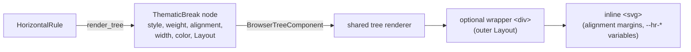

# HorizontalRule Component

The `HorizontalRule` component provides customizable horizontal separator lines for terminal and browser rendering.

## Struct Definition

```rust
use biscuit_terminal::prelude::*;

let rule = HorizontalRule::new()
    .style(RuleStyle::Waves)
    .alignment(RuleAlignment::Centered)
    .weight(RuleWeight::Medium)
    .width("75%");

// Terminal rendering
let terminal = Terminal::default();
let output = rule.render(&terminal);

// Browser rendering (an HTML fragment containing an inline SVG)
let html = rule.render_html_fragment().render();
```

## Enums

### RuleStyle

Defines the visual style of the horizontal rule:

```rust
pub enum RuleStyle {
    Dashes,
    Dots,
    Waves,
    LineStar,
    LineCircle,
    InsetLine,
    CurtainRod,
}
```

### RuleAlignment

Defines the horizontal alignment of the rule:

```rust
pub enum RuleAlignment {
    Full,
    Centered,
    Left,
    Right,
}
```

### RuleWeight

Defines the thickness/weight of the rule:

```rust
pub enum RuleWeight {
    Thin,
    Medium,
    Thick,
}
```

## Trait Implementations

### TerminalRenderable (Terminal Rendering)

The `HorizontalRule` implements the `TerminalRenderable` trait for terminal output with three-tier progressive enhancement:

1. **Tier 1**: SVG → PNG via `resvg` and `TerminalImage` when the terminal advertises Kitty or ITerm image support.
2. **Tier 2**: Unicode fallback characters when image rendering is unavailable and the terminal's locale signals UTF-8.
3. **Tier 3**: ASCII fallback characters (basic compatibility).

### BrowserRenderable (Browser Rendering)

The `HorizontalRule` implements the `BrowserRenderable` trait by projecting itself into the shared render tree and letting the tree's browser renderer draw it. There is no separate browser SVG generator inside this crate: a `HorizontalRule` and a Markdown `---` reaching the browser produce the same markup.



The implementation is a single delegation:

```rust
fn render_html_fragment(&self) -> BrowserFragment<Ready> {
    BrowserTreeComponent::new(self.clone()).render_html_fragment()
}
```

What the browser output guarantees:

- Generates an inline SVG with `stroke="var(--hr-color, currentColor)"` for proper CSS inheritance.
- Declares `--hr-weight`, `--hr-color`, and `--hr-width` CSS custom properties on the root `<svg>` (see [CSS Variables](#css-variables)).
- Honors style, weight, alignment, width, color, and the outer `Layout`, as described in the sections below.
- To get a plain `<hr>` carrying `data-hr-*` attributes instead of an SVG, render the tree yourself (`TreeRenderable::render_tree`) with `GraphicsMode::Off`.

## Usage Example

```rust
use biscuit_terminal::prelude::*;

let rule = HorizontalRule::new()
    .style(RuleStyle::Waves)
    .alignment(RuleAlignment::Centered)
    .weight(RuleWeight::Medium)
    .width("75%");

// Terminal rendering
let terminal = Terminal::default();
let _ = rule.render(&terminal);

// Browser rendering (an HTML fragment containing an inline SVG)
let html = rule.render_html_fragment().render();
```

## Alignment

`.alignment()` decides where the rule sits inside its box. In the browser it becomes the SVG's horizontal margins:

| `RuleAlignment` | SVG left margin | SVG right margin | SVG `width`                 |
|-----------------|-----------------|------------------|-----------------------------|
| `Left`          | `0`             | `auto`           | authored `width` (or `100%`) |
| `Right`         | `auto`          | `0`              | authored `width` (or `100%`) |
| `Centered`      | `auto`          | `auto`           | authored `width` (or `100%`) |
| `Full`          | `0`             | `0`              | always `100%`               |

For example, `HorizontalRule::new().alignment(RuleAlignment::Left).width("60ch")` emits `width="60ch"` with `margin: 0 auto 0 0`.

### `Full` ignores the authored width

`HorizontalRule::new()` defaults to `RuleAlignment::Full`. A `Full` rule spans `100%` of its box with no side margins, so a `width` set on it has no effect in the browser:

```rust
use biscuit_terminal::prelude::*;

// Renders width="100%": Full fills the available box.
let full = HorizontalRule::new().width("50%");

// Renders width="50%", centered.
let half = HorizontalRule::new()
    .alignment(RuleAlignment::Centered)
    .width("50%");
```

To honor an authored width, select `Centered`, `Left`, or `Right`, or keep `Full` and constrain the outer box with `Layout::width` / `Layout::max_width` (next section).

## Rule Alignment vs Outer Layout

A rule has two independent placement controls:

- **`.alignment()`** is the rule's *intrinsic* placement inside its box: the SVG margins from the table above.
- **`.with_layout(Layout)`** is the *outer* block box the tree renderer places around the rule. A non-default layout produces exactly one wrapper `<div>` carrying its margins, `width`, `max-width`, and alignment; a default layout produces no wrapper at all.

```rust
use biscuit_terminal::prelude::*;
use biscuit_terminal::utils::layout::{Alignment, Layout, Length, TargetValue, Width};

// A Full rule inside a centered box that is half the page wide and at most 40ch.
let rule = HorizontalRule::new().with_layout(Layout {
    width: Width::Fixed(TargetValue::universal(Length::percent(50.0).unwrap())),
    max_width: Some(TargetValue::universal(Length::ch(40))),
    alignment: Alignment::Center,
    ..Layout::default()
});
// <div style="...width:50%;max-width:40ch;margin-left:auto;margin-right:auto..."><svg width="100%" ...>
```

Per-target layout values resolve for the browser target: a margin declared as `ch(2)` for the terminal and `ch(5)` for the browser appears in the wrapper once, as `margin-left:5ch`.

## Style Matrix

| Style       | SVG            | Unicode           | ASCII       |
|-------------|----------------|-------------------|-------------|
| Dashes      | dashed line    | `╌` / `╍` (thick) | `-`         |
| Dots        | dotted line    | `·` / `•` (thick) | `.`         |
| Waves       | wavy path      | `≋`               | `~`         |
| LineStar    | line + star    | `─★─` / `━★━`     | `---*---`   |
| LineCircle  | line + circle  | `─●─` / `━●━`     | `---o---`   |
| InsetLine   | centered line  | `  ─  ` / `  ━  ` | `  -  `     |
| CurtainRod  | line + ends    | `┤─┤─...─├`       | `[---]`     |

## Weight

`RuleWeight` maps to the terminal and browser as follows:

| Weight   | Terminal (Unicode)                  | Terminal (ASCII) | Browser (SVG stroke-width) |
|----------|-------------------------------------|------------------|----------------------------|
| `Thin`   | Single-line chars (`╌`, `·`, `─`)   | `-`, `.`, …      | `2`                        |
| `Medium` | Single-line chars (`╌`, `·`, `─`)   | `-`, `.`, …      | `4`                        |
| `Thick`  | Heavy variants (`╍`, `•`, `━`)      | `-`, `.`, …      | `8`                        |

### Unicode thick substitutions

- `╌` → `╍` (dashes)
- `·` → `•` (dots)
- `─` → `━` (line-*, inset-line, curtain-rod body)

### Limitations

- **Waves** has no heavy Unicode variant — `≋` is used for every weight. `weight=thick` is still honored in the browser (8px stroke) but produces the same terminal characters as `medium`.
- **ASCII** has no heavy variants — weight is a no-op in Tier 3.

## CSS Variables

The browser SVG declares three custom properties on the root `<svg>`:

| Variable      | Default source                                                        |
|---------------|-----------------------------------------------------------------------|
| `--hr-weight` | numeric stroke width derived from `RuleWeight`                        |
| `--hr-color`  | `self.color` if set and valid, otherwise `currentColor`               |
| `--hr-width`  | `self.width` if set and valid (and not `Full`), otherwise `100%`      |

Shape primitives reference these with `var(--hr-weight, <fallback>)` etc., so the SVG stays valid even if the inline style is stripped, and a page stylesheet can override them per rule.

## Invalid Width and Color Values

`width` and `color` are free-form strings, and they may come from untrusted documents. The browser renderer validates each one before writing it into the SVG and falls back to a safe default when it fails:

| Field   | Accepted                                                              | Fallback       |
|---------|-----------------------------------------------------------------------|----------------|
| `width` | a plain CSS dimension such as `75%`, `60ch`, `320px`                  | `100%`         |
| `color` | a CSS color name, hex (`#rgb`, `#rgba`, `#rrggbb`, `#rrggbbaa`), or `rgb()`/`rgba()`/`hsl()`/`hsla()` | `currentColor` |

A value containing a quote, `<`, `>`, or `;` never passes, so an injection payload such as `red" onmouseover="alert(1)` or `red;background:url(x)` is dropped entirely and the rule renders in `currentColor`.

The browser and terminal validate colors independently. A browser-valid name the terminal does not know, such as `tomato`, still renders in the browser; the terminal leaves the rule uncolored (see [Color](#color)).

## Color

`color` applies to both targets:

- **Browser**: sets the `--hr-color` CSS variable (and `stroke="var(--hr-color, currentColor)"`) when the value passes validation; see [Invalid Width and Color Values](#invalid-width-and-color-values).
- **Terminal**: wraps the rendered content in an ANSI color escape **when** `term.color_depth != ColorDepth::None`. Supported forms:
  - CSS basic-16 names: `black`, `red`, `green`, `yellow`, `blue`, `magenta`, `cyan`, `white`, plus `bright_*` variants and `gray`/`grey` (alias for bright black).
  - `#rrggbb` hex — upgraded to 24-bit RGB on `ColorDepth::TrueColor` terminals; mapped to the nearest basic color otherwise.

Color strings the terminal does not recognize leave the terminal output uncolored and emit a `tracing::warn!`. The browser applies its own validation, so a CSS name such as `tomato` still colors the browser rule.

## Tier 1 Image Rendering

The component ships Tier 1 rendering via `HorizontalRule::render_image_tier`, invoked from the `TerminalRenderable` impl before the Unicode / ASCII fallbacks.

- **Capability gate:** Tier 1 activates only when **both** `term.is_tty == true` **and** the terminal reports Kitty or ITerm image support (`ImageSupport::Kitty` or `ImageSupport::ITerm`). Non-TTY sinks and other terminals skip straight to Tier 2 / Tier 3.
- **Rasterization:** the terminal path builds its own SVG, sized in pixels from the rule's cell geometry, and rasterizes it to a PNG via [`resvg`](https://crates.io/crates/resvg). It does not reuse the browser SVG. Without an authored color it strokes in white on dark or unknown backgrounds and black on light ones, because `currentColor` would rasterize as black and vanish on a dark terminal. The PNG is emitted through `TerminalImage::render_kitty_cells` as a Kitty graphics escape sequence, which iTerm-compatible terminals also accept.
- **Cell sizing:** rule dimensions are computed against `term.cell_size()` when available; if the terminal does not report a cell size, an 8x16 pixel default is assumed.
- **Fallback contract:** any rasterization failure logs a `tracing::warn!` and causes `render_image_tier` to return `None`, at which point rendering proceeds to Tier 2 (Unicode) or Tier 3 (ASCII) using the same style / weight / alignment / color settings.
