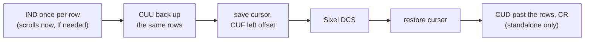

# TerminalImage

Renders images inline in the terminal in the format chosen by the terminal's [graphics route](../discovery/graphics-routes.md) (Kitty, iTerm2, or Sixel). When the route has no usable format, the image is drawn as [half-blocks](#half-block-fallback) where the terminal can show them, and as alt text otherwise. Handles cursor positioning, scroll compensation, and terminal-specific quirks across Kitty, Ghostty, WezTerm, Warp, iTerm2, and Sixel terminals.

## Programmatic Use

```rust
use biscuit_terminal::prelude::*;
use std::path::Path;

// Basic image display
let image = TerminalImage::new(Path::new("photo.jpg")).unwrap();
let term = Terminal::new();
println!("{}", image.display(&term));

// With width specification via path suffix (`from_spec` parses it; `new` does not)
let image = TerminalImage::from_spec("diagram.png|50%").unwrap();  // 50% of terminal
let image = TerminalImage::from_spec("icon.png|25").unwrap();      // 25 characters wide
let image = TerminalImage::from_spec("banner.png|fill").unwrap();  // Full width

// Parse width spec separately
let (path, width) = parse_filepath_and_width("photo.jpg|75%");
```

### Width Specifications

| Spec | Meaning |
|------|---------|
| `filename.jpg` | Default 50% width |
| `filename.jpg\|25` | Fixed 25 characters |
| `filename.jpg\|50%` | 50% of terminal width |
| `filename.jpg\|fill` | Fill available width |

`ImageWidth::Scale(f32)` has no string form. It sizes an image from its natural width relative to terminal text: pixels per unit = scale × cell height ÷ 16, and columns = natural width × pixels per unit ÷ cell width, rounded up and clamped to the available columns. At `1.0`, 16 units (Mermaid's body text) are one terminal line tall. A raster image's natural width is its pixel width; `biscuit-visualized`'s `MermaidDiagram` passes the SVG's measured width. An unknown cell size (native Windows, CI, every stream redirected) uses `CellSize::FALLBACK` (8×16).

### Key API

| Method/Function | Description |
|--------|-------------|
| `TerminalImage::new(&Path)` | Create from a file path; the file must exist |
| `TerminalImage::from_spec(str)` | Create from a path with an optional `\|width` suffix |
| `TerminalImage::from_encoded_png(EncodedPng)` | Create from PNG bytes the program produced itself; see [Already-encoded PNG input](#already-encoded-png-input) |
| `TerminalImage::render_with_route(&Terminal)` | Render for the terminal's graphics route, as pixels or alt text; see [Graphics routes](#graphics-routes) |
| `TerminalImage::render_with_half_blocks(&Terminal)` | Like `render_with_route`, but draws half-blocks before falling back to alt text; see [Half-block fallback](#half-block-fallback) |
| `parse_filepath_and_width(str)` | Parse path and width spec separately |
| `parse_width_spec(str)` | Parse just the width portion |
| `calculate_display_dimensions(...)` | Calculate pixel dimensions for display |
| `ImageWidth::scaled_columns(scale, natural_width, cell)` | Columns for `ImageWidth::Scale`, before the clamp |
| `TerminalImage::resolve_scaled_dimensions_for(...)` | Columns, margins, and offset for content with a known natural width |

### Graphics routes

`TerminalImage` makes no format decision of its own. It follows `Terminal::graphics_route`, which `Terminal::new()` resolves once from the environment and, where that cannot decide, the graphics probe (a caller can also supply a route through `Terminal::builder()`); [Graphics Routes](../discovery/graphics-routes.md) explains how the route is chosen and overridden with `BISCUIT_GRAPHICS`.

| Route format | What is sent |
|--------------|--------------|
| Kitty | Kitty graphics, except to iTerm2, which gets its own format unless `BISCUIT_GRAPHICS=kitty` forced Kitty |
| iTerm2 | iTerm2's `OSC 1337;File=` format |
| Sixel | A Sixel image composited onto an opaque background; see [Sixel](#sixel) |
| none | The text fallback: half-blocks or alt text |

A route with transport `Tmux` sends the same image wrapped for tmux passthrough: each Kitty chunk in its own `ESC P tmux; … ESC \` envelope (with a fresh nonzero image ID, quiet mode, and explicit rows), and the iTerm2 `File=` message or the Sixel DCS as one envelope. Cursor movement stays unwrapped for tmux to handle. When every tmux client is Kitty or Ghostty, the route's placement is `Placeholders`: the upload carries a virtual placement (`U=1`) and the image is drawn by lines of Unicode placeholder text that tmux keeps in the pane, so the image follows it. See [tmux in Graphics Routes](../discovery/graphics-routes.md#tmux) for the wire format, [Unicode placeholders](../discovery/graphics-routes.md#unicode-placeholders) for when they are used, and the known limits of ordinary placement through tmux.

Two properties of a pixel route can still send it to the text fallback, each with its own reason so the caller can tell why:

- **An iTerm2 or Sixel image over tmux's limit.** Through tmux, a wrapped `File=` message or Sixel DCS larger than 1 MiB (1,048,576 bytes, counted after base64, ESC doubling, and the envelope) renders the fallback with a `BlockedTransport` reason giving the size. The check runs before any row is reserved, and the message is never split.
- **`needs_measured_cells` without a measured cell size.** Zellij sizes an image from its own measurement of the host's cells, so a Zellij route is drawn only when `Terminal::cell_size()` returns a measured size; otherwise the fallback says the multiplexer did not report its cell size in pixels. The 8×16 estimate is never used for such a route.

`render_with_route` returns an `ImageOutput` so a caller can tell the outcomes apart:

```rust
use biscuit_terminal::components::terminal_image::ImageOutput;
use biscuit_terminal::prelude::*;
use std::path::Path;

let term = Terminal::new();
let image = TerminalImage::new(Path::new("photo.jpg"))?.with_alt_text("A photo");
match image.render_with_route(&term)? {
    ImageOutput::Pixels(sequence) => print!("{sequence}"),
    ImageOutput::Fallback { text, reason } => println!("{text}  ({reason})"),
    // Only `render_with_half_blocks` returns this variant.
    ImageOutput::HalfBlocks { text, .. } => println!("{text}"),
}
# Ok::<(), Box<dyn std::error::Error>>(())
```

- **Fallback text** is the alt text, or `[Image: <file name>]` when none was set, printed as literal text: control characters (ESC, CR, BEL, and the rest) are removed, so neither can inject terminal controls. Explicit alt text wins over the file name.
- **`render_with_route` never draws half-blocks.** Its fallback is always this text, which is what a diagram needs (its fallback is its source); `render_with_half_blocks` is the variant that tries half-blocks first.
- **Errors come first.** The image is loaded and decoded before anything is produced, so a missing, unreadable, or corrupt image is an error even when the route has no pixels, rather than becoming alt text or half-blocks.
- `render()` and `display()` call `render_with_half_blocks` and print whichever outcome it returns; they turn an error into an empty string (logged as a warning).

### Sixel

A route whose format is Sixel draws the image with the [`icy_sixel`](https://github.com/mkrueger/icy_sixel) encoder. The settings are fixed so the output is deterministic: Wu quantization, a palette of at most `SIXEL_PALETTE_COLORS` (256) colors, and no dithering. The same image always encodes to the same bytes, and a crisp diagram gains no dithering noise.

**Size.** The image is resized to its display size: the resolved columns times the cell's pixel width, with the height following the aspect ratio. The cell size is the measured one, or `CellSize::FALLBACK` (8×16) when the terminal reported none. The rows the image covers are rounded up, and the raster is padded below with the background color to fill whole cell rows; the image is never stretched to fit them.

**Background.** Sixel has no transparency, so every image is composited onto an opaque `SixelBackground` before it is encoded. `SixelBackground::for_terminal` picks the color and records where it came from:

| `BackgroundSource` | Color |
|--------------------|-------|
| `Measured` | The terminal's answer to the OSC 11 background query (`Terminal::background_color`) |
| `Estimated` | White for `ColorMode::Light`, black for a dark or unknown color mode |

An estimated background may not match the terminal's exactly, so a transparent image can show a visible box around it. The choice is logged at debug level (the `Sixel image render` event's `background` field), and a caller can check it ahead of time:

```rust
use biscuit_terminal::components::terminal_image::{BackgroundSource, SixelBackground};
use biscuit_terminal::terminal::Terminal;

let background = SixelBackground::for_terminal(&Terminal::new());
if background.source == BackgroundSource::Estimated {
    eprintln!("Sixel images use an estimated background: {:?}", background.color);
}
```

**Cursor and rows.** Drawing Sixel moves the cursor and, at the bottom of the viewport, can scroll the screen, so the image reserves its rows first and draws with the cursor saved:



Any scrolling happens while the rows are reserved, never under a saved cursor, so Sixel needs none of the scroll compensation the Kitty and iTerm2 paths apply. The DCS introducer is `ESC P 9;1;0 q` (square pixels; `P2=1` so a terminal that rounds the height up to a six-pixel band leaves the extra pixels alone) followed by raster attributes giving the pixel size. No private mode is set or reset: Sixel scrolling (mode 80) and private palette (mode 1070) stay as the terminal had them.

- **Inline** (an image inside `TwoColumn`): the same reservation and save, draw, restore, without the final move down; the column reserves the rows.
- **Through tmux passthrough** (for example `BISCUIT_GRAPHICS=sixel` forced to a tmux whose clients lack the `sixel` feature): only the DCS is wrapped in the passthrough envelope; the index and cursor movement go to tmux unwrapped. The 1 MiB message limit applies as for iTerm2. When tmux draws Sixel itself the route's transport is `Direct` and nothing is wrapped; see [tmux in Graphics Routes](../discovery/graphics-routes.md#tmux).

### Half-block fallback

A terminal with no usable graphics route can still show a recognizable picture: each text cell becomes an upper half block (`▀`, U+2580) whose foreground is the upper image pixel and whose background is the lower one, both in truecolor. A 60-column image is 60 cells wide and about half as many rows tall as it has pixel rows at that width.

```rust
use biscuit_terminal::components::terminal_image::ImageOutput;
use biscuit_terminal::prelude::*;
use std::path::Path;

let term = Terminal::new();
let image = TerminalImage::new(Path::new("photo.jpg"))?.with_alt_text("A photo");

// A plain image: pixels, else half-blocks, else alt text.
match image.render_with_half_blocks(&term)? {
    ImageOutput::Pixels(sequence) => print!("{sequence}"),
    ImageOutput::HalfBlocks { text, .. } | ImageOutput::Fallback { text, .. } => println!("{text}"),
}

// Content with a better text form of its own, such as a diagram whose
// fallback is its source: pixels, else `Fallback`, never `HalfBlocks`.
let output = image.render_with_route(&term)?;
# Ok::<(), Box<dyn std::error::Error>>(())
```

**When half-blocks are drawn.** `render_with_half_blocks` returns `ImageOutput::HalfBlocks` when the route has no usable pixel format, or a pixel route is refused late (an iTerm2 or Sixel image over tmux's 1 MiB message limit, or a Zellij route without a measured cell size), and every one of these holds:

| Condition | Otherwise |
|-----------|-----------|
| stdout is a terminal (`Terminal::is_tty`) | Alt text. Piped output gets plain text even with `FORCE_COLOR=1`, because the route still knows stdout is a pipe. |
| `color_depth` is `TrueColor` | Alt text on 256-color, 16-color, and no-color terminals |
| `supports_unicode` is true | Alt text |
| The route's reason is not `UserDisabled` (`BISCUIT_GRAPHICS=none`) | Alt text: the user turned graphics off |
| The reason is not `InvalidInput` (an invalid `BISCUIT_GRAPHICS` or `BISCUIT_GRAPHICS_TRANSPORT`) | Alt text: a configuration error is reported, not guessed around |
| The reason is not `NotATerminal` | Alt text |

**What `HalfBlocks` carries.** `text` is one line per text row joined with `\n`, with no trailing newline; it never includes the alt text. `reason` is the same `RouteReason` a `Fallback` would carry, so a caller can still explain why no pixels were sent (`bt` prints its hint from it). `ImageOutput::into_text()` returns `text`. Half-blocks are a text fallback, not image support: `ImageSupport` and the route's `format` (`None`) are unchanged.

**Size and color.**

- **Width** comes from the same resolver as the pixel paths: `ImageWidth`, margins, and alignment. The layout's left offset becomes leading spaces.
- **Height** keeps the aspect ratio. A half-block pixel is one cell wide and half a cell tall, measured with the terminal's cell size or `CellSize::FALLBACK` (8×16). The image is resized with a triangle (bilinear) filter.
- **Transparency** is composited onto the same background as [Sixel](#sixel) (`SixelBackground::for_terminal`). An odd last pixel row gets that background as its lower half.
- **Escapes stay small.** A cell writes a color pair only when it differs from the previous cell's, and each line ends with an SGR reset, so nothing leaks into the following text.

**Who uses it.**

| Caller | No pixel route |
|--------|----------------|
| `TerminalImage::render` / `display` | Half-blocks, else alt text |
| An image column in `TwoColumn` | Half-block rows beside the text column, else alt text |
| `bt image` | Half-blocks, else alt text |
| `MermaidDiagram`, `GraphExpression` (`biscuit-visualized`) | The diagram's source code block (they call `render_with_route`) |
| Markdown images in the render tree | The `[alt]` or block placeholder, at every `GraphicsMode` |
| Darkmatter's legacy terminal output | Its `▉ IMAGE[...]` placeholder |

The image access policy (`TerminalImageOptions`: base path, size limit, remote URLs) is applied when the `TerminalImage` is constructed, so half-blocks never read anything the policy refused. The image is decoded only to draw it, under the `image` crate's default decode limits.

### Image Options

Use `TerminalImageOptionsBuilder` for advanced configuration:

```rust
use biscuit_terminal::prelude::*;
use std::path::PathBuf;

let options = TerminalImageOptionsBuilder::default()
    .base_path(PathBuf::from("/safe/directory"))
    .max_file_size(5 * 1024 * 1024)  // 5MB limit
    .allow_remote(false)
    .build();
```

### Already-encoded PNG input

When your program has already produced a PNG in memory, such as a diagram rasterized at its display size, wrap the bytes in an `EncodedPng` and build the image with `TerminalImage::from_encoded_png`. Kitty and iTerm2 then receive those exact bytes; nothing is decoded and encoded again, and the image is not written to a file first. A Sixel route decodes the PNG, since Sixel is its own pixel encoding.

```rust
use biscuit_terminal::components::terminal_image::EncodedPng;
use biscuit_terminal::prelude::*;

let png = EncodedPng::new(std::fs::read("diagram.png")?)?;
let image = TerminalImage::from_encoded_png(png)
    .with_width(ImageWidth::Characters(60))
    .with_alt_text("Request flow");
println!("{}", image.display(&Terminal::new()));
# Ok::<(), Box<dyn std::error::Error>>(())
```

`EncodedPng::new` validates the bytes before anything is decoded or any terminal rows are reserved, and fails with:

| Check | Error |
|-------|-------|
| More than 10 MiB (the default `TerminalImageOptions::max_file_size`) | `TerminalImageError::FileTooLarge` |
| Not a readable PNG header | `TerminalImageError::ImageLoadError` |
| Pixel dimensions beyond the `image` crate's default 512 MiB decode allocation limit | `TerminalImageError::ImageLoadError` (a limits error) |

`bytes()`, `width()`, and `height()` return the bytes and the pixel size read from the header.

The bytes are sent unchanged by the standalone Kitty and iTerm2 paths, the inline (`TwoColumn`) path, and `render_as_kitty`. They are decoded only by `load_image()`, by a Sixel route, or by an actual resize: `render_as_iterm2` resizes when the target pixel width (columns × cell width) differs from the PNG's width. To skip that resize, produce the PNG at exactly the width it will be shown at, as `biscuit-visualized`'s diagram components do.

`EncodedPng` is meant for images the program produced itself. Caller-supplied files should still go through the path constructors (`new`, `from_spec`), which require the file to exist and resolve to a local path, together with whatever `TerminalImageOptions` policy your application enforces. An `EncodedPng` image has no file name, so iTerm2 receives `name=image.png` and the alt text is `[Image: image]` unless you set `with_alt_text`.

### PNG Encoding

Whenever `TerminalImage` has to encode pixels itself (a file decoded from disk, or a resize), `encode_as_png` uses zlib's default compression level with adaptive filtering (`PngEncoder::new_with_quality(CompressionType::Default, FilterType::Adaptive)`). The `image` crate's plain `write_to` favors speed and can produce a PNG larger than the raw pixels; with these settings the 400×400 iTerm2 app icon, for example, encodes to about 43 KB instead of 53 KB. Smaller payloads mean less data written to the terminal for every image.

### Error Handling

Returns `TerminalImageError` with variants for file not found, invalid path, invalid width spec, path traversal blocked, file too large, remote URL blocked, image load errors, encoding errors, and unsupported terminal.

## CLI

Exposed via `bt image`:

```bash
bt image photo.jpg              # Default 50% width
bt image photo.jpg --width 75%  # 75% width
bt image banner.png --width fill
bt image icon.png --width 25    # 25 characters
```

Layout args are supported: `--margin-left`, `--margin-right`, `--alignment`, etc.

When the terminal has no usable graphics route, `bt image` draws the image as [half-blocks](#half-block-fallback) on a truecolor, Unicode terminal and prints the fallback text otherwise; piped output is always the plain fallback text. Either way `bt` explains why on stderr when the reason has a known fix; see [Hints](../discovery/graphics-routes.md#hints).
