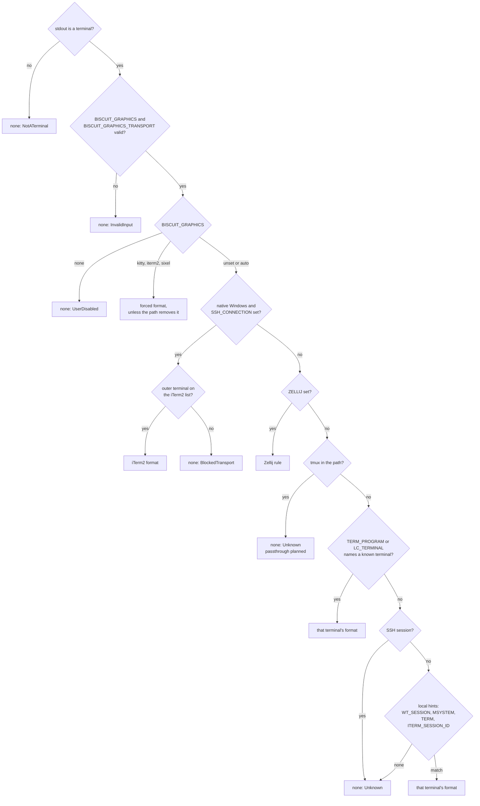

# Graphics Routes

Before `biscuit-terminal` draws an image it decides the **graphics route**:
the pixel format the image is encoded in, how the bytes travel to the
terminal, and, when no pixels can be sent, a structured reason saying why.
This page explains how that decision is made, how to override it, and how to
read it from code or from the `bt` CLI.

The decision is made once per `Terminal` and only from the environment: no
query is written to the terminal. It is cheap and has no side effects, but it
cannot see what the environment does not say (see [SSH](#ssh) and
[When the route is unknown](#when-the-route-is-unknown)).

## What you can rely on

- **Piped output never gets graphics.** When stdout is not a terminal the
  route has no pixel format, whatever else is set.
- **A forced format is honored, unless the path is known to remove it.**
  `BISCUIT_GRAPHICS=kitty` gives Kitty everywhere except where something
  between the program and the terminal is known to strip Kitty.
- **A typo never silently picks a different format.** An override that is not
  one of its exact accepted values gives no pixel route, and the reason lists
  the accepted values.
- **No route means text, not an empty string.** A valid image whose route has
  no usable format renders as its alt text. A missing or corrupt image is
  still an error.
- **A fix is named only when the blocker was observed.** The reason carries a
  `fix` only for causes the resolver actually saw, such as a Zellij or Windows
  Terminal release that is too old, never as a guess.

## What a route records

| Field | Values | Meaning |
| --- | --- | --- |
| `format` | `Kitty`, `Iterm2`, `Sixel`, `None` | The pixel format. `None` means the image uses a text fallback. |
| `transport` | `Direct`, `Tmux` | How escape sequences reach the terminal. Every route is `Direct` today; tmux passthrough is **planned**. |
| `placement` | `Ordinary`, `Placeholders` | How a Kitty image is placed. Every route is `Ordinary` today; Unicode placeholders (for tmux) are **planned**. |
| `confidence` | `Forced`, `Verified`, `Known`, `Unknown` | How the route was established (below). |
| `reason` | `kind`, `message`, `fix` | Why this route, or why no pixels. `fix` is optional. |

**Confidence:**

- `Forced`: chosen by `BISCUIT_GRAPHICS`, or by a caller's force override.
- `Verified`: confirmed by a reply from the terminal. Nothing produces this
  yet; it arrives with the graphics probe (**planned**).
- `Known`: inferred from the terminal's identity, or supplied by the caller.
- `Unknown`: nothing established the route.

**Reason kinds:**

| Kind | When |
| --- | --- |
| `Supported` | A pixel route was chosen. |
| `NoSupport` | The terminal is known to lack a usable format (for example Terminal.app, or Zellij older than 0.45). |
| `Unknown` | Nothing established whether graphics work. |
| `UserDisabled` | `BISCUIT_GRAPHICS=none`. |
| `BlockedTransport` | Something between the program and the terminal removes the format (the Windows SSH server's console host, or Zellij for the iTerm2 format). |
| `InvalidInput` | An override variable holds a value outside its accepted set. |
| `NotATerminal` | Stdout is not a terminal. |

`ImageSupport` (`None`, `Kitty`, `ITerm`, `Sixel`) is a projection of the
route's format, kept for callers that only need the format.

## Reading the route

From code, read the field on a `Terminal`:

```rust
use biscuit_terminal::terminal::Terminal;

let term = Terminal::new();
let route = &term.graphics_route;
println!("{:?} ({:?}): {}", route.format, route.confidence, route.reason);
```

`Terminal::new()` resolves the route once and keeps it; every image rendered
with that `Terminal` follows it, and components never resolve again from the
environment. `term.image_support()` returns the projection.

To supply a route instead of detecting one (for a test, or an application that
already knows its terminal), use the builder. `.image_support(...)` produces a
`Known`, direct, ordinary route for that format; `.graphics_route(...)` takes
a full `GraphicsRoute`.

```rust
use biscuit_terminal::discovery::detection::ImageSupport;
use biscuit_terminal::terminal::Terminal;

let term = Terminal::builder()
    .is_tty(true)
    .image_support(ImageSupport::Kitty)
    .build();
```

`resolve_graphics_route` is a pure function of `RouteInputs`, so tests can
describe any environment without touching the process's own:

```rust
use biscuit_terminal::discovery::detection::{
    GraphicsFormat, RouteInputs, ToolVersion, resolve_graphics_route,
};

let inputs = RouteInputs::new(true).with_var("TERM_PROGRAM", "WezTerm");
assert_eq!(resolve_graphics_route(&inputs).format, GraphicsFormat::Kitty);

// Inside a Windows OpenSSH session only the iTerm2 format survives.
let mut inputs = RouteInputs::new(true)
    .with_var("SSH_CONNECTION", "10.0.0.2 50000 10.0.0.1 22")
    .with_var("TERM_PROGRAM", "WezTerm");
inputs.is_windows = true;
assert_eq!(resolve_graphics_route(&inputs).format, GraphicsFormat::Iterm2);

// Zellij needs its version, which `RouteInputs::from_process` reads.
let mut inputs = RouteInputs::new(true)
    .with_var("ZELLIJ", "0")
    .with_var("TERM_PROGRAM", "ghostty");
inputs.zellij_version = Some(ToolVersion::new(0, 45, 1));
assert_eq!(resolve_graphics_route(&inputs).format, GraphicsFormat::Kitty);
```

`RouteInputs::new(output_is_tty)` starts from an empty environment;
`with_var` adds a variable as resolution will see it. `is_windows`,
`zellij_version`, and `windows_terminal_version` are public fields.
`RouteInputs::from_process()` gathers the real inputs: stdout's TTY state,
the OS, the variables listed below, `zellij --version` (only inside Zellij,
with a 500 ms deadline), and on native Windows the file version of the
`WindowsTerminal.exe` found by walking the parent process chain (only when
`WT_SESSION` is set).

### From the `bt` CLI

- `bt` prints the route on its `Images:` line: the format, its transport,
  placement, and confidence, then the reason and any fix.
- `bt --json` includes a `graphics_route` object next to the existing image
  support field, with the reason as data:

  ```json
  "graphics_route": {
    "format": "Kitty",
    "transport": "Direct",
    "placement": "Ordinary",
    "confidence": "Known",
    "reason": {
      "kind": "Supported",
      "message": "WezTerm (TERM_PROGRAM=WezTerm) is known to render the Kitty graphics protocol",
      "fix": null
    }
  }
  ```

- See [Hints](#hints) for what `bt` writes to stderr.

## How the route is resolved

The first rule that decides wins:



The variables consulted are `BISCUIT_GRAPHICS`, `BISCUIT_GRAPHICS_TRANSPORT`,
`TERM_PROGRAM`, `TERM`, `LC_TERMINAL`, `ITERM_SESSION_ID`, `ITERM_PROFILE`,
`WT_SESSION`, `MSYSTEM`, `SSH_CONNECTION`, `SSH_CLIENT`, `SSH_TTY`, `TMUX`,
and `ZELLIJ`. Any one of the three `SSH_*` variables marks an SSH session.
A value that is not valid UTF-8 identifies nothing.

### Known terminals

A known terminal gets the format it handles reliably, not everything it
advertises.

| Terminal | Identified by | Format |
| --- | --- | --- |
| Kitty, Ghostty, WezTerm, Warp, Konsole, wast | `TERM_PROGRAM` (`kitty`, `ghostty`, `WezTerm`, `Warp`/`WarpTerminal`, `konsole`, `wast`; case-insensitive), or locally a `TERM` containing `kitty` | Kitty |
| iTerm2 | `TERM_PROGRAM=iTerm.app`, `LC_TERMINAL=iTerm2`, or locally `ITERM_SESSION_ID` / `ITERM_PROFILE` | iTerm2 |
| mintty | `TERM_PROGRAM=mintty`, or locally `MSYSTEM` with no `TERM_PROGRAM` | iTerm2 |
| cterm | `TERM_PROGRAM=cterm` | iTerm2 |
| Windows Terminal | `WT_SESSION` (local only) | Sixel when `WindowsTerminal.exe` is 1.22 or later |
| Terminal.app | `TERM_PROGRAM=Apple_Terminal` | none (`NoSupport`) |

iTerm2 keeps its own format even though it accepts Kitty: it ignores Kitty's
quiet flag (`q=2`), so its `OK` replies land in the shell's input as junk, and
it places nothing for a width-only Kitty placement. For the same reason, a
Kitty route reaching iTerm2 by another path (for example a caller-supplied
`ImageSupport::Kitty`) is sent in iTerm2 format; only `BISCUIT_GRAPHICS=kitty`
keeps Kitty there.

**Windows Terminal.** Only a native Windows process can read the
`WindowsTerminal.exe` version, so:

- 1.22 or later: Sixel (`Known`).
- Older: none (`NoSupport`), with the fix "upgrade Windows Terminal".
- Version unreadable (including WSL, which inherits `WT_SESSION`): none
  (`Unknown`), with the fix "set `BISCUIT_GRAPHICS=sixel` if this Windows
  Terminal is 1.22 or later".

A Sixel route currently renders the text fallback: the Sixel encoder is
**planned**. Detecting Sixel from Windows Terminal's own DA1 reply arrives with
the probe (**planned**).

Any `TERM_PROGRAM` not in the table (for example `vscode` or `tmux`)
identifies nothing, and resolution moves on to the local hints.

### SSH

Inside an SSH session, `LC_TERMINAL` beats `TERM_PROGRAM`. `LC_TERMINAL` is
sent by the connecting client (iTerm2 sets it, and many OpenSSH setups forward
`LC_*` variables), while `TERM_PROGRAM` may be the server's own stale value. Locally,
`TERM_PROGRAM` is set by the terminal running the process and wins.

The local hints (`WT_SESSION`, `MSYSTEM`, `TERM`, `ITERM_SESSION_ID`,
`ITERM_PROFILE`) are not used inside SSH, where they may describe a different
terminal. An SSH session with no forwarded hints resolves to `Unknown`.
Asking the far terminal directly is the job of the graphics probe
(**planned**).

### Windows SSH server

When the program runs on native Windows inside an OpenSSH server session
(`SSH_CONNECTION` set), its console is the system `conhost.exe`. Measured on
a Windows host, that console host **removes** APC sequences (Kitty) and DCS
sequences (Sixel, and anything wrapped for tmux passthrough), and **passes**
OSC sequences intact, including the iTerm2 format's `OSC 1337;File=` with a
2 MB payload.

So only the iTerm2 format can reach the client, and only a client terminal on
the **iTerm2 list** renders it:

| iTerm2 list | Matched value (`LC_TERMINAL`, then `TERM_PROGRAM`, as in any SSH session) |
| --- | --- |
| iTerm2 | `iTerm.app`, `iTerm2` |
| WezTerm | `WezTerm` |
| Konsole | `konsole` |
| mintty | `mintty` |
| cterm | `cterm` |

A match gives the iTerm2 format (`Known`); anything else gives none
(`BlockedTransport`). The route never selects Kitty or Sixel here, and a
forced `kitty` or `sixel` is blocked too.

This applies only to the system console host. WezTerm's own multiplexer works
on the same kind of host because WezTerm ships its own console host.

### Zellij

Zellij renders Kitty graphics from 0.45, when the terminal hosting it supports
them. The rule needs Zellij's version:

| Situation | Route |
| --- | --- |
| Version unreadable | none (`Unknown`) |
| Older than 0.45 | none (`NoSupport`), fix "upgrade Zellij to 0.45.0 or later" |
| 0.45+, inside a Kitty-family terminal (from `TERM_PROGRAM`) | Kitty (`Known`) |
| 0.45+, any other terminal | none (`Unknown`) |

The 0.45+ rule is interim: Zellij turns on its Kitty support only after
querying a Kitty-capable host, so an inherited Kitty-family identity is
reasonable evidence. Asking the Zellij pane directly (which would give
`Verified`) and detecting Sixel under Zellij arrive with the probe
(**planned**). Zellij drops the iTerm2 format, so a forced `iterm2` inside
Zellij is `BlockedTransport`.

### tmux

There is no pixel route through tmux today. When `TMUX` is set, or
`BISCUIT_GRAPHICS_TRANSPORT=tmux`, the route is none (`Unknown`), and a forced
format is not sent either. Wrapping graphics for tmux passthrough, with
placement chosen from the outer terminal, is **planned**.

### When the route is unknown

`Unknown` means the environment did not say: an unrecognized terminal, an SSH
session without forwarded hints, Zellij in front of an unidentified terminal,
or a native Windows console with no modern terminal identified. The image gets
the text fallback.

The **graphics probe** (**planned**) will settle these cases by asking the
terminal: a Kitty query and a Sixel check that join the color query round trip
`Terminal::new()` already makes (see
[Live Terminal Queries](./terminal-queries.md)), so it adds no extra round
trip. Which Windows consoles count as "legacy conhost with no modern
terminal", and so are never probed because they never answer, is defined with
the probe.

**Escape hatch for TUIs (planned with the probe).** An application with its
own input loop will be able to supply a resolved route or turn
construction-time probing off, so the probe never races its input. Supplying a
route through `Terminal::builder().graphics_route(...)` already bypasses
detection today.

## Overrides

### `BISCUIT_GRAPHICS`

Accepted values, exactly and lowercase: `auto`, `kitty`, `iterm2`, `sixel`,
`none`.

| Value | Effect |
| --- | --- |
| unset, `auto` | Detect as described above. |
| `kitty`, `iterm2`, `sixel` | Use that format (`Forced`). |
| `none` | No pixel route (`UserDisabled`). |

A forced format skips terminal identity and preferences, so
`BISCUIT_GRAPHICS=kitty` in iTerm2 sends Kitty. It does **not**:

- enable tmux passthrough: with tmux in the path there is still no route;
- get past a path known to remove it: Kitty and Sixel on a Windows SSH server,
  or the iTerm2 format in Zellij, give `BlockedTransport` with the requested
  format in the reason;
- make the terminal render it: a terminal that does not understand the format
  shows nothing, or garbage;
- produce Sixel pixels yet: a Sixel route renders the text fallback until the
  encoder lands (**planned**).

### `BISCUIT_GRAPHICS_TRANSPORT`

Accepted values, exactly and lowercase: `auto`, `direct`, `tmux`. It states
the one fact a program cannot always observe: whether tmux sits between it and
the terminal (for example a tmux on the far side of SSH, where `TMUX` is not
set).

| Value | Effect |
| --- | --- |
| unset, `auto` | tmux is in the path when `TMUX` is set. |
| `direct` | No tmux in the path, even when `TMUX` is set. |
| `tmux` | tmux is in the path, so no route until passthrough lands (**planned**). |

### Invalid values

Both variables share one validator. An empty value, a padded value
(`" kitty"`), a differently cased value (`Kitty`), any other word, or a value
that is not valid UTF-8 is invalid: it is never read as `auto`. The route is
none (`InvalidInput`), and the reason names the variable and the accepted
values:

```text
BISCUIT_GRAPHICS="Kitty" is not a valid value; accepted values: auto, kitty, iterm2, sixel, none
```

Validation comes before any detection, so an invalid value disables graphics
even in a terminal that would otherwise get them.

## Policy ceilings

The route says what the terminal path can carry. Rendering policy can still
lower what is drawn, and a caller's force override can raise it only so far.

- **`GraphicsMode`** (render tree): `Off` and `Vector` never send pixels;
  `Rich` permits them when the route has a format.
- **`TerminalMermaidMode`**: Mermaid fences become diagrams only when this is
  `Image` *and* `GraphicsMode` is `Rich`.
- **`force_graphics`** (render tree, and Darkmatter's
  `TerminalImageMode::Force`): upgrades a route whose reason is `NoSupport` or
  `Unknown` to Kitty (`Forced`). It never lifts `BISCUIT_GRAPHICS=none`, an
  invalid override, a blocked transport, or nonterminal stdout, and it does
  not raise `GraphicsMode`. A pixel route is kept as it is.

In code, `GraphicsRoute::forced_by_caller()` applies the `force_graphics` rule.

## Fallback

When the route has no usable format, a valid image renders as text:

- **Plain images** (`TerminalImage`, `bt image`): the alt text, or
  `[Image: <file name>]` when none was set, with control characters removed so
  a file name cannot inject terminal controls. A half-block rendering in
  truecolor is **planned** as the first fallback before alt text.
- **Diagrams** keep the source code block they produce today.
- A missing, unreadable, or corrupt image is an error, whether or not the
  route has pixels.

See [`TerminalImage`](../components/terminal_image.md) for the rendering API.

## Hints

The library never prints hints; it returns the reason. The `bt` CLI writes a
one-line hint to stderr when the route has no pixels and its reason has a fix,
only when stderr is a terminal (so piped and `--json` output stay clean), and
at most once per distinct reason in one invocation. A hint for an invalid
override is labeled a configuration error rather than "no graphics".

| Reason | Fix the hint names |
| --- | --- |
| Zellij older than 0.45 | Upgrade Zellij to 0.45.0 or later. |
| Windows Terminal older than 1.22 | Upgrade Windows Terminal to 1.22.0 or later. |
| Windows Terminal whose version could not be read | Set `BISCUIT_GRAPHICS=sixel` if it is 1.22 or later (the route is then Sixel, which renders the text fallback until the encoder lands). |
| Invalid `BISCUIT_GRAPHICS` or `BISCUIT_GRAPHICS_TRANSPORT` | Set the variable to one of its accepted values. |

Every other reason, including the Windows SSH block and an unidentified
terminal, has no fix and produces no hint: there is nothing the user can
change that is known to help.

## Background reading

- [Terminal graphics research](../research/graphics/index.md): the
  [Kitty](../research/graphics/kitty.md),
  [iTerm2](../research/graphics/iterm2.md), and
  [Sixel](../research/graphics/sixel.md) formats, and
  [graphics through multiplexers](../research/graphics/multiplexing.md).
