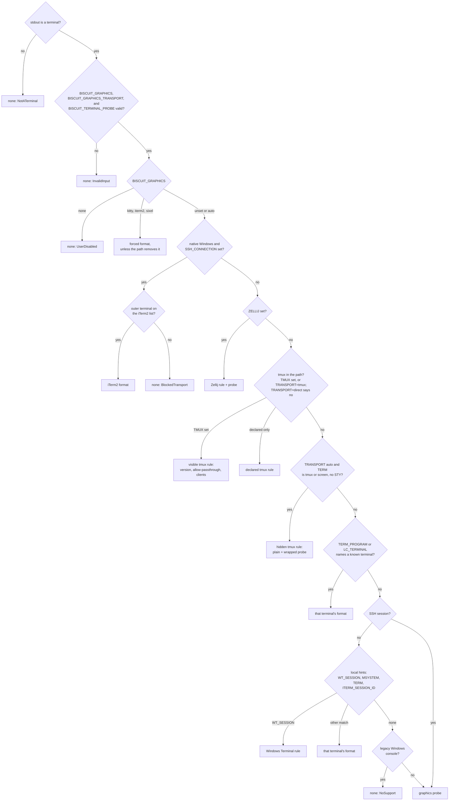
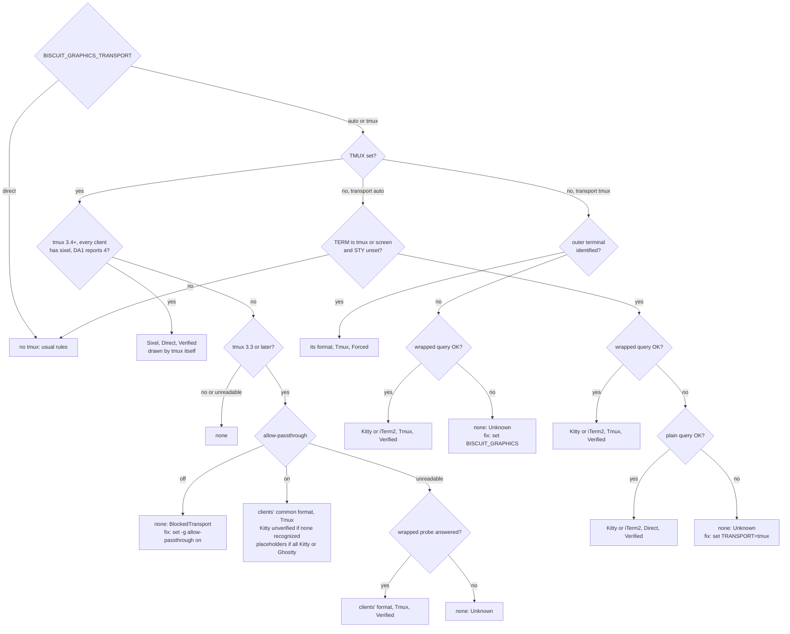

# Graphics Routes

Before `biscuit-terminal` draws an image it decides the **graphics route**:
the pixel format the image is encoded in, how the bytes travel to the
terminal, and, when no pixels can be sent, a structured reason saying why.
This page explains how that decision is made, how to override it, and how to
read it from code or from the `bt` CLI.

The decision is made once per `Terminal`, from the environment first. When
the environment cannot decide (an unidentified terminal, an SSH session that
forwarded nothing, Zellij), the library asks the terminal with the
[graphics probe](#the-graphics-probe): a Kitty query that rides along with the
color query `Terminal::new()` already makes, with Sixel read from the DA1
reply that ends it. Identified terminals are never probed.

## What you can rely on

- **Piped output never gets graphics.** When stdout is not a terminal the
  route has no pixel format, whatever else is set.
- **A forced format is honored, unless the path is known to remove it.**
  `BISCUIT_GRAPHICS=kitty` gives Kitty everywhere except where something
  between the program and the terminal is known to strip Kitty.
- **A typo never silently picks a different format.** An override that is not
  one of its exact accepted values gives no pixel route, and the reason lists
  the accepted values.
- **No route means text, not an empty string.** A valid image whose route has
  no usable format renders as its alt text. A missing or corrupt image is
  still an error.
- **A fix is named only when the blocker was observed.** The reason carries a
  `fix` only for causes the resolver actually saw, such as a Zellij or Windows
  Terminal release that is too old, tmux `allow-passthrough` read as `off`, or
  a likely tmux it cannot see, never as a guess.
- **Silence is never a "no".** A terminal that does not answer the probe, or a
  probe skipped because input was waiting, leaves the route `Unknown`; only a
  terminal that answered (DA1 without Sixel, or a Kitty rejection) is recorded
  as having no support.

## What a route records

| Field | Values | Meaning |
| --- | --- | --- |
| `format` | `Kitty`, `Iterm2`, `Sixel`, `None` | The pixel format. `None` means the image uses a text fallback. |
| `transport` | `Direct`, `Tmux` | How escape sequences reach the terminal. `Tmux` wraps every graphics sequence for tmux passthrough (see [tmux](#tmux)). |
| `placement` | `Ordinary`, `Placeholders` | How a Kitty image is placed. `Placeholders` only through a visible tmux whose clients are all Kitty or Ghostty (see [Unicode placeholders](#unicode-placeholders)); every other route is `Ordinary`. |
| `confidence` | `Forced`, `Verified`, `Known`, `Unknown` | How the route was established (below). |
| `reason` | `kind`, `message`, `fix` | Why this route, or why no pixels. `fix` is optional. |
| `needs_measured_cells` | `true`, `false` | The image must be sized from a measured cell size, never the 8×16 estimate. Set for Zellij, which sizes images from its own measurement of the host. |

**Confidence:**

- `Forced`: chosen by `BISCUIT_GRAPHICS`, or by a caller's force override.
- `Verified`: confirmed by a reply to the [graphics probe](#the-graphics-probe),
  whether the reply says yes or no.
- `Known`: inferred from the terminal's identity, or supplied by the caller.
- `Unknown`: nothing established the route.

**Reason kinds:**

| Kind | When |
| --- | --- |
| `Supported` | A pixel route was chosen. |
| `NoSupport` | The terminal is known to lack a usable format (for example Terminal.app, a legacy Windows console, or a terminal whose probe reply offered neither Kitty nor Sixel). |
| `Unknown` | Nothing established whether graphics work. |
| `UserDisabled` | `BISCUIT_GRAPHICS=none`. |
| `BlockedTransport` | Something between the program and the terminal removes the format (the Windows SSH server's console host, or Zellij for the iTerm2 format). |
| `InvalidInput` | An override variable holds a value outside its accepted set. |
| `NotATerminal` | Stdout is not a terminal. |

`ImageSupport` (`None`, `Kitty`, `ITerm`, `Sixel`) is a projection of the
route's format, kept for callers that only need the format.

## Reading the route

From code, read the field on a `Terminal`:

```rust
use biscuit_terminal::terminal::Terminal;

let term = Terminal::new();
let route = &term.graphics_route;
println!("{:?} ({:?}): {}", route.format, route.confidence, route.reason);
```

`Terminal::new()` resolves the route once and keeps it; every image rendered
with that `Terminal` follows it, and components never resolve again from the
environment. `term.image_support()` returns the projection.

To supply a route instead of detecting one (for a test, or an application that
already knows its terminal), use the builder. `.image_support(...)` produces a
`Known`, direct, ordinary route for that format; `.graphics_route(...)` takes
a full `GraphicsRoute`. A supplied route is never re-resolved, and
construction sends no graphics probe for it.

```rust
use biscuit_terminal::discovery::detection::ImageSupport;
use biscuit_terminal::terminal::Terminal;

let term = Terminal::builder()
    .is_tty(true)
    .image_support(ImageSupport::Kitty)
    .build();
```

`resolve_graphics_route` is a pure function of `RouteInputs`, so tests can
describe any environment without touching the process's own:

```rust
use biscuit_terminal::discovery::detection::{
    GraphicsFormat, RouteInputs, ToolVersion, resolve_graphics_route,
};

let inputs = RouteInputs::new(true).with_var("TERM_PROGRAM", "WezTerm");
assert_eq!(resolve_graphics_route(&inputs).format, GraphicsFormat::Kitty);

// Inside a Windows OpenSSH session only the iTerm2 format survives.
let mut inputs = RouteInputs::new(true)
    .with_var("SSH_CONNECTION", "10.0.0.2 50000 10.0.0.1 22")
    .with_var("TERM_PROGRAM", "WezTerm");
inputs.is_windows = true;
assert_eq!(resolve_graphics_route(&inputs).format, GraphicsFormat::Iterm2);

// Zellij needs its version, which `RouteInputs::from_process` reads.
let mut inputs = RouteInputs::new(true)
    .with_var("ZELLIJ", "0")
    .with_var("TERM_PROGRAM", "ghostty");
inputs.zellij_version = Some(ToolVersion::new(0, 45, 1));
assert_eq!(resolve_graphics_route(&inputs).format, GraphicsFormat::Kitty);
```

`RouteInputs::new(output_is_tty)` starts from an empty environment;
`with_var` adds a variable as resolution will see it. `is_windows`, `is_ci`,
`zellij_version`, `windows_terminal_version`, `probe_mode`, and `probe` (the
probe results) are public fields, so a test can describe any probe answer
without a terminal:

```rust
use biscuit_terminal::discovery::detection::{
    Da1Reply, GraphicsFormat, KittyReply, ProbeReply, ProbeResult, RouteConfidence,
    RouteInputs, probe_plan, resolve_graphics_route,
};

let mut inputs = RouteInputs::new(true).with_var("SSH_CONNECTION", "10.0.0.2 50000 10.0.0.1 22");
assert!(probe_plan(&inputs).direct); // nothing forwarded: the probe would run

inputs.probe.direct = Some(ProbeResult::Replied(ProbeReply {
    kitty: KittyReply::NoReply,
    da1: Some(Da1Reply { class: 62, attributes: vec![4, 22] }),
}));
let route = resolve_graphics_route(&inputs);
assert_eq!(route.format, GraphicsFormat::Sixel);
assert_eq!(route.confidence, RouteConfidence::Verified);
```

`RouteInputs::from_process()` gathers the real inputs: stdout's TTY state,
the OS, whether this is CI, the variables listed below, `zellij --version`
(only inside Zellij, with a 500 ms deadline), and on native Windows the file
version of the `WindowsTerminal.exe` found by walking the parent process chain
(only when `WT_SESSION` is set). `probe_plan(&inputs)` says which probe
exchanges would help, and `inputs.probed()` runs them (sharing the cached
startup exchange) and records the results. The returned `ProbePlan` has three
fields: `direct` (the query written as-is), `tunneled` (the query wrapped for
tmux passthrough), and `direct_da1_only`, set when the direct exchange must
send the DA1 request without the Kitty query, as it does to a visible tmux
that could draw Sixel itself (see [tmux](#tmux)).

### From the `bt` CLI

- `bt` prints the route on its `Images:` line: the format, its transport,
  placement, and confidence, then the reason and any fix.
- `bt --json` includes a `graphics_route` object next to the existing image
  support field, with the reason as data:

  ```json
  "graphics_route": {
    "format": "Kitty",
    "transport": "Direct",
    "placement": "Ordinary",
    "confidence": "Known",
    "reason": {
      "kind": "Supported",
      "message": "WezTerm (TERM_PROGRAM=WezTerm) is known to render the Kitty graphics protocol",
      "fix": null
    },
    "needs_measured_cells": false
  }
  ```

- See [Hints](#hints) for what `bt` writes to stderr.

## How the route is resolved

The first rule that decides wins. Where the environment runs out, the
[graphics probe](#the-graphics-probe) decides:



The variables consulted are `BISCUIT_GRAPHICS`, `BISCUIT_GRAPHICS_TRANSPORT`,
`BISCUIT_TERMINAL_PROBE`, `TERM_PROGRAM`, `TERM`, `LC_TERMINAL`,
`ITERM_SESSION_ID`, `ITERM_PROFILE`, `WT_SESSION`, `MSYSTEM`,
`SSH_CONNECTION`, `SSH_CLIENT`, `SSH_TTY`, `TMUX`, `STY`, and `ZELLIJ`. Any
one of the three `SSH_*` variables marks an SSH session. A value that is not
valid UTF-8 identifies nothing.

### Known terminals

A known terminal gets the format it handles reliably, not everything it
advertises.

| Terminal | Identified by | Format |
| --- | --- | --- |
| Kitty, Ghostty, WezTerm, Warp, Konsole, wast | `TERM_PROGRAM` (`kitty`, `ghostty`, `WezTerm`, `Warp`/`WarpTerminal`, `konsole`, `wast`; case-insensitive), or locally a `TERM` containing `kitty` | Kitty |
| iTerm2 | `TERM_PROGRAM=iTerm.app`, `LC_TERMINAL=iTerm2`, or locally `ITERM_SESSION_ID` / `ITERM_PROFILE` | iTerm2 |
| mintty | `TERM_PROGRAM=mintty`, or locally `MSYSTEM` with no `TERM_PROGRAM` | iTerm2 |
| cterm | `TERM_PROGRAM=cterm` | iTerm2 |
| Windows Terminal | `WT_SESSION` (local only) | Sixel when `WindowsTerminal.exe` is 1.22 or later, or its DA1 reply reports Sixel |
| Terminal.app | `TERM_PROGRAM=Apple_Terminal` | none (`NoSupport`) |

iTerm2 keeps its own format even though it accepts Kitty: it ignores Kitty's
quiet flag (`q=2`), so its `OK` replies land in the shell's input as junk, and
it places nothing for a width-only Kitty placement. For the same reason, a
Kitty route reaching iTerm2 by another path (for example a caller-supplied
`ImageSupport::Kitty`) is sent in iTerm2 format; only `BISCUIT_GRAPHICS=kitty`
keeps Kitty there.

**Windows Terminal.** Either of two signals selects Sixel: the
`WindowsTerminal.exe` hosting the process is 1.22 or later, or the terminal's
DA1 reply reports Sixel (attribute `4`). Only a native Windows process can read
the version, so the probe covers the rest, including WSL, which inherits
`WT_SESSION`:

- Version 1.22 or later: Sixel (`Known`), and no probe is sent.
- Otherwise the probe runs, and a DA1 reply with attribute `4` gives Sixel
  (`Verified`).
- Older, with no Sixel in the reply: none (`NoSupport`), with the fix
  "upgrade Windows Terminal".
- Version unreadable, with no Sixel in the reply (or no reply): none
  (`Unknown`), with the fix "set `BISCUIT_GRAPHICS=sixel` if this Windows
  Terminal is 1.22 or later".

Any `TERM_PROGRAM` not in the table (for example `vscode` or `tmux`)
identifies nothing, and resolution moves on to the local hints.

### SSH

Inside an SSH session, `LC_TERMINAL` beats `TERM_PROGRAM`. `LC_TERMINAL` is
sent by the connecting client (iTerm2 sets it, and many OpenSSH setups forward
`LC_*` variables), while `TERM_PROGRAM` may be the server's own stale value. Locally,
`TERM_PROGRAM` is set by the terminal running the process and wins.

The local hints (`WT_SESSION`, `MSYSTEM`, `TERM`, `ITERM_SESSION_ID`,
`ITERM_PROFILE`) are not used inside SSH, where they may describe a different
terminal. An SSH session with no forwarded hints is decided by the
[graphics probe](#the-graphics-probe), which asks the far terminal directly;
the silence budget is the full timeout over SSH, so a slow link is not
mistaken for a silent terminal.

### Windows SSH server

When the program runs on native Windows inside an OpenSSH server session
(`SSH_CONNECTION` set), its console is the system `conhost.exe`. Measured on
a Windows host, that console host **removes** APC sequences (Kitty) and DCS
sequences (Sixel, and anything wrapped for tmux passthrough), and **passes**
OSC sequences intact, including the iTerm2 format's `OSC 1337;File=` with a
2 MB payload.

So only the iTerm2 format can reach the client, and only a client terminal on
the **iTerm2 list** renders it:

| iTerm2 list | Matched value (`LC_TERMINAL`, then `TERM_PROGRAM`, as in any SSH session) |
| --- | --- |
| iTerm2 | `iTerm.app`, `iTerm2` |
| WezTerm | `WezTerm` |
| Konsole | `konsole` |
| mintty | `mintty` |
| cterm | `cterm` |

A match gives the iTerm2 format (`Known`); anything else gives none
(`BlockedTransport`). The route never selects Kitty or Sixel here, and a
forced `kitty` or `sixel` is blocked too. The graphics probe is never sent
here: the console host would remove it as well.

This applies only to the system console host. WezTerm's own multiplexer works
on the same kind of host because WezTerm ships its own console host.

### Zellij

Zellij renders Kitty graphics from 0.45, but only for a pane whose host
terminal supports them, and only Zellij knows whether it turned that support
on. So inside Zellij the probe always runs, and the pane's own answer decides:

| Pane's answer | Route |
| --- | --- |
| Kitty `OK` (Zellij 0.45 or later, or version unreadable) | Kitty (`Verified`) |
| DA1 reports Sixel | Sixel (`Verified`) |
| Older than 0.45, no Sixel | none (`NoSupport`), fix "upgrade Zellij to 0.45.0 or later" |
| DA1 without Kitty or Sixel | none (`NoSupport`, `Verified`): Kitty graphics are off for this pane |
| No reply, conflicting replies, or probe not sent | none (`Unknown`) |

Only the graphics query is sent inside Zellij; the color queries stay off, as
they are for every multiplexer.

A pixel route through Zellij sets `needs_measured_cells`. Zellij sizes the
image from its own measurement of the host's cells, so a probe success says
nothing about whether the library knows the cell size; when no measured cell
size is available, `TerminalImage` renders the text fallback with its own
reason instead of guessing with the 8×16 estimate. Zellij drops the iTerm2
format, so a forced `iterm2` inside Zellij is `BlockedTransport`.

### tmux

tmux draws its panes itself, so a graphics sequence written into a pane
reaches the outer terminal only through **passthrough**: each complete
sequence is wrapped as `ESC P tmux; <sequence with every ESC doubled> ESC \`,
and tmux forwards the inside unchanged when the pane allows it. A route with
transport `Tmux` makes `TerminalImage` wrap every Kitty chunk, every
iTerm2 message, and every Sixel DCS this way (see [Sending an image through tmux](#sending-an-image-through-tmux)).
tmux 3.4 and later can also draw Sixel itself, with no passthrough at all.
The route tells three tmux situations apart.

**A visible tmux** (`TMUX` set). The library asks tmux itself, with
read-only commands run without a shell and with a 500 ms deadline each:

| Question | Command | Unreadable means |
| --- | --- | --- |
| Version | `tmux -V` | none (`Unknown`): passthrough needs 3.3 |
| Passthrough for this pane | `tmux show-options -Apv -t "$TMUX_PANE" allow-passthrough` | unknown, never "off" |
| Outer terminal | `tmux list-clients -t "$TMUX_PANE" -F '#{client_termname}<TAB>#{client_termtype}'` | unidentified |

`list-clients -t <pane>` (`client_termname`, `client_termtype`,
`client_utf8`, `client_termfeatures`) lists only the clients attached to the session that
holds this pane, never another session's clients or the server's startup
environment (so an inherited `LC_TERMINAL` or `TERM_PROGRAM` is ignored).
Each client is identified from `client_termtype` (the outer terminal's own
answer to tmux, such as `kitty(0.39.1)` or `iTerm2 3.5.10`) and then
`client_termname` (its `TERM`, such as `xterm-kitty` or `wezterm`); a generic
`xterm-256color` identifies nothing.

**Sixel drawn by tmux itself** comes first, ahead of every passthrough route
and even when the clients could take Kitty, because tmux then keeps the image
with the pane and redraws it. It is established only when all three hold:

1. tmux is 3.4 or later;
2. every client attached to the pane's session lists `sixel` in
   `#{client_termfeatures}` (an empty or unreadable client list does not
   qualify);
3. tmux's own DA1 reply, asked unwrapped in the
   [direct exchange](./terminal-queries.md#the-startup-exchange), reports
   attribute `4` (a tmux built with
   Sixel answers `ESC[?1;2;4c`; `#{sixel_support}` shows the same build
   option).

The route is then Sixel, transport `Direct` (nothing is wrapped), confidence
`Verified`, with a reason such as:

```text
tmux 3.4.0 draws Sixel itself: its DA1 reply reports attribute 4 and every client has the sixel terminal feature
```

`allow-passthrough` does not matter here: `off` blocks tunneled graphics, not
tmux's own Sixel, so this route works with it `off`, `on`, or unreadable.
When the first two conditions hold, the direct exchange asks tmux for DA1
alone (`ProbePlan::direct_da1_only`) and never sends the Kitty query
unwrapped: tmux treats an unwrapped APC (`ESC _ … ESC \`) as a pane-title
change, so the query would retitle the pane `Gi=…`. tmux answers DA1 itself,
so the question costs no wait on the outer terminal. When probing is not
allowed (CI, `BISCUIT_TERMINAL_PROBE=off`, `ProbeMode::Off`), DA1 is not
asked, the route is not established, and the passthrough rules below apply.

Otherwise the route goes through passthrough:

| tmux reports | Route |
| --- | --- |
| tmux older than 3.3 | none (`BlockedTransport`), the version in the reason, fix "upgrade tmux to 3.3.0 or later" |
| version unreadable | none (`Unknown`), no fix |
| `allow-passthrough off` | none (`BlockedTransport`), fix "set -g allow-passthrough on" |
| on (`on` or `all`), clients on Kitty or Ghostty, each sent UTF-8 and 24-bit color | Kitty, `Tmux`, Unicode placeholders, `Known` |
| on, clients on Kitty or Ghostty, one not sent UTF-8 or 24-bit color | Kitty, `Tmux`, ordinary placement, `Known`; the reason says why |
| on, clients on WezTerm or Konsole | Kitty, `Tmux`, ordinary placement, `Known` |
| on, clients on iTerm2 | iTerm2 format, `Tmux`, `Known` |
| on, no client attached or none recognized | Kitty, `Tmux`, ordinary placement, confidence `Unknown` (sent unverified) |
| on, clients with no format in common | none (`NoSupport`), the terminals named in the reason |
| unreadable | the wrapped probe decides (below) |

When several clients are attached, the route uses a format all of them
render, preferring Kitty: Kitty and WezTerm share Kitty, iTerm2 and WezTerm
share the iTerm2 format, and Kitty with iTerm2 share nothing. A client whose
terminal is not recognized counts as Kitty-only, the same default a lone
unrecognized client gets.

Only when `allow-passthrough` cannot be read (for example the tmux socket is
not accessible) does the library send the
[wrapped probe](./terminal-queries.md#the-wrapped-exchange). Any answer to it
proves passthrough works, and the format then follows the clients as in the
table (`Verified`); with no recognized client a Kitty `OK` gives Kitty, and an
answer without one gives none (`NoSupport`). No answer leaves the route none
(`Unknown`) with no fix: passthrough was not seen to be off, so the library
does not tell you to turn it on. When passthrough can be read, nothing is
probed, so a tmux session never waits on a reply that tmux may not forward.

A forced format (`BISCUIT_GRAPHICS=kitty|iterm2|sixel`) inside a visible tmux
keeps the version floor and the `allow-passthrough off` block, skips client
identification for the format, and is sent through passthrough (`Forced`).
A forced Kitty still uses Unicode placeholders when the clients allow them.
The one exception is a forced `sixel` to a tmux that is 3.4 or later with the
`sixel` feature on every client: tmux draws it itself (transport `Direct`,
`Forced`), and its DA1 is not asked. The reason reads "forced by
BISCUIT_GRAPHICS=sixel, drawn by tmux 3.4.0 itself (every client has the
sixel terminal feature)".

A tmux beyond SSH (hidden or declared, below) always uses ordinary placement:
its clients cannot be read, so Kitty or Ghostty is never positively
identified.

**A likely tmux the program cannot see.** Over SSH, a tmux on the far side
leaves no `TMUX` in the program's environment, but it usually sets `TERM` to
`tmux-*` or `screen-*` (or exactly `tmux` or `screen`). With such a `TERM` and
neither `TMUX` nor `STY` set, a hidden tmux is likely, and graphics written
directly would be swallowed by it. The probe sends the Kitty query twice at
the same moment: once plain, and once
[wrapped for passthrough](./terminal-queries.md#the-wrapped-exchange).

| Answer | Route |
| --- | --- |
| `OK` to the wrapped query | transport `Tmux`, ordinary placement, `Verified`: Kitty, or the iTerm2 format when the client forwarded `LC_TERMINAL=iTerm2` |
| `OK` to the plain query | no tmux after all: direct (`Verified`), Kitty, or the iTerm2 format when the client forwarded `LC_TERMINAL=iTerm2` |
| Neither | none (`Unknown`), with the fix "set `BISCUIT_GRAPHICS_TRANSPORT=tmux` if a tmux with allow-passthrough on runs between this program and the terminal" |

This hint is checked before a forwarded identity such as `LC_TERMINAL=iTerm2`,
because that identity describes the terminal outside the tmux, which never
sees unwrapped graphics. `BISCUIT_GRAPHICS_TRANSPORT=direct` turns the hint
off.

**A declared tmux** (`BISCUIT_GRAPHICS_TRANSPORT=tmux` with no `TMUX`): the
user says a tmux runs beyond SSH. The transport is `Tmux` and the format comes
from, in order:

1. an outer terminal identified by `TERM_PROGRAM` or `LC_TERMINAL`: its format,
   with confidence `Forced` (the reason says "unverified"), and no probe;
2. the wrapped probe: Kitty, or the iTerm2 format with `LC_TERMINAL=iTerm2`
   (`Verified`);
3. otherwise none (`Unknown`), with the fix "set `BISCUIT_GRAPHICS` to the
   outer terminal's format".

A forced format plus a declared tmux gives that format, transport `Tmux`,
`Forced`.



#### Sending an image through tmux

With a `Tmux` route, `TerminalImage` writes the same image it would write
directly, with every graphics sequence wrapped:

- **Kitty**: each 4096-byte chunk gets its own envelope. The upload carries a
  fresh nonzero image ID (`i=`), stays in quiet mode (`q=2`, so no reply lands
  in the shell), and gives rows explicitly (`c=` and `r=`), because the outer
  terminal is not the one the library sees.
- **iTerm2** and **Sixel**: the whole `File=` message, or the whole Sixel
  DCS, is one envelope; it is never split. tmux accepts at most 1 MiB (1,048,576 bytes) per wrapped message. The size
  is counted after base64, metadata, ESC doubling, and the envelope, and an
  image over it renders the text fallback with a `BlockedTransport` reason
  that gives the size, before any row is reserved.
- **Not wrapped**: cursor save, move, and restore, index (`ESC D`), text, and synchronized
  output (mode 2026), which tmux handles itself. An existing envelope is
  never wrapped twice.

```text
ESC [ s                                   cursor save (tmux handles it)
ESC P tmux; ESC ESC _G q=2,i=7,…,m=1;… ESC ESC \ ESC \   chunk 1
ESC P tmux; ESC ESC _G m=0;… ESC ESC \ ESC \              chunk 2
ESC [ u                                   cursor restore
```

#### Unicode placeholders

Kitty and Ghostty can draw an image wherever they find **placeholder cells**
for it. A placeholder cell is ordinary text, so tmux keeps it in the pane like
any other character: the image moves with the pane, is cut off by its edges,
scrolls with it, and disappears when you switch windows. The route uses
placeholders (`placement: Placeholders`) only when all of these hold:

- the route is Kitty through a visible tmux;
- every client attached to the pane's session is positively identified as
  Kitty or Ghostty (WezTerm ignores placeholder uploads and Zellij rejects
  them, and an unrecognized terminal may do either);
- tmux sends every one of those clients UTF-8 (`client_utf8` is `1`) and
  24-bit color (`RGB` in `client_termfeatures`, which tmux takes from the
  terminal's terminfo).

The last rule exists because each cell carries the image ID in its
foreground color. tmux re-encodes colors for each client, and without `RGB`
it would round the ID to a 256-color index. When a Kitty or Ghostty client
misses one of them, the image is placed ordinarily and the reason ends with
"placed ordinarily, because Unicode placeholders need tmux to send UTF-8 and
24-bit color (the RGB terminal feature) to every client". Adding the
feature, for example `set -as terminal-features ',xterm-kitty:RGB'`, turns
placeholders on for later runs.

What `TerminalImage` writes for a placeholder route:

1. The upload, wrapped for passthrough like any Kitty upload, with a
   **virtual placement** (`a=T,U=1`): the outer terminal stores the image
   but draws nothing yet.
2. One line of text per image row, **not wrapped**. Each line sets the
   foreground to the image ID as 24-bit color, prints one placeholder cell
   per column, and resets the foreground (`SGR 39`), so text after it keeps
   its color.

A cell is the character `U+10EEEE` followed by two combining marks from
Kitty's row/column diacritic table: the first gives the row, the second the
column. The table has 297 entries, so a grid can be at most 297 columns by
297 rows; a larger image is placed ordinarily instead.

```text
ESC P tmux; ESC ESC _G q=2,i=1193046,f=100,a=T,U=1,t=d,c=3,r=2,m=0;… ESC ESC \ ESC \
ESC[38;2;18;52;86m  U+10EEEE ◌̅◌̅  U+10EEEE ◌̅◌̍  U+10EEEE ◌̅◌̎  ESC[39m   row 0
ESC[38;2;18;52;86m  U+10EEEE ◌̍◌̅  U+10EEEE ◌̍◌̍  U+10EEEE ◌̍◌̎  ESC[39m   row 1
```

Image `1193046` is `0x123456`, so its color is `18;52;86`. Image IDs come
from one counter per process, shared with the graphics probe: they start at
a per-process offset, stay within 24 bits (1 to 16,777,215) so every ID fits
in a color, and wrap back to 1.

A standalone image ends with a line break after each row, leaving the cursor
at the start of the line below the image. In a `TwoColumn` layout the rows
are the column's lines, so the other column's text sits beside them.

A client that attaches later sees the placeholder cells but no image: the
image data went only to the clients attached when it was drawn. This is
documented, not worked around.

**Known limits of ordinary placement through tmux.** tmux does not know the
image is there, so the outer terminal draws it at the cursor and keeps it
where it was drawn. Through WezTerm, or any outer terminal without Unicode
placeholders, the image can drift when the pane is resized or scrolled in
copy mode, and may stay visible over other windows after a window switch. A
client that attaches later sees blank space where the image was: tmux redraws
its own grid, never the image. These limits are documented, not worked
around.

## The graphics probe

When the environment cannot decide, the library asks the terminal. The probe
is part of the color exchange `Terminal::new()` already makes, once per
process (see [Live Terminal Queries](./terminal-queries.md#the-startup-exchange)):
a Kitty graphics query for a one-pixel image, with a fresh image ID, and the
DA1 request that already ends the exchange. It adds no round trip. To a
visible tmux that could draw Sixel itself, the direct exchange carries the DA1
request alone (`ProbePlan::direct_da1_only`): an unwrapped Kitty query would
retitle the pane, and the probe result records `kitty: NoReply` with tmux's
DA1 reply.

### What the replies mean

- A **Kitty reply** counts only when it is complete and carries the query's
  image ID. `OK` means accepted; any other message (for example
  `ENOTSUPPORTED:…`) means the terminal understood the protocol and refused,
  which is different from silence. Two replies for the ID that disagree count
  as conflicting.
- The **DA1 reply** (`ESC [ ? class ; attributes c`) is read structurally:
  Sixel is attribute `4` after the class parameter, never the class itself
  and never a `4` inside another number (`ESC[?64;14c` does not report Sixel).

| Probe outcome | Route |
| --- | --- |
| Kitty `OK` | Kitty (`Verified`); this beats Sixel |
| DA1 reports Sixel | Sixel (`Verified`) |
| DA1 without either, or a Kitty rejection | none (`NoSupport`, `Verified`) |
| No reply before the deadline, conflicting replies | none (`Unknown`) |
| Skipped because input was waiting, terminal unusable | none (`Unknown`) |

### When the probe runs

The probe runs only when the environment leaves the route open:

- an unidentified terminal;
- an SSH session without forwarded hints;
- Zellij, always (see [Zellij](#zellij));
- Windows Terminal whose `WindowsTerminal.exe` version is unreadable or older
  than 1.22 (see [Known terminals](#known-terminals));
- a likely hidden tmux, with the extra wrapped query (see [tmux](#tmux));
- a declared tmux whose outer terminal is not identified (wrapped query only);
- a visible tmux that is 3.4 or later with the `sixel` feature on every
  client (DA1 alone, unwrapped, to ask tmux about its own Sixel);
- a visible tmux whose `allow-passthrough` could not be read (wrapped query).

It is never sent for:

- a known terminal, compatible or not: its identity decides;
- stdout that is not a terminal, or CI;
- `BISCUIT_GRAPHICS=none` or any forced format;
- an invalid override value;
- probing turned off (`BISCUIT_TERMINAL_PROBE=off` or `ProbeMode::Off`);
- a Windows SSH server session;
- a legacy Windows console: native Windows with no `WT_SESSION`, no
  `TERM_PROGRAM`, no `MSYSTEM`, and not SSH. It resolves to none
  (`NoSupport`);
- a visible tmux whose `allow-passthrough` was read and that cannot draw
  Sixel itself, or whose version is unreadable or older than 3.3.

When probing is not allowed in a case that would have probed, the route is
`Unknown` and its reason says why, for example "not probed in CI" or "not
probed: the caller turned probing off".

### Programs that read input themselves

The probe reads the terminal's input to see the reply, so a TUI with its own
input loop keeps it out of the way: build with
`Terminal::builder().probe(ProbeMode::Off)`, set `BISCUIT_TERMINAL_PROBE=off`,
or supply a route with `Terminal::builder().graphics_route(..)`, which is
never re-resolved and causes no probe. Only the first construction in a
process probes, so construct before the input loop starts.
[Who owns input](./terminal-queries.md#who-owns-input) covers busy input and
the caller's rules.

## Overrides

### `BISCUIT_GRAPHICS`

Accepted values, exactly and lowercase: `auto`, `kitty`, `iterm2`, `sixel`,
`none`.

| Value | Effect |
| --- | --- |
| unset, `auto` | Detect as described above. |
| `kitty`, `iterm2`, `sixel` | Use that format (`Forced`). |
| `none` | No pixel route (`UserDisabled`). |

A forced format skips terminal identity and preferences, so
`BISCUIT_GRAPHICS=kitty` in iTerm2 sends Kitty. It does **not**:

- enable tmux passthrough or lift tmux limits: with `TMUX` set, tmux older
  than 3.3 or `allow-passthrough off` still give `BlockedTransport`, and an
  iTerm2 image over tmux's 1 MiB message limit still renders the fallback;
- get past a path known to remove it: Kitty and Sixel on a Windows SSH server,
  or the iTerm2 format in Zellij, give `BlockedTransport` with the requested
  format in the reason;
- make the terminal render it: a terminal that does not understand the format
  shows nothing, or garbage.

### `BISCUIT_GRAPHICS_TRANSPORT`

Accepted values, exactly and lowercase: `auto`, `direct`, `tmux`. It states
the one fact a program cannot always observe: whether tmux sits between it and
the terminal (for example a tmux on the far side of SSH, where `TMUX` is not
set).

| Value | Effect |
| --- | --- |
| unset, `auto` | tmux is in the path when `TMUX` is set; a `tmux-*` or `screen-*` `TERM` without `TMUX` or `STY` is probed as a likely hidden tmux. |
| `direct` | No tmux in the path, even when `TMUX` is set, and no hidden-tmux check. |
| `tmux` | tmux is in the path. With `TMUX` set the [visible tmux](#tmux) rule applies; without it, the [declared tmux](#tmux) rule picks the format and the transport is `Tmux`. |

### `BISCUIT_TERMINAL_PROBE`

Accepted values, exactly and lowercase: `auto`, `off`.

| Value | Effect |
| --- | --- |
| unset, `auto` | Construction may query the terminal: the colors, and the graphics probe when the route needs it. |
| `off` | Construction writes nothing to the terminal. Colors come from the environment fallbacks; the route from the environment alone ("not probed: BISCUIT_TERMINAL_PROBE=off"). |

It is the environment form of `Terminal::builder().probe(ProbeMode::Off)`, for
running a program you cannot change.

### Invalid values

All three variables share one validator. An empty value, a padded value
(`" kitty"`), a differently cased value (`Kitty`), any other word, or a value
that is not valid UTF-8 is invalid: it is never read as `auto`. The route is
none (`InvalidInput`), and the reason names the variable and the accepted
values:

```text
BISCUIT_GRAPHICS="Kitty" is not a valid value; accepted values: auto, kitty, iterm2, sixel, none
```

Validation comes before any detection, so an invalid value disables graphics
even in a terminal that would otherwise get them, and nothing is queried.

## Policy ceilings

The route says what the terminal path can carry. Rendering policy can still
lower what is drawn, and a caller's force override can raise it only so far.

- **`GraphicsMode`** (render tree): `Off` and `Vector` never send pixels;
  `Rich` permits them when the route has a format.
- **`TerminalMermaidMode`**: Mermaid fences become diagrams only when this is
  `Image` *and* `GraphicsMode` is `Rich`.
- **`force_graphics`** (render tree, and Darkmatter's
  `TerminalImageMode::Force`): upgrades a route whose reason is `NoSupport` or
  `Unknown` to Kitty (`Forced`). It never lifts `BISCUIT_GRAPHICS=none`, an
  invalid override, a blocked transport, or nonterminal stdout, and it does
  not raise `GraphicsMode`. A pixel route is kept as it is.

In code, `GraphicsRoute::forced_by_caller()` applies the `force_graphics` rule.

## Fallback

When the route has no usable format, a valid image renders as text:

- **Plain images** (`TerminalImage`, `bt image`): the alt text, or
  `[Image: <file name>]` when none was set, with control characters removed so
  a file name cannot inject terminal controls. A half-block rendering in
  truecolor is **planned** as the first fallback before alt text.
- **Some pixel routes fall back too**, each with its own reason: an iTerm2 or
  Sixel image over tmux's 1 MiB passthrough message limit, and a Zellij route
  when no measured cell size is available.
- **Diagrams** keep the source code block they produce today.
- A missing, unreadable, or corrupt image is an error, whether or not the
  route has pixels.

See [`TerminalImage`](../components/terminal_image.md) for the rendering API.

## Hints

The library never prints hints; it returns the reason. The `bt` CLI writes a
one-line hint to stderr when the route has no pixels and its reason has a fix,
only when stderr is a terminal (so piped and `--json` output stay clean), and
at most once per distinct reason in one invocation. A hint for an invalid
override is labeled a configuration error rather than "no graphics".

| Reason | Fix the hint names |
| --- | --- |
| Zellij older than 0.45 | Upgrade Zellij to 0.45.0 or later. |
| Windows Terminal older than 1.22 | Upgrade Windows Terminal to 1.22.0 or later. |
| Windows Terminal whose version could not be read and whose DA1 reply reports no Sixel | Set `BISCUIT_GRAPHICS=sixel` if it is 1.22 or later (the route is then Sixel). |
| tmux older than 3.3 | Upgrade tmux to 3.3.0 or later. |
| tmux with `allow-passthrough off` for the pane | `set -g allow-passthrough on`. |
| A likely hidden tmux that answered neither query | Set `BISCUIT_GRAPHICS_TRANSPORT=tmux` if a tmux with allow-passthrough on runs between this program and the terminal. |
| A declared tmux whose outer terminal is unknown | Set `BISCUIT_GRAPHICS` to the outer terminal's format. |
| Invalid `BISCUIT_GRAPHICS`, `BISCUIT_GRAPHICS_TRANSPORT`, or `BISCUIT_TERMINAL_PROBE` | Set the variable to one of its accepted values. |

Every other reason, including the Windows SSH block and an unidentified
terminal that did not answer the probe, has no fix and produces no hint: there
is nothing the user can change that is known to help.

## Background reading

- [Terminal graphics research](../research/graphics/index.md): the
  [Kitty](../research/graphics/kitty.md),
  [iTerm2](../research/graphics/iterm2.md), and
  [Sixel](../research/graphics/sixel.md) formats, and
  [graphics through multiplexers](../research/graphics/multiplexing.md).
