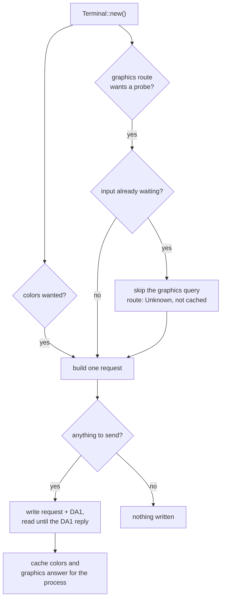
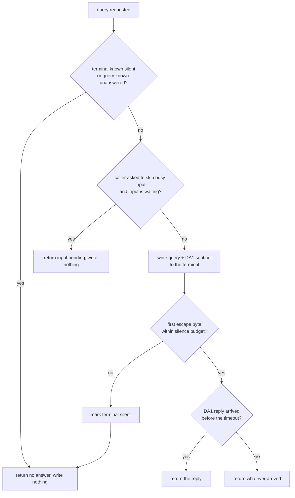

# Live Terminal Queries

Some facts about a terminal can only be learned by asking it: the background
and foreground colors (OSC 11 / OSC 10), the cursor color (OSC 12), whether it
renders Kitty graphics or Sixel (the graphics probe), the window size in pixels
(CSI 14 t), and the cursor position (DSR, `CSI 6 n`). `biscuit-terminal` asks
by writing an escape sequence to the terminal and reading the reply. This page
describes what that costs, when it is skipped, and how a program that reads
the terminal itself keeps the library out of its way.

## What you can rely on

- **A terminal that never answers costs one short wait per process.** The
  first query waits at most 500 ms for any reply. If nothing arrives, the
  terminal is recorded as silent, and every later query in the process returns
  "no answer" at once without writing anything to the terminal. The budget is
  not shorter because real terminals can be slow to answer: WezTerm was
  measured replying in 170-200 ms.
- **A terminal that answers, but not this question, costs no wait.** Each
  query is followed by a DA1 request (`CSI c`, "who are you?"), which
  virtually every terminal answers. Terminals reply in order, so once the DA1
  reply arrives, anything the terminal was going to say about the query has
  already arrived. A single-purpose query (cursor position, window pixels, a
  standalone color lookup) left unanswered at that point is not sent again in
  this process.
- **No busy waiting.** Reads block until a byte arrives or the deadline passes.
- **Building a `Terminal` costs at most one exchange.** The colors
  (`bg_color()`, `text_color()`) and, when the environment cannot decide it,
  the graphics probe share a single request whose result is cached for the
  life of the process, so building many `Terminal` values writes to the
  terminal once (see [The startup exchange](#the-startup-exchange)).
- **The graphics probe does not compete with typed input.** If input is
  already waiting when the exchange would start, the graphics query is not
  sent (see [Who owns input](#who-owns-input)).

```text
silent pty, whole process:   ESC]10;?  ESC]11;?  ESC[c      <- written once, 500 ms wait
                             (cell size, cursor position: nothing written)

terminal that answers DA1:   ESC]10;?  ESC]11;?  ESC[c   -> ESC[?62;22c   (no wait)
                             ESC[14t   ESC[c             -> ESC[?62;22c   (no wait, never re-sent)
```

## The startup exchange

`Terminal::new()` makes one live exchange per process. It always held the
OSC 10/11 color queries; when the [graphics route](./graphics-routes.md)
cannot be decided from the environment (an unidentified terminal, an SSH
session without forwarded hints, Zellij, and the other cases listed in
[When the probe runs](./graphics-routes.md#when-the-probe-runs)), the Kitty
graphics query is written in the same request:

```text
ESC]10;?  ESC]11;?  ESC_Gi=<id>,s=1,v=1,a=q,t=d,f=24;AAAA ESC\  ESC[c
```

The Kitty part is a complete query for a one-pixel image that is never
displayed. Its image ID (`i=`) is fresh and nonzero for every probe, and only
a complete reply carrying that ID counts, so a reply meant for another program
sharing the terminal is not mistaken for this one. The DA1 sentinel that
already ended the exchange answers the second question: attribute `4` in the
reply means Sixel. Graphics therefore add no extra round trip and no new
moment at which the library reads input.

Inside a visible tmux (`TMUX` set) that is 3.4 or later with the `sixel`
feature on every client, the graphics part is the DA1 request alone, with no
Kitty query (`ProbePlan::direct_da1_only`). tmux answers DA1 itself, which
tells the library whether tmux can draw Sixel on its own, and it treats an
unwrapped APC (`ESC _ … ESC \`) as a pane-title change, so a Kitty query
written as-is would retitle the pane `Gi=…` instead of reaching a terminal.
The probe result records `kitty: NoReply` and tmux's DA1 reply:

```text
ESC[c   -> ESC[?1;2;4c   (tmux built with Sixel; colors are not asked through tmux)
```

Whichever caller needs the exchange first, the color lookup or the graphics
route, sends every part the process needs, and both answers are cached
together. Each part keeps its own gate:

| Part | Sent when |
|------|-----------|
| OSC 10/11 colors | Stdout is a terminal, not CI, probing is not turned off, the terminal is on the color list (below), and no multiplexer (tmux, Zellij, GNU Screen) is in the way |
| Kitty graphics query | The graphics route asks for a probe and no input is waiting, except to a visible tmux asked about its own Sixel (DA1 only) |
| DA1 sentinel | Always, as the last part of any exchange that is sent |

So inside Zellij the colors are still not queried but the graphics query is:
extending graphics to a multiplexer does not turn on any other query there.



[Graphics Routes](./graphics-routes.md#the-graphics-probe) explains how each
reply becomes a route.

### The wrapped exchange

When the environment suggests a tmux the program cannot see (a tmux on the far
side of SSH: `TERM` names tmux or screen but neither `TMUX` nor `STY` is set),
the user declared one with `BISCUIT_GRAPHICS_TRANSPORT=tmux`, or a visible
tmux (`TMUX` set) would not say whether `allow-passthrough` is on, a second
exchange is sent at the same moment: the Kitty query and the DA1 sentinel,
each wrapped once for tmux passthrough. A visible tmux whose
`allow-passthrough` can be read is never probed: tmux reports the answer
itself.

```text
ESC P tmux; <the sequence with every ESC doubled> ESC \
```

Only a tmux with passthrough turned on forwards the wrapped bytes to the
terminal behind it, and tmux itself never answers them, so a reply to the
wrapped query proves the tmux transport. Because nothing answers the wrapped
sentinel when there is no such tmux, an unanswered wrapped exchange waits out
the silence budget (local) or the full timeout (remote), and its silence is
never recorded as "the terminal is silent": later queries still run.

## How one query runs



Two kinds of caller use this loop. The single-purpose lookups (cursor
position, CSI 14 t, a standalone OSC color query) read "DA1 with nothing
before it" as unanswered and remember the request, so it is never written
again in this process. The startup exchange reads the whole reply, DA1
included, because "answered DA1 but not the Kitty query" is itself an answer
about graphics. The wrapped exchange turns off "mark terminal silent", as
described above.

Every exchange collects at most 4 KiB, and the caller chooses the sentinel's
bytes, so a wrapped request is ended by a wrapped sentinel.

## Who owns input

A query has to read the terminal's input to see the reply, so whatever the
user types during an exchange is read too. Construction-time probing is
designed for a program that has not started reading input yet, such as a CLI
building its `Terminal` at startup.

- **Busy input.** If input is already waiting when the startup exchange would
  start, the graphics query is not sent and the route is `Unknown`
  ("skipped because input was waiting"). The colors are still queried, as
  they always were. The skip is not cached, so a later construction in the
  same process may still probe.
- **Typed keys on Unix** read during an exchange are discarded, as they were
  before the graphics probe existed.
- **A program with its own input loop** (a TUI) must not let the library
  query while it reads. It has three ways out:
  - build with `Terminal::builder().probe(ProbeMode::Off).build()`: nothing is
    written to the terminal during construction; the colors come from the
    environment fallbacks (`COLORFGBG`, per-terminal defaults, the system
    appearance), and the graphics route from the environment alone ("not
    probed: the caller turned probing off");
  - set `BISCUIT_TERMINAL_PROBE=off` in the environment, which does the same
    for any program without a code change;
  - supply a resolved route with `Terminal::builder().graphics_route(..)`
    (or `.image_support(..)`): a supplied route is never re-resolved and
    causes no graphics probe.

  Only the first construction in a process probes, so a TUI that wants probed
  values constructs its `Terminal` before its input loop starts.
- **Never from a running event loop.** Do not construct a probing `Terminal`
  from inside a TUI event loop or inside a synchronized-output block
  (mode 2026). The library cannot detect either; this is the caller's rule.

```rust
use biscuit_terminal::discovery::detection::ProbeMode;
use biscuit_terminal::terminal::Terminal;

// A TUI: decide everything before raw mode and the input loop begin.
let term = Terminal::builder().probe(ProbeMode::Off).build();
```

`BISCUIT_TERMINAL_PROBE` accepts exactly `auto` (the default) and `off`,
lowercase. It shares its validator with `BISCUIT_GRAPHICS` and
`BISCUIT_GRAPHICS_TRANSPORT`, so any other value (for example `OFF`) is a
configuration error: nothing is queried, the graphics route has no pixels,
and its reason lists the accepted values (see
[Invalid values](./graphics-routes.md#invalid-values)).

## When queries are skipped entirely

No query is written when stdout is not a TTY, when running in CI, or when
probing is turned off (`ProbeMode::Off` or `BISCUIT_TERMINAL_PROBE`). Colors
and cursor position are also not queried inside tmux, Zellij, or GNU Screen.

`bg_color()`, `text_color()`, and `cursor_color()` query only terminals known
to answer color queries (Kitty, WezTerm, iTerm2, Alacritty, Ghostty, Foot,
Contour, and on native Windows also Windows Terminal), and otherwise fall back
to `COLORFGBG` and per-terminal defaults.

The graphics probe is sent only when the environment cannot decide the route;
[Graphics Routes](./graphics-routes.md#when-the-probe-runs) lists when it runs
and when it never does.

## Platforms

The query loop above (deadline, silence budget, size cap, sentinel) is shared;
only the way the terminal is reached differs.

| Platform | How the terminal is reached | Queries |
|----------|-----------------------------|---------|
| macOS, Linux, WSL2 | `/dev/tty` in raw mode, read through `select(2)`; the terminal modes are restored afterwards | All of them |
| Native Windows | The console input and output handles (`CONIN$` / `CONOUT$`), with the console modes restored afterwards | Colors and the graphics probe; not cursor position or window pixels |

The request goes to the controlling terminal rather than stdout, so it reaches
the terminal even when stdout is captured.

On native Windows the console backend writes the request and its DA1
sentinel, reads with the same deadline and silence budget, and restores the
console modes when it is done. It serves both parts of the startup exchange,
so Windows Terminal reports its real foreground and background colors, which
also decide the light or dark theme there, instead of the per-terminal
default. Cursor position and CSI 14 t window pixels are still not queried on
native Windows.

Two Windows environments are never queried:

- **The Windows SSH server.** Its console host removes the Kitty and Sixel
  sequences anyway (see
  [Windows SSH server](./graphics-routes.md#windows-ssh-server)), and it
  stands between the program and the client's terminal, so neither the
  graphics probe nor the color queries are sent.
- **A legacy Windows console**: a native Windows process with no
  `WT_SESSION`, no `TERM_PROGRAM`, no `MSYSTEM`, and not in an SSH session.
  It answers no queries and renders no pixel format.

## Timing knobs

| Situation | Wait for the first reply byte | Whole exchange |
|-----------|-------------------------------|----------------|
| Local session | 500 ms | the query's timeout (1 s for the startup exchange, the wrapped exchange, colors, and cursor position; 100 ms for window pixels) |
| SSH or Mosh session | the query's timeout | the query's timeout |
| `BISCUIT_TERMINAL_QUERY_SILENCE_MS=<ms>` set | `<ms>`, capped at the query's timeout | the query's timeout |

The environment variable is for slow links the SSH/Mosh check cannot see
(for example a container shell over a remote connection), and for tests that
manufacture replies on a busy host.

A reply that arrives after the library has stopped waiting is read by whatever
reads the terminal next, typically the shell, and shows up as stray characters
at the prompt. A longer silence budget makes that less likely on a slow link.

## Caching

| What | Cached for | Notes |
|------|------------|-------|
| The startup exchange (colors and the direct graphics probe) | The process | Shared by every `Terminal` and every color lookup |
| The wrapped exchange | The process, separately | Never merged with the direct answer |
| A graphics query skipped because input was waiting | Not cached | A later construction may probe |
| A silent terminal | The process | Every later query returns at once |
| An unanswered single-purpose query | The process | Only cursor position, CSI 14 t, standalone OSC |

The graphics route itself is kept on each `Terminal`; the cell size an image
is drawn with is looked up separately and is not part of the probe cache.

## Stray input

Bytes that are not part of an escape sequence (typeahead, or the `^D` some pty
hosts inject when their input closes) do not count as a reply, so they neither
extend the wait nor keep a silent terminal from being recorded as silent. On
Unix they are consumed by the query, as they were before. On native Windows,
typed keys read during the exchange are written back to the console input
afterwards. They are appended, so a key typed in the instant between the
exchange's last read and the write-back arrives ahead of them.
