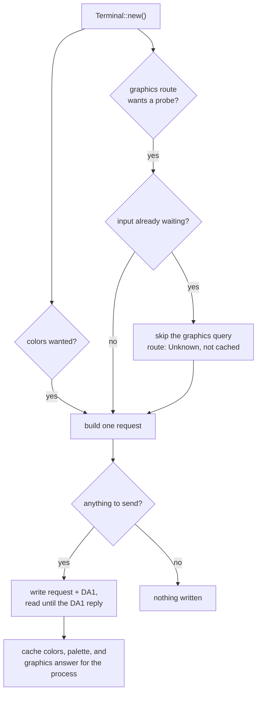
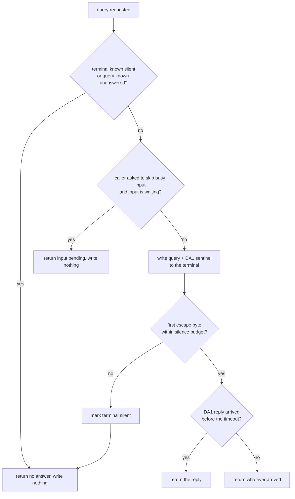

# Live Terminal Queries

Some facts about a terminal can only be learned by asking it: the background
and foreground colors (OSC 11 / OSC 10), the cursor color (OSC 12), the 16
ANSI palette colors (OSC 4), whether it
renders Kitty graphics or Sixel (the graphics probe), the window size in pixels
(CSI 14 t), the size of one character cell in pixels (CSI 16 t, native
Windows), and the cursor position (DSR, `CSI 6 n`). `biscuit-terminal` asks
by writing an escape sequence to the terminal and reading the reply. This page
describes what that costs, when it is skipped, and how a program that reads
the terminal itself keeps the library out of its way.

## What you can rely on

- **A terminal that never answers costs one short wait per process.** The
  first query waits at most 500 ms for any reply. If nothing arrives, the
  terminal is recorded as silent, and every later query in the process returns
  "no answer" at once without writing anything to the terminal. The budget is
  not shorter because real terminals can be slow to answer: WezTerm was
  measured replying in 170-200 ms.
- **A terminal that answers, but not this question, costs no wait.** Each
  query is followed by a DA1 request (`CSI c`, "who are you?"), which
  virtually every terminal answers. Terminals reply in order, so once the DA1
  reply arrives, anything the terminal was going to say about the query has
  already arrived. A single-purpose query (cursor position, window pixels, a
  standalone color lookup) left unanswered at that point is not sent again in
  this process.
- **No busy waiting.** Reads block until a byte arrives or the deadline passes.
- **Building a `Terminal` costs at most one exchange.** The colors
  (`bg_color()`, `text_color()`) and, when the environment cannot decide it,
  the graphics probe share a single request whose result is cached for the
  life of the process, so building many `Terminal` values writes to the
  terminal once (see [The startup exchange](#the-startup-exchange)).
- **The graphics probe does not compete with typed input.** If input is
  already waiting when the exchange would start, the graphics query is not
  sent (see [Who owns input](#who-owns-input)).

```text
silent pty, whole process:   ESC]10;?  ESC]11;?  ESC[c      <- written once, 500 ms wait
                             (cell size, cursor position: nothing written)

terminal that answers DA1:   ESC]10;?  ESC]11;?  ESC[c   -> ESC[?62;22c   (no wait)
                             ESC[14t   ESC[c             -> ESC[?62;22c   (no wait, never re-sent)
```

## The startup exchange

[`Terminal::new()`](../../lib/src/terminal.rs) makes one live exchange per process
([`startup_exchange.rs`](../../lib/src/discovery/startup_exchange.rs)). It holds the
OSC 10/11 color queries and, on every platform, the ANSI palette queries
(see [The ANSI palette](#the-ansi-palette-osc-4)); when the [graphics route](./graphics-routes.md)
cannot be decided from the environment (an unidentified terminal, an SSH
session without forwarded hints, Zellij, and the other cases listed in
[When the probe runs](./graphics-routes.md#when-the-probe-runs)), the Kitty
graphics query is written in the same request:

```text
ESC]10;?  ESC]11;?  ESC]4;0;? … ESC]4;15;?  ESC_Gi=<id>,s=1,v=1,a=q,t=d,f=24;AAAA ESC\  ESC[c
```

The Kitty part is a complete query for a one-pixel image that is never
displayed. Its image ID (`i=`) is fresh and nonzero for every probe, and only
a complete reply carrying that ID counts, so a reply meant for another program
sharing the terminal is not mistaken for this one. The DA1 sentinel that
already ended the exchange answers the second question: attribute `4` in the
reply means Sixel. Graphics therefore add no extra round trip and no new
moment at which the library reads input.

Whenever a tmux or GNU screen is in the path or likely (`TMUX` or `STY`
set, or a `TERM` suggesting a hidden tmux), the graphics part is the DA1
request alone, with no Kitty query
([`ProbePlan::direct_da1_only`](../../lib/src/discovery/detection/probe.rs)). tmux
treats an unwrapped APC (`ESC _ … ESC \`) as a pane-title change, so a Kitty
query written as-is would retitle the pane `Gi=…` instead of reaching a
terminal; GNU screen takes it as a hardstatus change. Inside a visible tmux
that is 3.4 or later with the `sixel` feature on every client, tmux answers
DA1 itself, which tells the library whether tmux can draw Sixel on its own.
The probe result records `kitty: NoReply` and tmux's DA1 reply:

```text
ESC[c   -> ESC[?1;2;4c   (tmux built with Sixel; colors are not asked through tmux)
```

On native Windows the exchange also asks for the cell size, because Windows
has no system call that reports it (see [Cell size](#cell-size)):

```text
ESC]10;?  ESC]11;?  ESC]4;0;? … ESC]4;15;?  ESC[16t  ESC[c   -> ... ESC[6;20;10t ESC[?61;4;...c
```

Whichever caller needs the exchange first, the color lookup, the palette
lookup, the graphics route, or (on native Windows) a cell-size lookup, sends
every part the process needs, and the answers are cached together. Each part keeps its own gate:

| Part | Sent when |
|------|-----------|
| OSC 10/11 colors | Stdout or stderr is a terminal, not CI, probing is not turned off, the terminal is on the color list (below), and no multiplexer (tmux, Zellij, GNU Screen) is in the way |
| OSC 4 palette, slots 0–15 | Exactly when the colors are, on every platform (native Windows included) |
| Kitty graphics query | The graphics route asks for a probe and no input is waiting, except to a visible tmux asked about its own Sixel (DA1 only) |
| Cell size (`CSI 16 t`) | Native Windows only, whenever the exchange is sent there; a cell-size lookup before any exchange sends one when the color gate passes |
| DA1 sentinel | Always, as the last part of any exchange that is sent |

So inside Zellij the colors are still not queried but the graphics query is:
extending graphics to a multiplexer does not turn on any other query there.



[Graphics Routes](./graphics-routes.md#the-graphics-probe) explains how each
reply becomes a route.

### The ANSI palette (OSC 4)

The palette is the 16 colors a user's theme assigns to the ANSI color
indices 0–15 (black, red, … bright white). The library asks for each slot
with its own `?` query, `ESC ] 4 ; <index> ; ? BEL`, in the startup exchange,
right after the OSC 10/11 colors. Nothing extra is waited for: terminals
answer in order, so the palette replies arrive before the DA1 reply that
already ends the exchange. The library only ever asks; it never writes a
palette entry, so the user's colors are never changed.

A terminal answers each query with `ESC ] 4 ; <index> ; <color>`, ended by
BEL (`\x07`) or ST (`ESC \`). The color is `rgb:` with one to four hex
digits per component, each scaled from its own width (`rgb:ff/…` and
`rgb:ffff/…` both mean 255), or `#rrggbb`:

```text
reply bytes:  ESC]4;1;rgb:cdcd/3131/3131 BEL  ESC]4;4;#2472c8 ESC\  ESC]4;9;rgb:f1/4c ESC[?62;22c
palette:      slot 1 = (205, 49, 49), slot 4 = (36, 114, 200), every other slot unknown
```

Slot 9 is unknown because its reply was cut short. Replies may arrive in any
order and mixed with other replies; a reply with a malformed color or an
index outside 0–15 is ignored. A slot with no usable reply is unknown, never
an error, and a terminal that answers none of them leaves the whole palette
unknown.

The palette shares the startup exchange's per-process cache: a terminal that
does not answer is not asked again in that process, and a silent one costs
the usual single bounded wait. It is not public API; `biscuit-visualized`
reads it through the hidden (left out of the API docs)
[`osc_queries::ansi_palette()`](../../lib/src/discovery/osc_queries/mod.rs) to build a
diagram's palette in the terminal: ANSI 1–6 become the diagram's accent
colors, and where the palette is unknown the accents are derived from the
detected background instead (see
[Terminal palettes](../../../biscuit-visualized/docs/merman.md#terminal-palettes)).

**Native Windows sends the OSC 4 query too**, through the same console query
backend as the OSC 10/11 colors (no Windows-specific query code), so a
Windows terminal that answers, such as Windows Terminal, gives diagrams its
own ANSI accents. One that stays silent leaves the palette unknown, and
diagrams use background-derived accents. The palette is also unknown wherever
the colors are not queried: no terminal on stdout or stderr, CI, tmux,
Zellij, GNU Screen, probing turned off, or a terminal not on the color list.

### The wrapped exchange

When the environment suggests a tmux the program cannot see (a tmux on the far
side of SSH: `TERM` names tmux or screen but neither `TMUX` nor `STY` is set),
the user declared one with `BISCUIT_GRAPHICS_TRANSPORT=tmux`, or a visible
tmux (`TMUX` set) would not say whether `allow-passthrough` is on, a second
exchange is sent at the same moment: the Kitty query and the DA1 sentinel,
each wrapped once for tmux passthrough. In each of these cases this is the
only Kitty query sent; the direct exchange carries DA1 alone or is not sent. A visible tmux whose
`allow-passthrough` can be read is never probed: tmux reports the answer
itself.

```text
ESC P tmux; <the sequence with every ESC doubled> ESC \
```

Only a tmux with passthrough turned on forwards the wrapped bytes to the
terminal behind it, and tmux itself never answers them, so a reply to the
wrapped query proves the tmux transport. Because nothing answers the wrapped
sentinel when there is no such tmux, an unanswered wrapped exchange waits out
the silence budget (local) or the full timeout (remote), and its silence is
never recorded as "the terminal is silent": later queries still run.

## How one query runs



Two kinds of caller use this loop. The single-purpose lookups (cursor
position, CSI 14 t, a standalone OSC color query) read "DA1 with nothing
before it" as unanswered and remember the request, so it is never written
again in this process. The startup exchange reads the whole reply, DA1
included, because "answered DA1 but not the Kitty query" is itself an answer
about graphics. The wrapped exchange turns off "mark terminal silent", as
described above.

Every exchange collects at most 4 KiB, and the caller chooses the sentinel's
bytes, so a wrapped request is ended by a wrapped sentinel.

## Who owns input

A query has to read the terminal's input to see the reply, so whatever the
user types during an exchange is read too. Construction-time probing is
designed for a program that has not started reading input yet, such as a CLI
building its `Terminal` at startup.

- **Busy input.** If input is already waiting when the startup exchange would
  start, the graphics query is not sent and the route is `Unknown`
  ("skipped because input was waiting"). The colors are still queried, as
  they always were. The skip is not cached, so a later construction in the
  same process may still probe.
- **Typed keys on Unix** read during an exchange are discarded, as they were
  before the graphics probe existed.
- **A program with its own input loop** (a TUI) must not let the library
  query while it reads. It has three ways out:
  - build with `Terminal::builder().probe(ProbeMode::Off).build()`
    ([`ProbeMode`](../../lib/src/discovery/detection/route.rs)): nothing is
    written to the terminal during construction; the colors come from the
    environment fallbacks (`COLORFGBG`, per-terminal defaults, the system
    appearance), and the graphics route from the environment alone ("not
    probed: the caller turned probing off");
  - set `BISCUIT_TERMINAL_PROBE=off` in the environment, which does the same
    for any program without a code change;
  - supply a resolved route with `Terminal::builder().graphics_route(..)`
    (or `.image_support(..)`): a supplied route is never re-resolved and
    causes no graphics probe.

  Only the first construction in a process probes, so a TUI that wants probed
  values constructs its `Terminal` before its input loop starts.
- **Never from a running event loop.** Do not construct a probing `Terminal`
  from inside a TUI event loop or inside a synchronized-output block
  (mode 2026). The library cannot detect either; this is the caller's rule.

```rust
use biscuit_terminal::discovery::detection::ProbeMode;
use biscuit_terminal::terminal::Terminal;

// A TUI: decide everything before raw mode and the input loop begin.
let term = Terminal::builder().probe(ProbeMode::Off).build();
```

`BISCUIT_TERMINAL_PROBE` accepts exactly `auto` (the default) and `off`,
lowercase. It shares its validator with `BISCUIT_GRAPHICS` and
`BISCUIT_GRAPHICS_TRANSPORT`, so any other value (for example `OFF`) is a
configuration error: nothing is queried, the graphics route has no pixels,
and its reason lists the accepted values (see
[Invalid values](./graphics-routes.md#invalid-values)).

## When queries are skipped entirely

No query is written when neither stdout nor stderr is a TTY, when running in CI, or when
probing is turned off (`ProbeMode::Off` or `BISCUIT_TERMINAL_PROBE`). Colors
and cursor position are also not queried inside tmux, Zellij, or GNU Screen.

`bg_color()`, `text_color()`, and `cursor_color()` query only terminals known
to answer color queries (Kitty, WezTerm, iTerm2, Alacritty, Ghostty, Foot,
Contour, and on native Windows also Windows Terminal), and otherwise fall back
to `COLORFGBG` and per-terminal defaults.

Only a reply is a measurement. `bg_color_with_source()`,
`text_color_with_source()`, and `cursor_color_with_source()` return the color
with its [`ColorSource`](../../lib/src/discovery/osc_queries/types.rs): `Measured` when the terminal answered the live query,
`Estimated` when it came from `COLORFGBG` or a per-terminal default.
`Terminal::background_source` carries the same for `Terminal::background_color`.
Under tmux, for example, nothing is queried, so WezTerm's background reads as
the per-terminal default `#1e1e1e`, `Estimated`, even when the real one is
`#282c34`. Image rendering never paints transparent pixels with an estimate
([Terminal Image](../components/terminal_image.md#sixel)), and `bt` labels each
color `measured` or `estimated` (the JSON `source` field).

The graphics probe is sent only when the environment cannot decide the route;
[Graphics Routes](./graphics-routes.md#when-the-probe-runs) lists when it runs
and when it never does.

## Platforms

The query loop above (deadline, silence budget, size cap, sentinel) is shared;
only the way the terminal is reached differs.

| Platform | How the terminal is reached | Queries |
|----------|-----------------------------|---------|
| macOS, Linux, WSL2 | `/dev/tty` in raw mode, read through `select(2)`; the terminal modes are restored afterwards | All of them |
| Native Windows | The console input and output handles (`CONIN$` / `CONOUT$`), with the console modes restored afterwards | Colors, the ANSI palette, the cell size, and the graphics probe; not cursor position or window pixels |

The request goes to the controlling terminal rather than stdout, so it reaches
the terminal even when stdout is captured.

On native Windows the console backend writes the request and its DA1
sentinel, reads with the same deadline and silence budget, and restores the
console modes when it is done. It serves every part of the startup exchange,
the OSC 4 palette included,
so Windows Terminal reports its real foreground and background colors, which
also decide the light or dark theme there, instead of the per-terminal
default. Cursor position and CSI 14 t window pixels are still not queried on
native Windows; the cell size is (see [Cell size](#cell-size)).

Two Windows environments are never queried:

- **The Windows SSH server.** Its console host removes the Kitty and Sixel
  sequences anyway (see
  [Windows SSH server](./graphics-routes.md#windows-ssh-server)), and it
  stands between the program and the client's terminal, so neither the
  graphics probe, the color queries, nor the cell-size query is sent. Images
  there are sized with the 8×16 estimate.
- **A legacy Windows console**: a native Windows process with no
  `WT_SESSION`, no `TERM_PROGRAM`, no `MSYSTEM`, and not in an SSH session.
  It answers no queries and renders no pixel format.

## Cell size

Images and pixel-drawn rules are sized from the pixel size of one character
cell. `Terminal::cell_size()` (and
[`discovery::fonts::cell_size()`](../../lib/src/discovery/fonts/window_size.rs)) returns
the measured size, or `None`, in which case the drawing code uses
[`CellSize::FALLBACK`](../../lib/src/discovery/fonts/types.rs) (8 px wide, 16 px tall).

| Platform | Where the size comes from | When it is read |
|----------|---------------------------|-----------------|
| macOS, Linux, WSL2 | The `TIOCGWINSZ` pixel fields divided by the grid; when the terminal leaves them at zero, CSI 14 t window pixels divided by the grid | Every lookup, so a font change is followed |
| Native Windows | The terminal's answer to `CSI 16 t` in the startup exchange, `CSI 6 ; <height> ; <width> t` | Once per process |

Windows Terminal answers `ESC[6;20;10t` for its default font: 20 px tall,
10 px wide. The answer is used only when both dimensions are between 1 and
1024 px; no answer, a zero (a terminal that does not know its pixels), or a
larger value leaves the size unmeasured, so the 8×16 estimate is used. The
reply is an escape sequence, so on Windows it is never written back to the
console input as typeahead.

The Windows answer is not asked again at render time. A cell's pixel size
follows the font, not the window, so resizing the window does not change it
(the column count, which does change, is read on every render). Asking again
would read console input while the program may be reading it. A font size
change during a long-running Windows program is therefore not seen until the
next process.

## Timing knobs

| Situation | Wait for the first reply byte | Whole exchange |
|-----------|-------------------------------|----------------|
| Local session | 500 ms | the query's timeout (1 s for the startup exchange, the wrapped exchange, colors, and cursor position; 100 ms for window pixels) |
| SSH or Mosh session | the query's timeout | the query's timeout |
| `BISCUIT_TERMINAL_QUERY_SILENCE_MS=<ms>` set | `<ms>`, capped at the query's timeout | the query's timeout |

The environment variable is for slow links the SSH/Mosh check cannot see
(for example a container shell over a remote connection), and for tests that
manufacture replies on a busy host.

A reply that arrives after the library has stopped waiting is read by whatever
reads the terminal next, typically the shell, and shows up as stray characters
at the prompt. A longer silence budget makes that less likely on a slow link.

## Caching

| What | Cached for | Notes |
|------|------------|-------|
| The startup exchange (colors, the ANSI palette, and the direct graphics probe) | The process | Shared by every `Terminal`, every color lookup, and the palette lookup |
| The wrapped exchange | The process, separately | Never merged with the direct answer |
| A graphics query skipped because input was waiting | Not cached | A later construction may probe |
| A silent terminal | The process | Every later query returns at once |
| An unanswered single-purpose query | The process | Only cursor position, CSI 14 t, standalone OSC |
| The cell size on native Windows | The process | Part of the startup exchange; see [Cell size](#cell-size) |

The graphics route itself is kept on each `Terminal`. On macOS, Linux, and
WSL2 the cell size an image is drawn with is measured again for each lookup
and is not part of the probe cache.

## Stray input

Bytes that are not part of an escape sequence (typeahead, or the `^D` some pty
hosts inject when their input closes) do not count as a reply, so they neither
extend the wait nor keep a silent terminal from being recorded as silent. On
Unix they are consumed by the query, as they were before. On native Windows,
typed keys read during the exchange are written back to the console input
afterwards. They are appended, so a key typed in the instant between the
exchange's last read and the write-back arrives ahead of them.
