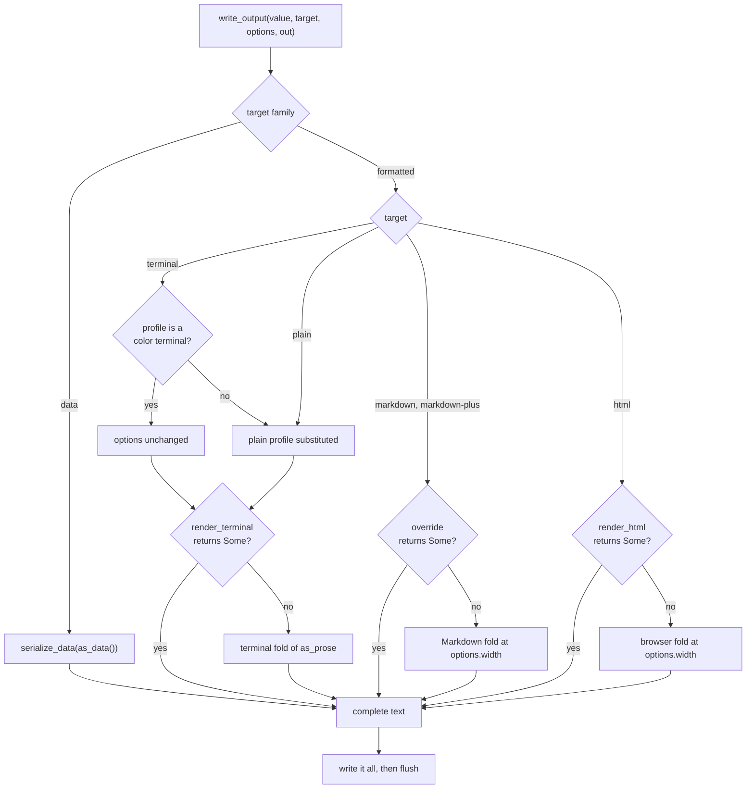
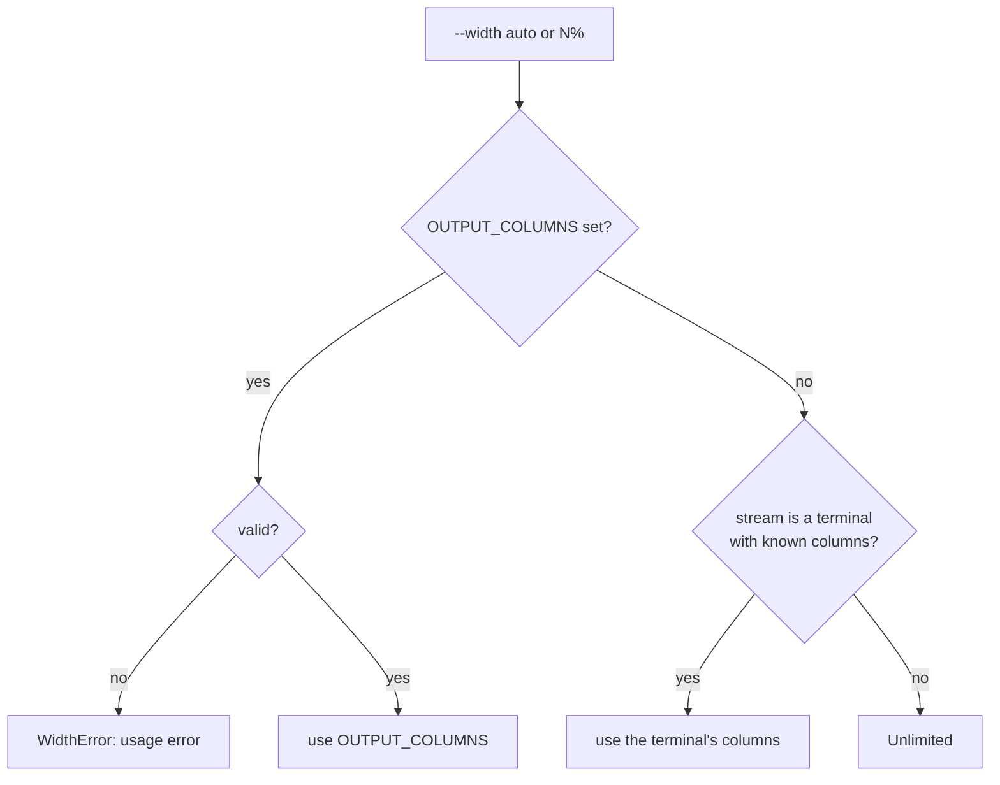

# Command Output Dispatch

`biscuit_terminal::output` prints a command's result in whichever output the user
asked for with `--output`, at whatever width `--width` resolves to. Call one
function and you get styled terminal text that degrades correctly on a pipe, plain
text with no escape bytes, Markdown, HTML, or serialized data.

The result implements `renderable::CommandOutput`, which supplies a render-tree
document for the formatted outputs and a serializable value for the data outputs.
See [Command Output](../../renderable/docs/command-output.md) for how to implement
it, and for `OutputOptions`, `TerminalProfile`, and the `Width` enum this page
uses.

## Quick start

Everything a CLI does between parsing its arguments and exiting:

```rust
use biscuit_terminal::output::{
    OutputTarget, parse_width_request, resolve_width, write_output,
};
use biscuit_terminal::terminal::Terminal;
use renderable::OutputOptions;
# use renderable::CommandOutput;
# fn print(report: &impl CommandOutput, output: &str, width: &str, verbose: u8)
#     -> Result<(), Box<dyn std::error::Error>> {

let target: OutputTarget = output.parse()?;

let terminal = Terminal::new();
let resolved = resolve_width(
    parse_width_request(width)?,
    std::env::var("OUTPUT_COLUMNS").ok().as_deref(),
    terminal.detected_columns(),
)?;

let options = OutputOptions::new(resolved.width, terminal.output_profile())
    .with_verbosity(verbose);

write_output(report, target, &options, &mut std::io::stdout().lock())?;
# Ok(())
# }
```

A malformed `--output` or `--width` is a usage error, so report it as one (exit
status 2). `resolved.warning` holds any warning width resolution produced: deliver
it on stderr for a formatted output and inside the payload for a data output,
which leaves stderr empty.

The library reads no environment variable and detects nothing during dispatch.
The caller captures `OUTPUT_COLUMNS` and builds the profile, then passes them in.
That keeps a render reproducible in a test.

## Targets and families

`OutputTarget` is the one enum of everything `--output` can name.

| Target | Family | Source | What you get |
|---|---|---|---|
| `Terminal` | formatted | `as_prose()` | styled text, degraded to what the terminal supports |
| `Plain` | formatted | `as_prose()` | text with every style removed; never an escape byte |
| `Markdown` | formatted | `as_prose()` | Markdown that is ergonomic to author and to read |
| `MarkdownPlus` | formatted | `as_prose()` | Markdown using inline HTML for richer presentation; equal to `Markdown` where there is no richer form |
| `Html` | formatted | `as_prose()` | HTML |
| `Json` | data | `as_data()` | pretty-printed JSON |
| `Json5` | data | `as_data()` | JSON5 |
| `Yaml` | data | `as_data()` | YAML |
| `Toml` | data | `as_data()` | TOML |

A command accepts whole families, never part of one.

```rust
use biscuit_terminal::output::{OutputFamily, OutputTarget};

let target: OutputTarget = "markdown-plus".parse().unwrap();
assert_eq!(target.as_str(), "markdown-plus");
assert_eq!(target.family(), OutputFamily::Formatted);
assert_eq!(target.extension(), "md");

// `browser` is the one accepted alias.
assert_eq!("browser".parse::<OutputTarget>(), Ok(OutputTarget::Html));
assert!("auto".parse::<OutputTarget>().is_err());
```

`OutputTarget::ALL` lists every target, formatted family first; `is_data()` is the
family test a command needs most often; and `extension()` names the file an
artifact of that target is saved with. A value that names no target parses to
`UnknownOutputTarget`.

## Writing the output

`write_output` folds the value to the target and writes the result to any
`std::io::Write`.



**Output is buffered.** The value is rendered or serialized completely before the
first byte is written, so a failure never leaves partial output on stdout. A TOML
failure halfway through a payload writes nothing at all.

The terminal fold `write_output` uses has no code renderer or diagram hook
installed, so code prints as fenced text. A CLI that wants syntax highlighting
overrides `render_terminal` and folds with
`TerminalRenderOptions::from_output_options` plus
[its hooks](./render-tree.md).

`write_output` discards the diagnostics the folds report. To deliver them, call
`render_output`, which returns a `RenderedOutput { text, diagnostics }` without
writing anything. Its `diagnostics` come from whichever generic fold ran; an
override reports none here and delivers its own.

### Errors

`OutputError` has three kinds:

| Kind | When | Carries |
|---|---|---|
| `Render` | a generic fold failed | `target` and the fold's `RenderError` |
| `Serialize` | the data cannot be serialized or represented in the target format | `target`, `message`, and `path`, a JSON-pointer-style path to the offending value when one value is to blame |
| `Io` | writing or flushing the finished output failed | the `std::io::Error` |

### Data outputs

`serialize_data` is the data half of the dispatch, and you can call it directly.
All four formats are converted from one JSON value, so they carry the same data,
and every output ends with a newline.

TOML has no `null`, its integers are signed 64-bit, and it needs a table at its root,
so it follows these rules:

| Input | TOML output |
|---|---|
| an object field whose value is `null`, at any depth | the field is omitted |
| a `null` inside an array | an `OutputError::Serialize` naming the path, such as `/items/2`, because omitting it would change the array |
| an integer above `i64::MAX` | written as its decimal text, such as `"18446744073709551615"` |
| a root that is a scalar or an array | written as `value = …` |
| a `null` root | an empty document |

```rust
use biscuit_terminal::output::{OutputTarget, serialize_data};

let data = serde_json::json!({ "name": "x", "note": null });
assert_eq!(serialize_data(&data, OutputTarget::Toml).unwrap(), "name = \"x\"\n");
assert_eq!(serialize_data(&3, OutputTarget::Toml).unwrap(), "value = 3\n");

let err = serialize_data(&serde_json::json!({ "items": [1, null] }), OutputTarget::Toml);
assert!(err.unwrap_err().to_string().contains("`/items/1`"));
```

## Resolving the width

`parse_width_request` reads a `--width` value into a `WidthRequest`, and
`resolve_width` turns that into a `ResolvedWidth`: the `Width` to render at, plus
an optional warning.

| `--width` | `WidthRequest` | Resolves to |
|---|---|---|
| `auto` | `Auto` | `OUTPUT_COLUMNS` if set, else the terminal's columns, else `Unlimited` |
| `N` | `Columns(n)` | `N` columns; `OUTPUT_COLUMNS` and the terminal are not consulted |
| `N.M` | `Fractional(f)` | `N` columns, with a warning that the width takes whole numbers |
| `N%` | `Percent(p)` | `N` percent of `OUTPUT_COLUMNS`, else of the terminal, floored; `Unlimited` when neither is known |
| `source` | `Source` | `Width::Source`: authored line breaks stay |
| `unlimited` | `Unlimited` | `Width::Unlimited`: nothing wraps and nothing fills, even on a terminal of known width |



```rust
use biscuit_terminal::output::{parse_width_request, resolve_width};
use renderable::Width;

let request = parse_width_request("50%").unwrap();
let resolved = resolve_width(request, Some("120"), Some(80)).unwrap();
assert_eq!(resolved.width, Width::Columns(60));

// No width is known: the answer is Unlimited, never a guess of 80 columns.
let auto = parse_width_request("auto").unwrap();
assert_eq!(resolve_width(auto, None, None).unwrap().width, Width::Unlimited);
```

The rules worth knowing:

- **`OUTPUT_COLUMNS` is read only when needed.** A bad value fails `auto` or a
  percentage with `WidthError::InvalidOutputColumns`, but never an explicit
  `--width 72`.
- **Pass the columns of the stream you are writing, and only when it is a
  terminal.** `Terminal::detected_columns()` returns stdout's columns, or `None`
  on a pipe. It does not read `COLUMNS`. A CLI that honors `COLUMNS` reads it once
  at startup and passes the value as the terminal columns on a stream that is a
  terminal.
- **Every invalid value is a usage error.** `WidthError` covers a malformed value,
  one that floors to zero columns, one above `u32::MAX`, and a bad
  `OUTPUT_COLUMNS`. A percentage above 100 is allowed.

### Stderr has its own width

`--width` and `OUTPUT_COLUMNS` describe the deliverable. Text written to stderr
never uses them, because stdout can go to a file while stderr goes to a terminal.
`stderr_terminal_columns()` measures stderr, and `resolve_stderr_width` gives the
width to use: those columns, or `Unlimited` when stderr is not a terminal.

```rust
use biscuit_terminal::output::{resolve_stderr_width, stderr_terminal_columns};

let width = resolve_stderr_width(stderr_terminal_columns());
```

## The plain profile

`plain` and a degraded `terminal` run through the same code as `terminal`, with
`TerminalProfile::plain()` in the options. There is no separate plain renderer.

`terminal_target_options` makes that substitution, and the dispatch calls it for
you. `plain` always gets the plain profile. `terminal` gets it too when
`degrades_to_plain()` holds: the stream is not a terminal, or the terminal has no
color. Any other target returns the options unchanged. The substitution comes
after every other choice, so nothing in the options can restore a capability it
removes.

```rust
use biscuit_terminal::output::{OutputTarget, terminal_target_options};
use biscuit_terminal::terminal::Terminal;
use renderable::{OutputOptions, TerminalProfile, Width};

let rich = OutputOptions::new(
    Width::Columns(80),
    Terminal::new_optimistic(80).output_profile(),
);
let plain = terminal_target_options(OutputTarget::Plain, &rich);
assert_eq!(plain.terminal_profile, TerminalProfile::plain());
assert_eq!(terminal_target_options(OutputTarget::Terminal, &rich), rich);
```

When the fold sees the plain profile it pins the render: the output holds no escape
sequence of any kind and no trailing whitespace, and structure that carries meaning
prints as text.

| Element | Printed as |
|---|---|
| bold, italic | the text, without markers |
| heading | its text alone, without `#` |
| block quote | each line prefixed `> ` |
| horizontal rule | `---` |
| table | keeps its box-drawing borders, which are structure |
| disclosure section | its summary, then its contents as ordinary blocks, with no bar |
| inline code | keeps its backticks |
| code block | keeps its fences and language tag; never cut |
| link, image | the [non-clickable rule](#links-and-images-that-cannot-be-clickable) |

```text
Setup

Run `just install`.

> Quoted text keeps a visible marker.

---

┌──────┬───────┐
│ Name │ Type  │
├──────┼───────┤
│ id   │ ulid  │
└──────┴───────┘
```

This structure applies when the plain profile is pinned, not whenever a terminal
merely has no color. A component rendered directly on a colorless `Terminal` loses
its color and keeps its own form of a quote or rule. Use `write_output` or
`render_terminal_output` to get the rules above.

## What `Unlimited` does to components

Under `Width::Unlimited` nothing wraps and nothing fills. `Width::Source` behaves
the same way and also keeps authored soft breaks. Neither is a large number
standing in for "no limit": the terminal fold asks each component for its intrinsic
natural width, so one horizontal rule cannot become a megabyte of glyphs.

| Component | Under `Columns(n)` | Under `Unlimited` |
|---|---|---|
| prose paragraph | joined, wrapped at `n` | joined, never wrapped |
| code block | lines unchanged; cut at `n` in a styled terminal, whole in `plain` | lines unchanged |
| table | planned to fit `n`, cells wrap | natural column widths, no cell wrapping |
| horizontal rule | `n` glyphs when styled; `---` in `plain` | 3 glyphs when styled; `---` in `plain` |
| block quote and disclosure bar | content wraps inside the bar | a bar on each line; content never wraps |
| two columns | columns share `n` | each at its natural width; a `ch` left column keeps its width; the right column is never padded |
| layout box with `Auto` or `FitContent` width | resolved against `n` | the content's natural width, with no alignment offset |
| layout box with `max-width`, or a `Fixed` width | resolved against `n` | **still caps** the content when it is a `ch` length |
| left margin, padding, list and quote indentation | applied | applied, because they are not fills |

A percentage has nothing to resolve against, so a `%` margin, padding, width, or
`max-width` comes to zero, which leaves that margin and padding off and applies no
cap.

```rust
use renderable::Width;

// `max-width: 60ch` still applies when nothing else bounds the output.
assert_eq!(Width::Unlimited.capped_at(60), Width::Columns(60));
```

An installed code renderer receives the width through `TerminalCodeContext`. A
renderer that paints a band should pad to the block's longest line plus its padding
when the width is not `Columns`, as there is nothing else to fill to.

## Code, links, and images without capabilities

### Code

Removing styling does not remove meaning: a reader or a script can still tell code
from prose. In `plain`, and on a terminal that cannot style code, inline code keeps
its backticks and a code block keeps its fences and language tag.

````text
Run `md compose` first.

```yaml
name: string(required)
```
````

Code is never wrapped. A styled terminal cuts a too-long row at `Columns(n)`, with
no ellipsis; `plain`, a colorless render, and any unbounded width print every row
whole.

### Links and images that cannot be clickable

One rule covers every link that cannot be clicked, in `plain` and on a terminal
without OSC 8 support. It keeps the output clean by default, and the `-v` count on
`OutputOptions::verbosity` (or `Prose::with_verbosity`) asks for the destinations.

| Element | Default | Verbosity 1 or more |
|---|---|---|
| link | `text` | `text <url>` |
| link whose text equals its URL | `url`, once | `url`, once |
| image | `IMAGE[alt]` | `image: alt <path>` |

The URL printed is the link's authored destination, not a resolved `file://` URL.
The image rule applies whenever an image falls back to text, whatever the OSC 8
support.

An image draws inline only when the terminal has a graphics route and the
destination is a relative path to an existing local file of at most 10 MiB.
The path resolves from the document's directory by the same rules as a `./` or
bare [file reference](../../biscuit-file/docs/topics/file-references.md), so
`../` may climb anywhere inside the enclosing repository; outside a repository
it may not climb above the document's directory. A remote URL, an absolute
path, a `~`/`@`/`&`/`^`/`vault:` reference, or a path that leaves that tree
falls back to text.

```text
repo/
├── assets/logo.png
└── package/just.md      → draws
                               → IMAGE[x]
```

A printed URL is one **unbreakable word**. When it does not fit on the current line
it moves to a line of its own, and when it is wider than the width it overflows
rather than being split or hyphenated.

```text
See the docs
<https://example.com/a/very/long/path/to/the/documentation/page.html>
for details.
```

Because URLs disappear by default, never put information only in a link's URL. If a
reader needs a path and line, make them the link's visible text.

## OSC 8 parameters

OSC 8 is the escape sequence that makes terminal text clickable. It has a URI field
and a parameter field. A link carrying `LinkMetadata` (see
[Link metadata](../../renderable/docs/command-output.md#link-metadata)) writes a
bare URI, with its query and fragment removed, and moves those facts to the
parameter field as colon-separated `key=value` pairs:

1. `line`, then `column`
2. `heading`: the metadata's `heading`, else the destination's fragment
3. every other key, sorted

```rust
use biscuit_terminal::render_tree::osc8_parameters;
use renderable::output::link_metadata::{LinkMetadata, QueryParams};

let metadata = LinkMetadata {
    query: QueryParams::from_iter([("line", 14_u64), ("column", 83)]),
};
let (uri, params) = osc8_parameters("file:///repo/types.md#setup", &metadata);
assert_eq!(uri, "file:///repo/types.md");
assert_eq!(params, "line=14:column=83:heading=setup");
```

The parameter field cannot carry every character. A pair is **omitted** when its key
or value contains `:`, `;`, or a control character, or when its key is empty or
contains `=`. A link without metadata keeps its destination, fragment included, and
an empty parameter field.

## Components that render to a `Terminal`

Some components take a `Terminal` rather than going through the render tree.
`Terminal::from_output_options` builds one holding exactly what the options state.
Nothing is detected, so a plain profile cannot pick up a capability from the host.

```rust
use biscuit_terminal::components::renderable::TerminalRenderable;
use biscuit_terminal::prelude::Prose;
use biscuit_terminal::terminal::Terminal;
use renderable::{OutputOptions, TerminalProfile, Width};

let options = OutputOptions::new(Width::Columns(40), TerminalProfile::plain());
let terminal = Terminal::from_output_options(&options);
let text = Prose::new("Hello").with_verbosity(options.verbosity).render(&terminal);
```

The reverse direction is `Terminal::output_profile`, which copies what detection
found into a `TerminalProfile`.

The terminal keeps the width's state, not a number standing in for it. Under
`Unlimited` or `Source` it has no columns: `terminal.columns()` is `None` and
`terminal.output_width()` returns the variant. A component that receives this
terminal renders at its natural size, the same as `render_terminal_output` would.

| Component | With `Columns(40)` | With `Unlimited` or `Source` |
|---|---|---|
| `HorizontalRule` | 40 glyphs | `---` in a plain profile; 3 glyphs in a styled one, never an image |
| `Table` | fitted to 40, cells wrap | natural column widths, no cell wraps |
| `Prose`, `Status`, `BlockQuote`, lists | wrapped at 40 | not wrapped |
| anything centered or right-aligned | placed within 40 | placed at the left, with no padding |
| `TerminalImage`, `MermaidDiagram` | sized against 40 | their natural size |

```rust
use biscuit_terminal::components::horizontal_rule::HorizontalRule;
use biscuit_terminal::components::renderable::TerminalRenderable;
use biscuit_terminal::terminal::Terminal;
use renderable::{OutputOptions, TerminalProfile, Width};

let options = OutputOptions::new(Width::Unlimited, TerminalProfile::plain());
let terminal = Terminal::from_output_options(&options);
assert_eq!(terminal.columns(), None);
assert_eq!(HorizontalRule::new().render(&terminal), "---");
```

A component that fills or wraps reads `columns()`. `Terminal::width()` only answers
when a number is all a caller needs: on a terminal with no width it returns 80, the
same answer as a terminal whose size cannot be determined. Three things still size
themselves from that number, because they need a concrete budget before they can
measure anything: a `TwoColumn` holding a `TerminalImage` (its cursor overlay needs a
column grid), a `GraphExpression` image, and a `GitGraph` viewport.

Setting `fixed_width` on such a terminal narrows it to that number of columns, which
is how a container gives a child a real width. A terminal from `Terminal::new()` or a
builder always has columns; only an output route produces one without.

## See also

- [Command Output](../../renderable/docs/command-output.md): the trait, options,
  profile, and width enum.
- [Render-Tree Hooks](./render-tree.md): adding syntax highlighting and diagrams to
  a terminal override.
- [Prose](./components/prose.md#graceful-degradation): how Prose degrades on its own.
