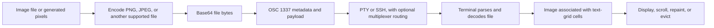

# iTerm2 inline images protocol

Research checked on October 13, 2026. Terminal behavior and crate versions are a snapshot; support must be established for the actual emulator, version, and connection path.

The iTerm2 inline images protocol (IIP) lets an application insert full-color images into terminal output by sending an encoded image file through the terminal connection. Its natural use is a photo, chart, thumbnail, or document preview alongside text. It is a publicly documented, proprietary terminal extension maintained by the iTerm2 project, rather than an ECMA or ISO standard. The originating emulator is macOS-only; applications speaking the protocol can run on other operating systems and send their output to compatible emulators. The canonical starting point is the [iTerm2 image documentation](https://iterm2.com/documentation-images.html).

## History and authorship

**George Nachman introduced image display in iTerm2 on January 13, 2014.** The [original commit](https://github.com/gnachman/iTerm2/commit/17da0bc310ca58cdfe1a6b3d4fe4067406a4fb5e) identifies him as the author and adds image insertion using an earlier `BeginFile` mechanism under OSC 50. This is an implementation-origin date, not a claim that the current OSC 1337 syntax shipped unchanged that day.

The feature grew out of file transfer: Nachman's [January 6, 2014 commit](https://github.com/gnachman/iTerm2/commit/61abc180ef8dea3cc7a25975707cdd01daaa741f) added Base64 file downloading. Further [January 17 work](https://github.com/gnachman/iTerm2/commit/f9db7cf791185841cdf87f68b031c2d011ab7ed7) added `imgcat`, `imgls`, and aspect-preserving fitting. This explains why graphics and downloads still share a command family.

Later milestones:

- **2014:** images were available in development builds. In the [July 15 release discussion](https://news.ycombinator.com/item?id=8035022), Nachman described parsing/rendering changes in the nightlies; the discussion also distinguishes nightly image support from the stable 2.0 release.
- **May 12, 2015:** animated GIF support arrived in build `2.9.20150512`.
- **2016:** release 3.0.10 moved image decoding into a sandboxed process; see the [release history](https://iterm2.com/downloads.html).
- **3.2.0:** Retina sizing changed to use display pixels rather than treating each image pixel as a logical point.
- **3.5:** multipart file transfer was added. The GIF, Retina, and multipart milestones are recorded in the [protocol documentation](https://iterm2.com/documentation-images.html).

The OSC namespace also changed from 50 to 1337 to avoid an xterm conflict, as explained in the [escape-code reference](https://iterm2.com/documentation-escape-codes.html). “iTerm2 graphics” now needs disambiguation: the emulator also supports the separate Kitty graphics protocol; speaking IIP and running inside iTerm2 are different facts.

## Resolution, dimensions, formats, and color

### No fixed resolution menu

There is no protocol-defined list such as 720p, 1080p, or 4K. Source dimensions come from the encoded image file. Destination dimensions are separate parameters: an image containing 1920 × 1080 pixels can be fitted into a much smaller terminal region. The sender does not supply a separate mandatory source-width/source-height pair as it would for raw Kitty RGB data.

The [typed dimension implementation in termwiz](https://docs.rs/crate/termwiz/0.23.3/source/src/escape/osc.rs) models four forms:

- `width=60`: 60 character cells; height has the same unit syntax.
- `width=600px`: pixels.
- `width=50%`: half the session width; height percentages use session height.
- `width=auto`: infer the dimension from the image and other sizing information.

`preserveAspectRatio=1`, the default, fits the image within its requested bounds without stretching. `preserveAspectRatio=0` allows distortion to fill the requested rectangle. For example, `width=60;height=20` on a terminal with 10 × 20-pixel cells describes 600 × 400 pixels of space, not 60 × 20 source pixels. A 1200 × 800 source fits that rectangle at half scale. These are geometry calculations, not emulator conformance measurements.

### Practical acceptance limits belong to implementations

Neither an arbitrary source resolution nor an arbitrarily large transfer is guaranteed. Decoders, graphics memory, parser limits, image caches, and available screen space all matter. Important distinctions include:

- **iTerm2:** the inspected [image serialization code](https://github.com/gnachman/iTerm2/blob/master/sources/InlineImages/iTermImage.m) rejects decoded dimensions at or above 10,000 pixels per axis when reconstructing its image object. Its [sandboxed decoder](https://github.com/gnachman/iTerm2/blob/master/iTerm2SandboxedWorker/iTermImage%2BImageWithData.m) separately scales large unknown/vector-type images to a maximum side of 4096. These are different implementation paths, not a universal IIP “10,000 × 10,000 supported” promise.
- **xterm.js image add-on:** [default options](https://github.com/xtermjs/xterm.js/blob/master/addons/addon-image/src/ImageAddon.ts) set `pixelLimit` to 16,777,216, `iipSizeLimit` to 33,554,432 bytes, and image storage to 128 MB. The pixel limit is an area bound, not a requirement that every image be square. Integrators can configure these values.
- **Wormhole:** its [published limits](https://getwormhole.app/docs/inline-images) include 10,000 pixels per side, 16 million decoded pixels, and 32 MiB of encoded data per image. Again, those are that terminal's policy.

A 3840 × 2160 RGBA bitmap occupies about 31.6 MiB before image/decoder overhead; 7680 × 4320 occupies about 126.6 MiB. Compressed PNG or JPEG size can be much smaller, but does not establish decoded memory cost. Thus 4K can be feasible while an 8K source can exceed another terminal's pixel budget. Downsample to the useful display area and impose both encoded-byte and decoded-pixel limits in an application.

### Retina, cell geometry, and resizing

Do not confuse image pixels, logical display points, and physical display pixels. iTerm2's [cell-size query](https://iterm2.com/documentation-escape-codes.html#report-cell-size) is:

```text
ESC ] 1337 ; ReportCellSize ST
```

Its reply supplies **height, width**, and optionally a scale factor. The dimensions are floating-point logical points; multiplying by scale gives physical pixels. For example, height 17.5, width 8, scale 2 describes a physical cell of 16 × 35 pixels. This order is easy to reverse accidentally.

Measure the terminal, not the monitor. Recompute layout after font or window changes. Specifying cell bounds lets the emulator perform much of the sizing; client-side resizing still reduces bandwidth. Percentage sizing should be treated as an instruction at insertion time, not a portable promise that an existing image will reflow like a browser element. The [xterm.js interaction rules](https://github.com/xtermjs/xterm.js/blob/master/addons/addon-image/README.md) describe cell-preserving font rescaling and possible fragmentation during text reflow.

### Images are complete files, not raw framebuffer bytes

PNG is the safest baseline for lossless images and alpha; JPEG is useful for photographs. IIP itself does not standardize a raw RGB/RGBA format, channel depth, color profile, HDR behavior, or vector drawing command set. Image-container semantics and terminal decoders determine the result.

The [iTerm2 decoder](https://github.com/gnachman/iTerm2/blob/master/iTerm2SandboxedWorker/iTermImage%2BImageWithData.m) uses macOS image representations, extracts animation frames where supported, rasterizes the first PDF page, and has a path for SVG/other representations. This broader format handling belongs to iTerm2, not every implementation of the wire protocol. Rasterize SVG/PDF to PNG in the application when portability matters.

The [xterm.js add-on](https://github.com/xtermjs/xterm.js/blob/master/addons/addon-image/README.md) lists PNG, JPEG, GIF, QOI, WebP, and AVIF, but does not animate images and leaves most decoding to the browser. Wormhole documents GIF's first frame. A successfully displayed static GIF therefore does not prove animation support. Alpha inside a PNG also does not imply that an emulator offers arbitrary compositing between overlapping images and text.

## Architecture and wire representation

### File transport attached to a terminal text grid

A useful application model is “send this file and insert its image at the current cursor.” The terminal decodes the file and associates the resulting image with screen cells. It may retain pixels internally for scrolling and repainting, but the base protocol does not give the application Kitty-style image IDs and independently managed placements.

In iTerm2, [image information](https://github.com/gnachman/iTerm2/blob/master/sources/InlineImages/iTermImageInfo.m) includes original data, cell coverage, filename, animation state, and cached resized frames. These are implementation details; a sender cannot rely on their internal identifiers as a public protocol API.



### Original single-message transfer

The basic framing is illustrated below. `ESC` means byte `0x1b`, `BEL` means `0x07`, and `ST` can be the two bytes `ESC` followed by backslash. Spaces in the diagram are for readability; they are not sent.

```text
ESC ] 1337 ; File = key=value;key=value : BASE64_FILE_BYTES BEL
```

For example, this header requests an inline image at 40 cells wide:

```text
ESC ] 1337 ; File=inline=1;width=40;preserveAspectRatio=1:... BEL
```

The ellipsis must be replaced with Base64 of a real image file. Base64 of raw pixel bytes is not sufficient.

The inspected [termwiz parser and serializer](https://docs.rs/crate/termwiz/0.23.3/source/src/escape/osc.rs) establish the core metadata contract:

- `inline=1` selects image insertion. Its default is false, selecting file download where implemented.
- `name` contains a Base64-encoded filename, not a path the terminal opens to fetch pixels.
- `size` is the original file-byte count, not the Base64 length, decoded-pixel count, or display size. It is optional progress metadata.
- `width`, `height`, and `preserveAspectRatio` select display geometry.

Header keys are case-sensitive. Encode the filename and file contents independently, with standard Base64 and no inserted line breaks. The original file remains an encoded file after transmission: PNG compression is inside PNG, JPEG compression inside JPEG. There is no generic IIP equivalent of Kitty's `o=z` transport compression flag.

The filename is metadata. Unlike Kitty's file/shared-memory media, IIP does not instruct the terminal to open the sender's filesystem path. This makes the same byte-transfer approach useful over SSH, in containers, or from WSL2, provided the receiving terminal understands it.

### Multipart transfer

iTerm2 3.5 added this sequence family:

```text
ESC ] 1337 ; MultipartFile=inline=1;width=40 BEL
ESC ] 1337 ; FilePart=BASE64_PART_1 BEL
ESC ] 1337 ; FilePart=BASE64_PART_2 BEL
ESC ] 1337 ; FileEnd BEL
```

The [protocol specification](https://iterm2.com/documentation-images.html) gives a 1,048,576-byte per-sequence limit for iTerm2/newer tmux, and a 256-byte limit for older tmux. These are message limits, not a fixed source resolution or total-file allowance. Account for headers, termination, and wrapping overhead.

The current [upstream `imgcat`](https://github.com/gnachman/iTerm2/blob/master/OtherResources/Utilities/imgcat) splits the encoded data into 200-character parts. That is a conservative compatibility choice, not a protocol requirement that every client use 200. Prefer encoding one stream and splitting on four-character Base64 boundaries. If independently encoding raw chunks, align nonfinal chunks to three bytes so intermediate padding does not corrupt a concatenated Base64 stream.

Multipart support is a separate capability from original `File=` support. The inspected [Konsole parser](https://github.com/KDE/konsole/blob/master/src/Vt102Emulation.cpp) handles multipart commands; other backends discussed below only emit the original form. Do not assume a Rust library chunks merely because it supports IIP, or that several writes inside one OSC message bypass the terminal's sequence-length limit. Serialize each image transfer so other producers do not interleave conflicting image commands.

### Cursor movement, lifetime, and removal

Images occupy terminal cells and participate in scrolling. Cursor movement, partial-cell rounding, insertion near the bottom margin, overwritten cells, alternate-screen transitions, and reflow all affect the result. The original [cursor-policy commit](https://github.com/gnachman/iTerm2/commit/c6533a951b1366a7aa2673f15e54b9bf7e046fe2) deliberately left the cursor at the image's bottom right so applications could discover its resulting extent.

`doNotMoveCursor=1` appears in WezTerm/termwiz, Konsole, Yazi, and ratatui-image implementations. It is an implementation extension, absent from the core parameter list in the public IIP specification; the inspected [iTerm2 command handler](https://github.com/gnachman/iTerm2/blob/master/sources/VT100/VT100Terminal.m) does not consume that key. Treat it as terminal-specific, and let a renderer handle cursor save/restore and row advancement.

The base interface has no public upload-only operation, placement identity, source cropping command, z-order control, or targeted delete-by-ID operation. Applications generally erase the occupied cells and redraw when changing a preview. For example, [Yazi's IIP backend](https://docs.rs/crate/yazi-adapter/26.5.6/source/src/drivers/iip.rs) clears its previous rectangular footprint with spaces before inserting another image. Clearing behavior is not identical across emulators; test it before relying on repeated live updates.

### Detection and negotiation

The official [Feature Reporting proposal](https://iterm2.com/feature-reporting/) offers `TERM_FEATURES` and this query/reply:

```text
Query: ESC ] 1337 ; Capabilities ST
Reply: ESC ] 1337 ; Capabilities=FEATURE_STRING ST
```

Its `FILE` feature refers to the file/display mechanism. However, the inspected published code table assigns `F` to both `FILE` and `FOCUS_REPORTING`; a naive substring check for `F` is not an unambiguous inline-image probe. This is a defect in that published table, not something an application should silently reinterpret.

Use an established library's capability policy, bounded terminal queries, known emulator/version information, and an explicit user override when necessary. Environment variables such as `TERM_PROGRAM`, `LC_TERMINAL`, and `KONSOLE_VERSION` are useful hints, but can be missing across SSH or misleading inside a multiplexer. An `xterm-256color` value does not establish graphics support.

IIP has no equivalent of Kitty's correlated per-upload `OK`/error acknowledgments. A successful write and flush proves only that bytes reached the output stream. A cell-size reply proves cell-size reporting, not image decoding. A capabilities reply also does not enumerate every decoder, multipart support, or GIF playback behavior. Complete startup queries before the normal input reader starts; the [ratatui-image Picker contract](https://docs.rs/ratatui-image/11.1.0/ratatui_image/picker/struct.Picker.html) documents this input-ownership requirement.

## What the design does well

These are engineering judgments based on the architecture above:

- **Simple static-image output:** a file, Base64, and one framed message are enough for a basic sender. The application need not manage image/placement IDs or an acknowledgment reader.
- **Useful bandwidth choices:** an existing JPEG can be sent without converting it to a large PNG or raw framebuffer. PNG preserves lossless detail and transparency.
- **Remote-friendly transport:** the terminal receives the actual file bytes, so the client does not need a shared directory or graphics-memory namespace.
- **Terminal-oriented sizing:** cell, pixel, percentage, and automatic bounds suit ordinary CLI previews.
- **Convenient media integration:** the originating emulator can decode formats and animation itself; file downloading uses the same transport family.
- **Good fit for a transcript:** plots and previews can appear among ordinary command output and remain visually associated with it in scrollback, subject to the terminal's retention policy.

These strengths are particularly valuable for infrequent images. They do not establish a universal performance advantage over another protocol or guarantee that an image survives terminal-session serialization.

## Limitations

### Limited application control

IIP is a weaker foundation for a continuously changing graphical scene. Moving the same icon, showing one bitmap in several places, removing exactly one object, cropping an existing image, and composing layers have no corresponding base-protocol commands. A client must manipulate text cells and often resend complete image data.

GIF playback is useful for a finished animation, but is not a general frame-upload/timing/composition API. For a live simulation or video stream, full-image replacement can consume substantial CPU and bandwidth. [Rasteroid's IIP frame sender](https://docs.rs/crate/rasteroid/0.4.0/source/src/iterm_encoder.rs) schedules and drops late frames in the client; it does not obtain Kitty-style native animation control.

### Portability is a feature matrix

Support for static PNG insertion does not establish PDF, SVG, animated GIF, download mode, multipart transfer, cursor extensions, or correct clearing. A terminal may successfully display `imgcat` output while failing inside a TUI that repeatedly overlaps text and images.

### Memory, bandwidth, and parser pressure

For a file of `n` bytes, standard padded Base64 uses `4 × ceil(n / 3)` bytes before framing. A 1 MiB image becomes 1,398,104 payload bytes, already larger than a 1 MiB message limit. Several in-memory copies and decoded/resized images may coexist. Multipart changes framing, not that expansion or the decoder's allocation needs.

Cache decoded/resized images, reduce them to useful dimensions, avoid needless redraws, and keep only the latest pending live frame. Do not repeatedly encode an unchanged plot during an unrelated keyboard event. The [xterm.js add-on's performance guidance](https://github.com/xtermjs/xterm.js/blob/master/addons/addon-image/README.md) notes that image traffic can overwhelm incoming queues and that its PTY/server/WebSocket/parser path adds latency.

### Images remain pixels

Searchable labels, selectable data, alt text, accessibility descriptions, hyperlinks, and hit testing are not preserved inside the bitmap. Print essential values and descriptions as terminal text and offer an exported file when useful. Standard mouse input can support an application-defined interaction model, but IIP does not send image-object click events.

## Terminal support and application adoption

### A defensible count

**This research verifies at least 12 named terminal or terminal-engine implementations with documented IIP support**, counting xterm.js once and treating products embedding it separately. This is a lower bound, not a complete market census or a certification of full feature coverage.

1. **iTerm2:** the originating macOS implementation, including GIF playback, downloads, and multipart transfer in appropriate versions. See its [image reference](https://iterm2.com/documentation-images.html).
2. **WezTerm:** officially documents IIP and the `wezterm imgcat` command; see [IIP usage](https://wezterm.org/imgcat.html). Its cross-platform client/server design is useful for remote work.
3. **Konsole:** its [emulation source](https://github.com/KDE/konsole/blob/master/src/Vt102Emulation.cpp) handles `File`, `MultipartFile`, `FilePart`, `FileEnd`, and the cursor extension. The feature name does not prove every TUI clearing scenario.
4. **mintty:** [control-sequence documentation](https://github.com/mintty/mintty/wiki/CtrlSeqs#image-support) describes OSC 1337 image display. This provides a native Windows ecosystem path, including Cygwin/MSYS2 use.
5. **Rio:** the [release history](https://rioterm.com/docs/releases) records IIP introduction in 0.1.13 and later fixes for images persisting after text overwrites. The latest [Yazi compatibility page](https://yazi-rs.github.io/docs/image-preview/) still reports incorrect preview sizing, so baseline support and application compatibility must be distinguished.
6. **Bobcat:** its [project documentation](https://github.com/ismail-yilmaz/Bobcat) advertises IIP through its TerminalCtrl-based implementation across major desktop operating systems.
7. **Warp:** [official documentation](https://docs.warp.dev/terminal/more-features/files-and-links) advertises iTerm2/Kitty image support on macOS and Linux. Do not extend that statement to Warp on Windows.
8. **Contour:** [0.7.0 release metadata](https://github.com/contour-terminal/contour/blob/master/metainfo.xml) records IIP support on August 17, 2026. Older compatibility tables that mark it absent describe earlier code.
9. **par-term:** its [upstream documentation](https://github.com/paulrobello/par-term) advertises IIP alongside Sixel and Kitty graphics.
10. **Wormhole:** [inline-image documentation](https://getwormhole.app/docs/inline-images) specifies static/file-format handling and multipart transfer, but no download mode.
11. **WebSSH:** the vendor's [inline-image documentation](https://webssh.net/documentation/terminal-inline-images/) advertises IIP over SSH alongside Sixel. Check the installed app's graphics settings and limits.
12. **xterm.js with its image add-on:** [the add-on](https://github.com/xtermjs/xterm.js/blob/master/addons/addon-image/README.md) supplies IIP when loaded. It is an embeddable engine, not an assurance about every terminal using xterm.js.

Additional deployments share that last engine rather than adding independent protocol implementations:

- **VS Code integrated terminal:** [official documentation](https://code.visualstudio.com/docs/terminal/advanced#image-support) requires `terminal.integrated.enableImages`; the feature is disabled by default. It does not restore images during terminal serialization and does not animate GIFs.
- **Tabby:** [frontend source](https://github.com/Eugeny/tabby/blob/master/tabby-terminal/src/frontends/xtermFrontend.ts) loads `ImageAddon` behind its `terminal.sixel` setting. The setting's name is broader in effect than it sounds.
- **Hyper:** [frontend source](https://github.com/vercel/hyper/blob/canary/lib/components/term.tsx) loads the image add-on when `imageSupport` is enabled. Version/configuration matters; a separate `hyper-imgcat` plugin also exists.

That gives **15 named terminals/engines/deployments in this inventory**, with 12 in the implementation-oriented roster and three additional xterm.js-based products. The counts use different units deliberately; neither means 15 complete implementations. The same distinction explains why raw support totals should not decide protocol selection.

Terminal identity alone is insufficient. For example, the [ratatui-image compatibility matrix](https://github.com/ratatui/ratatui-image#compatibility-matrix) prefers IIP for WezTerm and reports that Warp fails image clearing in its widget. Application-specific results can differ from the terminal vendor's static-image support claim.

### Applications using the ecosystem

Representative users include:

- **CLI previews and listings:** iTerm2's [utilities](https://iterm2.com/documentation-utilities.html), including `imgcat` and `imgls`; [viu](https://github.com/atanunq/viu), backed by viuer; and [timg](https://github.com/hzeller/timg).
- **File-manager previews:** [Yazi](https://yazi-rs.github.io/docs/image-preview/) chooses among terminal protocols and other display strategies. [Ranger](https://github.com/ranger/ranger) also offers an iTerm2 image method.
- **Markdown and media:** [mdcat](https://github.com/swsnr/mdcat), [mcat](https://github.com/Skardyy/mcat), and [Presenterm](https://github.com/mfontanini/presenterm) integrate graphics into richer terminal output.

These examples demonstrate adoption, not a claim that each application exposes downloads, multipart transfer, or animated images.

## Comparison with Kitty graphics

The companion [Kitty graphics research](./kitty.md) explains its retained-image and placement model. The following comparison concerns **IIP versus KGP**, not iTerm2 versus the Kitty emulator. iTerm2 can now receive both.

- **Representation:** IIP sends a complete decoder-supported file. KGP defines raw RGB, raw RGBA, and PNG wire formats. IIP can therefore send an existing JPEG directly; a KGP client must decode/re-encode it.
- **Transport:** IIP sends Base64 file contents inline. KGP additionally offers file, temporary-file, and shared-memory media. IIP avoids shared-namespace requirements; KGP can reduce local PTY traffic.
- **Resource lifecycle:** IIP insertion is coupled to the text grid. KGP separates upload from display and exposes image IDs, placement IDs, reuse, and targeted deletion.
- **Geometry and composition:** IIP offers convenient bounds/aspect fitting. KGP additionally controls source cropping, pixel offsets, layers, relative placements, and Unicode placeholders for text-based layout.
- **Animation:** IIP can rely on the receiver's animated-file decoder. KGP provides explicit frame upload, timing, control, and composition operations.
- **Feedback:** IIP has capability/cell queries but no correlated per-image completion/error channel. KGP defines queries and success/error responses.
- **Implementation effort:** a basic IIP preview sender is small. A robust KGP client has more state and input-routing work, rewarded by richer control.

The KGP facts above are defined in the [Kitty protocol specification](https://sw.kovidgoyal.net/kitty/graphics-protocol/); the IIP distinctions follow from the transfer and implementation APIs described earlier. These are architectural merits, not measured performance results.

For **occasional previews, transcripts, or transmitting an existing JPEG/GIF**, IIP is appealing. For **reused sprites, independently movable images, layered scenes, or frequent graphical updates**, KGP supplies a stronger application contract. Actual terminal/backend compatibility can override that preference: the WezTerm widget experience above is a concrete example. Neither protocol wins merely because an emulator uses a GPU.

## Rust crate landscape

This inventory covers the reusable IIP senders, UI integrations, specialized renderers, and receiving-side libraries found through crates.io searches, upstream documentation, and published source. It lists every relevant reusable crate identified in that search, rather than claiming an exhaustive census of unpublished helpers or future releases. Versions are the inspected releases; “coverage” describes API/source scope, not conformance testing.

Unless stated otherwise, the application-facing implementations below emit the **original `File=` form**, not multipart transfer. Passing an already encoded GIF/PDF preserves its file contents; taking an `image::DynamicImage` and writing PNG normally produces a static raster. Those two API shapes provide different feature coverage.

### Protocol builders and general terminal infrastructure

- **[termwiz 0.23.3](https://docs.rs/termwiz/0.23.3/termwiz/):** WezTerm's terminal infrastructure. `ITermFileData`, `ITermDimension`, and `ITermProprietary::File` provide typed metadata, parsing, and serialization; filenames are Base64 encoded correctly. Covers cell/pixel/percentage/automatic sizing, aspect ratio, inline/download mode, and the cursor extension. Its inspected IIP model does not represent multipart transfer. Powerful for terminal-stream tooling, but heavier than a one-image helper and does not automatically supply an application's decoder/detection/redraw policy.
- **[iterm2 0.2.1](https://docs.rs/iterm2/0.2.1/iterm2/):** helpers for many iTerm2-specific escapes. `download_file(args, bytes)` can display an image by passing `inline=1` and suitable metadata, despite its name. It accepts arbitrary string pairs and writes to stdout; the caller must encode the filename and validate parameters. No multipart implementation or image decode/resize pipeline. Its cell-size getter is unimplemented in this release. `set_background_image` changes the terminal background and is a different facility.
- **[iterm2img 0.1.0](https://docs.rs/crate/iterm2img/0.1.0/source/src/lib.rs):** a small bytes-to-string builder with all four dimension units and inline/download selection. **Source finding:** `.name()` inserts its argument literally rather than Base64 encoding it, and `.preserve_aspect_ratio()` emits `preserve_aspect_ratio`, whereas the wire key is `preserveAspectRatio`. Default aspect-preserving display can appear to work while explicit stretching is ignored. Use a corrected implementation or avoid the affected options; it is not a complete, validated IIP client.

### CLI image presentation

- **[viuer 0.11.0](https://docs.rs/viuer/0.11.0/viuer/):** convenient image printing with IIP, Kitty, optional Sixel, and Unicode half-block fallback. Its [IIP source](https://docs.rs/crate/viuer/0.11.0/source/src/printer/iterm.rs) encodes `DynamicImage` as PNG, selects cell bounds, writes one original-form sequence, and uses environment-based support hints. With `print-file`, it transmits the original file contents after decoding them for dimensions, allowing an original GIF to reach a receiver capable of animating it. No multipart API, download workflow, arbitrary unit selection, or native image lifecycle manager.
- **[rasteroid 0.4.0](https://docs.rs/rasteroid/0.4.0/rasteroid/):** image/video encoding extracted from mcat. Its IIP backend uses PNG for alpha images and JPEG for opaque images, supports placement and tmux wrapping, and provides client-scheduled frame output. It is media-oriented rather than a widget API; animation here means sending timed complete images, not uploading a GIF or using a terminal-side frame-management protocol.
- **[onefetch-image 3.0.0](https://docs.rs/onefetch-image/3.0.0/onefetch_image/):** static image/logo output arranged beside Onefetch's text. The IIP backend scales/encodes PNG and manages cursor positioning. It detects `TERM_PROGRAM=iTerm.app` narrowly; graphics modules are gated off on Windows in the inspected release. Useful for its output shape, not a portable full-protocol SDK.
- **[wtrenderlib 0.1.0](https://docs.rs/crate/wtrenderlib/0.1.0/source/src/render/iterm2.rs):** low-dependency output of already encoded image bytes to any writer; other backends handle RGB/RGBA frames. IIP options provide cell bounds and aspect selection, with multiplexer helpers elsewhere in the crate. **Source finding:** false `preserve_aspect_ratio` omits the key, leaving the receiver's default true; it does not request stretching. No IIP multipart or decoder/detection system.
- **[pacode-image 1.1.0](https://docs.rs/pacode-image/1.1.0/pacode_image/):** bounded image previews, environment-based backend selection, and half-block fallback. `encode_iterm2(bytes, cols, rows)` emits original-form insertion with cell bounds and aspect preservation. Good for static previews, but does not expose the full metadata, download, or multipart surface.
- **[image_to_console_core 0.2.2](https://docs.rs/crate/image_to_console_core/0.2.2):** image conversion/display modes including IIP, Kitty, and text output. Its IIP conversion prepares an image file and emits original-form insertion, with cell-oriented sizing in its centered mode. It is a presentation/conversion library, not a terminal resource manager; no inspected multipart or animated-file forwarding API.

### TUI and component integrations

- **[ratatui-image 11.1.0](https://docs.rs/ratatui-image/11.1.0/ratatui_image/):** fixed/resizable Ratatui widgets, capability/cell-size discovery, fallback protocols, and worker-thread integration. Its IIP encoder sends PNG with pixel bounds, clears the footprint, and emits the cursor extension. Coverage is static image integration and redraw, not downloads, GIF playback, or multipart. Disable default features when avoiding native Chafa integration; the examples below use only its `crossterm` feature.
- **[yazi-adapter 26.5.6](https://docs.rs/crate/yazi-adapter/26.5.6):** Yazi's preview adaptation layer. Its IIP backend downscales, chooses JPEG or PNG based on alpha, encodes off-thread, and erases the old rectangle. It implements practical file-manager behavior but is coupled to Yazi's configuration/emulator abstractions, rather than a neutral IIP SDK.
- **[abstracttui 0.6.0](https://docs.rs/crate/abstracttui/0.6.0):** reactive UI framework with graphics surfaces and multiple backend strategies. Its IIP emitter builds PNG, supports cell fitting and explicit stretching, and integrates with the framework's presentation pipeline. Original-form static/frame presentation, not full IIP metadata/download/multipart coverage.
- **[superlighttui 0.25.0](https://docs.rs/crate/superlighttui/0.25.0):** UI/image integration with protocol selection and per-cell damage footprints. Its internal IIP encoder has payload bounds and emits PNG/file data with cell dimensions and aspect selection. The value is framework-managed reblitting after text damage, not a separately exposed complete IIP client.
- **[omp-tui 0.1.0](https://docs.rs/crate/omp-tui/0.1.0):** retained UI components, input, and rendering. Its IIP module places PNG images in cell viewports with encoded names and cursor save/restore. Coverage centers on retained preview integration; the inspected sender uses the original form and does not expose multipart/download operations.
- **[photon-ui 0.4.5](https://docs.rs/crate/photon-ui/0.4.5):** lightweight TUI components with image helpers. Its IIP encoder is a minimal file-bytes-to-OSC insertion function; the MIME argument does not negotiate decoder support. No broad sizing, multipart, or download model in that helper.
- **[scopekit 0.1.0](https://docs.rs/crate/scopekit/0.1.0):** embeds a live wgpu-rendered view inside Ratatui or a native window. Its terminal feature delegates graphics to ratatui-image, inheriting that backend's IIP subset; it is not another independent IIP implementation.
- **[biscuit-terminal](../../components/terminal_image.md):** this repository's component path. `TerminalImage` handles image loading, sizing, capability selection, and terminal-specific cursor policy. Its [IIP implementation](../../../lib/src/components/terminal_image/iterm.rs) sends PNG through original-form OSC 1337. It currently selects this path for iTerm2; other detected emulators may use Kitty instead. It does not offer a general multipart/download/animated-file API.

### Specialized plotting and framebuffer output

- **[malevich 1.24.1](https://docs.rs/malevich/1.24.1/malevich/):** plots with axes, marks, rasterization, and terminal presentation. Its `pixel` feature supports IIP PNG alongside Kitty and Sixel, with terminal geometry and Ratatui integration. Coverage is static/live plot presentation, not arbitrary file transfer or multipart.
- **[meditate 0.5.2](https://docs.rs/meditate/0.5.2/meditate/render/graphics/index.html):** an application-oriented framebuffer renderer with reusable graphics types. Its IIP renderer wraps a 24-bit BMP frame, cell bounds, and explicit stretching. This demonstrates that IIP can carry a bitmap container without PNG compression, but BMP has a larger wire cost and less uniform decoder coverage. It is specialized to its surface/session model.

### Receiving-side libraries

- **[par-term-emu-core 0.60.0](https://docs.rs/crate/par-term-emu-core/0.60.0) and [par-term-emu-core-rust 0.60.0](https://docs.rs/par-term-emu-core-rust/0.60.0/par_term_emu_core_rust/graphics/):** terminal emulation, IIP decoding, unified RGBA graphics storage, placement, and resource limits. The native core owns the implementation; the latter package re-exports it and adds bindings/integrations. Useful for building an emulator or testing an incoming stream, rather than sending one preview from a CLI. Its separately documented animation module concerns Kitty; do not infer IIP GIF playback from that module name.
- **[bmux_image 0.0.1-alpha.1](https://docs.rs/crate/bmux_image/0.0.1-alpha.1):** multiplexer-side interception, image codecs/registries, and host compositing for IIP and other protocols. Useful for implementing image-aware pane behavior. An early integration, not a turnkey application sender or full terminal conformance claim.
- **[kou 0.1.0](https://docs.rs/crate/kou/0.1.0):** virtual-terminal/PTY infrastructure that extracts incoming graphics and can encode IIP output from its stored images. Supports original-form image presentation, with protocol selection controlled by its environment setting; evaluate its screen/session model before embedding it as a renderer.
- **[rio-graphics 0.5.28](https://docs.rs/rio-graphics/0.5.28/rio_graphics/):** shared graphics data/resize types for Rio's VT core and renderer. It does not itself parse IIP or send escape sequences. Receiving/parsing lives in the related `rio-vt` core and rendering in Sugarloaf, so it belongs in emulator architecture discussions rather than the shortlist for a CLI image printer.

### Markdown rendering, supporting crates, and exclusions

**[pulldown-cmark-mdcat 2.18.0](https://docs.rs/pulldown-cmark-mdcat/2.18.0/pulldown_cmark_mdcat/)** renders Markdown events to terminal output, including IIP image resources and SVG-to-PNG conversion. Its purpose is document rendering. Source-review caveat: the inspected image-processing branch builds explicit size metadata with comma separators (`size=...,width=...,height=...`) instead of IIP's semicolons; validate/correct that branch before depending on its sizing behavior. **[mdcat-ng](https://github.com/pawelb0/mdcat-ng)** is a related maintained application/fork, not evidence that the inspected mdcat release is bug-free.

**[image](https://docs.rs/image/)** and **[png](https://docs.rs/png/)** provide decoding/encoding; **[resvg](https://docs.rs/resvg/)** and **[tiny-skia](https://docs.rs/tiny-skia/)** rasterize vectors; **[plotters](https://docs.rs/plotters/)** generates charts. **[base64](https://docs.rs/base64/)** encodes payloads, while **[crossterm](https://docs.rs/crossterm/)** and **[console](https://docs.rs/console/)** provide terminal/session primitives. None alone is an IIP renderer.

Do not inflate the reusable renderer count with similarly named tools:

- `iterm2-client` targets the emulator's WebSocket/Protobuf scripting API, not IIP transport.
- `imgcat`, `imgtiger`, `viu`, and `mcat` are principally applications. The Rust `imgcat` package is also distinct from iTerm2's shell utility.
- `termage` and `showie` use character-based image presentation in the inspected releases; `termal_core` does not implement an IIP image sender.
- `ratatui-plt`'s inspected terminal image export is Kitty-specific, rather than an additional IIP backend.
- Modern Notcurses bindings are **not** an IIP solution. The [upstream changelog](https://github.com/dankamongmen/notcurses/blob/master/NEWS.md) records removal in 2.3.15 on August 17, 2021 because the protocol did not suit its model. Being able to render graphics inside the iTerm2 emulator through another protocol is a different capability.

## If only one crate were available

**For a standalone Rust application focused on iTerm2-style image output, I would choose viuer 0.11.0.** It addresses the common workload directly: decoded images, file previews, display bounds, cursor offsets, emulator hints, and a usable half-block fallback. Its `print-file` path can preserve the original image container, which matters when sending a JPEG or animated GIF. It avoids imposing an entire UI framework on an occasional preview.

This is a recommendation for practical presentation, not maximum protocol coverage. viuer does not supply multipart transfers, general download controls, or robust feature negotiation, and its environment-based detection is a limitation across SSH. Choose termwiz instead when the central requirement is typed protocol parsing/serialization, or ratatui-image when integrating with an existing Ratatui application.

Within rusty-biscuit, continue using **`TerminalImage` and the existing `TerminalRenderable` components** for ordinary application output. That preserves the repository's sizing and cursor handling. Surrounding labels/descriptions belong in [Prose](../../components/prose.md) or other components. This research is not a recommendation to add a second renderer to the monorepo.

## Developer-reported gotchas and working approaches

### tmux swallows or truncates image output

The [upstream `imgcat` script](https://github.com/gnachman/iTerm2/blob/master/OtherResources/Utilities/imgcat) implements both tmux wrapping and conservative multipart chunks. In ordinary tmux mode, an unknown graphics sequence must pass through a DCS envelope; embedded ESC bytes are doubled, and the outer envelope ends with `ESC` plus backslash. On versions requiring it, enable:

```text
set -g allow-passthrough on
```

Setting that option alone does not wrap the emitted bytes. Use a library/script implementing the appropriate path; verify receiver multipart support and account for the entire wrapped message size. iTerm2's `tmux -CC` integration and ordinary passthrough are distinct paths. Forwarding bytes also does not make tmux understand an image's cell footprint during pane changes, redraws, or nested sessions.

### A PNG works, but an animated GIF becomes static

[viuer's IIP implementation](https://docs.rs/crate/viuer/0.11.0/source/src/printer/iterm.rs) encodes `DynamicImage` as PNG, while `print_from_file` sends the original file buffer. Decoding a GIF to one `DynamicImage` loses its animation before the terminal sees it. Use original encoded bytes when preserving the file's animation, and a terminal that actually plays it. In VS Code/xterm.js or a first-frame-only decoder, changing the Rust API cannot create missing terminal animation support.

### The preview is blurry, too large, or occupies half a row

The [VS Code maintainers](https://code.visualstudio.com/docs/terminal/advanced#image-support) document problematic images shorter than a terminal cell. The [mdcat implementation](https://docs.rs/crate/pulldown-cmark-mdcat/2.18.0/source/src/terminal/capabilities/iterm2.rs) also describes small badges and the need to resize pixels to whole-row geometry.

Measure cell size and Retina scale, resize/pad the raster to a meaningful row footprint, and send explicit bounds. Keep pixel quality separate from cell allocation. A sensible application workaround does not validate an encoder's wire syntax; mdcat's comma-separated size metadata noted above is a separate problem.

### Overwriting text leaves ghosts, or later text erases the picture

The [Rio release notes](https://rioterm.com/docs/releases) document a fix for IIP/Sixel images remaining visible when overwritten, while [Yazi](https://yazi-rs.github.io/docs/image-preview/) reports a remaining sizing mismatch. Conversely, xterm.js deliberately erases image information where text overwrites the cells. The [ratatui-image matrix](https://github.com/ratatui/ratatui-image#compatibility-matrix) reports an IIP clearing failure in Warp.

Track the complete image rectangle, erase its old footprint, and prevent the text renderer from painting over image-owned cells unintentionally. Use a widget with backend-specific redraw handling; switch to a tested alternative backend or text fallback when clearing fails. Upgrading an emulator may fix a known defect, but “supports IIP” is not a sufficient regression test.

### Image output adds blank lines or scrolls unexpectedly

A receiver may advance the cursor while placing the image; appending another unconditional newline or using an unsupported cursor extension can change the layout again. This repository's [cursor handling](../../../lib/src/components/terminal_image/cursor.rs) and [IIP rendering path](../../../lib/src/components/terminal_image/iterm.rs) explicitly coordinate image extent and cursor placement.

Let the image renderer own cursor policy, reserve adequate vertical space, and test the right and bottom edges. For a TUI, restore the cursor and redraw from the layout engine's coordinates. A save/restore sequence cannot undo scrolling that already occurred.

### A builder compiles but sends the wrong metadata

`iterm2img`'s wrong aspect key/literal filename, `wtrenderlib`'s omitted false flag, and mdcat's comma-separated sizing are findings from the inspected released sources, not anecdotal issue reports. The workaround is a corrected encoder or a verified alternative, with checks against the real wire contract. Unit tests that merely assert the implementation's own string can still enshrine a protocol error.

Always include `inline=1` for graphics; otherwise a receiver supporting downloads may save a file instead. Base64 encode names separately, use the exact parameter spelling, and avoid whitespace in payloads even if one emulator tolerates it.

### Startup queries race with keyboard input

[Picker's documentation](https://docs.rs/ratatui-image/11.1.0/ratatui_image/picker/struct.Picker.html) requires startup queries after entering the alternate screen and before the ordinary event reader begins. Coordinate one owner of terminal input and use timeouts; otherwise a capability response can be mistaken for keystrokes or a query can consume user input. Background resize/encoding workers should produce image data, not compete to read terminal replies.

## Rust examples

The following are three common use cases, with complete standalone binaries. They use library APIs rather than constructing application-owned escape strings. The first two prefer IIP and retain half-block fallback; they do not force an unsupported terminal to decode graphics. In repository application code, use `TerminalImage` as described above.

Examples assume modest local inputs. A production previewer should bound file bytes and decoded dimensions, cache expensive work, and provide useful textual descriptions. Terminal display requires an actual terminal; do not launch the interactive example as an unattended test.

### 1. Preview a local photo or build artifact

Enable viuer's file API and the decoders needed for your input formats:

```toml
[dependencies]
image = { version = "0.25", default-features = false, features = ["png", "jpeg", "gif"] }
viuer = { version = "=0.11.0", features = ["print-file"] }
```

In this release, viuer's `print-file` feature also enables `image/default-formats`; the explicit `image` features above do not restrict the combined decoder set. Use the decoded-image API with a deliberately limited decoder configuration if dependency/input-format minimization is important.

```rust
use std::{error::Error, io::{self, IsTerminal}, path::PathBuf};
use viuer::Config;

fn main() -> Result<(), Box<dyn Error>> {
    if !io::stdout().is_terminal() {
        return Err("image preview requires terminal output".into());
    }
    let path = PathBuf::from(std::env::args_os().nth(1).ok_or("provide an image path")?);
    let config = Config {
        width: Some(60),
        absolute_offset: false,
        use_kitty: false,
        ..Config::default()
    };
    viuer::print_from_file(path, &config)?;
    Ok(())
}
```

`absolute_offset=false` starts relative to the current cursor. Disabling Kitty makes the IIP/fallback behavior explicit for this example. `print-file` preserves the original file bytes in its IIP branch; an animated GIF still needs a compatible receiver. viuer's Rust decoder must also recognize the file for dimension calculation, so iTerm2's wider PDF/SVG decoder support does not automatically extend this helper to those files.

### 2. Display an in-memory scientific heatmap

Use the same dependencies. A simulation or diagnostic command can generate pixels without an intermediate file:

```rust
use std::{error::Error, io::{self, IsTerminal}};
use image::{DynamicImage, Rgba, RgbaImage};
use viuer::Config;

fn main() -> Result<(), Box<dyn Error>> {
    if !io::stdout().is_terminal() {
        return Err("heatmap requires terminal output".into());
    }
    let pixels = RgbaImage::from_fn(640, 320, |x, y| {
        let value = ((x as f32 / 40.0).sin() * (y as f32 / 25.0).cos() + 1.0) / 2.0;
        Rgba([(255.0 * value) as u8, 48, (255.0 * (1.0 - value)) as u8, 255])
    });
    viuer::print(
        &DynamicImage::ImageRgba8(pixels),
        &Config {
            width: Some(64),
            absolute_offset: false,
            use_kitty: false,
            ..Config::default()
        },
    )?;
    Ok(())
}
```

The source raster is 640 × 320 pixels; the 64-cell destination width is a separate decision. viuer encodes this static image as PNG. Replace the illustrative scalar field with real data, and keep units, legend values, and significant numbers available as text. For repeated updates, use a UI renderer with footprint/redraw ownership instead of repeatedly appending previews to the transcript.

### 3. A resizable file-manager or document-preview panel

Use Ratatui's image widget when the image belongs inside a layout:

```toml
[dependencies]
crossterm = "0.29"
image = { version = "0.25", default-features = false, features = ["png", "jpeg"] }
ratatui = "=0.30.1"
ratatui-image = { version = "=11.1.0", default-features = false, features = ["crossterm"] }
```

```rust
use std::{error::Error, io::{self, IsTerminal}, time::Duration};
use crossterm::event::{self, Event, KeyCode, KeyEventKind};
use ratatui::widgets::Block;
use ratatui_image::{picker::Picker, StatefulImage};

fn main() -> Result<(), Box<dyn Error>> {
    if !io::stdin().is_terminal() || !io::stdout().is_terminal() {
        return Err("interactive preview requires a terminal".into());
    }
    let path = std::env::args_os().nth(1).ok_or("provide an image path")?;
    let image = image::ImageReader::open(path)?.decode()?;

    ratatui::run(|terminal| -> Result<(), Box<dyn Error>> {
        let picker = Picker::from_query_stdio()?;
        let mut state = picker.new_resize_protocol(image);
        loop {
            terminal.draw(|frame| {
                let border = Block::bordered().title("Preview: q to quit");
                let inner = border.inner(frame.area());
                frame.render_widget(border, frame.area());
                frame.render_stateful_widget(StatefulImage::default(), inner, &mut state);
            })?;
            if event::poll(Duration::from_millis(100))? {
                if let Event::Key(key) = event::read()? {
                    if key.kind == KeyEventKind::Press
                        && matches!(key.code, KeyCode::Char('q') | KeyCode::Esc)
                    {
                        return Ok(());
                    }
                }
            }
        }
    })
}
```

`ratatui::run` establishes/restores the terminal session, and the picker runs before the input event loop. On recognized iTerm2/WezTerm environments this uses the IIP backend; elsewhere the picker can choose another supported protocol or fallback. It deliberately does not override discovery just to emit IIP. The decoded image is static, even if the original file was animated.

For large images or frequent resizes, move resize/encoding into the crate's `ThreadProtocol` integration. The [maintainers' widget guidance](https://github.com/ratatui/ratatui-image#usage) recommends that approach because synchronous resizing can block UI rendering. The example keeps it synchronous to show a compact complete lifecycle.

## Verification scope

The protocol details were cross-checked against official documentation, original commits, emulator source, and published crate archives. The three Rust binaries were checked with `cargo check --bins` on the current macOS host. No live terminal conformance test, rendering benchmark, or cross-platform execution was performed for this documentation update. The terminal roster and feature descriptions are documented support, with application-specific caveats called out explicitly.
