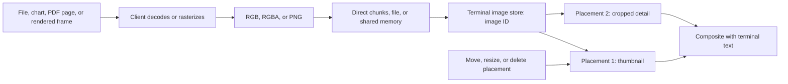

# Kitty graphics protocol

Terminal behavior and crate versions below are a dated snapshot; protocol support must still be detected in the running session.

Kitty graphics protocol (KGP), also called the Terminal Graphics Protocol (TGP), lets a terminal application display actual raster pixels alongside terminal text. Its defining abstraction is a terminal-owned image that can have multiple independently controlled placements. Uploading pixels, positioning an image, and removing it are separate operations. That makes KGP useful for thumbnails, plots, document previews, and continuously updated graphical interfaces.

The canonical reference is the [Kitty graphics specification](https://sw.kovidgoyal.net/kitty/graphics-protocol/). It is an openly published, evolving terminal extension maintained by the Kitty project, rather than an ECMA or ISO standard. The protocol is independent of the Kitty executable: a Rust application can speak it directly to another compatible emulator.

## Origins and evolution

Kovid Goyal, Kitty's creator, opened the original [graphics design discussion, issue 33](https://github.com/kovidgoyal/kitty/issues/33), on January 14, 2017. The discussion considered existing terminal image mechanisms and the problems of efficient transfer, placement, and integration with text. This is the design origin, not the first release date.

The [Kitty changelog](https://sw.kovidgoyal.net/kitty/changelog/) records these milestones:

- **October 22, 2017, Kitty 0.4.0:** first released graphics support, including direct transfer over SSH, local files/shared memory, alpha blending, and stacking above or below text.
- **December 19, 2020, 0.19.3:** placement identifiers, response suppression, and terminal-assigned image IDs through image numbers.
- **April 19, 2021, 0.20.0:** animation and the option to leave the cursor stationary during placement.
- **July 26, 2021, 0.22.0:** composition between animation frames.
- **April 15, 2023, 0.28.0:** Unicode placeholders, allowing images to participate in text-based layout.
- **November 8, 2023, 0.31.0:** placements relative to other placements.
- **July 18, 2026, 0.48.0:** transient usage hints for short-lived image/frame data.

These are reference-implementation milestones. Another emulator's support for the original upload commands does not establish support for every later extension.

## Resolution, color, and practical limits

### There is no fixed resolution menu

KGP does not restrict images to VGA, 1080p, 4K, or terminal character resolution. Image dimensions are integer pixel counts. Source resolution and display size are separate: a 1920 × 1080 image can occupy a 60-column placement without changing the original uploaded pixels.

The protocol uses 32-bit integer control values, but their representable range is not an allocation guarantee. In the [Kitty implementation](https://github.com/kovidgoyal/kitty/blob/master/kitty/graphics.c), `MAX_IMAGE_DIMENSION` is **10,000 pixels per axis**, and the default base image storage quota is **320 MiB per screen buffer**. Other emulators can impose different limits. GPU texture limits, decompression limits, available memory, and the visible viewport impose further constraints.

For perspective, an uncompressed 3840 × 2160 RGBA image needs 33,177,600 bytes, about 31.6 MiB. At 7680 × 4320 it needs about 126.6 MiB. A 10,000 × 10,000 RGBA image needs about 381.5 MiB before other overhead, so passing the per-axis bound does not imply that it fits a normal storage budget. These sizes are calculations, not measured throughput or universal acceptance limits.

### Three wire formats

The [pixel-transfer rules](https://sw.kovidgoyal.net/kitty/graphics-protocol/#transferring-pixel-data) define:

- `f=24`: packed RGB, three 8-bit channels per pixel, in sRGB. Width `s` and height `v` are required.
- `f=32`: packed RGBA, four 8-bit channels per pixel, in sRGB. This is the default format; width and height are required. Alpha allows transparent edges and overlays.
- `f=100`: PNG bytes. Dimensions are obtained from the PNG itself.

JPEG, GIF, WebP, SVG, PDF, and video are not additional KGP wire formats. Decode or rasterize them in the client, then send RGB, RGBA, or PNG. In particular, native protocol animation is a sequence of uploaded frames and controls, not an instruction to decode an arbitrary GIF or video file. Sixteen-bit channels, HDR, and vector drawing commands are not part of this basic pixel contract.

### Pixels versus character cells

A placement starts at the cursor's cell, optionally offset within that cell by `X` and `Y` pixels. The source crop uses pixel coordinates `x`, `y`, `w`, and `h`; destination bounds use columns `c` and rows `r`.

With one destination dimension specified, the terminal derives the other while preserving aspect ratio. With both specified, the specification calls for fitting with letterboxing or pillarboxing. Treat implementation differences as compatibility issues, not permission to assume square character cells.

For example, if cells measure 10 × 20 pixels, a 60 × 20-cell box has 600 × 400 pixels of space. A 1200 × 800 source fits that box at half scale. Source pixels, terminal-reported pixels, and OS logical display points can differ on high-DPI displays; use terminal measurements rather than monitor resolution.

Obtain character dimensions and, where available, pixel dimensions through the OS terminal API. If pixel metrics are absent, `CSI 16 t` requests cell dimensions and `CSI 14 t` requests the text area's pixel dimensions. A library should handle response parsing and timeouts. Recompute layout when the terminal is resized or its font changes.

## Architecture and image lifecycle

### A retained image store beside a text grid

A useful conceptual model has three parts:

1. The client decodes or renders content into pixels.
2. The terminal receives those pixels into an image store.
3. Placements reference that stored image, selecting geometry, cropping, stacking, and cursor behavior.

This describes the protocol contract, not a required internal renderer. Kitty uses graphics management, texture rendering, and a disk cache; another terminal can implement the same operations differently.



### Wire framing and chunking

Commands are Application Program Commands (APCs):

```text
ESC _ G key=value,key=value;BASE64_PAYLOAD ESC \
```

Here `ESC` denotes byte `0x1b`; spaces in the illustration separate tokens and are not transmitted. Control keys are case-sensitive. A payload-free command can omit the payload separator.

For example, the header `a=T,f=100,t=d,i=42,c=40` means upload PNG bytes directly, assign image ID 42, and create a 40-column placement. It is only a header; the complete command also needs encoded PNG bytes and termination.

Direct payloads are Base64 encoded, then divided into chunks of **at most 4096 encoded bytes**. Nonfinal chunks must have lengths divisible by four. Use `m=1` while more data remains and `m=0` on the final chunk. Only the first chunk carries ordinary image metadata; continuation chunks carry `m` and optionally `q`, with the additional `a=f` required for animation-frame continuations. Finish one transfer before sending another graphics operation. The placement cursor is the cursor position when the final chunk arrives.

Base64 expands data to approximately four-thirds of its original size. Optional `o=z` applies RFC 1950 zlib compression before Base64, not gzip or a bare RFC 1951 deflate stream. PNG already compresses its contents; an extra zlib layer may not be worthwhile. If wrapping PNG in protocol compression, supply the uncompressed PNG byte count with `S`.

### Transport choices

The [transmission-medium contract](https://sw.kovidgoyal.net/kitty/graphics-protocol/#the-transmission-medium) offers four choices:

- **Direct, `t=d`:** pixels or PNG bytes travel inside APC payloads. This is the interoperable starting point across SSH, containers, and separate filesystem namespaces.
- **File, `t=f`:** the payload contains a Base64-encoded path, not image bytes. The terminal opens the file. This avoids moving pixel bytes through the PTY but requires a genuinely shared filesystem.
- **Temporary file, `t=t`:** similar, but the terminal takes responsibility for deleting an eligible temporary file after reading it. The specification restricts deletion to appropriate temporary locations and paths containing `tty-graphics-protocol`.
- **Shared memory, `t=s`:** the payload names a shared memory object. The protocol describes POSIX objects and Windows named mappings. The terminal reads the object and performs the specified cleanup. This reduces PTY traffic; it is not a promise of zero-copy GPU upload.

`S` and `O` can select a byte count and offset within a file or mapping. These are transport offsets, distinct from a source-image crop.

Local optimizations require a successful medium-specific probe. An application running in WSL2 and an emulator running on native Windows do not automatically share a POSIX shared-memory namespace. Likewise, a pathname on an SSH server does not name a file on the client machine.

### IDs, placement, and deletion

The [placement rules](https://sw.kovidgoyal.net/kitty/graphics-protocol/#display-images-on-screen) distinguish:

- `a=t`: upload without displaying.
- `a=T`: upload and display.
- `a=p`: display an existing image.
- `a=d`: remove selected placements and, optionally, their underlying data.

An image ID `i` is an application-chosen nonzero 32-bit identifier. A placement ID `p` is scoped to its image: the identity is the pair `(i, p)`. Reusing that pair moves or replaces the placement without resending pixels. Omitting `p` can create additional placements instead of updating the previous one.

Image numbers `I` offer a different allocation model: the terminal creates a new image ID and reports it back. This helps applications sharing a screen avoid accidental ID collisions, provided they process the response.

Re-uploading pixels with an existing image ID deletes that image's old placements. It is not a general “update the bitmap beneath every existing placement” operation. Use placement commands for movement and the animation/frame-update machinery where suitable for pixel updates.

Deletion selectors distinguish lowercase forms, which can retain stored pixels, from uppercase forms, which also request data reclamation when no remaining reference requires it. For example, deleting a selected image's placements differs from deleting its placements and backing data. Avoid global “delete everything” commands in applications that share the terminal with other tools.

### Text composition, scrolling, and cursor policy

The `z` value controls stacking. Negative values place an image below text; sufficiently negative values also place it below explicitly colored cell backgrounds. Transparency can combine multiple images and text. Applications should test their actual background styles: a TUI painting every cell's background can obscure a low-layer image.

Regular placements are anchored in terminal screen/scrollback coordinates and can scroll with text. Cursor movement normally accounts for the placement's occupied rectangle. `C=1` requests no cursor movement, which is useful when the application owns the layout. Movement beyond screen or scrolling-region boundaries has implementation-defined edge behavior; reserve space and position the cursor explicitly for predictable composition.

### Unicode placeholders and relative placements

[Unicode placeholders](https://sw.kovidgoyal.net/kitty/graphics-protocol/#unicode-placeholders) bridge retained graphics and text-oriented renderers. The client uploads an image, creates an invisible virtual placement with `U=1`, then emits the private-use character `U+10EEEE` into the text grid. Foreground color encodes the image ID; combining marks encode image row/column and optionally the high ID byte; underline color can encode the placement ID.

A text editor or multiplexer can move those cells without understanding image geometry. The terminal paints the corresponding image portion where the placeholders appear. This is especially useful for immediate-mode TUIs and scrolling editor buffers.

The trade-offs are real: the intermediary must preserve the character, combining marks, and relevant colors, and the terminal must implement this extension correctly. Upload still needs a working route to the outer terminal. Placeholders do not make arbitrary multiplexers automatically compatible. Manipulate visible placeholder cells as text; they are not ordinary placements that every graphics deletion selector can erase.

Relative placements use parent image/placement IDs (`P`, `Q`) and cell offsets (`H`, `V`). They allow an overlay to follow another placement, including a virtual placeholder placement. Parent deletion removes dependent placements. Terminals must reject cycles and support at least eight levels of parent chaining; deeper chains are implementation-dependent.

### Animation, incremental updates, and persistence

[Animation](https://sw.kovidgoyal.net/kitty/graphics-protocol/#animation) adds frame upload (`a=f`), playback control (`a=a`), and frame-to-frame composition (`a=c`). An application can upload complete frames or changed rectangles, blend or replace pixels, and set per-frame timing. The initial image is frame 1; its timing must also be set when terminal-driven playback is desired.

Two strategies serve different workloads:

- **Terminal-driven playback:** upload frames and delays, then let the emulator advance them. This avoids a network round trip for every frame and can continue after a simple viewer exits.
- **Client-driven updates:** choose frames or transmit current content as data changes. This fits live charts and simulations, but the application owns pacing and backpressure.

This is not a video codec: there is no built-in audio track, interframe video compression, or universal frame-rate guarantee. Delta rectangles help when only a small area changes; they cannot make every full-screen video inexpensive.

Images are cached resources, not permanent storage. Eviction can make a later placement fail with `ENOENT`; retain enough client-side data to upload again. Kitty's additional animation-frame cache has a larger disk-backed quota, described in [image persistence and storage quotas](https://sw.kovidgoyal.net/kitty/graphics-protocol/#image-persistence-and-storage-quotas). Newer terminals may honor `N=1`, the transient usage hint, to avoid treating short-lived frames like persistent images. Probe extensions rather than assuming this recent hint is available.

### Capability queries and responses

Use `a=q` with a tiny valid image to test the protocol or a specific medium without retaining an image. Follow it with a primary-device-attributes request (`CSI c`): a DA reply without the earlier graphics reply identifies a terminal that did not handle the graphics query. Also impose a timeout for disconnected or filtering intermediaries.

Responses are APC messages on the terminal input stream, correlated by IDs, containing `OK` or an error. They are not messages written to stderr. `q=1` suppresses successful acknowledgments; `q=2` suppresses all responses. The latter is useful for embedding in a host application that cannot consume graphics replies, but it also removes error feedback.

There is no single negotiated protocol-version number or complete feature bitmap. A successful baseline query establishes only the tested operation. Probe the extensions and transport you intend to use; distinguish an error response from silence. Coordinate queries with the application's input parser so terminal replies do not become user keystrokes.

## What the design does well

These are engineering judgments based on the contract above:

- **It separates expensive pixels from cheap positioning.** Reusing an uploaded icon or sprite can reduce repeated output to small placement commands.
- **It preserves useful image fidelity.** Full RGB/RGBA and PNG avoid requiring a client-side palette reduction step, while alpha and layering make graphics coexist with text.
- **It accommodates both remote and local clients.** Direct transfer works over an ordinary terminal connection; verified file/shared-memory paths offer local optimizations without requiring a different application model.
- **It has explicit resource and error operations.** IDs, queries, placement acknowledgments, and targeted deletion are better foundations for a persistent application than blindly printing an opaque image blob.
- **It acknowledges the existing terminal ecosystem.** Placeholder cells and relative placements address the gap between retained graphics and text-based layout.
- **It supports efficient temporal changes.** Terminal-driven timing and rectangle updates offer more control than repeatedly transmitting complete screenshots.

Compared with traditional Sixel workflows, KGP offers an explicit retained-image/placement model and native RGBA transfer. Compared with iTerm2's inline image mechanism, it exposes more image lifecycle and composition controls. Those advantages do not establish a universal performance winner: source content, encoder, transport, emulator, and workload determine actual cost.

## Limitations and boundaries

The main cost is implementation complexity. A robust client manages IDs, chunk boundaries, input replies, resource lifetime, geometry, multiplexer routing, and varying extension support. A minimal PNG demo exercises only a small portion of that surface.

The protocol also does not provide application semantics. A plot rendered as pixels does not retain searchable labels, selectable data, accessibility descriptions, hyperlinks, or hit testing. Keep important text in terminal text cells and provide meaningful textual output or an exported artifact where appropriate. Mouse input is a separate terminal facility; mapping clicks to pixels is the application's job.

Compression and caching reduce bandwidth but do not eliminate it. An uncompressed 1080p RGBA frame is about 7.9 MiB, or roughly 10.5 MiB after Base64; repeated at 30 frames per second, the payload alone approaches 316 MiB/s. That calculation excludes command overhead and assumes no compression. Scale to the display area, reuse images, send damage rectangles, and drop obsolete frames instead of accumulating a rendering backlog.

File transfer modes add a terminal-side file-access surface. The specification requires regular-file checks and limits the information leaked through read errors. Application-side policy should still validate the content it chooses to render. Direct transfer is often the simpler choice across trust and namespace boundaries.

## How many terminals support it?

**The protocol's published roster contains 11 implementations when Kitty itself is included.** It lists ten others: AbsoluteTelnet/SSH, Ghostty, Konsole, Mobile SSH, patched st, Warp, wayst, WezTerm, iTerm2, and xterm.js. This counts implementations, including a patched terminal and an embeddable engine; it is not a count of fully conforming, enabled-by-default desktop applications. See the [authors' implementation roster](https://sw.kovidgoyal.net/kitty/graphics-protocol/).

I also found [par-term](https://github.com/paulrobello/par-term), whose own project documents Kitty support. Thus this research establishes **at least 12 named terminal/engine implementations**, not a universal census. Forks and products embedding an engine make an exact market-wide count impractical. Zellij is discussed separately as a multiplexer rather than added to that terminal count.

The qualifications matter more than the number:

1. **Kitty:** the reference implementation and primary target for the complete documented feature set.
2. **Ghostty:** [officially supports KGP](https://ghostty.org/docs/features), including placeholder-based applications. Check the installed version for animation and newer extensions; static image success is insufficient evidence.
3. **WezTerm:** documents its implementation and conformance work in [tracking issue 986](https://github.com/wezterm/wezterm/issues/986). Builds/configurations may require `enable_kitty_graphics = true`. Widget authors still report differences significant enough to select another backend.
4. **Konsole:** implemented graphics support through [merge request 594](https://invent.kde.org/utilities/konsole/-/merge_requests/594). Treat baseline support separately from placeholders and terminal animation.
5. **iTerm2:** now documents [both its own image protocol and KGP](https://iterm2.com/documentation-images.html). Its [3.6.1 release notes](https://iterm2.com/downloads.html) add file/shared-memory transfer and fix streaming decoding. Older “iTerm2 has no Kitty graphics” statements are stale.
6. **Warp:** its [March 26, 2025 changelog](https://docs.warp.dev/getting-started/changelog#id-2025.03.26-v0.2025.03.26.08.10) records support. The Ratatui image project's compatibility matrix reports missing placeholder functionality; do not equate basic display with widget compatibility.
7. **wayst:** listed by the protocol authors and implemented in the [wayst project](https://github.com/91861/wayst). Verify the operations used by the application rather than assuming reference-level coverage.
8. **st with the graphics patch:** requires the [Kitty graphics patch](https://st.suckless.org/patches/kitty-graphics-protocol/); this is not a stock-st capability.
9. **AbsoluteTelnet/SSH:** the [vendor's feature description](https://www.celestialsoftware.net/kitty-graphics-protocol/) covers placements, placeholders, animation, and direct remote transfer, with support first shipped in 14.01. It deliberately does not require local file/shared-memory transfer for its SSH use case.
10. **Mobile SSH:** its [terminal documentation](https://mobile-ssh.github.io/docs/terminal/) advertises graphics support. Verify the installed mobile application's version and intended feature subset.
11. **xterm.js:** the optional [image add-on](https://github.com/xtermjs/xterm.js/blob/master/addons/addon-image/README.md) describes Kitty support as partial and work in progress. An application embedding xterm.js must install and enable the relevant add-on/version; the engine name alone proves nothing about a particular editor's integrated terminal.
12. **par-term:** advertises Sixel, iTerm2, and Kitty graphics. Its inclusion here is based on upstream documentation, not a conformance run performed for this research.

For multiplexers, [Zellij 0.45.0](https://zellij.dev/news/nested-sessions-kitty-graphics-new-ui/), released August 20, 2026, implements graphics within its panes and still requires a compatible host terminal. tmux passthrough is a different strategy: it forwards wrapped sequences to the outer emulator and does not, by itself, supply a full graphics layout model. Test the whole chain, including nested sessions.

### Application adoption

Representative applications illustrate the range without implying that all use every extension:

- **Image and file previews:** [viu](https://github.com/atanunq/viu), [Yazi](https://yazi-rs.github.io/docs/image-preview/), and [ranger](https://github.com/ranger/ranger).
- **Editor buffers and documents:** [image.nvim](https://github.com/3rd/image.nvim) for Neovim, [kitty-graphics.el](https://github.com/cashmeredev/kitty-graphics.el) for Emacs, and [termpdf.py](https://github.com/dsanson/termpdf.py) for documents.
- **Images and video:** [timg](https://github.com/hzeller/timg) and [mpv's Kitty video output](https://github.com/mpv-player/mpv/blob/master/video/out/vo_kitty.c).
- **Plots and graphical interfaces:** [malevich](https://github.com/shergin/malevich), [plotui](https://github.com/sebaheg/plotui), and [bevy_kitty](https://github.com/dsturnbull/bevy_kitty).

An application's backend requirements can be stricter than the terminal's baseline KGP support. For example, a placeholder-based editor plugin can fail where a simple direct PNG viewer succeeds.

## Rust crate landscape

This inventory covers the reusable KGP clients, image widgets, specialized renderers, and emulator-side libraries found through crates.io, upstream documentation, and published source. Versions are the inspected stable releases unless marked otherwise. It is a broad research inventory, not a claim that every unpublished helper or future crate has been found. “Coverage” means API/source coverage, not a conformance certification.

### Direct protocol libraries

- **[kittage 0.4.0](https://docs.rs/kittage/0.4.0/kittage/):** typed client operations for transmission, queries, placement, deletion, geometry, virtual/relative placement, and response handling. It supports direct/file/shared-memory paths and optional `image` integration. The author explicitly excludes animation frames from its otherwise broad coverage, and animation actions remain unimplemented in the inspected public API. A strong candidate for a custom image manager; not a complete animation SDK.

- **[kitty_image 0.1.0](https://docs.rs/kitty_image/0.1.0/kitty_image/):** typed command construction/serialization, with RGB/RGBA/PNG, media selectors, placement, placeholders, relative-placement fields, deletion, and animation loading/control/composition types. It is broader than its small “display an image” introduction suggests. The application still owns discovery, response routing, IDs, and lifecycle. It is an older LGPL-3.0 release; source review and compatibility testing are necessary before treating its broad type surface as full current conformance.

- **[kitty-graphics-protocol 0.1.3](https://docs.rs/crate/kitty-graphics-protocol/0.1.3):** command builders and convenience image-display helpers, plus types for animation, composition, media, compression, and virtual placements. It advertises comprehensive coverage, but that claim is not a substitute for tests. This release's docs.rs build failed; inspect the [published source](https://docs.rs/crate/kitty-graphics-protocol/0.1.3/source/) and build the exact target/version before adoption. Its probing facilities also have platform-specific behavior.

- **[little-kitty 0.0.3](https://docs.rs/crate/little-kitty/0.0.3):** low-level arbitrary controls, responses, support queries, positioning, tmux wrapping, and helpers for standard/Unicode-placeholder display. Its generic controls can express more than the convenience API, but the caller supplies protocol knowledge. Source-review finding: its [payload helpers](https://docs.rs/crate/little-kitty/0.0.3/source/src/command/command.rs) split raw data at 4096-byte boundaries before Base64 encoding, potentially exceeding KGP's 4096-byte encoded-payload bound. Verify or correct chunking before using it for large transfers; do not interpret generic key support as validated full coverage.

- **[termwiz 0.23.3](https://docs.rs/termwiz/0.23.3/termwiz/escape/apc/index.html):** terminal infrastructure from WezTerm, with structured parsing/serialization of image transfer, placement, deletion, frame loading, and composition. Useful when handling terminal streams or building an emulator. The inspected action enum is not a complete modern KGP client, and the library does not make its higher-level rendering backends automatically support every KGP extension.

### General display and TUI integration

- **[viuer 0.11.0](https://docs.rs/viuer/0.11.0/viuer/):** convenient one-shot display of `image::DynamicImage`, with Kitty, iTerm2, optional Sixel, and Unicode half-block output. Its Kitty implementation probes direct/local transfer and handles ordinary sizing and cursor placement. It does not expose a retained placement manager, placeholders, native animation, or the full protocol. Best suited to CLI previews; `print_from_file` requires the `print-file` feature.

- **[ratatui-image 11.1.0](https://docs.rs/ratatui-image/11.1.0/ratatui_image/):** image widgets for Ratatui, with capability/cell-size discovery, fixed and resizable images, worker-thread integration, and multiple protocol fallbacks. Its Kitty backend uses Unicode placeholders to participate in buffer rendering. It solves the TUI redraw problem rather than exposing every animation/media command. Its [compatibility matrix](https://github.com/ratatui/ratatui-image#compatibility-matrix) is valuable operational evidence. Default features include dynamic Chafa integration; disable defaults for a build that avoids that native dependency. A 12.0 prerelease also exists; examples here use the stable 11.1 API.

- **[rasteroid 0.4.0](https://docs.rs/rasteroid/0.4.0/rasteroid/):** image/video transport extracted from mcat, supporting Kitty, iTerm2, Sixel, and character output. Its Kitty encoder includes static images, frame encoding/animation, and optimized local transfer paths. More media-oriented than a widget library; it does not replace all placement, query, and lifecycle policy with a universal KGP model.

- **[onefetch-image 3.0.0](https://docs.rs/onefetch-image/3.0.0/onefetch_image/):** image backends for Onefetch's output, including Kitty, Sixel, and iTerm2. Focused on static image/logo presentation, not arbitrary image-store management or animation. The inspected source gates graphics backend modules to non-Windows targets, a meaningful restriction for this monorepo.

- **[yazi-adapter 26.5.6](https://docs.rs/crate/yazi-adapter/26.5.6):** Yazi's terminal image adaptation layer, with regular and placeholder-oriented Kitty implementations among several display strategies. Useful implementation experience for file-manager previews and multiplexer integration; its APIs are coupled to Yazi's application architecture rather than designed as a neutral complete KGP SDK.

- **[cursive-image 0.0.6](https://docs.rs/crate/cursive-image/0.0.6):** a Cursive image view built on little-kitty, with sizing, alignment, scrolling, and optional format decoders/rasterizers. Its core is image-view integration, not general animation/composition control. It inherits the transport concerns of its protocol dependency; other graphics protocols are described as future work in the inspected README.

- **[karet-fileview 0.7.1](https://docs.rs/crate/karet-fileview/0.7.1):** reusable file-preview primitives for Ratatui. The `raster`/`images` features provide Karet's own Kitty backend and half-block fallback. Scope is decoded-frame/file preview and placement, not complete animation or shared-memory coverage.

- **[urushi-graphics 0.1.1](https://docs.rs/crate/urushi-graphics/0.1.1):** renderer-neutral image presentation plus one-shot/retained Kitty and Sixel adapters for Urushi. It keeps protocol state outside the UI core and selects positively confirmed capabilities. An early framework integration, not an independent full-protocol client.

- **[wtrenderlib 0.1.0](https://docs.rs/crate/wtrenderlib/0.1.0):** low-dependency presentation of borrowed RGB/RGBA frames, with Kitty output, other output formats, and multiplexer wrapping helpers. Decoding can remain outside the crate. Useful as a frame encoder; its focus is not virtual/relative placements and terminal-driven animation management.

- **[fe2o3-glow 0.1.49](https://docs.rs/crate/fe2o3-glow/0.1.49):** image display/clearing with Kitty and several alternative backends. Its own documentation targets Linux/macOS and uses environment-based detection. Coverage is practical preview output, not the complete protocol; assess platform support before considering it for a cross-platform shared component.

- **[biscuit-terminal](../../components/terminal_image.md):** this monorepo's component-based rendering path. `TerminalImage` provides image decoding, sizing, protocol selection, and terminal-specific cursor handling. Its [Kitty implementation](../../../lib/src/components/terminal_image/kitty.rs) focuses on chunked inline PNG display, not a public animation/retained-image management API. Prefer this existing component for ordinary repository CLI output rather than introducing a parallel renderer. Use the [component catalog](../../components/index.md) for surrounding `TerminalRenderable` content.

### Plots, games, and framebuffer applications

- **[malevich 1.24.1](https://docs.rs/malevich/1.24.1/malevich/):** chart construction and raster/text/SVG rendering. Its `pixel` feature offers terminal graphics output, including Kitty. The functional coverage is plot presentation and terminal-aware sizing, not arbitrary KGP animation or resource control.

- **[termplt 0.5.0](https://docs.rs/termplt/0.5.0/termplt/):** 2D plotting with PNG transfer, capability checks, terminal sizing, and tmux handling. Its live plots replace image IDs and remove old images using baseline commands, rather than requiring native animation. The upstream README notes a Windows console-input ownership caveat for long-lived interactive applications; examine it before embedding alongside another input reader.

- **[ratatui-plt 0.0.2](https://docs.rs/crate/ratatui-plt/0.0.2):** scientific plotting widgets with optional image export. Its `kitty` feature supplies Kitty inline export; that is a plot-output path, not full KGP state management.

- **[plotui-protocol 0.4.2](https://docs.rs/plotui-protocol/0.4.2/plotui_protocol/):** turns RGBA framebuffers into Kitty protocol output, with compressed transfer and presentation strategies for plotting. Related **[plotui-core](https://docs.rs/crate/plotui-core/0.4.2)** produces the pixels, **[plotui-term](https://docs.rs/crate/plotui-term/0.4.2)** handles detection, cell metrics, and multiplexer policy, and **[plotui-ratatui](https://docs.rs/crate/plotui-ratatui/0.4.2)** integrates with widget rendering. The family's coverage is efficient interactive plots; it is not a general API for every KGP command.

- **[bevy_kitty 0.1.3](https://docs.rs/crate/bevy_kitty/0.1.3):** a Bevy integration with sprite reuse and full-frame presentation modes. Sprite mode uploads bitmaps and then moves placements; frame mode sends composited frames. This directly exploits KGP's retained-image design. It is a specialized renderer with substantial engine dependencies, not a lightweight image widget or a guarantee of all Bevy rendering features in sprite mode.

- **[tilcayo 0.2.0](https://docs.rs/crate/tilcayo/0.2.0):** a terminal GUI/framebuffer runtime with damage rectangles, incremental updates through animation-frame replacement, direct/compressed/local transports, capability probing, backpressure, and session/input ownership. Broad practical presentation coverage, but upstream explicitly targets Unix-like systems. It is not a drop-in cross-platform choice for this repository.

- **[scopekit 0.1.0](https://docs.rs/crate/scopekit/0.1.0):** Ratatui applications containing a live wgpu-rendered view. Terminal mode uses ratatui-image for graphics/fallback; window mode composites into a native window. It inherits the image backend's protocol subset rather than independently implementing all KGP features.

- **[unpeel-surface 0.1.0-alpha.6](https://docs.rs/crate/unpeel-surface/0.1.0-alpha.6):** graphical surfaces with terminal text chrome. Its Kitty path presents an mmap-backed RGBA frame ring through the file medium. This is a local shared-filesystem optimization, not a direct-transfer SSH solution or a complete animation/placeholder SDK.

### Bindings and terminal-side implementations

- **[notcurses 3.6.0](https://docs.rs/notcurses/3.6.0/notcurses/) and [libnotcurses-sys 3.11.0](https://docs.rs/libnotcurses-sys/3.11.0/libnotcurses_sys/):** high-level and low-level bindings to the C Notcurses library. Its visual/plane APIs select graphics backends, including Kitty, and manage image composition with TUI planes. This is backend-driven access to graphics, not a Rust API mirroring every protocol key. Native library/build dependencies and supported targets must be evaluated separately from protocol richness; consult [Notcurses usage](https://github.com/dankamongmen/notcurses/blob/master/USAGE.md).

- **[bmux_image 0.0.1-alpha.1](https://docs.rs/crate/bmux_image/0.0.1-alpha.1):** multiplexer-side image interception, per-pane registries, and compositor integration for several protocols. It addresses receiving/remapping images inside bmux. Early implementation coverage should be inspected per operation rather than inferred from the feature name.

- **[par-term-emu-core-rust](https://docs.rs/par-term-emu-core-rust/) and [ghostty-vt](https://docs.rs/ghostty-vt/):** terminal-emulation infrastructure, including graphics state supplied by their emulator implementations. These are relevant if building a terminal or analyzing incoming graphics, not substitutes for a small application-side image sender. The former implements terminal emulation in Rust; the latter binds Ghostty's library, so the capabilities depend on the bundled Ghostty revision.

### Supporting crates and misleading matches

**[image](https://docs.rs/image/)** and **[png](https://docs.rs/png/)** decode/encode pixels; **[resvg](https://docs.rs/resvg/)** and **[tiny-skia](https://docs.rs/tiny-skia/)** rasterize vectors; **[plotters](https://docs.rs/plotters/)** can generate chart bitmaps. None of these, by themselves, supplies KGP transport, detection, IDs, or placement management.

**[base64](https://docs.rs/base64/)** or **[base64-simd](https://docs.rs/base64-simd/)** encode payloads, **[flate2](https://docs.rs/flate2/)** supplies zlib compression, and **[crossterm](https://docs.rs/crossterm/)** handles terminal session/input/cursor operations. They are building blocks, not complete KGP libraries. In this monorepo, use biscuit-terminal's existing rendering components where they cover the requirement.

Name searches also return unrelated or narrower packages. `kitty-rc` and `kitty-remote-bindings` target Kitty's remote-control protocol, not KGP. `termage` and `showie` are image-display libraries without Kitty encoding in the inspected releases. `ratatu-image` is an old renamed package, not an additional current alternative to ratatui-image. `viu` and many other viewers are primarily applications; their existence should not inflate a list of reusable protocol SDKs. A wrapper for the original Überzug is not automatically a binding to Überzug++'s Kitty backend.

## If only one crate were available

**For a new Rust application that needs images inside an interactive terminal UI, I would choose ratatui-image 11.1.0.** It handles the hardest recurring integration work together: protocol/cell-size discovery, image placement within a text-buffer renderer, resizing, and fallbacks. Its documented compatibility testing is more useful than an unsupported claim to implement every protocol key. Disable unnecessary native/default features and let its picker choose a working backend instead of forcing Kitty everywhere.

This is a recommendation for application integration, not maximum protocol coverage. It does not expose the complete native animation or transport surface, and it brings Ratatui's UI model. For a one-shot CLI, viuer is smaller conceptually; for custom protocol management, kittage is a better low-level starting point, with its explicit animation gap. Those distinctions explain the choice rather than changing the single recommendation.

Within rusty-biscuit, ordinary terminal image output should continue through `biscuit_terminal::components::terminal_image::TerminalImage`, alongside `TerminalRenderable` components for surrounding text. Replacing that integration with an unrelated widget stack would require a separate architectural reason.

## Developer-reported gotchas and working approaches

### A terminal says “Kitty supported,” but the widget still fails

The [ratatui-image maintainers](https://github.com/ratatui/ratatui-image#compatibility-matrix) report that WezTerm's iTerm2 backend works more reliably for their widget, and identify missing Warp placeholder support. The [image.nvim maintainers](https://github.com/3rd/image.nvim#rendering-backend) also distinguish basic WezTerm support from reliable plugin behavior.

The workaround is to select a known-working protocol for that widget and emulator, or avoid placeholder-dependent rendering on an affected version. Maintain feature-specific tests: upload, placement, redraw, clipping, scrolling, cleanup, and animation answer different questions.

### tmux receives bytes but the outer terminal never displays them

The [image.nvim tmux setup](https://github.com/3rd/image.nvim#tmux) documents enabling passthrough. Applications must also wrap graphics commands in tmux's DCS passthrough envelope and escape embedded ESC bytes. Setting the option alone does not wrap application output.

```text
set -g allow-passthrough on
```

Use a library that implements wrapping. For text-managed layout, use supported Unicode placeholders. Do not assume direct passthrough lets tmux crop, redraw, or relocate arbitrary images correctly. Zellij's native image handling is a distinct path and must be tested separately.

### Probing races with the event reader or consumes user input

The [ratatui-image Picker contract](https://docs.rs/ratatui-image/11.1.0/ratatui_image/picker/struct.Picker.html) says to query after entering the alternate screen and before reading terminal events. Its queries temporarily own stdio. The [termplt README](https://github.com/EdCarney/termplt) documents a concrete Windows issue where a background console reader can consume the next typed line in an embedding application.

Run startup probes before spawning the normal input loop, use bounded timeouts, and give one parser ownership of terminal input. Later queries should be routed through that parser rather than starting a competing reader. For hosts that cannot parse replies, use an appropriate quiet mode and accept the loss of error feedback.

### A temporary file disappears before the application removes it

[viuer's Kitty backend](https://github.com/atanunq/viuer/blob/master/src/printer/kitty.rs) explicitly tolerates `NotFound` during cleanup because the terminal may already have deleted a `t=t` file. It also probes local transfer separately from remote/direct transfer.

Keep the backing object alive until the terminal has consumed it; then clean up idempotently. Fall back to direct bytes if the terminal cannot access the object. A successful write/flush only proves delivery to the terminal stream, not that a file has been read or a frame presented.

### Image output inserts an unexpected blank line or scrolls at the bottom

The same [viuer backend](https://github.com/atanunq/viuer/blob/master/src/printer/kitty.rs) handles a boundary case where the terminal already advances after an image reaches the right edge, so adding another newline leaves a blank row. This repository's [TerminalImage implementation](../../../lib/src/components/terminal_image/mod.rs) likewise contains emulator-specific cursor handling.

Use the library's cursor policy, reserve sufficient rows, and test at the right/bottom edges. In a TUI, use no-movement placement where appropriate and let the layout engine own cursor positioning. Do not append a newline unconditionally to every rendered image string.

### Repeated frames saturate SSH or stall the UI

The [bevy_kitty design](https://github.com/dsturnbull/bevy_kitty) uses cached sprite placements to avoid retransmitting full frames. The [ratatui-image threading examples](https://github.com/ratatui/ratatui-image/tree/master/examples) move resize/encoding work off the UI thread. [Tilcayo](https://github.com/pgavlin/tilcayo) uses damage rectangles and explicit presentation backpressure.

Apply the same principles: cache decoded/resized content, reuse image IDs for placements, render only changed pixels when supported, and bound pending work. For finite animation, let the terminal play preloaded frames. Benchmark compression on the actual workload; CPU-heavy encoding can make a smaller payload feel slower locally.

## Rust examples

These examples cover three common workloads. They use published APIs rather than hand-assembling escape sequences. They compile as separate binaries with the dependency versions shown below. Display requires a real terminal; compiling an example does not prove rendering compatibility. Do not run the TUI example as an unattended test.

### 1. A CLI photo or build-artifact preview

For repository code, use `TerminalImage` as described above. In a standalone application, viuer is convenient when the goal is to display one decoded image and continue printing output.

```toml
[dependencies]
image = { version = "0.25", default-features = false, features = ["png", "jpeg"] }
viuer = "=0.11.0"
```

```rust
use std::{error::Error, io::{self, IsTerminal}};
use viuer::Config;

fn main() -> Result<(), Box<dyn Error>> {
    if !io::stdout().is_terminal() {
        return Err("image preview requires terminal output".into());
    }
    let path = std::env::args_os().nth(1).ok_or("provide a local image path")?;
    let image = image::ImageReader::open(path)?.decode()?;
    let config = Config {
        width: Some(60),
        absolute_offset: false,
        ..Config::default()
    };
    viuer::print(&image, &config)?;
    Ok(())
}
```

The crate selects an available output method, so this does not force KGP onto an incompatible terminal. Its public configuration expresses display bounds in terminal-oriented units, not a request for a particular source-image resolution. The application still needs a policy for input size and acceptable decode cost.

### 2. A generated heatmap without an intermediate image file

Use the same dependencies. A simulation, scientific tool, or monitoring command can construct an RGBA image in memory. Replace the illustrative scalar field below with real measurements.

```rust
use std::{error::Error, io::{self, IsTerminal}};
use image::{DynamicImage, Rgba, RgbaImage};
use viuer::Config;

fn main() -> Result<(), Box<dyn Error>> {
    if !io::stdout().is_terminal() {
        return Err("heatmap requires terminal output".into());
    }
    let pixels = RgbaImage::from_fn(640, 320, |x, y| {
        let value = ((x as f32 / 40.0).sin() * (y as f32 / 25.0).cos()
            + 1.0) / 2.0;
        Rgba([(255.0 * value) as u8, 48, (255.0 * (1.0 - value)) as u8, 255])
    });
    viuer::print(
        &DynamicImage::ImageRgba8(pixels),
        &Config {
            width: Some(64),
            absolute_offset: false,
            ..Config::default()
        },
    )?;
    Ok(())
}
```

This generates 640 × 320 source pixels; the terminal placement is a separate sizing decision. For a live dashboard, use a widget/retained renderer rather than repeatedly calling a one-shot display helper. Keep axes, units, and significant numerical values available as text; this example only demonstrates the pixel path.

### 3. A resizable preview inside a Ratatui application

This suits a file manager, album-art panel, or document-page viewer. Use these dependencies for this binary:

```toml
[dependencies]
crossterm = "0.29"
image = { version = "0.25", default-features = false, features = ["png", "jpeg"] }
ratatui = "=0.30.1"
ratatui-image = { version = "=11.1.0", default-features = false, features = ["crossterm"] }
```

```rust
use std::{error::Error, io::{self, IsTerminal}, time::Duration};
use crossterm::event::{self, Event, KeyCode, KeyEventKind};
use ratatui::widgets::Block;
use ratatui_image::{picker::Picker, StatefulImage};

fn main() -> Result<(), Box<dyn Error>> {
    if !io::stdin().is_terminal() || !io::stdout().is_terminal() {
        return Err("interactive preview requires a terminal".into());
    }
    let path = std::env::args_os().nth(1).ok_or("provide a local image path")?;
    let image = image::ImageReader::open(path)?.decode()?;

    ratatui::run(|terminal| -> Result<(), Box<dyn Error>> {
        let picker = Picker::from_query_stdio()?;
        let mut state = picker.new_resize_protocol(image);
        loop {
            terminal.draw(|frame| {
                let border = Block::bordered().title("Preview: q to quit");
                let inner = border.inner(frame.area());
                frame.render_widget(border, frame.area());
                frame.render_stateful_widget(StatefulImage::default(), inner, &mut state);
            })?;
            if event::poll(Duration::from_millis(100))? {
                if let Event::Key(key) = event::read()? {
                    if key.kind == KeyEventKind::Press
                        && matches!(key.code, KeyCode::Char('q') | KeyCode::Esc)
                    {
                        return Ok(());
                    }
                }
            }
        }
    })
}
```

`ratatui::run` sets up the terminal, supplies the alternate screen needed before the query, and restores the terminal on return. The picker runs before the event loop takes ownership of input. The stateful widget adapts to its available area and selects a supported protocol or fallback; it is not forced to use Kitty on a terminal with a better-supported alternative.

For large images or frequent resize events, move resizing/encoding into the crate's `ThreadProtocol` integration instead of doing expensive work during `draw`. The compact example keeps that work synchronous to show the complete UI lifecycle without adding a worker/event architecture.

## Verification scope

The research combines the protocol specification, release history, emulator documentation, maintainer reports, and source from the named published crates. The Rust example APIs were checked by compiling the standalone binaries on the current macOS host. No live terminal conformance run, performance benchmark, or cross-platform execution was performed for this documentation update. Terminal support counts describe documented implementations; they do not certify every operation on every released build.
