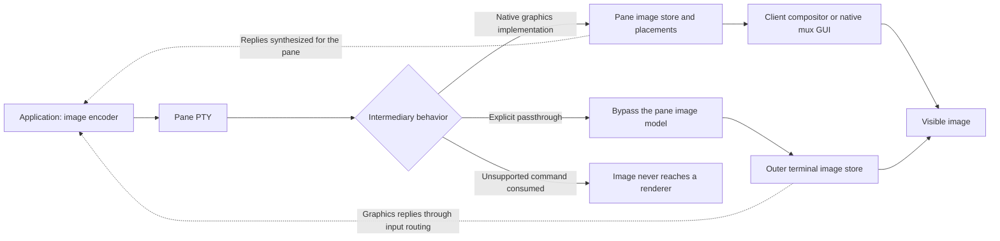
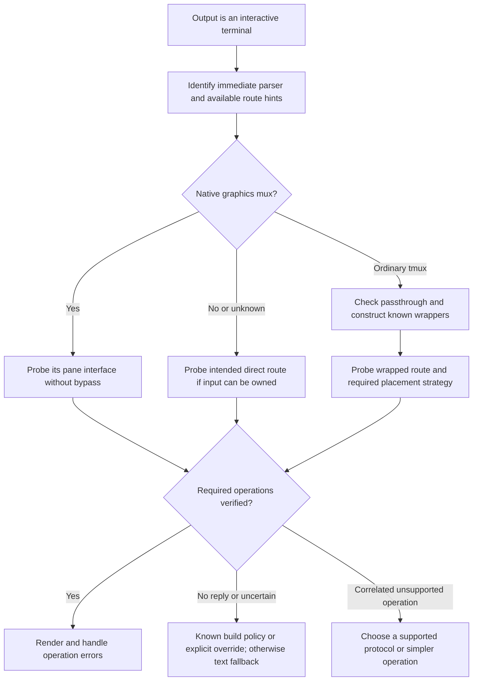

# Terminal graphics through multiplexed sessions

Research checked on October 13, 2026. This document assumes the final terminal can render Kitty graphics, iTerm2 inline images, or both. It investigates the intervening transport and session arrangement. A protocol that works directly can fail inside a multiplexer even with the same terminal application.

The practical choices are:

- **Ordinary tmux:** use Kitty uploads through DCS passthrough and Unicode placeholders for placement, provided the receiving endpoint implements placeholders. iTerm2 passthrough can display images, but tmux does not retain their image state.
- **Zellij 0.45.0:** use its native Kitty implementation with ordinary placements. It manages images per pane; do not use the tmux placeholder strategy against Zellij's native parser.
- **WezTerm native multiplexing:** send ordinary Kitty or iTerm2 commands to the pane. The mux understands images and transports image state to its GUI.
- **cterm:** use its native iTerm2 `File=` implementation. Live output and restoring an existing image after daemon reattachment are different capabilities.

These recommendations follow the upstream documentation and source examined below; they are not results of running a terminal compatibility lab. Exact builds, nested arrangements, and reconnect behavior still need the validation described at the end.

## Scope and names

The companion documents cover [Kitty graphics](./kitty.md), [iTerm2 graphics](./iterm2.md), [tmux](../multiplexing/tmux.md), [Zellij](../multiplexing/zellij.md), and [WezTerm](../multiplexing/wezterm.md). Their historical version tables do not establish current graphics support.

**The referenced `../multiplexing/cterm.md` does not exist in this checkout.** Here, cterm means [KarpelesLab/cterm](https://github.com/KarpelesLab/cterm), also called CodeTerm/ClaudeTerm. The directory contains a separate [cmux document](../multiplexing/cmux.md). These are different projects; a short cmux note appears below so a possible naming error does not silently change the subject.

Source-sensitive conclusions use these snapshots:

| Project | Inspected baseline                                                        | Why the distinction matters                                                                         |
| ------- | ------------------------------------------------------------------------- | --------------------------------------------------------------------------------------------------- |
| tmux    | `f0a2ed30017f1b3faf490ccca7c73912f69cc95d`                                | Current input parser, passthrough options, and change history; older releases differ                |
| Zellij  | Release `v0.45.0`; development `dfa40f44a4ab4d66d0eac692841adb787aeece75` | Native Kitty support starts at 0.45.0; outbound compression differs between release and development |
| WezTerm | `e2a98e1b8af156988ad0ac778658ac27b60a55fb`                                | Native mux image serialization and the implemented Kitty subset                                     |
| cterm   | `1a0d2c8009aa8e478af24175a239a7631358debd`                                | Native SSH, iTerm2 parsing, and daemon snapshot contents                                            |

This is a record of inspected implementations, not a claim that every development behavior is in a released binary.

## Three requirements for working graphics

An application needs three things, which should be tested separately:

1. **Delivery:** complete image commands and their bytes reach an endpoint that understands them.
2. **Replies:** capability and error responses return to the application's input parser, where the protocol provides responses.
3. **Placement:** image position, clipping, visibility, scrolling, and lifetime remain consistent with the application's pane.

A successful upload proves neither pane ownership nor reconnect persistence. Conversely, a missing reply does not prove the forward path is blocked.



A native mux interprets graphics and can redraw them for a pane. Passthrough forwards an escape sequence but does not add graphics to the mux's screen model. This architectural distinction explains most failures better than a list of terminal names.

## Protocol representation and SSH

### What travels through the connection

The following examples use `ESC` for byte `0x1b`, `BEL` for `0x07`, and `ST` for `ESC` followed by backslash. Spaces in the notation are separators, not literal wire bytes.

| Property           | Kitty graphics                                                | iTerm2 inline images                                                                       |
| ------------------ | ------------------------------------------------------------- | ------------------------------------------------------------------------------------------ |
| Framing            | APC: `ESC _ G controls ; payload ST`                          | OSC: `ESC ] 1337 ; File=metadata : payload BEL`                                            |
| Image payload      | Base64 RGB, RGBA, or PNG                                      | Base64 encoded image file, such as PNG                                                     |
| Remote-safe medium | Direct transfer, `t=d`                                        | File contents are already in the sequence                                                  |
| Local optimization | `t=f`, `t=t`, or `t=s` can name files or shared memory        | `name=` is metadata, not a request to open that path                                       |
| Large transfer     | Direct payloads split into at most 4096 encoded bytes per APC | Legacy `File=` is one large OSC; multipart uses `MultipartFile`, `FilePart`, and `FileEnd` |
| Placement model    | Image IDs and independently controlled placements             | Insert image at the current cursor with display dimensions                                 |

These transport forms come from the [Kitty protocol](https://sw.kovidgoyal.net/kitty/graphics-protocol/) and [iTerm2 image protocol](https://iterm2.com/documentation-images.html). The companion protocol documents explain pixel formats and rendering semantics in more detail.

### SSH can carry both protocols

SSH session data is channel data, not a sequence of interpreted terminal drawing commands. Allocating a PTY is a separate request with terminal type, dimensions, and modes. Nothing in the SSH connection protocol requires stripping APC or OSC image commands. Both inline protocols can travel over an ordinary SSH connection without a special graphics tunnel or X11 forwarding. SSH's own channel multiplexing and connection sharing are separate from a terminal multiplexer. [RFC 4254, sections 5.2 and 6](https://www.rfc-editor.org/rfc/rfc4254)

For a remote Kitty sender, choose `t=d`; for iTerm2, send the encoded image bytes. An SSH-server pathname is not automatically accessible on the client. A remote process and local GUI do not share memory merely because both support Kitty. Containers, WSL2, and remote mux servers introduce similar namespace boundaries. Kitty's [icat transfer-mode documentation](https://sw.kovidgoyal.net/kitty/kittens/icat/#cmdoption-kitten-icat-transfer-mode) explicitly distinguishes streamed transfer from local file and memory modes.

There is an important exception to the filesystem rule: **a native mux can be the image consumer on the remote host.** Zellij can read a file in its server's filesystem, decode it, and transmit pixels to the client terminal. WezTerm's mux can similarly consume image data before sending its internal representation to the GUI. The right question is which process opens the file, not whether the GUI is remote.

Transfer cost still matters. Base64 of `n` bytes requires `4 × ceil(n / 3)` bytes before framing. A 1920 × 1080 RGBA frame is 8,294,400 bytes, or 11,059,200 Base64 bytes. PNG may be much smaller. These are calculated sizes, not throughput measurements. Downscale before upload and avoid sending unchanged pixels repeatedly.

PTYs and adapters can change data independently of SSH. Keep Base64 unwrapped; do not insert newlines into payloads. Serialize image writes so logging, another renderer, or a second image transfer cannot interleave with an unfinished transfer. A network packet boundary does not need to coincide with an APC/OSC boundary: parsers must accumulate fragmented input.

### Multiplexer position changes the route

Consider these two arrangements, in application-to-screen order:

```text
remote app → remote tmux → SSH → local terminal
remote app → SSH → local tmux → local terminal
```

Both require tmux-aware output. In the second arrangement, the remote app may have no `TMUX` variable or access to the local tmux socket. `TERM=tmux-256color` is a useful clue, but not a complete topology description. Setting a different `TERM` does not remove the local mux from the stream.

An SSH jump host used only as a connection relay is not another terminal parser. An interactive shell on that host containing a mux is. Record the actual sequence of PTYs, parsers, and native mux boundaries before deciding how many wrappers to use.

## Windows SSH: locate the parser that changes the stream

“Windows SSH strips escapes” describes some arrangements, not SSH or Windows universally. Distinguish the SSH client, the local console/ConPTY, the SSH server's PTY, and any shell pipeline.

| Windows path                                              | What can happen                                                                                               | Appropriate response                                                                           |
| --------------------------------------------------------- | ------------------------------------------------------------------------------------------------------------- | ---------------------------------------------------------------------------------------------- |
| Legacy Windows OpenSSH console parser                     | Incoming VT commands are interpreted into Console API operations rather than delivered transparently          | Avoid the legacy parser; use a byte-preserving client path                                     |
| Modern `ssh.exe` writing through a Windows console/ConPTY | SSH may pass commands to the console, which can parse, forward, or alter them according to its build and mode | Probe both directions; distinguish disappearance from cursor desynchronization                 |
| Native Windows SSH server with a console-backed PTY       | Server-side console translation can intervene even when the local client is transparent                       | Test the server leg separately; changing the client cannot repair a lossy server PTY           |
| WSL's Linux `ssh`                                         | Avoids the Windows `ssh.exe` legacy parser, but WSL-to-GUI plumbing can still contain ConPTY                  | Verify which SSH executable and terminal backend are used                                      |
| Integrated SSH in WezTerm or cterm                        | SSH channel data enters the emulator without a locally spawned `ssh.exe` console process                      | Prefer this route when diagnosing a client-side console blocker; remote PTY constraints remain |

The upstream [Windows OpenSSH TTY/PTY guide](https://github.com/PowerShell/Win32-OpenSSH/wiki/TTY-PTY-support-in-Windows-OpenSSH) documents the legacy parser and modern console path. The inspected [console implementation](https://github.com/PowerShell/openssh-portable/blob/latestw_all/contrib/win32/win32compat/console.c) selects its internal parser if `SSH_TERM_CONHOST_PARSER=0` or enabling console VT processing fails. **Setting that variable to zero is not a graphics passthrough fix; it requests the older interpreter.** Leaving it unset avoids forcing that path, but does not establish end-to-end graphics support.

ConPTY is also not invariably an escape-stripping barrier. Microsoft's [Kitty APC cursor-desynchronization issue](https://github.com/microsoft/terminal/issues/19926) describes unrecognized graphics reaching the terminal while ConPTY's cursor state becomes stale. [PR 20009](https://github.com/microsoft/terminal/pull/20009), merged March 24, 2026, adds cursor-position resynchronization for unknown sequences. This is evidence that forwarding and placement can fail separately. A fix in the Microsoft repository does not establish which console implementation a particular third-party emulator loads.

For diagnosis, compare a direct integrated SSH connection with `ssh.exe` inside a local shell, then add the mux. WezTerm documents its [embedded SSH client](https://wezterm.org/ssh.html); cterm's [native SSH implementation](https://github.com/KarpelesLab/cterm/blob/1a0d2c8009aa8e478af24175a239a7631358debd/crates/cterm-core/src/ssh.rs) explicitly replaces spawning the system SSH binary in a local PTY.

Do not route binary terminal output through text formatting or decoding pipelines to “fix” escape handling. If an intermediary consumes the image command and lacks an escape-preserving mode, wrapping for a different mux cannot reconstruct the discarded payload. Replace or bypass that intermediary. Changing a transport/parser does not require changing the assumed graphics-capable final terminal.

## tmux: transport bypass with text-based placement

### Enable passthrough and encode it correctly

tmux's [manual](https://github.com/tmux/tmux/blob/f0a2ed30017f1b3faf490ccca7c73912f69cc95d/tmux.1) describes `allow-passthrough`:

```tmux
set -g allow-passthrough on
```

`on` allows passthrough from visible panes. `all` also permits invisible panes. The option defaults to off in the inspected [options table](https://github.com/tmux/tmux/blob/f0a2ed30017f1b3faf490ccca7c73912f69cc95d/options-table.c). Prefer `on` for visible application output; `all` does not make offscreen image drawing pane-aware. Account for explicit pane/window overrides when diagnosing effective settings.

The [change history](https://github.com/tmux/tmux/blob/f0a2ed30017f1b3faf490ccca7c73912f69cc95d/CHANGES) records the gate's introduction in 3.3 and the `all` state in 3.4. Passthrough framing existed earlier. The absence of the option in an old release is not itself proof that passthrough is unavailable.

For an inner byte sequence `P`, construct:

```text
W(P) = ESC P tmux; + P with every ESC doubled + ESC backslash
```

Double **every** ESC in the payload, including the ESC in an inner ST terminator. Leave the outer envelope's introducer and terminator undoubled. For Kitty, wrap each complete APC chunk independently; for iTerm2 multipart, wrap each complete OSC independently. Enabling the option does not automatically wrap application output. The [tmux DCS dispatcher](https://github.com/tmux/tmux/blob/f0a2ed30017f1b3faf490ccca7c73912f69cc95d/input.c) recognizes the `tmux;` prefix and writes its decoded payload as a raw string.

An illustrative encoder, usable on all four target environments, is:

```python
def tmux_wrap(sequence: bytes) -> bytes:
    return b"\x1bPtmux;" + sequence.replace(b"\x1b", b"\x1b\x1b") + b"\x1b\\"
```

This function provides framing only. It does not discover the route, consume replies, or manage placements.

### Kitty: upload bypassed, placement retained as text

An ordinary Kitty placement sent through passthrough lives in the outer terminal. tmux does not know its rectangle or image ID. Resize, scrolling, switching windows, copy mode, or floating/pop-up UI can leave it misplaced, overwritten, or visible over another pane. Manually reserving blank rows helps initial layout, but adds no retained image state to tmux.

The robust available strategy is:

1. Upload pixels and create a Kitty virtual placement through passthrough.
2. Send the placeholder grid as ordinary text **through tmux's pane parser**, not in passthrough.
3. Let tmux move/redraw those cells; the outer terminal resolves them to image tiles.

Kitty's [Unicode placeholder specification](https://sw.kovidgoyal.net/kitty/graphics-protocol/#unicode-placeholders) uses `U+10EEEE`, foreground color for the image ID, combining marks for tile coordinates, and optionally underline color for placement identity. This requires preserving those characters, marks, and color values across the entire text path.

The official [icat command](https://sw.kovidgoyal.net/kitty/kittens/icat/) supports the strategy directly:

```sh
kitten icat --transfer-mode=stream --passthrough=tmux image.png
```

Its tmux passthrough option implies Unicode placeholders. This is a sender example for an endpoint that supports that extension, not a guarantee for every Kitty-capable terminal. WezTerm's inspected parser does not implement the virtual-placement fields, for example. Baseline Kitty support alone is insufficient.

Placeholders improve relayout and pane switching, but do not persist the terminal's pixel cache inside tmux. On a fresh client or after cache eviction, text cells may remain without their referenced image. A live application can re-upload; a finished process cannot automatically replay its old images. Avoid global image deletion: bypassed image IDs belong to the shared outer terminal, so one pane can affect another. Manage IDs and cleanup for the resources your application owns.

### iTerm2: large sequences and untracked images

Legacy `File=` emits one potentially large OSC. Dividing a `write()` into small writes does not reduce the mux parser's control-string size: it still accumulates the same message. Use the receiver's supported multipart protocol or reduce the image until the complete encoded OSC fits.

The [iTerm2 documentation](https://iterm2.com/documentation-images.html) introduces multipart in 3.5 specifically for smaller messages, including tmux integration. It cites historical tmux sequence limits of 256 bytes and newer limits of 1,048,576 bytes; framing and metadata consume part of the budget. The inspected tmux [header](https://github.com/tmux/tmux/blob/f0a2ed30017f1b3faf490ccca7c73912f69cc95d/tmux.h) defines a 1 MiB default input buffer, and the [options table](https://github.com/tmux/tmux/blob/f0a2ed30017f1b3faf490ccca7c73912f69cc95d/options-table.c) permits `input-buffer-size` in current builds. Check availability before configuring it; it entered the 3.6 development cycle.

The upstream [imgcat script](https://github.com/gnachman/iTerm2/blob/master/OtherResources/Utilities/imgcat) wraps OSCs for tmux and uses conservative 200-byte Base64 parts in multipart mode. Its legacy mode is still needed for receivers implementing only `File=`. **Streaming one OSC and accepting multipart OSCs are different parser features.** Neither cterm's nor WezTerm's inspected iTerm2 parser implements the multipart keywords.

Plain tmux passthrough still does not give IIP a retained pane image model. A single static image can appear correctly; reliable arbitrary pane resizing, redraw, and new-client restoration require more than delivering the bytes. Smaller chunks solve transport truncation, not placement ownership.

### iTerm2 native tmux integration is a separate arrangement

[iTerm2's integration](https://iterm2.com/documentation-tmux-integration.html) uses tmux control mode (`tmux -CC`), mapping tmux windows and panes to native terminal UI. It is not ordinary tmux compositing a full text screen into one terminal pane. iTerm2's documented multipart support works with this integration, but do not infer equivalent behavior from running ordinary tmux in iTerm2 or infer complete Kitty-extension support from IIP support.

Control-mode live output and restoration of past screen state are separate paths. In the absence of a verified image-restoration contract, do not promise that reconnecting reconstructs already-consumed images. Prefer the terminal's own integration-aware sender and verify detach/reattach explicitly.

### Reply routing is not the same tunnel

DCS passthrough applies to output. Outer-terminal replies normally return through tmux's input/key parser; they are not automatically wrapped or correlated to the originating pane. The upstream [query-collision report](https://github.com/tmux/tmux/issues/5530) shows tmux's own DA/version probes colliding with an application's probes. The application's [Kitty reply-leak report](https://github.com/charmbracelet/crush/issues/3500) documents APC responses being treated as input fragments.

Use one input owner, a fresh graphics query ID, and bounded reads; be prepared for fragmented replies. Suppress unsolicited graphics replies with `q=2` during ordinary rendering if the application cannot consume them. Do not suppress replies during detection. A broken reverse path can make automatic detection impossible even when known-good forward rendering works; an explicit protocol/route override is useful in that case.

## Zellij: native Kitty support, with a defined subset

### Version and configuration

The [0.45.0 announcement](https://zellij.dev/news/nested-sessions-kitty-graphics-new-ui/) establishes native Kitty graphics support. Older “Zellij supports only Sixel” guidance does not describe that release. The current [compatibility guide](https://zellij.dev/documentation/compatibility.html) says it queries the host and tracks images per pane through scrolling, resizing, relayouts, fullscreen, and floating/pinned panes.

```kdl
support_kitty_graphics_protocol true
```

The [option documentation](https://zellij.dev/documentation/options.html#support_kitty_graphics_protocol) says the default depends on the startup host query and changing the option requires restarting Zellij. This is separate from `support_kitty_keyboard_protocol`.

Send ordinary Kitty APCs to the Zellij pane. It parses commands, manages images and placements, and emits graphics for its clients. A tmux DCS envelope is not a Zellij tunnel.

### Supported transport and unsupported operations

The release's [Kitty parser](https://github.com/zellij-org/zellij/blob/v0.45.0/zellij-server/src/panes/kitty_graphics/parser.rs) and [grid command execution](https://github.com/zellij-org/zellij/blob/v0.45.0/zellij-server/src/panes/grid.rs) establish this subset:

| Operation                                         | Zellij 0.45.0 behavior           | Application choice                               |
| ------------------------------------------------- | -------------------------------- | ------------------------------------------------ |
| Direct RGB/RGBA/PNG, including chunking and zlib  | Implemented                      | Prefer streamed PNG for remote use               |
| File and temporary-file media                     | Read by the Zellij server        | Use only when the server can read that namespace |
| Shared memory, `t=s`                              | `ENOTSUPPORTED`                  | Switch to direct transfer                        |
| Transmit, display, delete, query                  | Implemented, with IDs/placements | Use ordinary pane-relative placements            |
| Unicode virtual placement, nonzero `U`            | `ENOTSUPPORTED`                  | Do not select a tmux placeholder backend         |
| Animation actions `a=f`, `a=a`, `a=c`             | `ENOTSUPPORTED`                  | Static frame or application-driven replacement   |
| Parent-relative placement keys `P`, `Q`, `H`, `V` | Accepted but ignored             | Do not treat a quiet response as feature support |

The parser caps decoded image data at 100 MiB and dimensions at 10,000 pixels per axis. These are intermediary limits even if the outer terminal could accept a larger image. Downscaling addresses the limit; arbitrary chunking does not reduce the decoded allocation.

The [placement executor](https://github.com/zellij-org/zellij/blob/v0.45.0/zellij-server/src/panes/grid.rs) can reject display with `ENOTSUPPORTED` and “cell size unknown.” A query can therefore establish graphics support while a later placement fails for missing geometry. Ensure the host-to-Zellij measurement path works; an application's assumed cell size does not supply the mux's internal metric.

### iTerm2-only hosts and output cost

Zellij's documented native image paths are Kitty and Sixel. The inspected [grid parser](https://github.com/zellij-org/zellij/blob/v0.45.0/zellij-server/src/panes/grid.rs) has no IIP `File=` implementation or tmux DCS escape route for arbitrary graphics. **A terminal supporting only IIP does not satisfy the Kitty requirement.** There is no documented native Kitty-to-IIP translation. For the fixed arrangement, the IIP image route is blocked; use a different mux arrangement or an explicitly available Sixel path. Sixel is an alternative protocol, outside this document's main scope.

Zellij also decodes and re-encodes images rather than preserving the original compressed wire representation. The release [output implementation](https://github.com/zellij-org/zellij/blob/v0.45.0/zellij-server/src/output/mod.rs) sends uncompressed RGBA directly to the host; [issue 5596](https://github.com/zellij-org/zellij/issues/5596) reports the resulting bandwidth cost. The inspected [development output](https://github.com/zellij-org/zellij/blob/dfa40f44a4ab4d66d0eac692841adb787aeece75/zellij-server/src/output/mod.rs) has optional zlib transmission. Do not assume the release has that improvement. Optimize source dimensions and avoid unnecessary retransmission; sending a tiny PNG does not guarantee equally small Zellij-to-client traffic.

## WezTerm: native mux transports image state

WezTerm's [multiplexing architecture](https://wezterm.org/multiplexing.html) separates local panes, plain SSH domains, and persistent remote mux domains. These are different routes:

```text
plain SSH:       app → remote PTY → SSH channel → local WezTerm parser/GUI
remote mux:      app → remote PTY → remote WezTerm parser → mux protocol → GUI
tmux in a pane:  app → tmux → either of the above routes
```

For native panes, send ordinary Kitty or IIP commands with no tmux wrapper. The [mux codec](https://github.com/wezterm/wezterm/blob/e2a98e1b8af156988ad0ac778658ac27b60a55fb/codec/src/lib.rs) serializes image cells alongside lines, including image identity and texture coordinates. Its `GetImageCell`/response exchange retrieves image data. Thus the mux connection carries image state, rather than replaying a text-only screen or forwarding terminal APCs to an arbitrary third-party terminal.

The GUI and mux server need compatible WezTerm implementations. The native remote mux is not a generic protocol for attaching any graphics-capable terminal. An ordinary tmux inside a WezTerm pane still imposes the tmux constraints above.

The inspected [configuration](https://github.com/wezterm/wezterm/blob/e2a98e1b8af156988ad0ac778658ac27b60a55fb/config/src/config.rs) sets `enable_kitty_graphics` to true by default. The [Kitty handler](https://github.com/wezterm/wezterm/blob/e2a98e1b8af156988ad0ac778658ac27b60a55fb/term/src/terminalstate/kitty.rs) respects that setting. A GUI setting alone should not be assumed to reconfigure an independently running remote server.

WezTerm implements baseline upload/display and responds to Kitty queries, but not the whole evolving protocol. Its [APC parser](https://github.com/wezterm/wezterm/blob/e2a98e1b8af156988ad0ac778658ac27b60a55fb/wezterm-escape-parser/src/apc.rs) has ordinary placement fields and frame transmission/composition, but no virtual `U` placement or parent-relative placement model; animation playback controls are not a complete implemented route. Unknown keys can be ignored, so a baseline `OK` cannot certify placeholders. Against this native endpoint, use ordinary placements; against plain tmux with WezTerm as the endpoint, do not assume the placeholder strategy is available.

The [iTerm2 handler](https://github.com/wezterm/wezterm/blob/e2a98e1b8af156988ad0ac778658ac27b60a55fb/term/src/terminalstate/iterm.rs) consumes image contents into terminal image state. Its [OSC parser](https://github.com/wezterm/wezterm/blob/e2a98e1b8af156988ad0ac778658ac27b60a55fb/wezterm-escape-parser/src/osc.rs) implements `File=` but not `MultipartFile`/`FilePart`/`FileEnd`. Use `File=` for native IIP output, or direct Kitty chunks when an intervening size-limited mux makes a single IIP OSC impractical.

Native image serialization supports transferring existing image-bearing lines, but it is not an unlimited retention guarantee. Verify scrollback/cache behavior for the installed build and retain application data for redraw. File/media optimization must be tested against the process doing the decoding: the remote mux server for a mux domain, the local terminal for plain SSH.

## cterm: native IIP, but incomplete image restoration

### Live rendering

cterm's [README](https://github.com/KarpelesLab/cterm/blob/1a0d2c8009aa8e478af24175a239a7631358debd/README.md) documents Sixel and iTerm2 graphics, native platform UIs, and a `ctermd` session daemon. Split panes are listed as future work in this snapshot. Treat its current arrangement as tabs/sessions and an emulator/daemon pair, not as a tmux-compatible text compositor sitting in front of an arbitrary terminal.

Its [terminal parser](https://github.com/KarpelesLab/cterm/blob/1a0d2c8009aa8e478af24175a239a7631358debd/crates/cterm-core/src/parser.rs) implements OSC 1337 `File=`, including streaming its payload, decoding inline images, and adding them to the screen image store. It has no Kitty APC image implementation, IIP multipart keywords, or generic `DCS tmux;` passthrough handler. For the usable graphics-capable endpoint assumed here, choose IIP. An unseen Kitty-capable “outer terminal” cannot rescue a command consumed by cterm's parser.

The daemon-backed UI [session implementation](https://github.com/KarpelesLab/cterm/blob/1a0d2c8009aa8e478af24175a239a7631358debd/crates/cterm-app/src/daemon_session.rs) describes raw live output fed into a local terminal parser. That preserves a route for complete live IIP transfers. Streaming here means accumulating one `File=` transfer incrementally; it does not establish multipart compatibility.

For Windows, distinguish cterm's [native SSH backend](https://github.com/KarpelesLab/cterm/blob/1a0d2c8009aa8e478af24175a239a7631358debd/crates/cterm-core/src/ssh.rs) from running `ssh.exe` inside a shell tab. The former avoids that local console subprocess; local native programs still use the [Windows ConPTY backend](https://github.com/KarpelesLab/cterm/blob/1a0d2c8009aa8e478af24175a239a7631358debd/crates/cterm-core/src/pty.rs).

### A concrete daemon snapshot gap

The attach path constructs a new local terminal and applies an initial screen snapshot. The inspected [snapshot conversion and restoration](https://github.com/KarpelesLab/cterm/blob/1a0d2c8009aa8e478af24175a239a7631358debd/crates/cterm-proto/src/convert/screen.rs) carries rows, scrollback, cursor, title, modes, and downloadable fonts, but no image store or placements. Images are stored separately in the [screen implementation](https://github.com/KarpelesLab/cterm/blob/1a0d2c8009aa8e478af24175a239a7631358debd/crates/cterm-core/src/screen.rs).

**Source-based inference:** a new UI attachment cannot reconstruct a previously displayed image from this snapshot alone. A currently attached UI may retain its own image data; a new attachment or UI restart is different. Session-process survival does not establish graphics-state survival.

An application can recover by sending complete images again after reconnection/redraw. That does not recover a finished application's old output automatically. Transparent restoration needs a cterm change to serialize image state or replay retained graphics data. tmux wrapping, smaller chunks, and a different `TERM` cannot supply state absent from the snapshot.

### If the intended project was cmux

[cmux](https://github.com/manaflow-ai/cmux) is the separate Ghostty-based terminal/workspace project described by the local `cmux.md`. Native surfaces use libghostty as their graphics endpoint; native splits do not themselves require a tmux DCS tunnel. Under the capable-terminal assumption, emit the endpoint's supported graphics directly. Any tmux/Zellij started inside a surface still adds its own parsing boundary. Do not transfer cterm's IIP or daemon-snapshot conclusions to cmux.

## Nested sessions: compose routes, not product names

For **two ordinary tmux parsers**, the payload is `W(W(P))`: the nearest mux removes one envelope, and the next mux removes the other. Double the ESC bytes of the entire already-wrapped sequence when adding another layer. Enable passthrough at every relevant tmux and account for each layer's size limit and input routing. Nesting is not intrinsically impossible, but a library that supports only one wrapper cannot claim to support that route.

SSH between the tmux instances does not add another DCS wrapper. A native graphics mux usually terminates the application protocol instead of transparently forwarding it, so do not mechanically wrap once for every program called a multiplexer.

| Application-to-screen route                                 | Endpoint and consequence                                                                                                                              |
| ----------------------------------------------------------- | ----------------------------------------------------------------------------------------------------------------------------------------------------- |
| App → tmux → SSH → Kitty-capable terminal with placeholders | One tmux wrapper for uploads; placeholder text stays in the tmux grid                                                                                 |
| App → tmux → tmux → terminal                                | Two envelopes; extensions and reply route still need validation                                                                                       |
| App → tmux → Zellij 0.45 → terminal                         | One envelope reaches Zellij's native Kitty parser; `U=1` is rejected there, so a sender that always combines tmux passthrough with placeholders fails |
| App → Zellij → ordinary tmux → terminal                     | Zellij's own host detection and graphics output must traverse tmux; configuring only the app cannot repair Zellij's outbound path                     |
| App → remote WezTerm mux → WezTerm GUI                      | Native image-state transport; no tmux framing                                                                                                         |
| App → tmux → cterm                                          | IIP passthrough can reach cterm's `File=` parser; multipart and Kitty are not implemented there                                                       |

For the Zellij-inside-tmux row, the inspected 0.45 [client](https://github.com/zellij-org/zellij/blob/v0.45.0/zellij-client/src/lib.rs) and [output implementation](https://github.com/zellij-org/zellij/blob/v0.45.0/zellij-server/src/output/mod.rs) emit ordinary host queries and Kitty output without a general tmux-wrapper adapter. **Source-based inference:** this composition needs an additional transport adapter; support in each program separately is insufficient. Reorder the arrangement, avoid the extra mux, or supply an adapter covering both host probes and rendering. A version claiming native nesting support still needs to support the particular outer parser.

## Capability detection through the abstraction

### Detect the usable pane interface

The application normally needs **what this pane can do**, not the identity of the final GUI. A native mux can legitimately answer a query itself; its result is the supported intersection or translation offered to that pane. Querying around it can advertise an outer feature the mux cannot implement.

Treat observations separately:

| Observation                                         | Establishes                                                         | Does not establish                                   |
| --------------------------------------------------- | ------------------------------------------------------------------- | ---------------------------------------------------- |
| `TERM`, `TERM_PROGRAM`, terminal-specific variables | A hint about an immediate or inherited endpoint                     | Reachability, active client, protocol subset         |
| `TMUX`, `TMUX_PANE`, `ZELLIJ`, session variables    | A local mux context                                                 | Every parser across SSH or nested sessions           |
| `WEZTERM_PANE`                                      | WezTerm pane identity/context                                       | That no tmux runs inside it                          |
| Correlated Kitty `OK` for direct query              | The tested medium/query is handled on this route                    | Rendering, placeholders, animation, persistent state |
| Kitty error reply                                   | A responding implementation with an operation/data/geometry problem | A globally unsupported graphics route                |
| DA1 or cell-size reply                              | That specific query has a reply path                                | Image decoding or a working graphics reply path      |
| Successful output write                             | Bytes accepted by the OS/output channel                             | Terminal receipt or visible pixels                   |
| No reply before deadline                            | An inconclusive or unavailable probe path                           | That the final terminal lacks graphics               |

tmux offers local diagnostics without probing the outer terminal:

```sh
tmux -V
tmux show-options -Apv -t "$TMUX_PANE" allow-passthrough
tmux list-clients -F '#{client_name} #{client_termname} #{client_termfeatures}'
```

The client format fields come from the [tmux format reference](https://github.com/tmux/tmux/blob/f0a2ed30017f1b3faf490ccca7c73912f69cc95d/tmux.1). `client_termfeatures` is not a universal graphics feature bitmap. Multiple clients can have different endpoints; a server session does not have one authoritative outer terminal identity. Across SSH, these commands may have no socket access and must not be treated as required.

### Kitty: correlated query, then operation-specific validation

A small direct probe is:

```text
ESC _ G i=731,s=1,v=1,a=q,t=d,f=24;AAAA ST
```

Use a fresh nonzero ID rather than always reusing the illustrative `731`. `AAAA` encodes a valid one-pixel RGB payload. The expected successful reply is an APC containing the same ID and `OK`. A query does not retain/display the image. Kitty's [query specification](https://sw.kovidgoyal.net/kitty/graphics-protocol/#querying-support-and-available-transmission-mediums) pairs it with DA1 (`CSI c`) as an ordering sentinel.

Send both through the same intended output route. With tmux bypass, wrap the graphics query and any sentinel intended for the outer endpoint. An unwrapped DA1 answered by tmux does not order the outer terminal's response. Even a wrapped sentinel cannot prove absence when tmux's reply parser consumes or corrupts one reply. Keep a deadline and report “probe unavailable” separately from a correlated rejection.

Use ordinary, unwrapped probes against native Zellij or WezTerm panes. Once the baseline responds, test the operation the renderer needs. A tiny query does not exercise Zellij's placement geometry; create and remove a small owned placement when validating that path. Placeholder support requires both virtual-placement behavior and preservation of the text grid; unknown keys being ignored means an `OK` is not enough. Retain conservative build knowledge or a visual validation result for that extension.

### iTerm2: weaker negotiation

IIP has no equivalent per-image `OK`/error acknowledgment. The [Feature Reporting proposal](https://iterm2.com/feature-reporting/) defines `TERM_FEATURES` and:

```text
Query: ESC ] 1337 ; Capabilities ST
Reply: ESC ] 1337 ; Capabilities=FEATURE_STRING ST
```

Its published table assigns `F` to both `FILE` and `FOCUS_REPORTING`; do not treat an arbitrary `F` as an unambiguous image claim. Implementation-specific capability handling, known receiver/version information, and an explicit override remain necessary. `ReportCellSize` from the [escape-code reference](https://iterm2.com/documentation-escape-codes.html#report-cell-size) measures cells, not IIP decoder or multipart support.

A host environment variable inherited into a native mux cannot establish the mux's protocol support. For example, an IIP-capable outer terminal identified by `TERM_PROGRAM` does not give Zellij an IIP parser. `TERM=xterm-256color`, truecolor support, and terminfo installation also do not establish graphics.

### Recommended application policy



Keep protocol, route, transfer medium, placement strategy, reply availability, and restoration expectations as separate facts. Useful states are “verified,” “known for this build,” “explicitly forced,” “unsupported on this route,” and “unknown.” A single `supports_images` boolean loses the reason for failure.

One component must own terminal input while probing. On Unix, use the controlling TTY with raw-mode restoration rather than emitting startup probes into redirected stdout. On Windows, use the actual console/PTY interfaces for that backend and preserve modes. A TUI event loop should parse responses as events; a second reader must not race it. Consume late/fragmented replies, impose size/deadline bounds, and never let replies become shell keystrokes. Re-probe or invalidate route assumptions when the client, connection, or mux arrangement changes; query cell geometry after resizing separately from protocol support.

For biscuit-terminal, [current image detection](../../../lib/src/discovery/detection/image.rs) is environment-based and performs no live image probe. [TerminalImage's protocol selection](../../../lib/src/components/terminal_image/protocol.rs) selects Kitty/IIP, while the encoders do not supply a complete tmux-wrapper/placeholder route. These research recommendations are therefore **not a claim that automatic mux graphics transport is already implemented**. Any future probing belongs in the shared [TTY query engine](../../../lib/src/discovery/tty_query.rs), with route-aware handling and coordinated input ownership. Rendering should continue through `TerminalImage`/`TerminalRenderable` components rather than placing protocol policy in each CLI.

## Blockers and available workarounds

“Hard blocker” here means impossible for an application to repair while preserving the stated parser/build/arrangement. Upgrading, changing configuration, or replacing a layer can change that arrangement. It does not mean terminal graphics are impossible in principle.

| Failure                                                    | Classification for the fixed route                   | Workaround or required change                                                                    |
| ---------------------------------------------------------- | ---------------------------------------------------- | ------------------------------------------------------------------------------------------------ |
| tmux passthrough disabled                                  | Configuration blocker                                | Enable it where permitted; an app cannot bypass an enforced gate by adding more envelopes        |
| Unwrapped graphics consumed by ordinary tmux               | Framing blocker                                      | Wrap complete commands, with correct ESC doubling                                                |
| Oversized single IIP OSC                                   | Transport-size blocker                               | Downscale; use receiver-supported multipart; increase a supported parser limit                   |
| Kitty file/shared-memory namespace not shared              | Medium blocker                                       | Stream pixels or target a native mux that can read the file                                      |
| tmux ordinary placements lose pane ownership               | Structural placement limitation                      | Use verified placeholders; otherwise redraw with restricted layout or change the mux arrangement |
| tmux new client lacks placeholder pixels                   | Structural restoration limitation                    | Re-upload from a live app; restoring finished output needs retained/replayed image data          |
| Zellij before native Kitty support, or feature disabled    | Build/configuration blocker                          | Upgrade or enable/restart; old Sixel support is not Kitty support                                |
| Zellij IIP route with an IIP-only host                     | Hard protocol blocker                                | Change arrangement or use another independently supported protocol                               |
| Zellij 0.45 animation, shared memory, or virtual placement | Hard operation blocker                               | Static/ordinary direct graphics, or change implementation/build                                  |
| Zellij cannot measure cell size                            | Placement prerequisite missing                       | Restore host metric reporting; a successful image query is insufficient                          |
| tmux placeholders reach an endpoint lacking `U` semantics  | Hard operation blocker for that strategy             | Change placement strategy or mux; base Kitty support does not repair it                          |
| cterm old images absent from a new attachment snapshot     | Hard restoration blocker                             | App redraw; transparent historical recovery requires daemon snapshot/replay changes              |
| Lossy Windows console/SSH translation                      | Hard transport blocker for that parser path          | Bypass/replace the parser or use a version/backend verified to preserve the commands             |
| Graphics reply filtered, but output passes                 | Detection blocker, not necessarily rendering blocker | Known-good override plus reply suppression, or repair input routing                              |
| No graphics-capable client attached                        | No current display target                            | Keep data and render after attachment; do not infer permanent lack of support                    |

Chunking, `TERM` overrides, and `allow-passthrough all` each solve a particular problem. None substitutes for an absent native parser, missing snapshot data, unsupported extension, or a lossy transport.

## Validation and remaining uncertainty

This research inspected upstream specs, release documentation, parsers, output generators, and snapshot/mux codecs. It did **not** open terminal windows, authenticate to SSH servers, or visually test each matrix cell. The cterm snapshot conclusion is a source-derived prediction. Exact cross-platform/build behavior should be recorded as measured evidence before advertising a supported route.

Use a small asymmetric test image, reserved rows, and application-owned IDs. Compare the direct path first, then add one boundary at a time. Keep captured output as bytes; text-only screenshots or `capture-pane` output cannot prove pixel delivery.

| Check                                                                                  | What it resolves                                                |
| -------------------------------------------------------------------------------------- | --------------------------------------------------------------- |
| Tiny correlated Kitty query plus a real placement                                      | Reply path versus actual display/geometry support               |
| Large PNG and multi-chunk transfer                                                     | Parser limits, truncation, and completion handling              |
| Ordinary placement versus placeholder grid                                             | Endpoint extension support and text/mark/color preservation     |
| Scroll, resize, zoom, move/switch panes, cover with floating UI                        | Ownership, clipping, reflow, stale placements                   |
| Alternate-screen enter/leave and application exit                                      | Cleanup and restoration semantics                               |
| Detach/reattach the same UI, then attach a fresh UI/client                             | Client cache versus mux-retained image state                    |
| Two clients with different graphics subsets                                            | Whether one pane can safely advertise the required intersection |
| Windows `ssh.exe`, WSL Linux SSH, integrated SSH; native Windows SSH server separately | Which local/server parser changes the bytes or cursor state     |
| Two tmux layers and both tmux/Zellij orders                                            | Wrapper depth, native protocol termination, reverse routing     |
| Suppressed rendering replies versus active detection replies                           | Whether a command-line sender can avoid input contamination     |

For repository L2/L3 automation, use the shared terminal test harness with background/hidden visibility so windows never gain focus. Record protocol operations, mux/client versions, configuration, topology, byte traces, and visual outcome independently. Do not mark a whole route unsupported because one extension or automatic detector failed.
