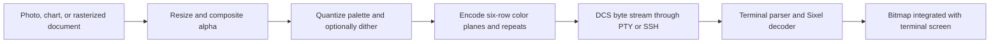

# Sixel graphics for terminal applications

Sixel is DEC's stream-oriented, palette-based bitmap protocol for terminals and printers. It sends pixels inside a terminal device control string (DCS), so an application can draw an image through the same connection that carries its text. It remains useful for inline plots, previews, and terminals whose only pixel graphics protocol is Sixel. It is a weaker foundation for retained images, smooth animation, or alpha compositing than newer protocols.

This research was checked on October 13, 2026. Protocol descriptions distinguish DEC behavior, emulator extensions, and application policy. Terminal support and crate versions are a dated inventory, not a guarantee about every installed build.

## History and standardization

Digital Equipment Corporation (DEC) introduced Sixel in the early 1980s in its terminal/printer ecosystem. Its name refers to six vertically stacked pixels. The encoding fits a six-dot print-head model and economical serial transport. DEC is the identifiable originator; the primary references reviewed here do not establish a single individual inventor or an exact first-release day. Claims that it was invented in 1987 confuse a later reference manual with the protocol's origin.

The VT240/VT241 generation dates to 1983, and the VT330/VT340 generation to 1987. DEC's graphics manuals made Sixel a documented interoperability contract. The [archived March 1987 graphics manual](https://bitsavers.org/pdf/dec/terminal/vt340/EK-VT3XX-GP-001_VT330_VT340_Graphics_Programming_Mar87.pdf) and [later Chapter 14 transcription](https://vt100.net/docs/vt3xx-gp/chapter14.html) are central references. The earlier VT125 belongs to the ReGIS history; do not equate every DEC graphics terminal with a Sixel input implementation. [Xterm's emulation documentation](https://invisible-island.net/xterm/ctlseqs/ctlseqs.html#h3-Sixel-Graphics) distinguishes those sets.

DEC used the format with printers including the LA50 and LN03, with differing protocol levels and physical dot geometry. [DEC's printing chapter](https://manx-docs.org/mirror/vt100.net/docs/vt3xx-gp/chapter16.html) documents these variations. Consequently, printer compatibility does not imply identical terminal rendering.

Sixel is a vendor graphics protocol carried in ANSI/ECMA-style terminal framing, rather than a modern, independently versioned image standard with a conformance authority. Today's practical specification combines DEC manuals, emulator behavior, and extension documentation. Xterm explicitly records contradictory DEC descriptions of scrolling mode; treating one manual as infallible produces compatibility bugs. [Xterm's compatibility notes](https://invisible-island.net/xterm/ctlseqs/ctlseqs.html#h2-Non-VT100-Modes).

The modern revival includes better quantization and transport-efficient encoders in [libsixel](https://github.com/saitoha/libsixel), followed by broader emulator adoption. Konsole added support in [KDE Gear 22.04](https://kde.org/announcements/gear/22.04.0/). Microsoft introduced it in [Windows Terminal Preview 1.22 on August 27, 2024](https://devblogs.microsoft.com/commandline/windows-terminal-preview-1-22-release/). These are implementation milestones, not changes to Sixel's origin.

## Resolutions, pixel shape, and color

There is no fixed list such as 640×480, 1080p, and 4K. A stream describes its raster using decimal dimensions and drawing commands. Actual maximum width, height, allocation size, palette capacity, and visible area belong to the receiving implementation.

- DEC VT330/VT340 hardware had an **800×480** graphics screen. That hardware limit is not a universal Sixel limit. [DEC screen geometry](https://vt100.net/docs/vt3xx-gp/chapter1.html).
- Xterm documents a default `maxGraphicSize` of **1000×1000**, configurable independently of the window. Its `auto` setting derives geometry from the emulated DEC model. This is a resource setting, not an immutable protocol ceiling. [Xterm resource reference](https://invisible-island.net/xterm/manpage/xterm.html#VT100-Widget-Resources).
- Heights need not be divisible by six. The final encoded band still contains six bit positions; unset bits and raster dimensions describe the intended partial band. Some terminals nevertheless count the whole band for scrolling.
- Pixel aspect ratio is independent of resolution. DEC's legacy default is 2:1 vertically to horizontally; modern images usually need explicit square pixels. Raster attributes override the header's legacy aspect macro. [DEC raster attributes](https://vt100.net/docs/vt3xx-gp/chapter14.html).

The practical sizing rule is to resize on the sending side to the available **pixel** rectangle, then encode. For a pane of `C` columns and `R` rows with measured cell size `cw×ch`, the nominal budget is `C*cw` by `R*ch`; leave bottom margin for cursor behavior. Font size, zoom, and window resizing change this budget. A 4K source image can be downsampled to fit a small terminal; declaring 3840×2160 does not request automatic scaling.

Color has three separate limits:

1. **Registers:** DEC VT330 exposes four grayscale entries; VT340 exposes 16 color entries. The documented color-number syntax includes 0–255, but that does not give the original hardware 256 simultaneous colors.
2. **Color definitions:** `#index;2;r;g;b` uses RGB percentages, 0–100, rather than 8-bit RGB channel values. `#index;1;h;l;s` selects HLS. A percentage-based definition is not lossless 24-bit RGB.
3. **Modern policy:** 256 colors is a common encoder target, not a guarantee about the receiver. Quantize to its actual capacity. Xterm's `numColorRegisters` is configurable. [DEC color syntax](https://vt100.net/docs/vt3xx-gp/chapter14.html), [Xterm palette resources](https://invisible-island.net/xterm/manpage/xterm.html#VT100-Widget-Resources).

Some encoders produce higher-color images by redefining registers while painting successive regions. Libsixel exposes a 15-bit high-color mode. This is not a portable promise of arbitrary truecolor pixels: shared versus private palette behavior and register updates vary. Use it only with tested receivers. [Libsixel options](https://github.com/saitoha/libsixel#usage-of-command-line-tools).

## Architecture and image representation

The application first rasterizes its content, reduces colors to a palette, and encodes six-row bands. The terminal's DCS parser hands the payload to a Sixel decoder, which maintains a drawing position, color registers, and a bitmap. The terminal then integrates that bitmap with its screen and scrolling behavior. The stream carries neither a PNG/JPEG file nor base64-wrapped source pixels.



### Framing and commands

Use the seven-bit framing below for UTF-8-oriented terminal connections. `ESC` is byte `0x1b`; `ST` is `ESC` followed by a backslash. The alternative C1 DCS/ST bytes are `0x90`/`0x9c`, which are not standalone valid UTF-8.

```text
ESC P P1;P2;P3 q <payload> ESC \
```

`P1` is a legacy pixel-aspect macro; `P2=1` preserves undrawn pixels while `P2=0` or `2` selects background filling. `P3` is historical horizontal grid spacing, ignored by VT300. The lowercase `q` identifies the payload. [DEC framing](https://vt100.net/docs/vt3xx-gp/chapter14.html).

The payload's small vocabulary is:

| Syntax                  | Meaning                                                         |
| ----------------------- | --------------------------------------------------------------- |
| `?` through `~`         | One vertical six-pixel mask; byte value minus 63 gives the mask |
| `!nX`                   | Repeat mask character `X` for `n` columns                       |
| `$`                     | Return to the start of the same six-row band                    |
| `-`                     | Return horizontally and advance to the next six-row band        |
| `#n`                    | Select color register `n`                                       |
| `#n;2;r;g;b`            | Define/select an RGB color                                      |
| `#n;1;h;l;s`            | Define/select an HLS color                                      |
| `"pan;pad;width;height` | Raster aspect ratio and declared dimensions                     |

The low bit is the top pixel. `?` paints no pixels, `@` has only its top bit set, and `~` has all six set. Multicolor bands are painted as separate masks: emit one color's columns, return with `$`, select another color, and overpaint its mask. Raster dimensions allow omitted background regions; DEC's declaration is not a strict clipping boundary for later drawing commands. [DEC graphics programming manual](https://bitsavers.org/pdf/dec/terminal/vt340/EK-VT3XX-GP-001_VT330_VT340_Graphics_Programming_Mar87.pdf).

A complete 3×6 red rectangle illustrates the relationship:

```text
ESC P 0;1;0 q "1;1;3;6 #0;2;100;0;0 #0 !3~ ESC \
```

Spaces above are explanatory separators; omit them in emitted bytes. In a Rust byte/string literal the sequence is:

```rust
const RED_RECTANGLE: &str = "\x1bP0;1;0q\"1;1;3;6#0;2;100;0;0#0!3~\x1b\\";
```

This interpretation is a worked derivation of the commands: square-pixel attributes, preserved background, a red register, and three all-set masks. `!3~` compresses three identical columns. With uncompressible detail, palette planes can grow substantially; repeat compression is especially effective for flat-color images.

### Placement and lifetime

Sixel positions an image through terminal cursor/screen state. It does not define image IDs, retained placements, z-order, crop requests, or an image-delete command. There is no standard image-upload acknowledgment or reusable GPU-style texture store. Application redraws generally send another bitmap and erase or overwrite the old region.

DECSDM, private mode 80, affects screen-origin versus cursor-origin rendering and scrolling, but historical documentation reverses its meaning. Xterm documents its compatibility handling and additional modes: private color registers (`1070`) and cursor placement to the right of a graphic (`8452`). These extensions must not be assumed on every terminal. [Xterm graphics modes](https://invisible-island.net/xterm/ctlseqs/ctlseqs.html#h3-Sixel-Graphics).

## What Sixel does well

- **Inline pixel graphics:** fine plot lines, image previews, and rasterized diagrams exceed text-cell resolution without opening another window.
- **Self-contained transport:** the sender needs no shared filesystem with the receiver. The seven-bit stream can travel over a PTY or SSH; the entire route must preserve its controls.
- **Small decoder vocabulary:** masks, palette registers, repeats, and band movement are straightforward to implement and inspect.
- **Flat-color efficiency:** repeated masks compress charts, logos, and pixel art well. Reducing palette size can reduce both encoding cost and output.
- **Long-lived interoperability:** old equipment, specialist emulators, and current desktop terminals can consume the same basic format.

These are architectural advantages, not measured claims that Sixel is faster or smaller than compressed PNG transmission for every workload. Photographs, dithering, and large palettes can reverse the comparison.

## Limitations

Sixel's palette and percentage color definitions require quantization for general RGB images. Dithering can hide banding but adds texture and reduces repetition. It is often undesirable for QR codes and crisp diagrams.

Transparency is **preservation of undrawn pixels**, not a general alpha channel. Semi-transparent edges require sender-side compositing against a chosen background, or a threshold to opaque/transparent pixels. A later background change does not recomposite those pixels. [A-sixel's transparency documentation](https://docs.rs/a-sixel/0.8.0/a_sixel/).

A bitmap is weakly integrated with terminal text. Erasing text, reflowing scrollback, changing font size, and restoring screens can leave stale images or alter placement. Support for receiving an image is a lower bar than correct TUI lifecycle behavior. The [ratatui-image compatibility matrix](https://github.com/ratatui/ratatui-image#compatibility-matrix) explicitly separates them.

Animation is application-managed repeated drawing: there is no Sixel frame timing, disposal, or delta-frame standard. Video demos establish possibility, not suitability for sustained high-resolution playback. CPU quantization, terminal decoding, and link bandwidth all matter.

There is no universal negotiation or maximum-size contract. Palette and geometry queries are emulator extensions, and multiplexer replies may describe the intermediary. Resource limits are also necessary in decoders: a short repeat or raster declaration can demand a large allocation. Applications accepting untrusted streams should enforce dimensions, total pixels, byte budgets, and cancellation before rendering.

## Terminal support: how many?

There is no authoritative worldwide census. A defensible answer is **at least ten distinct emulator projects with documented Sixel implementations** in the core inventory below. This counts projects once, excluding DEC hardware, multiplexers, patched forks, and conditional VTE frontends. It does not assert that every version/build has support or that each works with every TUI.

| Project          | Evidence and qualification                                                                                                                                            |
| ---------------- | --------------------------------------------------------------------------------------------------------------------------------------------------------------------- |
| Xterm            | [Official manual](https://invisible-island.net/xterm/manpage/xterm.html); build and graphics emulation settings matter                                                |
| mlterm           | [Encoder project's interoperability inventory](https://github.com/saitoha/libsixel#terminal-requirements); multiple window-system backends                            |
| Mintty           | [Project feature list](https://mintty.github.io/); Windows/Cygwin ecosystem                                                                                           |
| iTerm2           | [Official release notes](https://iterm2.com/downloads.html); also implements its own inline-image protocol                                                            |
| WezTerm          | [Project feature list](https://github.com/wezterm/wezterm); app libraries may favor its iTerm2 implementation                                                         |
| foot             | [Yazi's supported-host documentation](https://yazi-rs.github.io/docs/image-preview/); Wayland terminal, Sixel image path                                              |
| Konsole          | [KDE 22.04 announcement](https://kde.org/announcements/gear/22.04.0/); receiving works, clearing behavior needs app-specific checks                                   |
| Contour          | [Official features](https://contour-terminal.org/features/); TUI erasure compatibility is a separate question                                                         |
| Rio              | [Official features](https://rioterm.com/docs/features); application reports identify sizing/rendering glitches                                                        |
| Windows Terminal | [Microsoft's 1.22 introduction](https://devblogs.microsoft.com/commandline/windows-terminal-preview-1-22-release/); Yazi specifies stable build 1.22.10352.0 or newer |

There are additional implementations. Libsixel lists yaft, DomTerm, MacTerm, RLogin, and others; its list is useful historical interoperability evidence, not proof of present maintenance. Black Box has Sixel-capable distributions, but VTE build choices matter. `st-sixel` is a patched fork, not support in stock st. These deliberately do not inflate the core count. [Libsixel inventory](https://github.com/saitoha/libsixel#terminal-requirements), [application build qualifications](https://github.com/ratatui/ratatui-image#compatibility-matrix).

Kitty's own terminal uses its [graphics protocol](https://sw.kovidgoyal.net/kitty/graphics-protocol/), and Ghostty uses that family of graphics support; neither should be inferred to support Sixel. Alacritty's stock build likewise cannot be treated as a Sixel host. Yazi's [adapter table](https://yazi-rs.github.io/docs/image-preview/) and ratatui-image's matrix document the practical protocol choices. A shell or WSL distribution is not itself the graphics receiver: the terminal window and intervening transport determine support.

### Applications and intermediaries

Sixel is used beyond standalone image viewers:

- [Gnuplot `sixelgd`](https://www.gnuplot.info/docs_6.0/loc22870.html) renders plots through a raster intermediate, supports explicit sizes, and distinguishes anchored versus scrolling output. Its `truecolor` option still maps the output to 256 colors.
- [Chafa](https://hpjansson.org/chafa/) produces Sixel, Kitty, iTerm2, and Unicode mosaics; it serves as both a viewer and conversion backend.
- [Yazi](https://yazi-rs.github.io/docs/image-preview/) uses Sixel for selected preview hosts and chooses other protocols where preferable.
- [Libsixel tools and integrations](https://github.com/saitoha/libsixel#related-projects) include `img2sixel`, w3m integration, and experimental video/SDL output.

Tmux added basic native Sixel support in **3.4**, conditional on `--enable-sixel`. Later fixes address transparency, raster dimensions, and reflow. Native interpretation is different from blindly passing a DCS through to the outer terminal. [Tmux changelog](https://github.com/tmux/tmux/blob/master/CHANGES).

Yazi documents multiplexer configuration and reports Sixel performance and tearing problems in Zellij. A reliable outer terminal does not make every nested path reliable; testing outside the multiplexer is a useful first isolation step. [Yazi multiplexer guidance](https://yazi-rs.github.io/docs/image-preview/#zellij-users).

## Choosing Sixel when newer protocols are available

Yes, there are reasons to choose Sixel on a terminal that also receives Kitty or iTerm2 graphics:

1. An existing producer already emits Sixel, such as a plotting program. Reusing its stream may avoid another conversion/backend dependency.
2. One deployment includes Sixel-only receivers alongside multi-protocol receivers. A shared static-image backend can simplify support.
3. A tested intermediary supports Sixel more reliably than the alternative protocol on that route.
4. A small flat-color raster is cheap to encode and the application needs only immediate drawing. The right conclusion comes from workload measurements.

For new image-heavy applications, choose according to required behavior:

| Need                                                                      | Usually strongest choice, when supported                |
| ------------------------------------------------------------------------- | ------------------------------------------------------- |
| Retained uploads, multiple placements, deletion, crop, animation controls | Kitty graphics; these have explicit protocol operations |
| Simple inline PNG/JPEG with terminal-side sizing                          | iTerm2 inline images                                    |
| DEC interoperability or Sixel-only host                                   | Sixel                                                   |
| Unsupported/uncertain route                                               | Text, Unicode blocks, or an exported image              |

Kitty provides image IDs, placements, deletion, and alpha-capable formats. iTerm2 carries an encoded image with sizing metadata and an aspect-preservation option. Neither comparison means Sixel always loses in byte size or latency. [Kitty specification](https://sw.kovidgoyal.net/kitty/graphics-protocol/), [iTerm2 specification](https://iterm2.com/documentation-images.html).

Library experience should override abstract preference when necessary: ratatui-image has favored iTerm2 on WezTerm and blacklisted problematic detected combinations. That is evidence about a particular renderer's lifecycle requirements, not absence of Sixel decoding in those terminals. [Renderer changelog](https://github.com/ratatui/ratatui-image/blob/master/CHANGELOG.md).

## Rust crates

The survey combines the [crates.io Sixel search](https://crates.io/search?q=sixel), published package manifests/source, and maintainer documentation. “All” here means the directly relevant codecs, bindings, stream tools, and rendering adapters found in that survey; there is no stable exhaustive registry of every crate that could invoke an external converter. CLI applications and generic image libraries are identified separately. Versions below are those inspected, rather than a request to upgrade this repository.

### Codecs, bindings, and stream manipulation

| Crate                                                                    | Functional focus                                           | Sixel coverage and limits                                                                                                                                                                                                                                         |
| ------------------------------------------------------------------------ | ---------------------------------------------------------- | ----------------------------------------------------------------------------------------------------------------------------------------------------------------------------------------------------------------------------------------------------------------- |
| [`icy_sixel` 0.7.0](https://github.com/mkrueger/icy_sixel)               | Pure Rust encoder and decoder                              | RGBA boundary, 2–256-color quantization, Wu/K-means, Floyd–Steinberg diffusion, aspect/background metadata, batch and incremental decoding, persistent decoder palettes. Does not provide terminal placement or detection. No portable partial alpha on the wire. |
| [`a-sixel` 0.8.0](https://docs.rs/a-sixel/0.8.0/a_sixel/)                | Image-to-Sixel encoder                                     | Multiple palette builders and dithering choices; custom palette sizes. Optional background-query compositing for partial alpha. Focuses on producing images, not decoding or a retained terminal lifecycle.                                                       |
| [`sixel-rs` 0.5.0](https://docs.rs/crate/sixel-rs/0.5.0)                 | Safe interface to C libsixel                               | Broad encoder configuration, file conversion, dithering and pixel-format facilities. Capabilities depend on wrapped API and native build; not every libsixel tool option becomes a Rust method.                                                                   |
| [`sixel` 0.3.2](https://docs.rs/sixel/0.3.2/sixel/)                      | Earlier safe libsixel wrapper                              | Similar native-library lineage; choose deliberately rather than confuse it with the active-fork package name `sixel-rs`. Native packaging remains part of deployment.                                                                                             |
| [`sixel-sys` 0.5.0](https://docs.rs/crate/sixel-sys/0.5.0)               | Raw libsixel FFI                                           | Low-level access to native features, with unsafe ownership/error handling and native build/link requirements; not a complete application renderer.                                                                                                                |
| [`sixel-sys-static` 0.3.2](https://docs.rs/crate/sixel-sys-static/0.3.2) | Static-linking FFI variant                                 | Same kind of low-level role; static linkage does not remove C tooling or establish support on every target.                                                                                                                                                       |
| [`sixel-bytes` 0.2.3](https://docs.rs/sixel-bytes/0.2.3/sixel_bytes/)    | Compact raw-pixel-to-string wrapper                        | Pixel-format and diffusion selection using static libsixel bindings. Smaller option surface; maintainer recommends `sixel-rs` for more options. Despite the name, returns a `String`.                                                                             |
| [`sixel-image` 0.2.1](https://crates.io/crates/sixel-image/0.2.1)        | Parse, query, manipulate, and reserialize existing streams | Useful to terminal/multiplexer implementers; includes whole-input and event-driven deserialization. Not a photograph loader or quantization toolkit.                                                                                                              |
| [`sixel-tokenizer` 0.1.0](https://github.com/zellij-org/sixel-tokenizer) | Incremental stream tokenization                            | Lexical/parser events for consumers such as `sixel-image`; does not itself rasterize, quantize, or display images.                                                                                                                                                |
| [`libsixel-rs` 0.1.0](https://github.com/rmsyn/libsixel-rs)              | Experimental C-to-Rust port                                | Its README explicitly says the port does not work yet. Do not infer production readiness from documented modules. Distinct from `sixel-rs`; GPL-3.0-only licensing also differs from the preferred codec.                                                         |

“Supports encoding” does not mean full printer-level compatibility, DEC macros, every HLS corner case, palette persistence, terminal querying, or safe TUI erasure. Where those matter, inspect the exact version and exercise fixtures against real receivers.

### Higher-level rendering and supporting libraries

| Crate                                                                                                            | Functional focus                           | Coverage boundary                                                                                                                                                                                                                                                                                                                      |
| ---------------------------------------------------------------------------------------------------------------- | ------------------------------------------ | -------------------------------------------------------------------------------------------------------------------------------------------------------------------------------------------------------------------------------------------------------------------------------------------------------------------------------------- |
| [`ratatui-image`](https://github.com/ratatui/ratatui-image)                                                      | Images inside Ratatui                      | Protocol selection, cell geometry, fit/crop/resize, widgets and worker-thread support; Sixel alongside Kitty/iTerm2/halfblocks. Uses a codec underneath and cannot fix every emulator's erasure behavior.                                                                                                                              |
| [`viuer` 0.11.0](https://docs.rs/crate/viuer/0.11.0)                                                             | Convenient image printing                  | Positions/sizes images and offers multiple protocols plus blocks. Sixel is optional. Its manifest uses older `icy_sixel` APIs; `sixel` selects native bindings on non-Windows and Rust encoding on Windows, while `icy_sixel` enables the Rust path explicitly. [Manifest](https://docs.rs/crate/viuer/0.11.0/source/Cargo.toml.orig). |
| [`rasteroid` 0.4.0](https://crates.io/crates/rasteroid/0.4.0)                                                    | Image/video output backend                 | Common encoder abstraction for Sixel, Kitty, iTerm2, and ASCII; includes frame-output behavior. Not a general DEC stream decoder.                                                                                                                                                                                                      |
| [`wtrenderlib` 0.1.0](https://crates.io/crates/wtrenderlib/0.1.0)                                                | RGB/RGBA terminal primitives               | Opt-in Sixel through `icy_sixel`, plus protocol framing and multiplexer helpers. Codec coverage is delegated; core dependencies and enabled features must be distinguished.                                                                                                                                                            |
| [`rasterm` 1.2.0](https://crates.io/crates/rasterm/1.2.0), [`rasterm-sys`](https://crates.io/crates/rasterm-sys) | Native raster presentation bindings        | Frame-oriented API, terminal capability information and output budgets. Requires a matching external native library; broad runtime features are not proof of full DEC conformance.                                                                                                                                                     |
| [`urushi-graphics` 0.1.1](https://crates.io/crates/urushi-graphics/0.1.1)                                        | Urushi image components/adapters           | Kitty/Sixel lifecycle and text fallback; requires confirmed Sixel capability and cell pixel geometry. Uses `icy_sixel`; tied to the Urushi rendering model.                                                                                                                                                                            |
| [`bmux_image` 0.0.1-alpha.1](https://crates.io/crates/bmux_image/0.0.1-alpha.1)                                  | Multiplexer graphics interception/registry | Feature-gated Sixel/Kitty/iTerm2 handling. Relevant to preserving and managing terminal streams, not a first choice for photo-to-Sixel encoding.                                                                                                                                                                                       |
| [`fe2o3-glow`](https://crates.io/crates/fe2o3-glow)                                                              | Multi-protocol image display               | Sixel output delegates to ImageMagick `convert`; requires the external executable. Useful for multi-backend display, with encoder coverage delegated rather than implemented by the adapter.                                                                                                                                           |
| [`px2ansi` 0.4.0](https://crates.io/crates/px2ansi/0.4.0)                                                        | Terminal art rendering                     | Optional Sixel backend uses `icy_sixel`, with palette-size and diffusion controls. Output rendering, not a stream decoder or printer-control API.                                                                                                                                                                                      |
| [`rs-rich-art` 0.0.12](https://crates.io/crates/rs-rich-art/0.0.12)                                              | Rich image renderables and GIF content     | Feature-gated `icy_sixel` encoding, cell-oriented output and reduced-palette handling; explicit Sixel is rejected in capture/export contexts. Application presentation sits above codec coverage.                                                                                                                                      |
| [`image_to_console_core`](https://crates.io/crates/image_to_console_core)                                        | Image-to-console conversion                | Sixel feature enabled by default, with palette size and dithering controls and `quantette` quantization. Produces image output; does not establish a general DEC stream-decoding or printer-emulation contract.                                                                                                                        |
| [`chafa-sys`](https://crates.io/crates/chafa-sys), [`chafa` 0.1.1](https://docs.rs/chafa/0.1.1/chafa/)           | Bindings to Chafa                          | Chafa itself supports Sixel, but the inspected safe wrapper only exposes ANSI canvas building and does not expose Sixel format selection. Native capability is not automatically Rust-wrapper capability; use suitable raw bindings or the CLI when needed.                                                                            |

[`image`](https://docs.rs/image/) supplies file decoding, resizing and pixel buffers; [`qrcode`](https://docs.rs/qrcode/) supplies QR raster content. Neither is a Sixel encoder. CLI-oriented packages include [`sixrs` 0.1.3](https://crates.io/crates/sixrs/0.1.3), `icy_sixel-cli`, `svg2sixel`, `picat`, `catimg`, `viu`, and `mcat`. Sixrs handles raw pixels, palette limits, fallback and cursor policy, but its inspected package is a command-line tool rather than an interchangeable codec library. Existing applications are useful references, not all reusable APIs.

### If only one Sixel crate is allowed

For a cross-platform application that needs a Sixel codec, I would choose **`icy_sixel` 0.7.0**. It offers encoding and decoding, checked RGBA construction, palette/diffusion controls, and incremental parsing without a C build dependency. Its maintainer specifically motivates the Rust implementation by cross-platform deployment. That makes it a good fit for macOS, Linux, Windows, and WSL2 packaging. [Maintainer documentation](https://github.com/mkrueger/icy_sixel).

This recommendation assumes the task is Sixel encoding/decoding. For an existing Ratatui application needing a widget and fallback, `ratatui-image` is the more useful top-level dependency. A native libsixel wrapper is reasonable if specialized legacy encoder options outweigh deployment complexity.

Icy_sixel does not remove the need for image loaders, capability detection, layout, or real-terminal validation. Nor does its RGBA interface grant Sixel fractional alpha. The examples below use its explicit encoding API so errors propagate, rather than its `Display` convenience behavior that substitutes an error string. [SixelImage contract](https://docs.rs/icy_sixel/0.7.0/icy_sixel/sixel_image/struct.SixelImage.html).

## Developer gotchas and workarounds

### Drawing at the bottom scrolls the entire TUI

In [ratatui-image issue 57](https://github.com/ratatui/ratatui-image/issues/57), developers report images triggering scrolling at the last screen row. James Holderness explains the six-pixel band interaction: a 20-pixel text row can safely contain an 18-pixel band-aligned image, while 20 pixels may be processed as 24. Some terminals additionally place the cursor below the image incorrectly.

The maintainer's practical advice is to avoid the last screen line. Where exact bottom filling is required, align the image height with both band size and cell height, potentially starting higher with transparent padding; a 20-pixel cell and six-pixel band meet at 60 pixels. This still requires receiver testing. Toggling DECSDM is not a general fix because origin behavior and historical mode polarity vary.

### Clearing text leaves old graphics or transparency artifacts

Ratatui-image's changelog records fixes for transparent Sixel backgrounds and black padding bars. Its renderer clears rows before drawing; its earlier discussion notes that rectangular erase (`DECERA`) is not implemented reliably across major terminals. Use a tested renderer's erasure policy, or explicitly clear the previously occupied region and redraw. Do not assume spaces, a text buffer diff, or screen-clear has identical graphics semantics everywhere. [Renderer changelog](https://github.com/ratatui/ratatui-image/blob/master/CHANGELOG.md), [Sixel renderer source](https://github.com/ratatui/ratatui-image/blob/master/src/protocol/sixel.rs).

### A terminal query races the event reader

[MovieBox-Tui issue 32](https://github.com/mesamirh/MovieBox-Tui/issues/32) documents a cursor-position timeout when Sixel redraw triggered `Terminal::clear()` while Crossterm's event stream was consuming input. This is an input-ownership race in that library combination, not a Sixel image-format error.

Application policy should give one subsystem ownership of terminal input: do discovery before starting event consumption, or route query replies through that owner. Avoid cursor queries inside redraw paths when layout already supplies the position. Check the issue and affected library versions before applying a workaround; successful encoding alone cannot resolve a competing reader.

### It works directly but fails in a multiplexer

Check the intermediary's native graphics support, build flags, advertised features, and route before changing the encoder. Tmux 3.4 introduced native Sixel conditionally; later fixes preserve transparency and raster attributes. `allow-passthrough` addresses a different path and cannot add native Sixel to a build lacking it. [Tmux history](https://github.com/tmux/tmux/blob/master/CHANGES), [Yazi configuration guidance](https://yazi-rs.github.io/docs/image-preview/#tmux-users).

### Pixel dimensions are absent or wrong

In a [libsixel author's tmux/yaft investigation](https://gist.github.com/saitoha/ad59c1c4be095accaf4e?permalink_comment_id=1493091), a missing pixel-size report through `TIOCGWINSZ` explained failed output. An updated yaft branch supplied that information, but pane support still depended on margin controls. The lesson is to separate geometry discovery from Sixel detection. Accept an explicit cell-size override when querying is unavailable, and recompute on resize; do not silently treat character dimensions as pixels.

### Dithering damages sharp content; alpha looks wrong

A-sixel documents optional background compositing for fractional alpha. Icy_sixel exposes adjustable error diffusion. Precompose against a known background for antialiased photos/diagrams; select no diffusion for QR codes and pixel art. Benchmark palette size and emitted bytes along with visual quality. [A-sixel transparency](https://docs.rs/a-sixel/0.8.0/a_sixel/), [Icy_sixel encoding options](https://docs.rs/icy_sixel/0.7.0/icy_sixel/encoder/struct.EncodeOptions.html).

## Rust examples: three common uses

These examples share a codec helper and dispatcher. Combine the four Rust blocks below into `src/main.rs` in a separate example project with this manifest:

```toml
[package]
name = "sixel-examples"
version = "0.1.0"
edition = "2021"

[dependencies]
icy_sixel = "=0.7.0"
image = { version = "0.25", default-features = false, features = ["png", "jpeg"] }
qrcode = { version = "0.14", default-features = false }
```

The examples **encode to a file** by default. An explicit `--display-sixel` opts into stdout after the user has verified the receiver and route. This keeps redirected output and unsupported terminals free of unintended graphics. The demonstration writer is a protocol boundary, not a complete layout manager: it makes no cursor-advance promise and is unsuitable for arbitrary TUI positioning.

In this monorepo, use `biscuit-terminal`'s `TerminalRenderable` components for application output, `Prose` for accompanying text, and `TerminalImage` for image layout/protocol policy. The examples isolate the Sixel encoder; they do not establish that this exact backend is wired into `TerminalImage`. Consult [image rendering documentation](../../components/terminal_image.md) and the current implementation before integrating it.

### Shared encoder and dispatcher

```rust
use icy_sixel::{BackgroundMode, EncodeOptions, PixelAspectRatio, SixelImage};
use image::{Rgba, RgbaImage};
use std::{error::Error, io::{self, IsTerminal, Write}, path::Path};

type Result<T> = std::result::Result<T, Box<dyn Error>>;

fn encode(image: RgbaImage, colors: u16, diffusion: f32) -> Result<String> {
    let (width, height) = image.dimensions();
    let sixel = SixelImage::try_from_rgba(
        image.into_raw(), width as usize, height as usize,
    )?
    .with_aspect_ratio(PixelAspectRatio::Square)
    .with_background_mode(BackgroundMode::Opaque);
    let options = EncodeOptions {
        max_colors: colors,
        diffusion,
        ..Default::default()
    };
    Ok(sixel.encode_with(&options)?)
}

fn main() -> Result<()> {
    let args: Vec<String> = std::env::args().skip(1).collect();
    let mode = args.first().map(String::as_str).unwrap_or("heatmap");
    let output = match mode {
        "photo" => preview(Path::new(args.get(1).ok_or("photo needs a path")?))?,
        "heatmap" => heatmap()?,
        "qr" => qr(args.get(1).ok_or("qr needs text")?)?,
        _ => return Err("expected photo, heatmap, or qr".into()),
    };
    if args.iter().any(|arg| arg == "--display-sixel") {
        let stdout = io::stdout();
        if !stdout.is_terminal() {
            return Err("display requires a terminal; omit flag to save".into());
        }
        let mut writer = stdout.lock();
        writer.write_all(output.as_bytes())?;
        writer.flush()?;
    } else {
        std::fs::write("output.six", output.as_bytes())?;
        eprintln!("Saved output.six");
    }
    Ok(())
}
```

`IsTerminal` checks only whether stdout is a terminal, not whether it supports Sixel. A production renderer should perform bounded capability discovery, offer an override, serialize complete DCS writes against other output, and provide a textual fallback. The [`SixelImage` constructor and encoder](https://docs.rs/icy_sixel/0.7.0/icy_sixel/sixel_image/struct.SixelImage.html) and [`EncodeOptions`](https://docs.rs/icy_sixel/0.7.0/icy_sixel/encoder/struct.EncodeOptions.html) are version-specific.

### 1. A thumbnail in a file or document viewer

Decode, fit to an application pixel budget, and composite alpha against a chosen background. Production code should set decoder allocation limits and derive the budget from cell geometry. This thumbnail deliberately uses a fixed 480×240 maximum to keep the example independent of terminal queries.

```rust
fn preview(path: &Path) -> Result<String> {
    let mut image = image::open(path)?.thumbnail(480, 240).to_rgba8();
    let background = [24u32, 24, 24];
    for pixel in image.pixels_mut() {
        let alpha = u32::from(pixel[3]);
        for channel in 0..3 {
            pixel[channel] = ((u32::from(pixel[channel]) * alpha
                + background[channel] * (255 - alpha) + 127) / 255) as u8;
        }
        pixel[3] = 255;
    }
    encode(image, 256, 0.875)
}
```

Example invocation: `cargo run -- photo sample.png`. For higher-quality compositing, perform blending in linear light rather than the compact channel arithmetic here. Avoid reloading and quantizing an unchanged thumbnail on every TUI tick.

### 2. A scientific heatmap or monitoring snapshot

Sixel is useful where color regions need more detail than a character grid. Generate the raster directly, disable diffusion to preserve cell boundaries, and keep the source numeric data available separately. This synthetic field stands in for real measurements.

```rust
fn heatmap() -> Result<String> {
    let image = RgbaImage::from_fn(320, 192, |x, y| {
        let column = x / 8;
        let row = y / 8;
        let value = ((column * 7 + row * 11) % 32) as u8;
        Rgba([value * 8, 48, 248 - value * 8, 255])
    });
    encode(image, 32, 0.0)
}
```

Example invocation: `cargo run -- heatmap`. A real plot should include a legend and units, plus accessible textual values. For live monitoring, throttle updates and retain the previous pixel bounds for erasure; encoding a fresh frame does not delete the old one.

### 3. A scannable QR code

A QR code benefits from exact black/white modules, square pixels, a quiet zone, and no dithering. The code below allocates four pixels per module and a four-module white border without depending on qrcode's image adapter.

```rust
fn qr(text: &str) -> Result<String> {
    use qrcode::{Color, QrCode};

    let code = QrCode::new(text.as_bytes())?;
    let modules = code.width();
    let quiet = 4usize;
    let scale = 4usize;
    let side = ((modules + 2 * quiet) * scale) as u32;
    let image = RgbaImage::from_fn(side, side, |x, y| {
        let mx = x as usize / scale;
        let my = y as usize / scale;
        let inside = mx >= quiet && my >= quiet
            && mx < modules + quiet && my < modules + quiet;
        let dark = inside && code[(mx - quiet, my - quiet)] == Color::Dark;
        let value = if dark { 0 } else { 255 };
        Rgba([value, value, value, 255])
    });
    encode(image, 2, 0.0)
}
```

Example invocation: `cargo run -- qr 'https://example.com'`. Retain the source URL/text as a fallback, avoid interpolated resizing that blurs modules, and verify scanability at the actual terminal/font zoom. The indexed module API comes from [`qrcode::QrCode`](https://docs.rs/qrcode/0.14.1/qrcode/struct.QrCode.html).

## Integration guidance

A robust application keeps three responsibilities separate: producing a bounded raster, encoding that raster, and presenting it under terminal policy. Cache encoded content when the pixels, size, palette, and background are unchanged. Move expensive resize/quantization work off the UI thread. Tie image clearing to the previously occupied region, not only the new region.

For discovery, Primary Device Attributes may advertise Sixel with option `4`; Xterm's `XTSMGRAPHICS` can report color-register and geometry limits. These are useful signals, not universal responses. Parse bounded replies through a single input owner, account for the intermediary, and fall back when the budget expires. [Xterm query documentation](https://invisible-island.net/xterm/ctlseqs/ctlseqs.html).

Validate encoding and terminal behavior separately. Codec fixtures should cover partial bands, repeats, palette definitions, transparency, dimensions and malformed input. Real-terminal checks should cover resize, bottom margin, erasure, scrollback, alternate screen, and multiplexer paths. Headless encoding or a successful compile proves no graphics presentation behavior; terminal tests should run without bringing windows into focus.

## Verification of these examples

The combined example project passed `cargo check` on the macOS research host. All three modes also ran without displaying graphics: a generated PNG exercised the preview path, and the heatmap and QR modes wrote complete DCS-framed files. The Markdown was reread and parsed, and the original frontmatter was preserved byte for byte. These checks validate the examples and document structure; they do not establish screen rendering, QR scanability, or runtime results on other operating systems.
