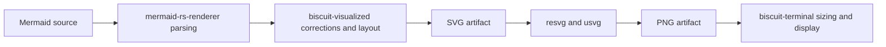

# mermaid-rs-renderer

`mermaid-rs-renderer` is the native Rust Mermaid parser, layout engine, and SVG
renderer used by `biscuit-visualized`. It provides fast rendering without a
JavaScript or browser runtime, but compatibility and visual fidelity differ from
the official Mermaid.js renderer. Our installed Mermaid renderer is already on
the latest published release; upstream has unreleased changes worth evaluating.

This document records research verified on October 15, 2026. Release versions,
activity counts, and repository observations are dated findings. No dependency
upgrade, renderer build, or visual comparison was performed during this research.

## How We Use It

Diagram artifacts belong to `biscuit-visualized`; terminal sizing, capabilities,
display protocols, and fallback presentation belong to `biscuit-terminal`.

The distinction matters when diagnosing a defect:

| Symptom | First stage to investigate |
| ------- | -------------------------- |
| Rejected syntax or missing diagram data | Mermaid parser and intermediate representation |
| Incorrect spacing, connections, or overlaps already visible in SVG | Layout and SVG generation |
| Correct SVG but incorrect PNG text or shapes | SVG parsing, fonts, and rasterization |
| Correct standalone PNG but poor terminal output | Target dimensions and terminal display |

`biscuit-visualized/src/Cargo.toml` declares `mermaid-rs-renderer` with default
features disabled. We use its SVG pipeline and our own rasterizer, avoiding its
CLI and PNG dependencies. `biscuit-terminal/lib/Cargo.toml` also directly depends
on `resvg` for image rendering.

Our Mermaid integration drives the manual pipeline rather than the upstream
high-level `render()` API. It parses the source, repairs gitGraph merges, applies
selected theme overrides, and computes the corrected layout before emitting SVG.
Consequently, upstream improvements to high-level configuration handling do not
automatically apply to our integration.

Existing local corrections include labeled gitGraph merge repair, collision-aware
tag spacing, and SVG post-processing for text alignment and pie contrast. The
gitGraph contracts are described in [Mermaid gitGraph Corrections](../../../biscuit-visualized/docs/mermaid-gitgraph.md).
Any upstream upgrade must be checked against these corrections to avoid either
losing a necessary fix or applying a now-redundant correction twice.

## Published Versions and Upgrade Candidates

Versions were checked against the crates.io API and upstream release history:

| Dependency | Workspace lockfile | Latest published stable | Finding |
| ---------- | ------------------ | ----------------------- | ------- |
| `mermaid-rs-renderer` | 0.3.1 | 0.3.1 | No newer published release |
| `resvg` / `usvg` | 0.45.1 | 0.48.1 | Rasterizer upgrade available |

The latest Mermaid release, 0.3.1, was published July 6, 2026. Upstream `master`
was 24 commits ahead of that release, ending at
`3726ccbffe0e8032361eb9668694b24f77858060` on September 7. Its manifest still
identifies the crate as 0.3.1, so the version string alone cannot identify an
unreleased build. [Crate registry](https://crates.io/crates/mermaid-rs-renderer),
[releases](https://github.com/1jehuang/mermaid-rs-renderer/releases),
[changes since 0.3.1](https://github.com/1jehuang/mermaid-rs-renderer/compare/v0.3.1...3726ccbffe0e8032361eb9668694b24f77858060).

The unreleased commits include radar data and label fixes, state fork/join
corrections, requirement text placement, flowchart routing improvements, a guarded
Dagre-style placement engine, and an optional native vector scene API. Their
presence is evidence of candidate improvements, not proof that they resolve our
particular rendering defects. [Upstream comparison](https://github.com/1jehuang/mermaid-rs-renderer/compare/v0.3.1...3726ccbffe0e8032361eb9668694b24f77858060).

### Rasterization

`resvg` 0.48 changes font parsing and shaping to `skrifa` and `harfrust`. Its
fixes include glyph advances, text transforms, nested SVG transforms, clipping,
and other SVG behavior. Version 0.48.1 declares Rust 1.85.0 as its minimum
supported version. These changes could improve PNG fidelity; they cannot add
Mermaid syntax or repair geometry already wrong in SVG. Changes listed under
the changelog's **Unreleased** heading must not be attributed to 0.48.1.
[resvg changelog](https://github.com/linebender/resvg/blob/main/CHANGELOG.md),
[crate registry](https://crates.io/crates/resvg).

Both direct `resvg` declarations currently use the `0.45` range. A coordinated
upgrade should keep the two consumers on the same version and verify image
feature gating, fonts, transparency, aspect ratio, and requested dimensions.

Cache identities also need attention. The current shared artifact cache identifies
the Mermaid backend as `mermaid-rs-renderer@0.3.x+bv3` and rasterization as
`resvg@0.45`. An unreleased renderer needs a revision-specific identity, and a
rasterizer upgrade needs its own updated identity, so stale artifacts cannot
conceal the new output.

## Maintenance Activity and Contributors

GitHub's contributor endpoint reported six human accounts and Dependabot:

| Contributor | Attributed commits |
| ----------- | ------------------ |
| `1jehuang` | 501 |
| `fondoger` | 17 |
| `smitbarmase` | 5 |
| `codewarnab` | 1 |
| `nicosuave` | 1 |
| `james7132` | 1 |
| `dependabot[bot]` | 15 |

These are GitHub-attributed contributor counts, not a count of everyone who has
reported bugs, reviewed changes, or submitted unmerged work. The lead account
represents approximately 95% of the 526 attributed human commits.
[Contributor data](https://api.github.com/repos/1jehuang/mermaid-rs-renderer/contributors?per_page=100).

The repository was created January 22, 2026. The latest default-branch commit
was September 7, with no commits in the 30 days preceding October 15. Most of
the 24 post-release commits landed in July. Repository metadata reported a push
on October 4; a repository push timestamp does not establish a new default-branch
commit or release. [Repository metadata](https://api.github.com/repos/1jehuang/mermaid-rs-renderer),
[commit history](https://github.com/1jehuang/mermaid-rs-renderer/commits/3726ccbffe0e8032361eb9668694b24f77858060/).

**Assessment:** the project has meaningful development history but sparse recent
default-branch activity, an irregular release cadence, and substantial dependence
on one maintainer. We should not assume prompt releases or automatic support for
new Mermaid.js features.

## Contributor Readiness, Architecture, and Standards

There is enough material to begin focused work, especially on layout defects,
but no dedicated `CONTRIBUTING.md` was found in the inspected tree. A new
contributor must assemble the workflow from the README, topic documents, source,
test suites, and CI configuration.

| Resource | What it provides |
| -------- | ---------------- |
| [Architecture](https://github.com/1jehuang/mermaid-rs-renderer/blob/master/docs/architecture.md) | Pipeline orientation and design decisions |
| [Flowchart routing](https://github.com/1jehuang/mermaid-rs-renderer/blob/master/docs/flowchart-routing-architecture.md) | Detailed routing design |
| [Benchmark suite design](https://github.com/1jehuang/mermaid-rs-renderer/blob/master/docs/benchmark-suite-design.md) | Quality priorities, gaps, and an implementation-status section |
| [Layout objective](https://github.com/1jehuang/mermaid-rs-renderer/blob/master/docs/layout_objective.md) | Hard constraints and readability objectives |
| [Layout feedback loop](https://github.com/1jehuang/mermaid-rs-renderer/blob/master/docs/dagre-feedback-loop.md) | Placement-engine boundaries, deterministic comparison, and acceptance criteria |
| [CI workflow](https://github.com/1jehuang/mermaid-rs-renderer/blob/master/.github/workflows/ci.yml) | Executable checks and platform coverage |

The architecture page mixes intentions with implementation and contains drift:
it proposes `pest` or `nom`, whereas the inspected parser is handwritten and
uses regular expressions. The benchmark design likewise includes aspirations
alongside a later status update. Use these documents for intent and verify
current behavior in source and CI. [Parser](https://github.com/1jehuang/mermaid-rs-renderer/blob/master/src/parser.rs).

The quality priorities are explicit: correctness, hard geometry validity,
readability, then performance. Tests cover content preservation, valid output,
determinism, selected diagram semantics, robustness, and output shape. The hard
geometry gate ratchets against a baseline; it prevents new or worsening defects
rather than proving every existing fixture is defect-free.
[Benchmark design and status](https://github.com/1jehuang/mermaid-rs-renderer/blob/master/docs/benchmark-suite-design.md).

CI checks formatting, Clippy with warnings denied, Python and shell tooling,
documentation/tool consistency, dependency feature combinations, tests, doctests,
packaging, and packaged-crate compilation. Separate jobs run tests on macOS and
Windows; Linux runs the broader checks and layout quality gate. These are
upstream workflows, not instructions to substitute for this monorepo's `just`
and nextest workflows. [CI](https://github.com/1jehuang/mermaid-rs-renderer/blob/master/.github/workflows/ci.yml).

**Planning estimate, not measured:** half a day to a day should be enough to
establish a reproducible mindmap baseline, understand the relevant source, and
attempt a focused fix. A broad compatibility program would require more work.

## How Mermaid.js Behavior Is Mapped

The inspected repository shows selective algorithm porting and fixture-based
comparison with official output. No comprehensive upstream requirements map,
automated grammar/test import process, or systematic release-tracking process
was found. This is an observation about the inspected materials, not proof that
contributors have no additional informal process.

### Reference comparisons

`scripts/conformance_compare.py` renders fixtures through both the Rust renderer
and official Mermaid CLI. It produces PNG comparisons, difference images, an
HTML report, and optional layout comparisons. Its default official invocation
uses unversioned `npx -y @mermaid-js/mermaid-cli`, which can change the reference
between runs. Pin the official version before relying on reproducible results.
[Conformance tool](https://github.com/1jehuang/mermaid-rs-renderer/blob/master/scripts/conformance_compare.py).

The newer layout feedback-loop document describes reference caching keyed with
the Mermaid CLI version, stage-specific metrics, downstream regression vetoes,
and an acceptance ledger. Different tools therefore offer different levels of
reference reproducibility. [Feedback loop](https://github.com/1jehuang/mermaid-rs-renderer/blob/master/docs/dagre-feedback-loop.md).

### Explicit ports and intentional differences

Mindmap source comments identify a port of the non-layered tidy-tree algorithm
used by Mermaid.js. They reference upstream layout functions and explain matching
spacing, subtree placement, and curve construction. Other comments document
intentional differences, including circle intersections and older root-edge
routing. This provides useful local traceability, but not a complete compatibility
contract. [Mindmap source](https://github.com/1jehuang/mermaid-rs-renderer/blob/3726ccbffe0e8032361eb9668694b24f77858060/src/layout/mindmap.rs).

For efficient contribution, a useful addition would be a small compatibility
matrix connecting each target behavior to an upstream version or commit, source
function, reproduction fixture, expected semantics, and automated regression.

## Mindmap Findings

Reviewing all 24 post-0.3.1 commits did not reveal a dedicated mindmap spacing,
overlap, or routing improvement. Two changes are relevant:

- **July 12, `90a1bfc`:** removes invalid child references and prunes cycles
  before layout. A regression constructs cyclic public mindmap IR and verifies
  that layout terminates without a panic. This primarily improves robustness
  for programmatically constructed graphs. [Commit](https://github.com/1jehuang/mermaid-rs-renderer/commit/90a1bfc50f6bdfcd0ae8f0bdaad599d79153f6e4).
- **July 9, `f07ebff`:** high-level library APIs start applying parsed init
  directives, including the mindmap `layoutAlgorithm` setting. Manual-pipeline
  callers must explicitly merge configuration to gain equivalent behavior.
  [Commit](https://github.com/1jehuang/mermaid-rs-renderer/commit/f07ebff8bc8914979103d0bc0900935fc8f02993).

The September scene API adds mindmap coverage among its diagram-kind checks,
but does not establish a mindmap layout fix.
[Scene API commit](https://github.com/1jehuang/mermaid-rs-renderer/commit/3726ccbffe0e8032361eb9668694b24f77858060).

### Issue #7572 and Fix #7639

**#7572 is an issue, not a pull request.** It reports branches appearing
disconnected from a mindmap root under `tidy-tree`, with several children.
The report used Mermaid 11.13.0. The fix is PR #7639, merged April 21, 2026.
[Issue](https://github.com/mermaid-js/mermaid/issues/7572),
[fix](https://github.com/mermaid-js/mermaid/pull/7639).

The old routing omitted a root-side intermediate control point. Subsequent
intersection calculation could place the start anchor at the root's top or
bottom boundary and produce a visibly disconnected curve. The fix adds an
intermediate point on the side facing the child, at the root's vertical center.
It includes coordinate assertions and a visual regression using the reported
example. [Fix details](https://github.com/mermaid-js/mermaid/pull/7639).

The Rust renderer explicitly chooses the older behavior in
`tidy_tree_edge_points`: root branches can attach at different sides or corners
instead of sharing the horizontal midline. This is a documented divergence from
the corrected JavaScript routing. It does not prove the Rust implementation
reproduces the original gap, but the upstream reproduction is a strong fixture
for investigating it. [Pinned Rust implementation](https://github.com/1jehuang/mermaid-rs-renderer/blob/3726ccbffe0e8032361eb9668694b24f77858060/src/layout/mindmap.rs).

## Proposed Comparison Workflow

The following investigation is planned; no comparison gallery has been built.

1. Build separate executables for released 0.3.1 and an exact upstream commit,
   outside the workspace dependency choices. Record the full SHA.
2. Render identical sources and settings, preserving both SVG and PNG output
   and displaying parse/render failures alongside successful results.
3. Use the same rasterizer for both Mermaid candidates to isolate parser,
   layout, and SVG changes. Compare rasterizer 0.45.1 versus 0.48.1 separately.
4. Produce an HTML gallery with side-by-side SVGs and PNGs. Include actual user
   failures when available, the #7572 reproduction, and existing upstream
   mindmap fixtures for basic, deep, shaped, tidy-tree, and lr-tree diagrams.
5. Test promising changes through `biscuit-visualized`, including local themes,
   configuration handling, gitGraph corrections, caching, and terminal sizing.

**Planning estimate, not measured:** roughly an hour to assemble and inspect a
small initial gallery, depending on build time and fixture selection. A fix or
upstream-ready contribution takes additional time.

The principal unanswered question is whether any evaluated candidate improves
the diagrams that prompted this investigation. Until those diagrams are captured
and rendered, upgrade recommendations remain candidates rather than demonstrated
solutions.
