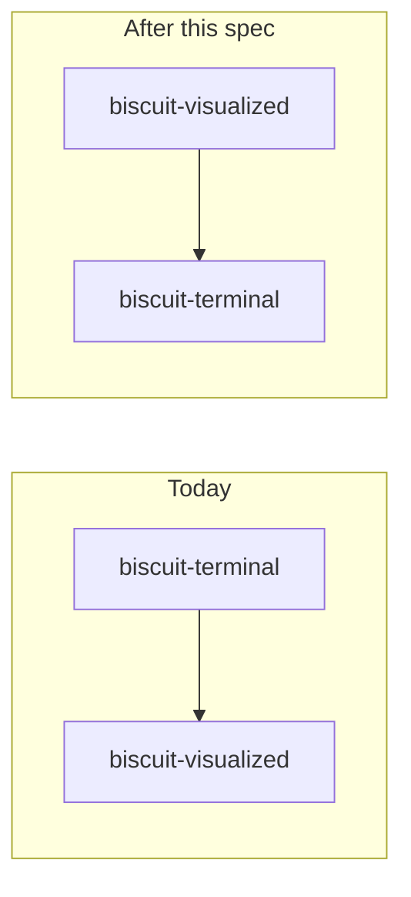

# Graphics Where Possible

People using `biscuit-terminal` and `biscuit-visualized` should see graphics
whenever their terminal can render them, including through tmux, Zellij, SSH,
and a Windows SSH server, without configuring anything that `biscuit-terminal`
could have worked out itself. Where graphics are impossible, they get a useful
fallback, and where a setting is blocking graphics, they are told which one.

This spec began because a WezTerm session into a Windows host showed no
graphics. Reconfiguring to WezTerm's multiplexer fixed that one setup; this
spec makes the general case work out of the box.

It also corrects the division of work between the two packages:
`biscuit-terminal` owns terminal detection and getting bytes onto the screen,
and `biscuit-visualized` owns diagrams for every target. Both changes land
here, in one spec, by the author's choice.

Research this spec builds on:

- [Kitty graphics](../../docs/research/graphics/kitty.md)
- [iTerm2 graphics](../../docs/research/graphics/iterm2.md)
- [Sixel graphics](../../docs/research/graphics/sixel.md)
- [Graphics through multiplexed sessions](../../docs/research/graphics/multiplexing.md)
- [Terminal standards](../../docs/research/terminal-standards/SKILL.md) (OSC 1337, modes 2026 and 2048)

## Current state

As of 2026-10-20:

- **Two formats are rendered today, not one.** Kitty everywhere detection
  says Kitty, and the iTerm2 format (`OSC 1337;File=`, legacy single-message
  form) for iTerm2. `protocol.rs` deliberately routes iTerm2 to the iTerm2
  encoder even when Kitty is reported.
- **Detection reads only environment variables**
  (`discovery/detection/image.rs`): `TERM_PROGRAM`, `TERM`, `ITERM_*`. It
  never probes and never consults the multiplexer detection that already
  exists (`detect_multiplexer()`, `multiplex_support()`). Consequences:
    - **tmux:** tmux sets `TERM_PROGRAM=tmux`, so detection finds no known
      terminal and returns `None`. Nothing wraps output for passthrough
      either.
    - **Zellij:** `TERM_PROGRAM` is inherited from the outer terminal. With
      iTerm2 outside, we send the iTerm2 format, which Zellij drops.
    - **SSH:** `TERM_PROGRAM` is usually not forwarded, so the result is
      `None` even when the local terminal is capable.
    - **Windows SSH server:** when `TERM_PROGRAM` *is* forwarded, detection
      picks Kitty, the system console host strips it, and the user sees
      reserved blank rows (see Evidence).
    - **mintty** (Git Bash, MSYS2, Cygwin, WSLtty) renders the iTerm2 format
      but is not recognized.
- **Fallbacks:** a Mermaid diagram with no image support falls back to its
  source as a ```` ```mermaid ```` code block; `bt image` and
  `TerminalImage` print nothing. Neither says why.
- `viuer` is a declared dependency of the library, but no `viuer::` call
  was found in its code.
- **Diagram components live in the terminal crate.** `MermaidDiagram`,
  `GraphExpression`, and `GitGraph` are in `biscuit-terminal/lib/src/components/`
  and implement terminal, tree, and (for the latter two) browser rendering.
  `biscuit-terminal` depends on `biscuit-visualized` through its `image`
  feature; `biscuit-visualized` has no other dependent. About 20 packages
  depend on `biscuit-terminal`; four of them (worktree-cli, sniff-cli,
  darkmatter, the `bt` CLI) enable `image` and compile the Mermaid renderer.
- **The render-tree renderer calls `MermaidDiagram` directly**
  (`render_tree/render.rs`) to turn a Mermaid code fence into a diagram when
  `TerminalMermaidMode::Image` is set.
- **Diagram PNGs are encoded twice (bug).** `biscuit-visualized` rasterizes a
  PNG, and `biscuit-terminal` decodes, resizes, and encodes it again
  (`encode_as_png`) even when the rendered width already matches the display
  width.

## Evidence gathered while scoping

### Kitty in iTerm2 (iTerm2 3.7.6, 2026-10-20)

| Case | Result |
| --- | --- |
| iTerm2 format (today's path) | Correct placement |
| Kitty with width only (`c=`) | Space reserved, **no image** |
| Kitty with width and height (`c=` + `r=`) | Correct placement |
| Kitty after an image with `q=2` | iTerm2 **ignores `q=2`** and replies `ESC _Gi=0;OK ESC \`; the reply lands in the shell's input buffer as junk |
| Kitty query (`a=q`, `i=31`) | Correct `OK` reply |

**Conclusion:** iTerm2 keeps the iTerm2 format. The comment at
`protocol.rs:49-50` ("more predictable for cursor placement") misstates the
reason and is corrected in this work.

### Windows OpenSSH server on `build-win-native` (2026-10-20)

The bytes a Windows process wrote inside an `ssh -tt` session were captured at
the client. The session's console is `C:\WINDOWS\system32\conhost.exe`.

| Sent by the Windows process | Arrived at the client |
| --- | --- |
| Kitty (APC) | **Removed** |
| iTerm2 format, BEL or ST terminated | Intact |
| iTerm2 format with 300 KB and 2 MB payloads | Intact, byte count exact |
| Sixel (DCS) | **Removed** |
| Kitty wrapped for tmux passthrough (DCS) | **Removed** |
| OSC 8 hyperlink (control) | Passes; conhost adds an `id=` |

WezTerm's multiplexer works on the same host because WezTerm installs its own
`conpty.dll` and `OpenConsole.exe` (`C:\Program Files\WezTerm\`) and does not
use the system console host.

### Binary cost of Sixel (macOS arm64, stripped release, 2026-10-20)

Adding `icy_sixel` 0.7 to a minimal `image` 0.25 program: 5,847,328 →
5,931,584 bytes, **+82 KB** (about 0.4% of the installed `bt`). It pulls in
`quantette` and its dependencies, which cost mostly compile time.

In the same test, Kitty output for a 400×400 icon was 1.1 MB, against 110 KB
as Sixel, which suggests our PNG encoding uses fast, low-compression settings.

## Goals

Each supported setup has one testable outcome:

| Setup | Outcome |
| --- | --- |
| Direct, local terminal | Unchanged from today |
| Zellij 0.45+ | Kitty, ordinary placement; never the iTerm2 format |
| Zellij before 0.45, or Kitty support disabled | Sixel if Zellij reports it, otherwise fallback |
| WezTerm multiplexer domain | Unchanged from today (works) |
| tmux, Kitty or Ghostty outside, passthrough on | Kitty with Unicode placeholders; images follow the pane |
| tmux, WezTerm outside, passthrough on | Kitty through passthrough, ordinary placement |
| tmux, iTerm2 outside, passthrough on | iTerm2 format through passthrough |
| tmux built with Sixel, Sixel-capable outside | Sixel handled by tmux itself |
| tmux, passthrough off | Fallback, plus a hint naming `set -g allow-passthrough on` |
| SSH from a capable terminal, no forwarded hints | Graphics, via the probe |
| SSH into a Windows server (system conhost) | iTerm2 format when the outer terminal is on the iTerm2 list; otherwise fallback. Never Kitty or Sixel. |
| mintty | iTerm2 format |
| Windows Terminal | Sixel |
| Terminal.app, Alacritty, VTE terminals, conhost | Fallback |
| Any setup, `BISCUIT_GRAPHICS` set | Exactly the forced format, or none |

## Non-goals

- Restoring images after tmux detach/reattach, a fresh tmux client, or a
  cterm daemon reattach. A finished process cannot send its images again.
- Kitty animation, shared-memory or file transfer media.
- More than one level of nested tmux.
- tmux inside Zellij, or Zellij inside tmux. These need an adapter in the
  multiplexer itself.
- iTerm2 multipart (`MultipartFile`/`FilePart`) until someone hits tmux's
  message-size limit; WezTerm and cterm do not parse it.
- Switching the Mermaid renderer to Merman. Likely, but separate work; this
  spec only leaves room for the Unicode text fallback Merman would enable.

## Package boundaries

**`biscuit-visualized` decides what to show; `biscuit-terminal` decides how it
reaches the screen.**

| | `biscuit-terminal` | `biscuit-visualized` |
| --- | --- | --- |
| Owns | Terminal detection and capabilities; the graphics route; displaying pixels (`TerminalImage`, the Kitty, iTerm2, Sixel, and half-block encoders, tmux wrapping, placement) | Diagrams for every target: the diagram components (`MermaidDiagram`, `GraphExpression`, `GitGraph`) and their terminal, browser, and tree rendering |
| Terminal output | Turns pixels into escape sequences for the route | Asks `biscuit-terminal` for the route and cell geometry, chooses what to show (pixels, later a Unicode drawing, or the source), renders at the display size, and hands pixels to `TerminalImage` |
| Browser output | — | SVG, as today |
| Never | Knows about diagrams | Writes escape sequences or knows about formats and routes |

`TerminalImage` stays in `biscuit-terminal` because plain images are displayed
without any diagram involved (biscuit-icon, claudine, darkmatter), and because
sending pixels depends on the route (the placeholder grid needs tmux's outer
terminal; the Windows SSH rule changes the format).

**The dependency direction flips:** `biscuit-visualized` depends on
`biscuit-terminal`, and `biscuit-terminal` drops `biscuit-visualized` and
`resvg`. Packages that depend on `biscuit-terminal` stop compiling the Mermaid
renderer unless they use diagrams.



## Design

### 1. Route model

Replace the single answer with a **route**: what the image passes through to
reach a renderer. A route records:

- **format**: Kitty, iTerm2, Sixel, or none
- **transport**: direct, or wrapped for tmux passthrough
- **placement**: ordinary, or Unicode placeholders (Kitty only)
- **confidence**: forced, verified by probe, known terminal, or unknown
- **reason**: a human-readable explanation, including the fix when one exists

`ImageSupport` and `image_support()` remain as a projection of the route so
existing callers keep working. `TerminalImage` consumes the route, and the
diagram components read it to choose what to show; CLIs never make format
decisions.

Resolution order:

```mermaid
flowchart TD
    A[stdout is a terminal?] -->|no| N[none]
    A -->|yes| O{BISCUIT_GRAPHICS set?}
    O -->|kitty, iterm2, sixel, none| F[forced route]
    O -->|unset or auto| W{Windows and SSH_CONNECTION?}
    W -->|yes| WI{outer terminal on iTerm2 list?}
    WI -->|yes| I2[iTerm2 format, direct]
    WI -->|no| N
    W -->|no| M{multiplexer}
    M -->|Zellij| Z[Kitty if 0.45+, else Sixel probe, else none]
    M -->|tmux| T[tmux route, section 3]
    M -->|none| K{known terminal from env or LC_TERMINAL?}
    K -->|yes| KT[known route]
    K -->|no| P[probe, section 2]
```



**Format choice for a known terminal:** pick the format the endpoint handles
reliably, not everything it advertises.

| Terminal | Format |
| --- | --- |
| Kitty, Ghostty, WezTerm, Warp, Konsole, wast | Kitty |
| iTerm2, mintty, cterm | iTerm2 format |
| Windows Terminal (`WT_SESSION`) | Sixel |
| Terminal.app | none |

The **iTerm2 list** used by the Windows SSH rule and tmux is: iTerm2,
WezTerm, Konsole, mintty, cterm. The iTerm2 format is chosen only by terminal
identity, never by probe, because no reliable query exists for it.

### 2. Probe, only when the environment cannot decide

The probe runs only when the route is otherwise unknown: SSH sessions with no
recognizable terminal, `TERM_PROGRAM=tmux` with no identifiable outer
terminal, or an unrecognized local terminal. Known terminals are never probed,
so the earlier Ghostty reply leak cannot return.

- Sends a Kitty query (`a=q`, fresh nonzero ID) followed by DA1 (`ESC [ c`)
  through the existing query engine (`discovery/osc_queries`). Kitty `OK`
  before the DA1 reply means Kitty; a `4` in the DA1 reply means Sixel.
- Runs only when stdout is a terminal and `biscuit-terminal` owns the input;
  never inside a running TUI event loop and never inside a synchronized
  output (mode 2026) block, because WezTerm holds replies there with no
  timeout.
- Under tmux, the probe is wrapped for passthrough like any other output.
- The result is cached per process.
- **Never selects Kitty for iTerm2.** If `LC_TERMINAL=iTerm2` or another
  iTerm2 hint is present, the iTerm2 format wins over a Kitty `OK`.

### 3. tmux

- **Detect** tmux from `TMUX`; read `allow-passthrough` for the pane
  (`tmux show-options -Apv -t "$TMUX_PANE" allow-passthrough`).
- **Identify the outer terminal** from the attached client
  (`#{client_termname}`, `#{client_termtype}`) or `tmux show-environment`.
  Without socket access (for example across SSH), fall back to the probe.
- **Wrap** each complete escape sequence as
  `ESC P tmux; <sequence with every ESC doubled> ESC \`. Each Kitty chunk is
  wrapped separately.
- **Placement:**
    - Kitty or Ghostty outside: upload through passthrough with a virtual
      placement (`U=1`) and print the Unicode placeholder grid (`U+10EEEE`,
      image ID in the foreground color, row/column combining marks) as
      ordinary text through tmux. Used only when the outer terminal is
      positively identified; Zellij rejects `U=1` and WezTerm ignores it.
    - WezTerm or unidentified outside: ordinary placement through
      passthrough. Known limits (drift on resize, window switch, copy mode)
      are documented.
    - iTerm2 outside: iTerm2 format through passthrough.
- **Sixel handled by tmux itself:** when tmux was built with Sixel support
  and the outer terminal handles Sixel, prefer Sixel unwrapped, since tmux then
  redraws it with the pane. The selection rule between this and Kitty
  passthrough is settled in phase 0.
- Mode 2026 is never wrapped for passthrough; tmux handles it itself.
- Passthrough off: fallback, and the hint names the setting.

### 4. Zellij

- Kitty with ordinary placements only, for Zellij 0.45 and later. Never
  placeholders, never the iTerm2 format.
- Earlier versions or Kitty support disabled: Sixel if the probe reports it,
  otherwise fallback.

### 5. Sixel

- Encoder: `icy_sixel`, no cargo feature flag.
- Detection: `4` in the DA1 reply; `WT_SESSION` for Windows Terminal.
- Sized by the rule in section 7. Sixel has no partial transparency:
  diagrams are rendered opaque on the terminal's background by
  `biscuit-visualized`; plain images are composited against that background
  by `TerminalImage`.
- Never sent into a Windows SSH session.

### 6. Fallback and hints

- **Diagrams** keep the source code block they produce today. The choice
  belongs to the diagram components in `biscuit-visualized`, so a Unicode
  drawing (expected with Merman) can later slot in between graphics and the
  source without touching `biscuit-terminal`.
- **Plain images** (`bt image`, `TerminalImage`) render as half-blocks
  (`▀` with truecolor foreground and background), degrading to alt text (the
  file name) without truecolor.
- **Hint:** when the route's reason has a fix, the `bt` CLI writes one line
  to stderr, only when stderr is a terminal. The library never writes hints
  into rendered output.
- The capability report (`bt` with no arguments, `--json`) shows the route
  and its reason, not just `Images: None`.

### 7. Sizing and the double-encoding fix

- **Render at the final display size.** The layout decides an image's width
  (a percentage, a character count, natural width, margins; rarely the full
  terminal width). Diagrams are rasterized at exactly that width in pixels
  (`RenderRequest::target_width`), with the height rounded to whole rows,
  rather than rendered at another size and resampled. Placeholders and Sixel
  depend on the exact cell rectangle.
- **Fix: send diagram PNGs without re-encoding.** When the rendered size
  matches the display size, the PNG bytes from `biscuit-visualized` go to the
  encoder unchanged. Decoding is reserved for formats that need pixels
  (Sixel, half-blocks) or for an actual resize.
- **Background instead of a bool.** `RenderRequest::transparent_background`
  becomes an optional background color, so a diagram can be rendered opaque
  on the terminal's actual background (Sixel, half-blocks) or transparent
  (Kitty, iTerm2 format, browser).

### 8. Moving the diagram components

- `MermaidDiagram`, `GraphExpression`, and `GitGraph`, with their tests and
  component docs, move from `biscuit-terminal` to `biscuit-visualized`.
- `biscuit-visualized` gains a dependency on `biscuit-terminal`;
  `biscuit-terminal` drops `biscuit-visualized`, `resvg`, and the diagram
  half of its `image` feature.
- **Render-tree hook.** The terminal render-tree renderer can no longer call
  `MermaidDiagram`. It gains a diagram-rendering hook (a trait object on the
  render options) that `biscuit-visualized` implements; with no hook
  installed, a Mermaid fence stays a code block, as with
  `TerminalMermaidMode::Code` today. Callers that want diagrams
  (darkmatter, the `bt` CLI) install it.
- Consumers update imports: the `bt` CLI diagram commands, darkmatter,
  sniff-cli, worktree (lib and CLI).
- Behavior is unchanged by the move itself; existing tests pass from their
  new location.

### 9. Housekeeping

- Correct the `protocol.rs` comment on why iTerm2 uses its own format.
- Review PNG encoding settings for transfer size, in both `TerminalImage`
  and the `biscuit-visualized` rasterizer.
- Remove `viuer` if it is unused.

## Phases

| Phase | Content | Depends on |
| --- | --- | --- |
| 0. Evidence | Visual confirmation of the Windows SSH rule; whether conhost answers DA1 itself and claims Sixel; Ghostty placeholder support; cell pixel size inside tmux and Zellij; what Kitty and Ghostty do with an ordinary placement when tmux switches windows; the tmux Sixel-versus-Kitty rule | — |
| 1. Component move | Section 8: diagram components to `biscuit-visualized`, dependency flip, render-tree hook, consumer imports. No behavior change. | — |
| 2. Sizing and double encoding | Section 7: render at display size, PNG pass-through fix, background color in `RenderRequest` | 1 |
| 3. Route model | Route type, resolution order, `BISCUIT_GRAPHICS`, Windows SSH rule, mintty, Windows Terminal identity, Zellij gating, capability report, stderr hints, housekeeping | 1 |
| 4. Probe | Kitty query plus DA1 through the query engine | 3 |
| 5. tmux transport | Passthrough detection, outer-terminal identification, wrapping, ordinary placement, iTerm2 format through tmux | 3, 4 |
| 6. Placeholders | Unicode placeholder encoder and its use under tmux for Kitty and Ghostty | 2, 5 |
| 7. Sixel | Encoder, detection, tmux's own Sixel handling | 2, 3, 4 |
| 8. Half-blocks | Half-block fallback for plain images | 3 |

The move comes first so that every later change to diagram behavior is
written once, in its final package. Phases 1 and 2 change no visible output.
Phase 3 changes no bytes for setups that work today, except the Windows SSH
case, which today shows blank rows.

## Verification

- **L1:** the resolution order as an environment-variable matrix (every row
  of the Goals table that environment alone decides); tmux wrapping
  including ESC doubling and nested terminators; placeholder grid encoding;
  Sixel output for fixed fixtures; half-block output; the probe's reply
  parser over fragmented and out-of-order replies; diagram PNG bytes reach
  the encoder unchanged when sizes match; a render tree without the diagram
  hook leaves Mermaid fences as code blocks.
- **Move:** the moved components' existing tests pass unchanged in
  `biscuit-visualized`, and `cargo tree -p biscuit-terminal` no longer
  contains `biscuit-visualized` or `resvg`.
- **L2:** tmux through the shared test harness, with passthrough on and off;
  Zellij where available; WezTerm.
- **Manual, recorded:** iTerm2 (iTerm2 format and no reply leak), Windows SSH
  server from WezTerm (iTerm2 format renders), Windows Terminal (Sixel),
  mintty (iTerm2 format), Ghostty under tmux (placeholders survive resize and
  window switch). Results are kept as dated evidence with terminal and
  multiplexer versions.

## Documentation

- A new `docs/` topic page on how `biscuit-terminal` chooses a graphics route,
  the route table, `BISCUIT_GRAPHICS`, what each hint means, and the known
  limits under tmux. Written for a developer new to the repository; it links
  to the research, not to this spec.
- `docs/components/terminal_image.md` updated for the route model and the
  half-block fallback.
- The component docs for `MermaidDiagram`, `GraphExpression`, and `GitGraph`
  move to `biscuit-visualized/docs/`, along with
  `docs/data-visualization/` pages that describe them.
- Both packages' `docs/dependencies.md` for the dependency flip, `icy_sixel`,
  and `viuer` if removed; both READMEs where they describe what each package
  does.
- The `os` skill (`windows-console.md`): Windows OpenSSH's system conhost
  removes APC and DCS sequences and passes OSC; WezTerm ships its own ConPTY.
- The `biscuit-terminal` and `biscuit-visualized` skills for the route model
  and the new package boundary.

## Risks

- **Width-only Kitty placement** failed in iTerm2. iTerm2 no longer receives
  Kitty, but other terminals with partial Kitty support may behave the same
  way; sending both `c=` and `r=` everywhere is the cheap insurance if one
  turns up.
- **Windows console behavior may change.** A newer system conhost may stop
  removing these sequences; the Windows SSH rule is written against observed
  behavior and re-checked, not treated as permanent.
- **Placeholder cells after a fresh tmux client** render blank because the
  image data is gone; documented, not fixed.
- **Probe false positives** where an intermediary answers DA1 itself.
- **The move touches several packages** (the `bt` CLI, darkmatter, sniff-cli,
  worktree), which widens this spec's CI scope. Keeping phase 1 free of
  behavior changes keeps its review mechanical.
- **The render-tree hook is a new public seam.** A caller that forgets to
  install it silently gets code blocks instead of diagrams; the capability
  report or a debug trace should make that visible.

## Open questions

- The tmux rule between Sixel handled by tmux and Kitty through passthrough
  when both are available (phase 0).
- Whether `BISCUIT_GRAPHICS` also needs a way to force the tmux transport for
  setups where tmux is present but undetectable (for example a remote program
  reached over SSH from inside a local tmux, which sees no `TMUX`).
