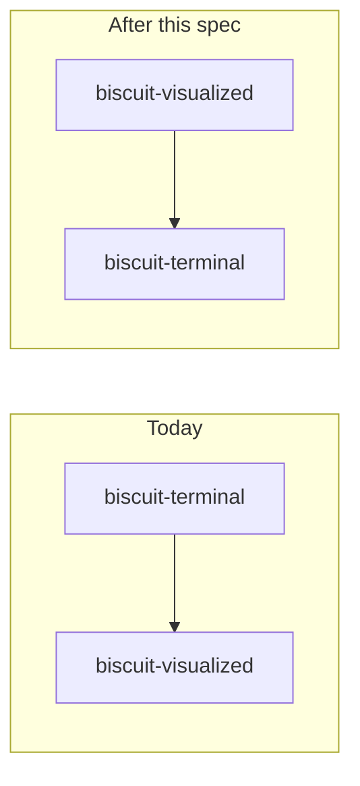
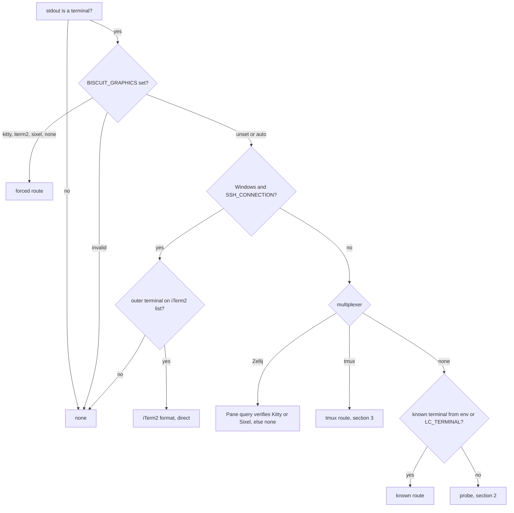

---
$schema:
    status: |-
        enum(
            draft-spec,
            finalized-spec,
            planned,
            implemented,
            review-findings,
            human-in-the-loop,
            completed,
            on-hold,
            abandoned
        ) -> an indicator of progress for this specification
    reviewed: boolean -> indicates whether the specification file has been reviewed by another agent from the one which created the spec
    reviewed_by: string -> the agent and model used in the spec review
    reviewed_on: date -> the date the spec was reviewed
    review_iterations: number -> the number of implementation reviews have taken place in the review/fix cycle
    clarified: boolean -> indicates whether the specification was built -- _in part_ -- with the clarify.md prompt
    implemented: boolean -> indicates whether this spec's plan has been implemented
    implemented_by: string -> the agent who implemented the plan
status: finalized-spec
reviewed: true
reviewed_by: "codex/gpt-6.1-sol"
reviewed_on: "2026-10-20"
review_iterations: 0
implemented: true
implemented_by: "claude/opus"
---

# Graphics Where Possible

People using `biscuit-terminal` and `biscuit-visualized` should see graphics
whenever their terminal can render them, including through tmux, Zellij, SSH,
and a Windows SSH server, without configuring anything that `biscuit-terminal`
could have worked out itself. Where graphics are impossible, they get a useful
fallback, and where a setting is blocking graphics, they are told which one.

This spec began because a WezTerm session into a Windows host showed no
graphics. Reconfiguring to WezTerm's multiplexer fixed that one setup; this
spec makes the general case work out of the box.

It also corrects the division of work between the two packages:
`biscuit-terminal` owns terminal detection and getting bytes onto the screen,
and `biscuit-visualized` owns diagrams for every target. Both changes land
here, in one spec, by the author's choice.

Research this spec builds on:

- [Kitty graphics](../../docs/research/graphics/kitty.md)
- [iTerm2 graphics](../../docs/research/graphics/iterm2.md)
- [Sixel graphics](../../docs/research/graphics/sixel.md)
- [Graphics through multiplexed sessions](../../docs/research/graphics/multiplexing.md)
- [Terminal standards](../../docs/research/terminal-standards/SKILL.md) (OSC 1337, modes 2026 and 2048)

## Current state

As of 2026-10-20:

- **Two formats are rendered today, not one.** Kitty everywhere detection
  says Kitty, and the iTerm2 format (`OSC 1337;File=`, legacy single-message
  form) for iTerm2. `protocol.rs` deliberately routes iTerm2 to the iTerm2
  encoder even when Kitty is reported.
- **Detection reads only environment variables**
  (`discovery/detection/image.rs`): `TERM_PROGRAM`, `TERM`, `ITERM_*`. It
  never probes and never consults the multiplexer detection that already
  exists (`detect_multiplexer()`, `multiplex_support()`). Consequences:
    - **tmux:** tmux sets `TERM_PROGRAM=tmux`, so detection finds no known
      terminal and returns `None`. Nothing wraps output for passthrough
      either.
    - **Zellij:** `TERM_PROGRAM` is inherited from the outer terminal. With
      iTerm2 outside, we send the iTerm2 format, which Zellij drops.
    - **SSH:** `TERM_PROGRAM` is usually not forwarded, so the result is
      `None` even when the local terminal is capable.
    - **Windows SSH server:** when `TERM_PROGRAM` *is* forwarded, detection
      picks Kitty, the system console host strips it, and the user sees
      reserved blank rows (see Evidence).
    - **mintty** (Git Bash, MSYS2, Cygwin, WSLtty) renders the iTerm2 format
      but is not recognized.
- **Fallbacks:** a Mermaid diagram with no image support falls back to its
  source as a ```` ```mermaid ```` code block; `bt image` and
  `TerminalImage` print nothing. Neither says why.
- `viuer` is a declared dependency of the library, but no `viuer::` call
  was found in its code.
- **Diagram components live in the terminal crate.** `MermaidDiagram`,
  `GraphExpression`, and `GitGraph` are in `biscuit-terminal/lib/src/components/`
  and implement terminal, tree, and (for the latter two) browser rendering.
  `biscuit-terminal` depends on `biscuit-visualized` through its `image`
  feature; `biscuit-visualized` has no other dependent. About 20 packages
  depend on `biscuit-terminal`; four of them (worktree-cli, sniff-cli,
  darkmatter, the `bt` CLI) enable `image` and compile the Mermaid renderer.
- **The render-tree renderer calls `MermaidDiagram` directly**
  (`render_tree/render.rs`) to turn a Mermaid code fence into a diagram when
  `TerminalMermaidMode::Image` is set.
- **Diagram PNGs are encoded twice (bug).** `biscuit-visualized` rasterizes a
  PNG, and `biscuit-terminal` decodes, resizes, and encodes it again
  (`encode_as_png`) even when the rendered width already matches the display
  width.

## Evidence gathered while scoping

### Kitty in iTerm2 (iTerm2 3.7.6, 2026-10-20)

| Case | Result |
| --- | --- |
| iTerm2 format (today's path) | Correct placement |
| Kitty with width only (`c=`) | Space reserved, **no image** |
| Kitty with width and height (`c=` + `r=`) | Correct placement |
| Kitty after an image with `q=2` | iTerm2 **ignores `q=2`** and replies `ESC _Gi=0;OK ESC \`; the reply lands in the shell's input buffer as junk |
| Kitty query (`a=q`, `i=31`) | Correct `OK` reply |

**Conclusion:** iTerm2 keeps the iTerm2 format. The comment at
`protocol.rs:49-50` ("more predictable for cursor placement") misstates the
reason and is corrected in this work.

### Windows OpenSSH server on `build-win-native` (2026-10-20)

The bytes a Windows process wrote inside an `ssh -tt` session were captured at
the client. The session's console is `C:\WINDOWS\system32\conhost.exe`.

| Sent by the Windows process | Arrived at the client |
| --- | --- |
| Kitty (APC) | **Removed** |
| iTerm2 format, BEL or ST terminated | Intact |
| iTerm2 format with 300 KB and 2 MB payloads | Intact, byte count exact |
| Sixel (DCS) | **Removed** |
| Kitty wrapped for tmux passthrough (DCS) | **Removed** |
| OSC 8 hyperlink (control) | Passes; conhost adds an `id=` |

WezTerm's multiplexer works on the same host because WezTerm installs its own
`conpty.dll` and `OpenConsole.exe` (`C:\Program Files\WezTerm\`) and does not
use the system console host.

### Binary cost of Sixel (macOS arm64, stripped release, 2026-10-20)

Adding `icy_sixel` 0.7 to a minimal `image` 0.25 program: 5,847,328 →
5,931,584 bytes, **+82 KB** (about 0.4% of the installed `bt`). It pulls in
`quantette` and its dependencies, which cost mostly compile time.

In the same test, Kitty output for a 400×400 icon was 1.1 MB, against 110 KB
as Sixel, which suggests our PNG encoding uses fast, low-compression settings.

## Goals

Each supported setup has one testable outcome. Under tmux, a positively
established native Sixel path takes precedence over the passthrough cases
below; this keeps images attached to the pane.

| Setup | Outcome |
| --- | --- |
| Direct, local terminal | Unchanged from today |
| Zellij 0.45+, graphics enabled and a working host path | Kitty after a successful pane query (until the probe ships: under a Kitty-family host identity, as today), ordinary placement; never the iTerm2 format |
| Zellij before 0.45, or Kitty support disabled | Sixel if Zellij reports it, otherwise fallback |
| WezTerm multiplexer domain | Unchanged from today (works) |
| tmux, Kitty or Ghostty outside, passthrough on | Kitty with Unicode placeholders; images follow the pane |
| tmux, WezTerm outside, passthrough on | Kitty through passthrough, ordinary placement |
| tmux, iTerm2 outside, passthrough on | iTerm2 format through passthrough |
| tmux built with Sixel, Sixel-capable outside | Sixel handled by tmux itself |
| tmux, passthrough off | Native Sixel when positively supported; otherwise fallback plus a hint naming `set -g allow-passthrough on` |
| SSH from a capable terminal, no forwarded hints | Graphics when a safe probe verifies a usable format; otherwise fallback with an unknown-route reason |
| SSH from inside a local tmux (remote side sees `TERM=tmux-*`/`screen-*`, no `TMUX`) | Kitty through passthrough, ordinary placement, when a wrapped probe confirms it; otherwise fallback with a hint naming `BISCUIT_GRAPHICS_TRANSPORT=tmux` |
| SSH into a Windows server (system conhost) | iTerm2 format when the outer terminal is on the iTerm2 list; otherwise fallback. Never Kitty or Sixel. |
| mintty | iTerm2 format |
| Windows Terminal with Sixel support established | Sixel, established by the native Windows probe's DA1 reply; `WT_SESSION` alone does not establish version support |
| Native Windows, any terminal answering color queries | Measured background and foreground colors, so diagrams get the right light/dark theme and Sixel the right opaque background |
| Terminals without a supported pixel format, including Terminal.app and system conhost | Diagram source or the plain-image text fallback; no graphics probe to known incompatible terminals |
| Any setup, valid `BISCUIT_GRAPHICS` set | Selected format or disabled graphics, subject to output policy and a usable transport; never silently substitute another pixel format |

## Non-goals

- Restoring images after tmux detach/reattach, a fresh tmux client, or a
  cterm daemon reattach. A finished process cannot send its images again.
- Kitty animation, shared-memory or file transfer media.
- More than one level of nested tmux.
- tmux inside Zellij, or Zellij inside tmux. These need an adapter in the
  multiplexer itself.
- iTerm2 multipart (`MultipartFile`/`FilePart`) until someone hits tmux's
  message-size limit; WezTerm and cterm do not parse it.
- Switching the Mermaid renderer to Merman. Likely, but separate work; this
  spec only leaves room for the Unicode text fallback Merman would enable.

## Package boundaries

**`biscuit-visualized` decides what to show; `biscuit-terminal` decides how it
reaches the screen.**

| | `biscuit-terminal` | `biscuit-visualized` |
| --- | --- | --- |
| Owns | Terminal detection and capabilities; the graphics route; displaying pixels (`TerminalImage`, the Kitty, iTerm2, Sixel, and half-block encoders, tmux wrapping, placement) | Diagrams for every target: the diagram components (`MermaidDiagram`, `GraphExpression`, `GitGraph`) and their terminal, browser, and tree rendering |
| Terminal output | Turns pixels into escape sequences for the route | Asks `biscuit-terminal` for the route and cell geometry, chooses what to show (pixels, later a Unicode drawing, or the source), renders at the display size, and hands pixels to `TerminalImage` |
| Browser output | — | SVG, as today |
| Never | Knows about diagrams | Writes escape sequences or knows about formats and routes |

`TerminalImage` stays in `biscuit-terminal` because plain images are displayed
without any diagram involved (biscuit-icon, claudine, darkmatter), and because
sending pixels depends on the route (the placeholder grid needs tmux's outer
terminal; the Windows SSH rule changes the format).

**The dependency direction flips:** `biscuit-visualized` optionally depends on
`biscuit-terminal`, and `biscuit-terminal` drops `biscuit-visualized` but retains
optional `resvg` for plain SVG images and graphical rules. Packages that depend
on `biscuit-terminal` stop compiling the Mermaid renderer unless they use
diagrams.

> **Reader's note:** removing `resvg` as originally proposed would also remove
> unrelated SVG behavior. The terminal package's
> [SVG image loader](../../lib/src/components/terminal_image/mod.rs) and
> [graphical rules](../../lib/src/components/horizontal_rule/mod.rs) use it
> directly. Keeping that dependency preserves these public features while the
> expensive diagram dependency moves to its actual consumers.



## Design

### 1. Route model

Replace the single answer with a **route**: what the image passes through to
reach a renderer. A route records:

- **format**: Kitty, iTerm2, Sixel, or none
- **transport**: direct, or wrapped for tmux passthrough
- **placement**: ordinary, or Unicode placeholders (Kitty only)
- **confidence**: forced, verified by probe, known terminal, or unknown
- **reason**: a human-readable explanation, including the fix when one exists

The terminal package's
[`ImageSupport` and `image_support()`](../../lib/src/discovery/detection/image.rs),
which expose supported pixel formats, become projections of the route. Add a
`Sixel` variant and update exhaustive matches, serialization tests, and JSON
consumers together. This is an intentional source-level API change; mapping
Sixel to `None` would tell consumers to suppress a working image route.
Half-blocks remain a text fallback and do not count as image-protocol support.
The route is authoritative: update the public capability field and render-tree
snapshot together, including caller-supplied terminal snapshots. Do not resolve
from the environment again for every image. `TerminalImage` consumes the route,
and diagram components read it to choose what to show; CLIs never make format
decisions.

Resolution order (the diagram shows automatic capability discovery; output
policy and usable transport still constrain a forced format):



**Format choice for a known terminal:** pick the format the endpoint handles
reliably, not everything it advertises.

| Terminal | Format |
| --- | --- |
| Kitty, Ghostty, WezTerm, Warp, Konsole, wast | Kitty |
| iTerm2, mintty, cterm | iTerm2 format |
| Windows Terminal (`WT_SESSION`) | Sixel when the probe's DA1 reply contains `4`, or when the `WindowsTerminal.exe` file version is 1.22 or later (section 2) |
| Terminal.app | none |

The **iTerm2 list** used by the Windows SSH rule and tmux is: iTerm2,
WezTerm, Konsole, mintty, cterm. The iTerm2 format is chosen only by terminal
identity, never by a generic graphics probe, because no reliable query exists
for it. These terminal names describe candidate formats; a blocked transport
still rules them out. Generic `xterm-256color`, a local `WT_SESSION` inherited
by a remote shell, and a multiplexer server's old environment do not prove the
identity of the active outer terminal. On conflicts, current client information
wins over inherited hints; if it remains ambiguous, use a safe probe or fallback.

#### Overrides and existing graphics policy

`BISCUIT_GRAPHICS` accepts exactly `auto`, `kitty`, `iterm2`, `sixel`, or
`none` (lowercase). Unset and `auto` use detection. An invalid value selects no
pixel route and records the accepted values in the reason; `bt` reports a
configuration error instead of silently selecting a different format.

`BISCUIT_GRAPHICS_TRANSPORT` accepts exactly `auto`, `direct`, or `tmux`
(lowercase), independently of the format. It supplies the one fact a remote
program cannot observe: a tmux layer on the far side of SSH. A forced `tmux`
transport wraps output for passthrough, is reported as unverified, and uses
ordinary placement unless the outer terminal is identified. Invalid values are
handled like an invalid `BISCUIT_GRAPHICS`.

A forced format skips format probing and terminal-identity preferences, but
still uses detected tmux wrapping and format-appropriate placement. It does
not enable tmux passthrough, lift a known message-size limit, or promise that
an incompatible endpoint will render it. Known impossible transports return
no pixel route with the requested format recorded in the reason. Thus forced
Kitty can test a newer Windows console, once that transport is explicitly known
to pass APC, without changing the default for the measured system conhost.

Existing rendering policy remains a ceiling. In the shared `renderable`
package, [`GraphicsMode`](../../../renderable/src/tree/mod.rs) controls whether
raster output is allowed, and `TerminalMermaidMode` independently opts Mermaid
fences into diagrams. `Off` permits text descriptions/source only; `Vector`
does not permit Sixel, Kitty, iTerm2, or raster-derived half-blocks. `Rich`
permits graphics but does not automatically promote Mermaid fences.
`BISCUIT_GRAPHICS=none` disables pixel protocols and half-blocks, leaving alt
text or source. The terminal renderer's existing
[`force_graphics`](../../lib/src/render_tree/options.rs) capability override
continues to work when the environment selection is `auto`; it cannot override
an explicit `none`, a lower fidelity ceiling, nonterminal stdout, or a blocked
transport. Rendering into a pipe never sends graphics controls or live queries.

A route describes capabilities, not every image's success. Distinguish no
support, unknown/probe unavailable, user-disabled graphics, blocked transport,
and invalid input. Only name a configuration fix when its blocker was actually
observed; do not suggest enabling passthrough for every failed probe.

### 2. Probe, only when the environment cannot decide

The probe runs when environment and route information cannot decide, including
an unknown SSH endpoint or Zellij whose active graphics configuration is unknown.
Known compatible direct terminals keep their current path without a probe.
Known incompatible terminals, CI, redirected stdout, explicitly disabled
graphics, and Windows SSH paths known to strip the query are never probed.

- Use a valid one-pixel Kitty query (`a=q`, direct data, fresh nonzero image
  ID, dimensions and pixel format matching its payload). Accept only a complete
  `OK` response with that ID; a rejection is distinct from silence. See the
  [Kitty query contract](https://sw.kovidgoyal.net/kitty/graphics-protocol/#querying-support-and-available-transmission-mediums).
- Parse DA1 structurally: Sixel is parameter `4` in a primary device-attributes
  reply, not the digit `4` anywhere in the input. Prefer a correlated Kitty
  success over Sixel when both are usable, subject to the tmux rule below.
- **When it runs: in the existing color round trip.** `Terminal::new()`
  already makes one live OSC 10/11 exchange per process on Unix (cached in
  `osc_queries`). The Kitty query joins that same exchange, and the DA1 reply
  that already ends it answers the Sixel question. No new probing moment and
  no extra round trip; graphics inherit the input exposure colors already
  have. Under tmux, a second, wrapped exchange happens at the same moment,
  because tmux answers color queries itself while the Kitty query must reach
  the outer terminal.
- **Escape hatch for TUIs.** A caller can supply a resolved route, or turn
  construction-time probing off, so an application with its own input loop
  never races the probe. Because results are cached, only the first
  construction can probe; it should happen before any input loop starts.
  Never probe from a running TUI event loop or inside a synchronized output
  block (mode 2026).
- Use the terminal package's existing
  [query transport](../../lib/src/discovery/tty_query.rs) for locking, raw-mode
  restoration, bounded reads, deadlines, and silence budgets. Write queries
  through the controlling terminal, never through captured stdout.
- The existing engine strips the DA1 reply before returning and appends an
  unwrapped DA1. It needs extending: graphics discovery needs structured query
  and DA1 results and a caller-chosen transport for **both** requests.
  Preserve existing color/cursor behavior; extending graphics probing does not
  enable every other probe inside a mux.
- **A long-term input broker** (one dispatcher for every query and application
  reader, preserving typeahead centrally) is the eventual fix for colors and
  graphics alike, and is separate work.
- Through tmux, send the query and its ordering sentinel through the same
  passthrough route. A DA1 answered by tmux can establish tmux-native Sixel;
  it cannot order an outer Kitty response. Keep native and outer results
  separate. Lost or out-of-order responses end at the existing deadline and
  yield unknown rather than a confident negative. Wrap no request twice.
- Cache stable probe results per process and output route, not globally across
  different transports or caller-supplied terminal snapshots. Skipping because
  input is busy is not a permanent negative capability result. Cell geometry
  is refreshed for each render and is not part of this capability cache.
- **Never automatically selects Kitty for iTerm2.** Reliable iTerm2 hints
  select its native format before probing. Ordinary Kitty transfers use quiet
  mode and nonzero IDs; probing owns and consumes its correlated replies.
- **Hidden tmux across SSH.** `TERM=tmux-*` or `screen-*` with no `TMUX`
  marks a likely tmux layer the program cannot see. The exchange then also
  sends a *wrapped* Kitty query: only a tmux with passthrough on can deliver
  it to the outer terminal, so a correlated `OK` confirms tmux transport. With
  no tmux in the path, the outer terminal receives an unknown DCS, which the
  targeted terminals ignore. Placement is ordinary (the outer terminal is not
  identified), except that a forwarded `LC_TERMINAL=iTerm2` selects the
  iTerm2 format through passthrough. When the hint is present but nothing
  confirms it, the `bt` hint names `BISCUIT_GRAPHICS_TRANSPORT=tmux`. The
  wrapped probe is always implemented: if replies do not return through
  tmux, it yields unknown and the fallback plus hint apply, so nothing breaks.
- **Native Windows backend.** The query engine gains a Windows
  implementation under the same contract: request plus DA1, deadline and
  silence budget, console modes restored afterwards. It serves both colors
  and graphics through the shared round trip above, so Windows gets measured
  background/foreground colors (today it gets none) and Sixel detection from
  Windows Terminal's own DA1 reply. Never probed: Windows SSH server sessions
  (the measured system conhost strips the query) and legacy conhost with no
  modern terminal attached (known not to answer).
- **Windows Terminal Sixel: either positive signal suffices.** Sixel is
  selected when the probe's DA1 reply contains parameter `4`, **or** when
  `WT_SESSION` is set and the `WindowsTerminal.exe` found by walking the
  parent process chain has a file version of 1.22 or later. Whether the DA1
  reply under ConPTY comes from Windows Terminal or the console host is not
  known, and either signal is positive evidence on its own, so this works for
  both answers. If neither signal is available (no reply, version unreadable),
  use the fallback, and the `bt` hint suggests `BISCUIT_GRAPHICS=sixel`.
- **Returning typeahead on Windows.** The Windows input buffer holds key
  events, and `WriteConsoleInput` can put events back. Key events the probe
  reads that are not part of a reply are written back after the exchange. A
  Level 2 test on `build-win-native` (windowless ConPTY) types keys during the
  probe and checks they arrive afterwards. If that test cannot show the keys
  being returned, ship without re-injection (discard, as on Unix), remove the
  test, and record the outcome in the implementation log.

> **Reader's note:** this intentionally broadens the current environment-only
> graphics detection contract, which avoids probes because of visible query
> leakage and replies reaching the shell. It does so by joining the color
> round trip that `Terminal::new()` already makes, rather than adding a new
> probing moment; see Decisions.

### 3. tmux

- **Detect** tmux from `TMUX`; read `allow-passthrough` for the pane
  (`tmux show-options -Apv -t "$TMUX_PANE" allow-passthrough`).
- **Version floor.** Read the version with `tmux -V`. Passthrough routes
  require tmux 3.3 or later, the release that introduced `allow-passthrough`.
  An older or unreadable version gets the fallback with a reason naming the
  version.
- **Identify the outer terminal** from the attached client
  (`#{client_termname}`, `#{client_termtype}`) or `tmux show-environment`.
  Query the client associated with the target pane; a server can have clients
  using different terminal applications. Do not choose an arbitrary attached
  client or assume the server's startup environment is current. If clients
  disagree, use a format all relevant clients can handle or fallback.
  Without socket access, use a safe probe only when the transport is known;
  absent `TMUX` across SSH does not establish that the path is direct (see
  "Hidden tmux across SSH" in section 2).
  Run read-only tmux commands without shell interpolation, with a deadline.
  A missing executable, inaccessible socket, unsupported option, or command
  failure produces unknown, not passthrough-off.
- **Wrap** each complete escape sequence as
  `ESC P tmux; <sequence with every ESC doubled> ESC \`. Each Kitty chunk is
  wrapped separately.
- **Placement:**
    - Kitty or Ghostty outside: upload through passthrough with a virtual
      placement (`U=1`) and print the Unicode placeholder grid (`U+10EEEE`,
      image ID in the foreground color, row/column combining marks) as
      ordinary text through tmux. Used only when the outer terminal is
      positively identified; Zellij rejects `U=1` and WezTerm ignores it.
      Kitty and Ghostty are both treated as supporting placeholders.
      Require Unicode and the color fidelity needed to encode image IDs;
      otherwise use ordinary placement with its documented limits. Allocate
      distinct nonzero image IDs for live uploads, and reset placeholder colors
      after the grid so subsequent text is unaffected.
    - WezTerm or unidentified outside: ordinary placement through
      passthrough. The docs state the limits: the image can drift on resize
      and in copy mode, and may stay visible over other windows after a
      window switch.
    - iTerm2 outside: iTerm2 format through passthrough.
- **Sixel handled by tmux itself:** when tmux was built with Sixel support
  and the outer terminal handles Sixel, prefer Sixel unwrapped, since tmux then
  redraws it with the pane. Prefer this native Sixel route over passthrough
  when it is established, even if Kitty is also available. Otherwise prefer
  the reliable Kitty/iTerm2 route. **Established means all three:** tmux is
  3.4 or later; tmux's own (unwrapped) DA1 reply contains parameter `4`; and
  `#{client_termfeatures}` for the pane's client contains `sixel`. A build
  feature alone or a DA1 answer from the outer terminal is insufficient.
- Mode 2026 is never wrapped for passthrough; tmux handles it itself.
- Passthrough off blocks tunneled graphics, not native Sixel. Use native
  Sixel if established; otherwise fallback and name the setting.
- Before emitting an iTerm2 message, account for base64 expansion, metadata,
  ESC doubling, and the tmux envelope against a fixed 1 MiB budget for the
  whole wrapped message (tmux 3.3 and later; older versions are already
  excluded by the version floor). An oversized
  image falls back with a size-limit reason before reserving rows. Never split
  a legacy `File=` message into arbitrary OSC messages. Multipart remains out
  of scope; see [iTerm2's framing and limits](https://iterm2.com/documentation-images.html).

### 4. Zellij

- **Version.** Read it with `zellij --version` under a 500 ms deadline. An
  unreadable version counts as unknown.
- Kitty with ordinary placements only. Version 0.45+ establishes eligibility,
  not enablement: query the pane endpoint to establish active Kitty support.
  Never infer it from an inherited outer `TERM_PROGRAM` alone; never use tmux
  wrapping, placeholders, or the iTerm2 format.
- **Until the probe ships** (phase 4), and only with a known version,
  Zellij 0.45+ under an inherited Kitty-family identity keeps today's
  behavior: Kitty, ordinary placement, confidence "known terminal". Zellij
  enables its Kitty support by querying a Kitty-capable host, so that identity
  is reasonable interim evidence, and it is what works today. Without this,
  phase 3 would turn working Zellij sessions into fallback. The pane query
  replaces the interim rule once it ships.
- Earlier versions, unknown versions, or Kitty disabled: use a positive Sixel
  reply when available, otherwise fallback. Do not inspect a local config file
  as proof of the running server's state. Zellij's
  [graphics option](https://zellij.dev/documentation/options.html#support_kitty_graphics_protocol)
  depends on the host and requires a restart after changes.
- A query success does not establish that Zellij knows its host's cell size.
  Missing geometry or a placement failure gets a distinct reason and fallback;
  the library's estimated cell size does not fix Zellij's internal measurement.

### 5. Sixel

- Encoder: `icy_sixel`, no cargo feature flag.
- Detection: parameter `4` in a DA1 reply from the relevant renderer; for
  Windows Terminal, the either-signal rule in section 2. `WT_SESSION` alone
  identifies the application, not the Sixel capability of every installed
  version.
- Sized by the rule in section 7. Sixel has no partial transparency:
  diagrams are rendered opaque on the terminal's background by
  `biscuit-visualized`; plain images are composited against that background
  by `TerminalImage`. If the measured background is unavailable, use the
  existing light/dark theme's opaque background and expose that estimate in
  diagnostics. Quantization uses a bounded palette and deterministic settings;
  crisp diagrams should not gain dithering noise by default.
- Preserve terminal mode state. Do not leave scrolling or palette-related
  private modes changed after an image; use the existing cursor ownership rules
  and test output at the bottom of the viewport.
- Never selected automatically for the measured Windows SSH system-conhost path.

### 6. Fallback and hints

- **Diagrams** keep the source code block they produce today. The choice
  belongs to the diagram components in `biscuit-visualized`, so a Unicode
  drawing (expected with Merman) can later slot in between graphics and the
  source without touching `biscuit-terminal`.
- **Plain images** (`bt image`, `TerminalImage`) render as half-blocks
  (`▀` with truecolor foreground and background), degrading to alt text (the
  file name) without truecolor or Unicode support. Explicit alt text wins over
  the file name. Sanitize descriptions and file names as literal text so they
  cannot inject terminal controls. With nonterminal stdout, output a plain text
  description and never color blocks.
- **Hint:** when the route's reason has a fix, the `bt` CLI writes one line
  to stderr, only when stderr is a terminal, at most once per distinct reason
  per command invocation. The library returns structured reasons without
  writing hints as a side effect. JSON output stays parseable and includes the
  reason as data, not a diagnostic mixed into stdout.
- The capability report (`bt` with no arguments, `--json`) shows the route
  and its reason, not just `Images: None`; retain the existing image-support
  field while adding the route fields.
- Resolve/load/encode before reserving rows or emitting image bytes. Once a
  write partially succeeds, return the I/O failure; do not append another pixel
  format to an incomplete control sequence. A valid image with no usable route
  gets fallback; invalid paths, policy violations, and corrupt images remain
  errors under existing error/strictness rules. Preserve the terminal package's
  image access policy and the shared render tree's existing placeholder style.
  The new plain-image half-block default does not bypass those explicit policies.

### 7. Sizing and the double-encoding fix

- **Render at the final display size.** The layout decides an image's width
  (a percentage, a character count, natural width, margins; rarely the full
  terminal width). Diagrams are rasterized at exactly that width in pixels
  (the visualized package's
  [`RenderRequest::target_width`](../../../biscuit-visualized/src/src/artifact.rs)).
  Preserve aspect ratio: compute height from that width, round the reserved
  cell rectangle up, and pad unused pixels rather than stretching the image.
  Reuse the terminal package's existing
  [image width resolver](../../lib/src/components/terminal_image/width.rs),
  which gives `ImageWidth` precedence and does not read `Layout::width` or
  `Layout::max_width`. Respect the parent's available width and indentation.
  Measure cell pixels when available, otherwise use the existing documented
  cell estimate; never use zero dimensions. Recompute after resize and enforce
  existing decode/allocation limits before allocating or reserving rows.
- **Fix: send diagram PNGs without re-encoding.** When the rendered size
  matches the display size, the PNG bytes from `biscuit-visualized` go to the
  Kitty/iTerm2 encoder unchanged, with pixel dimensions and cell footprint
  carried alongside them. Use an encoded-PNG input path in `TerminalImage`
  instead of handing it an already-decoded image. Existing path-based image
  validation still applies; the internal artifact path is not a bypass for
  caller-supplied files. Decoding is reserved for formats that need pixels
  (Sixel, half-blocks), validation that actually requires it, or an actual
  resize. Apply this to inline and standalone rendering; both currently have
  separate protocol dispatch paths.
- **Background with three meanings.** Replace the visualized package's
  `RenderRequest::transparent_background` with an explicit choice of theme
  background, transparent, or solid RGB. Preserve today's default theme
  background for exports; terminal adapters request transparency for Kitty and
  iTerm2 or a solid terminal background for Sixel. Apply the choice consistently
  to SVG and PNG and update all request literals. An optional color alone would
  conflate theme defaults with transparency and change existing exports.
- Include resolved background, target dimensions/padding, and encoding options
  in artifact cache identity; invalidate old artifacts when these semantics
  change. Keep using `biscuit-hash` for cache keys. Palette and display choices
  must not reuse an artifact prepared for a different background or geometry.

### 8. Moving the diagram components

- `MermaidDiagram`, `GraphExpression`, and `GitGraph`, with their tests and
  component docs, move from `biscuit-terminal` to `biscuit-visualized`.
- `biscuit-visualized` gains a dependency on `biscuit-terminal`;
  `biscuit-terminal` drops `biscuit-visualized` and the diagram half of its
  `image` feature, retaining `resvg` for SVG images and graphical rules.
  Make the new terminal dependency optional in `biscuit-visualized` behind a
  `terminal` feature, so browser/artifact-only users do not pull in terminal
  detection. That feature enables the existing visualization `image` support
  and the terminal package's `image` feature; neither package enables a feature
  that creates a reverse dependency. Preserve existing `clap` feature gating.
- **Render-tree hook.** The terminal render-tree renderer can no longer call
  `MermaidDiagram`. It gains a diagram-rendering hook (a trait object on the
  render options) that `biscuit-visualized` implements; with no hook
  installed, a Mermaid fence stays a code block, as with
  `TerminalMermaidMode::Code` today. Callers that want diagrams
  (darkmatter, the `bt` CLI) install it.
  Use the existing `Rc` hook ownership style in the terminal package's
  [render options](../../lib/src/render_tree/options.rs). The hook receives
  source, node attributes, effective terminal/route, available width and layout;
  it returns rendered output or a typed error. It is consulted only for Mermaid
  promotion at `Rich`, before the ordinary code-rendering hook, matching today's
  ordering. Preserve strict/warn/lossy error handling; a missing hook falls
  through to code rendering. Cloning child render options retains the hook.
  The adapter renders directly rather than recursively promoting its own fence.
- Consumers update imports: the `bt` CLI diagram commands, darkmatter,
  sniff-cli, worktree (lib and CLI). Search the entire workspace for diagram
  imports, prelude re-exports, examples, doctests, and diagram-only font/raster
  helpers; migrate every caller rather than assuming this list is exhaustive.
  Keep the existing lower-level artifact API distinct from the moved component
  names (expose the latter under `biscuit_visualized::components`),
  so two `MermaidDiagram` types do not collide. No terminal-crate re-export can
  remain, because that would restore the dependency cycle.
- Behavior is unchanged by the move itself; existing tests pass from their
  new location.

### 9. Housekeeping

- Correct the `protocol.rs` comment on why iTerm2 uses its own format.
- **PNG encoding.** `encode_as_png` uses the image crate's default
  `write_to`, which in the scoping test produced a PNG larger than the raw
  pixels. Encode with `PngEncoder::new_with_quality(CompressionType::Default,
  FilterType::Adaptive)` in `TerminalImage`, and use the equivalent setting in
  `biscuit-visualized`'s rasterizer (`raster/png.rs`), whose bytes now pass
  straight through. Acceptance: the 400×400 iTerm2 app icon sample from the
  scoping test encodes smaller than before, measured once on one host. No
  performance matrix and no binary-size spike (the +82 KB Sixel cost is
  already measured).
- **Remove the `viuer` dependency.** It is never called; only the names
  `DetectionMethod::Viuer` and the `TerminalImageError` viuer variant remain.
  Leave those public variants unchanged.

## Phases

| Phase | Content | Depends on |
| --- | --- | --- |
| 1. Component move | Section 8: diagram components to `biscuit-visualized`, dependency flip, render-tree hook, consumer imports. No behavior change. | — |
| 2. Sizing and double encoding | Section 7: render at display size, PNG pass-through fix, background color in `RenderRequest` | 1 |
| 3. Route model | Route type, resolution order, `BISCUIT_GRAPHICS` and `BISCUIT_GRAPHICS_TRANSPORT`, Windows SSH rule, mintty, Windows Terminal identity, Zellij gating, capability report, stderr hints, housekeeping | 1 |
| 4. Probe | Kitty query and structured DA1 in the shared color round trip, TUI escape hatch, wrapped probe for hidden tmux, native Windows query backend (colors and graphics) | 3 |
| 5. tmux transport | Passthrough detection, outer-terminal identification, wrapping, ordinary placement, iTerm2 format through tmux | 3, 4 |
| 6. Placeholders | Unicode placeholder encoder and its use under tmux for Kitty and Ghostty | 2, 5 |
| 7. Sixel | Encoder, detection, tmux's own Sixel handling | 2, 3, 4 |
| 8. Half-blocks | Half-block fallback for plain images | 3 |
| 9. Human verification checklist | Write `verification.md` in this spec's folder from the "Human verification checklist" section below | 1–8 |

Every phase runs without human interaction. Checks that need a person at a
real terminal are collected in phase 9's checklist; they happen after the
plan completes, are not completion criteria, and a failure is fixed forward.

The move comes first so that every later change to diagram behavior is
written once, in its final package. Phase 1 preserves behavior after consumer
migration. Phase 2 preserves aspect
ratio and intended footprint; padding, terminal backgrounds, and removing
resampling can visibly improve pixels. Phase 3 preserves the working direct
routes, while fixing Windows SSH blank rows and correcting blocked multiplexer
routes. Phase 4 adds no new probing moment on Unix; on native Windows it adds
live queries where there were none, which changes theme selection there.

## Verification

- **L1:** the resolution order as an environment-variable matrix (every row
  of the Goals table that environment alone decides); tmux wrapping
  including ESC doubling and nested terminators; placeholder grid encoding;
  Sixel output for fixed fixtures; half-block output; the probe's reply
  parser over fragmented and out-of-order replies; diagram PNG bytes reach
  the encoder unchanged when sizes match; a render tree without the diagram
  hook leaves Mermaid fences as code blocks. Include policy precedence,
  invalid overrides, the new Sixel capability variant, known-incompatible
  terminals that must not be queried, Zellij enabled/disabled state independent
  of version, native versus tunneled DA1 results, busy-input skips, and tmux
  message-limit boundaries. Assert aspect ratio, padding, background cache
  separation, inline/standalone dispatch parity, and existing SVG/rule behavior.
- **Move:** the moved components' existing tests pass unchanged in
  `biscuit-visualized`, and `cargo tree -p biscuit-terminal` no longer
  contains `biscuit-visualized` or the Mermaid renderer, including with its
  `image` feature enabled. Optional `resvg` remains expected. Check that
  artifact-only `biscuit-visualized` does not pull in `biscuit-terminal`, and
  that enabling terminal support introduces no cycle.
- **L2:** tmux through the shared test harness, with passthrough on and off;
  Zellij when `zellij` 0.45 or later is installed on the host, otherwise the
  test skips through the harness's normal backend-unavailable path; WezTerm. The native Windows query backend through a
  windowless ConPTY (`xpty`, see the `os` skill), which answers the startup
  DA1 itself and never takes focus.
- **Native Windows before pushing:** run the Windows backend and route tests
  on `$BUILD_WIN` (`build-win-native`) with `just cross-check <pkg> --os
  windows`, so Windows failures surface locally rather than in the nightly.
- **Human checks** are not run by the plan; they are listed in the next
  section and written to `verification.md` by phase 9.
- Use the repository's nextest-backed `just test` / `just test-l2` recipes and
  shared Test Toolkit. Register moved tests in their new test targets and retain
  tier/feature gating. Level 2 terminal windows must never gain focus. Exercise
  platform-independent route/encoder logic on macOS, Linux, native Windows,
  and WSL2 through the normal test scope; distinguish compile evidence from
  live terminal behavior.

## Human verification checklist

Phase 9 writes these to `verification.md`, each with the exact command to
run, what to look for, and a blank result line for the terminal and
multiplexer versions. They are behavioral checks, not performance spikes.

| Check | Setup | Pass when |
| --- | --- | --- |
| iTerm2 | Local iTerm2, `bt image` and a diagram | Image renders in iTerm2 format; no `Gi=…;OK` junk at the next prompt |
| Windows SSH server | WezTerm on macOS, `ssh build-win-native`, `bt bar-chart --example` | Chart renders (iTerm2 format), no blank rows |
| Windows Terminal | Native Windows Terminal, `bt bar-chart --example` | Sixel renders; diagram theme matches the terminal's light/dark background |
| mintty | Git Bash, `bt image` | Image renders in iTerm2 format |
| Ghostty under tmux | tmux 3.3+ inside Ghostty, `bt image`, then resize and switch windows | Image follows the pane (placeholders) |
| Kitty under tmux | Same as above in Kitty | Image follows the pane (placeholders) |
| WezTerm under tmux | tmux 3.3+ inside WezTerm, `bt image` | Image renders (ordinary placement); documented limits match what is seen |
| SSH from inside a local tmux | tmux in WezTerm, `ssh build-linux`, `bt image` | Image renders after the wrapped probe, or the hint names `BISCUIT_GRAPHICS_TRANSPORT=tmux` |
| Zellij 0.45+ | Zellij in WezTerm or Ghostty, `bt image` | Image renders (Kitty, ordinary placement) |
| Terminal.app | `bt image` and a diagram | Half-blocks for the image, source block for the diagram, no escape garbage |

## Documentation

- A new topic page, `biscuit-terminal/docs/discovery/graphics-routes.md`
  (beside `terminal-queries.md`), on how `biscuit-terminal` chooses a graphics route,
  the route table, `BISCUIT_GRAPHICS` and `BISCUIT_GRAPHICS_TRANSPORT`, the
  TUI escape hatch, what each hint means, and the known
  limits under tmux. Written for a developer new to the repository; it links
  to the research, not to this spec.
- `docs/components/terminal_image.md` updated for the route model and the
  half-block fallback. Update the live-query topic page for the intentional
  graphics-probe exceptions, input ownership, and platform limits. Document
  unbuilt behavior as planned until its implementation lands.
- The component docs for `MermaidDiagram`, `GraphExpression`, and `GitGraph`
  move to `biscuit-visualized/docs/`, along with
  `docs/data-visualization/` pages that describe them.
- Both packages' `docs/dependencies.md` for the dependency flip, `icy_sixel`,
  and the `viuer` removal; both READMEs where they describe what each package
  does.
- The `os` skill (`windows-console.md`): Windows OpenSSH's system conhost
  removes APC and DCS sequences and passes OSC; WezTerm ships its own ConPTY.
- The `biscuit-terminal` and `biscuit-visualized` skills for the route model
  and the new package boundary.

## Risks

- **Width-only Kitty placement** failed in iTerm2. iTerm2 no longer receives
  Kitty, but other terminals with partial Kitty support may behave the same
  way; sending both `c=` and `r=` everywhere is the cheap insurance if one
  turns up.
- **Windows console behavior may change.** A newer system conhost may stop
  removing these sequences; the Windows SSH rule is written against observed
  behavior and re-checked, not treated as permanent.
- **Placeholder cells after a fresh tmux client** render blank because the
  image data is gone; documented, not fixed.
- **Probe false positives** where an intermediary answers DA1 itself.
- **The move touches several packages** (the `bt` CLI, darkmatter, sniff-cli,
  worktree), which widens this spec's CI scope. Keeping phase 1 free of
  behavior changes keeps its review mechanical.
- **The render-tree hook is a new public seam.** A caller that forgets to
  install it silently gets code blocks instead of diagrams; the capability
  debug trace records Mermaid promotion requested without a hook; a terminal
  capability report cannot know which hooks an application installed.

## Decisions

The review left three questions open. The author decided them on 2026-10-21.

### Input ownership while probing: join the existing color round trip

The graphics query joins the once-per-process OSC 10/11 exchange that
`Terminal::new()` already makes, rather than adding an explicit startup
discovery call. TUIs get an escape hatch: supply a resolved route, or turn
construction-time probing off.

- **Why:** the input risks the review raised (typeahead loss, late replies, a
  second reader) already exist for the color query and were accepted there.
  Holding graphics to a stricter contract would block the SSH goal without
  making anything safer, while explicit startup discovery would give
  automatic graphics only to CLIs that opt in, not to library consumers.
- **Rejected:** explicit startup discovery with an input owner (the review's
  recommendation); a shared input broker (correct long term, recorded as
  separate work); no probe.

### Hidden tmux across SSH: infer, confirm, and keep an override

`TERM=tmux-*` or `screen-*` with no `TMUX` marks a likely hidden tmux; a
wrapped Kitty query confirms it. `BISCUIT_GRAPHICS_TRANSPORT=auto|direct|tmux`
is the escape hatch, and the `bt` hint names it when the hint is present but
unconfirmed.

- **Why:** SSH forwards `TERM`, and only a tmux with passthrough on can answer
  a wrapped query, so the common case can work automatically. An override
  alone is correct but undiscoverable; the hint closes that gap.
- **Rejected:** override only (the review's recommendation); combined format
  values such as `kitty-tmux`; documenting the setup as unsupported.
- **No contingency needed:** if wrapped replies do not return through tmux,
  the probe yields unknown and the fallback plus hint apply, so the wrapped
  probe is always implemented.

### Native Windows: add a live query backend in this feature

The query engine gains a native Windows implementation that serves colors and
graphics through the shared round trip.

- **Why:** without a background color query, Windows cannot choose the right
  light/dark theme for diagrams, and Sixel on Windows Terminal (its main
  target) cannot be rendered opaque on the real background. The backend also
  detects Sixel from Windows Terminal's own DA1 reply instead of guessing from
  `WT_SESSION`. Local runs on `build-win-native` keep the Windows feedback
  loop short.
- **Windows Terminal Sixel (decided 2026-10-21):** either the DA1 reply
  containing `4` or a `WindowsTerminal.exe` version of 1.22 or later selects
  Sixel. Each is positive evidence on its own, and together they work whether
  the DA1 reply under ConPTY comes from Windows Terminal or the console host,
  which could not be established without a person at the terminal.
- **Rejected:** conservative detection without live queries; DA1 alone for
  Windows Terminal Sixel; assuming Sixel whenever `WT_SESSION` exists.
