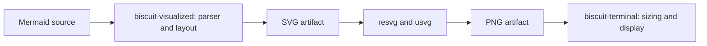

---
$schema:
    status: |-
        enum(
            draft-spec,
            finalized-spec,
            planned,
            implemented,
            review-findings,
            human-in-the-loop,
            completed,
            on-hold,
            abandoned
        ) -> an indicator of progress for this specification
    reviewed: boolean -> indicates whether the specification file has been reviewed by another agent from the one which created the spec
    reviewed_by: string -> the agent and model used in the spec review
    reviewed_on: date -> the date the spec was reviewed
    review_iterations: number -> the number of implementation reviews have taken place in the review/fix cycle
    clarified: boolean -> indicates whether the specification was built -- _in part_ -- with the 'clarify.md' prompt
    implemented: boolean -> indicates whether this spec's plan has been implemented
    implemented_by: string -> the agent who implemented the plan
area: biscuit-terminal
status: draft-spec
created: 2026-10-15
packages:
    - biscuit-visualized
    - biscuit-terminal
    - biscuit-terminal-cli
implemented: true
reviewed: true
reviewed_by: codex/gpt-6.1-sol
reviewed_on: 2026-10-15
review_iterations: 0
implemented_by: "claude/opus"
---

# Upgraded Diagram Rendering

## Problem

Some newer Mermaid diagrams fail to render or produce images with poor visual
fidelity. Rendering has two distinct stages: interpreting Mermaid and laying it
out as SVG, then rasterizing that SVG into a PNG. Updating the rasterizer can
improve text and SVG fidelity, but cannot add Mermaid syntax or repair a layout
that was already incorrect in the SVG.

This feature covers both `biscuit-visualized`, which owns diagram artifacts,
and `biscuit-terminal`, which adapts artifacts for terminal display and also
directly depends on the SVG rasterizer.

## Dependency Findings

Versions verified against the crates.io registry on 2026-10-15:

| Dependency | Locked version | Latest published version | Decision |
| ---------- | -------------- | ------------------------ | -------- |
| `mermaid-rs-renderer` | 0.3.1 | 0.3.1 | Evaluate a pinned upstream revision against the released renderer |
| `resvg` / `usvg` | 0.45.1 | 0.48.1 | Upgrade both rendering consumers to 0.48.1 |

`resvg` 0.48 introduces a newer font parsing and text shaping stack, with fixes
for glyph advances, text transforms, nested SVG transforms, and other rendering
defects. Version 0.48.1 declares a minimum supported Rust version of 1.85.0.
These changes are candidates for improved PNG fidelity; improvement on our
diagrams must be demonstrated rather than inferred from release notes.

The dated investigation found 24 upstream commits beyond v0.3.1, ending at
`3726ccbffe0e8032361eb9668694b24f77858060`. They include radar data and label
fixes, state fork/join corrections,
requirement text placement, flowchart routing, and broader rendering changes.
They have not been published as a newer crate version. Upstream explicitly
notes that output quality may differ from the official Mermaid renderer.

Sources:

- [Mermaid renderer releases](https://github.com/1jehuang/mermaid-rs-renderer/releases)
- [Mermaid changes since v0.3.1](https://github.com/1jehuang/mermaid-rs-renderer/compare/v0.3.1...3726ccbffe0e8032361eb9668694b24f77858060)
- [Mermaid renderer documentation](https://github.com/1jehuang/mermaid-rs-renderer)
- [resvg release history](https://github.com/linebender/resvg/blob/v0.48.1/CHANGELOG.md)

## Goals and Scope

1. Upgrade SVG rasterization in both packages while preserving public APIs,
   feature gating, themes, transparency, and requested image dimensions.
2. Demonstrate whether upstream Mermaid changes improve representative defects
   without regressing existing supported diagrams.
3. Prevent cached artifacts from concealing changes to either rendering stage.
4. Document actual syntax support and known limitations after the upgrade.

The implementation keeps the existing ownership boundary:

Replacing the renderer with another project, adding a browser or Node.js
runtime, changing terminal graphics protocols, and claiming complete Mermaid
compatibility are outside this feature. Such work requires a separate decision
if the evaluated upgrades cannot address the observed problems.

This is a bounded upgrade evaluation, not an all-family comparison or performance
study. The separate `2026-10-15-mermaid-renderer-comparison` experiment uses the
final version selected here as its incumbent baseline. Reuse suitable fixtures
and record unresolved fidelity problems for that experiment; do not expand this
upgrade into evaluating replacement engines.

## Requirements

### Shared rasterizer upgrade

- Update `biscuit-visualized/src/Cargo.toml` and
  `biscuit-terminal/lib/Cargo.toml` to the 0.48.1-compatible `resvg` release
  range, and update the workspace lockfile.
- Resolve both direct consumers to the same `resvg` version. Preserve optional
  dependencies and existing image feature behavior. Keep
  `mermaid-rs-renderer` default features disabled, including when using a Git
  revision: its optional PNG and scene paths pull their own `usvg` dependency,
  and its PNG path also pulls `resvg`. Neither is needed by our SVG integration.
  Inspect the resolved dependency features to confirm that this upgrade does
  not introduce a second rasterizer through the Mermaid dependency. Continue
  using `resvg`'s `usvg` re-export rather than adding a separate direct dependency.
- Adapt affected font database, SVG parsing, and rasterization calls as needed;
  verify both image-enabled and image-disabled builds.
- Preserve aspect ratio, target pixel width, scale-based rendering, dark/light
  themes, and transparent/opaque background behavior.
- Cover graph artifacts and direct SVG images as regression surfaces because
  they also pass through the upgraded rasterizer. In the terminal package,
  preserve conversion from premultiplied rasterizer colors to straight RGBA;
  check a partially transparent shape so dark fringes cannot pass unnoticed.
- Preserve the visualization package's lazy system-font initialization. Compare
  old/new PNG output using the same fonts on the comparison host and record the
  selected families. Missing fonts must be distinguished from a shaping defect.
  The terminal package's direct SVG loader currently uses default SVG options
  without loading system fonts; this upgrade does not promise to fix that
  existing limitation or introduce a new font-distribution policy.
- Verify compatibility with the repository's pinned Rust toolchain and record
  any higher requirement from the complete selected dependency graph. The
  rasterizer's minimum Rust version alone does not establish compatibility of
  an unreleased Mermaid revision.

### Mermaid renderer evaluation and adoption

- Establish a small reproducible corpus before choosing a revision. Include
  observed user failures when available; otherwise use upstream regression
  examples and explicitly record that the user's particular failures have not
  yet been reproduced.
- Separate parse failures, incorrect SVG geometry, PNG rasterization defects,
  and terminal display defects in the evaluation results. Freeze each input
  locally with its provenance and expected behavior. Use the same source,
  theme/configuration, fonts, and requested dimensions for each comparison.
- First compare the existing renderer with old/new rasterizers; then compare
  released and candidate Mermaid renderers using the upgraded rasterizer. This
  attributes improvements to the stage that changed without a full matrix of
  dependency combinations. Bypass artifact caches or use isolated cache roots
  for these comparisons so preexisting output cannot substitute for a render.
- Compare released 0.3.1 with an exact upstream commit. Record the full commit
  SHA, relevant fixes, and results in `implementation-log.md` beside this spec.
  Never depend on a moving branch.
- Adopt the pinned revision only when it demonstrates relevant improvements
  and passes existing regression checks. Prefer a published release if it
  includes the evaluated fixes by implementation time.
- If the candidate fails those checks, retain 0.3.1, complete the rasterizer
  upgrade, and record the unresolved Mermaid limitations and candidate failure.
  Do not describe the retained renderer as upgraded.
- Keep diagram parsing, layout, and SVG corrections in `biscuit-visualized`.
  Do not introduce a second Mermaid implementation in `biscuit-terminal`.
- Reevaluate existing labeled-merge repair, gitGraph tag spacing, and SVG
  post-processing against the chosen revision. Retain necessary corrections;
  remove a correction only when regression evidence proves upstream replaces it.
- Test the actual integration, not only upstream's convenience API. The
  `biscuit-visualized` package's
  [`compute_layout`](../../../biscuit-visualized/src/src/mermaid/render.rs)
  path explicitly parses, repairs, and lays out diagrams. Fixes confined to
  upstream's high-level `render()` API are not automatically inherited. Preserve
  configuration precedence, explicit source theme overrides, and the shared
  layout used by natural-size measurement and rendering. In particular, verify
  that measured dimensions still match the emitted SVG's viewBox after gitGraph
  corrections; terminal fitting depends on those measurements.
- The SVG artifact is also used for browser rendering and export. Verify that
  it remains standalone and parseable, with visible labels and equivalent theme
  handling. This feature changes generated artifacts, not browser APIs or the
  terminal component's layout/style support contract.

### Cache identity

> **Review note:** Updating the rasterizer constant alone does not invalidate
> today's caches. It is declared but unused in key generation. The design below
> makes rasterization an explicit PNG cache input while preserving SVG reuse.

- In `biscuit-visualized`, set
  [`RASTERIZER`](../../../biscuit-visualized/src/src/cache/file_cache.rs), the
  rasterizer identity, to `resvg@0.48.1`. Include it in key generation for **both
  Mermaid and graph PNG artifacts**. Apply this format-specific addition in the
  shared cache-key path so callers cannot omit it; preserve the public function
  signature and existing hashing through `biscuit-hash`.
- Rasterizer-only changes must change PNG keys but leave SVG keys unchanged.
  Mermaid backend or local correction changes must invalidate both Mermaid
  formats. Do not change graph backend identity for a rasterizer-only upgrade.
- If adopting an unreleased Mermaid revision, include its full commit SHA in
  [`MERMAID_BACKEND`](../../../biscuit-visualized/src/src/cache/file_cache.rs),
  the visualization package's Mermaid backend identity. For a published version,
  use its exact version; `0.3.x` cannot distinguish releases or Git revisions.
  Preserve the local `+bv<n>` correction suffix and advance it when correction
  behavior changes.
- Test old/new keys with otherwise identical inputs. Seed an old PNG entry in
  an isolated cache and prove the upgraded request misses it, then hits its own
  newly written entry on repetition. Cover Mermaid and graph output and verify
  SVG key stability for a rasterizer-only change. Use the existing cache-root
  override or an explicit test cache rather than clearing the user's cache.
- Leave old files for the existing temporary-directory lifecycle; no cache
  migration, global deletion, or new cleanup service is needed. System-font
  inventory changes are not newly fingerprinted by this feature. Direct SVG
  images use the terminal loader, not this artifact cache.

## Validation and Acceptance Criteria

1. Both direct rasterizer consumers resolve to `resvg` 0.48.1, with compatible
   `usvg`, and compile with their existing image feature configurations.
2. The implementation log identifies the selected Mermaid version or full Git
   revision and explains adoption or retention using recorded comparisons.
3. The small comparison corpus includes flowcharts, radar, state fork/join,
   requirement diagrams, and existing gitGraph merge/tag regressions. Reuse the
   existing regression fixtures rather than constructing an exhaustive gallery.
   Record success, remaining defects, and before/after SVG and PNG evidence for each
   investigated defect; a successful render alone is not proof of fidelity.
4. Focused automated regressions assert meaningful behavior such as preserved
   labels/data, non-overlapping bounds, image dimensions, or alpha behavior.
   Avoid exact cross-platform pixel snapshots dependent on installed fonts.
   Cache regressions prove invalidation rather than only asserting constant
   strings. Preserve `target_width` precedence over `scale`, minimum-one sizing,
   aspect ratio within integer pixel rounding, and existing scale behavior.
5. Existing package L1 suites and lints pass through each area's `just test`
   and `just lint` recipes, using nextest. Confirm feature-disabled compilation
   separately. Run relevant L2 checks through `just test-l2` when terminal
   integration is affected; any terminal/browser windows must remain unfocused.
6. Compilation and required regression evidence cover macOS, Linux, native
   Windows, and WSL2 through the repository's existing testing workflows. Do not
   expand CI scope merely to compare images; use local artifacts for visual
   investigation and follow existing CI scope and evidence reuse rules.
7. Existing fallback behavior remains available when rendering fails or the
   terminal cannot display images. The terminal package's fallible render path
   still returns errors; its infallible `TerminalRenderable` path still emits the
   source code block. Public component APIs, CLI flags, defaults, and metadata
   shape remain compatible, although artifact paths change with cache identity.
8. Current behavior and remaining limitations are documented in the areas'
   `docs/` trees, including the Mermaid component and gitGraph documentation
   where affected. Replace the Mermaid component page's unqualified claim of
   supporting all Mermaid types with verified support and limitations. Document
   the direct SVG loader's font limitation if it remains. Update dependency
   documentation and relevant agent skills; update README overviews only if
   their public descriptions change. Current
   docs must not refer readers to this feature snapshot.

## Open Questions

None blocks the bounded upgrade at review time. Adoption of the upstream Mermaid
revision is decided by the comparisons above; retaining 0.3.1 is an explicitly
valid outcome. If a candidate needs public API changes, new runtime requirements,
or a different font policy to succeed, record that as a separate design question
instead of silently expanding this feature.

## Implementation Record

Keep dependency choices, corpus results, validation evidence, and departures
from this spec in the adjacent `implementation-log.md`. Leave this spec as the
decision snapshot. The final implementation state is ready for review; moving
the feature into `_completed` remains the author's responsibility.
