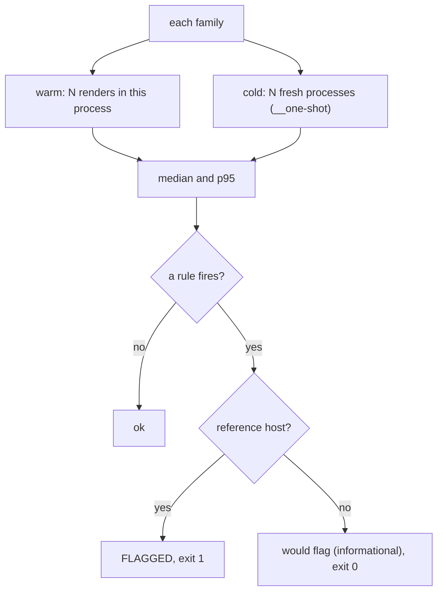

# biscuit-visualized benchmark

Times Mermaid rendering for every diagram family (flowchart, sequence, pie,
and the rest; see [Diagram types](../docs/merman.md#diagram-types)) and checks
the timings against fixed limits and a stored baseline. It is a standalone
Cargo project ([`src/main.rs`](src/main.rs)), not a member of the
rusty-biscuit workspace, so it never runs in CI.

```sh
just bench                                        # from biscuit-visualized/
just bench --families flowchart,pie --iterations 3   # a quick run
```

The corpus is the family fixtures the
[golden tests](../docs/merman.md#golden-tests) (the stored reference renders
every output change is compared against) use, one `.mmd` file per family in
`../src/src/tests/fixtures/merman/families/`, compiled into the binary
([`src/corpus.rs`](src/corpus.rs)). Each diagram renders to PNG with the
default request and the `Default` palette. A family is timed 20 times warm and
20 times cold unless `--iterations` says otherwise.



## What is measured

For each family, the run reports the median and the p95 (the 95th
percentile, taken as the nearest-ranked sample, [`src/stats.rs`](src/stats.rs))
of:

- **warm**: [`MermaidDiagram::render`](../src/src/mermaid/render.rs) to PNG
  (measure, layout, SVG,
  post-process, raster) in a process that has already rendered that family
  once;
- **cold**: a fresh process doing one render, timed from spawn to exit (the
  benchmark runs itself with a hidden `__one-shot` subcommand).

Every iteration, warm and cold, gets its own empty
`BISCUIT_VISUALIZED_CACHE_DIR` (the directory the render cache writes to),
created and checked empty before the timer starts. A render that reports a
cache hit, or that writes nothing into its directory, stops the run with an
error.

```text
family           warm med   warm p95   cold med   cold p95    Δ warm    Δ cold  status
flowchart           21.40      23.10      61.80      66.20     +3.1%     -1.2%  ok
timeline            84.02      88.75      95.10      99.40     +0.4%     +0.9%  would flag (informational)
```

(Illustrative numbers.)

## Rules

| Rule | Flags a family when |
|---|---|
| warm limit | the warm median is over 50 ms (`--warm-limit-ms`) |
| cold limit | the cold median is 500 ms or more (`--cold-limit-ms`) |
| regression | the warm or the cold median is more than 25% above the baseline median (`--regression-pct`) |
| no baseline | the family has no entry in the baseline |

The rules apply only on the **reference host**, the one machine whose
timings the baseline records, so timings from faster or slower machines are
never compared with it: a run whose hostname matches
the baseline's `reference_host` (first label, case-insensitive), or any run
passed `--reference`. Elsewhere the same findings print as "would flag" and
the run exits 0. Exit codes: 0 no rule fired (or informational), 1 a rule
flagged, 2 an error (unknown family, unreadable or invalid baseline, a failed
render, a cache hit).

## The baseline

[`baseline.json`](baseline.json) holds, per family, the warm and cold
`median_ms` and `p95_ms` recorded on the Linux build host (values here illustrative):

```json
{
  "reference_host": "build-linux",
  "families": {
    "flowchart": { "warm": { "median_ms": 20.7, "p95_ms": 22.9 }, "cold": { "median_ms": 62.5, "p95_ms": 67.0 } }
  }
}
```

The loader ([`src/baseline.rs`](src/baseline.rs)) is strict: a missing, `null`,
non-numeric, zero, or negative value, an unknown key or family, a duplicate
key at any depth, or text after the document is an error naming the JSON
path, and nothing is compared. An empty `families` object is valid; every
family then reports "no baseline".

Rewrite it only in a change that knowingly accepts the new timings, on the
reference host:

```sh
just bench --write-baseline                  # on the reference host
just bench --reference --write-baseline      # first recording on a new host
```

`--write-baseline` updates the families the run measured, keeps the others,
records this host as `reference_host`, and refuses to replace a baseline that
fails to load. It still flags the limits, but not regressions or missing
entries.

## Tests

```sh
CARGO_TARGET_DIR=/tmp/bv-bench-target cargo nextest run
```

The loader's tests run in-process; [`tests/wiring.rs`](tests/wiring.rs) spawns the binary for
the control, doctored-baseline, and doctored-limit runs.
