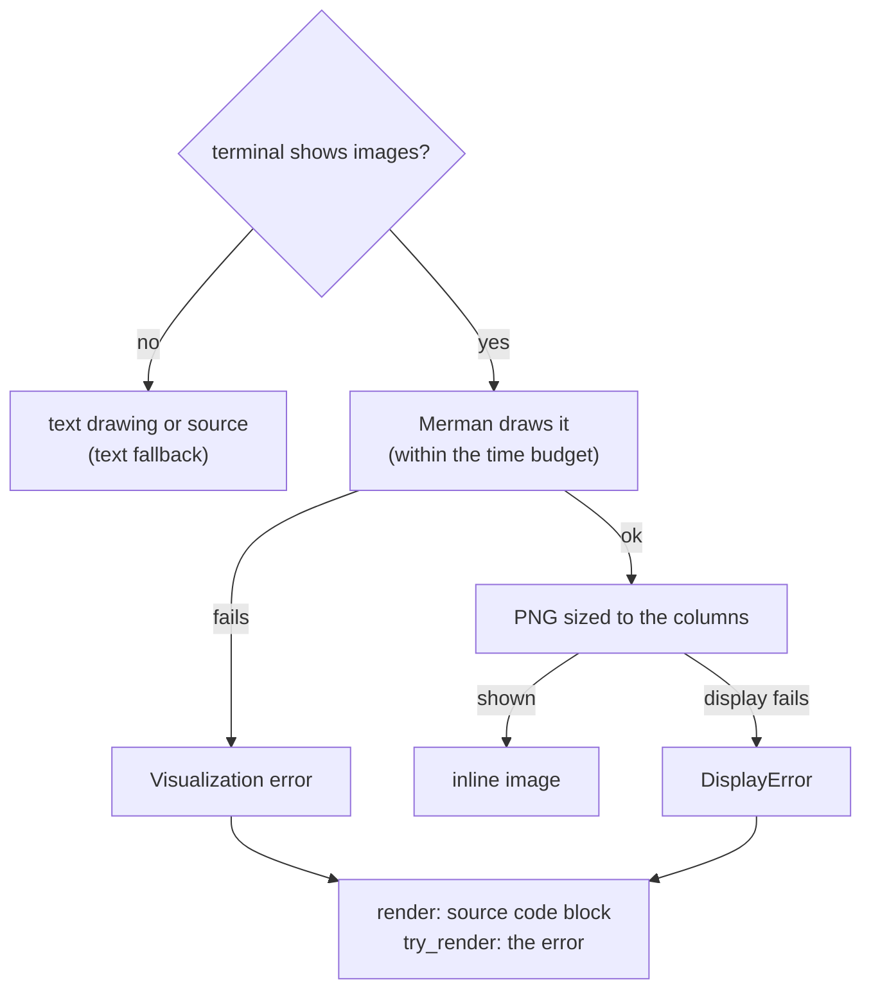
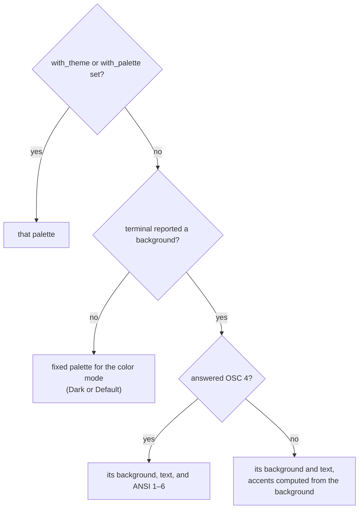
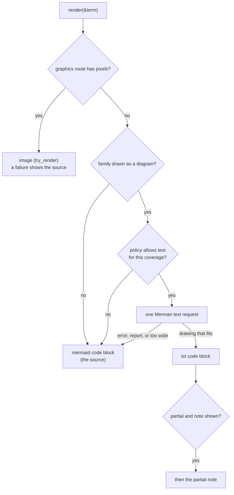
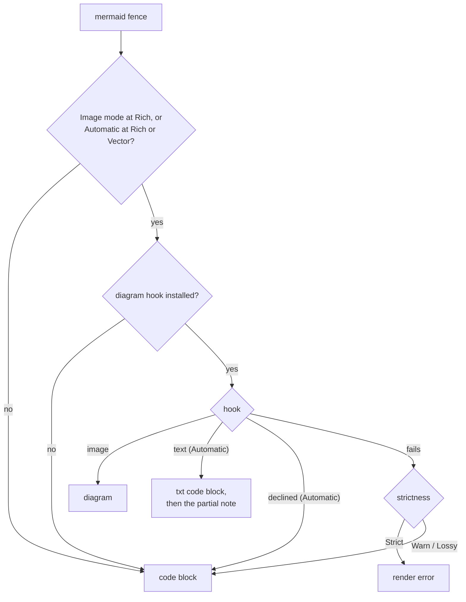

# MermaidDiagram

Renders Mermaid diagrams inline in the terminal as raster images. [`MermaidDiagram`](../../src/src/components/mermaid.rs) is the terminal component: it styles the diagram with the terminal's own colors, has it drawn by this crate's Mermaid renderer ([Merman](../merman.md), a pure-Rust port of Mermaid.js 12.2.0, reached through the library-level [`mermaid::MermaidDiagram`](../../src/src/mermaid/render.rs)), and displays the PNG through `biscuit-terminal`'s [`TerminalImage`](../../../biscuit-terminal/docs/components/terminal_image.md) using the terminal's image protocol (Kitty, iTerm2, or Sixel). On a terminal that cannot show images it draws the diagram as text when it can (see [Without images: the text fallback](#without-images-the-text-fallback)), and otherwise shows the source as a `mermaid` code block, as it does for any diagram that cannot be drawn.

Requires the `terminal` feature; import it from `biscuit_visualized::components`.

Supports every diagram family Merman renders, among them flowcharts, sequence, class, state, ER, Gantt, pie, quadrant, XY (bar and line) charts, git graphs, timelines, journeys, mindmaps, requirement, C4, block, kanban, architecture, packet, radar, sankey, and treemap diagrams, and the families only Merman draws: agentflow, cynefin, event modeling (`eventmodeling`), info, ishikawa, railroad (with its `railroadAbnf`, `railroadEbnf`, and `railroadPeg` dialects), swimlane, tree view (`treeView`), use case (`usecase`), venn, and wardley maps (see [Diagram types](../merman.md#diagram-types)). ZenUML and diagrams with math labels (`$$…$$`) are not rendered and show their source (see [When a diagram falls back to its source](../merman.md#when-a-diagram-falls-back-to-its-source)):

```rust
// Merman's math support is not compiled in, so this shows as a fenced code block.
let diagram = MermaidDiagram::new("flowchart LR\n    A[\"$$x^2$$\"] --> B");
```

## Programmatic Use

```rust
use biscuit_terminal::prelude::*;
use biscuit_visualized::components::*;

// Basic usage
let diagram = MermaidDiagram::new("flowchart LR\n    A --> B --> C");
let term = Terminal::new();

// Infallible render (via the TerminalRenderable trait)
println!("{}", diagram.display(&term));

// Fallible render with metadata
match diagram.try_render(&term) {
    Ok(result) => {
        print!("{}", result.output);
        eprintln!("PNG: {}", result.png_path.display());
        eprintln!("Cache hit: {}", result.cache_hit);
    }
    Err(e) => eprintln!("Render failed: {}", e),
}

// With theme and config; the title goes in the source to be drawn
let diagram = MermaidDiagram::new("pie title Distribution\n    \"A\" : 40\n    \"B\" : 60")
    .with_theme(MermaidTheme::Forest)
    .with_title("Distribution")
    .with_config(MermaidConfig::new().with_point_label_font_size(16));
```

### Key API

| Method | Description |
|--------|-------------|
| `MermaidDiagram::new(source)` | Create from Mermaid source text, styled with the terminal's palette (see [Themes and palettes](#themes-and-palettes)) |
| `.with_theme(MermaidTheme)` | Use one of the four fixed palettes ([`MermaidTheme`](../../src/src/mermaid/config.rs): `Dark`, `Default`, `Forest`, `Neutral`) instead of the terminal's |
| `.with_palette(Palette)` | Use any [`Palette`](../../src/src/mermaid/palette.rs) instead of the terminal's |
| `.with_title(str)` | The rendered file's alt text. It is not drawn; put a title in the Mermaid source (`pie title …`, `---\ntitle: …\n---`) to draw one |
| `.with_config(MermaidConfig)` | Quadrant chart settings ([`MermaidConfig`](../../src/src/mermaid/config.rs), see [below](#quadrant-chart-configuration)) |
| `.with_width(ImageWidth)` | Display width ([`ImageWidth`](../../../biscuit-terminal/docs/components/terminal_image.md#width-specifications)); the default is `ImageWidth::Scale(1.0)` |
| `.with_background(Background)` | What paints behind the diagram ([`Background`](../../src/src/artifact.rs)); the default is `Background::Transparent` |
| `.with_time_budget(Duration)` | How long Merman may work on each request; the default is `MermaidDiagram::DEFAULT_TIME_BUDGET` (2 s) |
| `.with_target(MermaidTarget)` | Who `render_to_svg`'s SVG is for ([`MermaidTarget`](../../src/src/mermaid/render.rs)); `MermaidTarget::HtmlStatic` for a static SVG in an HTML page (see [Merman rendering](../merman.md#html-static-target)). The terminal's PNG ignores it |
| `.with_embedded_font(bool)` | With `MermaidTarget::HtmlStatic`, measure labels in a face the page can embed (default off; see [Embedded font](../mermaid-embedded-font.md)). Ignored for any other target and for the terminal's PNG |
| `.inverted(is_dark)` | The opposite fixed palette of the color mode, on its opaque background |
| `.resolve_dimensions(term_width, cell)` | The columns the image will occupy, measuring the diagram for `Scale` |
| `.with_fallback_policy(MermaidFallbackPolicy)` | Whether a terminal without images gets a text drawing, and whether the partial note follows it (see [Fallback policy](#fallback-policy-and-mermaid_fallback)) |
| `.try_render(&Terminal)` | Fallible, image-only render returning [`MermaidRenderResult`](../../src/src/components/mermaid.rs) (`output`, `png_path`, `cache_hit`, `width_cells`); never returns text |
| `.render(&Terminal)` | Infallible render: the image, else the text drawing, else the source code block |
| `.present(&Terminal)` | The choice `render` makes, as [`MermaidPresentation`](../../src/src/components/mermaid.rs): `Image(result)`, `Text(nodes)`, or `Source(nodes)` |
| `.text_columns(term_width)` | The columns a text or source presentation is laid out in (the width limit inside the margins) |
| `.render_to_svg()` | The diagram as an SVG string, for a browser |
| `.render_to_svg_with_font()` | `render_to_svg` plus the diagram's `DiagramFont`, which is `Some` only when the embedded-font opt-in applied; pass every diagram's font to `mermaid::page_font` |
| `.fallback_code_block()` | The source as a fenced `mermaid` code block |

### Sizing

The default width is `ImageWidth::Scale(1.0)`: the diagram's 16-unit body text is one terminal line tall, so nodes and text are the same size in every diagram whatever its content. The natural width is the root `viewBox` width of the SVG the render rasterizes (the library's `natural_size()`, which renders and caches that SVG), so it is measured with the same theme, fonts, and source rewrites as the image. The result is clamped to the available columns, so only a terminal too narrow for the diagram shrinks it. `Percent`, `Characters`, and `Fill` size the image from the terminal's columns instead, whatever the diagram's content:

```rust
use biscuit_terminal::components::terminal_image::ImageWidth;

let natural = MermaidDiagram::new(source);                                    // text one line tall
let half = MermaidDiagram::new(source).with_width(ImageWidth::Percent(0.5));  // half the terminal
```

The diagram is rasterized once, at its final display size: the PNG is as many pixels wide as the resolved columns (margins included) times the measured cell width, and its height is padded with blank rows below the drawing up to a whole number of cell rows. When the terminal reports no cell size, the 8x16 fallback is used. Those PNG bytes reach Kitty and iTerm2 unchanged (see [`EncodedPng`](../../../biscuit-terminal/docs/components/terminal_image.md#already-encoded-png-input)), so the terminal shows the raster 1:1 in exactly the rows it reserves, with no stretching or re-encoding. A Sixel route decodes the PNG and encodes it as Sixel at the same size. The size is measured on every render, so after a terminal or font resize the next render produces a new raster.

### Fonts

Each label's font is chosen by one resolution chain shared by text
measurement and drawing, so a label is measured in the face it is drawn in
and fits its box. Set `MERMAID_FONT` to a family name (case-insensitive) to
use it for every diagram; `MERMAID_FONT=Inter` selects the Inter face bundled
with the library and gives the same layout on every host. A family that is
neither installed nor bundled logs one warning per process and is otherwise
ignored. Linux builds also bundle a monochrome Noto Emoji face, used only
when no installed font has the emoji. See
[Merman rendering](../merman.md#fonts) for the full chain, the fallback
order, and the `\n` line-break rewrite.

```sh
MERMAID_FONT=Inter bt flowchart "A --> B --> C"   # the same layout on macOS, Linux, and Windows
```

### Error Handling

`try_render` returns a [`MermaidRenderError`](../../src/src/components/mermaid.rs): `Visualization` when the diagram cannot be drawn (it does not parse, it is a ZenUML or math diagram, or Merman exceeds the time budget), `NoImageSupport` when the terminal shows no images, and `DisplayError` when the image cannot be shown. `render` checks for images first: without them it takes the [text fallback](#without-images-the-text-fallback) and never calls `try_render`. With them, any `try_render` error becomes the `mermaid` source code block, never text; a time budget exceeded also logs a warning.



```rust
use std::time::Duration;

let diagram = MermaidDiagram::new(source).with_time_budget(Duration::from_millis(500));
```

The budget applies to each Merman request (a tagged gitGraph makes two) and covers Merman's parsing, layout, and SVG output only, not rasterization. See [Time budget](../merman.md#time-budget).

## Themes and Configuration

### Theme and Rendering Options

```rust
use biscuit_visualized::artifact::Background;
use biscuit_visualized::components::mermaid::{MermaidDiagram, MermaidTheme};

let diagram = MermaidDiagram::new("flowchart LR\n    A --> B")
    .with_theme(MermaidTheme::Dark)         // dark, default, forest, neutral
    .with_background(Background::Solid { r: 0x1e, g: 0x1e, b: 0x2e });
```

The terminal image's resolution comes from the cell size (see [Sizing](#sizing)). `with_scale(u32)` (default 2) does not change it: the scale applies only to a PNG rendered without a target width, which this component never asks for.

The background decides what paints the area behind the diagram, and also the blank rows below it:

| Background | Result |
|------------|--------|
| `Background::Transparent` (default) | Nothing is painted; Kitty and iTerm2 composite the diagram over the terminal's own background; a Sixel route leaves the transparent pixels unset, or paints the measured background (below) |
| `Background::Theme` | The palette's background color (the terminal's own, or the fixed theme's) |
| `Background::Solid { r, g, b }` | One opaque color in place of the palette's |

`with_transparent_background(bool)` remains as a shorthand: `true` is `Transparent`, `false` is `Theme`. `inverted(..)` switches to the inverse fixed theme with its opaque `Theme` background.

**On a Sixel route** a transparent diagram keeps its transparent pixels unset: Sixel has no partial transparency, so `TerminalImage` leaves fully transparent pixels untouched (the terminal's own background shows) and blends only antialiased edges onto the best-known background. When the terminal measured its background (an OSC 11 reply), a `Background::Transparent` diagram is instead rasterized on `Background::Solid` with that color, which makes the edges exact. When it did not, for example under tmux, where the background is only a per-terminal guess, the diagram stays `Transparent`, so a wrong guess never paints a box around it. A `Theme` or `Solid` background you request is kept as it is. The artifact cache keys on the background, so the Sixel raster and the Kitty raster of the same diagram can be separate cache entries.

### Quadrant Chart Configuration

Use `MermaidConfig` to customize quadrant chart styling:

```rust
use biscuit_visualized::components::mermaid::{MermaidConfig, MermaidDiagram};

let config = MermaidConfig::new()
    .with_point_label_font_size(18)    // Font size for point labels (default: 12)
    .with_point_radius(10)             // Default point radius (default: 5)
    .with_quadrant_fill(1, "#1e2a1e")  // Top-right (quadrant-1) fill color
    .with_quadrant_fill(3, "#2a1e1e"); // Bottom-left (quadrant-3) fill color

let diagram = MermaidDiagram::new("quadrantChart\n    Item: [0.5, 0.5]")
    .with_config(config);
```

**Quadrant numbering** (matches Mermaid convention):

```
        +-------------+-------------+
        |  quadrant-2 |  quadrant-1 |
        |  (top-left) | (top-right) |
        +-------------+-------------+
        |  quadrant-3 |  quadrant-4 |
        |(bottom-left)|(bottom-right)|
        +-------------+-------------+
```

### Quadrant Themes

Use [`QuadrantTheme`](../../src/src/mermaid/config.rs) presets for common quadrant chart styles:

```rust
use biscuit_visualized::components::mermaid::{MermaidConfig, QuadrantTheme};
use biscuit_terminal::discovery::detection::ColorMode;
use biscuit_terminal::terminal::Terminal;

// Magic Quadrangle style: subtle green top-right, red bottom-left,
// in the colors for the terminal's light/dark mode
let is_dark = Terminal::new().color_mode() == ColorMode::Dark;
let config = QuadrantTheme::MagicQuadrangle.apply(MermaidConfig::new(), is_dark);

// Parse theme from string
let theme = QuadrantTheme::parse("magic-quadrangle").unwrap();
```

**Available themes:**

| Theme | Description |
|-------|-------------|
| `QuadrantTheme::Default` | No customization: the quadrants take the diagram's palette colors |
| `QuadrantTheme::MagicQuadrangle` | Gartner-style: subtle green top-right (leaders), subtle red bottom-left (niche). Top-left and bottom-right use a neutral color. Colors adapt to terminal color mode. |

**Magic Quadrangle colors by terminal mode:**

| Mode | Top-right (q1) | Top-left (q2) | Bottom-left (q3) | Bottom-right (q4) |
|------|----------------|---------------|------------------|-------------------|
| Dark | `#1e2a1e` (green tint) | `#1a1a1a` (neutral) | `#2a1e1e` (red tint) | `#1a1a1a` (neutral) |
| Light | `#f6faf6` (green tint) | `#f8f8f8` (neutral) | `#faf6f6` (red tint) | `#f8f8f8` (neutral) |

The neutral quadrants (q2, q4) use the same color - a dark grey in dark mode, light grey in light mode - creating visual balance while highlighting the key diagonal (top-right leaders vs bottom-left niche).

### Inline Point Styling

Individual points can override defaults using comma-separated properties:

```
Item A: [0.3, 0.6] color: #ff3300, radius: 12
Item B: [0.7, 0.4] color: #00ff00
```

**Important:** Multiple properties must be comma-separated. Space-only separation causes parsing errors (e.g., `color: #ff3300 radius: 10` fails).

Available properties: `color`, `radius`, `stroke-color`, `stroke-width`

### Themes and palettes

`MermaidDiagram::new` styles the diagram with **the terminal's own
palette**, read by [`TerminalColors::detect`](../../src/src/mermaid/palette.rs)
from what `biscuit-terminal` asked the terminal at startup: its background and
text colors (the OSC 11 and OSC 10 queries) and, where the terminal answers
the ANSI palette query ([OSC 4](../../../biscuit-terminal/docs/discovery/terminal-queries.md#the-ansi-palette-osc-4),
which asks for the 16 colors the user's theme assigns to ANSI black, red,
green, and so on; native Windows included), ANSI 1–6 as the six accent colors. Where the
terminal reports no ANSI colors the accents are computed from its background;
where it reports no background, or stdout is not a terminal, or `CI` is set,
the fixed palette for its color mode is used. Under tmux, Zellij, or GNU
Screen nothing is asked: the background is at best an estimate (`COLORFGBG`
or a per-terminal default) and the accents are computed from it. Text always meets 4.5:1 contrast against
the fill behind it.



For a Tokyo Night terminal (background `#1a1b26`, text `#c0caf5`), a
flowchart's nodes are tinted with Tokyo Night's own red, green, yellow, blue,
magenta, and cyan, on the terminal's background.

Each `MermaidTheme` is a fixed palette, starting from Mermaid.js's theme of
the same name:

- **`MermaidTheme::Dark`**: light text on `#333333` (the fallback for dark terminals)
- **`MermaidTheme::Default`**: dark text on white (the fallback for light terminals)
- **`MermaidTheme::Forest`**: green surfaces
- **`MermaidTheme::Neutral`**: grays

`with_theme` replaces the terminal palette with a fixed one, and
`with_palette` with any `Palette`, for example one built from colors you
detected yourself:

```rust
use biscuit_visualized::components::mermaid::{MermaidDiagram, MermaidTheme, Palette, TerminalColors};

let pinned = MermaidDiagram::new("flowchart LR\n    A --> B").with_theme(MermaidTheme::Neutral);
let palette = Palette::for_terminal(&TerminalColors::detect(), true);
let detected = MermaidDiagram::new("flowchart LR\n    A --> B").with_palette(palette);
```

Un-styled nodes get rotating accents in flowchart, class, sequence, and
mindmap diagrams; `classDef`, `style`, and colors set in `%%{init}%%` keep
the author's colors. See [Themes](../merman.md#themes) for how a palette is
built and reaches Merman.

Use `MermaidTheme::for_color_mode()` to automatically select based on terminal:

```rust
use biscuit_visualized::components::mermaid::MermaidTheme;
use biscuit_terminal::discovery::detection::ColorMode;
use biscuit_terminal::terminal::Terminal;

let theme = MermaidTheme::for_color_mode(Terminal::new().color_mode() == ColorMode::Dark);
let inverse_theme = theme.inverse();  // For solid background rendering
```

### Public API Notes

- Use `MermaidDiagram::try_render(&Terminal)` when you need the image plus metadata (`png_path`, `cache_hit`). It is image-only: on a terminal without images it returns `NoImageSupport`, never text.
- Use the `TerminalRenderable` implementation (`render`) when you want graceful fallback (see [Without images: the text fallback](#without-images-the-text-fallback)).
- Half-block character art is never used for diagrams.

## Without images: the text fallback

When the terminal's graphics route has no pixels (no image protocol, graphics turned off, or a multiplexer that cannot pass images through), `render` does not try the image at all. It asks Merman, the same renderer that draws the image, to draw the diagram with text characters, and shows that drawing when all of these hold:

1. Merman draws the diagram's family **as a diagram** (see [Which diagrams are drawn as text](#which-diagrams-are-drawn-as-text));
2. the [fallback policy](#fallback-policy-and-mermaid_fallback) allows it;
3. the drawing **fits** the columns (see [Width](#width)).

Otherwise it shows the source as a `mermaid` code block. The decision is made before any SVG is measured, any font is loaded, or any file is written, and it costs at most one Merman request.



```rust
use biscuit_terminal::prelude::*;
use biscuit_visualized::components::MermaidDiagram;

let diagram = MermaidDiagram::new("flowchart LR\n    A[Write spec] --> B{Approved?}\n    B -- yes --> C[Plan]\n    B -- no --> A");
// On a terminal without images this prints the drawing below, then the note.
println!("{}", diagram.render(&Terminal::new()));
```

Without color, the output is:

````txt
```txt
┌────────────┐       ╭───────────╮        ┌──────┐
│            │       ╱           ╲        │      │
│ Write spec ├──────►< Approved? >──yes──►│ Plan │
│            │       ╲           ╱        │      │
└────────────┘       ╰───────────╯        └──────┘
       ▲                   │
       └────────no─────────┘
```

│ Note: this textual representation is provided because the current terminal
│ settings do not allow for a graphical image to be used. This fallback
│ representation, while never arbitrary or speculative, might be missing
│ attributes that would have been visible in the image's representation [id:
│ mermaid-partial-warning].
````

### Which diagrams are drawn as text

Merman publishes, for every diagram family, what its text output is (`merman::ascii::ascii_capabilities()`), and that metadata is the only thing that decides. There is no list of family names in this crate; a Merman upgrade that draws a new family as a diagram makes it eligible, and the eligibility snapshot test shows the change in review. Merman's text output comes in two kinds, called *projections*:

- a **diagrammatic** projection is a drawing: boxes, lines, and arrows, like the flowchart above;
- a **structured-text** projection is a report *about* the diagram. It is faithful, but harder to read than the source, so it never replaces the source. This mindmap:

  ```mermaid
  mindmap
    root((Merman))
      Rendering
        SVG
      Text
  ```

  would come back as a report such as `node(bytes=6)="Merman" id(bytes=4)="root" …` with one indented line per child, so the component shows the mindmap's source instead.

A diagram is drawn as text only when its family's primary projection is diagrammatic **and** the render it gets back is diagrammatic too: a dense class or ER diagram whose drawing Merman abandons for a `relations:` list shows the source. A family Merman lists with no text output, or with a value this crate does not recognize, also shows the source.

At the pinned Merman revision the eligible families are flowchart, sequence, state, class, ER, XY chart (`xychart`), and swimlane. Gantt, gitGraph, journey, kanban, mindmap, packet, timeline, and tree view are structured text; every other family (pie, quadrant, architecture, ZenUML, …) has no text output. An XY chart is drawn only when its y-axis states a range (`y-axis 0 --> 5`); without one Merman reports no drawing and the source shows, and a drawn XY chart begins with a line Merman adds, such as `xDomain: band categories=[bytes=1="a", …]`. [`text_eligibility`](../../src/src/mermaid/text.rs) answers the question for one family:

```rust
use biscuit_visualized::mermaid::{TextCoverage, text_eligibility};

assert_eq!(text_eligibility("flowchart").unwrap().coverage(), TextCoverage::Partial);
assert!(text_eligibility("pie").is_none()); // a pie chart always shows its source
```

### The partial note

Merman also says how much of a family survives in text: **full** coverage, or **partial**, meaning some features are dropped or approximated (a flowchart's `click` links vanish, icons print as raw codes such as `fa:fa-book`). Every eligible family is partial today. A partial drawing is followed by a blank line and this note, so the reader knows the drawing may be incomplete:

> **Note:** this textual representation is provided because the current terminal settings do not allow for a graphical image to be used. This fallback representation, while never arbitrary or speculative, might be missing attributes that would have been visible in the image's representation [<dim>id: <i>mermaid-partial-warning</i></dim>].

`Note:` is bold, the bracketed `id: mermaid-partial-warning` is dim, and the id itself is italic; a terminal without bold, dim, or italic shows plain text. The note wraps to the terminal width like any block quote (the drawing never wraps). It never follows a source code block or an image. The id is [`PARTIAL_NOTE_ID`](../../src/src/components/mermaid.rs), and [`partial_note()`](../../src/src/components/mermaid.rs) builds the note's render-tree node.

### Fallback policy and `MERMAID_FALLBACK`

[`MermaidFallbackPolicy`](../../src/src/components/fallback_policy.rs) has two independent settings:

| Setting | Values | Default |
| --- | --- | --- |
| text fallback | `TextFallback::Allowed`, `TextFallback::NoPartial` (no text for a partial family), `TextFallback::Never` | `Allowed` |
| show partial note | `true`, `false` | `true` |

A setting you set is final. A text-fallback setting you leave unset reads the `MERMAID_FALLBACK` environment variable at render time: `code-block` (in any letter case) means `Never`; any other value, or no variable, means the default. The variable never changes the note setting. So the precedence for each setting is **explicit setting > environment > default**, and a CLI that turns its flags into explicit settings makes a flag beat the variable.

```rust
use biscuit_visualized::components::{MermaidDiagram, MermaidFallbackPolicy, TextFallback};

// Never draw text, whatever MERMAID_FALLBACK says.
let source_only = MermaidDiagram::new(source)
    .with_fallback_policy(MermaidFallbackPolicy::default().with_text_fallback(TextFallback::Never));

// Draw text, but without the note; MERMAID_FALLBACK still decides the text setting.
let quiet = MermaidDiagram::new(source)
    .with_fallback_policy(MermaidFallbackPolicy::default().with_show_partial_note(false));
```

```sh
MERMAID_FALLBACK=code-block bt flowchart "A --> B"   # shows the source
```

`NoPartial` behaves like `Never` today, because every eligible family is partial; the two differ once Merman draws a family with full coverage. With the `clap` feature, [`MermaidFallbackFeature`](../../src/src/components/fallback_policy.rs) is a ready-made CLI value enum (`no-mermaid-fallbacks`, `no-mermaid-partial-fallbacks`, `no-mermaid-partial-warning`), and `MermaidFallbackPolicy::from_features` folds a list of them into a policy, the more restrictive text setting winning. `bt` and `md` take them as `--feature` flags (see the [`bt` CLI reference](../../../biscuit-terminal/docs/cli.md)).

### Width

The drawing must fit the columns available to the component: the terminal width less the margins (in a Markdown render, the [hook](#mermaid-fences-in-a-render-tree) uses the width at the fence's position), limited by an explicit `ImageWidth::Characters`, `Percent`, or `Fill`, less two columns for a highlighting code renderer's padding ([`TEXT_BLOCK_CHROME_COLUMNS`](../../src/src/components/mermaid.rs)). The default `ImageWidth::Scale` uses every available column; text cells do not scale. Width is measured in terminal display cells, so a wide CJK label counts twice.

Flowchart, sequence, and swimlane diagrams (the families whose metadata admits Merman's `auto` layout) are drawn in their ordinary layout first and, if that is too wide, once more in a compact layout, all within one request. Other families get their ordinary layout only. A drawing that is still too wide shows the source; it is never clipped, wrapped, or turned to a different direction:

```sh
bt flowchart --width 10 "A[Write spec] --> B{Approved?}"   # too narrow: shows the source
```

### Drawing characters

The drawing uses Unicode box-drawing characters when the terminal supports Unicode (biscuit-terminal's `Terminal::supports_unicode`), and plain ASCII borders and connectors otherwise. Only what Merman generates changes; the labels you wrote are kept exactly, accents and emoji included:

```txt
+------+     +---+
|      |     |   |
| Café |---->| B |
|      |     |   |
+------+     +---+
```

Control characters inside labels are neutralized before the drawing reaches the terminal, so a label cannot move the cursor or change colors.

### Errors on the text route

`render` never fails. A source that does not parse, a Merman failure, an exceeded [time budget](#error-handling) (the same `with_time_budget` applies to text requests), a resource limit, or an empty drawing all show the source code block; the text route never falls back to the image, and the image route never falls back to text. A title set with `with_title` is shown once, as a bold line above the drawing or the source, unless the source already gives the same title (`title X`, a frontmatter `title:`, or `pie title X`).

### Laying the nodes out yourself

The text and source presentations are render-tree nodes (a `txt` or `mermaid` code node, then the note's block quote), so the program displaying them decides how code is highlighted. `render` lays them out with biscuit-terminal's plain code block. To highlight them, as `bt` does with darkmatter's highlighter, take [`present`](../../src/src/components/mermaid.rs) and render the nodes yourself at `text_columns`, then apply the component's layout:

```rust
use biscuit_terminal::render_tree::{TerminalRenderOptions, render_terminal_node};
use biscuit_visualized::components::MermaidPresentation;
use renderable::tree::{RenderNode, RenderStrictness};

match diagram.present(&term) {
    MermaidPresentation::Image(result) => print!("{}", result.output),
    presentation => {
        let nodes = presentation.nodes().unwrap_or_default().to_vec();
        let mut options = TerminalRenderOptions::new(&term, RenderStrictness::Lossy)
            .with_code_renderer(code_renderer.clone()); // an Rc<dyn renderable::tree::CodeRenderer>
        options.context = options.context.with_width(diagram.text_columns(term.width()));
        let rendered = render_terminal_node(&RenderNode::root(nodes), &options)?;
        print!("{}", diagram.layout().apply_block_layout(&rendered.output, term.width()));
    }
}
```

## Mermaid fences in a render tree

`biscuit-terminal`'s render-tree renderer draws no diagrams on its own: a
`mermaid` code fence stays a code block unless the caller installs
[`TerminalDiagramRenderer`](../../src/src/components/render_hook.rs), this crate's diagram hook, on the render options.
With the hook installed, a fence is offered to it only when the render asks
for it (`TerminalMermaidMode::Image` at `GraphicsMode::Rich`, or
`TerminalMermaidMode::Automatic` at `Rich` or `Vector`), and the hook is
consulted before any code-block hook.

- In `Image` mode the hook draws the image, or fails.
- In `Automatic` mode it draws the image at `Rich` when the terminal's graphics
  route has pixels. Otherwise it draws the diagram as text: a `txt` code block,
  then the partial note, exactly as the component does at the same width.
  When the source should show instead (the family is not drawn as a diagram,
  the drawing does not fit, or the fallback policy forbids text), it
  *declines*, and the fence renders as an ordinary code block with no
  diagnostic under every strictness. A parse error, a Merman failure, or an
  exceeded time budget is an error, which the strictness below handles.

Set the policy on the hook as on the component:
`TerminalDiagramRenderer::default().with_fallback_policy(policy)`.

```rust
use std::rc::Rc;

use biscuit_terminal::render_tree::{TerminalRenderOptions, render_terminal_node};
use biscuit_terminal::terminal::Terminal;
use biscuit_visualized::components::TerminalDiagramRenderer;
use renderable::tree::{GraphicsMode, RenderNode, RenderStrictness, TerminalMermaidMode};

let term = Terminal::new();
let mut options = TerminalRenderOptions::new(&term, RenderStrictness::Warn)
    .with_diagram_renderer(Rc::new(TerminalDiagramRenderer::default()));
options.context.graphics_mode = GraphicsMode::Rich;
options.context.mermaid_mode = TerminalMermaidMode::Image;

let fence = RenderNode::code(Some("mermaid".into()), None, "flowchart LR\n    A --> B");
let rendered = render_terminal_node(&fence, &options)?;
```

The hook's image is exactly what `MermaidDiagram::try_render` would draw, and
its text drawing exactly what the component's text fallback would draw, sized
to the columns available at the fence's position (a list item's or block
quote's inner width, not the whole terminal), in the terminal's palette and
with the default time budget. When it fails (no image support in `Image` mode,
invalid source, ZenUML or math, the time budget exceeded), the render's
strictness decides: `Strict` rejects the render, `Warn` records a lossy
diagnostic and shows the fence as code, and `Lossy` shows it as code silently.
A *declined* fence is not a failure: it renders as code under every
strictness. Darkmatter installs the hook for its terminal output, and
`md --mermaid` asks for `Automatic` mode.



## CLI

Exposed via multiple `bt` subcommands, one per diagram type:

```bash
bt flowchart "A --> B --> C"
bt pie-chart "A:40" "B:60"
bt quadrant --title "Priority" --x-axis "Effort" --y-axis "Impact"
bt git-graph
bt bar-chart "Q1:100" "Q2:150"
bt line-chart "Jan:10" "Feb:20"
bt timeline "2024:Launch" "2025:Scale"
bt state-diagram "s1 --> s2"
bt erd "CUSTOMER ||--o{ ORDER : places"
```

All diagram commands support `--json` for JSON output, `--meta` for render metadata, `--width` for sizing, and layout args (`--margin-left`, `--alignment`, etc.).
Without images they print the text drawing or the source, highlighted like `md`'s code blocks, and `--feature` changes that choice; see [the `bt` CLI reference](../../../biscuit-terminal/docs/cli.md).
