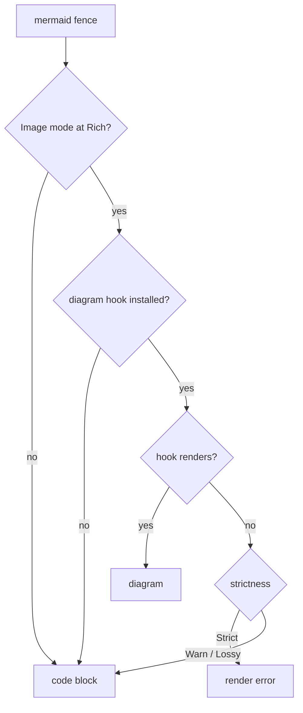

# MermaidDiagram

Renders Mermaid diagrams inline in the terminal as raster images. The diagram is rendered by this crate's Mermaid renderer and displayed through `biscuit-terminal`'s `TerminalImage` using the terminal's image protocol (Kitty or iTerm2). Falls back to a code block on terminals without image support.

Requires the `terminal` feature; import it from `biscuit_visualized::components`.

Supports all Mermaid diagram types: flowcharts, sequence diagrams, class diagrams, state diagrams, ERD, Gantt charts, pie charts, quadrant charts, git graphs, timelines, bar charts, and line charts.

## Programmatic Use

```rust
use biscuit_terminal::prelude::*;
use biscuit_visualized::components::*;

// Basic usage
let diagram = MermaidDiagram::new("flowchart LR\n    A --> B --> C");
let term = Terminal::new();

// Infallible render (via Renderable trait)
println!("{}", diagram.display(&term));

// Fallible render with metadata
match diagram.try_render(&term) {
    Ok(result) => {
        print!("{}", result.output);
        eprintln!("PNG: {}", result.png_path.display());
        eprintln!("Cache hit: {}", result.cache_hit);
    }
    Err(e) => eprintln!("Render failed: {}", e),
}

// With theme and config
let diagram = MermaidDiagram::new("pie\n    \"A\" : 40\n    \"B\" : 60")
    .with_theme(MermaidTheme::Forest)
    .with_title("Distribution")
    .with_config(MermaidConfig::new().with_point_label_font_size(16));
```

### Key API

| Method | Description |
|--------|-------------|
| `MermaidDiagram::new(source)` | Create from Mermaid source text |
| `.with_theme(MermaidTheme)` | Set rendering theme (Dark, Forest, etc.) |
| `.with_title(str)` | Add a diagram title |
| `.with_config(MermaidConfig)` | Customize rendering config |
| `.with_width(ImageWidth)` | Display width; the default is `ImageWidth::Scale(1.0)` |
| `.with_background(Background)` | What paints behind the diagram; the default is `Background::Transparent` |
| `.resolve_dimensions(term_width, cell)` | The columns the image will occupy, measuring the diagram for `Scale` |
| `.try_render(&Terminal)` | Fallible render returning `MermaidRenderResult` |
| `.render(&Terminal)` | Infallible render (falls back to code block) |

### Sizing

The default width is `ImageWidth::Scale(1.0)`: the diagram's 16-unit body text is one terminal line tall, so nodes and text are the same size in every diagram whatever its content. The natural width comes from `mermaid-rs-renderer`'s `measure_svg_dimensions` (the root `viewBox` width), measured with the same theme as the render. The result is clamped to the available columns, so only a terminal too narrow for the diagram shrinks it. `Percent`, `Characters`, and `Fill` still work as before.

The diagram is rasterized once, at its final display size: the PNG is as many pixels wide as the resolved columns (margins included) times the measured cell width, and its height is padded with blank rows below the drawing up to a whole number of cell rows. When the terminal reports no cell size, the 8x16 fallback is used. Those PNG bytes reach Kitty and iTerm2 unchanged (see [`EncodedPng`](../../../biscuit-terminal/docs/components/terminal_image.md#already-encoded-png-input)), so the terminal shows the raster 1:1 in exactly the rows it reserves, with no stretching or re-encoding. The size is measured on every render, so after a terminal or font resize the next render produces a new raster.

### Error Handling

Returns `MermaidRenderError` for visualization errors, unsupported terminals, and image display failures.

## Themes and Configuration

### Theme and Rendering Options

```rust
use biscuit_visualized::artifact::Background;
use biscuit_visualized::components::mermaid::{MermaidDiagram, MermaidTheme};

let diagram = MermaidDiagram::new("flowchart LR\n    A --> B")
    .with_theme(MermaidTheme::Dark)         // dark, default, forest, neutral
    .with_scale(3)                          // Higher resolution (default: 2)
    .with_background(Background::Solid { r: 0x1e, g: 0x1e, b: 0x2e });
```

The background decides what paints the area behind the diagram, and also the blank rows below it:

| Background | Result |
|------------|--------|
| `Background::Transparent` (default) | Nothing is painted; Kitty and iTerm2 composite the diagram over the terminal's own background |
| `Background::Theme` | The theme's background color |
| `Background::Solid { r, g, b }` | One opaque color in place of the theme's |

`with_transparent_background(bool)` remains as a shorthand: `true` is `Transparent`, `false` is `Theme`. `inverted(..)` switches to the inverse theme with its opaque `Theme` background.

### Quadrant Chart Configuration

Use `MermaidConfig` to customize quadrant chart styling:

```rust
use biscuit_visualized::components::mermaid::{MermaidConfig, MermaidDiagram};

let config = MermaidConfig::new()
    .with_point_label_font_size(18)    // Font size for point labels (default: 12)
    .with_point_radius(10)             // Default point radius (default: 5)
    .with_quadrant_fill(1, "#1e2a1e")  // Top-right (quadrant-1) fill color
    .with_quadrant_fill(3, "#2a1e1e"); // Bottom-left (quadrant-3) fill color

let diagram = MermaidDiagram::new("quadrantChart\n    Item: [0.5, 0.5]")
    .with_config(config);
```

**Quadrant numbering** (matches Mermaid convention):

```
        +-------------+-------------+
        |  quadrant-2 |  quadrant-1 |
        |  (top-left) | (top-right) |
        +-------------+-------------+
        |  quadrant-3 |  quadrant-4 |
        |(bottom-left)|(bottom-right)|
        +-------------+-------------+
```

### Quadrant Themes

Use preset themes for common quadrant chart styles:

```rust
use biscuit_visualized::components::mermaid::{MermaidConfig, QuadrantTheme};
use biscuit_terminal::discovery::detection::ColorMode;
use biscuit_terminal::terminal::Terminal;

// Magic Quadrangle style: subtle green top-right, red bottom-left,
// in the colors for the terminal's light/dark mode
let is_dark = Terminal::new().color_mode() == ColorMode::Dark;
let config = QuadrantTheme::MagicQuadrangle.apply(MermaidConfig::new(), is_dark);

// Parse theme from string
let theme = QuadrantTheme::parse("magic-quadrangle").unwrap();
```

**Available themes:**

| Theme | Description |
|-------|-------------|
| `QuadrantTheme::Default` | Standard Mermaid colors (no customization) |
| `QuadrantTheme::MagicQuadrangle` | Gartner-style: subtle green top-right (leaders), subtle red bottom-left (niche). Top-left and bottom-right use a neutral color. Colors adapt to terminal color mode. |

**Magic Quadrangle colors by terminal mode:**

| Mode | Top-right (q1) | Top-left (q2) | Bottom-left (q3) | Bottom-right (q4) |
|------|----------------|---------------|------------------|-------------------|
| Dark | `#1e2a1e` (green tint) | `#1a1a1a` (neutral) | `#2a1e1e` (red tint) | `#1a1a1a` (neutral) |
| Light | `#f6faf6` (green tint) | `#f8f8f8` (neutral) | `#faf6f6` (red tint) | `#f8f8f8` (neutral) |

The neutral quadrants (q2, q4) use the same color - a dark grey in dark mode, light grey in light mode - creating visual balance while highlighting the key diagonal (top-right leaders vs bottom-left niche).

### Inline Point Styling

Individual points can override defaults using comma-separated properties:

```
Item A: [0.3, 0.6] color: #ff3300, radius: 12
Item B: [0.7, 0.4] color: #00ff00
```

**Important:** Multiple properties must be comma-separated. Space-only separation causes parsing errors (e.g., `color: #ff3300 radius: 10` fails).

Available properties: `color`, `radius`, `stroke-color`, `stroke-width`

### Themes

- **`MermaidTheme::Dark`**: Light text on dark background (default for dark terminals)
- **`MermaidTheme::Default`**: Dark text on light background (default for light terminals)
- **`MermaidTheme::Forest`**: Green tones
- **`MermaidTheme::Neutral`**: Grayscale, works well with transparent backgrounds

Use `MermaidTheme::for_color_mode()` to automatically select based on terminal:

```rust
use biscuit_visualized::components::mermaid::MermaidTheme;
use biscuit_terminal::discovery::detection::ColorMode;
use biscuit_terminal::terminal::Terminal;

let theme = MermaidTheme::for_color_mode(Terminal::new().color_mode() == ColorMode::Dark);
let inverse_theme = theme.inverse();  // For solid background rendering
```

### Terminal check

A diagram renders only when the terminal supports an image protocol; otherwise `try_render` returns an error and `render` falls back to the code block.

### Public API Notes

- Use `MermaidDiagram::try_render(&Terminal)` when you need the rendered output plus metadata (`png_path`, `cache_hit`).
- Use the `Renderable` implementation when you want graceful fallback to a fenced Mermaid code block on terminals without image support.

## Mermaid fences in a render tree

`biscuit-terminal`'s render-tree renderer draws no diagrams on its own: a
`mermaid` code fence stays a code block unless the caller installs
`TerminalDiagramRenderer`, this crate's diagram hook, on the render options.
With the hook installed, a fence is drawn only when the render asks for it
(`TerminalMermaidMode::Image` at `GraphicsMode::Rich`), and the hook is
consulted before any code-block hook.

```rust
use std::rc::Rc;

use biscuit_terminal::render_tree::{TerminalRenderOptions, render_terminal_node};
use biscuit_terminal::terminal::Terminal;
use biscuit_visualized::components::TerminalDiagramRenderer;
use renderable::tree::{GraphicsMode, RenderNode, RenderStrictness, TerminalMermaidMode};

let term = Terminal::new();
let mut options = TerminalRenderOptions::new(&term, RenderStrictness::Warn)
    .with_diagram_renderer(Rc::new(TerminalDiagramRenderer));
options.context.graphics_mode = GraphicsMode::Rich;
options.context.mermaid_mode = TerminalMermaidMode::Image;

let fence = RenderNode::code(Some("mermaid".into()), None, "flowchart LR\n    A --> B");
let rendered = render_terminal_node(&fence, &options)?;
```

The hook renders exactly what `MermaidDiagram::try_render` would, sized to
the columns available at the fence's position (a list item's or block quote's
inner width, not the whole terminal). When it
cannot (no image support, invalid source), the render's strictness decides:
`Strict` rejects the render, `Warn` records a lossy diagnostic and shows the
fence as code, and `Lossy` shows it as code silently. Darkmatter installs the
hook for its terminal output.



## CLI

Exposed via multiple `bt` subcommands, one per diagram type:

```bash
bt flowchart "A --> B --> C"
bt pie-chart "A:40" "B:60"
bt quadrant --title "Priority" --x-axis "Effort" --y-axis "Impact"
bt git-graph
bt bar-chart "Q1:100" "Q2:150"
bt line-chart "Jan:10" "Feb:20"
bt timeline "2024:Launch" "2025:Scale"
bt state-diagram "s1 --> s2"
bt erd "CUSTOMER ||--o{ ORDER : places"
```

All diagram commands support `--json` for JSON output, `--meta` for render metadata, `--width` for sizing, and layout args (`--margin-left`, `--alignment`, etc.).
