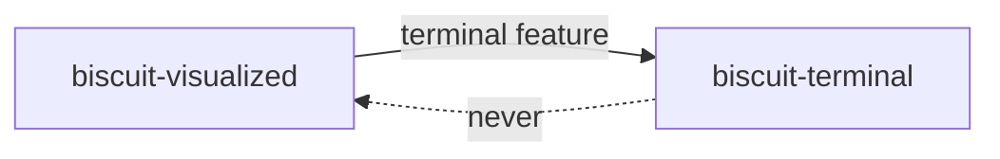

# biscuit-visualized Dependencies

## Structure

- `biscuit-visualized/src/Cargo.toml` - Diagram artifacts (SVG/PNG) and, with
  the `terminal` feature, the diagram components

The dependency runs one way: with `terminal` enabled this crate depends on
`biscuit-terminal`. `biscuit-terminal` never depends on this crate, and no
feature here may make it do so.

## Production Dependencies

- [layout-rs](https://crates.io/crates/layout-rs) _v0.1_

    _Graph layout for expression and DOT input; no Graphviz binary is needed._

- [serde](https://serde.rs) _v1.0_ and [serde_json](https://github.com/serde-rs/json) _v1.0_

    _Serialized render requests and cache metadata._

- [tempfile](https://github.com/Stebalien/tempfile) _v3_

    _Temporary files and directories for rendered artifacts._

- [thiserror](https://github.com/dtolnay/thiserror) _v2.0_

    _Typed errors for parsing and rendering._

- [tracing](https://github.com/tokio-rs/tracing) _v0.1_

    _Render and cache diagnostics._

## Workspace Dependencies

- [biscuit-hash](../../biscuit-hash/lib) _v0.1.0_

    _Content hashes that key the artifact cache._

## Optional Dependencies

- [resvg](https://github.com/linebender/resvg) _v0.45_ (feature: `image`)

    _Rasterizes SVG to PNG._

- [mermaid-rs-renderer](https://crates.io/crates/mermaid-rs-renderer) _v0.3.1_ (feature: `image`)

    _Pure-Rust Mermaid parser, layout engine, and SVG renderer, with
    `default-features = false`: this crate rasterizes with its own `resvg`._

- [biscuit-terminal](../../biscuit-terminal/lib) _v0.1.0_ (feature: `terminal`, with its `image` feature)

    _Terminal capabilities, `TerminalImage` for displaying pixels, and the
    render-tree diagram hook trait that `TerminalDiagramRenderer`
    implements._

- [renderable](../../renderable) _v0.1.0_ (feature: `terminal`)

    _The render tree and browser fragments the diagram components project to._

- [clap](https://github.com/clap-rs/clap) _v4_ (feature: `clap`)

    _Derives `clap::ValueEnum` on `QuadrantTheme`._

## Development Dependencies

- `serial_test` serializes the tests that redirect the process-global cache
  directory.
- `biscuit-test-harness` (`manifest_dir!()`), `insta` (layout-matrix
  snapshots), and `image` (decoding rendered PNGs) serve the `l1` integration
  tests of the diagram components.
