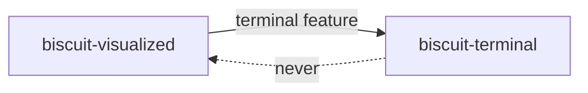

# biscuit-visualized Dependencies

## Structure

- `biscuit-visualized/src/Cargo.toml` - Diagram artifacts (SVG/PNG) and, with
  the `terminal` feature, the diagram components

The dependency runs one way: with `terminal` enabled this crate depends on
`biscuit-terminal`. `biscuit-terminal` never depends on this crate, and no
feature here may make it do so.

## Production Dependencies

- [layout-rs](https://crates.io/crates/layout-rs) _v0.1_

    _Graph layout for expression and DOT input; no Graphviz binary is needed._

- [serde](https://serde.rs) _v1.0_ and [serde_json](https://github.com/serde-rs/json) _v1.0_

    _Serialized render requests and cache metadata._

- [tempfile](https://github.com/Stebalien/tempfile) _v3_

    _Temporary files and directories for rendered artifacts._

- [thiserror](https://github.com/dtolnay/thiserror) _v2.0_

    _Typed errors for parsing and rendering._

- [tracing](https://github.com/tokio-rs/tracing) _v0.1_

    _Render and cache diagnostics._

## Workspace Dependencies

- [biscuit-hash](../../biscuit-hash/lib) _v0.1.0_

    _Content hashes that key the artifact cache._

## Optional Dependencies

- [resvg](https://github.com/linebender/resvg) _v0.47_ (feature: `image`)

    _Rasterizes SVG to PNG (with `usvg` 0.47, `fontdb` 0.23, and `tiny-skia`
    0.12)._

- [png](https://github.com/image-rs/image-png) _v0.18_ (feature: `image`)

    _Encodes rasterized PNGs at zlib's default level with adaptive filtering.
    The settings are explicit because they are part of the PNG cache key, so
    a change in tiny-skia's defaults cannot change the bytes behind a key.
    Kept on the major version tiny-skia already uses, so it adds no second
    copy._

- [rustybuzz](https://github.com/harfbuzz/rustybuzz) _v0.20.1_ (feature: `image`)

    _Shapes label text to measure it, so the measured face is the face resvg
    draws. Kept on the version `usvg` uses, so the lockfile holds one copy._

- [ttf-parser](https://github.com/harfbuzz/ttf-parser) _v0.25.1_ (feature: `image`)

    _Reads font tables (family names, OS/2 class, character maps) for font
    resolution. Kept on the version `usvg` uses, so the lockfile holds one
    copy._

- [unicode-bidi](https://github.com/servo/unicode-bidi) _v0.3_ and [unicode-script](https://github.com/unicode-rs/unicode-script) _v0.5_ (feature: `image`)

    _Split label text into bidi and script runs for shaping, as `usvg`'s text
    layout does; both are already in the graph through `usvg`._

- [fontique](https://github.com/linebender/parley) _v0.12.0_ (feature: `image`)

    _The OS's own generic font family (fontconfig on Linux, CoreText on
    macOS, DirectWrite on Windows), with `default-features = false` and
    feature `system`. On Linux it links the system `libfontconfig` at build
    time, so the fontconfig development package (its pkg-config file) must be
    installed._

- [mermaid-rs-renderer](https://crates.io/crates/mermaid-rs-renderer) _v0.3.1_ (feature: `image`)

    _Pure-Rust Mermaid parser, layout engine, and SVG renderer, with
    `default-features = false`: this crate rasterizes with its own `resvg`._

- [biscuit-terminal](../../biscuit-terminal/lib) _v0.1.0_ (feature: `terminal`, with its `image` feature)

    _Terminal capabilities, `TerminalImage` for displaying pixels, and the
    render-tree diagram hook trait that `TerminalDiagramRenderer`
    implements._

- [renderable](../../renderable) _v0.1.0_ (feature: `terminal`)

    _The render tree and browser fragments the diagram components project to._

- [clap](https://github.com/clap-rs/clap) _v4_ (feature: `clap`)

    _Derives `clap::ValueEnum` on `QuadrantTheme`._

## Bundled Assets

Font files compiled into the library under the `image` feature, from
`biscuit-visualized/src/assets/fonts/`. Each directory holds the license
text (`OFL.txt`) and a `README.md` with the source, release, and SHA-256 of
every file.

- **Inter** 4.1, Regular and Bold (static TrueType, SIL Open Font License
  1.1, about 0.8 MB together), on every OS. Registered as the family `Inter`
  and matched only by name.
- **Noto Emoji**, monochrome (variable TrueType, `wght` 300–700, default
  Regular 400; SIL Open Font License 1.1, about 2.0 MB), in Linux builds
  only. The last fallback face for emoji.

## Development Dependencies

- `serial_test` serializes the tests that redirect the process-global cache
  directory.
- `biscuit-test-harness` (`manifest_dir!()`), `insta` (layout-matrix
  snapshots), and `image` (decoding rendered PNGs) serve the `l1` integration
  tests of the diagram components.
- `base64` decodes the Kitty and iTerm2 protocol payloads in the `l1` tests,
  to check that the PNG bytes reach the terminal unchanged.
