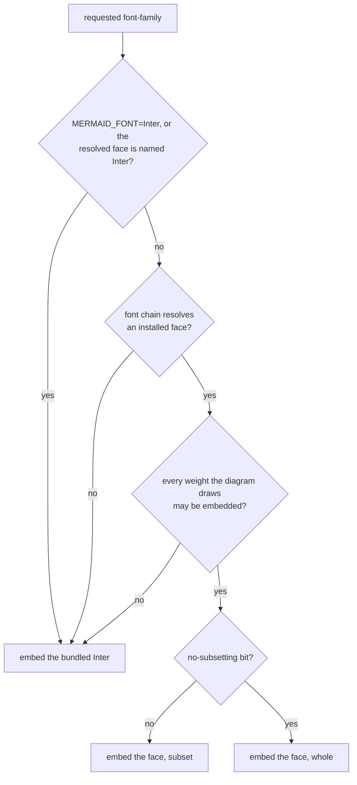

# Embedded font for Mermaid static SVG

A Mermaid diagram written into a web page as a static SVG is laid out with
fonts on the machine that rendered it, but drawn by the reader's browser with
the reader's fonts. When the reader lacks the face a label was measured in,
the label is drawn in a fallback face of a different width and can crowd or
overrun its box. The [HTML static target](./merman.md#html-static-target)
softens this by letting labels overflow; the **embedded-font opt-in** removes
the guess by shipping the measured face inside the page.

With the opt-in, `biscuit-visualized`:

1. chooses, for each font family the diagram asks for, a face the page may
   legally embed (the [face rule](#which-face-is-embedded));
2. measures every label in that face, so boxes fit what the reader will see;
3. hands back the characters each family draws, from which you build one
   `@font-face` style block per page, holding a subset of each face with only
   those characters.

It applies only to SVG rendered for the HTML static target. Terminal output,
PNG files, and the default (raster-safe) SVG ignore it and are byte for byte
what they are without it.

## Using it

```rust
use biscuit_visualized::artifact::{OutputFormat, RenderRequest};
use biscuit_visualized::mermaid::{page_font, MermaidDiagram, MermaidTarget};

let request = RenderRequest { format: OutputFormat::Svg, ..RenderRequest::default() };
let mut fonts = Vec::new();
let mut body = String::new();
for source in ["flowchart LR\n  A --> B", "classDiagram\n  class Animal"] {
    let diagram = MermaidDiagram::new(source)
        .with_target(MermaidTarget::HtmlStatic)
        .with_embedded_font(true);
    let (artifact, font) = diagram.render_with_font(&request)?;
    body.push_str(&std::fs::read_to_string(&artifact.path)?);
    fonts.extend(font); // Some(DiagramFont) only when the opt-in applied
}

match page_font(&fonts) {
    // comments, then one <style> element; empty when no diagram drew text
    Ok(font) => body.insert_str(0, &font.markup()),
    // the diagrams still show; only the width guarantee is lost
    Err(error) => eprintln!("no embedded font: {error}"),
}
```

- `MermaidDiagram::with_embedded_font(true)` turns the opt-in on; it is off by
  default. The terminal component
  ([`components::mermaid::MermaidDiagram`](./components/mermaid_diagram.md#key-api))
  has the same switch, and `render_to_svg_with_font` returns the SVG string
  with its font.
- `render_with_font` returns the cached artifact and a `DiagramFont`, which is
  `Some` exactly when the opt-in applied (HTML static target, SVG output).
  `render` is the same call without the font.
- `page_font` merges every diagram's `DiagramFont` into one `PageFont`:
  `comments()` (one per embedded family), `css()` (the `<style>` body),
  `markup()` (both, ready to insert), and `is_empty()`. Put the markup once
  per page, before the first diagram; one block serves every diagram and both
  light and dark themes.

Darkmatter does exactly this for its static-SVG pages (see its
[Mermaid rendering](../../darkmatter/docs/rendering/mermaid.md#embedded-font)
page).

The markup for a page whose diagrams resolved to a Restricted face looks like
this (base64 shortened):

```html
<!-- mermaid font: "Inter" embedded; resolved face "Arial" is Restricted (fsType 0x0002) -->
<style>
/* Inter: Copyright (c) 2016 The Inter Project Authors (https://github.com/rsms/inter); SIL Open Font License 1.1 */
@font-face{font-family:'Inter';font-style:normal;font-weight:400;src:url(data:font/ttf;base64,AAEAAA…) format("truetype")}
@font-face{font-family:'Inter';font-style:normal;font-weight:700;src:url(data:font/ttf;base64,AAEAAA…) format("truetype")}
</style>
```

Every label's `font-family` in the SVG then starts with `'Inter'`, the family
the rule declares, followed by Mermaid's original stack.

## Why a font's permission matters

Embedding a font in a published page **redistributes** it: every reader
downloads a copy. Many operating-system fonts (Helvetica, Trebuchet MS,
Arial, Segoe UI) are licensed for the machine they were installed on, not for
redistribution.

Every TrueType or OpenType font declares whether it may be embedded, in the
`fsType` field of its `OS/2` table, set by the font's vendor. Its permission
bits read:

| `fsType` permission | Plain meaning | The opt-in |
| --- | --- | --- |
| Installable (`0x0000`) | May be embedded, and installed by the reader | embeds it |
| Editable (`0x0008`) | May be embedded and used to edit the document | embeds it |
| Preview & print (`0x0004`) | May be embedded for viewing and printing only | embeds it |
| Restricted (`0x0002` alone) | Must not be embedded | embeds Inter instead |

Two more bits matter:

- **No subsetting** (`0x0100`): the face may be embedded only whole. The
  opt-in embeds it [unsubset](#subsetting-and-the-size-budget).
- **Bitmap embedding only** (`0x0200`): only the face's bitmaps may be
  embedded. Browsers draw outlines, so this counts as Restricted.

An older font may set several permission bits; the least restrictive one
applies, as the OpenType specification directs (`0x0006` reads as Preview &
print). Reserved bits are ignored. A face whose `OS/2` table is missing or
too short to hold `fsType` cannot be classified and is treated as Restricted:
the opt-in never embeds a face it could not classify.

The fallback, the bundled **Inter** 4.1, is licensed under the SIL Open Font
License 1.1, which allows redistribution and subsetting as long as the
copyright and license travel with the font. They do, twice: the subset keeps
Inter's `name` table (copyright, license, and license URL), and the page
carries a one-line CSS comment naming Inter's copyright and the license, right
before Inter's first rule. A page that embeds only host faces carries no such
comment.

## Which face is embedded

The face embedded is always the face measured. The choice is made per
requested `font-family` list and per diagram, from the weights that diagram
actually draws, and is kept for the whole render.



A face may be embedded when its outlines are static TrueType (`glyf`, not
variable) and its `fsType` permits it (the table above).

Which weights a diagram draws is known only after it is laid out, so a
diagram is first laid out in the resolved faces. If it turns out to draw a
weight whose face may not be embedded, it is laid out again with that family
measured in Inter, and the second layout is the one returned and cached. For
example, with an installed Arial:

| Arial's `fsType` | Diagram | Draws | Embedded |
| --- | --- | --- | --- |
| regular Installable, bold Restricted | `flowchart LR` with plain nodes | regular only | Arial, a 400 rule |
| regular Restricted, bold Installable | `classDiagram` with only `class Zebra` | bold only (the title) | Arial, a 700 rule |
| regular Installable, bold Restricted | `classDiagram` with a title and members | regular and bold | Inter, 400 and 700 rules |

- **The resolved face first.** The face is the one the normal
  [resolution chain](./merman.md#the-resolution-chain) picks for the family:
  `MERMAID_FONT`, then the requested CSS stack, then the OS's generic family,
  then the sans-serif rule. It is the family's own face, not a fallback face
  used for characters it lacks.
- **One family, one face.** If any weight a diagram draws in a family may not
  be embedded, the whole family becomes Inter for that diagram, so one family
  never mixes two faces' metrics. A weight the diagram never draws does not
  count. The substitution is logged as a warning when the diagram is
  rendered (a later cache hit repeats the choice without logging).
- **Per diagram, on one page.** Two diagrams on one page can choose
  differently for the same requested family: one drawing only the permitted
  regular keeps Arial, one also drawing the Restricted bold uses Inter. The
  page then embeds both: Arial's regular for the first diagram, and Inter's
  rules for the second.
- **Outline format.** The page declares `format("truetype")`, so only
  TrueType-outline (`glyf`) faces qualify. A CFF or CFF2 face, a variable
  face (`fvar`), or a face with no `glyf` table embeds Inter instead.
- **Inter by name.** `MERMAID_FONT=Inter` (or a stack that names `Inter`)
  gives the bundled Inter. Where a copy of Inter is installed and the chain
  resolves to it, the opt-in still measures and embeds the bundled Inter: the
  page declares Inter's faces under the name `Inter`, and another family of
  the same page may fall back to the bundled Inter, so two different files
  can never share that name and weight.

The page comment before the `<style>` element says, for each embedded family,
which face was embedded and why:

```text
<!-- mermaid font: "Trebuchet MS" embedded; the face the font chain resolved, fsType 0x0008 (Editable) -->
<!-- mermaid font: "Inter" embedded; selected by MERMAID_FONT=Inter -->
<!-- mermaid font: "Inter" embedded; resolved face "Arial" is Restricted (fsType 0x0002) -->
<!-- mermaid font: "Inter" embedded; resolved face "X" allows bitmap embedding only (fsType 0x0200) -->
<!-- mermaid font: "Inter" embedded; resolved face "X" has no readable OS/2 table -->
<!-- mermaid font: "Inter" embedded; resolved face "X" has an outline format not embeddable as TrueType -->
<!-- mermaid font: "Inter" embedded; the font chain reached no installed face -->
<!-- mermaid font: "Y" embedded; the face the font chain resolved, fsType 0x0100 (Installable); embedded unsubset because fsType 0x0100 forbids subsetting -->
```

When several requested families end up as one embedded family (for example
an unresolvable `sans-serif` and a refused Arial both become Inter), the page
has one comment for it, giving the reason that best explains the
substitution: a refusal first, then `MERMAID_FONT=Inter`, then the resolved
face, then "no installed face". A Resolved comment names the permission of
the weights that may be embedded only.

Font names in the comment lose control characters, `<`, `>`, every `--` and
`*/`, and a trailing `-`, so a crafted name cannot end the comment early.

## Subsetting and the size budget

After the diagrams are rendered, the characters each family draws are read
from the final SVGs through their CSS, the way the rasterizer reads them:
bold text (weight 600 and up, `bold`, `bolder`) is counted for the bold face,
the rest for the regular face, and a space is always added. Each family gets
one `@font-face` rule per weight a page draws, holding the union of every
diagram's characters at that weight; a weight or family the page never draws
is not embedded. Two diagrams whose `font-family` lists choose the same family
share its rules.

A family with only one installed face uses that face for both weights. It
still gets a rule for each weight it draws, each a separate subset: for
example, a class diagram whose title `Zebra` is bold and whose member
`+String name` is regular gets a 400 rule without `Z` and a 700 rule that has
it.

The subset is made with [`allsorts`](https://github.com/yeslogic/allsorts) and
keeps the tables a browser needs: `cmap` (characters to glyphs), `OS/2`
(browsers reject a font without it), `name` (copyright and license), and the
outline and metric tables (`glyf`, `loca`, `head`, `hhea`, `hmtx`, `maxp`,
`post`). It carries no `GPOS`, `GSUB`, or `kern` table, so the browser draws
it **without kerning, ligatures, or contextual alternates**. The opt-in
therefore measures labels with the face's plain glyph advances, which is
exactly what the browser draws from the subset; text is slightly wider than in
a kerned render, and the boxes match it.

A face embedded whole (see **Unsubset faces** below) keeps every table, so the browser
kerns it, and the opt-in measures its labels with normal shaping instead. The
choice follows the file emitted for each weight: with `0x0100` on the regular
face only, regular labels are measured kerned and bold labels with plain
advances.

```text
AVAVAVAVAVAVAVAV at 16 px in Inter Regular
  subset (no GPOS):  176.625 px   plain advances
  whole face:        160.219 px   kerned
```

- **Budget.** Each weight's file should stay under 60,000 bytes (measured
  before base64). A file over the budget is still embedded, and its size is
  logged at `info`.
- **Unsubset faces.** A face with the no-subsetting bit is embedded whole (one
  file per weight, the same `@font-face` shape), which is far larger: Inter
  whole is about 410 KB per weight. This is logged at `info` and named in the
  page comment. Its labels are measured with kerning, as the browser draws
  them.
- **Characters the face lacks.** CJK, emoji, and other characters the face
  does not map are left out of the subset; the reader's browser draws them in
  its own fallback face.

## When embedding fails

If any face cannot be subset or read, `page_font` returns a
`FontEmbeddingError` after logging one warning, and the page gets no embedded
font at all, not a font for some families only. The diagrams are unchanged and
still show: they are static SVGs whose labels lead with the chosen family, so
a reader without that face falls back to the original stack, as on a page
without the opt-in. Only the width guarantee is lost.

## Caching

An opt-in render is a separate cache entry from a plain HTML static render and
from a raster-safe one, so neither is ever served for the other (see
[Cache identity](./merman.md#cache-identity)). Choosing a different face (a
Restricted face replaced by Inter, or a different `MERMAID_FONT`) changes the
key through the font identity it already carries.

Beside an opt-in SVG the cache stores a small record, `{key}.font.json`, with
the requested families, those the render chose as Inter because it draws a
refused weight, and the characters each family draws per weight, so a cache
hit can return the same `DiagramFont` without laying the diagram out or
reading the SVG again. A diagram laid out a second time is stored under the
key of its first layout, which is the key a later render checks. The
subset itself is never cached; `page_font` builds it for each page. An SVG
whose record is missing or unreadable is rendered again.
