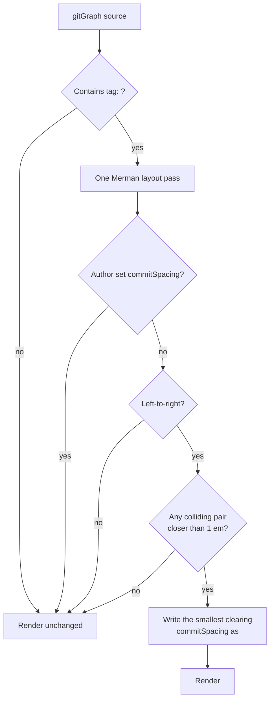

# Mermaid gitGraph tag spacing

`biscuit-visualized` renders a `gitGraph` with [Merman](./merman.md), which
draws merges as Mermaid.js does. It adds one thing of its own: **tags never
overlap**. When two tags on different commits would collide, the commits are
spaced just far enough apart to leave a one-em gap between them, and no
further.

(An em is a length equal to the diagram's font size, 16 px by default; see
[the rules](#tag-spacing).)

This applies to every gitGraph and every caller: the library's
[`MermaidDiagram`](../src/src/mermaid/render.rs) directly, the
[`GitGraph`](./components/git_graph.md) terminal component and `bt git-graph`
built on it, and Darkmatter's Mermaid blocks. There is nothing to opt into and
no new option.

## Merges

Merman follows Mermaid.js's gitGraph rules, so a merge needs no correction.
(A gitGraph's _branch_ is drawn as a horizontal _lane_; each `commit` is a dot
on the lane of the branch checked out at that point.)

- A labeled merge keeps both parents. In `merge feat id: "M" tag: "v1"`,
  `M`'s parents are the current branch's head and `feat`'s head, and `M`
  keeps its ID, its tag, and its lane.
- A merge of a branch that has no commit of its own renders: its second
  parent is the commit the branch was created at.

```text
gitGraph
    commit id: "A"
    branch side
    checkout main
    commit id: "B"
    merge side id: "M"
```

Here `M`'s parents are `B` and `A`.

A merge is still an error, in Merman and in Mermaid.js alike, when the two
heads (each branch's latest commit) cannot make a merge commit with two
distinct parents:

- the current branch has no commit at all (it was created before the first
  `commit`), or the merged branch has none;
- both branches are at the same commit, as in
  `commit id: "A"` / `branch side` / `checkout main` / `merge side`;
- the current branch has no commit of its own and the merge brings in the
  branch it was created from (`Cannot merge branch 'main' into itself`).

Such a diagram does not render; it
[falls back to its source](./merman.md#when-a-diagram-falls-back-to-its-source).
The `GitGraph` component emits a merge only onto a lane that already has a
commit of its own, so it never produces one.

## Tag spacing

Merman places each tag above its commit with no collision avoidance and
spaces commits a fixed 50 px apart (`commitSpacing`'s default). A tag wider
than that covers its neighbor's, as `main` and `origin/main` one commit apart
do. So, before rendering, a left-to-right gitGraph with tags is laid out once
at its current spacing, its tags are checked in pairs, and when a pair
collides the smallest spacing that clears every pair is written into the
source:

```text
gitGraph
    commit id: "d1"
    commit id: "d2" tag: "main"
    commit id: "d3" tag: "origin/main"
%%{init: {"gitGraph": {"commitSpacing": 74.5}}}%%
```

(The value is illustrative; it depends on the measured tag widths.) A
`%%{init: …}%%` line is a Mermaid **directive**: JSON configuration written
inside the diagram text. It is appended as the last line. Merman, like
Mermaid.js, reads directives anywhere in the source and merges them over the
diagram's frontmatter (a `---` YAML block before the diagram) and earlier
directives, so it changes no other setting.



The rules:

- **Which pairs count.** Two tags on **different** commits whose boxes share
  rows (boxes that only touch do not count). Tags stacked on one commit never
  widen the spacing, and neither do tags on lanes far enough apart that their
  rows do not overlap, nor two commits drawn in the same column
  (`parallelCommits`), which no spacing can separate.
- **The gap.** Each counting pair needs one em between the earlier tag's
  right edge and the later tag's left edge. An em is the diagram's
  `themeVariables.fontSize` (16 px in every built-in theme), so a
  `%%{init}%%` that raises the font size widens the gap. The em is a
  readability policy, not a measured margin.
- **The smallest spacing.** Tag boxes move with their commits, so a pair `n`
  columns apart that is `shortfall` px short of the gap needs
  `spacing + shortfall / n`. The diagram gets the largest of these, rounded
  up to 0.01 px, so the tightest pair ends up one em apart (to that rounding)
  and no pair is closer. One layout pass is enough: no second pass is needed
  to verify it.
- **Tag widths.** Each tag is measured with the same measurer and font chain
  Merman lays the diagram out with, at the tag font size
  (`themeVariables.tagLabelFontSize`, 10 px by default), and its box follows
  Merman's own tag-box formula. The tag size is read exactly as Merman reads
  it, so the measured tag is the drawn one: a string in `px`, `em` or `%`
  (the last two relative to `fontSize`), `inherit` or `unset` (equal to
  `fontSize`), or `0`. Anything else, including a bare JSON number such as
  `14` or a unitless string such as `"14"`, is drawn at 10 px:

  ```text
  %%{init: {"themeVariables": {"tagLabelFontSize": "150%"}}}%%   → tags at 24 px (150% of 16)
  %%{init: {"themeVariables": {"tagLabelFontSize": 14}}}%%       → tags at 10 px
  ```

  Raising only `fontSize` therefore widens the gap and leaves `px` tags
  unchanged, but also enlarges tags sized in `em` or `%`.
- **The author wins.** A source that already sets `gitGraph.commitSpacing`,
  in a directive or in frontmatter, is never changed, even when its value
  lets tags overlap.

Two examples in the default theme:

| Graph | Colliding pair | Spacing |
| ----- | -------------- | ------- |
| `main` and `origin/main` stacked on one commit, beside a long history | none (same commit) | 50, the default |
| `main` on one commit, `origin/main` on the next | one column apart, overlapping | 50 + the overlap + 16 |

So a graph with one long, isolated label keeps Merman's density. Only a real
collision widens it, and only as far as that collision needs.

Left alone, laid out with Merman's spacing:

- diagrams that are not gitGraphs;
- gitGraphs with no tags (no layout pass is made for them);
- top-to-bottom and bottom-to-top gitGraphs (`gitGraph TB:` or `BT:`), whose
  tags Merman rotates. **Their tags are not spaced and can still overlap.**

The spacing is one value for the whole diagram, so one colliding pair widens
every column. Callers that fit a width should expect that a colliding graph
may need shrinking. The `GitGraph` component trims commits first and then
shrinks, and never shortens a label.

## Cost and cache identity

The layout pass runs before the [cache check](./merman.md#cache-identity),
under its own [time budget](./merman.md#time-budget), so a tagged gitGraph
costs one Merman layout even when its image is cached. The cache key covers
the source as rewritten, so the written spacing is part of the key. A change
to how spacing is computed changes output for the same input, so it bumps the
`+bv<n>` suffix of the backend id
([`MERMAID_BACKEND`](../src/src/cache/file_cache.rs)), the version string
every cache key starts from:

```text
merman@6e6b1e6554e8+bv7    Merman commit 6e6b1e6554e8, this crate's layer at version 7
merman@6e6b1e6554e8+bv8    after a future spacing change: no artifact cached under bv7 is reused
```

`commitSpacing` is not a setting stock Merman reads. `biscuit-visualized`
pins Merman to a fork that adds it (see [Dependencies](./dependencies.md)).

## Checking a layout

[`MermaidDiagram::gitgraph_geometry()`](../src/src/mermaid/render.rs)
returns the laid-out commits (ID, lane, parents, placement index and x, tag
text and bounds), the commit step (the distance between neighboring commits),
the tag gap, and the size, built from Merman's layout data for the source as
rewritten, so it is the layout that renders. On the returned
[`GitGraphGeometry`](../src/src/mermaid/gitgraph.rs), `tag_boxes()` lists
every tag's box and `tag_overlaps()` answers "do any tags overlap?" without
rasterizing.
[`biscuit_visualized::mermaid::default_gitgraph_commit_step()`](../src/src/mermaid/gitgraph.rs)
gives Merman's default spacing (50) to compare against. Both are
`#[doc(hidden)]` (left out of the generated API docs): test support, not a
stable API.

```rust
use biscuit_visualized::mermaid::{default_gitgraph_commit_step, MermaidDiagram};

let source = "gitGraph
  commit id: \"d1\"
  commit id: \"d2\" tag: \"main\"
  commit id: \"d3\" tag: \"origin/main\"
";
let layout = MermaidDiagram::new(source).gitgraph_geometry()?.expect("a gitGraph");
assert!(layout.tag_overlaps().is_empty());
assert!(layout.commit_step > default_gitgraph_commit_step()); // widened for this pair
```

The `GitGraph` component's tests and worktree tests
use them to prove placement on real layouts, because Mermaid text alone
cannot show an overlap.

## Tests

- [`src/src/tests/gitgraph_tests.rs`](../src/src/tests/gitgraph_tests.rs) (L1, the fast in-process tier): both parents of a labeled merge, a
  merge of a branch without its own commit, and real layouts: long labels on
  neighboring commits, `main`/`origin/main` one commit apart, a stack of
  three tags, and cross-lane tags, each checked for no overlap and for the
  tightest pair being one em apart; the default spacing for stacked tags,
  for lanes apart without shared rows, for a real `wt list` graph, for
  untagged graphs, and for vertical graphs; a larger `%%{init}%%` font
  widening only the gap; and that the measured size is the spaced layout.
- [`src/src/tests/gitgraph_layout_tests.rs`](../src/src/tests/gitgraph_layout_tests.rs) (L1): reading Merman's layout
  data strictly (missing, mistyped, and duplicate fields, trailing content),
  tag bounds matching the drawn tags in every direction, and the spacing
  separating adjacent tags.
