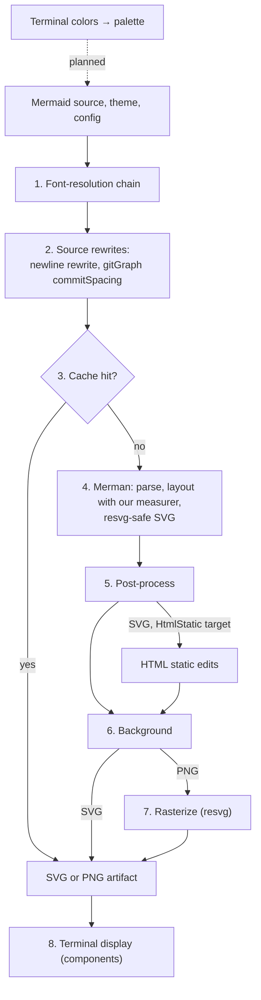
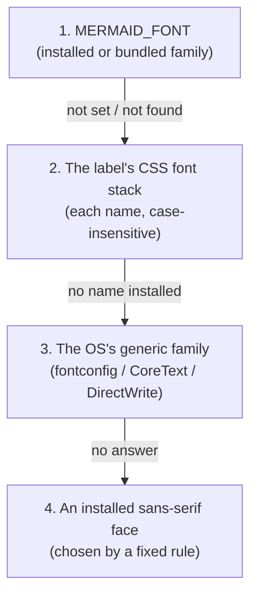
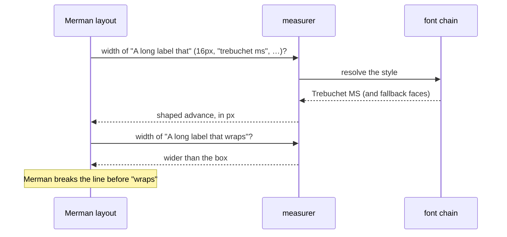

# Merman rendering

`biscuit-visualized` renders every Mermaid diagram with
[Merman](https://github.com/Latias94/merman), a pure-Rust Mermaid renderer
that aims for parity with Mermaid.js: it parses the source, lays it out, and
writes an SVG. Merman does the diagram work; `biscuit-visualized` supplies the fonts and the text measurer,
rewrites a few source constructs Merman mishandles, caches the result, fixes
two SVG defects, and rasterizes. You call one type,
`mermaid::MermaidDiagram` (or the terminal component built on it, see
[MermaidDiagram](./components/mermaid_diagram.md)), and get an SVG or PNG
file:

```rust
use std::time::Duration;
use biscuit_visualized::artifact::RenderRequest;
use biscuit_visualized::mermaid::{MermaidDiagram, MermaidTheme};

let diagram = MermaidDiagram::new("flowchart LR\n    A --> B")
    .with_theme(MermaidTheme::Dark)
    .with_time_budget(Duration::from_secs(1));
let artifact = diagram.render(&RenderRequest::default())?; // a cached PNG
```

Merman is pinned to an exact commit on a fork that adds one gitGraph setting,
`commitSpacing`, which [tag spacing](#gitgraph-tag-spacing) needs. Only its
SVG pipeline is compiled in: its PNG output, native font loading, ELK layout,
and math rendering are off, because this crate draws and measures text with
its own font chain. See [Dependencies](./dependencies.md).

## The rendering pipeline



| Step | What happens | Owner |
| ---- | ------------ | ----- |
| 1 | The process's [font chain](#the-resolution-chain) is built once: installed fonts plus the [bundled fonts](#bundled-fonts). The site config for Merman is assembled from the theme and `MermaidConfig` | `biscuit-visualized` (fontique, ttf-parser) |
| 2 | The [`\n` rewrite](#line-breaks-in-labels-n) for four families; for a gitGraph with tags, one Merman layout pass decides whether to write [`commitSpacing`](#gitgraph-tag-spacing) | `biscuit-visualized`, using Merman's layout data |
| 3 | The [cache](#cache-identity) is checked; a hit skips steps 4 to 7 | `biscuit-visualized` |
| 4 | Merman parses and lays the diagram out, asking [our measurer](#measuring-label-widths) for label widths and wrapping lines itself, and writes an SVG that keeps `<text>` elements and avoids features resvg cannot draw. All of it runs under the [time budget](#time-budget) | Merman; `biscuit-visualized` (measurer) |
| 5 | The [post-process](#post-processing) repairs gradient strokes and gives unstyled text `sans-serif`; an SVG for the [HTML static target](#html-static-target) also gets its two edits | `biscuit-visualized` |
| 6 | `RenderRequest::background` decides what is painted behind the diagram: the theme's color, a solid color, or nothing | `biscuit-visualized` |
| 7 | For PNG, usvg turns text into outlines through the same font chain and resvg 0.47 draws them | `biscuit-visualized` |
| 8 | The terminal components size the PNG to whole cells and hand it to `TerminalImage` | `biscuit-visualized` components over `biscuit-terminal` |

One step is **planned** (dotted above): a palette derived from the
terminal's colors and compiled into the Merman theme, owned by
`biscuit-terminal` (color detection), `biscuit-visualized`, and Merman (see
[Themes](#themes)).

Measurement (step 4) and drawing (step 7) ask the same chain for a face, so a
label is measured in the face it is drawn in and never spills out of its box.

A diagram's natural size, which the terminal component scales from, is the
root `viewBox` of the same SVG step 7 rasterizes; `natural_size()` renders
(and caches) that SVG to read it.

## Time budget

Every Merman request has a deadline, 2 s by default
(`MermaidDiagram::DEFAULT_TIME_BUDGET`). Set another with
`with_time_budget(Duration)` on `mermaid::MermaidDiagram`, or on the
terminal component, which passes it through:

```rust
let diagram = MermaidDiagram::new(source).with_time_budget(Duration::from_millis(500));
```

- **Per request, not per render.** An SVG render is one request. A gitGraph
  with tags makes two, the layout pass of step 2 and the SVG render, and each
  gets the full budget.
- **Merman's work only.** Merman checks the deadline at its own checkpoints
  while parsing, laying out, and writing SVG. Post-processing and
  rasterization run outside it, so a render can finish after the budget
  without failing.
- **Exceeded:** the library returns `MermaidError::RenderFailed` and logs a
  warning with the budget and the elapsed time; the terminal component shows
  the source as a fenced code block.

## When a diagram falls back to its source

These are render failures (`MermaidError::RenderFailed`). The terminal
component, the render-tree hook, and `fallback_code_block()` show the Mermaid
source as a code block instead:

- the source does not parse, or its diagram type is unknown;
- a ZenUML diagram, recognized by its `zenuml` header. Merman could draw it,
  but Mermaid.js supports ZenUML only through an external plugin, so a
  diagram that renders here would not render elsewhere;
- a label that uses math (`$$…$$`). Merman's math support is not compiled in,
  so it refuses the whole diagram, not just the label;
- Merman exceeds the [time budget](#time-budget).

## Themes

`MermaidTheme` currently selects one of Merman's built-in themes, which match
Mermaid.js's named themes:

| `MermaidTheme` | Merman theme | `Background::Theme` color |
| -------------- | ------------ | ------------------------- |
| `Dark` (the default) | `dark` | `#333` |
| `Default` | `default` | `white` |
| `Forest` | `forest` | `white` |
| `Neutral` | `neutral` | `#ffffff` |

Merman leaves the SVG's root unpainted, so `Background::Theme` paints that
color as a rectangle behind the diagram, and `Background::Transparent` paints
nothing. `MermaidConfig`'s quadrant settings reach Merman as site config
(`quadrantChart.pointLabelFontSize` and `pointRadius`, and
`themeVariables.quadrant1Fill` to `quadrant4Fill`); `point_label_font_size`
sizes quadrant point labels only. A `%%{init}%%` directive or frontmatter in
the source is read by Merman as Mermaid.js reads it.

> **Planned.** The built-in theme names are an interim mapping. Diagrams will
> be styled with palettes compiled into Merman themes:
>
> - in a terminal, a palette **derived from the terminal's own colors**
>   (background, foreground, and its ANSI palette), with accent colors for
>   unstyled nodes and text colors chosen for contrast;
> - `Dark`, `Default`, `Forest`, and `Neutral` become fixed palettes, used
>   when no terminal colors are available and for output that is not for a
>   terminal;
> - a small post-process adds the accents compiled themes cannot express.

## Fonts

A Mermaid diagram becomes an image in two passes that both need fonts:

1. **Layout.** Merman asks how wide each label is, so it can size boxes and
   decide where to wrap.
2. **Drawing.** The rasterizer (usvg/resvg) turns each `<text>` element into
   glyph outlines.

If those two passes used different fonts, a label measured in one face would
be drawn in another and spill out of its box. `biscuit-visualized` therefore
has **one font-resolution chain**, and both the text measurer and the
rasterizer ask it which face to use. The rasterizer's font database holds
exactly the faces the chain can return, so the chain decides the face of
every rasterized SVG, graphs included. `raster::available_font_families()`
lists the installed families plus `Inter`.

### Choosing a font: `MERMAID_FONT`

Set `MERMAID_FONT` to a family name to draw every diagram in that family:

```sh
MERMAID_FONT=Inter bt flowchart "A --> B --> C"          # identical layout on every host
MERMAID_FONT="dejavu sans" bt flowchart "A --> B --> C"
```

- Matching is **case-insensitive** (`inter`, `Inter`, and `INTER` are the same).
- Unset or empty: ignored silently.
- Set to a family that is neither installed nor bundled: one warning naming it
  is logged, **at most once per process**, and resolution continues with the
  next step as if the variable were unset.

### The resolution chain

For each label the chain tries these steps in order and stops at the first
that yields a face:



1. **`MERMAID_FONT`**, as above. The bundled Inter counts as available here.
2. **The label's CSS font stack.** Mermaid's default is
   `"trebuchet ms", verdana, arial, sans-serif`. Each named family is matched
   case-insensitively against installed families and the bundled Inter; a
   generic name (`serif`, `sans-serif`, `monospace`, `cursive`, `fantasy`, in
   any casing, quoted or not) is answered by the OS's own family for that
   generic, as in step 3. Trebuchet MS is only Mermaid's first preference,
   not a requirement.
3. **The OS's sans-serif family**, asked through `fontique`: fontconfig on
   Linux, CoreText on macOS, DirectWrite on Windows. This is what keeps text
   visible on a Linux host that has none of the stack's fonts installed. A
   stack that asks only for, say, `courier` gets the sans-serif answer here,
   not a monospace one: no font name is treated as a hint.
4. **An installed face that its own font file classifies as sans-serif** (the
   OS/2 table's `sFamilyClass` is 8). Among those, the family is chosen by
   these preferences, in order:
    1. a family with both a regular and a bold face;
    2. then the one covering the most Latin code points (Unicode Latin blocks
       mapped by its `cmap`);
    3. then proportional over monospace (the `post` table's `isFixedPitch`);
    4. then the alphabetically first family name, ignoring case.

   The Latin blocks counted are Basic Latin, Latin-1 Supplement, Latin
   Extended-A to -G, and Latin Extended Additional. There is no list of
   preferred font names anywhere in the chain. The bundled faces are never
   step-4 candidates.

Once a step names a family, the face within it is chosen by the text's
weight, style, and stretch with CSS font matching (the rule `fontdb`
uses), so bold text in Inter gets Inter Bold. If no step yields a face (no
installed font qualifies and nothing names Inter), the text is not drawn.

For example, on a minimal Linux container with only DejaVu installed and no
`MERMAID_FONT`, step 2 finds none of the default stack, step 3's fontconfig
answer for `sans-serif` is DejaVu Sans, and every label is measured and drawn
in DejaVu Sans.

### Characters the chosen face lacks

When the resolved face has no glyph for a character (a CJK ideograph in a
Latin face, an emoji), that character is measured and drawn in the first face
of this list that has it:

1. the resolved face itself;
2. every installed face, sorted by family name ignoring case; within one
   family, the face matching the text's weight and style first, then the
   others by PostScript name, face index, and file path;
3. on Linux builds only, the bundled Noto Emoji, always last.

The bundled Inter is not in this list: it is used only when a label resolves
to it. On macOS, system families whose names start with `.` (such as
`.Apple Color Emoji UI`) sort first.

The order is fixed for a given host, and the measurer and the rasterizer use
the same order, so a fallback character is measured in the face it is drawn
in.

### Measuring label widths

During layout, Merman asks how wide each candidate line of a label is, and
decides itself where to wrap. `biscuit-visualized` answers with its own
measurer (the crate-private `fonts::measure`), which:

1. turns the label's text style (CSS `font-family`, size, weight, italic)
   into the same font request the rasterizer makes for the drawn `<text>`,
   and resolves it through the chain above;
2. shapes the string with `rustybuzz` in that face, with the same
   per-character fallback as drawing, following usvg's own text layout step
   for step (bidirectional runs, kerning, font variations for weight and
   italic, letter and word spacing, small caps);
3. returns the sum of the glyph advances, in CSS pixels.



Two rules keep the boxes and the drawing in agreement:

- **Merman does all the wrapping.** The measurer only reports widths; it never
  breaks lines itself. A measurer that wrapped on its own would size a box for
  its line breaks while Merman draws the text with different ones.
- **Each string is measured exactly as given.** Spaces are not collapsed or
  trimmed: Merman measures each candidate line with its spaces, and
  collapsing them makes lines break later than Mermaid does.

Because the measurer shapes in the face the rasterizer draws, a measured
width equals the drawn width for Latin, right-to-left, CJK, emoji, and
combining-mark text alike; a repository test compares the two for every
label after each usvg upgrade. A host with no face for a script measures and
draws the same empty (`.notdef`) boxes.

### Bundled fonts

`biscuit-visualized` compiles two font families into the library, so every
binary that uses it has them without any installation:

| Font | Faces | License | Platforms | Role |
| ---- | ----- | ------- | --------- | ---- |
| Inter | Regular, Bold | SIL Open Font License 1.1 | all | Selectable by name (`MERMAID_FONT=Inter`, or a CSS stack naming `Inter`) |
| Noto Emoji (monochrome) | Regular | SIL Open Font License 1.1 | Linux only (WSL2 included) | Last fallback face for emoji |

- **Inter** is registered as the family `Inter`. It is never chosen unless
  asked for by name. Because it ships with the library, `MERMAID_FONT=Inter`
  produces the same layout on every host, which is how the golden tests stay
  deterministic.
- **Noto Emoji** exists because many Linux hosts have no emoji font, and
  emoji would otherwise draw as empty boxes. It is tried only after every
  installed face, so a host with a (usually color) emoji font installed keeps
  using that font. macOS and Windows always ship an emoji font, so their
  builds do not include it.

The font files and their license texts live in
`biscuit-visualized/src/assets/fonts/`.

## Line breaks in labels: `\n`

Merman breaks a label at a literal `\n` in class, ER, mindmap, and requirement
diagrams, but sizes the label's box for a single line, so the second line is
clipped. Until Merman fixes this, `biscuit-visualized` rewrites `\n` to
`<br/>` in the label text of **those four families only**, before rendering:

```text
classDiagram
  Animal --> Dog : Rel one\nRel two      →      Animal --> Dog : Rel one<br/>Rel two
```

The rewrite is not a global search-and-replace. It leaves these untouched:

- YAML frontmatter, `%%{init}%%` directives (multi-line ones included), and
  `%%` comments;
- `click`, `link`, and `callback` statements (URLs and tooltips);
- `classDef`, `style`, `cssClass`, and `linkStyle` statements;
- `accTitle` and `accDescr` (including the `accDescr { … }` block form);
- an escaped `\\n`.

Every other family is passed through unchanged: flowchart, state, and kanban
already break at `\n`; sequence, journey, timeline, architecture, gantt,
quadrant, treemap, and xychart keep `\n` as literal text, as Mermaid.js does;
C4 breaks at it; pie, gitGraph, and block draw it literally.

## gitGraph tag spacing

Merman places each tag above its commit with no collision avoidance, and
commits are 50 px apart by default, so `main` and `origin/main` on
neighboring commits overlap. For a left-to-right gitGraph with tags,
`biscuit-visualized` lays the diagram out once, finds the smallest commit
spacing that leaves one em between every pair of colliding tags, and writes
it into the source as an `%%{init}%%` directive setting
`gitGraph.commitSpacing`. A graph whose tags do not collide is left alone,
and an author's own `commitSpacing` always wins. The rules and examples are in
[Mermaid gitGraph tag spacing](./mermaid-gitgraph.md).

## Post-processing

Two edits are applied to every SVG Merman writes, before the background and
rasterization:

- **Gradient strokes become solid.** In every theme other than `default`,
  Merman's "neo" look strokes node shapes with a gradient sized to each
  shape's bounding box. A straight divider line has a zero-height bounding
  box, and by the SVG specification such a gradient paints nothing, so the
  dividers in class and ER boxes vanish (in resvg and in browsers alike).
  These strokes are rewritten to the theme's solid node stroke color.
- **Text with no font gets `sans-serif`.** Most families set the theme's font
  stack on the SVG's root; a family that sets none would otherwise be drawn
  in usvg's serif default, so the root gets `font-family="sans-serif"`.

An SVG that has neither defect is returned unchanged. The
[HTML static target](#html-static-target) adds two more edits, to SVG output
only.

## Cache identity

Rendered artifacts are cached in the OS temp directory, and a cache hit
returns the stored file without calling Merman's SVG renderer. The key is
checked after the source rewrites, so it covers the source Merman would
actually receive. It changes when any of these change:

- the backend id, `merman@<first 12 characters of the pinned rev>+bv<n>`
  (currently `merman@6e6b1e6554e8+bv1`). `<n>` versions this crate's own
  layer (source rewrites, post-process, background) and is bumped whenever
  that layer changes output, so older artifacts are never served;
- the rewritten source and the output format;
- a hash of the site config handed to Merman: the theme and `MermaidConfig`;
- the font identity: the contents of the faces the chain resolves for the
  theme's font stack and the generic families, and of the bundled faces; the
  path, size, modification time, and face index of every other font file the
  chain can reach; and which face each of the theme's regular and bold
  queries resolves to, with its fallback order. It is computed once per
  process, so a font installed while a process runs is seen by the next one;
- the request's geometry (scale, target width, row padding), background, and
  PNG encoder settings;
- for SVG output, the [HTML static target](#html-static-target). The default
  target adds nothing to the key, and a PNG is keyed the same under either
  target, because it is rasterized from the same SVG;
- the title.

A tagged gitGraph's layout pass (step 2) runs before the cache check, so a
cache hit for such a graph still costs one Merman layout.

## HTML static target

An SVG embedded in a web page is drawn by the reader's browser with the
reader's fonts, not by this crate's rasterizer. Select the HTML static target
for that output:

```rust
use biscuit_visualized::artifact::{OutputFormat, RenderRequest};
use biscuit_visualized::mermaid::{MermaidDiagram, MermaidTarget};

let diagram = MermaidDiagram::new("flowchart LR\n    A --> B")
    .with_target(MermaidTarget::HtmlStatic);
let request = RenderRequest { format: OutputFormat::Svg, ..RenderRequest::default() };
let svg = std::fs::read_to_string(diagram.render(&request)?.path)?;
```

The terminal component (`components::mermaid::MermaidDiagram`) has the same
`with_target`, which its `render_to_svg` honors. The default target,
`MermaidTarget::RasterSafe`, is the SVG described everywhere else on this
page.

For this target only, after the [post-process](#post-processing):

- **The measured face leads every font.** Each `font-family` in the SVG (its
  stylesheet rules, inline `style` declarations, and `font-family`
  attributes) gets the family of the face the label was measured in placed
  in front of the original stack. That is the face the
  [resolution chain](#the-resolution-chain) picks for the stack, the one the
  measurer shaped the label in. A reader who has that face sees the label
  at its measured width; a reader who does not falls back to the original
  stack. On a Mac with Trebuchet MS:

  ```text
  font-family:"trebuchet ms",verdana,arial,sans-serif
      → font-family:'Trebuchet MS',"trebuchet ms",verdana,arial,sans-serif
  ```

- **Labels may overflow their boxes.** Merman places most HTML-style labels
  (class, ER, mindmap, state, and others) in a nested `<svg>` sized to the
  measured text and clips it there with `overflow:hidden`. Every nested
  `<svg>` that holds text gets `overflow:visible` instead, because a reader's
  font may be wider than the measured one and must not be cut off. The
  diagram's root `<svg>` is left as it is.

Text content is never edited, and applying the edits twice changes nothing.

These edits never reach the rasterizer. A PNG render ignores the target: it
is rasterized from the raster-safe SVG, so it matches a default render byte
for byte and shares its cache entry. Labels in a PNG are drawn in the face
they were measured in, so they cannot overflow, and the raster SVG carries no
overflow change.

Darkmatter's static-SVG HTML output selects this target and passes the SVG
through its own sanitizer, which admits Merman's drop shadows.
