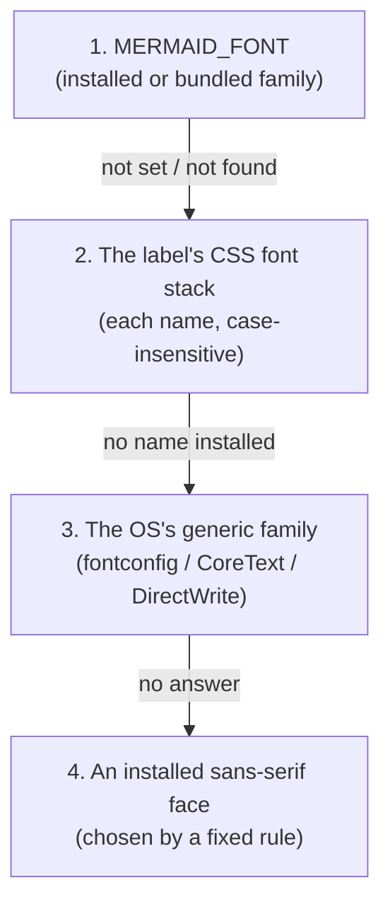
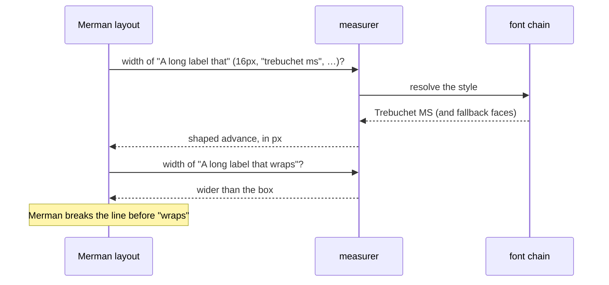

# Merman rendering: fonts and label text

> **Planned.** Mermaid diagrams are still laid out by `mermaid-rs-renderer`;
> the switch to [Merman](https://github.com/Latias94/merman), which lays them
> out with the text measurer described below, and the label rewrite below are
> not shipped yet. The measurer exists, but until the switch Mermaid layout
> does not consult the chain, so a label can still be measured in one face
> and drawn in another.

**Shipped: drawing goes through the chain.** The rasterizer already draws
every SVG it is given (graphs, and today's Mermaid output too) through the
font-resolution chain described on this page: its font database holds the
installed fonts plus the bundled Inter (and, on Linux builds, Noto Emoji),
each `<text>` element's face is chosen by the four steps below, and missing
characters fall back in the order below. `MERMAID_FONT` therefore already
changes the face every rasterized diagram is drawn in.
`raster::available_font_families()` lists the installed families plus
`Inter`.

A Mermaid diagram becomes an image in two passes that both need fonts:

1. **Layout.** The diagram engine asks how wide each label is, so it can size
   boxes and decide where to wrap.
2. **Drawing.** The rasterizer (usvg/resvg) turns each `<text>` element into
   glyph outlines.

If those two passes use different fonts, a label measured in one face is drawn
in another and spills out of its box. `biscuit-visualized` therefore has **one
font-resolution chain**, and both the text measurer and the rasterizer ask it
which face to use. The rasterizer's font database holds exactly the faces the
chain can return.

## Choosing a font: `MERMAID_FONT`

Set `MERMAID_FONT` to a family name to draw every diagram in that family:

```sh
MERMAID_FONT=Inter bt flowchart "A --> B --> C"          # identical layout on every host
MERMAID_FONT="dejavu sans" bt flowchart "A --> B --> C"
```

- Matching is **case-insensitive** (`inter`, `Inter`, and `INTER` are the same).
- Unset or empty: ignored silently.
- Set to a family that is neither installed nor bundled: one warning naming it
  is logged, **at most once per process**, and resolution continues with the
  next step as if the variable were unset.

## The resolution chain

For each label the chain tries these steps in order and stops at the first
that yields a face:



1. **`MERMAID_FONT`**, as above. The bundled Inter counts as available here.
2. **The label's CSS font stack.** Mermaid's default is
   `"trebuchet ms", verdana, arial, sans-serif`. Each named family is matched
   case-insensitively against installed families and the bundled Inter; a
   generic name (`serif`, `sans-serif`, `monospace`, `cursive`, `fantasy`, in
   any casing, quoted or not) is answered by the OS's own family for that
   generic, as in step 3. Trebuchet MS is only Mermaid's first preference,
   not a requirement.
3. **The OS's sans-serif family**, asked through `fontique`: fontconfig on
   Linux, CoreText on macOS, DirectWrite on Windows. This is what keeps text
   visible on a Linux host that has none of the stack's fonts installed. A
   stack that asks only for, say, `courier` gets the sans-serif answer here,
   not a monospace one: no font name is treated as a hint.
4. **An installed face that its own font file classifies as sans-serif** (the
   OS/2 table's `sFamilyClass` is 8). Among those, the family is chosen by
   these preferences, in order:
    1. a family with both a regular and a bold face;
    2. then the one covering the most Latin code points (Unicode Latin blocks
       mapped by its `cmap`);
    3. then proportional over monospace (the `post` table's `isFixedPitch`);
    4. then the alphabetically first family name, ignoring case.

   The Latin blocks counted are Basic Latin, Latin-1 Supplement, Latin
   Extended-A to -G, and Latin Extended Additional. There is no list of
   preferred font names anywhere in the chain. The bundled faces are never
   step-4 candidates.

Once a step names a family, the face within it is chosen by the text's
weight, style, and stretch with CSS font matching (the rule `fontdb`
uses), so bold text in Inter gets Inter Bold. If no step yields a face (no
installed font qualifies and nothing names Inter), the text is not drawn.

For example, on a minimal Linux container with only DejaVu installed and no
`MERMAID_FONT`, step 2 finds none of the default stack, step 3's fontconfig
answer for `sans-serif` is DejaVu Sans, and every label is measured and drawn
in DejaVu Sans.

## Characters the chosen face lacks

When the resolved face has no glyph for a character (a CJK ideograph in a
Latin face, an emoji), that character is measured and drawn in the first face
of this list that has it:

1. the resolved face itself;
2. every installed face, sorted by family name ignoring case; within one
   family, the face matching the text's weight and style first, then the
   others by PostScript name, face index, and file path;
3. on Linux builds only, the bundled Noto Emoji, always last.

The bundled Inter is not in this list: it is used only when a label resolves
to it. On macOS, system families whose names start with `.` (such as
`.Apple Color Emoji UI`) sort first.

The order is fixed for a given host, and the measurer and the rasterizer use
the same order, so a fallback character is measured in the face it is drawn
in.

## Measuring label widths

During layout, Merman asks how wide each candidate line of a label is, and
decides itself where to wrap. `biscuit-visualized` answers with its own
measurer (the crate-private `fonts::measure`), which:

1. turns the label's text style (CSS `font-family`, size, weight, italic)
   into the same font request the rasterizer makes for the drawn `<text>`,
   and resolves it through the chain above;
2. shapes the string with `rustybuzz` in that face, with the same
   per-character fallback as drawing, following usvg's own text layout step
   for step (bidirectional runs, kerning, font variations for weight and
   italic, letter and word spacing, small caps);
3. returns the sum of the glyph advances, in CSS pixels.



Two rules keep the boxes and the drawing in agreement:

- **Merman does all the wrapping.** The measurer only reports widths; it never
  breaks lines itself. A measurer that wrapped on its own would size a box for
  its line breaks while Merman draws the text with different ones.
- **Each string is measured exactly as given.** Spaces are not collapsed or
  trimmed: Merman measures each candidate line with its spaces, and
  collapsing them makes lines break later than Mermaid does.

Because the measurer shapes in the face the rasterizer draws, a measured
width equals the drawn width for Latin, right-to-left, CJK, emoji, and
combining-mark text alike; a repository test compares the two for every
label after each usvg upgrade. A host with no face for a script measures and
draws the same empty (`.notdef`) boxes.

## Bundled fonts

`biscuit-visualized` compiles two font families into the library, so every
binary that uses it has them without any installation:

| Font | Faces | License | Platforms | Role |
| ---- | ----- | ------- | --------- | ---- |
| Inter | Regular, Bold | SIL Open Font License 1.1 | all | Selectable by name (`MERMAID_FONT=Inter`, or a CSS stack naming `Inter`) |
| Noto Emoji (monochrome) | Regular | SIL Open Font License 1.1 | Linux only (WSL2 included) | Last fallback face for emoji |

- **Inter** is registered as the family `Inter`. It is never chosen unless
  asked for by name. Because it ships with the library, `MERMAID_FONT=Inter`
  produces the same layout on every host, which is how the golden tests stay
  deterministic.
- **Noto Emoji** exists because many Linux hosts have no emoji font, and
  emoji would otherwise draw as empty boxes. It is tried only after every
  installed face, so a host with a (usually color) emoji font installed keeps
  using that font. macOS and Windows always ship an emoji font, so their
  builds do not include it.

The font files and their license texts live in
`biscuit-visualized/src/assets/fonts/`.

## Line breaks in labels: `\n`

Merman breaks a label at a literal `\n` in class, ER, mindmap, and requirement
diagrams, but sizes the label's box for a single line, so the second line is
clipped. Until Merman fixes this, `biscuit-visualized` rewrites `\n` to
`<br/>` in the label text of **those four families only**, before rendering:

```text
classDiagram
  Animal --> Dog : Rel one\nRel two      →      Animal --> Dog : Rel one<br/>Rel two
```

The rewrite is not a global search-and-replace. It leaves these untouched:

- YAML frontmatter, `%%{init}%%` directives, and `%%` comments;
- `click`, `link`, and `callback` statements (URLs and tooltips);
- `classDef`, `style`, and `cssClass` statements;
- `accTitle` and `accDescr` (including the `accDescr { … }` block form);
- an escaped `\\n`.

Every other family is passed through unchanged: flowchart, state, and kanban
already break at `\n`; sequence, journey, timeline, architecture, gantt,
quadrant, treemap, and xychart keep `\n` as literal text, as Mermaid.js does;
C4 breaks at it; pie, gitGraph, and block draw it literally.
