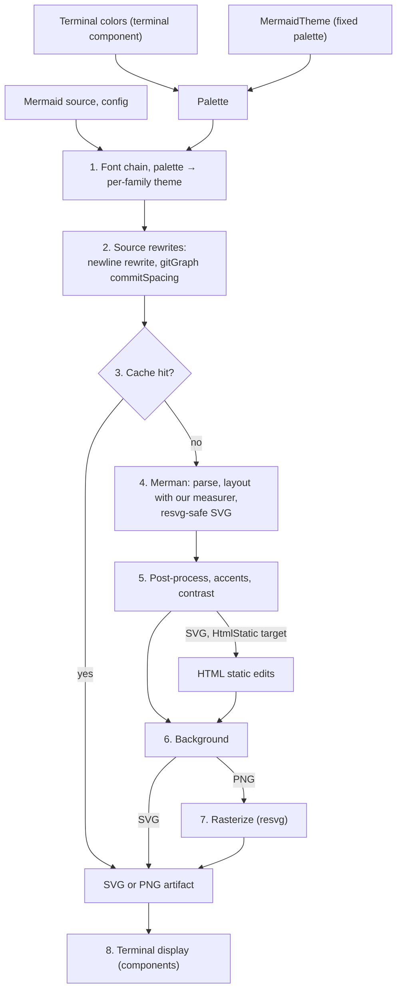
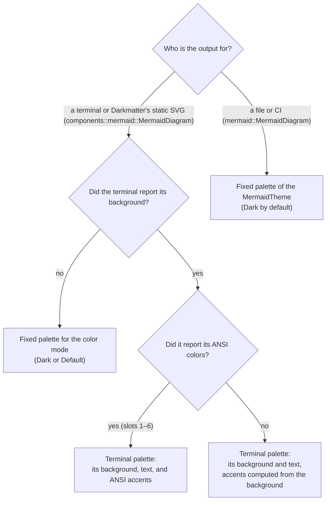
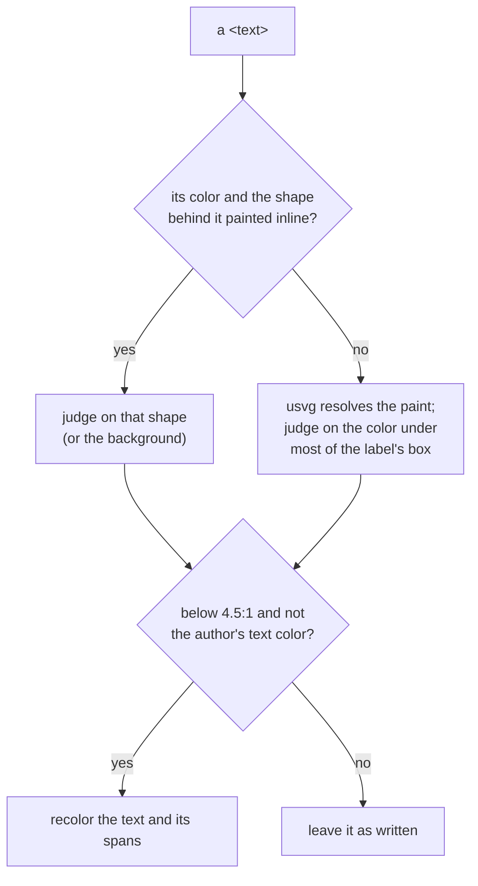
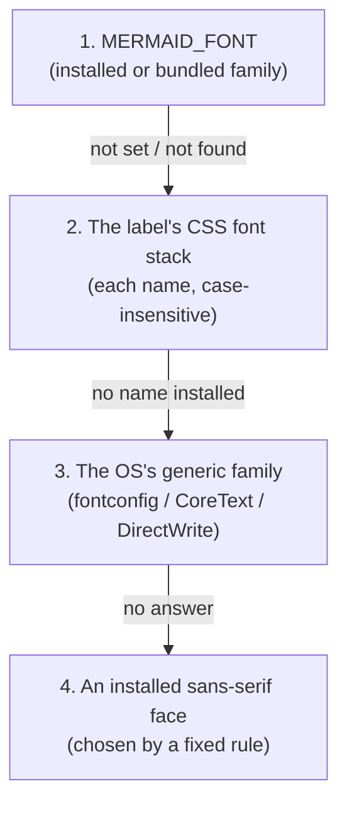
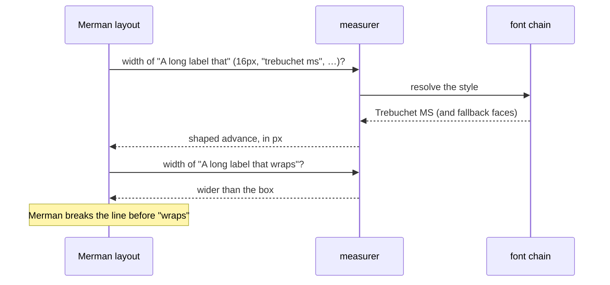

# Merman rendering

`biscuit-visualized` renders every Mermaid diagram with
[Merman](https://github.com/Latias94/merman), a pure-Rust Mermaid renderer
that aims for parity with Mermaid.js: it parses the source, lays it out, and
writes an SVG. Merman does the diagram work; `biscuit-visualized` supplies the fonts and the text measurer,
styles the diagram with a [palette](#themes) compiled into a Merman theme,
rewrites a few source constructs Merman mishandles, caches the result, fixes
two SVG defects, and rasterizes. You call one type,
[`mermaid::MermaidDiagram`](../src/src/mermaid/render.rs) (or the terminal
component built on it, see
[MermaidDiagram](./components/mermaid_diagram.md)), and get an SVG or PNG
file:

```rust
use std::time::Duration;
use biscuit_visualized::artifact::RenderRequest;
use biscuit_visualized::mermaid::{MermaidDiagram, MermaidTheme};

let diagram = MermaidDiagram::new("flowchart LR\n    A --> B")
    .with_theme(MermaidTheme::Dark)
    .with_time_budget(Duration::from_secs(1));
let artifact = diagram.render(&RenderRequest::default())?; // a cached PNG
```

Merman is pinned to an exact commit on a fork that adds one gitGraph setting,
`commitSpacing`, which [tag spacing](#gitgraph-tag-spacing) needs. Only its
SVG pipeline is compiled in: its PNG output, native font loading, ELK layout,
and math rendering are off, because this crate draws and measures text with
its own font chain. See [Dependencies](./dependencies.md).

## What Merman is

Merman is a Rust reimplementation of [Mermaid.js](https://mermaid.js.org/),
the JavaScript library that turns diagram text such as `flowchart LR; A --> B`
into an SVG in a browser. Merman models **Mermaid.js 12.2.0**: the same
diagram syntax, the same layout algorithms (dagre and cytoscape-style
layouts), the same theme variables, and SVG output written to match
Mermaid.js's. It runs without a browser or JavaScript engine, which is why a
CLI or a terminal can draw Mermaid with it.

Merman is **pre-1.0** and not released for the features used here, so it is
a git dependency pinned to one exact commit, and every move to a newer commit
is a deliberate change (see [Merman churn and rev bumps](#merman-churn-and-rev-bumps)).

### Diagram types

Every family in Merman's registry renders here, except two. One fixture per
family lives in `src/src/tests/fixtures/merman/families/`, and a test fails
when a Merman upgrade adds a family that has no fixture.

| Group | Families |
| ----- | -------- |
| Also drawn by Mermaid.js and by this crate's previous renderer | architecture, block, C4, class, ER, flowchart, gantt, gitGraph, journey, kanban, mindmap, packet, pie, quadrant chart, radar, requirement, sankey, sequence, state, timeline, treemap, XY chart |
| **Merman-only** (new with Merman; this crate could not draw them before) | agentflow, cynefin, event modeling (`eventmodeling`), info, ishikawa (fishbone), railroad (with its `railroadAbnf`, `railroadEbnf`, and `railroadPeg` dialects), swimlane, tree view (`treeView`), use case (`usecase`), venn, wardley map |
| In the registry but **not rendered** | `error` (Mermaid's own error picture, not an input), ZenUML (see [falls back to its source](#when-a-diagram-falls-back-to-its-source)) |

Each Merman-only family is tested like every other one: a smoke render to SVG
and PNG under each theme, and a [golden](#golden-tests) per fixed palette.
All of them are Mermaid.js 12.2.0 syntax, so the same source also renders in
a browser.

## The rendering pipeline



| Step | What happens | Owner |
| ---- | ------------ | ----- |
| 1 | The process's [font chain](#the-resolution-chain) is built once: installed fonts plus the [bundled fonts](#bundled-fonts). The diagram's [palette](#themes) becomes a Merman theme for its family, and the site config is assembled from the font stack and `MermaidConfig` | `biscuit-visualized` (fontique, ttf-parser); Merman compiles the theme |
| 2 | The [`\n` rewrite](#line-breaks-in-labels-n) for four families; for a gitGraph with tags, one Merman layout pass decides whether to write [`commitSpacing`](#gitgraph-tag-spacing) | `biscuit-visualized`, using Merman's layout data |
| 3 | The [cache](#cache-identity) is checked; a hit skips steps 4 to 7 | `biscuit-visualized` |
| 4 | Merman parses and lays the diagram out, asking [our measurer](#measuring-label-widths) for label widths and wrapping lines itself, and writes an SVG that keeps `<text>` elements and avoids features resvg cannot draw. All of it runs under the [time budget](#time-budget) | Merman; `biscuit-visualized` (measurer) |
| 5 | The [post-process](#post-processing) repairs gradient strokes and gives unstyled text `sans-serif`, then the [accents](#accents) and the [contrast pass](#readable-text); an SVG for the [HTML static target](#html-static-target) also gets its two edits | `biscuit-visualized` |
| 6 | [`RenderRequest`](../src/src/artifact.rs)'s `background` field decides what is painted behind the diagram: the palette's background, a solid color, or nothing | `biscuit-visualized` |
| 7 | For PNG, usvg turns text into outlines through the same font chain and resvg 0.47 draws them | `biscuit-visualized` |
| 8 | The [terminal components](./components/mermaid_diagram.md) size the PNG to whole cells and hand it to `biscuit-terminal`'s [`TerminalImage`](../../biscuit-terminal/docs/components/terminal_image.md), which sends it with the terminal's image protocol | `biscuit-visualized` components over `biscuit-terminal` |

The terminal's colors are detected by `biscuit-terminal` and turned into a
palette by `biscuit-visualized`'s terminal component; see [Themes](#themes).

Measurement (step 4) and drawing (step 7) ask the same chain for a face, so a
label is measured in the face it is drawn in and never spills out of its box.

A diagram's natural size, which the terminal component scales from, is the
root `viewBox` of the same SVG step 7 rasterizes;
[`natural_size()`](../src/src/mermaid/render.rs) renders (and caches) that
SVG to read it.

## A worked example: from text to a terminal image

This walks one diagram through the pipeline, from Mermaid text in a program
to pixels in a terminal such as Kitty, WezTerm, or iTerm2.

```rust
use biscuit_terminal::prelude::*;
use biscuit_visualized::components::MermaidDiagram;

let source = "classDiagram\n  Animal <|-- Dog : is a\\nkind of";
let diagram = MermaidDiagram::new(source); // the terminal component
println!("{}", diagram.display(&Terminal::new()));
```

1. **Palette.** The component asks `biscuit-terminal` for the terminal's
   colors. Say it is Tokyo Night: background `#1a1b26`, text `#c0caf5`, and
   ANSI red, green, yellow, blue, magenta, and cyan. Those become the
   [terminal palette](#terminal-palettes); the class diagram's compiled theme
   is built from it.
2. **Fonts.** The process's [font chain](#the-resolution-chain) is built (once
   per process). On a Mac with no `MERMAID_FONT`, Mermaid's stack
   `"trebuchet ms", verdana, arial, sans-serif` resolves to Trebuchet MS.
3. **Source rewrite.** A class diagram is one of the four families whose
   [`\n` is rewritten](#line-breaks-in-labels-n), so Merman receives
   `Animal <|-- Dog : is a<br/>kind of` and sizes the label for two lines.
4. **Cache.** The [cache key](#cache-identity) is computed from the rewritten
   source, the palette, the fonts, and the request. On a second run of the
   same program the PNG is already on disk and steps 5 to 7 are skipped.
5. **Merman.** Merman parses the class diagram, lays out the two boxes and
   the arrow, asking [our measurer](#measuring-label-widths) how wide
   `Animal`, `Dog`, `is a`, and `kind of` are in Trebuchet MS at 16 px, and
   writes an SVG, all within the 2 s [time budget](#time-budget).
6. **Post-process.** The divider lines inside the class boxes get a solid
   stroke ([gradient fix](#post-processing)), each box gets its own accent
   ([accents](#accents)), and any label below 4.5:1 contrast is recolored
   ([readable text](#readable-text)).
7. **Rasterize.** The component measures the terminal's cell size, picks the
   PNG width so 16 px text is one terminal line tall, and resvg draws the SVG
   with the same Trebuchet MS faces it was measured in, with a transparent
   background so the terminal's own background shows.
8. **Display.** `TerminalImage` sends the PNG with the terminal's image
   protocol, padded to whole rows, and the program's next line of output
   starts below it.

If any step from 3 to 5 fails (a typo in the source, or Merman taking longer
than the budget), the component prints the source as a fenced code block
instead and logs why.

## Time budget

Every Merman request has a deadline, 2 s by default
([`MermaidDiagram::DEFAULT_TIME_BUDGET`](../src/src/mermaid/render.rs)). Set another with
`with_time_budget(Duration)` on `mermaid::MermaidDiagram`, or on the
terminal component, which passes it through:

```rust
let diagram = MermaidDiagram::new(source).with_time_budget(Duration::from_millis(500));
```

- **Per request, not per render.** An SVG render is one request. A gitGraph
  with tags makes two, the layout pass of step 2 and the SVG render, and each
  gets the full budget.
- **Merman's work only.** Merman checks the deadline at its own checkpoints
  while parsing, laying out, and writing SVG. Post-processing and
  rasterization run outside it, so a render can finish after the budget
  without failing.
- **Exceeded:** the library returns
  [`MermaidError::RenderFailed`](../src/src/mermaid/error.rs) (the error for
  any diagram Merman could not draw) and logs a
  warning with the budget and the elapsed time; the terminal component shows
  the source as a fenced code block.

## When a diagram falls back to its source

These are render failures (`MermaidError::RenderFailed`). The terminal
component, the render-tree hook, and `fallback_code_block()` show the Mermaid
source as a code block instead:

- the source does not parse, or its diagram type is unknown;
- a ZenUML diagram, recognized by its `zenuml` header. Merman could draw it,
  but Mermaid.js supports ZenUML only through an external plugin, so a
  diagram that renders here would not render elsewhere;
- a label that uses math (`$$…$$`). Merman's math support is not compiled in,
  so it refuses the whole diagram, not just the label;
- Merman exceeds the [time budget](#time-budget).

## Themes

Every diagram is styled with a **palette**
([`Palette`](../src/src/mermaid/palette.rs)): a background, a text color, six
accent colors, and the surface, border, and line colors derived from them.
`biscuit-visualized` turns the palette into one Merman compiled theme for
the diagram's family and adds what a compiled theme cannot express. Where
the palette comes from depends on who the output is for:



```rust
use biscuit_visualized::mermaid::{MermaidDiagram, MermaidTheme, Palette, Rgb, TerminalColors};

// A fixed palette, for any output.
let fixed = MermaidDiagram::new(source).with_theme(MermaidTheme::Forest);

// A palette from colors a terminal reported (here injected by hand).
let colors = TerminalColors { background: Rgb::from_hex("#002b36"), ..TerminalColors::default() };
let solarized = MermaidDiagram::new(source).with_palette(Palette::for_terminal(&colors, true));
```

### Fixed palettes

[`MermaidTheme`](../src/src/mermaid/config.rs)'s four values are fixed
palettes. Each starts from Mermaid.js
12.2.0's theme of the same name (its background, text, node, border, and line
colors, and accents taken from its gitGraph branch colors), then goes through
the contrast passes below, so they do not reproduce Mermaid.js pixel for
pixel:

| `MermaidTheme` | Background | Text | Accents from |
| -------------- | ---------- | ---- | ------------ |
| `Dark` (the default) | `#333333` | `#cccccc` | Mermaid's dark branch colors, lightened to read on `#333` |
| `Default` | `#ffffff` | `#333333` | Mermaid's default branch colors, darkened to read on white |
| `Forest` | `#ffffff` | `#000000` | Mermaid's forest branch colors |
| `Neutral` | `#ffffff` | `#000000` | grays |

A fixed palette is used for output drawn with the library type: files and
CI. Darkmatter's static-SVG HTML is drawn with the terminal component, so it
takes the palette of the terminal `md` ran in (the fixed palette for the
color mode when that terminal reported no colors, or under CI). `MermaidTheme::for_color_mode(is_dark)` picks
`Dark` or `Default`.

### Terminal palettes

The terminal component (`components::mermaid::MermaidDiagram::new`) builds
its palette from what `biscuit-terminal` detected
([`TerminalColors::detect`](../src/src/mermaid/palette.rs), which returns the
colors the terminal reported and leaves the rest unknown):

- the **background** and **foreground** from the OSC 11 and OSC 10 queries
  (or an estimate where the terminal is not queried, such as under tmux);
- the **ANSI colors** from the OSC 4 query. ANSI 1–6 (red, green, yellow,
  blue, magenta, cyan) become the six accents. The query is sent at most once
  per process, with the OSC 10/11 colors, and only where those are sent: a
  terminal on stdout or stderr, not CI, no multiplexer (tmux, Zellij, GNU
  Screen), probing not turned off. **Native Windows sends it too**, through
  the same console query backend as the colors, so Windows Terminal gives
  diagrams its own ANSI accents.

What the terminal did not report is filled in:

- an ANSI slot it did not answer gets an accent **computed from the
  background** (light accents on a dark background, darker ones on a light
  background), so a terminal that answers no OSC 4 query, a multiplexer, or
  an SSH session that drops the replies still gets accents;
- no foreground: black or white, whichever reads on the background;
- no background, stdout not a terminal, or `CI` set: the fixed palette for
  the terminal's color mode.

`with_theme` on the component replaces the terminal palette with that
theme's fixed palette, and `with_palette` with any palette.

### Readable text

Every palette, whatever its source, guarantees WCAG AA contrast for text of
any size:

- the text color reaches 4.5:1 against the background; a terminal foreground
  that falls short is moved until it does, or replaced by black or white;
- node fills are accents **tinted** over the background, at most 22% strong
  (60% for pie slices) and weaker wherever the text would drop below 4.5:1;
- labels on full-strength accents (gitGraph branch and tag labels) use
  whichever of the text, the background, black, or white reads on them;
- labels Merman draws over half-transparent paint read through it: gitGraph's
  commit label background is darkened (or lightened) until its label reads
  over the background and every branch line, and sankey node colors are moved
  toward the background until the text reads on their links;
- accents, borders, and lines reach 3:1 against the background.

A final **contrast pass** over the SVG catches every label the steps above
do not reach, with or without a compiled theme: labels Merman's compiled
styles miss, the library's text on an author's `style`/`classDef` fill, and
every label drawn on an author's `%%{init}%%` colors (see [Author styling
wins](#author-styling-wins)). A label below 4.5:1 against what is painted
behind it is recolored to the palette's readable color on that fill, so the
same SVG goes to SVG export, PNG rasterization, and the HTML static target.

```text
%%{init: {'themeVariables': {'primaryColor': '#ffffff'}}}%%
flowchart LR
  A[Start] --> B[Finish]          Dark palette: the white nodes are kept, and
                                  "Start"/"Finish" turn dark instead of
                                  staying light gray at 1.6:1
```

**What counts as behind a label.** The pass first looks for a shape painted
with an inline fill: the nearest one in the label's group or the node group
just before it, following Merman's `<use>` label placements, mixed with what
it covers when it is translucent, or the diagram background. When the label's
own color or a shape it may sit on is painted by Merman's stylesheet or a
`fill` attribute instead, the pass asks usvg (the parser resvg rasterizes
with) for the document's painted result, and takes the color most of the
label's box sits on, strokes, translucency, and clipping included. That is
what reaches every surface under an author `%%{init}%%` color and a sequence
`box`, a rectangle drawn first whose messages sit far from it in the SVG:



**Whose text is recolored.** A label is recolored only when its color is not
one the author wrote as a text color. The author's text colors are read from
the source as written: a CSS `color` in `style`, `classDef`, or `linkStyle`,
C4's `$fontColor` and `$textColor`, and any theme variable or config key that
names text, a label, a title, or a font (`primaryTextColor`, `noteTextColor`,
`titleColor`), never a surface (`primaryColor`, `labelBackground`). Every
other text color, the palette's or one Merman's `base` theme or a family
default picked, is the library's choice. An author's own text color is left
as written on any fill, even where it does not read:

```text
style A1 color:red              → "A1" stays red, whatever it sits on
UpdateRelStyle(a, b, $textColor="blue")   → the relationship text stays blue
```

### How a palette reaches Merman

- **One compiled theme per family.** The palette becomes a Merman
  `ThemeDesignV1` for the diagram's family (flowchart, sequence, class, …),
  holding only what Merman reports it can apply to that family. Nodes get the
  accent tints as an ordinal palette (one per node, in order), gitGraph
  branches the full accents, and gitGraph's commit, tag, and branch label
  colors are set as Mermaid variables, which its compiled styles do not
  reach.
- **The site config** names Mermaid's `base` theme and the font stack, so no
  `MermaidTheme` maps to a Mermaid built-in theme. For families whose
  compiled theme does not reach every surface (treemap, quadrant chart, ER,
  gantt, C4, block, architecture, requirement, packet, …) the palette also
  goes into the site config as `base` theme variables, so those surfaces
  follow the palette rather than `base`'s light defaults; packet, which
  reads its colors from its own `packet` config, gets its block and label
  colors there (an author's own `packet` keys win), and C4 gets its boundary
  and relationship text colors, and a readable text color on its gray
  external elements, in its `c4` config. Families with an ordinal palette,
  and sequence and class diagrams, never get the root variables: Merman lets
  site variables override a compiled theme, and they would erase it.
- **Family variables** reach the surfaces behind labels that neither the
  compiled theme nor the root variables color, each checked not to erase the
  design: gantt's alternate sections, cynefin's domains, event modeling's
  lanes and boxes, venn's sets, treemap's sections, and kanban's columns (the
  second surface; Merman lightens its `cScale` colors by ten points first, so
  they are written ten points darker), and treeView's description text.
- C4 boundaries keep Mermaid's unfilled boundary: Merman draws a boundary
  after the shapes inside it, so a filled one would hide them. Timeline
  events, like mindmap nodes, are accents lightened or darkened until
  `base`'s fixed `#333` label reads on them.

### Accents

Three edits add accents compiled themes cannot express. Each matches colors
the palette itself emitted, never Merman's class names, so a node styled by
the author is never recolored:

- **Flowchart nodes** get a rotating accent outline matching their tint.
- **Class boxes** get one accent each, in document order: the box is tinted
  and its outline and member dividers take the accent.
- **Sequence participants** get one accent each, left to right, on both the
  top and the bottom box.

Mindmap nodes are accented by the compiled theme itself. Their labels are
drawn in Merman's fixed `#333`, so their fills are the accents lightened or
darkened until `#333` reads on them.

### Author styling wins

- `classDef` and `style` colors are kept: the compiled theme does not
  override them, and the accent edits only rewrite palette colors.
- A **color** set in the source's `%%{init}%%` directive or frontmatter
  `themeVariables` wins: such a diagram gets no compiled theme; the palette is
  passed as `base` theme variables with the author's on top. The
  [contrast pass](#readable-text) still runs, so the library's labels are
  recolored to read on the author's colors.
- A `theme` named in the source wins outright: no compiled theme and no
  palette variables.
- Other theme variables (sizes, widths, `darkMode`) keep the compiled theme,
  since it sets colors only.

```text
%%{init: {"themeVariables": {"primaryColor": "#ff00ff"}}}%%   → the author's magenta nodes
```

### Backgrounds and config

Merman leaves the SVG's root unpainted, so `Background::Theme` paints the
palette's background as a rectangle behind the diagram, and
`Background::Transparent` paints nothing (the terminal component's default,
so the terminal's own background shows). `MermaidConfig`'s quadrant settings
reach Merman as site config (`quadrantChart.pointLabelFontSize` and
`pointRadius`, and `themeVariables.quadrant1Fill` to `quadrant4Fill`);
`point_label_font_size` sizes quadrant point labels only.

Two diagrams in one HTML page never restyle each other: each SVG has its own
id, and every rule in its stylesheet is scoped to that id. No styling is
injected as CSS.

## Fonts

A Mermaid diagram becomes an image in two passes that both need fonts:

1. **Layout.** Merman asks how wide each label is, so it can size boxes and
   decide where to wrap.
2. **Drawing.** The rasterizer (usvg/resvg) turns each `<text>` element into
   glyph outlines.

If those two passes used different fonts, a label measured in one face would
be drawn in another and spill out of its box. `biscuit-visualized` therefore
has **one font-resolution chain**, and both the text measurer and the
rasterizer ask it which face to use. The rasterizer's font database holds
exactly the faces the chain can return, so the chain decides the face of
every rasterized SVG, graphs included. `raster::available_font_families()`
([`raster`](../src/src/raster/mod.rs)) lists the installed families plus
`Inter`.

Installed fonts stay files on disk until a label needs them. The first time
the chain answers with an installed face (as a label's face or as a fallback
for a missing character), it maps that face's file into memory and keeps it
mapped for the rest of the process; measuring and drawing then read the
mapping. Without this, every glyph lookup reopened the file, which was most
of a warm render's text work.

### Choosing a font: `MERMAID_FONT`

Set `MERMAID_FONT` to a family name to draw every diagram in that family:

```sh
MERMAID_FONT=Inter bt flowchart "A --> B --> C"          # identical layout on every host
MERMAID_FONT="dejavu sans" bt flowchart "A --> B --> C"
```

- Matching is **case-insensitive** (`inter`, `Inter`, and `INTER` are the same).
- Unset or empty: ignored silently.
- Set to a family that is neither installed nor bundled: one warning naming it
  is logged, **at most once per process**, and resolution continues with the
  next step as if the variable were unset.

### The resolution chain

For each label the chain tries these steps in order and stops at the first
that yields a face:



1. **`MERMAID_FONT`**, as above. The bundled Inter counts as available here.
2. **The label's CSS font stack.** Mermaid's default is
   `"trebuchet ms", verdana, arial, sans-serif`. Each named family is matched
   case-insensitively against installed families and the bundled Inter; a
   generic name (`serif`, `sans-serif`, `monospace`, `cursive`, `fantasy`, in
   any casing, quoted or not) is answered by the OS's own family for that
   generic, as in step 3. Trebuchet MS is only Mermaid's first preference,
   not a requirement.
3. **The OS's sans-serif family**, asked through `fontique`: fontconfig on
   Linux, CoreText on macOS, DirectWrite on Windows. This is what keeps text
   visible on a Linux host that has none of the stack's fonts installed. A
   stack that asks only for, say, `courier` gets the sans-serif answer here,
   not a monospace one: no font name is treated as a hint.
4. **An installed face that its own font file classifies as sans-serif** (the
   OS/2 table's `sFamilyClass` is 8). Among those, the family is chosen by
   these preferences, in order:
    1. a family with both a regular and a bold face;
    2. then the one covering the most Latin code points (Unicode Latin blocks
       mapped by its `cmap`);
    3. then proportional over monospace (the `post` table's `isFixedPitch`);
    4. then the alphabetically first family name, ignoring case.

   The Latin blocks counted are Basic Latin, Latin-1 Supplement, Latin
   Extended-A to -G, and Latin Extended Additional. There is no list of
   preferred font names anywhere in the chain. The bundled faces are never
   step-4 candidates.

Once a step names a family, the face within it is chosen by the text's
weight, style, and stretch with CSS font matching (the rule `fontdb`
uses), so bold text in Inter gets Inter Bold. If no step yields a face (no
installed font qualifies and nothing names Inter), the text is not drawn.

For example, on a minimal Linux container with only DejaVu installed and no
`MERMAID_FONT`, step 2 finds none of the default stack, step 3's fontconfig
answer for `sans-serif` is DejaVu Sans, and every label is measured and drawn
in DejaVu Sans.

### Characters the chosen face lacks

When the resolved face has no glyph for a character (a CJK ideograph in a
Latin face, an emoji), that character is measured and drawn in the first face
of this list that has it:

1. the resolved face itself;
2. every installed face, sorted by family name ignoring case; within one
   family, the face matching the text's weight and style first, then the
   others by PostScript name, face index, and file path;
3. on Linux builds only, the bundled Noto Emoji, always last.

The bundled Inter is not in this list: it is used only when a label resolves
to it. On macOS, system families whose names start with `.` (such as
`.Apple Color Emoji UI`) sort first.

The order is fixed for a given host, and the measurer and the rasterizer use
the same order, so a fallback character is measured in the face it is drawn
in.

### Measuring label widths

During layout, Merman asks how wide each candidate line of a label is, and
decides itself where to wrap. `biscuit-visualized` answers with its own
measurer (the crate-private [`fonts::measure`](../src/src/fonts/measure.rs)),
which:

1. turns the label's text style (CSS `font-family`, size, weight, italic)
   into the same font request the rasterizer makes for the drawn `<text>`,
   and resolves it through the chain above;
2. shapes the string with `rustybuzz` in that face, with the same
   per-character fallback as drawing, following usvg's own text layout step
   for step (bidirectional runs, kerning, font variations for weight and
   italic, letter and word spacing, small caps);
3. returns the sum of the glyph advances, in CSS pixels.



Two rules keep the boxes and the drawing in agreement:

- **Merman does all the wrapping.** The measurer only reports widths; it never
  breaks lines itself. A measurer that wrapped on its own would size a box for
  its line breaks while Merman draws the text with different ones.
- **Each string is measured exactly as given.** Spaces are not collapsed or
  trimmed: Merman measures each candidate line with its spaces, and
  collapsing them makes lines break later than Mermaid does.

Because the measurer shapes in the face the rasterizer draws, a measured
width equals the drawn width for Latin, right-to-left, CJK, emoji, and
combining-mark text alike; a repository test compares the two for every
label after each usvg upgrade. A host with no face for a script measures and
draws the same empty (`.notdef`) boxes.

### Bundled fonts

`biscuit-visualized` compiles two font families into the library, so every
binary that uses it has them without any installation:

| Font | Faces | License | Platforms | Role |
| ---- | ----- | ------- | --------- | ---- |
| Inter | Regular, Bold | SIL Open Font License 1.1 | all | Selectable by name (`MERMAID_FONT=Inter`, or a CSS stack naming `Inter`) |
| Noto Emoji (monochrome) | Regular | SIL Open Font License 1.1 | Linux only (WSL2 included) | Last fallback face for emoji |

- **Inter** is registered as the family `Inter`. It is never chosen unless
  asked for by name. Because it ships with the library, `MERMAID_FONT=Inter`
  produces the same layout on every host, which is how the golden tests stay
  deterministic.
- **Noto Emoji** exists because many Linux hosts have no emoji font, and
  emoji would otherwise draw as empty boxes. It is tried only after every
  installed face, so a host with a (usually color) emoji font installed keeps
  using that font. macOS and Windows always ship an emoji font, so their
  builds do not include it.

The font files and their license texts live in
`biscuit-visualized/src/assets/fonts/`.

## Line breaks in labels: `\n`

Merman breaks a label at a literal `\n` in class, ER, mindmap, and requirement
diagrams, but sizes the label's box for a single line, so the second line is
clipped. Until Merman fixes this, `biscuit-visualized` rewrites `\n` to
`<br/>` in the label text of **those four families only**, before rendering:

```text
classDiagram
  Animal --> Dog : Rel one\nRel two      →      Animal --> Dog : Rel one<br/>Rel two
```

The rewrite is not a global search-and-replace. It leaves these untouched:

- YAML frontmatter, `%%{init}%%` directives (multi-line ones included), and
  `%%` comments;
- `click`, `link`, and `callback` statements (URLs and tooltips);
- `classDef`, `style`, `cssClass`, and `linkStyle` statements;
- `accTitle` and `accDescr` (including the `accDescr { … }` block form);
- an escaped `\\n`.

Every other family is passed through unchanged: flowchart, state, and kanban
already break at `\n`; sequence, journey, timeline, architecture, gantt,
quadrant, treemap, and xychart keep `\n` as literal text, as Mermaid.js does;
C4 breaks at it; pie, gitGraph, and block draw it literally.

## gitGraph tag spacing

Merman places each tag above its commit with no collision avoidance, and
commits are 50 px apart by default, so `main` and `origin/main` on
neighboring commits overlap. For a left-to-right gitGraph with tags,
`biscuit-visualized` lays the diagram out once, finds the smallest commit
spacing that leaves one em between every pair of colliding tags, and writes
it into the source as an `%%{init}%%` directive setting
`gitGraph.commitSpacing`. A graph whose tags do not collide is left alone,
and an author's own `commitSpacing` always wins. The rules and examples are in
[Mermaid gitGraph tag spacing](./mermaid-gitgraph.md).

## Post-processing

Two edits are applied to every SVG Merman writes, before the background and
rasterization:

- **Gradient strokes become solid.** In every theme other than `default`,
  Merman's "neo" look strokes node shapes with a gradient sized to each
  shape's bounding box. A straight divider line has a zero-height bounding
  box, and by the SVG specification such a gradient paints nothing, so the
  dividers in class and ER boxes vanish (in resvg and in browsers alike).
  These strokes are rewritten to the theme's solid node stroke color.
- **Text with no font gets `sans-serif`.** Most families set the theme's font
  stack on the SVG's root; a family that sets none would otherwise be drawn
  in usvg's serif default, so the root gets `font-family="sans-serif"`.

An SVG that has neither defect is returned unchanged. The
[accents](#accents) and the [contrast pass](#readable-text) follow. The
[HTML static target](#html-static-target) adds two more edits, to SVG output
only.

## Cache identity

Rendered artifacts are cached in the OS temp directory, and a cache hit
returns the stored file without calling Merman's SVG renderer. The key is
checked after the source rewrites, so it covers the source Merman would
actually receive. It changes when any of these change:

- the backend id ([`MERMAID_BACKEND`](../src/src/cache/file_cache.rs)),
  `merman@<first 12 characters of the pinned rev>+bv<n>`
  (currently `merman@6e6b1e6554e8+bv5`). `<n>` versions this crate's own
  layer (source rewrites, post-process, accents, contrast pass, background)
  and is bumped whenever
  that layer changes output, so older artifacts are never served;
- the rewritten source and the output format;
- a hash of the styling: the site config handed to Merman (font stack,
  `MermaidConfig`, any palette variables), the compiled theme's design, and
  every color of the palette, so changing a single palette color changes the
  key;
- the font identity: the contents of the faces the chain resolves for the
  theme's font stack and the generic families, and of the bundled faces; the
  path, size, modification time, and face index of every other font file the
  chain can reach; and which face each of the theme's regular and bold
  queries resolves to, with its fallback order. It is computed once per
  process, so a font installed while a process runs is seen by the next one;
- the request's geometry (scale, target width, row padding), background, and
  PNG encoder settings;
- for SVG output, the [HTML static target](#html-static-target), and whether
  it [embeds the font](./mermaid-embedded-font.md#caching). The default
  target adds nothing to the key, and a PNG is keyed the same under either
  target, because it is rasterized from the same SVG;
- the title.

A tagged gitGraph's layout pass (step 2) runs before the cache check, so a
cache hit for such a graph still costs one Merman layout.

Graph PNGs (expression and DOT) carry the same font identity, computed for
the one stack their labels request: the color theme's `font_family`, or
`Times, serif` without a theme. Graph SVG keys carry none, because an SVG
stores the requested family rather than the face that draws it.

## HTML static target

An SVG embedded in a web page is drawn by the reader's browser with the
reader's fonts, not by this crate's rasterizer. Select the HTML static target
for that output:

```rust
use biscuit_visualized::artifact::{OutputFormat, RenderRequest};
use biscuit_visualized::mermaid::{MermaidDiagram, MermaidTarget};

let diagram = MermaidDiagram::new("flowchart LR\n    A --> B")
    .with_target(MermaidTarget::HtmlStatic);
let request = RenderRequest { format: OutputFormat::Svg, ..RenderRequest::default() };
let svg = std::fs::read_to_string(diagram.render(&request)?.path)?;
```

The terminal component (`components::mermaid::MermaidDiagram`) has the same
`with_target`, which its `render_to_svg` honors. The default target,
`MermaidTarget::RasterSafe`, is the SVG described everywhere else on this
page.

For this target only, after the [post-process](#post-processing):

- **The measured face leads every font.** Each `font-family` in the SVG (its
  stylesheet rules, inline `style` declarations, and `font-family`
  attributes) gets the family of the face the label was measured in placed
  in front of the original stack. That is the face the
  [resolution chain](#the-resolution-chain) picks for the stack, the one the
  measurer shaped the label in. A reader who has that face sees the label
  at its measured width; a reader who does not falls back to the original
  stack. On a Mac with Trebuchet MS:

  ```text
  font-family:"trebuchet ms",verdana,arial,sans-serif
      → font-family:'Trebuchet MS',"trebuchet ms",verdana,arial,sans-serif
  ```

- **Labels may overflow their boxes.** Merman places most HTML-style labels
  (class, ER, mindmap, state, and others) in a nested `<svg>` sized to the
  measured text and clips it there with `overflow:hidden`. Every nested
  `<svg>` that holds text gets `overflow:visible` instead, because a reader's
  font may be wider than the measured one and must not be cut off. The
  diagram's root `<svg>` is left as it is.

Text content is never edited, and applying the edits twice changes nothing.

These edits never reach the rasterizer. A PNG render ignores the target: it
is rasterized from the raster-safe SVG, so it matches a default render byte
for byte and shares its cache entry. Labels in a PNG are drawn in the face
they were measured in, so they cannot overflow, and the raster SVG carries no
overflow change.

To remove the guess about the reader's fonts, the HTML static target can also
carry the measured face: with `with_embedded_font(true)` the label boxes are
measured in a face the page may embed, and `page_font` builds one `@font-face`
block per page holding a subset of it. See
[Embedded font for Mermaid static SVG](./mermaid-embedded-font.md).

Darkmatter's static-SVG HTML output selects this target and passes the SVG
through its own sanitizer, which admits Merman's drop shadows.

## Benchmark

`just bench` (in `biscuit-visualized/`) times a render of every golden-corpus
family, through `MermaidDiagram::render` to PNG with the default request, in
the release profile. It is a separate Cargo project at
`biscuit-visualized/bench/`, outside the workspace, so CI never builds or runs
it. Run `just bench --families flowchart,pie --iterations 3` for a quick look.

It reports the median and p95 per family of:

- a **warm** render: measure, layout, SVG, post-process, and raster, in a
  process that has already rendered once;
- a **cold** render: a fresh process doing one render, timed from start to
  exit.

Every iteration uses its own empty render cache, so no timing is a cache hit.

On the **reference host**, the Linux build host, a run flags any family whose
warm median is over 50 ms, whose cold median is 500 ms or more, or that is more
than 25% slower than the baseline stored in `bench/baseline.json`; a family
with no baseline entry also flags. A flagged run exits 1 and names the family
and rule. Elsewhere the same findings are printed as information and the run
exits 0. The rules, flags, and the strict baseline format are described in
`bench/README.md`.

On the reference host today, every family's warm median is under 50 ms (the
slowest are timeline at about 41 ms and sequence at about 34 ms), and every
cold render is under 60 ms. Most of what remains in those two is resvg drawing
their drop shadows and other filters at the default scale of 2.

## Golden tests

Every family's fixture is rendered under each of the four fixed palettes and
compared with a stored SVG snapshot; `Dark` and `Default` are also compared
as PNGs. Goldens render with a font chain holding only the bundled fonts and
`MERMAID_FONT=Inter`, so no installed font can change them, and they are
identical on macOS, Linux, native Windows, and WSL2. Six more goldens render
flowchart, sequence, and gitGraph under two terminal-derived palettes (one
with ANSI colors, one with only a background).

```text
src/src/tests/goldens/svg/flowchart_dark.snap    exact match
src/src/tests/goldens/png/flowchart_dark.png     ≤ 0.1% of pixels differ, RMSE ≤ 0.005
```

Two more suites read the stored goldens: every text must reach 4.5:1 against
what is drawn behind it, and every label's measured width must equal the
width the rasterizer draws. Any change to output shows up as a golden diff,
which is reviewed and regenerated:

```sh
INSTA_UPDATE=always BISCUIT_VISUALIZED_UPDATE_GOLDENS=1 \
  cargo nextest run -p biscuit-visualized --all-features --lib -E 'test(/golden_tests::/)'
```

A change to output also bumps the `+bv<n>` suffix of the
[backend id](#cache-identity), so no cached artifact from before the change is
served.

## Design decisions

Each choice below is described in its own section above; this is why it was
made.

| Decision | Why |
| -------- | --- |
| **Real-font measurement** ([measuring](#measuring-label-widths)): our measurer shapes each label in the face that will draw it, and Merman does the wrapping | A box sized for one font and drawn in another clips its label. Measuring in the drawn face makes the measured width equal the drawn width; a test checks this for every label of every golden. Letting Merman wrap keeps one line breaker, so the box and the drawing agree on where lines break |
| **One font chain and `MERMAID_FONT`** ([chain](#the-resolution-chain)) | Measurement and drawing must agree on the face, so one function answers both. The OS generic step exists because, without it, a Linux host with none of Mermaid's stack fonts lost every label silently. Matching is case-insensitive because Mermaid writes `trebuchet ms` in lowercase. `MERMAID_FONT` gives one switch for identical output across hosts |
| **Bundled Inter** ([bundled fonts](#bundled-fonts)) | A font that ships inside the library is present on every host, CI runners included, so goldens need no test font directory and no per-host baseline, and any user can ask for identical output with `MERMAID_FONT=Inter`. It is never chosen unless named, so it does not change anyone's default look |
| **Noto Emoji on Linux only** ([fallback](#characters-the-chosen-face-lacks)) | Many Linux hosts have no emoji font and would draw empty boxes. It is the last fallback, so an installed color emoji font wins; macOS and Windows always have one, so they do not carry the extra file |
| **Gradient divider fix** ([post-process](#post-processing)) | Merman's "neo" look strokes shapes with a gradient sized to each shape's box; a straight divider has a box of zero height, and by the SVG specification such a gradient paints nothing. Class and ER dividers vanished in every viewer, so the strokes are made solid |
| **`\n` rewrite in four families** ([line breaks](#line-breaks-in-labels-n)) | In class, ER, mindmap, and requirement, Merman breaks at `\n` but sizes the box for one line, so the second line is clipped. `<br/>` gets a correctly sized box. Other families either already work or keep `\n` literal as Mermaid.js does, so they are left alone |
| **`commitSpacing` and the Merman fork** ([tag spacing](#gitgraph-tag-spacing)) | gitGraph tags on neighboring commits overlap at Merman's fixed 50 px spacing. Merman lays out commits from one constant, so making it a setting is a small, reviewable patch, and this crate writes the smallest value that clears every collision instead of moving Merman's shapes after the fact. Stock Merman has no such setting, so the dependency points at a fork until upstream adds one |
| **The cache key with resolved faces** ([cache identity](#cache-identity)) | A cached PNG drawn in one face must not be served after the fonts change. Hashing the contents of the faces that actually draw the labels catches a font upgrade; hashing every installed font's contents was too slow (about 0.6–1 s per process on a Mac with 3,000 font files), so other files are identified by path, size, and modification time |
| **Darkmatter's static SVG** ([HTML static target](#html-static-target)) | A browser draws the SVG with the reader's fonts, which nobody can know at render time. The measured face is named first so a reader who has it sees the measured layout, and labels may overflow in HTML only, so a wider font is never cut off. This does not hide a mismatch this crate could fix, which is why it is not done for PNGs |
| **Drop-shadow limits in Darkmatter's sanitizer** | Merman draws drop shadows with `<filter>` and `<feDropShadow>`. Darkmatter's sanitizer admits those two elements only, with every attribute a number or a color, `dx`, `dy`, and `stdDeviation` at most 20, and `flood-opacity` from 0 to 1; every other filter primitive is still removed. A shadow cannot run code or fetch anything, and the caps stop a crafted diagram from making the reader's browser slow |
| **Speed limits** ([benchmark](#benchmark)) | A warm render must take under 50 ms, a fresh process under 500 ms, and no family may get 25% slower than its baseline. These absolute limits answer "is it fast enough for a terminal?"; comparing with the previous renderer flagged families only because it often finished in under 0.3 ms |
| **Feature set: `svg`, `all-diagrams`, `layout-cytoscape`** | Merman's PNG output and native fonts are off because this crate rasterizes and measures with its own font chain. ELK layouts are off: ELK is EPL-2.0 licensed and heavy, and no consumer needs it. `math` is off: with it off Merman refuses a diagram with a `$$…$$` label, which then [falls back to its source](#when-a-diagram-falls-back-to-its-source) |

## What was tried and rejected

| Approach | Why it was rejected |
| -------- | ------------------- |
| **An `overflow:visible` patch on rasterized labels** (let text spill out of a box that is too small) | It hides a measurement mismatch instead of fixing it: the label is still wider than its box, it just stops being clipped. With real-font measurement the box fits, so no patch is needed. (The [HTML static target](#html-static-target) does allow overflow, for a different reason: the reader's fonts are unknown.) |
| **Merman's native measurement** (its `native-fonts` feature) | Its rule for generic families (`serif`, `monospace`, …) cannot be configured, so it measured some text in a different face than resvg drew: 92 labels on Linux and 2 on macOS, up to 60 px off. Its font database is private, so the rasterizer cannot share it |
| **Our own greedy wrap** (the measurer breaking lines itself) | Merman sized the box from our line breaks but drew the text with its own, and the two disagreed: a class relationship label clipped by 177 px (196 px on Linux) |
| **Merman's `parity` pipeline for HTML** (SVG with HTML labels, as Mermaid.js writes) | Boxes are still sized at render time, so a reader's different font still mismatches, and HTML inside SVG would widen what Darkmatter's sanitizer must admit |
| **Drawing text as paths in the SVG** (outlining every label) | Deferred, not needed: the rasterizer already turns text into outlines with the measured face. In SVG output, outlines would make text unselectable and unsearchable and the files larger |

## Future considerations

### Upstream issues and the pull request

Each workaround here exists because of a Merman defect or missing setting,
and goes away when Merman fixes it. The issue texts are drafted for the
maintainer of this repository to file with Merman.

| Upstream issue | Workaround here | Removed when |
| -------------- | --------------- | ------------ |
| Merman's default measurement assumes fonts the host may not have, so labels clip | Our [measurer](#measuring-label-widths) through the font chain | Kept: measuring in the drawn face is wanted regardless |
| A wrapped swimlane edge label loses its line break in resvg-safe output, so it overruns its box | None; listed as a known overflow in the measurement test | Merman draws the lines it laid out |
| The neo look's class and ER dividers vanish | The [gradient stroke fix](#post-processing) | Merman strokes dividers with a solid color |
| Normalize `\n` like `<br>` where Merman breaks at `\n` | The [`\n` rewrite](#line-breaks-in-labels-n) for four families | Merman sizes `\n` breaks like `<br>` |
| `\n` in pie, gitGraph, and block | None; drawn as Merman draws it | — |
| An ER attribute comment with `<br/>` clips by a few pixels | None; listed as a known overflow in the measurement test | — |
| **Pull request:** gitGraph `commitSpacing` | The Merman fork | Upstream merges the setting (or an equivalent) or releases it |

When the `commitSpacing` setting lands upstream, the dependency moves back to
stock Merman in its own change, the goldens are reviewed again, and if
upstream's setting differs in name or meaning, the [tag
spacing](#gitgraph-tag-spacing) code adapts in that same change.

### Possible later work

- **A text-art fallback.** Merman can also write diagrams as Unicode or ASCII
  art. That could replace the code-block fallback on terminals that cannot
  show images.

### Merman churn and rev bumps

Merman is pre-1.0 and changes often. Moving to a newer Merman commit is
always its own change:

1. update the pinned commit in `src/Cargo.toml` (rebasing the fork's
   `commitSpacing` patch while the fork is still used);
2. run the suite; the family-registry test fails if Merman added a family,
   and the theme guard tests fail if Merman changed how its styles take
   precedence;
3. review and regenerate the [goldens](#golden-tests);
4. update the rev part of the [backend id](#cache-identity), so no artifact
   drawn by the old Merman is served.
