# MermaidJS: history, architecture, chart inventory, theming, icons, and gotchas

_Snapshot date: 2026-10-20._ Version and release data come from the npm registry and GitHub releases API. Chart-type facts come from the `develop` branch docs (`packages/mermaid/src/docs/syntax/*.md`) and each diagram's `styles.ts`/`styles.js`. Activity counts come from the GitHub commits API for `packages/mermaid/src/diagrams/<type>` since 2026-04-20.

## 1. Summary

- **Latest version: `mermaid@12.2.0`** (npm `latest`, published 2026-10-13). The `12.0.0` major landed 2026-09-10 and is a breaking release.
- **Scale:** about 90.8k GitHub stars, 9.4k forks, about 1.9k open issues, created 2014-11 by Knut Sveidqvist. npm downloads were about 11.0M for the week of 2026-10-12.
- **Chart types:** 32 documented diagram keywords/pages. 12 carry a `-beta` keyword and 4 more are labeled "experimental" in their docs. Details are in section 4.
- **Big shifts in the last 6 months:**
    - 12.0 made ELK the bundled default layout.
    - 12.0 made the `redux-color` theme and `neo` look the default for ten diagram types.
    - Seven new diagram types arrived: Cynefin, Railroad, Swimlanes, TreeView, Event Modeling, Agentflow, and Use Case.
- **Light/dark:** there is no single-render "dual theme". You choose a theme per render (frontmatter, `initialize()`, or `%%{init}%%`) and re-render when the color scheme flips. See section 5.
- **Icons:** register Iconify JSON packs with `mermaid.registerIconPacks()`. Only some diagram types consume them. See section 6.

## 2. History and architecture

### History

- **2014:** Knut Sveidqvist starts mermaid, a text-to-diagram tool in the spirit of Markdown. The first npm release is dated 2014-12-02.
- **v8.x:** adds `securityLevel` (8.2) and theming plus `themeVariables` (8.7).
- **v9/v10:** more diagram types, the unified shape system, frontmatter config replacing `%%{init}%%` as the preferred form, KaTeX math (10.9.0), and ELK as an optional package.
- **v11:** architecture diagrams (11.1.0), ES-module chunking, and many new `-beta` diagram types.
- **v12 (2026-09-10):**
    - ELK bundled and the default layout.
    - New `redux`/`neo` themes and looks.
    - ES2024, Safari 17.4+, Node 22.12+ floor.
    - `flowchart.defaultRenderer` removed in favor of a top-level `layout` option.

### Architecture (monorepo `mermaid-js/mermaid`)

| Package                               | Role                                                                                               |
| ------------------------------------- | -------------------------------------------------------------------------------------------------- |
| `mermaid`                             | Core: parser dispatch, config, themes, per-diagram DB/renderer/styles, layout loaders              |
| `@mermaid-js/parser`                  | Langium-based parsers for the newer grammar-driven diagrams (2.0.1 on 2026-10-02)                  |
| `@mermaid-js/tiny`                    | Reduced build that omits ELK, cose-bilkent and some diagram types                                  |
| `@mermaid-js/layout-elk`              | Still published. It is how the tiny build opts back into ELK. No longer needed on the normal build |
| `@mermaid-js/layout-tidy-tree`        | Optional tidy-tree layout                                                                          |
| `@mermaid-js/mermaid-zenuml`          | ZenUML sequence diagrams (external renderer)                                                       |
| `@mermaid-js/examples`                | Example diagrams for tooling                                                                       |
| `mermaid-cli` (separate repo, `mmdc`) | Headless Chromium/Puppeteer rendering to SVG/PNG/PDF                                               |

### Pipeline

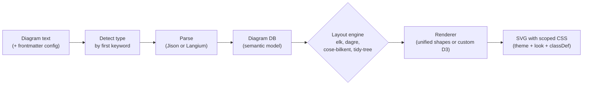

- **Rendering is browser-only.** Mermaid needs a DOM to measure text. Server-side use goes through a headless browser (`mmdc`) or a different implementation. This repo's `biscuit-visualized` uses `mermaid-rs-renderer`, a Rust reimplementation, and not mermaid-js.
- **Unified shape system.** Flowchart, state, class, ER, requirement, C4 (since 11.17), swimlane, agentflow and use case share one node/edge/cluster renderer. That is why they share CSS classes (`.node`, `.cluster`, `.edgeLabel`) and `classDef`. Other diagrams such as sequence, gantt, pie, wardley and git use custom D3 renderers with their own classes.
- **Layouts:**
    - `elk` is the default since 12.0 for flowchart, state, class, ER, requirement, use case and agentflow. Variants are `elk.stress`, `elk.force`, `elk.mrtree`, `elk.sporeOverlap`, `elk.box` and `elk.rectpacking`.
    - `dagre` is the previous default.
    - `cose-bilkent` is the default for mindmap.
    - `tidy-tree` is optional.
    - Swimlane overrides the layout with `swimlane`.
- **Looks:** `classic`, `neo` (the new default for the ten types in section 5) and `handDrawn` (rough.js). Wardley does not support `handDrawn`.
- **Config precedence (highest first):** the diagram's frontmatter or `%%{init}%%`, then `mermaid.initialize()`, then the per-diagram default, then the global default.

## 3. Release cadence

`mermaid` stable releases from npm `time` data. Rows after 2026-04-20 fall inside the 6-month window. The 10.x rows are backports.

| Version           | Date       | Gap since previous 11/12 release |
| ----------------- | ---------- | -------------------------------- |
| 11.13.0           | 2026-03-09 |                                  |
| 11.14.0           | 2026-04-01 | 23 d                             |
| **11.15.0**       | 2026-05-11 | 40 d                             |
| 10.9.6 (backport) | 2026-05-11 |                                  |
| **11.16.0**       | 2026-06-25 | 45 d                             |
| **11.16.1**       | 2026-08-04 | 40 d                             |
| 10.9.8 (backport) | 2026-08-04 |                                  |
| **11.17.0**       | 2026-08-19 | 15 d                             |
| **11.17.1**       | 2026-08-24 | 5 d                              |
| **11.17.2**       | 2026-08-25 | 1 d                              |
| **12.0.0**        | 2026-09-10 | 16 d                             |
| **12.1.0**        | 2026-10-02 | 22 d                             |
| **12.2.0**        | 2026-10-13 | 11 d                             |

- **9 stable releases of `mermaid` in the window** (11.15.0 to 12.2.0), plus 2 `10.9.x` backports. The same-day `@mermaid-js/tiny` build ships with each.
- **Rhythm:** it started slow (about 6 weeks between minors in May to July). It then sped up to a minor roughly every 2 to 3 weeks from mid-August, with quick patch releases after 11.17.0.
- **Versioning:** features arrive in minors. Changesets generate the notes.
- **Majors:** 12.0.0 is the first major since 11.0.
- **Supporting packages:** `@mermaid-js/parser` (1.2.0, 1.2.1, 2.0.0, 2.0.1), `layout-elk` (0.2.3, 1.0.0, 1.0.1) and `layout-tidy-tree` (1.0.0, 1.0.1) are released alongside the core.
- **Repo activity:** `pushed_at` was 2026-10-20 and many fixes are authored by a small group of regular contributors.

## 4. Chart inventory

### 4.1 How to read this section

- **Base URL:** every page lives at `https://mermaid.js.org/syntax/<page>.html`. The same docs are mirrored at `https://mermaid.ai/open-source/syntax/<page>.html`. Only the `<page>` slug is given below.
- **Beta:** "beta" means the diagram keyword ends in `-beta`, or the docs carry an experimental warning. This is the project's own signal that the syntax may change incompatibly.
- **Activity:** commits touching `packages/mermaid/src/diagrams/<dir>` from 2026-04-20 to 2026-10-20, with the date of the last commit. Counts include shared refactors, not only features. GitHub paging caps are not reached.
- **CSS:** class names are taken from the diagram's styles file. Styles are emitted scoped to the diagram's SVG id, so site CSS needs matching or higher specificity, or use `themeCSS` (section 5).
- **Markdown:** "Markdown" means Mermaid Markdown strings: bold, italics and automatic wrapping inside a backtick-quoted string such as `"`**bold** text`"`.
- **Snapshot-hard:** features that do not survive a static image.

#### Summary matrix

| Type           | Keyword                                                  | Page                        | Beta?                                        | Icons                         | Markdown              | Commits (6 mo) |
| -------------- | -------------------------------------------------------- | --------------------------- | -------------------------------------------- | ----------------------------- | --------------------- | -------------- |
| Flowchart      | `flowchart` / `graph`                                    | `flowchart`                 | No                                           | Yes (icon/image shapes)       | Yes                   | 52             |
| Swimlanes      | `swimlane-beta`                                          | `swimlanes`                 | **Beta**                                     | Yes (via flowchart shapes)    | Yes (via flowchart)   | 14             |
| Agentflow      | `agentflow-beta`                                         | `agentflow`                 | **Beta**                                     | Yes (`icon`/`img` shapes)     | Not documented        | 20             |
| Sequence       | `sequenceDiagram`                                        | `sequenceDiagram`           | No                                           | No packs (typed participants) | No (math only)        | 27             |
| ZenUML         | `zenuml`                                                 | `zenuml`                    | No (external plugin)                         | No                            | Yes (ZenUML comments) | n/a            |
| Class          | `classDiagram`                                           | `classDiagram`              | No                                           | No                            | No                    | 10             |
| State          | `stateDiagram-v2`                                        | `stateDiagram`              | No                                           | No                            | No                    | 33             |
| ER             | `erDiagram`                                              | `entityRelationshipDiagram` | No                                           | No                            | Yes                   | 14             |
| Requirement    | `requirementDiagram`                                     | `requirementDiagram`        | No                                           | No                            | Yes                   | 6              |
| Use Case       | `usecase-beta`                                           | `usecase`                   | **Beta**                                     | Yes (actors)                  | Yes                   | 22             |
| C4             | `C4Context` etc.                                         | `c4`                        | **Experimental**                             | No (sprites only)             | No                    | 13             |
| Block          | `block`                                                  | `block`                     | No ("new" marker)                            | No                            | No                    | 18             |
| Architecture   | `architecture-beta`                                      | `architecture`              | **Beta**                                     | **Yes (core feature)**        | No                    | 7              |
| Mindmap        | `mindmap`                                                | `mindmap`                   | **Experimental (icons)**                     | Yes (`::icon()`)              | Yes                   | 6              |
| Timeline       | `timeline`                                               | `timeline`                  | **Experimental (icons)**                     | Experimental only             | No                    | 5              |
| User Journey   | `journey`                                                | `userJourney`               | No                                           | No                            | No                    | 1              |
| Gantt          | `gantt`                                                  | `gantt`                     | No                                           | No                            | No                    | 5              |
| Git Graph      | `gitGraph`                                               | `gitgraph`                  | No                                           | No                            | No                    | 0              |
| Kanban         | `kanban`                                                 | `kanban`                    | No ("new" marker)                            | No (CSS hooks only)           | No                    | 0              |
| Pie            | `pie`                                                    | `pie`                       | No                                           | No                            | No                    | 10             |
| Quadrant       | `quadrantChart`                                          | `quadrantChart`             | No                                           | No                            | No                    | 4              |
| XY Chart       | `xychart`                                                | `xyChart`                   | No ("new" marker; `xychart-beta` still seen) | No                            | No                    | 18             |
| Sankey         | `sankey`                                                 | `sankey`                    | **Experimental**                             | No                            | No                    | 1              |
| Packet         | `packet`                                                 | `packet`                    | No ("new" marker)                            | No                            | No                    | 1              |
| Radar          | `radar-beta`                                             | `radar`                     | **Beta**                                     | No                            | No                    | 2              |
| Treemap        | `treemap-beta`                                           | `treemap`                   | **Beta**                                     | No                            | No                    | 1              |
| Venn           | `venn-beta`                                              | `venn`                      | **Beta**                                     | No                            | No                    | 7              |
| Ishikawa       | `ishikawa-beta`                                          | `ishikawa`                  | **Beta**                                     | No                            | No                    | 0              |
| Wardley        | `wardley-beta`                                           | `wardley`                   | **Beta**                                     | No                            | No                    | 9              |
| Cynefin        | `cynefin-beta`                                           | `cynefin`                   | **Beta**                                     | No                            | No                    | 2              |
| TreeView       | `treeView-beta`                                          | `treeView`                  | **Beta**                                     | **Yes**                       | No                    | 14             |
| Railroad       | `railroad-beta`, `-ebnf-beta`, `-abnf-beta`, `-peg-beta` | `railroad`                  | **Beta**                                     | No                            | No                    | 24             |
| Event Modeling | `eventmodeling`                                          | `eventmodeling`             | No                                           | No                            | No                    | 5              |

- Flowchart is by far the most active type (52 commits), followed by state (33), sequence (27), railroad (24), use case (22), agentflow (20), block and xychart (18 each).
- `git`, `ishikawa` and `kanban` had no commits to their diagram directories in the window.
- The docs mark Sankey, XY Chart, Block, Packet, Kanban, Architecture and the newest types with a "new" sidebar marker. Treat that as recency, not stability.

#### Version introduced (from docs headings)

| Type                         | Since   |
| ---------------------------- | ------- |
| Packet                       | 11.0.0  |
| Architecture                 | 11.1.0  |
| Radar                        | 11.6.0  |
| Ishikawa, Venn               | 11.12.3 |
| TreeView, Wardley            | 11.14.0 |
| Event Modeling               | 11.15.0 |
| Cynefin, Railroad, Swimlanes | 11.16.0 |
| Agentflow, Use Case          | 12.0.0  |
| Sankey                       | 10.3.0  |

### 4.2 Flowchart

- **Useful for:** process flows, decision trees, system data flows, runbooks, onboarding paths. It is the most general-purpose chart.
- **URL:** `/syntax/flowchart.html`. Beta: no.
- **Icons:** yes. `A@{ icon: "fa:user", form: "square", label: "User", pos: "t", h: 60 }` needs a registered pack. `A@{ img: "https://…/x.png", label: "…", w: 60, h: 60, constraint: "off" }` embeds an image. The older `fa:fa-user` text syntax needs Font Awesome CSS on the host page.
- **Markdown:** yes. Use `A["`**bold** and _italic_`"]`. KaTeX math via `$$…$$` also works here.
- **Activity:** 52 commits, last 2026-10-19. 11.17 added `folder`, `bucket`, `console`, `browser` and `person` shapes, collapsible subgraphs, and several ELK options. 12.1 added `elk.orientFeedbackEdges`.

Examples:

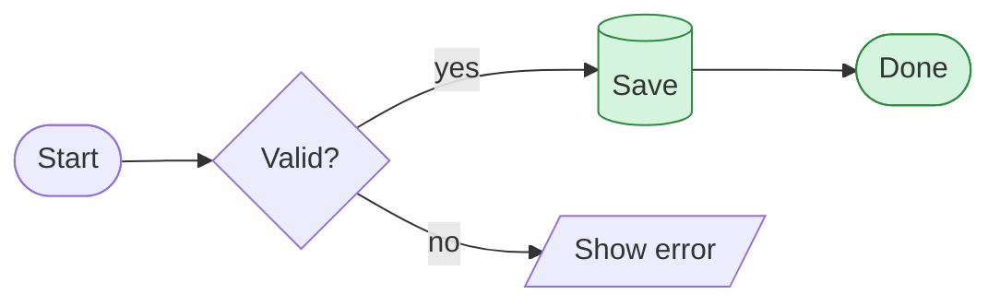

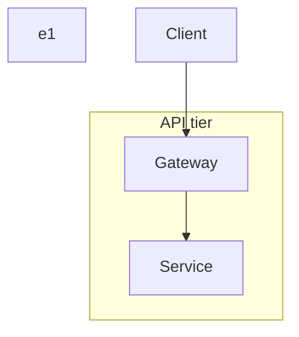

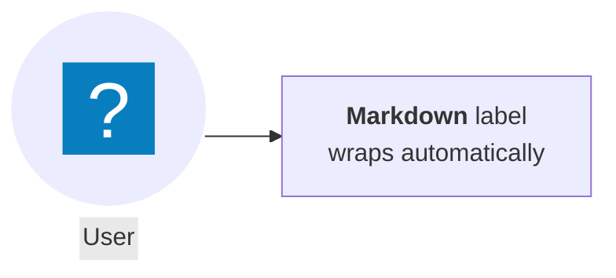

- **Key features:** edge IDs and `@{}` metadata, 40+ shapes via `shape:`, subgraphs with their own `direction`, `linkStyle`, `curve` styles (`basis`, `bumpX`, `cardinal`, `linear`, and others), click callbacks, tooltips, math.
- **CSS:** `.node`, `.node path`, `.node .label`, `.cluster rect`, `.cluster-label`, `.edgePaths .path`, `.flowchart-link`, `.edgeLabel`, `.labelBkg`, `.arrowheadPath`, `.flowchartTitleText`, `.icon-shape`, `.image-shape`, `.node.clickable`, `.collapsed-indicator`.
    - Prefer `classDef`/`class`/`:::name`, `style` and `linkStyle` over raw CSS.
    - Give a class `stroke-dasharray` for dashed borders.
    - Use `.edgeLabel`/`.labelBkg` to fix label backgrounds.
    - Use `.cluster rect` for rounded or tinted subgraphs.
- **Snapshot-hard:** edge animation (`animate`, `animation: fast|slow`, or a `classDef` with `stroke-dasharray` and a CSS `animation: dash …`), `click` callbacks and links, tooltips, and the interactive state of collapsible subgraphs.

### 4.3 Swimlanes (`swimlane-beta`)

- **Useful for:** cross-functional processes where ownership matters (customer, warehouse, finance). It is an actor-lane view of a flowchart.
- **URL:** `/syntax/swimlanes.html`. Beta: yes (since 11.16.0).
- **Icons/Markdown:** both inherited from the flowchart shape catalog. The page itself points to the Flowchart syntax for "shapes, icons, images, markdown strings, classes, and styling".
- **Activity:** 14 commits, last 2026-09-02. Recent fixes are about lane title bands, crossing cleanup and DOM id collisions between diagrams on one page.

```mermaid
swimlane-beta LR
  subgraph Customer
    Browse[Browse catalogue]
    Pay[Pay]
  end
  subgraph Warehouse
    Pick[Pick items]
    Ship[Ship order]
  end
  Browse --> Pay --> Pick --> Ship
```

```mermaid
---
config:
  theme: default
  look: classic
---
swimlane-beta TB
  subgraph Dev
    Commit --> Review
  end
  subgraph Ops
    Deploy
  end
  Review --> Deploy
```

- **CSS:** `.swimlane.cluster rect` (uncolored lanes). Otherwise use flowchart classes.
- **Snapshot-hard:** same click/animation features as flowchart. Lane layout uses its own `swimlane` layout, not ELK.

### 4.4 Agentflow (`agentflow-beta`)

- **Useful for:** LLM or agent pipelines: tasks, tools, decisions, reference docs and containers (`flow … end`) that nest.
- **URL:** `/syntax/agentflow.html`. Beta: yes (v12.0.0+).
- **Icons:** `icon` and `img` are accepted as presentation-only metadata. `getSemanticModel()` strips them for downstream consumers. **Markdown:** not documented.
- **Activity:** 20 commits, last 2026-10-14. It is the youngest type and is still churning.

```mermaid
agentflow-beta TB
  brief["Release brief"]@{ shape: input }
  flow writer["Drafting Agent"]
    draft["Draft the notes"]@{ shape: task }
    lookup["changelog_search"]@{ shape: tool }
    draft --> lookup
  end
  publish["Publish"]@{ shape: action }
  brief --> writer --> publish
```

```mermaid
agentflow-beta LR
  ok{"Clean?"}@{ shape: decision }
  guide["Style guide"]@{ shape: refdoc }
  check["Check claims"]@{ shape: task }
  check --> ok
  check -.- guide
```

- **CSS:** it reuses flowchart classes plus `.agentflowTitleText`. Edge `curve`, `animate` and `animation` apply to edges.
- **Snapshot-hard:** edge animation, as in flowchart.

### 4.5 Sequence diagram

- **Useful for:** API and protocol conversations, service interactions, auth flows, incident timelines.
- **URL:** `/syntax/sequenceDiagram.html`. Beta: no.
- **Icons:** no icon packs. Participants take a type, `participant DB@{ "type" : "database" }`, which draws a built-in glyph. A space before `@{` has parsed since 12.1. **Markdown:** no. KaTeX math via `$$` works. The 12.x release notes show the alias plus type combination is still a known gap (issue #6953).
- **Activity:** 27 commits, last 2026-09-28.

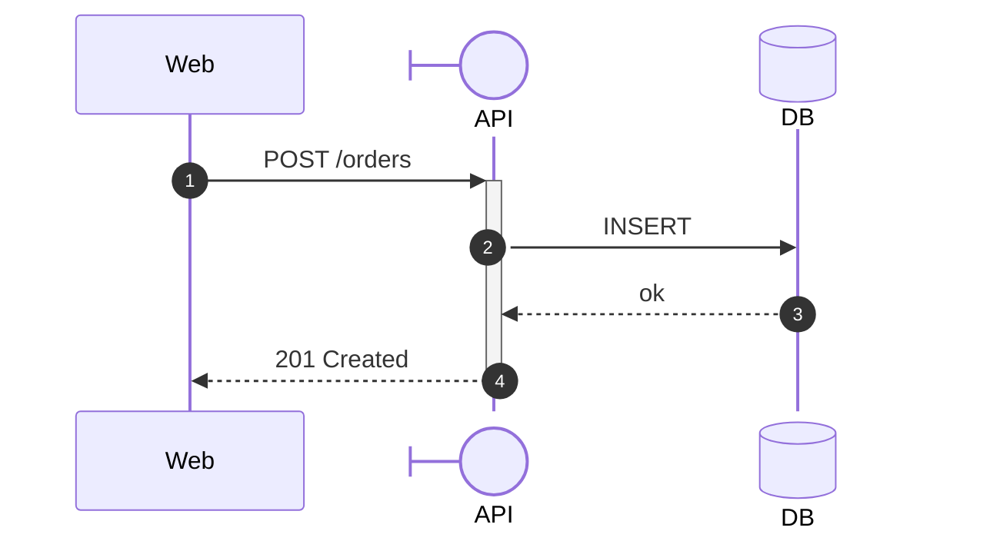

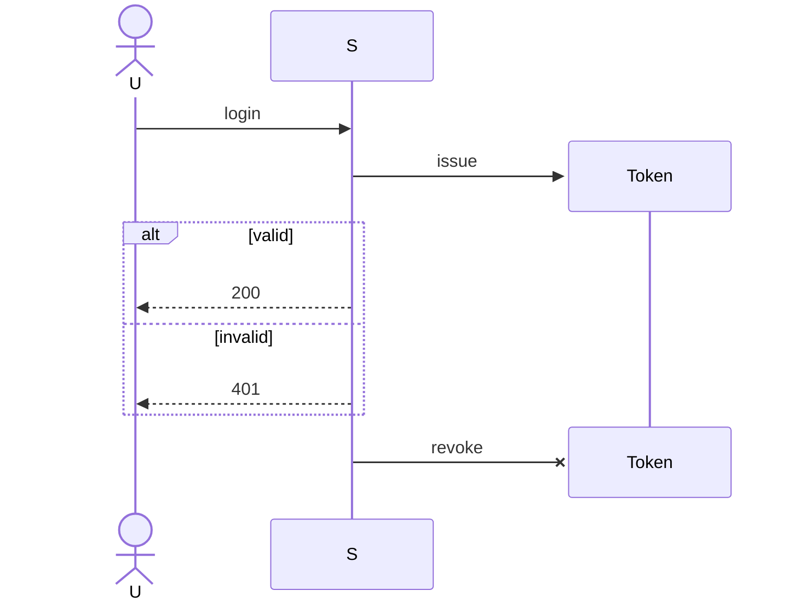

- **Key features:** `autonumber`, activations (`+`/`-`), `alt`/`opt`/`loop`/`par`/`critical`/`break`, notes, `rect` highlight, create/destroy (issue #4833 reports it breaks if the syntax is not exact), actor `links`.
- **CSS:** `.actor-line`, `.messageLine0`/`.messageLine1`, `.messageText`, `.sequenceNumber`, `.labelBox`/`.labelText`, `.loopLine`/`.loopText`, `.note`/`.noteText`, `.activation0..2`, `.actorPopupMenu`.
    - Style `.note` for softer notes and `.messageText` for font tuning.
- **Snapshot-hard:** actor popup menus (links) and `mirrorActors` toggles. Otherwise static.

### 4.6 ZenUML (plugin)

- **Useful for:** sequence diagrams written in a code-like syntax.
- **URL:** `/syntax/zenuml.html`. Beta: no, but it is an external renderer (`@mermaid-js/mermaid-zenuml`, 1.0.1 on 2026-09-18) that must be registered. **Markdown:** yes, in ZenUML comments. **Icons:** no.
- **Activity:** package releases only (1.0.0 and 1.0.1). It lives outside `src/diagrams`.

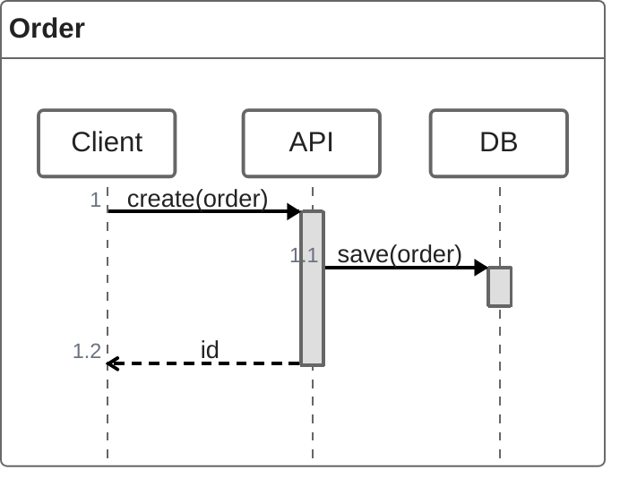

- **CSS:** ZenUML ships its own stylesheet and does not use the shared classes. **Snapshot-hard:** none documented.

### 4.7 Class diagram

- **Useful for:** domain models and object structure, API surfaces, UML documentation.
- **URL:** `/syntax/classDiagram.html`. Beta: no. **Icons/Markdown:** no.
- **Activity:** 10 commits, last 2026-09-07. 11.17 routed `classDiagram` to the unified (v2) renderer by default; set `class: { defaultRenderer: 'dagre-d3' }` for the legacy one. 12.1 fixed ELK cardinality-label placement.

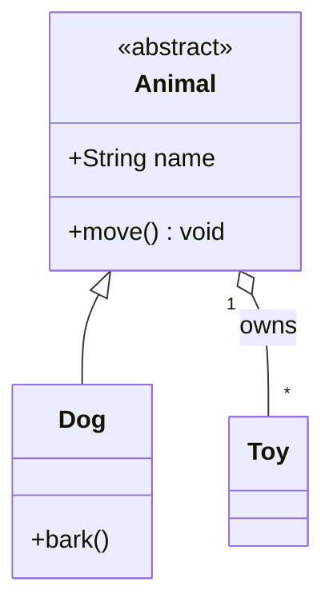

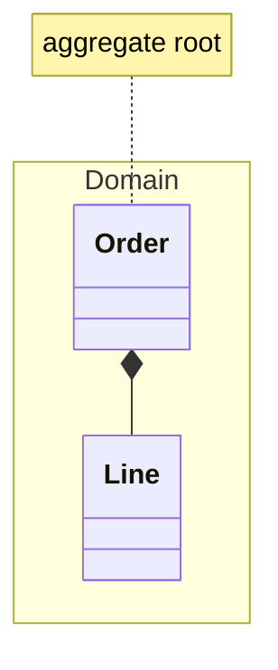

- **Key features:** annotations, generics, namespaces (`hierarchicalNamespaces`), notes, `click`/`link`/`callback`, `classDef`.
- **CSS:** `.classTitle`, `.classTitleText`, `.classLabel .box`, `.node path`, `.divider`, `.relation`, `.dashed-line`, `.dotted-line`, `.edgeLabel`, `.noteLabel`, `.cluster rect`.
- **Snapshot-hard:** click and link callbacks, tooltips.

### 4.8 State diagram

- **Useful for:** lifecycles, protocol state machines, UI states, workflow status.
- **URL:** `/syntax/stateDiagram.html`. Beta: no. **Icons/Markdown:** no.
- **Activity:** 33 commits, last 2026-09-07.

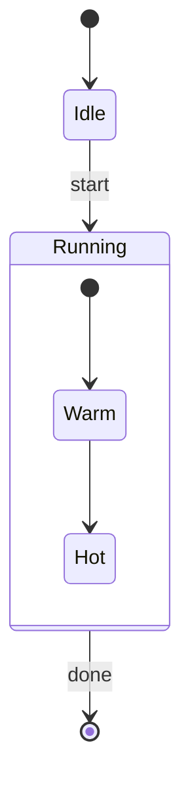

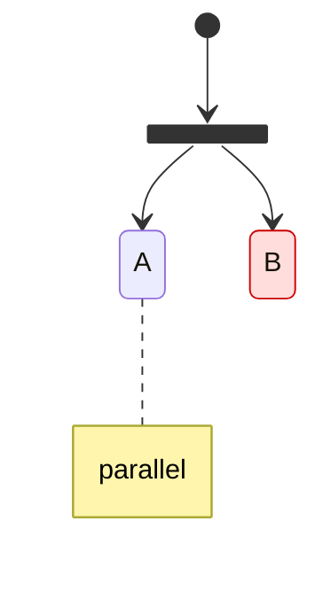

- **Key features:** composite and concurrent states, fork/join/choice, notes, `direction`, `classDef`.
- **CSS:** `.statediagram-state`, `.statediagram-cluster`, `.state-note`, `.stateLabel`, `.transition`, `.node circle.state-start`/`state-end`, `.end-state-inner`, `.node .fork-join`, `.edgeLabel`.
- **Snapshot-hard:** none documented.

### 4.9 Entity relationship (`erDiagram`)

- **Useful for:** database and domain data models.
- **URL:** `/syntax/entityRelationshipDiagram.html`. Beta: no. **Icons:** no. **Markdown:** yes. Entity text and labels accept `"This **is** _Markdown_"`, though PK/FK/UK keys do not.
- **Activity:** 14 commits, last 2026-09-02. 11.16 added optional attribute types (`type?`) and 11.17 added subgraph support.

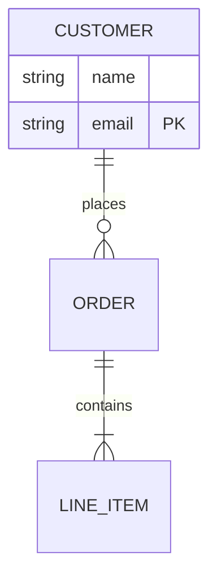

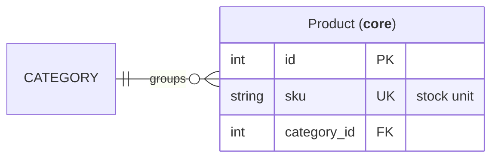

- **Key features:** cardinality notations, identifying and non-identifying relationships, key constraints, comments, `classDef`, aliases.
- **CSS:** `.entityBox`, `.relationshipLine`, `.relationshipLabelBox`, `.edgeLabel`, `.labelBkg`, `.edge-pattern-dashed`, `.marker`. ER graphs tend to get very wide (issue #2807), so use `direction`.
- **Snapshot-hard:** none documented.

### 4.10 Requirement diagram

- **Useful for:** SysML-style requirement traceability (requirements, elements, `satisfies`/`verifies` links).
- **URL:** `/syntax/requirementDiagram.html`. Beta: no. **Icons:** no. **Markdown:** yes (`"**bold** and *italics*"`).
- **Activity:** 6 commits, last 2026-08-28.

```mermaid
requirementDiagram
  requirement r1 {
    id: 1
    text: "System **shall** log in"
    risk: high
    verifymethod: test
  }
  element app { type: service }
  app - satisfies -> r1
```

```mermaid
requirementDiagram
  functionalRequirement f1 { id: 2 text: "Export" risk: low verifymethod: demonstration }
  performanceRequirement p1 { id: 3 text: "<200ms" risk: medium verifymethod: analysis }
  f1 - contains -> p1
```

- **CSS:** `.reqBox`, `.reqTitle`, `.reqLabel`, `.reqLabelBox`, `.req-title-line`, `.relationshipLine`, `.relationshipLabel`, `.divider`.
- **Snapshot-hard:** none documented.

### 4.11 Use case (`usecase-beta`)

- **Useful for:** UML actors, system boundaries and `include`/`extend` relationships in requirements work.
- **URL:** `/syntax/usecase.html`. Beta: yes (12.0.0+).
- **Icons:** yes, actor icons: `actor Icon("Label")@{ icon: "fa:user" }`. A missing pack falls back to the standard actor. An icon cannot combine with a non-normal `type` or `business: true`.
- **Markdown:** yes, as `"`*Reviewer*`"` strings. Plain strings show Markdown markers literally.
- **Activity:** 22 commits, last 2026-09-28.

```mermaid
usecase-beta
direction LR
actor Customer
systemBoundary Storefront
  Browse("Browse catalogue")
  Checkout("Checkout")
end
Customer --> Browse
Customer --> Checkout
Checkout ..> : include Browse
```

```mermaid
usecase-beta
actor Reviewer("`*Reviewer*`")@{ type: hollow }
systemBoundary Review
  Open("Open form")
end
opens@{ animation: fast }
Reviewer -- "`opens **form**`" --> Open
```

- **Key features:** actor variants (`hollow`, `awesome`, icon), nested boundaries, edge IDs with styling and animation, ELK layout.
- **CSS:** the styles file declares no standalone classes, so use `classDef` and the shared node/edge classes.
- **Snapshot-hard:** edge animation (`animate`, `animation: fast|slow`).

### 4.12 C4

- **Useful for:** C4 architecture (context, container, component, dynamic, deployment).
- **URL:** `/syntax/c4.html`. Beta: **experimental**. The docs warn the syntax and properties can change. **Icons:** no (`$sprite` hook only). **Markdown:** no.
- **Activity:** 13 commits, last 2026-08-21. 11.17 moved C4 to the unified shape system with a new `person` shape and fixed named attributes (`$tags`, `$link`, `$sprite`) being clobbered.

```mermaid
C4Context
  title System Context
  Person(user, "User", "A customer")
  System(app, "Shop", "Sells things")
  Rel(user, app, "Uses", "HTTPS")
```

```mermaid
C4Container
  Container(web, "Web", "React")
  ContainerDb(db, "DB", "Postgres")
  Rel(web, db, "reads/writes")
  UpdateRelStyle(web, db, $textColor="red", $offsetY="-10")
```

- **CSS:** `.c4-shape .label .c4-name`, `.c4-type`, `.c4-descr`, `.c4-shape line`. Label overlap is a known issue (#3221). `UpdateRelStyle`/`UpdateLayoutConfig` are the usual workaround.
- **Snapshot-hard:** `$link` hyperlinks.

### 4.13 Block diagram

- **Useful for:** hand-placed layouts on a column grid, system block diagrams, anything where auto-layout is too loose.
- **URL:** `/syntax/block.html`. Beta: no. **Icons/Markdown:** no.
- **Activity:** 18 commits, last 2026-09-09.

```mermaid
block
  columns 3
  A["Input"] space B["Output"]
  C:3
  blockArrowId<["go"]>(down)
```

```mermaid
block
  columns 2
  block:group1:2
    columns 2
    X Y
  end
  Z
  style Z fill:#f96
```

- **Key features:** `columns N`, spans (`A:2`), `space`, nested `block:id … end`, block arrows, `style`/`classDef`, `click`.
- **CSS:** `.node path`, `.cluster`, `.edgeLabel`, `.flowchart-label`, `.node.clickable`, `.flowchartTitleText`.
- **Snapshot-hard:** click and link handling.

### 4.14 Architecture (`architecture-beta`)

- **Useful for:** cloud and infrastructure diagrams made of groups, services, junctions and port-anchored edges.
- **URL:** `/syntax/architecture.html`. Beta: yes (since 11.1.0). **Markdown:** no.
- **Icons:** **yes, central.** Built-ins are `cloud`, `database`, `disk`, `internet` and `server`. Any registered Iconify pack works as `name:icon`, for example `logos:aws-lambda`. Issue #5950 (69 thumbs-up, open) asks for a first-class way to use packs in the Live Editor, GitHub Markdown and CLI.
- **Activity:** 7 commits, last 2026-09-04. 11.16 added the `align row|column {ids…}` directive to stop services collapsing onto the same coordinate.

```mermaid
architecture-beta
  group api(cloud)[API]
  service db(database)[DB] in api
  service srv(server)[Server] in api
  srv:R --> L:db
```

```mermaid
architecture-beta
  group aws(logos:aws)[AWS]
  service fn(logos:aws-lambda)[Fn] in aws
  service s3(logos:aws-s3)[Bucket] in aws
  junction j in aws
  fn:R -- L:j
  j:R --> L:s3
  align row fn j s3
```

- **Key features:** port sides (`L|R|T|B`), edge arrowheads (`<-->`), `iconSize`, `idealEdgeLengthMultiplier`, `randomize`. Layout is force-directed (cose-bilkent family).
- **CSS:** `.edge`, `.arrow`, `.node-bkg`, `.node-icon-text`.
- **Snapshot-hard:** `randomize: true` makes layouts non-reproducible between renders. Leave it `false` for stable snapshots.

### 4.15 Mindmap

- **Useful for:** brainstorming, topic outlines, note maps.
- **URL:** `/syntax/mindmap.html`. Beta: **experimental**. The syntax is stable except the icon integration. **Icons:** yes, `::icon(fa fa-book)`, and the host page must supply the icon font CSS (Font Awesome, Material Icons). **Markdown:** yes (`id["`**bold** wraps automatically`"]`).
- **Activity:** 6 commits, last 2026-10-08. 12.2 added opt-in `mindmap.colorBy: depth` and fixed label centering when `htmlLabels` is false.

```mermaid
mindmap
  root((Research))
    Methods
      Survey
      ::icon(fa fa-flask)
    Tools
      id2["`**Bold** and
      wrapped text`"]
```

```mermaid
---
config:
  mindmap:
    colorBy: depth
---
mindmap
  root
    A
      A1
    B
```

- **Key features:** node shapes (`(round)`, `((circle))`, `))bang((`, `)cloud(`, `{{hex}}`), `:::class` styling, indentation hierarchy. Layout is cose-bilkent unless set otherwise (dagre in the tiny build).
- **CSS:** `.section-<n>`, `.section-edge-<n>`, `.edge-depth-<n>`, `.node-icon-<n>`, `.section-root`, `.icon-container`, `.mindmap-node-label`.
- **Snapshot-hard:** force-directed layout means node positions can vary between renders.

### 4.16 Timeline

- **Useful for:** history and roadmap timelines grouped into eras or sections.
- **URL:** `/syntax/timeline.html`. Beta: **experimental** (the icon integration). **Icons:** only that experimental hook. **Markdown:** no.
- **Activity:** 5 commits, last 2026-09-02.

```mermaid
timeline
  title History of Social Media
  section 2000s
    2002 : LinkedIn
    2004 : Facebook : Google
  section 2010s
    2010 : Instagram
```

```mermaid
---
config:
  timeline:
    disableMulticolor: true
---
timeline
  2020 : Event A
  2021 : Event B : Event C
```

- **Key features:** `section` grouping, multiple events per period, `disableMulticolor`, and a per-period theme color cycle driven by `cScale0..11` theme variables.
- **CSS:** `.section-<n>`, `.section-edge-<n>`, `.edge-depth-<n>`, `.lineWrapper line`, `.eventWrapper`, `.icon-container`, `.node-icon-<n>`.
- **Snapshot-hard:** none documented.

### 4.17 User journey

- **Useful for:** UX satisfaction maps (score 1 to 5 per task per actor).
- **URL:** `/syntax/userJourney.html`. Beta: no. **Icons/Markdown:** no.
- **Activity:** 1 commit, last 2026-08-25. It is effectively stable and quiet.

```mermaid
journey
  title Checkout
  section Cart
    Add item: 5: Me
    Review: 3: Me, Cat
  section Pay
    Enter card: 2: Me
```

```mermaid
journey
  section Onboarding
    Sign up: 4: User
    Verify: 1: User, Support
```

- **CSS:** `.task-type-<n>`, `.section-type-<n>`, `.face`, `.mouth`, `.legend`, `.label`.
- **Snapshot-hard:** none.

### 4.18 Gantt

- **Useful for:** project schedules, dependencies, release plans.
- **URL:** `/syntax/gantt.html`. Beta: no. **Icons/Markdown:** no.
- **Activity:** 5 commits, last 2026-09-11. 11.16 allowed multiple `excludes`/`includes` lines.

```mermaid
gantt
  dateFormat YYYY-MM-DD
  axisFormat %b %d
  section Build
    Design   :done, d1, 2026-10-01, 5d
    Implement :active, d2, after d1, 10d
  section Ship
    Release  :crit, milestone, after d2, 0d
```

```mermaid
gantt
  dateFormat HH:mm
  axisFormat %H:%M
  excludes weekends
  todayMarker off
  Deploy window : vert, v1, 17:30, 2m
  Task : 17:00, 90m
```

- **Key features:** `after` dependencies, `crit`/`done`/`active`/`milestone` tags, `vert` vertical markers, `excludes`/`includes`, `tickInterval`, `todayMarker`, `click`.
- **CSS:** `.section0..3`, `.sectionTitle<n>`, `.task`, `.taskText`, `.taskTextOutsideLeft/Right`, `.active<n>`, `.done<n>`, `.crit<n>`, `.grid .tick`, `.today`, `.exclude-range`.
- **Snapshot-hard:** the **today marker is drawn for the render date**, so a stored image goes stale. Task `click` callbacks and links are interactive. The docs also note Gantt can export to SVG, PNG or a Markdown link.

### 4.19 Git graph

- **Useful for:** explaining branching strategies, release flow and merge history.
- **URL:** `/syntax/gitgraph.html`. Beta: no. **Icons/Markdown:** no.
- **Activity:** 0 commits in the window. It is stable. `parallelCommits: true` is reported as having no effect (issue #6148).

```mermaid
gitGraph
  commit
  branch develop
  checkout develop
  commit id: "feat" tag: "v1.0"
  checkout main
  merge develop
```

```mermaid
gitGraph TB:
  commit
  branch hotfix
  commit type: HIGHLIGHT
  checkout main
  cherry-pick id: "x"
  commit type: REVERSE
```

- **Key features:** `TB:` and `BT:` orientation (11.0.0+), commit types `NORMAL`/`REVERSE`/`HIGHLIGHT`, tags, cherry-pick, `mainBranchName`, `rotateCommitLabel`.
- **CSS:** `.branch`, `.branch-label`, `.commit-label`, `.commit-label-bkg`, `.tag-label`, `.commit-merge`, `.commit-reverse`, `.commit-highlight-inner/outer`, `.arrow`, `.gitTitleText`. Branch colors come from `git0..7` theme variables.
- **Snapshot-hard:** none. See `biscuit-visualized/docs/mermaid-gitgraph.md` for how this repo corrects gitGraph output.

### 4.20 Kanban

- **Useful for:** boards embedded in docs, with ticket numbers linked to a tracker.
- **URL:** `/syntax/kanban.html`. Beta: no ("new" marker). **Icons:** no (the styles define `.node-icon-<n>` hooks only). **Markdown:** no.
- **Activity:** 0 commits in the window.

```mermaid
kanban
  Todo
    t1[Write docs]@{ ticket: MC-1, assigned: 'ken', priority: 'High' }
  Doing
    t2[Review]
  Done
    t3[Ship]
```

```mermaid
---
config:
  kanban:
    ticketBaseUrl: 'https://tracker.example.com/browse/#TICKET#'
---
kanban
  Todo
    t1[Fix bug]@{ ticket: BUG-12 }
```

- **CSS:** `.section-<n>`, `.kanban-ticket-link`, `.kanban-label`, `.icon-container`, `.disabled`.
- **Snapshot-hard:** ticket links (`ticketBaseUrl`).

### 4.21 Pie

- **Useful for:** simple part-to-whole shares with few categories.
- **URL:** `/syntax/pie.html`. Beta: no. **Icons/Markdown:** no.
- **Activity:** 10 commits, last 2026-05-20. 11.16 added donut (`donutHole`), `legendPosition` and slice highlighting.

```mermaid
pie showData title Pets
  "Dogs" : 386
  "Cats" : 85
  "Rats" : 15
```

```mermaid
---
config:
  pie:
    donutHole: 0.5
    legendPosition: bottom
---
pie
  "A" : 60
  "B" : 40
```

- **CSS:** `.pieCircle`, `.pieCircle.highlighted`, `.pieCircle.highlightedOnHover:hover`, `.pieOuterCircle`, `.pieTitleText`, `.slice`, `.legend text`. Slice colors come from `pie1..12` theme variables.
- **Snapshot-hard:** the hover highlight (`highlightedOnHover`). A static image can only show the `highlighted` state.

### 4.22 Quadrant chart

- **Useful for:** prioritization matrices (effort/impact, reach/engagement) with plotted points.
- **URL:** `/syntax/quadrantChart.html`. Beta: no. **Icons/Markdown:** no.
- **Activity:** 4 commits, last 2026-05-12. See the quadrant theming notes in the `biscuit-visualized` skill.

```mermaid
quadrantChart
  title Campaigns
  x-axis Low Reach --> High Reach
  y-axis Low Engagement --> High Engagement
  quadrant-1 Expand
  quadrant-2 Promote
  quadrant-3 Re-evaluate
  quadrant-4 Improve
  Campaign A: [0.3, 0.6]
```

```mermaid
quadrantChart
  A: [0.2, 0.8] radius: 10, color: #ff3300
  B:::hot: [0.7, 0.3]
  classDef hot color: #109060
```

- **Key features:** per-point style (`radius`, `color`, `stroke-color`), `classDef`, config for padding, font sizes and point radius.
- **CSS:** styling is mostly via `themeVariables` (`quadrant1Fill`, `quadrantPointFill`, …) rather than classes.
- **Snapshot-hard:** none.

### 4.23 XY chart

- **Useful for:** simple bar and line series on a shared axis.
- **URL:** `/syntax/xyChart.html`. Beta: no, though the docs still show an `xychart-beta` example. **Icons/Markdown:** no.
- **Activity:** 18 commits, last 2026-09-29. 11.16 added per-point labels on line plots and an x-axis label rotate option. 11.17 added legends for named series.

```mermaid
xychart
  title "Sales"
  x-axis [jan, feb, mar, apr]
  y-axis "Revenue" 0 --> 10000
  bar [5000, 6000, 7500, 8200]
  line [5000, 6000, 7500, 8200]
```

```mermaid
xychart horizontal
  x-axis [a, b, c]
  bar [3, 5, 2]
```

- **Key features:** horizontal or vertical orientation, combined bar and line, numeric or categorical x-axis, theme variables under `xyChart` (`plotColorPalette`, …).
- **CSS:** styled through `themeVariables.xyChart`, not classes.
- **Snapshot-hard:** none.

### 4.24 Sankey

- **Useful for:** flows and conversions between stages (energy, budget, funnel).
- **URL:** `/syntax/sankey.html`. Beta: **experimental** warning; the syntax is CSV-like and expected to extend. The keyword is plain `sankey`. **Icons/Markdown:** no.
- **Activity:** 1 commit, last 2026-04-26.

```mermaid
sankey

Agricultural,Bio-conversion,124
Bio-conversion,Liquid,0.597
Bio-conversion,Solid,280
```

```mermaid
---
config:
  sankey:
    linkColor: gradient
    nodeAlignment: justify
    showValues: true
---
sankey

A,B,10
A,C,5
```

- **Key features:** `linkColor` (`source`, `target`, `gradient`, or a hex), node alignment, width and height.
- **CSS:** `.node rect`, `.link`, `.node-labels`, `.sankey-label-bg`, `.sankey-label-fg`.
- **Snapshot-hard:** link hover highlighting if the host adds it. The base chart is static.

### 4.25 Packet

- **Useful for:** network protocol headers and register layouts.
- **URL:** `/syntax/packet.html`. Beta: no (since 11.0.0). **Icons/Markdown:** no.
- **Activity:** 1 commit, last 2026-09-11. 12.1 added `bitOrder: descending` to mirror rows for hardware-register convention.

```mermaid
packet
  0-15: "Source Port"
  16-31: "Destination Port"
  32-63: "Sequence Number"
```

```mermaid
---
config:
  packet:
    showBits: true
    bitsPerRow: 16
    bitOrder: descending
---
packet
  0-7: "Type"
  8-15: "Code"
```

- **CSS:** `.packetBlock`, `.packetLabel`, `.packetByte` (`.start`, `.end`), `.packetTitle`.
- **Snapshot-hard:** none.

### 4.26 Radar (`radar-beta`)

- **Useful for:** comparing a few entities across 3 to 8 axes (skills, product scores).
- **URL:** `/syntax/radar.html`. Beta: yes (since 11.6.0). **Icons/Markdown:** no.
- **Activity:** 2 commits, last 2026-08-04.

```mermaid
radar-beta
  axis a["Speed"], b["Power"], c["Range"]
  curve x["Alice"]{85, 90, 80}
  curve y["Bob"]{70, 75, 85}
  max 100
```

```mermaid
radar-beta
  axis m, e, h
  curve c1{1,2,3}
  graticule polygon
  ticks 5
  showLegend true
```

- **Key features:** `max`/`min`, `ticks`, `graticule` (`circle` or `polygon`), per-curve names, legend toggle.
- **CSS:** `.radarCurve-<n>`, `.radarLegendBox-<n>`, `.radarGraticule`, `.radarAxisLine`, `.radarAxisLabel`, `.radarLegendText`, `.radarTitle`.
- **Snapshot-hard:** none.

### 4.27 Treemap (`treemap-beta`)

- **Useful for:** hierarchical size comparison (disk usage, budget breakdown).
- **URL:** `/syntax/treemap.html`. Beta: yes. **Icons/Markdown:** no.
- **Activity:** 1 commit, last 2026-06-01.

```mermaid
treemap-beta
"Products"
    "Electronics"
        "Phones": 50
        "Computers": 30
    "Clothing"
        "Men's": 40
```

```mermaid
treemap-beta
"Budget"
    "Eng": 60:::important
    "Ops": 25
classDef important fill:#f96,stroke:#333,stroke-width:2px;
```

- **Key features:** nesting by indentation, `classDef` styling, `showValues`, value formatting.
- **CSS:** `.treemapNode.section`, `.treemapNode.leaf`, `.treemapLabel`, `.treemapValue`, `.treemapTitle`.
- **Snapshot-hard:** none.

### 4.28 Venn (`venn-beta`)

- **Useful for:** set overlap and trade-off framing.
- **URL:** `/syntax/venn.html`. Beta: yes (since 11.12.3). **Icons/Markdown:** no.
- **Activity:** 7 commits, last 2026-08-31. It defaults to `redux-color`/`neo` since 12.0.

```mermaid
venn-beta
  title Good feature
  set Desirable
  set Feasible
  set Viable
  union Desirable,Feasible["Buildable"]
  union Desirable,Feasible,Viable["Ship it"]
```

```mermaid
venn-beta
  set "Foo Bar"
  set B
  union "Foo Bar",B["Shared"]
```

- **CSS:** `.venn-title`, `.venn-circle text`, `.venn-intersection text`, `.venn-text-node`.
- **Snapshot-hard:** none.

### 4.29 Ishikawa (`ishikawa-beta`)

- **Useful for:** fishbone root-cause analysis.
- **URL:** `/syntax/ishikawa.html`. Beta: yes (since 11.12.3). **Icons/Markdown:** no. The doc page is a one-screen stub.
- **Activity:** 0 commits in the window.

```mermaid
ishikawa-beta
    Blurry Photo
    Process
        Out of focus
        Shutter speed too slow
    Equipment
        LENS
            Dirty lens
```

```mermaid
ishikawa-beta
    Late release
    People
        Under-staffed
    Tooling
        Flaky CI
```

- **CSS:** `.ishikawa-head`, `.ishikawa-head-label`, `.ishikawa-arrow`, `.ishikawa-sub-branch`, `.ishikawa-label`, `.ishikawa-label-box`.
- **Snapshot-hard:** none.

### 4.30 Wardley (`wardley-beta`)

- **Useful for:** Wardley maps for strategy, with evolution stages and value chains.
- **URL:** `/syntax/wardley.html`. Beta: yes (since 11.14.0). **Icons/Markdown:** no.
- **Activity:** 9 commits, last 2026-06-10. It uses a custom D3 renderer, so `look: handDrawn` is not supported.

```mermaid
wardley-beta
  title Tea Shop
  anchor Business [0.95, 0.63]
  component Cup of Tea [0.79, 0.61]
  component Kettle [0.43, 0.35]
  Business -> Cup of Tea
  Cup of Tea -> Kettle
```

```mermaid
wardley-beta
  component Kettle [0.43, 0.35]
  component Kettle2 [0.43, 0.85]
  evolve Kettle 0.85
```

- **CSS:** `.wardley-node`, `.wardley-node-label`, `.wardley-link`, `.wardley-link--dashed`, `.wardley-axes`, `.wardley-grid`, `.wardley-stage-label`, `.wardley-trend`, `.wardley-annotation`, `.wardley-pipeline-box`, `.wardley-notes`.
- **Snapshot-hard:** none documented. Link callbacks exist.

### 4.31 Cynefin (`cynefin-beta`)

- **Useful for:** classifying problems into the five Cynefin domains for incident response, strategy or agile work.
- **URL:** `/syntax/cynefin.html`. Beta: yes (11.16.0). **Icons/Markdown:** no.
- **Activity:** 2 commits, last 2026-05-12.

```mermaid
cynefin-beta
  title Incident Response
  complex
    "Investigate root cause"
  clear
    "Restart service"
  chaotic
    "Page on-call"
  confusion
    "Unknown failure mode"
```

```mermaid
cynefin-beta
  complex --> complicated : "Pattern identified"
  complicated --> clear : "Best practice codified"
  clear --> chaotic : "Complacency"
```

- **CSS:** `.cynefinDomain`, `.cynefinDomainLabel`, `.cynefinItem`, `.cynefinItemText`, `.cynefinBoundary`, `.cynefinCliff`, `.cynefinConfusion`, `.cynefinArrowLine`, `.cynefinArrowLabel`, `.cynefinTitle`.
- **Snapshot-hard:** none.

### 4.32 TreeView (`treeView-beta`)

- **Useful for:** directory trees, repo layouts and file listings with annotations.
- **URL:** `/syntax/treeView.html`. Beta: yes (since 11.14.0).
- **Icons:** **yes.** Icons are hidden by default. `showIcons: true` turns on built-in `file` and `folder` icons. `icon(logos:react)` sets one per node. `filenameIcons`/`extensionIcons` config maps and a `defaultIconPack` (for example `material-icon-theme`) give file-type icons. Mermaid ships no filename-to-icon mapping, so you configure it. **Markdown:** no (quoted labels allow spaces).
- **Activity:** 14 commits, last 2026-06-29. 11.16 accepts box-drawing characters as input. Issue #8369 reports black text with no background in dark mode.

```mermaid
treeView-beta
├── src/
│   ├── App.tsx :::highlight icon(logos:react) ## main component
│   └── index.ts
└── package.json
```

```mermaid
---
config:
  treeView:
    showIcons: true
    defaultIconPack: material-icon-theme
---
treeView-beta
├── Dockerfile
└── README.md
```

- **CSS:** `.treeView-node-label`, `.treeView-node-dir`, `.treeView-node-line`, `.treeView-node-icon`, `.treeView-node-description`, `.treeView-highlight-bg`. `:::highlight` applies the built-in highlight.
- **Snapshot-hard:** none.

### 4.33 Railroad (`railroad-*-beta`)

- **Useful for:** syntax diagrams for grammars and protocols (EBNF, ABNF as in RFC 5234, PEG).
- **URL:** `/syntax/railroad.html`. Beta: yes (11.16.0). Four keywords: `railroad-beta` (intermediate representation with explicit constructors), `railroad-ebnf-beta`, `railroad-abnf-beta`, `railroad-peg-beta`. **Icons/Markdown:** no.
- **Activity:** 24 commits, last 2026-08-28.

```mermaid
railroad-ebnf-beta
  expr = term, { ("+" | "-"), term } ;
  term = factor, { ("*" | "/"), factor } ;
```

```mermaid
railroad-abnf-beta
  digit = %x30-39
  number = 1*digit
```

- **CSS:** `.railroad-diagram`, `.railroad-terminal`, `.railroad-nonterminal`, `.railroad-line`, `.railroad-end`, `.railroad-comment`, `.railroad-special`, `.railroad-rule-name`, `.railroad-group`.
- **Snapshot-hard:** none.

### 4.34 Event Modeling (`eventmodeling`)

- **Useful for:** Event Modeling timelines of UI, command, event and read-model frames.
- **URL:** `/syntax/eventmodeling.html`. Beta: no (since 11.15.0). **Icons/Markdown:** no.
- **Activity:** 5 commits, last 2026-09-30. The styles file has no standalone classes.

```mermaid
eventmodeling

tf 01 ui CartUI
tf 02 cmd AddItem
tf 03 evt ItemAdded
```

```mermaid
eventmodeling

tf 01 ui CartUI
tf 02 cmd AddItem { description: string }
tf 03 evt ItemAdded { description: string }
```

- **Key features:** time frames (`tf`), separate data blocks referenced from frames.
- **Snapshot-hard:** none.

## 5. Themes

### How themes work

A theme is a JS module that produces a `themeVariables` object. The variables feed each diagram's `styles` function, which emits the scoped CSS stored in the SVG. Three controls interact:

| Control  | What it does                     | Values                                                                                                                      |
| -------- | -------------------------------- | --------------------------------------------------------------------------------------------------------------------------- |
| `theme`  | The palette and CSS-variable set | `redux-color`, `redux-dark-color`, `redux`, `redux-dark`, `default`, `neutral`, `dark`, `forest`, `neo`, `neo-dark`, `base` |
| `look`   | Geometry and stroke style        | `classic`, `neo`, `handDrawn`                                                                                               |
| `layout` | Node placement                   | `elk`, `dagre`, `cose-bilkent`, `tidy-tree`                                                                                 |

- **Per-diagram defaults (12.0):** `redux-color` + `neo` for agentflow, flowchart, swimlane, class, ER, requirement, sequence, state, use case and Venn. Every other type stays `default` + `classic`. Config keys are `agentflow`, `flowchart`, `swimlane`, `class`, `er`, `requirement`, `sequence`, `state`, `usecase` and `venn`.
- **Restore the old look:** `theme: default`, `look: classic`, `layout: dagre`.
- **Scope to one type:** `mermaid.initialize({ look: 'classic', flowchart: { look: 'handDrawn' }, er: { theme: 'neutral' } })`.
- **Only `base` is customizable.** Set `theme: base` and override `themeVariables` (`primaryColor`, `primaryTextColor`, `primaryBorderColor`, `lineColor`, `secondaryColor`, `tertiaryColor`, `fontFamily`, and per-diagram groups such as `cScale0..11`, `pie1..12`, `git0..7`, `xyChart`, `quadrant*`). Other themes ignore overrides.
- **`darkMode: true`** changes how derived colors are computed. It does not by itself repaint the page background.
- **Escape hatches:** `themeCSS` (raw CSS appended to the SVG's style block), `classDef`, `style`, `linkStyle`.

```mermaid
---
config:
  theme: base
  themeVariables:
    darkMode: false
    primaryColor: '#BB2528'
    primaryTextColor: '#fff'
    lineColor: '#F8B229'
---
flowchart LR
  a --> b
```

### Light and dark

- **Yes, but you pick one per render.** The core has no `prefers-color-scheme` switch, and a rendered SVG bakes in its colors.
- **Pairs to use:** `default`/`dark`, `redux-color`/`redux-dark-color`, `redux`/`redux-dark`, `neo`/`neo-dark`.
- **Per diagram:** frontmatter `config.theme`. **Site-wide:** `mermaid.initialize({ theme })`.
- **Switching at runtime:** keep the original source text (Mermaid replaces the element's content and marks it `data-processed`), call `initialize` with the new theme, then re-render with `mermaid.render(uniqueId, source)` or `mermaid.run`.
- **Static outputs:** render the diagram twice (for example `mmdc -t dark -b transparent` and a light render) and pick with `<picture>`/CSS.
- **Custom palettes:** a `base` theme with your own `themeVariables`, once per color scheme.
- **Docs-site lesson (Docsy #2825, lazyit #1429, lekton #60):** loaders that hard-code `default`/`dark` give dark pages the old palette next to `redux-color` light pages after upgrading to 12. They switched to the `redux-*` pairs, stopped forcing `base`, and re-initialize on both flip directions.

## 6. Icon packs

Mermaid resolves icon names as `<registeredName>:<icon>` (for example `logos:aws-lambda`). The registered `name` overrides the Iconify prefix, so shorter names are possible and a pack can load lazily only when a diagram uses it.

```js
import mermaid from 'mermaid';

// 1) CDN JSON, lazy
mermaid.registerIconPacks([
  {
    name: 'logos',
    loader: () =>
      fetch('https://unpkg.com/@iconify-json/logos@1/icons.json').then((res) => res.json()),
  },
]);

// 2) npm package, lazy dynamic import
mermaid.registerIconPacks([
  { name: 'logos', loader: () => import('@iconify-json/logos').then((m) => m.icons) },
]);

// 3) npm package, eager (use the pack's own prefix)
import { icons } from '@iconify-json/logos';
mermaid.registerIconPacks([{ name: icons.prefix, icons }]);
```

- **Where packs come from:** the Iconify collection (200,000+ icons, browse at icones.js.org), installed as `@iconify-json/<set>`. Commonly used sets: `logos` (brand and cloud logos), `mdi`, `lucide`, `tabler`, `carbon`, `simple-icons`, `fa6-solid`/`fa6-brands`, `heroicons`, `devicon`, and `material-icon-theme` (used in the TreeView docs).
- **Where they are consumed:**

| Type                | How                                                 |
| ------------------- | --------------------------------------------------- |
| Architecture        | `service db(logos:aws-aurora)[Database]`            |
| Flowchart, swimlane | `A@{ icon: "fa:user", form: "square" }`             |
| Use case            | `actor U("User")@{ icon: "fa:user" }`               |
| TreeView            | `icon(logos:react)`, `showIcons`, `defaultIconPack` |

- **Not pack-based:**
    - Mindmap uses CSS icon fonts via `::icon(fa fa-book)`.
    - Flowchart labels can use `fa:fa-user` text with Font Awesome CSS.
    - Sequence participants use typed glyphs.
- **Registration timing:** register before the first render. `registerIconPacks` is asynchronous in effect, since loaders run on first use.
- **Missing pack:** use case falls back to the standard actor. Elsewhere you typically get a blank or error icon.
- **Constraints:**
    - Pack registration is JavaScript API only, so plain GitHub Markdown, which renders Mermaid without your code, cannot register extra packs. Only built-in icons work there.
    - The Live Editor and CLI need their own mechanisms (issue #5950).
- **Tiny build:** assume packs and several types are not available. Check the tiny build's included diagram types.

## 7. Gotchas reported by developers

| Gotcha                                                                                                                                                                                     | Workaround                                                                                                                                                                                                             |
| ------------------------------------------------------------------------------------------------------------------------------------------------------------------------------------------ | ---------------------------------------------------------------------------------------------------------------------------------------------------------------------------------------------------------------------- |
| **12.0 re-lays out and recolors existing diagrams** (ELK default, `redux-color`/`neo`, `flowchart.defaultRenderer` removed, ES2024/Safari 17.4+/Node 22.12+)                               | Pin `layout: dagre`, `theme: default`, `look: classic` globally or per diagram. Re-render and review visually. Polyfill or transpile for older browsers. Remove obsolete `registerLayoutLoaders(elk)` calls (harmless) |
| **12.0 `mermaid.esm.min.mjs` has syntax `es-module-lexer` (Vite) rejects**                                                                                                                 | Import the `mermaid` package specifier, not the pre-minified file                                                                                                                                                      |
| **Bundle size:** single-file IIFE grows about 500 kB gzipped with ELK                                                                                                                      | Use the ESM build (ELK is a separate lazily loaded chunk) or `@mermaid-js/tiny`                                                                                                                                        |
| **GitHub dark mode:** an `%%{init}%%` or frontmatter `theme` overrides GitHub's automatic light/dark choice and can make diagrams unreadable; hard-coded `style` colors vanish in one mode | Use `themeVariables` instead of forcing a theme; avoid hard-coded fills; test both modes. The "system" sync setting has a known bug where diagrams do not re-render on OS scheme change                                |
| **Special characters** (parentheses, brackets, quotes, `&`, `<`) break labels                                                                                                              | Wrap the label in double quotes (`A["Method(arg)"]`) or use entity codes. Invisible zero-width spaces from copy-paste also break parsing                                                                               |
| **Reserved words and edge-letter traps** (lowercase `end` closes a block; `o`/`x` right after `---` become edge markers)                                                                   | Capitalize or quote `End`, and add a space before node ids that start with `o` or `x`                                                                                                                                  |
| **Fence language must be exactly `mermaid`** on GitHub (`Mermaid` or `mmd` fall through to plain text)                                                                                     | Use a lowercase fence tag                                                                                                                                                                                              |
| **Size limits:** very large sources fail with a generic error (defaults `maxTextSize` 50,000 characters and `maxEdges` 500)                                                                | Split diagrams, or raise the limits in `initialize` where you control the source                                                                                                                                       |
| **Layout bugs:** subgraph label overlap (#3806, #1209), arrowheads not following `linkStyle` colors (#1236), massive whitespace (#1984), wide ER graphs (#2807), C4 label overlap (#3221)  | Switch layout (`dagre` or `elk`), set `direction`, use `UpdateLayoutConfig` for C4, set `useMaxWidth: false`, shorten labels                                                                                           |
| **`foreignObject` HTML labels do not rasterize** in many SVG renderers (resvg, ImageMagick, Inkscape), so exported images show boxes with no text                                          | Set `htmlLabels: false` (or `flowchart.htmlLabels: false`) before exporting SVG, or rasterize in a real browser or `mmdc`                                                                                              |
| **Dynamic frameworks (React, Vue, SPAs):** `startOnLoad` misses late-rendered nodes; duplicate render ids collide; syntax errors replace the diagram with a "bomb" graphic                 | Set `startOnLoad: false`; call `mermaid.run({ nodes })` or `mermaid.render(uniqueId, text)`; validate with `mermaid.parse(text, { suppressErrors: true })`                                                             |
| **Interactivity blocked:** `click` callbacks and some HTML do nothing under the default `securityLevel: 'strict'`                                                                          | `securityLevel: 'loose'` only for trusted sources. `sandbox` renders in an iframe and is still documented as beta                                                                                                      |
| **Tooltips misplaced / multiple diagrams on a page share ids**                                                                                                                             | Use unique ids; for tooltip placement see the FAQ link to mermaid issue #542                                                                                                                                           |
| **Headless export needs Chromium** (`mermaid-cli` Puppeteer) and can fail in locked-down CI or containers                                                                                  | Install a browser and pass Puppeteer args (`--no-sandbox` in containers); or use a non-browser renderer                                                                                                                |
| **Fonts:** diagram text is measured at render time, so a different font in the final display overflows boxes                                                                               | Set `fontFamily` and load fonts before `render`                                                                                                                                                                        |
| **Non-rendering hosts:** npmjs.com, Confluence, Google Docs and many wikis ignore Mermaid fences                                                                                           | Export a PNG or SVG                                                                                                                                                                                                    |
| **Accessibility:** connections between nodes are not exposed to assistive technology                                                                                                       | Add `accTitle`/`accDescr` or a text description beside the chart                                                                                                                                                       |
| **Unrendered state in `-beta` types:** keywords and syntax can change between minors                                                                                                       | Pin the `mermaid` version, and see the matrix in section 4 for which types are beta                                                                                                                                    |

## 8. Implications for this repository

- `biscuit-visualized` renders with `mermaid-rs-renderer` 0.3.x and supports a subset of the 32 types here (flowchart, sequence, class, state, ER, pie, XY, quadrant, gantt, timeline, journey, mindmap, gitGraph). It has no support for the beta families (architecture, radar, treemap, venn, wardley, cynefin, treeView, railroad, swimlane, agentflow, use case, event modeling). Mermaid-js 12's theme/look/layout changes do not apply to it.
- Static image output hides: edge animation, hover and click behavior, tooltips, `todayMarker`, and collapsed-subgraph state. A fallback code block (`fallback_code_block()`) preserves the source for those.
- When comparing output against mermaid-js, set `layout: dagre`, `look: classic` and `theme: default` to match the older reference look.

## 9. Sources

- npm registry: <https://registry.npmjs.org/mermaid> (versions, dates, dist-tags)
- GitHub: <https://github.com/mermaid-js/mermaid> (releases, commits API, docs under `packages/mermaid/src/docs`, diagram `styles.*` files)
- Docs site: <https://mermaid.js.org/> (syntax reference, theming, icons, layouts, math, usage)
- Developer reports: [mermaid issue #8369](https://github.com/mermaid-js/mermaid/issues/8369), [GitHub community discussion #172498](https://github.com/orgs/community/discussions/172498), [Docsy #2825](https://github.com/docsy/docsy/issues/2825), [lazyit PR #1429](https://github.com/joacominatel/lazyit/pull/1429), [lekton PR #60](https://github.com/dghilardi/lekton/pull/60), [Quarto #5416](https://github.com/quarto-dev/quarto-cli/issues/5416)
