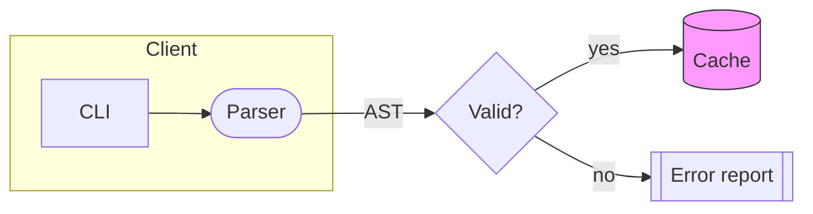
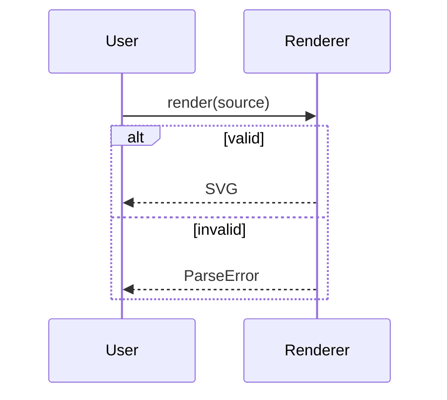
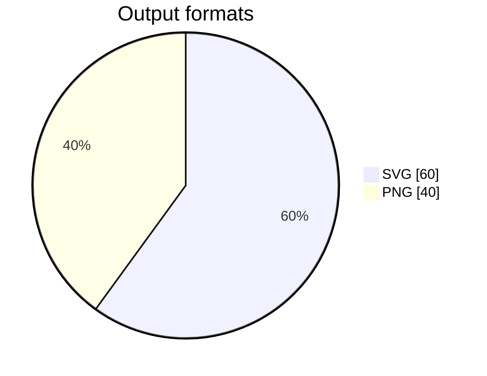
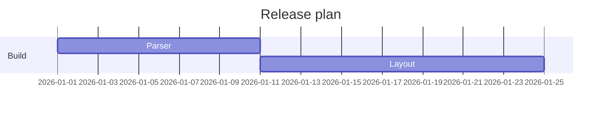
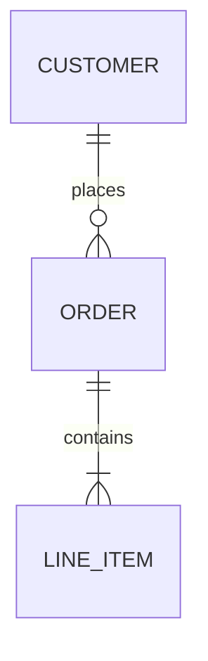

# mermaid-rs-renderer (`mmdr`) research

Research as of 2026-10-20. Sources: the local clone at `/Users/ken/coding/forks/mermaid-rs-renderer` (HEAD `3726ccb`, 2026-09-07), the GitHub and crates.io APIs, the local Merman clone (`/Users/ken/coding/forks/merman`), and Zed PR [#57644](https://github.com/zed-industries/zed/pull/57644). The CLI examples below were run against a release build of the clone.

## Summary

- `mermaid-rs-renderer` (crate name; binary and short name **`mmdr`**) is a pure-Rust Mermaid parser + layout + SVG emitter, MIT licensed, by `1jehuang`. It is a clean-room reimplementation, not a port of the MermaidJS source.
- It emits **SVG** natively and **PNG** by rasterizing that SVG with `resvg`. There is no JPG, PDF, or WebP output.
- It supports **23 diagram types**. It does **not** claim compatibility with any MermaidJS version.
- Its compatibility strategy is empirical: render a fixture corpus with `mermaid-cli` and compare images and layout metrics. It is not a spec-conformance or upstream-test-suite strategy.
- It has **no external icon pack support** (no Iconify), only Mermaid's five built-in architecture icons.
- It is young: the repository was created 2026-01-22. The README itself says output quality "may not yet match mermaid-cli in all cases".
- Correction to the task premise: Zed **used** mmdr (through its own fork) but **replaced it with Merman** in PR #57644, merged 2026-05-27. See [Zed](#zed).
- The prompt's comparison question ("compare with mermaid-rs-renderer") is self-referential. It was read as a comparison with **Merman**.

## Release history and cadence

Nine tags/GitHub releases (dates from GitHub releases; crates.io publish dates sometimes lag by a day or more):

| Version   | GitHub release | crates.io     | Notes                                                       |
| --------- | -------------- | ------------- | ----------------------------------------------------------- |
| 0.1.0     | 2026-01-23     | 2026-01-23    | First release (repo created 2026-01-22)                     |
| 0.1.1     | 2026-01-25     | not published |                                                             |
| 0.1.2     | 2026-01-28     | 2026-01-28    |                                                             |
| 0.1.3     | 2026-02-02     | not published |                                                             |
| 0.2.0     | 2026-02-07     | 2026-02-23    | Layout engine overhaul, visual redesigns                    |
| 0.2.1     | 2026-03-08     | 2026-03-09    |                                                             |
| 0.2.2     | 2026-04-23     | 2026-04-24    | Bug fixes, Gantt compact mode                               |
| 0.3.0     | 2026-07-03     | 2026-07-03    | Subgraph containment overhaul, `--theme`, size metadata API |
| **0.3.1** | **2026-07-06** | 2026-07-06    | **Latest release**                                          |

- **Latest version: 0.3.1.** crates.io shows about 190k total and about 159k recent downloads. GitHub shows about 1,780 stars, 110 forks, and 60 open issues.
- **Cadence:** bursty and slowing. Seven releases came in the first 11 weeks. Gaps then grew: 29 days, 46 days, 71 days, then a 3-day patch. **No release in the roughly 3.5 months since 0.3.1.**
- **Development continues on `master`.** The newest commit is 2026-09-07, "Add optional renderer-neutral native vector scene API". Earlier work includes a guarded dagre layout engine and a layered-layout feedback loop. The `scene` feature and the dagre engine are **unreleased**. Depending on them requires a git `rev` dependency.
- Versioning is pre-1.0 semver, with no stability promise. Releases are cut by pushing an annotated `vX.Y.Z` tag; CI then builds binaries, publishes to crates.io, and updates Homebrew and AUR (`docs/release.md`).
- A `CHANGELOG.md` exists but starts at v0.2.0. The v0.1.x notes are only in git history.

## Compatibility philosophy and testing

### Stated compatibility with MermaidJS

- **No MermaidJS version is stated or pinned** in the README, `Cargo.toml`, or docs.
- Version numbers that do appear are incidental:
    - `docs/benchmarks.md` and the README timing tables compare against `mermaid-cli 11.4.2`.
    - `package.json` (comparison tooling) asks for `@mermaid-js/mermaid-cli ^11.12.0`.
    - `docs/architecture-beta.md` mentions that mermaid v11.16+ `align row/column` is **not yet implemented**.
- So the practical target is "current MermaidJS 11.x as seen through `mermaid-cli`", with no formal baseline. Treat any version claim as unverified.

### Philosophy: match the picture, with hard geometric invariants

mmdr does not port MermaidJS, and it does not run MermaidJS's own test suite or grammar fixtures. It reimplements the pipeline (`parser.rs` -> `ir.rs` -> `layout/` -> `render.rs`) and treats the result as correct when it **looks like** `mermaid-cli` output and **never violates geometric invariants**. Where it follows MermaidJS internals, it does so by reading the behavior, for example `flowDb.makeUniq` for subgraph membership or `shiftPositionByArchitectureDirectionPair` for architecture placement.

Its own `docs/layout_objective.md` states the layout goal:

- Hard constraints: no node overlaps, no edges crossing unrelated nodes or subgraphs, ports on node boundaries, subgraph containment, deterministic output.
- Soft objectives (weighted): crossings (5), edge length (2), bends (2), port congestion (2), overlaps (1), area (1), stability (3).

### Testing machinery

Everything below lives in the repo:

| Layer                                                                                               | What it does                                                                                                                                                                                                    |
| --------------------------------------------------------------------------------------------------- | --------------------------------------------------------------------------------------------------------------------------------------------------------------------------------------------------------------- |
| Rust test suites (`tests/`)                                                                         | `correctness`, `determinism`, `invariant`, `layout`, `semantic`, `output_shape`, `scene`, `robustness`, `parse_errors`, `cli`, plus radar-specific and visual-issue suites                                      |
| Fixture corpus (`tests/fixtures/`, about 119 `.mmd` files, plus benchmark fixtures)                 | One or more fixtures per diagram type; flowchart stress cases such as `flowchart_mega_*`                                                                                                                        |
| Conformance report (`scripts/conformance_compare.py`, `docs/conformance-report/`)                   | Renders each fixture with both mmdr and `mermaid-cli`, produces side-by-side and diff PNGs and an HTML report. It currently covers about 28 fixtures across all 23 types                                        |
| Hard gate (`scripts/hard_gate.py`, `tests/hard_gate_baseline.json`)                                 | Classifies each fixture RED/GREEN on node overlap, edge-through-node, off-boundary endpoints, subgraph intrusion, non-finite coordinates, label overflow, canvas overflow. v0.3.0 reports **215 GREEN / 0 RED** |
| Quality gate (`scripts/quality_gate.py`, `tests/quality_baseline.json`)                             | Ratcheting aesthetic score baseline                                                                                                                                                                             |
| Layout comparison (`layout_score.py`, `layout_compare_report.py`, `quality_bench.py --engine both`) | Compares mmdr layout metrics against `mermaid-cli`                                                                                                                                                              |
| Strict parse errors (`ParseError`, `validator.rs`)                                                  | Typed errors for bad `%%{init}%%` JSON, unclosed or stray `subgraph`/`end`, leading arrows, unbalanced `click` quotes                                                                                           |

Important gaps relative to a conformance-driven approach:

- There is **no check that SVG structure, class names, or DOM match MermaidJS**. Consumers cannot rely on MermaidJS CSS selectors.
- Visual parity is judged against `mermaid-cli` output on mmdr's own fixtures. There is no pinned upstream corpus.
- MermaidJS features are implemented selectively. Unknown syntax inside a known diagram type can be silently ignored or can misparse.

## Supported and unsupported diagram types

`DiagramKind` in `src/ir.rs` has **23 variants**, and header detection lives in `parser.rs::detect_diagram_kind`.

| Category     | Supported header keywords                                                                                               |
| ------------ | ----------------------------------------------------------------------------------------------------------------------- |
| Core         | `flowchart`/`graph`, `sequenceDiagram`, `classDiagram`, `stateDiagram`(`-v2`)                                           |
| Data         | `erDiagram`, `pie`, `xychart(-beta)`, `quadrantChart`, `sankey(-beta)`                                                  |
| Planning     | `gantt`, `timeline`, `journey`, `kanban`                                                                                |
| Architecture | `C4Context`/`Container`/`Component`/`Dynamic`/`Deployment`, `block(-beta)`, `architecture(-beta)`, `requirementDiagram` |
| Other        | `mindmap`, `gitGraph`, `zenuml`, `packet(-beta)`, `radar(-beta)`, `treemap`                                             |

This covers essentially all of MermaidJS's classic diagrams and most of its beta diagrams.

**Not supported** (verified against the detection code, and a run of the built binary on `infoDiagram`):

- `info`. The binary returns `error: unknown or missing Mermaid diagram header`.
- Any diagram type that is not in the table above. Of the newer MermaidJS families, Merman's feature list shows at least `venn` as a type mmdr lacks. For the others (such as Ishikawa, Wardley, TreeView, Event Modeling, Cynefin) the mmdr source has no header detection, so the answer is "not supported" by inspection, but this was not run against each syntax.
- Partial support inside supported types:
    - Architecture: no external icon packs, no `align row/column` (v11.16+), nested groups are flattened, and edge labels are not rendered.
    - ZenUML: re-implemented from its documented syntax, not the real ZenUML engine.
    - Only the 12 flowchart node shapes in the README are claimed. The newer `@{ shape: ... }` syntax was not verified.
- Unknown headers produce an error, but text that merely looks like flowchart edge syntax falls back to a flowchart. A typo in a header can therefore render a wrong diagram instead of failing.

## Comparison with Merman

Merman ([Latias94/merman](https://github.com/Latias94/merman), v0.9.1, MIT OR Apache-2.0) is the other Rust Mermaid engine and is what Zed ships now.

|                    | mermaid-rs-renderer                                             | Merman                                                                                                                                            |
| ------------------ | --------------------------------------------------------------- | ------------------------------------------------------------------------------------------------------------------------------------------------- |
| Approach           | Clean-room reimplementation; its own SVG DOM and its own layout | "Headless implementation of Mermaid", parsing, layout, config, theming, and SVG structure checked against **pinned upstream source and fixtures** |
| MermaidJS baseline | None stated                                                     | Pinned upstream baseline. Its benchmark harness names Mermaid JS v11.15.0                                                                         |
| Diagram types      | 23                                                              | Broader: includes Info, Venn (beta), and newer Mermaid 12 families                                                                                |
| SVG fidelity       | "Good enough", own look                                         | Intended to be structurally close to MermaidJS. Zed's PR described Merman's SVG as "*very accurate*" but with "borderline unusable CSS"           |
| Output             | SVG, PNG                                                        | SVG by default. Optional PNG, JPEG, PDF, ASCII/Unicode, plus layout/typed models                                                                  |
| Icons              | Built-ins only                                                  | Optional local Iconify JSON (`icons` feature) and network icons (`network-icons` feature)                                                         |
| Themes             | 5 presets + `themeVariables`                                    | Host theme profiles, editor-oriented presets, custom-theme recipe (alpha)                                                                         |
| Bindings           | Rust crate + CLI                                                | Rust, WASM/web, FFI, UniFFI/Apple, Python, Typst, LSP, playground                                                                                 |
| Maturity           | Created 2026-01-22, 0.3.x                                       | Much larger surface and changelog, 0.9.x                                                                                                          |
| Dependency weight  | About 71 crates with `default-features = false`                 | Feature-gated; larger when full features are enabled                                                                                              |

Why this matters for the monorepo: `biscuit-visualized` depends on `mermaid-rs-renderer = "0.3.1"` with `default-features = false` and optional `resvg` for PNG. mmdr is a small, fast dependency, but it gives up fidelity and icon support relative to Merman.

## Rendering examples

All five were run with the CLI (`mmdr -i FILE -o OUT -e svg`) and rendered successfully.

### 1. Flowchart with subgraph, shapes, and class styling



```bash
mmdr -i flow.mmd -o flow.svg -e svg
mmdr -i flow.mmd -o flow.png -e png        # 609x165 PNG
```

Library, SVG string:

```rust
let svg = mermaid_rs_renderer::render(source)?;
```

### 2. Sequence diagram with `alt` frame



### 3. Pie chart



Pie colors are derived from the theme the same way MermaidJS derives `pie1..pie12`.

### 4. Gantt



Add `displayMode: compact` in YAML frontmatter for the compact view (added in 0.2.2).

### 5. ER diagram



### Library usage patterns

```rust
use mermaid_rs_renderer::{render_with_options, RenderOptions, Theme};

let mut opts = RenderOptions::modern()      // or ::mermaid_default()
    .with_node_spacing(60.0)
    .with_rank_spacing(80.0);
opts.theme = Theme::dark();
let svg = render_with_options("flowchart TD; X-->Y", opts)?;

// Typed parse errors instead of anyhow
let svg = mermaid_rs_renderer::render_strict(src, opts)?;

// Stage-by-stage: parse_mermaid -> compute_layout -> render_svg
// Size before rasterizing: measure(src, opts)
// Per-stage timing: render_with_timing(src, opts)
```

Markdown input is also supported by the CLI: `mmdr -i README.md -o ./diagrams/ -e svg` renders every fenced `mermaid` block to `diagram-N.svg`.

## Styling and themes

### How to configure

Four layers, applied in this order (later wins):

1. **Built-in preset**: `--theme default|base|mermaid|dark|forest|neutral|modern` on the CLI, or `Theme::from_name`, `Theme::modern()`, `Theme::dark()`, `Theme::forest()`, `Theme::neutral()`, `Theme::mermaid_default()` in Rust. **The default is `modern`**, not MermaidJS's `default`. `RenderOptions::mermaid_default()` selects the classic look.
2. **Config file** `-c config.json`: Mermaid-style `themeVariables` (`primaryColor`, `primaryTextColor`, `primaryBorderColor`, `lineColor`, `secondaryColor`, `tertiaryColor`, `edgeLabelBackground`, `clusterBkg`, `clusterBorder`, `background`, `fontFamily`, `fontSize`), plus `flowchart.nodeSpacing`/`rankSpacing`, `preferredAspectRatio`, and `mindmap.edgeColor`. Verified: a config setting `primaryColor` changed the rendered fills.
3. **In-diagram `%%{init: {...}}%%`** merged over the config. A malformed init JSON is a typed `InvalidDirective` error.
4. **Per-element** `classDef`, `class`, `:::class`, `style`, `linkStyle`.

Further CLI knobs: `--nodeSpacing`, `--rankSpacing`, `--preferredAspectRatio 16:9`, `--width`/`--height`, `--fastText` (calibrated ASCII widths, skips font DB load), and `--layoutEngine current|dagre|auto`.

### The `Theme` struct (Rust)

`Theme` is a flat struct of hex-string fields: base colors, `font_family`, `font_size`, plus per-diagram fields (`pie_colors[12]`, `sequence_actor_*`, `git_colors`, and so on). This is exactly what Zed filled in from its editor theme before moving to Merman.

**There is no CSS layer.** The renderer writes inline attributes and a small embedded style, with no stylesheet to override and no MermaidJS class names. Styling is done through `Theme` fields, `themeVariables`, and `classDef`, not by injecting CSS.

### Zed

- **Zed's CSS and its license.** Public. Zed is open source at `zed-industries/zed`, and the new `crates/mermaid_render` crate (with `postprocess/inject_css.rs` and the `accent_colors` modules) is declared `license = "GPL-3.0-or-later"` with a `LICENSE-GPL` link. The Zed application crates are GPL-3.0-or-later (server components are AGPL). Zed's CSS is written for **Merman's** SVG class structure and **cannot be reused with mmdr**. It is also GPL, which is copyleft and incompatible with copying into a permissive crate. Reading it as a reference for design choices is fine.
- **Zed's abstractions.** Zed has used two stacks:
    - *Before 2026-05-27 (mmdr):* the workspace pinned a **fork**, `zed-industries/mermaid-rs-renderer` (rev `782b89a`, `default-features = false`; the fork was last pushed 2026-05-08). `crates/markdown/src/mermaid.rs` built a `Theme::modern()`, overwrote about 40 fields from Zed's `cx.theme().colors()`, `accents()`, and `players()` (HSLA converted to hex), appended generated `classDef` accent lines to the diagram source, called `render_with_options`, then rasterized the SVG through GPUI's `svg_renderer().render_single_frame(...)` (`usvg`/`resvg`) at the editor scale. The result is cached per diagram (`CachedMermaidDiagram`).
    - *After (Merman):* PR #57644 ("Big PR that replaces `mermaid-rs` with `merman`") adds a leaf crate `mermaid_render` with `render_to_svg(source, &MermaidTheme)`: build a `merman::MermaidConfig` from the theme, render raster-safe SVG, then run a `quick-xml` event-stream post-processing pipeline (`accent_colors`, `inject_css`, `element_fixup`, `fallback_fixup`, `foreignobject_wrap`, `strip_foreignobject`, `strip_invalid_css`). It also appends `, sans-serif` to the font family because Merman measures text conservatively.
    - Zed additionally gates which diagram types render at all (`is_supported_diagram_type`: flowchart/graph, sequence, class, state, ER, gantt, pie, gitGraph, mindmap, timeline, quadrantChart, xychart-beta, journey). Everything else shows source.
- **Tabbed Preview/Code layout.** **Zed's, not mmdr's.** `render_mermaid_tab_header` in `crates/markdown/src/mermaid.rs` builds the "Preview" and "Code" buttons (`mermaid-tab-preview`, `mermaid-tab-code`) from GPUI components. It also has the zoom, scroll, and copy controls, and falls back to plain source with no tabs when a render fails. mmdr has no UI of any kind. Merman does not provide it either; it comes from the host (Zed's markdown crate).

## Icon packs

**Not supported.** mmdr has no network access and no JS runtime. It does not implement `registerIconPacks`, so Iconify names such as `logos:aws-lambda` render as a neutral glyph (confirmed by running an `architecture-beta` diagram with that icon). Supported: Mermaid's five built-ins (`cloud`, `database`, `disk`, `internet`, `server`), a `junction` marker, a symbolic `lambda`, and heuristic aliases (for example `gateway`, `storage`, `compute`). `docs/architecture-beta.md` calls AWS/logos packs "out of scope". The C4 person icon is a built-in vector silhouette. FontAwesome-style `fa:fa-name` labels are not handled by any code path found.

If icons matter, Merman (local Iconify JSON, optional network fetch) or the `biscuit-icon` package are the options. A workaround is to substitute icons at the SVG level after rendering.

## Performance

All numbers below are the **project's own** measurements unless noted. Treat them as order-of-magnitude.

### Against MermaidJS / `mermaid-cli`

Setup: Intel Core Ultra 7 265V, Linux 6.18, `mermaid-cli 11.4.2` (Puppeteer and Chromium), v0.2.0, 2026-02-07. mmdr numbers include process start and file I/O.

| Diagram              | mmdr    | mermaid-cli | Speedup |
| -------------------- | ------- | ----------- | ------- |
| Flowchart            | 4.49 ms | 1,971 ms    | 439x    |
| Class                | 4.67 ms | 1,907 ms    | 408x    |
| State                | 3.97 ms | 1,968 ms    | 496x    |
| Sequence             | 2.71 ms | 1,906 ms    | 704x    |
| Flowchart, 200 nodes | 47.0 ms | 2,276 ms    | 48x     |

- The headline "100-1400x" and the README "up to 2069x" figures are for tiny diagrams with a warm font cache or `--fastText`. Speedup shrinks as diagrams grow, because layout dominates.
- The comparison is mostly **Chromium start-up time**, not a rendering algorithm comparison. A long-lived MermaidJS in a browser or Node process would be far closer.
- As a library with Criterion (no process spawn): flowchart about 1.5 ms, class about 2.5 ms, state about 2.0 ms, sequence about 0.07 ms.
- Memory is quoted as about 15 MB for mmdr against more than 300 MB for mermaid-cli. Cold start is about 3 ms against about 2,000 ms.
- Reproduce with `cargo bench --features benchmark --bench renderer` and `python3 scripts/bench_compare.py`. `docs/benchmarks.md` has the per-type table, which is dated 2026-02-07 (v0.2.0).

### Against Merman

mmdr's repo has **no Merman comparison**. Merman publishes one (`docs/performance/renderer_comparison_2026-07-28_75c9fd156_vs_mmdr.md`), which should be read as a competitor's benchmark:

- Apple M4 Pro, macOS, Rust 1.95, Criterion with 30 samples, **warm native SVG path**, mmdr at commit `7ff1196`.
- 30 byte-identical fixtures were comparable. Merman was faster on 18 and slower on 12.
- **Median Merman/mmdr time ratio 0.664x** (Merman about 1.5x faster at the median). **Geometric mean 0.297x**, dominated by complex flowcharts.
- Remaining mmdr leads are small tiny-diagram fixed costs, such as `class_tiny` 52 us against 18 us, and `requirement_medium` 197 us against 71 us.
- Merman's own caveat: "the aggregate is not a quality-adjusted score", because the engines differ in families supported, layout algorithms, validation, sanitization, and SVG output.

Takeaway: both are sub-millisecond to low-millisecond for typical diagrams. Speed is not a reason to pick one over the other. Fidelity and feature set are.

## Output formats

| Format             | Supported                   | How                                                                                                                                                                                                                                           |
| ------------------ | --------------------------- | --------------------------------------------------------------------------------------------------------------------------------------------------------------------------------------------------------------------------------------------- |
| **SVG**            | Yes (native)                | `-e svg`, `render()`, `render_with_options()`                                                                                                                                                                                                 |
| **PNG**            | Yes (default feature `png`) | `-e png`; `resvg`/`usvg` rasterizes the SVG at its natural size and fills the theme background. Loads system fonts, so output varies with installed fonts                                                                                     |
| JPG/JPEG           | **No**                      | The CLI rejects it: `possible values: svg, png`                                                                                                                                                                                               |
| PDF, WebP, ASCII   | No                          | Not present                                                                                                                                                                                                                                   |
| Layout JSON        | Debug only                  | Layout dump for tooling                                                                                                                                                                                                                       |
| **Vector `Scene`** | Yes, **unreleased**         | `scene` feature, `render_scene()`; a list of fill-path, clip, and layer commands for native vector painters. It is SVG normalized through `usvg`, with text converted to glyph outlines, and it errors on images, filters, masks, and similar |

Cargo features: `cli` (clap), `png` (resvg/usvg), `scene` (usvg), `benchmark` (criterion). Both `cli` and `png` are default; `default-features = false` gives the SVG-only core at about 71 crates against about 123. The PNG path has no scale or DPI option (the size is the SVG size), so crisp terminal output means rasterizing the SVG yourself with `resvg` at a chosen scale, as `biscuit-visualized` does.

## Assessment for this monorepo

- **Strengths:** small and fast, pure Rust, MIT, 23 diagram types, themeable through `Theme`/`themeVariables`, typed parse errors, deterministic output, and a strong geometric-invariant test culture.
- **Risks:** pre-1.0 with a slowing release cadence (the scene API and dagre engine are unreleased), no MermaidJS version contract, no SVG-structure parity, no icon packs, a 60-issue backlog, and a bus factor of one (487 of about 546 commits are by the owner).
- **Gaps against what Zed chose:** Zed left mmdr for Merman for fidelity to MermaidJS output. If `biscuit-visualized` needs closer MermaidJS parity, icon packs, or newer diagram families, Merman is the migration candidate. Because both emit SVG, the swap is contained behind the renderer boundary.
- **Open item:** verify `@{ shape: ... }` flowchart shape syntax and `fa:` icon labels before relying on them.
