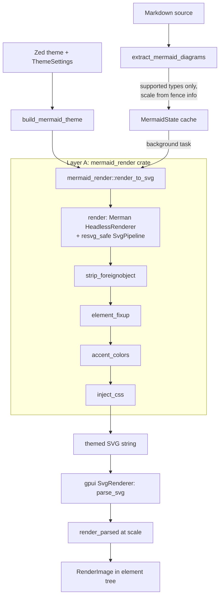
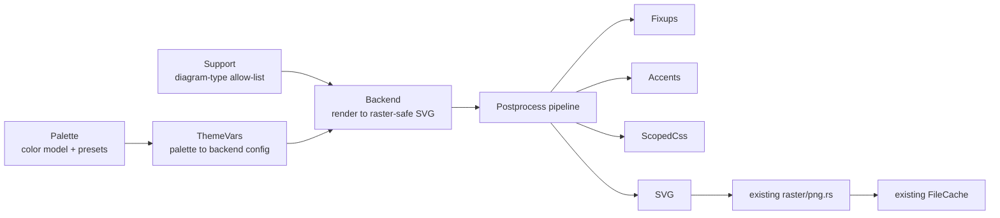

# How Zed Integrates Merman

Researched 2026-10-20 against Zed `main` (read directly from the `zed-industries/zed` repository) and Merman 0.9.1. Companion documents: [merman](./merman.md), [mermaid-rs-renderer](./mermaid-rs-renderer.md).

## Summary

- **Zed has a dedicated abstraction crate.** `crates/mermaid_render` ("mermaid_render") wraps Merman in a two-stage `&str + MermaidTheme -> SVG String` pipeline: Merman renders raster-safe SVG, then a chain of Zed-specific post-processors adds theme and accent styling. Rasterization is not in the crate. It happens in `gpui`'s `SvgRenderer` (usvg/resvg), driven by the `markdown` crate.
- **Merman is used for Mermaid in only one place**: the `markdown` crate. That crate backs the Markdown Preview and the Agent Panel. `mermaid_render` has no other dependents, and no standalone `.mmd` preview exists yet (only a proposal).
- **The abstraction is GPL-3.0-or-later, so we cannot copy it.** Merman itself is `MIT OR Apache-2.0`.
- **Only part of it is worth rebuilding.** The theme-mapping and postprocessing layer is valuable and decomposes cleanly into five pieces. The editor-side machinery (caching with fallback frames, zoom, debounce) is gpui-specific and not relevant to us. Rough cost: **about 1.5-2.5 weeks** for a clean-room version, plus a decision about migrating our backend (see [Recommendation](#recommendation-for-biscuit-visualized)).

> **Correction to the premise.** Merman does not itself produce raster images by default. SVG is its core output; PNG/JPEG/PDF are optional features generated *from* the SVG. Zed uses only the `svg` and `layout-cytoscape` features and rasterizes with its own resvg. Also, Zed adopted Merman recently: `mermaid_render`'s docs say the previous implementation used `mermaid-rs-renderer`, the same backend `biscuit-visualized` uses today. An earlier Zed discussion (#57548, June 2026) still describes `mermaid-rs-renderer` as the dependency, so some public discussion is out of date.

## Timeline of Zed's Mermaid support

| Item                                                                                | What it did                                                                                                                                                                                          |
| ----------------------------------------------------------------------------------- | ---------------------------------------------------------------------------------------------------------------------------------------------------------------------------------------------------- |
| Issue [#10696](https://github.com/zed-industries/zed/issues/10696)                  | Original request for Mermaid in Markdown preview.                                                                                                                                                    |
| PR [#49064](https://github.com/zed-industries/zed/pull/49064) (about February 2026) | "markdown_preview: Add Mermaid Diagram Support" using `mermaid-rs-renderer`.                                                                                                                         |
| PR [#56430](https://github.com/zed-industries/zed/pull/56430) (merged 2026-05-13)   | "agent_ui: Mermaid diagrams". Render by default with a code/diagram toggle; markdown rendering uses theme colors.                                                                                    |
| Later                                                                               | Backend moved to Merman in a new `mermaid_render` crate. Zoom and horizontal scrolling shipped in Stable v1.16.1 (per Discussion [#58717](https://github.com/zed-industries/zed/discussions/58717)). |
| Discussion [#57548](https://github.com/zed-industries/zed/discussions/57548)        | Proposal for a standalone `mermaid_preview` crate for `.mmd`/`.mermaid` files. No maintainer response as of the last read.                                                                           |

Known open problems (issues [#57323](https://github.com/zed-industries/zed/issues/57323), [#51480](https://github.com/zed-industries/zed/issues/51480)): ER entity styles shown as visible text, and breakdown on complex diagrams. These are the sort of gaps a postprocessing layer inherits from the backend.

## 1. What Zed builds on top of Merman

There are two layers. Layer A, `mermaid_render`, is a pure function and is the part relevant to us. Layer B, in `markdown`, is editor integration.

### Layer A: `mermaid_render` (about 100 KB of source including tests)

Public API is deliberately tiny: `render_to_svg(source: &str, theme: &MermaidTheme) -> Result<String>`, plus `text_color_for_background`.

**Stage 1: `render.rs` (Merman configuration).**

- Builds `merman::svg::HeadlessRenderer` with `with_site_config`, `with_vendored_text_measurer()` and a unique `diagram_id` (`merman-{n}` from an atomic counter), so several SVGs can coexist in one document without CSS id collisions.
- Applies Merman's `SvgPipeline::resvg_safe()` with a `CssOverridePostprocessor::strip_existing_important()`. The first replaces `<foreignObject>` HTML labels with wrapped native `<text>`, drops unsupported CSS (keyframes, `:root`, animations) and invalid attributes. The second removes Merman's `!important` declarations so Zed's later CSS wins.
- `to_merman_config` maps a `MermaidTheme` to Merman `themeVariables` (`theme: "base"`, `darkMode`, ~60 variables) covering flowchart, sequence, class, ER, pie, quadrant and git colors. The 8 git-branch colors double as `cScale0..7` and `pie1..8`.

**Stage 2: `postprocess/` (streaming SVG rewrite).** The SVG is parsed once with `quick_xml` into an event iterator. Each pass is a lazy `Iterator<Item = Result<Event>>` adapter over the previous one, and the result is written out once. The authors justify the complexity by performance (no repeated string insertion or reparsing) and robustness ("this code cannot panic"; bad output just looks odd). Passes, in order:

| Pass                  | Responsibility                                                                                                                                                                                                                                                                              |
| --------------------- | ------------------------------------------------------------------------------------------------------------------------------------------------------------------------------------------------------------------------------------------------------------------------------------------- |
| `strip_foreignobject` | Keeps Merman's fallback text groups but drops those that duplicate a native `<text>` (user journey emits both).                                                                                                                                                                             |
| `element_fixup`       | Replaces the hardcoded white SVG background with the theme background; removes `<rect>` with missing or `NaN` dimensions; other Merman output quirks.                                                                                                                                       |
| `accent_colors`       | Injects `zed-accent-N` CSS classes on nodes, per diagram type (sub-modules for class, mindmap and sequence diagrams). Mermaid has no general per-node coloring, so this is how diagrams get variety even when the author supplied no colors. Colors come from the editor's `player_colors`. |
| `inject_css`          | Appends a theme-aware stylesheet to the SVG's `<style>`, every selector scoped to the SVG id (`#merman-3 .node rect {...}`). Largest file (about 510 lines); also emits the CSS for the accent classes.                                                                                     |
| `util`                | `text_color_for_background`: picks readable text in OKLCH, keeping about 15% of the background chroma, with lightness chosen for contrast.                                                                                                                                                  |

**`MermaidTheme`** is a flat struct of about 25 named colors (`primary_color`, `line_color`, `cluster_background`, `note_*`, `actor_*`, `activation_*`, `er_attr_bg_odd/even`, `git_branch_colors: [Hsla; 8]`, `error_color`, `warning_color`...) plus `font_family`, `dark_mode` and `accent_colors: Vec<AccentColor { foreground, background }>`. It is typed with gpui's `Hsla`; the `gpui` dependency exists only for color types and `css_color` formatting (`#rrggbb`, or `#rrggbbaa` when translucent).

Tests include a rasterization-safety check (`usvg::Tree::from_data` must not panic on zalgo-text labels), a multibyte ER lexer regression, a cyclic-subgraph stack-overflow guard, class-diagram font-size assertions after usvg parsing, and a `tests/check_invalid_attrs.rs` (about 13 KB) that validates SVG attributes.

### Layer B: `markdown` crate integration (`mermaid.rs`, about 1,800 lines with tests)

Everything here is tied to gpui entities and UI, so it is mostly not portable:

- **Extraction and gating.** Fenced blocks tagged `mermaid [scale]` (scale clamped 10-500, default 100) or source files with `.mermaid`/`.mmd` extension. `is_supported_diagram_type` is an **allow-list**: flowchart/graph, sequence, class, state, ER, gantt, pie, gitGraph, mindmap, timeline, quadrantChart, xychart-beta, journey. Merman supports more, but Zed blocks types it has not yet written readable-text CSS for. Unsupported types stay as a normal code block. The comment notes the same list is mirrored in the Agent's system prompt.
- **Theme bridge.** `build_mermaid_theme` maps `cx.theme().colors()` and player colors to `MermaidTheme`; re-renders on theme or setting change.
- **Font fallback.** Merman's text measurer is limited; with unknown fonts it picks a narrow width and labels overflow. Zed appends `sans-serif` to the family list to force a wider, conservative measurement. They note the real fix, feeding resvg's measurements into Merman, is "a lot of work".
- **Async and caching.** A `MermaidState` cache keyed by diagram contents (and scale) holds `OnceLock` render results; rendering runs on a background executor. While a re-render is pending (an edit), the previous raster is shown as a fallback frame, with logic for rapid edits and duplicate blocks. Duplicate blocks share one entry.
- **Two-phase raster.** The parsed SVG tree is cached separately from its raster, so zoom only re-rasterizes at `zoom x natural size`, debounced 300 ms, never re-running Merman.
- **UI.** Code/diagram tab toggle, zoom (10% steps, max 2.0x, snap to 1.0), "Zoom NNN%" readout with reset, copy button, horizontal scroll container, and scroll-handle retention across reparses.

The tab toggle between source and rendering is therefore Zed's, not Merman's.

## 2. Is Merman used anywhere else in Zed?

No. Root `Cargo.toml` declares `merman` (pinned `=0.8.0-alpha.5`, `default-features = false`) and `mermaid_render`. In the workspace manifests I read, the only crate depending on `mermaid_render` is `markdown`; `merman` is referenced only by `mermaid_render`. Consumers of `markdown` get Mermaid by setting `render_mermaid_diagrams`:

- Markdown Preview (`markdown_preview_view.rs` sets it to `true`).
- Agent Panel (`agent_ui`, with settings-change cache invalidation in `conversation_view.rs`).

I did not find `merman` in `editor`, `git_ui`, `repl`, `svg_preview` or `gpui`. A full-text search of the repo was not possible without authentication, so "no other use" is based on the manifests checked. Discussion #57548 confirms standalone `.mmd` files currently open as plain text.

## 3. Licensing

| Component                      | License                                                                                                                                                    | Evidence                                                      |
| ------------------------------ | ---------------------------------------------------------------------------------------------------------------------------------------------------------- | ------------------------------------------------------------- |
| Zed repository                 | "licensed primarily under GPL-3.0-or-later", with "Apache-2.0 components where marked"                                                                     | repo README, `LICENSE-GPL` and `LICENSE-APACHE` files         |
| `mermaid_render`               | `GPL-3.0-or-later`                                                                                                                                         | its `Cargo.toml`; `LICENSE-GPL` is a symlink to the repo root |
| `markdown`, `markdown_preview` | `GPL-3.0-or-later`                                                                                                                                         | their `Cargo.toml`                                            |
| `gpui`                         | `Apache-2.0`                                                                                                                                               | its `Cargo.toml`                                              |
| Merman                         | `MIT OR Apache-2.0` own code; bundled third-party parts have separate terms (ELK is EPL-2.0 and is in the default features; math font data may be OFL-1.1) | Merman README and `THIRD_PARTY_NOTICES.md`                    |

Your recollection is right with one refinement: it is not "somewhat restrictive" in the sense of source-available. It is a real open-source license, but a **strong copyleft** one. Copying or closely adapting `mermaid_render` code would make the derived work GPL-3.0-or-later, which conflicts with a library others link against. Rules for us:

1. Do not copy or translate Zed code, including the CSS tables in `inject_css.rs` and the per-diagram accent logic.
2. Reuse *ideas* (pipeline shape, the problem list), which are not copyrightable, and implement from Merman's own SVG output.
3. The `gpui` dependency (Apache-2.0) is irrelevant to us; we would use our own color type.
4. Check whether Merman's EPL-2.0 ELK dependency matters for our policy if we adopt Merman; `layout-cytoscape` alone (Zed's choice) avoids selecting ELK explicitly, but defaults include it.

This is a research summary, not legal advice.

## 4. Would the abstractions be valuable in `biscuit-visualized`?

### What we already have

`biscuit-visualized` (about 5.6 KLOC including tests) uses `mermaid-rs-renderer` 0.3.1, not Merman. It already has pieces that overlap with Zed's stage 2:

| Zed concern        | Ours today                                                                                                                                       |
| ------------------ | ------------------------------------------------------------------------------------------------------------------------------------------------ |
| Theme struct       | `MermaidTheme` enum (Default/Dark/Forest/Neutral) plus `MermaidConfig` (quadrant-only fields) and `QuadrantTheme`                                |
| SVG postprocessing | `apply_svg_overrides`, `fix_legend_text_baseline`, `fix_pie_text_contrast` (string-based), plus the gitGraph correction in `mermaid/gitgraph.rs` |
| Rasterization      | `raster/png.rs` via resvg with lazily loaded font DB                                                                                             |
| Caching            | content-addressed `FileCache` (xxHash) keyed on source, options, backend id and format                                                           |
| Fallback           | `fallback_code_block()`                                                                                                                          |

### What is missing and valuable

| Zed capability                                                | Value for us                                                                                                                                                                 |
| ------------------------------------------------------------- | ---------------------------------------------------------------------------------------------------------------------------------------------------------------------------- |
| Arbitrary theme to full `themeVariables` mapping              | **High.** Our themes are four presets. A `MermaidPalette` mapped from the terminal's actual colors (via `biscuit-terminal`) would make diagrams match the user's terminal.   |
| Accent colors for un-styled nodes                             | **Medium-high.** Monochrome diagrams look plain. Mainly flowchart, class, mindmap, sequence.                                                                                 |
| Raster-safe SVG (foreignObject, bad CSS, NaN rects)           | **High, and mostly free**: Merman's `SvgPipeline::resvg_safe()` provides it. Our resvg path has the same constraint.                                                         |
| Scoped CSS injection by diagram id                            | **Medium.** Needed once a theme goes beyond config variables.                                                                                                                |
| Readable-text color helper                                    | **Medium.** We have a WCAG pie fix; one shared helper replaces ad hoc ones.                                                                                                  |
| Allow-list of supported diagram types                         | **High, cheap.** An explicit supported list with graceful `fallback_code_block()` fits our principle 4.                                                                      |
| Font-family fallback (`sans-serif`) for measurement           | **Medium.** Cheap, but only matters with Merman's measurer.                                                                                                                  |
| Streaming `quick_xml` event pipeline                          | **Low-medium.** Good engineering, but our SVGs are small and performance is not the issue; correctness and testability are.                                                  |
| Two-phase parse/raster cache, fallback frames, debounce, zoom | **Low.** Our consumers produce files; terminals display static images. Our file cache already covers repeat renders. A parsed-tree cache is the only part that could matter. |

So the answer is: **yes for the theming and postprocessing layer, no for the interactive machinery.**

### Work estimate (clean-room, ours)

Assumes no code from Zed. Estimates are for one engineer familiar with the crate and include tests; they are judgment, not measurements.

| Step                                                                                    | Work                                                                                                                                                                            | Size                                             |
| --------------------------------------------------------------------------------------- | ------------------------------------------------------------------------------------------------------------------------------------------------------------------------------- | ------------------------------------------------ |
| 0. Backend decision: add Merman behind a feature, or migrate from `mermaid-rs-renderer` | Decision first. Migration touches cache backend id, gitGraph correction, the pie/legend fixes and gitGraph tests; Merman may make some fixes unnecessary and may need new ones. | 3-5 days if migrating; 0 if staying              |
| 1. `MermaidPalette` type and `to_theme_variables()`                                     | About 25 named colors, presets for current four themes expressed as palettes, optional terminal-derived constructor                                                             | 1-2 days, about 300 lines                        |
| 2. Postprocess pass trait and pipeline (string-based first)                             | Common `SvgPass` interface; port the existing three fixes into it                                                                                                               | 1-2 days                                         |
| 3. Scoped CSS injection                                                                 | Per-diagram stylesheet with id scoping, for the types we support                                                                                                                | 2-3 days                                         |
| 4. Accent colors                                                                        | Per-type class tagging; the most diagram-specific part                                                                                                                          | 3-5 days for flowchart, class, sequence, mindmap |
| 5. Color utilities                                                                      | Contrast-aware text color (OKLCH or WCAG), alpha-aware hex                                                                                                                      | 0.5-1 day                                        |
| 6. Supported-type allow-list and fallback                                               | Detect first token, route unsupported to `fallback_code_block()`                                                                                                                | 0.5 day                                          |
| 7. Test corpus                                                                          | One fixture per supported type rendered through the rasterizer; no-panic checks on odd input; golden SVG snapshots                                                              | 2-3 days                                         |

**Total: roughly 10-18 working days with a Merman migration, 7-12 without** (staying on the current backend and building the palette and postprocess layers only). Steps 3 and 4 dominate and are where most diagram-specific bugs will show up, as Zed's open issues suggest.

Risks:

- **Backend churn.** Merman is pre-1.0 (0.9.1; Zed pins an alpha) and tracks Mermaid 12.1.0 with explicit non-parity caveats on text measurement. Pin the version like Zed does.
- **Text measurement.** Overflow with unknown fonts is a known Merman limitation. Our resvg rasterizer sees real fonts; a mismatch is possible.
- **Maintenance.** CSS tied to Merman's class names breaks silently on upgrades. Golden tests are required, not optional.

## 5. Decomposition

Yes. Zed's own structure suggests the seams, and they map to our existing module layout. Proposed modules inside `biscuit-visualized/src/mermaid/`:

| Module                  | Responsibility                                                                                                    | Depends on          | Reuse beyond Mermaid?                        |
| ----------------------- | ----------------------------------------------------------------------------------------------------------------- | ------------------- | -------------------------------------------- |
| `palette`               | Backend-agnostic color model: `MermaidPalette`, accent list, light/dark, contrast helper                          | nothing             | **Yes**: `GraphColorTheme` could share it    |
| `theme_vars`            | Palette to backend config (`themeVariables` JSON, or `mermaid-rs-renderer` `Theme`)                               | `palette`, backend  | No                                           |
| `support`               | Which diagram types we promise to render well; pure string logic                                                  | nothing             | Yes (CLI, `biscuit-terminal` adapters)       |
| `backend`               | One trait, `fn render(source, &ThemeVars) -> Result<String>`, with Merman and mermaid-rs-renderer implementations | `theme_vars`        | Isolates the migration                       |
| `postprocess::pipeline` | Ordered `SvgPass` list with a shared context (svg id, palette)                                                    | `palette`           | Yes, graph SVG already does similar trimming |
| `postprocess::fixups`   | Backend quirk repairs (white background, NaN rects, legend baseline, pie contrast)                                | pipeline            | No                                           |
| `postprocess::accents`  | Per-diagram-type node classes                                                                                     | pipeline, `palette` | No                                           |
| `postprocess::css`      | Scoped stylesheet generation                                                                                      | pipeline, `palette` | No                                           |

Two properties make this decomposition safe: every stage is a pure function of strings and a palette (testable without a terminal or window system), and the backend trait keeps the Merman decision reversible. The cache key must include the palette and the postprocess version, so the existing `backend_id` suffix scheme (`+bvN`) should be extended.

## Recommendation for `biscuit-visualized`

1. **Do not copy Zed's crate** (GPL). Treat it as a checklist of problems that exist, not a source.
2. **Introduce `palette`, `support` and the `backend` trait first.** They are small, independently useful, and make the Merman decision cheap to take or revert.
3. **Evaluate Merman behind a feature flag** against our existing mermaid tests before committing to migration. Its `resvg_safe` pipeline removes the largest category of postprocessing work, but we should confirm its output on gitGraph and pie, where we already carry corrections.
4. **Postpone accent colors** until palette-driven themes are in. Do not build zoom, debounce, or fallback-frame logic; those belong in a UI, not here.
5. Next step if approved: a short spec (`features/` entry) covering steps 0-3 and 6, since step 4 can be a follow-up.

## Sources

- Zed: [`crates/mermaid_render`](https://github.com/zed-industries/zed/tree/main/crates/mermaid_render), [`crates/markdown/src/mermaid.rs`](https://github.com/zed-industries/zed/blob/main/crates/markdown/src/mermaid.rs), [root `Cargo.toml`](https://github.com/zed-industries/zed/blob/main/Cargo.toml), [PR #56430](https://github.com/zed-industries/zed/pull/56430), [Discussion #57548](https://github.com/zed-industries/zed/discussions/57548), [Discussion #58717](https://github.com/zed-industries/zed/discussions/58717)
- Merman: [repository](https://github.com/Latias94/merman) (README states "Zed uses Merman as its Rust Mermaid backend")
