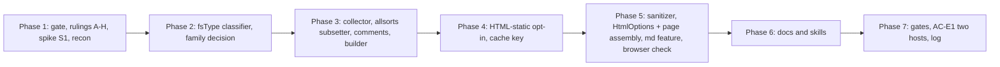

# Plan: Embedded Font for Mermaid Static SVG

Source: [spec.md](spec.md). Decision IDs (`D*`), requirements (`R-E*`) and
acceptance criteria (`AC-E*`) are the spec's. Decisions of the dependency specs
are cited as "Merman D*" (`2026-10-21-merman`) and "Fallback D*"
(`2026-10-22-merman-text-fallback`). The spec is the source of truth; where this
plan and the spec disagree, the spec wins and this plan is corrected.

## Summary and Definition of Done

### The work

An opt-in for Darkmatter's static-SVG HTML output that embeds, once per page,
the font face the diagrams were measured with, so label widths are the same on
every reader's machine. Six strands:

1. **Face choice** (`biscuit-visualized`). Read the resolved face's `OS/2`
   `fsType` and decide, per requested family, whether that face may be embedded
   (D13). If any weight of the family may not be, the whole family is measured
   and embedded as the bundled Inter. The measured face is always the embedded
   face (D6), so the choice happens *before* layout and reaches the cache key
   (D9).
2. **Subsetting and the `@font-face` payload** (`biscuit-visualized`). Collect
   the code points and weights each static SVG uses, subset with `allsorts`
   keeping `cmap`, `OS/2` and `name` (D10), fall back to the unsubset face when
   the browser check or the "no subsetting" bit says so (D11, D13, D16), build
   the TrueType data-URI rule, the page comment (D14) and the Inter OFL line
   (D15).
3. **Render-path wiring** (`biscuit-visualized`). Add the opt-in to the "HTML
   static" target (Merman D60), a per-render Inter substitution that does not
   touch process state, and a distinct output format in the cache key.
4. **Darkmatter.** `HtmlOptions::embed_mermaid_font`, `md --feature
   embed-mermaid-font`, page assembly (union of code points across all of a
   page's diagrams, one rule per face and weight, comments immediately before
   the `<style>`), and the sanitizer's narrow `data:font/ttf` admission inside
   `@font-face` `src` (D12).
5. **Docs and skills** (R-E10, AC-E11).
6. **Final verification**, including the two-host width comparison (AC-E1).

### Definition of done

- AC-E1 … AC-E15 pass; every one except AC-E1 at L1 with injected font sets, so
  results do not depend on the fonts installed on the test host. No test gives
  a real terminal or browser window focus (headless Chrome only).
- `just test` and `just lint` are green in `biscuit-visualized` and `darkmatter`.
- The default `<pre class="mermaid">` path and every render without the opt-in
  are byte-identical to before (AC-E9).
- A Restricted resolved face never reaches a page: no code path embeds a face
  whose `fsType` was not read and classified (R-E13).
- The implementation log records: the spike outcome (S1), the `OFL.txt`
  Reserved-Font-Name finding (AC-E8), the chosen `allsorts` version, and the
  Chrome result (AC-E12).
- The spec stays in place; the implementer's terminal state is "implementation
  complete, ready for review".

### Skills the implementers load

`biscuit-visualized`, `darkmatter`, `rust-testing`, `rust`, `os` (before
claiming any host cannot be reached for AC-E1, and before touching path code),
`biscuit-hash` (cache key work only), `clap`, `just`, `cssparser` (only if
Ruling G picks it).

### Task conventions

- Every task names the crate it edits. Tasks in one wave edit disjoint files.
- Any task that changes a symbol's behavior also updates its `///`/`//!` docs in
  the same change (repo comment-drift rule).
- Do not run `cargo fmt`. Do not commit.
- Evidence that invalidates a decision's premise is handled under the spec's
  D17 (bounded implementer autonomy): proceed only with an option that meets
  its three conditions, then amend the spec, log it under "Decided during
  implementation", and flag it for review; otherwise stop and set
  `human_review`.

## Phase 1: Prerequisite Gate, Rulings, Spike

Nothing in this phase changes shipped code.

### Prerequisite gate (blocks Phases 2–5)

- [x] **Merman cutover landed.** This spec rides on `2026-10-21-merman`. At the
  time of planning, `biscuit-visualized/src/Cargo.toml` still depends on
  `mermaid-rs-renderer`, there is no `src/assets/fonts/inter/`, and there is no
  font chain, "HTML static" target, resolved-face cache identity, or
  `svg_sanitizer` filter allowance (D64). Confirm each of these exists before
  starting Phase 2:
    - the font chain (Merman D32, D50) and the bundled Inter with `OFL.txt`
      (Merman D40);
    - the "HTML static" target on `mermaid::MermaidDiagram` (Merman D60) and
      Darkmatter's `MermaidMode::Image` → static-SVG path (Merman D37);
    - the cache key with resolved-face identity (Merman D41, D63);
    - `MERMAID_FONT` handling (Merman D32 step 1, D51).
- [x] **Text fallback landed.** *(Checked 2026-10-24: NOT landed; only task 5.3 needs it. Proceeding; see the implementation log's `decisions_for_review`.)* `2026-10-22-merman-text-fallback` introduces the
  `--feature` convention (Fallback D4) this spec's `embed-mermaid-font` uses
  (spec D3). Confirm `md` has the repeatable, comma-separated, case-insensitive
  `--feature` flag with usage errors for unknown names.
- If either is missing, stop and report; do not build stand-ins for them. The
  spike (S1) is the one exception: it needs only a copy of Inter and does not
  touch the repo's crates.

### Necessary Rules

The spec leaves these open. Each carries a recommendation so the author can
accept with one word. Record each ruling and its date in the implementation log
(`implementation-log.md` in this folder, created by the first task that needs
it). Implementers may not start the affected phase until it is decided.

- [x] **Rule A — how the opt-in substitutes Inter (blocks Phase 3).** D13 says
  "as if `MERMAID_FONT=Inter` were set for that render". `MERMAID_FONT` is
  process-global and `MERMAID_FONT=Inter` forces *every* family to Inter, while
  D13 decides **per requested family**. Recommendation: do not set the
  environment variable. The font chain takes an explicit per-render
  `FamilyOverride` (requested family → "use bundled Inter"), and the opt-in
  computes it before layout. `MERMAID_FONT` itself keeps its Merman meaning and
  is read as usual; an explicit `MERMAID_FONT=Inter` means every family is Inter
  and the page comment says so (D14, second reason).
- [x] **Rule B — which weights decide embeddability (blocks Phase 2).** D13
  says "if any weight the page uses" resolves to a non-embeddable face, the
  family is Inter. Weights actually used are only known after layout, but the
  face must be chosen before layout. Recommendation: decide on **both** weights
  the renderer can request (regular and bold), regardless of which the page ends
  up using. This is conservative (a family whose unused bold face is Restricted
  becomes Inter) and deterministic, and it satisfies AC-E13's bold-Restricted
  case. Alternative: lay out twice. Rejected as costly for a rare edge.
- [x] **Rule C — what counts as an embeddable outline format (blocks Phase 2).**
  The spec embeds a `font/ttf` data URI with `format("truetype")` and the
  sanitizer admits only `data:font/ttf` (D2, D12). `allsorts` subsetting a
  CFF-flavored OpenType face (`.otf`) yields CFF outlines, not TrueType, and
  host sans-serifs on macOS are often variable (`fvar`) or inside `.ttc`
  collections. The spec is silent on all three. Recommendation:
    - a face is embeddable as TrueType only if it has `glyf` outlines and no
      `fvar` table; a CFF/CFF2 or variable face is treated like a Restricted
      one and the family becomes Inter, with a new D14 reason ("outline format
      not embeddable as TrueType");
    - a face inside a `.ttc` is fine when subsetting extracts the one face
      (the face index already rides in the cache key, Merman D63);
    - the unsubset fallback of D11 applies to the same faces only (it never
      emits a CFF or variable file labeled `font/ttf`).
  Alternative: admit `font/otf` in the sanitizer and emit `format("opentype")`
  for CFF. Rejected unless the author prefers it, because it widens D12 and
  R-E6 as written.
- [x] **Rule D — the page cache boundary (blocks Phase 4).** Each diagram is
  cached on its own (Merman D41), but the subset covers the *union* of a page's
  code points (D4), which no single diagram knows. Recommendation: cache the
  **measured static SVG** per diagram under the new output format (R-E9, D9);
  never cache the subset or the `@font-face` payload. Subsetting runs per page
  render from the cached SVGs, which is cheap and keeps every cache entry
  independent of the other diagrams on the page. The cache entry also stores,
  next to the SVG, the sorted code-point set and the weights used, so a cache
  hit needs no SVG re-scan.
- [x] **Rule E — code-point source (blocks Phase 3).** "The page's labels" (R-E3,
  AC-E3) must be defined. Recommendation: the set of Unicode scalar values in
  the character data of every `<text>` and `<tspan>` of the final static SVG
  (after the HTML-static post-process), plus U+0020 and U+FFFD-free control
  filtering (drop C0/C1 controls), with a weight of `bold` when the element or an
  ancestor resolves `font-weight` to `bold` or ≥ 600. Code points the face does
  not map are skipped (R-E8), not substituted.
- [x] **Rule F — what the page-level `<style>` passes through (blocks Phase 5).**
  D12 and R-E6 put the `data:font/ttf` admission in "the sanitizer", but the
  example markup places the `<style>` outside the `<svg>`, where
  `sanitize_svg` never runs. Recommendation: both. (1) Darkmatter emits the
  page-level `<style>` and comments itself, outside `sanitize_svg`, from values
  it built (base64 of bytes it just produced, family names escaped). (2) The
  sanitizer gains the narrow admission anyway, as one reusable, fail-closed CSS
  check (`@font-face` `src` only, `data:font/ttf;base64,` only), and Darkmatter
  runs its own generated style through that same check before emitting, so the
  rule has one definition and a regression in either place is caught.
- [x] **Rule G — how the CSS check scans (blocks Phase 5).** `css_is_safe`
  today lower-cases and substring-scans for `url(` and `@import`. Telling an
  `@font-face` `src` descriptor from any other `url(` needs block structure.
  Recommendation: a small hand-written scanner over the style text that
  recognizes `@font-face { … }` blocks and `src:` declarations inside them,
  fails closed on anything it does not recognize, and is covered by the
  Input Robustness Matrix below. Use `cssparser` only if the scanner exceeds
  roughly 150 lines; the dependency is already in the repo's skill set but adds
  a crate to Darkmatter.
- [x] **Rule H — comment escaping beyond `--` and `>` (blocks Phase 3).** D14
  removes `--` and `>` from font names. A name ending in `-` followed by the
  comment's own closing `-->` would form `--->`, and `<!--` inside a comment
  is legal but confusing. Recommendation: after removing `>` and every `--`
  (repeat until none remain, so `---` cannot leave one), also strip control
  characters and newlines and remove `<`; a trailing `-` is dropped. Apply the
  same cleaning to the CSS comment (D15) and escape `"`/`\` in `font-family`
  and `url()` contexts, and `*/` in the CSS comment.
- [x] **Rule I — what "unsubset" does with the 60 KB budget (no code
  decision).** D2/D11 say embed and log. Confirmed, no ruling needed; recorded so
  the "unsubset host face" log line reads as expected rather than as a failure.
- [x] **Rule J — wider measurement (author's decision).** The spec asks for one
  spike (the D11 browser check) and one cross-host comparison (AC-E1: macOS and
  Linux). This plan runs each once and proposes nothing wider. If the author
  also wants Windows font rendering compared, or a size survey of the macOS and
  Windows sans-serif host faces against the 60 KB budget, that is a separate
  measurement to be requested, not added here.

### Spike decision

One spike, run once, before the work it informs (spec D11 / R-E12; the spec
itself calls it "the first implementation task").

- [x] **S1 — `allsorts` subset in headless Chrome (one host, macOS).**
    - Question: does an `allsorts` subset of Inter (regular and bold) load as an
      `@font-face` in headless Chrome, render every glyph of a test string in the
      embedded face (not in a fallback), and keep `cmap`, `OS/2`, and `name`
      (name IDs 0, 13, 14)?
    - Method: a throwaway crate under this folder's `spikes/s1-subset/` (not part
      of the workspace build). Subset `Inter-Regular` and `Inter-Bold` to a test
      string, wrap as `data:font/ttf;base64,…`, load in a page, and check with
      `document.fonts.check` plus a measured-width comparison against an
      unsubset load of the same face. Run headless Chrome with no window focus
      (`--headless=new`). Read the subset's table directory and `name` records
      back with `ttf-parser`.
    - Inter source: the bundled copy if the Merman cutover has landed; else a
      release downloaded into its own new empty directory (untrusted data; pass
      its path as an argument, run any Python with `-I`).
    - Also record, for the plan's later tasks: the `allsorts` version and API
      names that produce a TrueType subset with `cmap`/`OS/2`/`name` kept (the
      spec asserts this; the spike proves it), subset sizes for a typical label
      set, and whether a `.ttc` host face (Helvetica Neue or Arial) and a
      variable face (San Francisco) subset at all (feeds Rule C).
    - Outcome is exactly one of: **subset used** (Phases 3+ proceed with it) or
      **unsubset fallback taken** (D11: embed the face unsubset, one file per
      weight used; Phase 3 then skips the subsetter but keeps every other step).
      Either outcome is written to the implementation log with sizes. No
      further ruling is needed (spec D11).
    - Not repeated in later phases; AC-E12's final check only re-reads the log
      entry and the shipped subset's table directory.

### Wave 1 (parallel; read-only recon, results into the implementation log)

- [x] **1.1 Dependency recon.**
    - Record the exact crate and module paths of: the font chain entry point,
      the bundled Inter bytes and `OFL.txt`, the "HTML static" target option,
      the cache key builder, the static-SVG post-process, and the place where
      `font-family` is rewritten.
    - Record how `tracing` output is captured in this workspace's tests (needed
      for AC-E6 and AC-E7); reuse the existing pattern, add none.
    - Record whether `ttf-parser` is already a direct dependency of
      `biscuit-visualized` (Merman D32 reads OS/2 with it). `allsorts` is the
      only new crate this spec adds (Apache-2.0; pure Rust), and its transitive
      crates are listed in `docs/dependencies.md` in Phase 6.
- [x] **1.2 Darkmatter recon.**
    - Record where `HtmlOptions` fields are consumed for Mermaid, where the
      static-SVG page chunk is assembled, how `<style>` for the page is emitted
      today, and which tests cover `svg_sanitizer.rs`.
    - Record `md`'s `--feature` enum and where it folds into `HtmlOptions`
      (from the text-fallback work).
- [x] **1.3 `OFL.txt` Reserved Font Name check (AC-E8).**
    - Read the bundled `OFL.txt` (or, before the cutover, the release's) and
      record whether it declares a Reserved Font Name. If it does, Phase 3 uses
      the `bv-mermaid` family name for the embedded Inter (D8) in both the
      `@font-face` and every label's `font-family`; if not, it uses `Inter`.
      Record the exact copyright line used by D15.

### Validation checkpoint 1

- Gate checked, rulings A–H decided or accepted as recommended and logged,
  S1 outcome logged, recon notes written. Phase 2 does not start until all
  hold.

## Phase 2: Face Choice by `fsType` (`biscuit-visualized`)

Pure logic first, so it can be tested without a browser or a render.

### Input Robustness Matrix — font face reader

This phase adds code that reads the `OS/2` table of a font file and decides
from it. The load-bearing values are `fsType`, the presence of `OS/2`,
the outline tables (`glyf`, `CFF `, `CFF2`), and `fvar`.

**Default outcome (stated once):** any face whose embeddability cannot be
established — unreadable font data, missing or truncated `OS/2`, an `fsType`
this plan does not classify — is **treated as Restricted**: the family becomes
Inter, a D14 comment names the reason, and a warning is logged. Fail closed;
never embed a face we could not classify.

Exceptions, each with a test through the public decision function (not through
a private parser):

| Shape | Outcome |
| --- | --- |
| `fsType` `0x0000` (Installable) | embed |
| `0x0008` Editable, `0x0004` Preview & print | embed |
| `0x0002` as the only permission bit | Restricted → Inter |
| several permission bits (`0x0006`, `0x000A`, `0x000E`) | least restrictive wins (D13) |
| `0x0200` bitmap-only set (with or without `0x0000`-style permission bits) | Restricted → Inter |
| `0x0100` no-subsetting set, otherwise permitted | embed **unsubset** |
| `0x0100` set together with `0x0002` | Restricted (restriction wins) |
| reserved bits set (0x0001, 0x00F0, 0xFC00) | ignored for classification, logged once at debug; the permission bits still decide |
| `OS/2` absent | Restricted → Inter |
| `OS/2` present but shorter than the `fsType` offset | Restricted → Inter |
| face has `CFF `/`CFF2`, or `fvar` (Rule C) | Inter, reason "outline format not embeddable" |
| chain reaches no installed face | Inter, reason "no installed face" (D14, fourth) |

Document shapes (the loader that turns bytes into a face, tested once):
a font collection (`.ttc`) with the requested face index, an index out of
range, and trailing garbage after a valid face. The face reader is
`ttf-parser`, shared with the Merman chain, so these are tested once on the
shared loader call, not per field.

Field-shape rows for `fsType` are enumerated above because it is a bit set,
not an optional or collection field; the standard absent/null/wrong-type rows
do not apply to it.

### Wave 1 (parallel; disjoint files)

- [x] **2.1 `EmbedPermission` classifier.**
    - In a new module of `biscuit-visualized`'s Mermaid code: read the raw
      `fsType` from the `OS/2` table bytes (offset 8) with `ttf-parser`'s raw
      table access, not the library's pre-digested `Permissions` helper, because
      D13 needs the raw bits (least-restrictive rule, `0x0200`, `0x0100`).
    - Return a small enum: `Embed`, `EmbedUnsubset { reason }`, or
      `Refuse { reason }`, where `reason` is the closed set D14 and Rule C need.
    - Unit tests: every row of the matrix above, using synthetic `OS/2` tables
      built in the test (a minimal valid font built with a test helper, with
      `fsType` set per case). AC-E13.
- [x] **2.2 Comment and name text hygiene.**
    - A pure function that cleans a font name for an HTML comment and a CSS
      comment and `font-family`/`url()` contexts per Rule H.
    - Property-style tests: for random and crafted names (`a--b`, `a-->b`,
      `---`, `*/ x`, `"`, `\`, newline, `<!--`), the cleaned text contains none
      of `--`, `>`, `<`, `*/`, a newline, and cannot end either comment early.
      AC-E14's crafted-name case.

### Wave 2 (depends on 2.1)

- [x] **2.3 Family decision.**
    - `choose_embedded_faces(requested_families, font_chain) -> EmbeddedFaces`:
      for each requested family, resolve regular and bold through the Merman
      chain (Rule B), classify each with 2.1, and produce either the resolved
      face(s) or Inter for the whole family, plus the D14 reason.
    - A family that resolves to a permitted regular and a Restricted bold is
      wholly Inter (AC-E13, last clause). `MERMAID_FONT=Inter` yields Inter for
      every family with the "selected by `MERMAID_FONT=Inter`" reason.
    - `MERMAID_FONT` set to a permitted installed family measures and embeds that
      family; set to a Restricted one gives Inter; unset gives the chain's pick.
    - Tests with an injected font set (the Merman chain's test seam, from recon
      1.1): one face per `fsType` case, `MERMAID_FONT` permitted / Restricted /
      `Inter`, and an injected set with no installed face. Each asserts the
      **measured** and the **embedded** face are the same. AC-E5.

### Validation checkpoint 2 (L1 in `biscuit-visualized`)

- `just test` green. Matrix rows all covered. Grep for the code smells below
  returns nothing in the new module.
- **Smell grep (run now and again at Phase 5):** `#[serde(default)]` on a
  load-bearing field; `unwrap_or_default()`, `.ok()`, or `filter_map(.. as_str())`
  on a load-bearing parse; `Option<T>` where "absent" and "null" must differ.
  Fix findings in place.

## Phase 3: Subsetting and the `@font-face` Payload (`biscuit-visualized`)

Depends on Phase 2 and on S1's outcome.

### Wave 1 (parallel; disjoint files)

- [x] **3.1 Code-point and weight collector.**
    - Walk the final static SVG (Rule E) and return `UsedGlyphs { regular:
      BTreeSet<char>, bold: BTreeSet<char> }`. Use the same XML reader the
      post-process already uses, not a regex.
    - Tests: two diagrams with overlapping and differing labels; a bold label;
      entity-escaped text (`&amp;`, `&#x1F600;`); text inside `<tspan>`; an SVG
      with no text (empty sets, no `@font-face` later). Feeds AC-E3.
- [x] **3.2 `allsorts` subsetter.**
    - Add the `allsorts` dependency (version from S1) to `biscuit-visualized`.
      Provide `subset(face_bytes, face_index, &code_points) -> Result<Vec<u8>,
      SubsetError>` that maps code points through the face's `cmap` to glyph ids
      (skipping unmapped ones, R-E8), subsets, and keeps `cmap`, `OS/2`, `name`
      (D10, R-E11).
    - Unsubset path: `EmbedUnsubset` faces and the D11 fallback return the face's
      own bytes (for a `.ttc`, the single face extracted; never a collection).
    - Tests: the subset's table directory contains `cmap`, `OS/2`, `name`; every
      requested mapped code point is in the subset's `cmap`; an unmapped one is
      absent; Inter's name IDs 0, 13 and 14 are present (AC-E8, AC-E12 table
      check). If S1 chose the unsubset fallback, this task implements only the
      unsubset path and AC-E12 records that.
- [x] **3.3 Page comment and attribution text.**
    - Build the D14 HTML comment for each reason (resolved face with its
      permission; Inter by `MERMAID_FONT=Inter`; Inter because Restricted /
      bitmap only / no readable `OS/2` / outline format; Inter because the chain
      reached no installed face), the "embedded unsubset, and why" clause
      (D11 fallback, or the no-subsetting bit), and the D15 one-line CSS comment
      from the copyright line in recon 1.3. Names pass through 2.2.
    - Tests: one assertion per reason string and per unsubset reason (AC-E14),
      the crafted-name case, and the exact D15 line for Inter (AC-E15).

### Wave 2 (depends on 3.1–3.3)

- [x] **3.4 `FontEmbedding` builder.**
    - `build_font_embedding(&EmbeddedFaces, &[UsedGlyphs]) ->
      Result<FontEmbedding, FontEmbeddingError>`: unions the per-diagram sets
      (D4), subsets per face and weight actually used (a weight no label uses is
      not embedded, D1), and returns the exact `@font-face` rules, the comments,
      the OFL line (Inter only), the family name each label must lead with
      (`Inter` or `bv-mermaid` per recon 1.3), and the sizes.
    - Budget (D2): subset above 60 KB per weight (TrueType bytes, before
      base64) is still returned and its size logged at `warn`/`info` with the
      face, weight and bytes (R-E4, AC-E6). Unsubset files follow the same rule.
    - Failure (D7): any subsetting error returns `Err`, and the caller emits the
      diagram without a font; the builder logs a warning naming the cause
      (R-E5, AC-E7). Add an injection seam for the failure test.
    - Emit one `@font-face` per face and weight used (R-E3); `src` is
      `url(data:font/ttf;base64,…) format("truetype")`.
    - Tests: two diagrams sharing a face produce one rule per weight; a bold-only
      page embeds no regular rule; a budget-exceeding label set embeds and logs
      (captured log); an injected failure returns `Err` and logs; the generated
      CSS contains no external `url(`.

### Validation checkpoint 3 (L1)

- `just test` and `just lint` green in `biscuit-visualized`. AC-E3, AC-E6, AC-E7,
  AC-E8 (library side), AC-E12 (table directory), AC-E14, AC-E15 pass in
  isolation from Darkmatter.

## Phase 4: Render-Path Wiring (`biscuit-visualized`)

### Wave 1

- [x] **4.1 Opt-in on the "HTML static" target.**
    - Add an additive flag to the target option (Merman D60), for example
      `embed_font: bool`, default `false`; with it false, output is unchanged.
    - When on: compute `EmbeddedFaces` (2.3) before layout, feed the per-render
      family override (Rule A) to the font chain so the measurer and the
      rasterizer's resolver see the same face, and make the post-process lead
      each label's `font-family` with the embedded family name (D6; Merman D37).
    - Return, next to the SVG, the `UsedGlyphs` and the `EmbeddedFaces`, so the
      caller never re-scans or re-resolves (Rule D).
    - Raster output never receives any of this (Merman D60).
    - Tests: with an injected font set, the label `font-family` begins with the
      embedded family; the measured width equals the width computed with the
      embedded face alone (the measured-vs-drawn oracle already used by Merman
      R-V8); flag off gives a byte-identical SVG.
- [x] **4.2 Cache identity (D9, R-E9, AC-E10).**
    - Add an output format value for "static SVG with embedded font" to the
      cache key (Merman D41). The resolved-face identity (Merman D63) already
      covers the face; the Inter substitution changes the resolved face, so it
      reaches the key without extra fields.
    - Per Rule D, cache the measured SVG plus its code-point and weight sets;
      never the subset.
    - Tests: opt-in key differs from the plain static-SVG key for the same
      source; the same source with a different `MERMAID_FONT` or a Restricted
      versus permitted injected face yields different keys; a plain render after
      an opt-in render is a miss, and the reverse.
    - Uses `biscuit-hash` (workspace rule); no other hash crate.

### Validation checkpoint 4 (L1)

- `just test` green. Without the flag nothing changes; with it, the SVG carries
  the embedded family. `just lint` clean.

## Phase 5: Darkmatter

### Input Robustness Matrix — the `@font-face` CSS check

This phase adds a CSS reader (the sanitizer's `@font-face` admission).
Rulings F and G fix its shape.

**Default outcome (stated once):** any `url(...)` that is not a local `#…`
fragment, and any style text the scanner does not fully recognize, is rejected
exactly as today: the whole `<style>` block is dropped and nothing else
changes (existing behavior of `sanitize_style_element`). Exceptions, the only
admitted shape:

> an `@font-face` block whose `src` descriptor is one or more
> `url(data:font/ttf;base64,<base64>) format("truetype")` entries, with a
> well-formed base64 body.

| Shape | Outcome |
| --- | --- |
| control: valid `@font-face` + `data:font/ttf;base64,…` in `src` | kept |
| `https:` URL in `@font-face` `src` | block dropped |
| protocol-relative `//host/f.ttf` in `src` | block dropped |
| valid `data:` URI plus a second `src` entry with an external URL | block dropped |
| `data:font/ttf` URI in `fill`, `style`, `filter`, or a non-`src` property (`background`, `mask`) | rejected (attribute removed / block dropped) |
| `data:font/ttf` inside another at-rule (`@media`, `@keyframes`, nested) | block dropped |
| `data:image/png`, `data:font/woff2`, `data:font/otf`, `data:text/html` in `@font-face` `src` | block dropped |
| non-base64 form (`data:font/ttf,%00…`), extra parameters (`;charset=`) | block dropped |
| invalid base64 characters, whitespace inside the body | block dropped |
| uppercase `DATA:` / `FONT/TTF` / `URL(` | treated case-insensitively for the scheme and mime; behavior identical to lowercase |
| `@import` anywhere, including in the same block | block dropped |
| unterminated `@font-face` or `url(` | block dropped |
| duplicate `src` descriptor in one rule | block dropped (ambiguous; fail closed) |
| a `<style>` with an `@font-face` inside plus an unrelated safe rule | kept only if every part passes |

Tests run in-process through `sanitize_svg` (the public result: the output
string or `None`). One control case and the invalid shape per row; spawn the
`md` CLI only in 5.3 to prove wiring.

### Wave 1 (parallel; disjoint files)

- [x] **5.1 Sanitizer admission (`darkmatter/lib/src/markdown/render_tree/svg_sanitizer.rs`).**
    - Implement Rules F and G: a `@font-face` `src`-only, `data:font/ttf;base64`
      admission with the shapes above; every other `url(` rule unchanged; the
      doc comment of `sanitize_svg` and `css_is_safe` (which today says
      `url(data:…)` is always rejected) updated in the same change.
    - Expose the check as one function that 5.2 also calls on Darkmatter's own
      generated style.
    - Tests: the matrix, plus the existing sanitizer tests unchanged and green
      (AC-E2). The existing `drops_style_block_with_external_url` and
      local-fragment tests are the regression guard.
- [x] **5.2 `HtmlOptions::embed_mermaid_font` (`darkmatter/lib/src/markdown/output/html.rs`).**
    - Add `pub embed_mermaid_font: bool`, default `false`, with `///` docs that
      say it acts only with `MermaidMode::Image` (D3); `HtmlOptions` is
      `#[non_exhaustive]`, so the addition is non-breaking. Update the `mermaid_mode`
      field docs if they describe static SVG.
    - Page assembly, in the static-SVG path: render every diagram with the opt-in
      (4.1), union their `UsedGlyphs` per embedded face (D4), call
      `build_font_embedding` once, and emit once per embedded family, in this
      order: the D14 HTML comment, then one `<style>` holding the D15 CSS
      comment (Inter only) immediately before the rule, then the
      `@font-face` rules. The HTML comment sits immediately before the
      `<style>` (inside `<style>`, `<!--` is not a comment).
    - On `Err` from the builder (D7), emit each diagram as plain static SVG
      without a font and with no `@font-face`, and nothing else on the page
      changes.
    - Run the generated `<style>` through 5.1's check before emitting; if it
      fails, treat it as a D7 failure and log.
    - Tests: AC-E4 (several diagrams, light and dark theme, exactly one
      `@font-face` per face and weight), AC-E9 (default `false`; with
      `MermaidMode::Off` or the default path, HTML is byte-identical with and
      without the option), AC-E14/E15 at page level (comment immediately before
      `<style>`; OFL line immediately before Inter's rule; none on a host-face
      page), AC-E7 (page-level: no `@font-face` on failure).

### Wave 2 (depends on 5.2; parallel within wave)

- [ ] **5.3 `md --feature embed-mermaid-font` (`darkmatter/cli`).** *(Not done 2026-10-24: blocked. `md` still has no `--feature` flag because the text-fallback work has not landed, and the gate forbids a stand-in. `DarkmatterPage::with_embed_mermaid_font` is ready for the CLI to call; see the implementation log's Phase 5.)*
    - Add `embed-mermaid-font` to `md`'s `--feature` enum (from the text-fallback
      work; do not add a new flag, spec D3), mapped to
      `HtmlOptions::embed_mermaid_font = true`. Unknown names stay a usage error
      with that work's existing message. No frontmatter key (D3): add a test that
      a `embed_mermaid_font:` frontmatter key is not honored.
    - Wiring test through the CLI (spawn once): control (flag absent, no
      `@font-face`), flag present with `--mermaid` static SVG (one `@font-face`),
      flag present without static SVG (output unchanged), case-insensitive
      spelling, and combination with another `--feature` value. AC-E9.
- [x] **5.4 Darkmatter L2 browser check of the page.**
    - A single headless-Chrome test in the existing `tests/browser` harness that
      loads a rendered page with the opt-in, confirms every label glyph renders in
      the embedded face, and that the `@font-face` loaded (no network request for
      a font). Chrome must run headless with no window focus (workspace rule).
      Gated with the existing `require_level!` / `expect_level!` pattern
      (`rust-testing` skill); not a CI-new job.

### Validation checkpoint 5 (L1 + L2)

- `just test` and `just lint` green in `darkmatter` and `biscuit-visualized`;
  `just test-l2` for the browser check. Re-run the smell grep from checkpoint 2
  over the new Darkmatter code.

## Phase 6: Documentation and Skills

All docs describe shipped behavior, name no spec, feature, or fix (AC-E11), and
are written for a developer new to both packages: lead with what the reader can
do, give one compact example per rule, and use a Mermaid diagram where a flow is
easier to see than to read. README files stay overviews.

### Wave 1 (parallel; disjoint files)

- [x] **6.1 Darkmatter docs.**
    - Update `darkmatter/docs/rendering/mermaid.md` (or the page that now covers
      static SVG): the opt-in, `--feature embed-mermaid-font`, the
      `HtmlOptions::embed_mermaid_font` field, an end-to-end example, the page
      comment and attribution, the sanitizer's one `data:` exception, and the
      limits (coverage, budget, failure fallback, no frontmatter key, static SVG
      only).
    - Add the `md` CLI usage line to the area's CLI doc under `docs/`; do not
      grow the README.
- [x] **6.2 `biscuit-visualized` docs.**
    - A new topic page (for example `docs/mermaid-embedded-font.md`) with: why
      embed, a plain explanation of `fsType` and its table (installable, editable,
      preview & print, restricted) and why embedding redistributes a font, the
      face-choice flowchart as a Mermaid diagram, how the subset is made and what
      is kept, the 60 KB budget, the unsubset cases (no-subsetting bit,
      browser-check fallback), the Rule C outline-format limits, the failure
      fallback, and the cache-key effect. Link the page from the area's docs
      index and from the Mermaid page.
    - Record the `allsorts` dependency in `biscuit-visualized/docs/dependencies.md`
      and the root `docs/dependencies.md` (R-E10), with purpose, license and link.
- [x] **6.3 Skills.**
    - Update `.claude/skills/biscuit-visualized/` and `.claude/skills/darkmatter/`
      with the opt-in, the face rule, and where the code lives. Keep entry points
      under 200 lines, linking to the docs.
    - Update the Mermaid pages' "planned" markers left by the Merman work (its
      D37 says font embedding is an opt-in follow-up) so they read as shipped.
    - Update CLAUDE.md only if workspace conventions changed (they should not).

### Validation checkpoint 6

- Search the touched docs for `2026-` feature names and the words "spec" and
  "feature spec"; none may remain (AC-E11). Every link resolves. Docs match the
  shipped behavior, with no "planned" markers left for this feature.

## Phase 7: Final Verification

### Wave 1 (parallel)

- [x] **7.1 Workspace gates.**
    - `just test` and `just lint` in `biscuit-visualized` and `darkmatter`;
      `cargo check --workspace` proves no consumer broke on the additive option;
      `cargo tree -p biscuit-visualized` shows `allsorts` and nothing unexpected
      (R-E10's dependency record matches reality).
    - The plain static-SVG HTML and the default `<pre class="mermaid">` HTML on a
      representative page are byte-identical to the pre-change output (AC-E9).
- [x] **7.2 AC-E1: two-host width comparison (run once).**
    - Render one multi-diagram page with the opt-in on the macOS host and on a
      Linux host (load the `os` skill for how to reach `build-linux`), open each
      in headless Chrome without window focus, read every label's bounding box,
      and compare: widths equal within 0.5 px for labels the embedded face
      covers. Run the page twice on each host, once with the host's own fonts
      and once with a host that lacks the original face, as AC-E1 describes.
    - Record the page, the faces chosen on each host, and the results in the
      implementation log. A Windows run is not part of AC-E1 (Rule J).
- [x] **7.3 AC-E12 record.**
    - Confirm the log holds the S1 outcome (subset used, or unsubset fallback
      with sizes), the `OFL.txt` Reserved-Font-Name finding, and the chosen
      `allsorts` version. Re-read the shipped subset's table directory in a test
      (3.2) rather than rerunning S1.

### Validation checkpoint 7 (final)

- AC-E1 … AC-E15 each mapped to a passing test or log entry in the
  implementation log. `git status` shows only intended files. Terminal state:
  "implementation complete, ready for review". Do not move the spec to
  `_completed`, do not run `just complete`, do not commit.

## Dependency and Parallelism Overview

- Phase 2 Wave 1 (2.1, 2.2) and Phase 3 Wave 1 (3.1, 3.2, 3.3) touch disjoint
  files and can run concurrently across phases if the Phase 2 classifier's type
  names are fixed first; 3.2 needs only S1, not Phase 2.
- 5.1 (sanitizer, Darkmatter) needs only Rules F and G and can start as soon as
  the Phase 1 gate passes; it is independent of Phases 2–4. 5.2 needs Phase 3's
  builder and Phase 4's output.
- Docs 6.1–6.3 are parallel; 7.1–7.3 are parallel.

## Risks the Plan Manages

- **Dependencies are not landed.** The Merman cutover and the text-fallback
  `--feature` convention are prerequisites; the Phase 1 gate stops the work
  rather than building stand-ins.
- **`allsorts` may not keep `name` or `OS/2`, or the subset may not load.** S1
  proves it once, and D11's fallback (unsubset) is already decided.
- **Host faces vary in shape** (variable, CFF, collections). Rule C fails closed
  to Inter instead of mislabeling a file as `font/ttf`.
- **Redistribution of a proprietary font** if classification is wrong: the default
  outcome of the Phase 2 matrix is Restricted, and `fsType` is the vendor's
  declaration, not the license (spec Risks); the D14 page comment names the face
  so a publisher can check.
- **A sanitizer loosening** is the only security-relevant change. It admits one
  exact shape, fails closed, and has a single definition (Rule F) with a full
  negative matrix (AC-E2).
- **Large unsubset host faces** can exceed the budget. D2 is embed-and-log; the
  size is visible, not prevented.