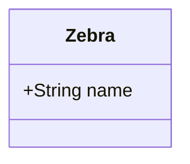

# Review 2: not production ready

Two independently reproduced font defects need repair. The command-line option remains unbuilt, the reported browser comparison does not satisfy the written measurement criterion, and the conservative permission check differs from the specified check of weights actually used. There are five findings, all listed above. No production code was repaired during this review.

The first review stopped for design decisions rather than reviewing the implementation. This review continues the implementation review as requested without treating the repair log's completion claim as approval of those decisions. No author rulings resolving the five questions appear in the reviewed documents; `review-1.md` still has `human_resolved: false`.

## Previous Finding Verification

The previous review has `findings: []` and explicitly says there were no findings. Its repair's `### Finding Ledger` accordingly contains no defect-instance rows: the five remaining rows are author decisions. The table includes all five so none disappears between cycles. These references name the question in `review-1.md`; they are not invented prior defect IDs.

| Finding ID and title | Required instances | Outcome | Verification evidence | What remains |
| --- | --- | --- | --- | --- |
| No formal findings in `review-1.md` | Zero repair instances | verified fixed | Read the entire prior review and repair ledger; neither requests a code repair or claims one occurred. This outcome means the empty repair inventory is accounted for, not that the feature is verified fixed. | Full implementation review, performed below. |
| `review-1.md` — Simpler typography to keep small subsets | Subsetter output; opt-in measurement; recorded browser check | unresolved | `embed/subset.rs` still uses the minimal allsorts profile without layout tables; `fonts/measure.rs` still disables layout tables for every opt-in measurement. The original spike's outcome remains recorded in `implementation-log.md`, “Spike S1.” | Author's existing typography choice. R2-F1 separately identifies the broken whole-font branch, not a request to reverse the subset decision. |
| `review-1.md` — An unused bold face can trigger Inter substitution | Regular and bold resolution; family substitution; resulting SVG and page font | still blocked | `embed/faces.rs::choose_family` still classifies both weights before layout. Review probes reproduce substitution on regular-only and bold-only diagrams. | Existing author choice about the two-weight rule; R2-F5 formalizes the remaining specification discrepancy. |
| `review-1.md` — Variable and CFF fonts become Inter | Variable, CFF/CFF2, missing `glyf`, static TrueType and collections | unresolved | `embed/permission.rs::classify` still refuses the first three shapes; permission tests cover the restrictions, and collection/subset tests cover individual TrueType extraction. No subsequent format ruling is recorded. | Author's existing supported-format decision; no additional format machinery is requested by this review. |
| `review-1.md` — Command-line option and tests deferred | Shared feature flag; embedding option wiring; CLI test; frontmatter non-opt-in test | still blocked | No `embed-mermaid-font` or `long = "feature"` wiring exists under `darkmatter/cli/src`; the repair ledger and current topic documentation both acknowledge the missing interface. Library/page option tests pass. | Prerequisite and implementation remain absent. R2-F3 records the unfinished contract without treating a deferral as a scope reduction. |
| `review-1.md` — Advance widths accepted instead of bounding boxes | Both generated pages; every label's specified bounding-box comparison | still blocked | Re-read the underlying implementation log, section “7.2 AC-E1”: four of 56 comparisons exceed 0.5 px, with maxima 0.673 and 0.969 px. The spec still requires bounding boxes within 0.5 px. | Existing author choice of measurement/tolerance or a repair meeting the original criterion; R2-F4 records the mismatch. |

The repair log's “complete” describes an empty repair inventory. It does not establish that any of these five questions was resolved. There is no partially repaired formal finding and no newly discovered sibling of a previously repaired formal finding.

## Unblocked Findings

### R2-F1 (high): Whole-font embedding retains shaping that layout disables

**Authority — defect and spec:** a permitted font marked “no subsetting” is explicitly supported by the spec's face-selection decision and acceptance criterion AC-E13: it is embedded **unsubset**. The measurement decision requires layout to match the embedded face. With a normal label such as `AVAVAVAVAVAVAVAV`, the implementation measures unkerned text but embeds the entire font with its kerning and substitution tables intact. The browser therefore draws narrower text than layout measured.

**Class:** measurement selects shaping behavior from the opt-in flag instead of the actual file emitted for the chosen weight.

In `biscuit-visualized`, [`LabelMeasurer::shape`](../../src/src/fonts/measure.rs:150), which supplies Merman's label widths, sets `layout_tables: self.chooser.is_none()`. Every opt-in disables shaping, including whole-font faces. Meanwhile [`whole_face`](../../src/src/mermaid/embed/subset.rs:54) preserves all tables and [`face_file`](../../src/src/mermaid/embed/embedding.rs:175) selects it when `unsubset` is true. No emitted CSS disables the retained shaping in the browser.

Reproduction used the existing injected-font fixture: copies of bundled Inter renamed Arial, changing only each weight's `fsType` to `0x0100`. Render a static opted-in diagram through the existing render seam and public `page_font`, decode the actual emitted font, and shape the label with rustybuzz's default features at 16 px. Compare that independent shaping of the emitted file with the width supplied by the opt-in measurer. A flowchart containing the label reproduces the regular-weight case. A class diagram supplies both emitted weights for the sweep.

| Child ID | Site | Shape tested | Observed result | Expected result |
| --- | --- | --- | --- | --- |
| R2-F1.1 | Regular measurement → regular whole-font output | Both weights forbid subsetting | Layout 176.625 px; emitted font shapes to 160.21875 px | Same advance width |
| R2-F1.2 | Bold measurement → bold whole-font output | Both weights forbid subsetting | Layout 191.125 px; emitted font shapes to 172.140625 px | Same advance width |
| R2-F1.3 | Per-weight decision → measurement | Only regular forbids subsetting | Regular has the same 16.40625 px discrepancy | Whole-font regular retains matching shaping; subset bold retains plain measurement |
| R2-F1.4 | Per-weight decision → measurement | Only bold forbids subsetting | Bold has the same 18.984375 px discrepancy | Whole-font bold retains matching shaping; subset regular retains plain measurement |
| R2-F1.5 | Regular and bold subset output | Neither weight forbids subsetting | Clean: existing `the_measurer_uses_plain_advances_with_the_opt_in` passes against each emitted subset's `hmtx` advances | Keep plain measurement for minimal subsets |
| R2-F1.6 | Whole-font collection extraction → measurement | A permitted collection member forbids subsetting | Same defect by invariant: `whole_face` copies every table and the measurer's unconditional flag does not inspect container or permission. Existing collection extraction test verifies all tables survive. | Same shaping for a whole standalone face and the same face extracted from a collection |
| R2-F1.7 | Other render targets | Plain HTML-static SVG, raster-safe SVG, PNG | Clean: opt-in is inactive; existing byte-comparison and measurement tests pass | Existing rendering behavior |

The common measurer also supplies gitGraph tag-spacing calculations and all Merman label measurements; there is no separate whole-font-aware calculation in those consumers. Fix this centrally by choosing shaping behavior per selected face/weight according to whether its emitted file retains layout tables. Add regular, bold, and mixed-permission regression checks against the actual emitted files. This is a small measurement repair, independent of the pending choice about typography in subsets; it does not require another font format or escaping layer. Update the affected measurement comments and topic documentation with the distinction.

### R2-F2 (high): Reusing one face for two weights drops bold-only characters

**Authority — spec:** the per-weight embedding decision requires “Each weight a page uses is subset and embedded separately,” and AC-E3 requires every mapped label character in the subset. A user selecting a family with only one installed face can render a class diagram whose title and members use different weights. The current builder drops characters used only in the title.

**Class:** deduplication uses font-file identity where output identity also includes CSS weight and the characters needed at that weight.

In `biscuit-visualized`, [`build`](../../src/src/mermaid/embed/embedding.rs:131), which constructs the page's font rules, remembers `Vec<ID>` and skips an already-seen face ID. Regular and bold can legitimately resolve to the same face when a family has one weight. Regular is subset first; bold is then skipped entirely, including its character set.

Reproduction: use the existing renamed-Inter Arial fixture but inject only its permitted regular face and select `MERMAID_FONT=Arial` in the injected chain. Render this ordinary diagram with the opt-in and call public `page_font`:

The result contains one 400-weight rule. Its decoded `cmap` lacks **`Z` and `b`**, although the original face maps them and the bold title draws them. The browser must use fallback characters inside `Zebra`, defeating the embedded face's coverage and consistent widths. The same problem survives a cache hit.

| Child ID | Site | Shape tested | Observed result | Expected result |
| --- | --- | --- | --- | --- |
| R2-F2.1 | Face selection → regular/bold rule builder | One permitted installed face; class title and members | Both weights resolve to one ID; bold rule and bold-only `Zb` disappear | Cover every character at each used weight; emit the required weight rules |
| R2-F2.2 | Sidecar reader → public page-font builder | Cache hit for the same diagram | Same missing `Zb` and single rule | Cache hit preserves complete coverage |
| R2-F2.3 | Single-face regular-only output | Existing flowchart fixture, fresh and cached | Clean: one rule; no missing regular characters | One regular rule covering the labels |
| R2-F2.4 | Separate regular and bold faces | Same class diagram, inject both weights, fresh and cached | Clean: two rules; no missing regular or bold characters | One complete rule per weight |
| R2-F2.5 | Page aggregation of the same face/weight | Existing multi-diagram union tests and repeated requested-family aliases resolving to Inter | Clean: the builder unions the matching family's characters across diagrams before suppressing a repeated choice; existing page tests pass | One rule covering the union at that weight |
| R2-F2.6 | Bold-only use of a shared ID | Same builder, regular character set empty | Clean by control flow: the empty regular set is skipped before the ID is recorded, leaving bold eligible | One bold rule containing its characters |

Sweep covered the chooser's two IDs, the per-family/per-weight character union, the skip decision, the emitted CSS rule and decoded `cmap`, page aggregation, and sidecar reconstruction. Change deduplication to preserve at least family, weight, and face identity, so two CSS weights can carry different subsets of the same underlying file. Keep suppressing duplicate rules for the same family and weight across diagrams. Add a regression using the single-face fixture and distinct title/member characters; no new font infrastructure is needed.

## Blocked Findings

### R2-F3 (high): The specified command-line opt-in is still unavailable

**Authority — spec:** the exposure decision, requirement R-E1, and AC-E9 require `md --feature embed-mermaid-font` to set `HtmlOptions::embed_mermaid_font`, using the shared repeatable, comma-separated, case-insensitive feature convention. The CLI has neither that shared option nor the embedding wiring. The topic documentation correctly marks it planned; that does not complete the contract.

**Class:** specified user entry point is absent while the underlying library capability exists.

| Child ID | Site | Shape tested | Observed result | Expected result |
| --- | --- | --- | --- | --- |
| R2-F3.1 | `darkmatter-cli` argument parsing and render wiring | `md --feature embed-mermaid-font` | Current binary exits 2 with `unexpected argument '--feature' found`; no embedding-feature implementation exists in `args/cli.rs`, `commands/render.rs`, or other CLI source | Recognize the shared feature convention and set the HTML option |
| R2-F3.2 | CLI verification | Embedding option; unchanged default-mode output; frontmatter cannot enable embedding | Specified CLI wiring and frontmatter-negative tests remain deferred in the implementation log | Tests exercise the completed CLI path and frontmatter boundary |
| R2-F3.3 | Darkmatter library and page entry points | Default option; opted-in static SVG; non-static modes | Clean: six `mermaid_embedded_font` L1 tests pass, including byte-identical non-static output | Preserve existing API behavior |

**Blocker:** the explicitly ordered shared feature-flag prerequisite has not landed. The repair log independently rechecked this and made no code changes. No author scope reduction or authorization to replace that prerequisite is recorded. Finish the flag, wiring, and tests when the prerequisite is available, or obtain an explicit scope change. A standalone alternative flag would not satisfy the current spec. No broader CLI redesign is requested.

### R2-F4 (high): The recorded browser comparison does not meet the specified width criterion

**Authority — spec:** AC-E1 explicitly says to compare “every label's bounding box” on two hosts with widths equal “within 0.5 px.” The implementation log's actual comparison reports four failures of that criterion, then treats matching canvas text advance widths as a pass. The spec has not adopted that replacement metric.

**Class:** verification substitutes a different measurement for an explicit acceptance criterion.

| Child ID | Site | Shape tested | Observed result | Expected result |
| --- | --- | --- | --- | --- |
| R2-F4.1 | macOS-generated page read on both hosts | 28 labels across flowchart, sequence, class, ER, and state | Recorded maximum bounding-box difference 0.673 px; `CUSTOMER`, `ORDER`, and `LINE_ITEM` exceed tolerance | Every label within 0.5 px under the current criterion |
| R2-F4.2 | Linux-generated page read on both hosts | Same family corpus, 28 labels | Recorded maximum 0.969 px; `Yes` exceeds tolerance | Every label within 0.5 px under the current criterion |
| R2-F4.3 | Advance-width diagnostic on both pages | Same labels with embedded fonts | Clean for that diagnostic: reported maximum difference 0.0000 px | Keep as evidence, not an unapproved replacement for bounding boxes |
| R2-F4.4 | No-font controls | Both generated pages | Clean sensitivity control: reported differences up to about 29 px | Removing embedding must reveal reader-font differences |
| R2-F4.5 | Committed browser test | Embedded-face load and character coverage | Clean for its purpose: rerun passed in headless Chrome; it compares same-host canvas measurements and does not assert cross-host bounding boxes | Keep this test; settle the separate acceptance metric |

**Blocker:** the first review already reserved the measurement/tolerance decision for the author, and no ruling is recorded. This review verified the discrepancy directly in the original log and unchanged acceptance text; it did not repeat the two-host experiment or claim independent cross-host results. This finding concerns the known failing metric and the unapproved replacement, not a demand for additional OS proof. The smallest resolution is the existing author decision: amend the measurement/tolerance or retain the original criterion and investigate the affected labels. Do not add a matrix of unrelated browser cases.

### R2-F5 (medium): An unused restricted weight changes the font of permitted labels

**Authority — spec:** the face-selection decision says “if any weight the page uses” resolves to a prohibited face, substitute Inter for the whole family. `choose_family` instead checks both 400 and 700 before knowing which is used. A regular-only flowchart whose regular face is permitted becomes Inter solely because its unused bold face is Restricted. This is an unusual installed-font permission combination, so medium is appropriate.

**Class:** family substitution depends on unused font weights rather than the page's required weights.

The relevant `biscuit-visualized` sites are [`choose_family`](../../src/src/mermaid/embed/faces.rs:126), which makes the substitution, the measurer that applies it, and the sidecar reconstruction that repeats it. The existing test `a_restricted_bold_makes_the_whole_family_inter` establishes the current conservative policy but does not establish that unused weights satisfy the spec.

| Child ID | Site | Shape tested | Observed result | Expected result under the current spec |
| --- | --- | --- | --- | --- |
| R2-F5.1 | Choice → regular-only layout and page font | Existing Arial fixture: regular permitted, bold Restricted; flowchart uses only 400 | Inter substituted for regular-only labels | Keep permitted Arial regular |
| R2-F5.2 | Choice → bold-only layout and page font | Same fixture with permissions reversed; `classDiagram` containing only `class Zebra` | Inter substituted although only 700 is emitted | Keep permitted Arial bold |
| R2-F5.3 | Whole-family rejection when prohibited weight is used | Regular permitted, bold Restricted; class with title and members | Clean: Inter for the family | Inter for both weights |
| R2-F5.4 | No prohibited weight | Both faces permitted; regular-only flowchart | Clean: Arial | Keep Arial |
| R2-F5.5 | Cached choice reconstruction | Recorded requested families passed to `choose_embedded_faces` | Same discrepancy by invariant: reconstruction calls the same unconditional two-weight chooser and does not use recorded weights to decide permission | Apply the settled family policy consistently on fresh renders and hits |

**Blocker:** this is precisely the unused-weight question the first review reserved for the author; the repair made no change and no ruling is recorded. If the conservative behavior is accepted, amend the spec to say so; this is the smallest resolution and requires no additional rendering machinery. If the stated contract is retained, discover actual weight usage before final layout/substitution and cover both symmetric cases above. Do not implement a second layout pass merely because this review listed it as an alternative.

## Recurrence

`recurrence: false`. The earlier review explicitly had no formal findings and its repair changed no source. The CLI, measurement criterion, and unused-weight discrepancies were already identified as unanswered design questions; they are now given repair-inventory IDs, not characterized as regressions or missed siblings of repaired findings. The two reproduced font defects are new findings. Whole-font measurement is distinct from the unresolved choice to simplify typography in **subsets**.

## Requirement and Verification Levels

This feature produces SVG and browser pages and adds no keyboard or terminal interaction. Real-terminal or OS-key-injection verification is not needed. The browser tier is required for actual font loading and use; it is present and was exercised headlessly without taking focus.

| Requirement | Strongest relevant verification | Assessment |
| --- | --- | --- |
| Consistent browser label widths (AC-E1) | Recorded two-host headless-browser experiment | Written bounding-box criterion not met; R2-F4 |
| Sanitizer URL boundary (AC-E2) | L1: 35 SVG sanitizer tests passed; headless-browser test loads generated rules | Positive font data URL and negative external/data URL surfaces exercised |
| Mapped character union (AC-E3) | L1: decoded subset `cmap` assertions; browser: label coverage probe | Standard two-face case passes; single-face/two-weight case fails, R2-F2 |
| One rule per used face and weight, both themes (AC-E4) | L1: public Darkmatter page markup and public page-font aggregation | Standard cases pass; shared-face weight deduplication is incorrect, R2-F2 |
| Face selection and matching measurement (AC-E5, AC-E13) | L1: injected font sets, emitted SVG and decoded files | Standard cases pass; whole-font shaping fails, R2-F1; unused-weight rule awaits decision, R2-F5 |
| Oversize logging (AC-E6) | L1: actual over-budget subset and captured info log | Passed; 60,000-byte threshold tested |
| Subsetting failure fallback (AC-E7) | L1: injected first/second-weight failures and warning; Darkmatter error-to-empty-markup unit checks | Present; no real terminal/browser resource needed to test this branch |
| License, subset tables, first browser check (AC-E8, AC-E12) | L1: decoded font tables and name entries; recorded initial Chrome spike; current headless-browser loading test | Tests pass; log records subset used and Reserved Font Name check |
| Default and CLI exposure (AC-E9) | L1: library/page default and non-static comparison | Library behavior passes; CLI portion absent, R2-F3 |
| Cache isolation (AC-E10) | L1: distinct keys, both insertion orders, sidecar loss/damage and regenerated output | Passed; font defects also propagate through valid cached records |
| Documentation (AC-E11) | Read current topic pages in both areas | Explains permissions, redistribution, coverage, budget, failure and examples; CLI correctly marked planned. Update measurement distinction with R2-F1. |
| Safe comments and OFL placement (AC-E14, AC-E15) | L1: reason cases, crafted names, public-page markup in both themes | Passed |

All seven embedded-font test modules are declared by the library's `tests/mod.rs` and enabled by `image`; the package enables all features in CI. Darkmatter declares `mermaid_embedded_font` in its `l1` target. Its browser target requires `browser-tests`, which is enabled by both the live browser recipe and CI test metadata. The browser test is selected by the browser tier, not L1. The acceptance experiment remains an explicitly recorded spike, not a hidden claim that its code runs automatically in CI.

## Input Robustness

The SVG/CSS character collector and sanitizer are text grammars/rendering machinery, so the requested configuration matrix does not apply to them. Their actual output and admission behavior were reviewed and tested separately above. The added file readers are the font-table reader and internal JSON cache record, not new user configuration loaders.

The default invalid-font outcome is refusal and bundled-Inter substitution; exceptions are the specified permitted `fsType` values and no-subsetting whole-font branch. Existing classifier/subset tests cover missing and short permission tables, malformed faces, invalid collection indices, prohibited outlines, mixed permission bits, reserved bits, no Unicode `cmap`, valid collection extraction, and trailing bytes after a valid font. Binary fixed-width fields have no JSON null/collection-element shapes. The public emitted-file probes above follow the resulting permission and identity values through measurement, rule selection, and coverage.

The cache reader uses required typed `requested`, `families`, `regular`, and `bold` fields without `serde(default)` or optional-field coercion. Invalid/missing records cause a rerender, rather than a successful empty-font default. The existing public-result test exercises missing files, invalid JSON, and missing required structure and asserts a miss followed by a restored hit. Code inspection confirms Serde rejects nulls and wrong field/element types and `from_slice` rejects trailing garbage. Empty structures/strings represent a valid no-text record; this is internal generated cache data, not an author-supplied instruction. No blanket located-error/publication rule is added for this regenerable cache. Duplicate JSON keys are not prohibited by a feature contract; no new duplicate-key protection is requested.

The requested code-smell search found `.ok()` in the sidecar reader; here it implements the intentional cache-miss-and-rerender behavior. The collector's optional CSS values and fallback strings belong to the excluded text grammar, not configuration parsing. No new user config field defaults invalid input to a permissive result.

## Commands and Evidence

- `just test embed_` in `biscuit-visualized`: **76 passed**; all were L1 and below the five-second budget.
- `just test mermaid_embedded_font` in `darkmatter`: **6 passed**.
- `just test svg_sanitizer` in `darkmatter`: **35 passed**.
- `BISCUIT_BROWSER_REQUIRED=1 just test-browser browser_embedded_mermaid_font_draws_every_label` in `darkmatter`: **1 passed** in actual headless Chrome. About 7.7 seconds, correctly outside L1.
- `just check-tier-coverage biscuit-visualized` and `just check-tier-coverage darkmatter` at the root: both passed, **zero stranded tests**.
- `cargo run --color=never --quiet -p darkmatter-cli --bin md -- --feature embed-mermaid-font </dev/null`: current binary rejected the missing flag with exit 2, confirming R2-F3.
- Temporary in-process review probes in the existing declared `embed_render_tests` module used its injected fonts/render seam and the public `page_font` result. Three probes intentionally failed the expected-contract assertions for R2-F1, R2-F2, and R2-F5, including both weights, mixed permissions, fresh/cache-hit coverage, and clean controls. Each probe ran below 0.2 seconds. They were removed after execution; the final Git diff confirms no test or implementation edits are part of this review.

No cross-OS evidence gap, pending human inspection alone, or speculative adversarial input is a finding. Existing unrelated JSON-order failures mentioned by the previous review were not reclassified or rerun as part of this feature review.
