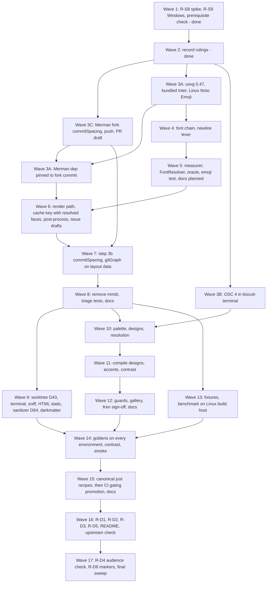

# Plan: Merman Rendering

Source: [spec.md](spec.md). Decision IDs (`D*`), requirements (`R-*`),
acceptance criteria (`AC-*`) and the question IDs (`Q*`) that the decisions
resolve are the spec's. The spec is the source of truth; where this plan and
the spec disagree, the spec wins and this plan is corrected.

## Summary and Definition of Done

### The work

Replace `mermaid-rs-renderer` (`mmdr`) with Merman behind the existing
`biscuit-visualized` public API (D4, D30), and make the result look and measure
correctly. Eight strands, in dependency order:

1. **Foundations (done).** Phase 1 ran the two spikes still owed (R-S8
   gitGraph geometry from layout data; R-S9 Windows PNG leg) and checked the
   prerequisite. Ken ruled every open item on 2026-10-22 (D40–D69).
2. **Merman fork patch.** A `commitSpacing` gitGraph config key on a branch of
   Ken's Merman fork, pushed there and pinned (D56, AC-C2a), with the upstream
   pull request drafted for Ken to open.
3. **Text.** Workspace upgrade to resvg/usvg 0.47 plus `fontique` (D31); the
   bundled Inter (D40) and, on Linux builds, the bundled Noto Emoji as the last
   fallback face (D65); one font-resolution chain (D32, D50, D51, D59) shared
   by our rustybuzz `TextMeasurer` and the rasterizer's usvg `FontResolver`;
   Merman wraps.
4. **Cutover core.** Merman render path, time budget (D28), cache identity with
   resolved faces and font identity (D41, D63, D70), pre-parse step 3b (D55: `\n` rewrite, D34;
   `commitSpacing`, D56), SVG post-process (D33), gitGraph geometry on layout
   data (D5, D36), interim themes (D61), `mmdr` removed, and the six upstream
   issue drafts for Ken to file during the cutover (D52, D66).
5. **Consumers.** `biscuit-terminal`, `sniff`, `worktree` under D43's rewrite
   rule, the "HTML static" target (D60), and `darkmatter`'s static-SVG path and
   sanitizer, drop shadows included (D37, D64).
6. **Terminal palette and styling.** Internal OSC 4 query (D19, D46, D71) in
   `biscuit-terminal` (runs early, in parallel; enabled on native Windows in
   Phase 5); palette type, per-family
   compiled `ThemeDesignV1`, accent post-process, 4.5:1 text everywhere (D6,
   D17, D45), then Ken's gallery sign-off.
7. **Verification.** Golden SVG/PNG corpus with Inter on every CI environment
   (D40, D42), six derived-palette goldens (D47), guard tests, promotion of
   `biscuit-visualized` to CI gating (D42), local benchmark on the Linux build
   host (D35, D44).
8. **Documentation and close-out.** Every R-D requirement, one task each,
   with **planned** markers written by earlier phases and removed at the end
   (R-D6).

### Successful completion looks like

- Every AC in the spec holds: AC-C1–C13, AC-C2a, AC-C6a, AC-C8a, AC-C8b,
  AC-C15, AC-M1–M11, AC-T1–T9, AC-P1–P6, AC-V1–V4, AC-U1, AC-D1–D7, and the
  cutover confirmations AC-S6 and AC-S8. AC-S4 is recorded (D30); AC-T5 is
  Ken's sign-off.
- `cargo tree -i mermaid-rs-renderer` is empty; one usvg (0.47) in
  `Cargo.lock`; Merman pinned to an exact `rev` on Ken's fork carrying
  `commitSpacing`, D58 feature set, no ELK (AC-C2, AC-M5).
- `just test` passes in `biscuit-visualized`, `biscuit-terminal`, `darkmatter`,
  `sniff`, `worktree`; `just lint` is clean in each; every hunk of `git diff
  main -- worktree/cli/src/commands/git_graph/tests.rs` is a mechanics rewrite
  listed in the log (D43, AC-C4).
- `biscuit-visualized` is a gating CI package (`gates = true`) and its goldens
  pass on Linux, macOS, native Windows, and WSL2 (D42, AC-V1, AC-V4).
- `upstream-issues/` holds the six issue drafts and the `commitSpacing` pull
  request draft; no agent has posted any of them (AC-U1, AC-C2a).
- **Documentation:** every file named in Phase 7 describes the shipped
  behavior for a reader new to `biscuit-visualized` and `biscuit-terminal`,
  with examples, linked symbols, and Mermaid diagrams for flows; no **planned**
  marker remains for shipped behavior; no `docs/` page names a spec or plan
  (R-D1–R-D6, AC-D1–AC-D7).
- The terminal state is **"implementation complete, ready for review"**. The
  agent does not run `just complete`, does not move the spec to `_completed`,
  and does not commit unless explicitly told to.

### Working rules for every task

- This is a non-interactive session tree; sub-agents inherit that and must be
  told so in their briefs. Never run `cargo fmt`; never commit; US English.
- Terminal rendering goes through `biscuit-terminal` components; host discovery
  through `sniff`; hashing through `biscuit-hash`; file-format conversion and
  path resolution through `biscuit-file`.
- Tests are nextest (`just test`, `just test-l2`, `just lint`). L2/L3 tests
  must never take window focus. Load the `rust-testing`, `os`, and
  `biscuit-visualized` skills before test or OS-specific work.
- Any behavior change includes a pass over the symbol's `///`/`//!` docs and
  inline comments in the same change.
- **Docs as you go (R-D6).** Every task that lands or fixes behavior writes
  that behavior into the Phase 7 pages it belongs to, in the same change. A
  behavior decided but not yet shipped by the end of a phase is written with a
  **planned** marker; the task that ships it removes the marker. Phase 7's
  final task removes every remaining marker for shipped behavior. Docs follow
  R-D4 from the first line written and never name a spec or plan.
- **Agents never post upstream.** Issue and pull request texts for Merman are
  files in `upstream-issues/`; Ken files and opens them (D52, D56).
- An implementation log lives at `implementation-log.md` beside the spec;
  rulings, departures from the spec, each D43 rewrite, measured sizes, and
  sign-offs are recorded there.
- **Findings that need a ruling do not stop the run** (the spec's D73,
  pre-authorized item 13; amends D72's "otherwise stop"). Handle each one in
  exactly one of three ways:
    1. **Proceed.** The option meets D72's three conditions (pre-authorized
       item 12): amend the spec, log it under "Decided during
       implementation", and flag it for review.
    2. **Flag and continue (the default).** It needs Ken's ruling, but the
       remaining work does not depend on the answer: add it to the log's
       `human_review_items`, set `human_review: true`, mark the affected
       checkpoint item **open** with a pointer to the finding, and carry on
       with every task and phase that does not depend on it. Re-run the open
       item once Ken rules. A red checkpoint item is not by itself a reason
       to stop.
    3. **Stop.** Only when continuing would be wasted or harmful: a later
       task's design or output depends on the answer; the next step is
       irreversible or outward-facing; or data, security, or a shipped
       contract on `main` is at risk. Stop at the first dependent task, not
       before, and say in `message_to_agent` exactly which task is blocked
       and by what.
- **Planned human gates are real stops.** Ken's gallery sign-off (AC-T5)
  before Phase 6 goldens is a stop under rule 3 above, because goldens
  generated before it would be thrown away.

### Input robustness (scope note)

Only two new pieces of code read structured input that changes what is
reported:

- **Merman `layout_json` → our gitGraph structs** (Phase 3, Wave 7).
- **Benchmark baseline JSON** (Phase 6, Wave 13).

The OSC 4 reply parser reads a terminal protocol, not a file or configuration;
its accepted forms are fixed by AC-P1 and its default outcome by R-P2, so the
matrix does not apply to it. `MERMAID_FONT` is a single env string with its
shapes fixed by R-M5/R-M6. Default outcome for both JSON loaders: **a located
error / fallback, nothing partially used**. Exceptions are listed at each task.

---

## Phase 1: Rulings and Remaining Spikes (done)

Goal: no later phase is blocked on an unanswered question; the two open spike
requirements are answered; the prerequisite's state is known.

### Rulings (all decided)

Ken ruled every item on 2026-10-22. Each item states the ruling and the spec
decision that holds it. "Differs from Phase 1" names, in one line, where Phase
1 had recorded the plan's earlier default instead. The implementation log
carries the same table.

1. **Cache key and backend id (Q5) — D41, amended by D63.** Backend id
   `merman@<12-char rev>+bv1`. Key: the source as rewritten by step 3b, the
   output format, a hash of the compiled per-family design JSON, a
   once-per-process content hash of every font file the chain can return
   (bundled faces included), and the identity (content hash plus face index)
   of the face the chain actually resolved for each requested family and
   fallback. Checked before parsing.
   *Differs from Phase 1:* adds the resolved-face identity (D63).
   *Amended after Phase 2 (D70):* only the faces resolved for the stacks and
   generic families and the bundled faces are hashed by contents; every other
   reachable font file is identified by path, size, modification time, and
   face index.
2. **CI tiers (Q8) — D42.** SVG goldens, PNG goldens (AE share ≤ 0.1%, RMSE ≤
   0.005), and OSC 4 parser tests are L1 on every CI environment; this work
   promotes `biscuit-visualized` to gating (`gates = true`, exclusion fields
   removed); the fixtures folder joins `source-inputs` only if tests read it
   through a path CI cannot otherwise see.
   *Differs from Phase 1:* gate now, and PNG goldens on every environment, not
   Linux/macOS only.
3. **Text-art fallback (Q11) — D48.** Out of scope; follow-up
   `2026-10-22-merman-text-fallback`.
4. **Benchmark (Q16) — D44.** Release profile; reference host is the **Linux
   build host**; baseline JSON beside the benchmark; fresh
   `BISCUIT_VISUALIZED_CACHE_DIR` per iteration outside the timed region.
   *Differs from Phase 1:* the Linux build host is the reference, not Ken's
   macOS host.
5. **Contrast (Q18) — D45.** Every text element meets 4.5:1; no large-text
   exception.
   *Differs from Phase 1:* all text 4.5:1; no "large text" size rule.
6. **OSC 4 on native Windows (Q19) — D46.** Not carried: the non-Unix OSC
   query arm is a stub, so native Windows uses background-derived accents and
   the palette docs say so.
   *Amended after Phase 2 (D71):* the Windows query path exists, so by D46's
   own rule OSC 4 runs on native Windows; Phase 5 enables and verifies it.
7. **Derived-palette goldens (Q20) — D47.** Six SVG goldens: flowchart,
   sequence, gitGraph × {full ANSI set, background only}.
8. **Fixtures (Q21) — D49.** `biscuit-visualized/src/tests/fixtures/merman/`;
   ~20 MB cap separately for `spikes/` and fixtures; bundled fonts are library
   source and do not count.
9. **Golden font (Q22) — D40.** Bundled Inter (regular, bold, OFL 1.1) in
   `biscuit-visualized/src/assets/fonts/inter/`, compiled into the library and
   registered as the family `Inter`; goldens set `MERMAID_FONT=Inter`; golden
   inputs use only code points Inter maps.
   *Differs from Phase 1:* bundled, shipping Inter, not a committed test-only
   font directory ahead of step 1.
10. **Font chain step 4 (R-M8) — D50.** Among installed OS/2 sans-serif faces
    (`sFamilyClass` 8): regular and bold present, then widest Latin coverage,
    then proportional over monospace, then the alphabetically first family
    name (case-insensitive).
    *Differs from Phase 1:* D50's ranking replaces "regular, non-italic,
    non-condensed; ties by name, then path".
11. **Fallback face order — D59, amended by D65.** Resolved face, then
    installed faces by case-folded family name, then (Linux builds only) the
    bundled Noto Emoji, last.
    *Differs from Phase 1:* adds the Linux-only Noto Emoji as the last face.
12. **Where tag spacing sits — D55.** Pre-parse step 3b, after the font chain
    and **before** the cache check, so the key covers the rewritten source.
    *Differs from Phase 1:* before the cache check, not after it.
13. **Darkmatter measured face per label — D60, with D64.** An additive "HTML
    static" target on `mermaid::MermaidDiagram`; `biscuit-visualized` rewrites
    `font-family` and allows overflow for it; Darkmatter selects and
    sanitizes. The sanitizer admits `<filter>` and `<feDropShadow>` only, with
    number-or-color attributes besides `id`, `dx`/`dy`/`stdDeviation` ≤ 20,
    `flood-opacity` 0–1; every other `fe*` primitive stays dropped; local-only `url(#…)`
    unchanged.
    *Differs from Phase 1:* adds feDropShadow admission with caps (Phase 1 left
    `filter`/`fe*` to the sanitizer change).
14. **Merman feature set — D58.** `default-features = false`,
    `["svg", "all-diagrams", "layout-cytoscape"]`; `png`, `native-fonts`, ELK,
    and `math` off; math labels show as source.
    *Differs from Phase 1:* same value; math off is now ruled (D58), not left
    to be confirmed.
15. **Interim themes at cutover — D61.** The four themes map to Merman
    built-in themes until the palette phase replaces them.
16. **`tag_gap` — D56 and Design notes.** Reports the clearance between
    adjacent tags that results from the `commitSpacing` written in step 3b,
    read from measured tag widths and layout `pos` (AC-C12).
    *Differs from Phase 1:* derived from `commitSpacing` (D56) instead of an
    unbuildable config route.
17. **`worktree` test edits — D43, with D56.** Fixed rule: topology
    assertions pass unchanged; renderer-mechanics assertions may be rewritten
    to Merman equivalents, split where mixed, each logged with category and
    reason. Tag spacing comes from the `commitSpacing` fork patch, so
    `tag_overlaps()` passes unchanged.
    *Differs from Phase 1:* D43 replaces D22's decision point, and the
    `commitSpacing` fork patch (D56, D57) replaces "wider spacing via gitGraph
    config".
18. **Circles `unsupported-paint` — D62.** Allow-listed per family with a
    comment naming it; the general assertion is not weakened.
19. **Prerequisite state — D7, D46.** `2026-10-13-graphics-where-possible`
    has not delivered native Windows detection; implementation proceeds and
    release waits on it.
20. **Upstream drafts — D52, D66, D56.** Six issue drafts
    (`upstream-issues/01-…md` to `06-…md`, issue 6 being the ER ` `
    comment clip) and the pull request draft
    `upstream-issues/pr-01-gitgraph-commit-spacing.md`; Ken files and opens
    them during the cutover; agents never post upstream.
    *Differs from Phase 1:* six issues plus a pull request draft, not four
    issues filed on Ken's go-ahead.
21. **Emoji fallback font — D65.** Noto Emoji (monochrome, regular, TrueType,
    OFL 1.1), Linux builds only (`#[cfg(target_os = "linux")]`, WSL2
    included), beside Inter, last fallback; Linux test that emoji draw as
    glyphs; goldens exclude emoji.
22. **Documentation — R-D1–R-D6.** The pages, audience rules, and sequencing
    of Phase 7, written as the work proceeds (R-D6).
23. **Benchmark placement — D67.** A non-member crate at
    `biscuit-visualized/bench/` (empty `[workspace]`), so CI schedules no
    `check` cell; `just bench` runs it directly instead of delegating to
    `_bench` (item 11's exception); the baseline JSON lives there.
24. **Measurer crates — D68.** `rustybuzz` and `ttf-parser` are direct
    dependencies of `biscuit-visualized`, pinned to the versions usvg 0.47
    uses (one copy each in `Cargo.lock`); pre-authorized in item 1.
25. **Clean-room check — D69, AC-T9.** At final verification a reviewer
    confirms no Zed copyright or GPL header and no Zed-specific identifiers
    in the changed code; the log records it.

### Merman-spec facts the follow-up specs rely on

These are facts of this spec that `2026-10-22-merman-text-fallback` relies
on. They add **no tasks** to this plan; the tasks that deliver them are the
ones already listed (Phase 2, Waves 3A–5).

- **The bundled Inter (D40).** Regular and bold, OFL 1.1, compiled into
  `biscuit-visualized` and registered as the family `Inter` in the font
  chain's database.
- **The font-resolution chain (D32).** `MERMAID_FONT`, then the CSS stack,
  then the OS generic family, then the D50 rule, used by measurement and
  rasterization only.

The text fallback's requirement that text selection initializes no font chain
(R-F10 there) is stated against these two facts.

`2026-10-21-mermaid-embedded-font` builds on the same two facts: it embeds the
face this chain resolves when the face's `fsType` permits embedding, and Inter
otherwise.

### Spikes

A spike runs once, here, and is not re-run later. No performance spike is
scheduled: S1 and S2 already measured warm and cold renders (D35 rationale), so
the benchmark (Phase 6) is a regression tool, not a spike. No further spike is
needed for fonts or palettes: S0 and S2 answer them. The cutover confirms S3
and the Windows leg on the real implementation (D54, AC-S6, AC-S8).

### Tasks

**Wave 1 — parallel (independent; both inside `spikes/` only, R-S10).**

- [x] **gitGraph geometry spike (R-S8, AC-S6).** New standalone Cargo project
  under `spikes/s3-gitgraph-geometry/` (empty `[workspace]`, seeded with the
  workspace `Cargo.lock`, Merman at the pinned rev).
    - Deserialize `RenderRequest::layout_json` output
      (`layout.GitGraphDiagram`) into our own structs; build a
      `GitGraphGeometry` equivalent (tag bounds from our measurer approximated
      by SVG text widths for the spike).
    - Run a copy of `worktree/cli/src/commands/git_graph/tests.rs` against it
      (or a `[patch]`ed copy of `biscuit-visualized` inside `spikes/`); record
      *which copy ran*.
    - Output: pass/fail list per assertion, the line-2193 `commit_step` result,
      and the effect of widened commit spacing (D36) on spacing assertions.
- [x] **Windows PNG leg (R-S9, AC-S8).** On the Windows test host (see `os`
  skill for reach and traps), render the one S1 diagram with the S1 settings and
  record the pixel difference against the macOS and Linux PNGs with the metric
  used. One host, one diagram; this is the input to the D13 PNG tolerance,
  which D42 sets. Reuse `spikes/s1-comparison` code; do not widen.
- [x] **Prerequisite check (ruling 19).** Read
  `2026-10-13-graphics-where-possible` state and `biscuit-terminal`'s Windows
  detection; record what exists, since Q19 and Phase 2's OSC 4 task depend on it.

**Wave 2 — after Wave 1.**

- [x] **Record rulings.** Write `implementation-log.md` with every ruling and
  the R-S8/R-S9 results. (Phase 1 recorded the plan's earlier defaults; the
  log's table now holds Ken's rulings of 2026-10-22.)

### Validation checkpoint 1

- [x] `implementation-log.md` exists and records every ruling with its value.
- [x] AC-S6 and AC-S8 have recorded results; a go/no-go for "worktree tests
  unchanged" is stated (no-go on stock Merman, closed by D43 and D56).
- [x] No file outside `spikes/` and the log changed (`git status`).

---

## Phase 2: Fork Patch, Workspace Upgrade, Fonts, Measurement, OSC 4

Goal: the Merman fork carries `commitSpacing` and is pinned; the bundled fonts
and the text layer exist and are proven against usvg; the terminal palette
query exists; all before anything renders through Merman. Streams A, B, and C
start together.

### Tasks

**Wave 3 — parallel streams.**

*Stream C — Merman fork patch (D56, D10, R-C2, AC-C2a; independent)*

- [x] **Add Ken's fork as a remote.** In `/Users/ken/coding/forks/merman`
  (only remote today: `origin` = upstream `Latias94/merman`), add Ken's GitHub
  fork as a second remote (name it `ken`; confirm the fork URL with `gh repo
  view --json url` on Ken's account, and that `git ls-remote` reaches it).
  Pre-authorized: item 8.
- [x] **Branch and patch.** Create a branch from the D10 rev
  (`482fcde7faffb05a466f198085d615e604075d97`), for example
  `gitgraph-commit-spacing`. Add the gitGraph config key `commitSpacing` (px,
  default 50, today's behavior), read wherever `COMMIT_STEP`/`LAYOUT_OFFSET`
  set the step in `merman-render/src/gitgraph.rs`, plus config parsing. Add a
  test in Merman's own suite: the default keeps a 50 px step; a set value
  changes consecutive `pos` by that value. Run the fork's relevant tests.
- [x] **Push.** Push the branch to the `ken` remote only. Never push to
  `origin`.
- [x] **Pull request draft.** Write
  `upstream-issues/pr-01-gitgraph-commit-spacing.md` in this spec's folder:
  ready-to-paste title and body (motivation, the S3 evidence, the key's
  semantics and default, the test). Ken opens the pull request; agents never
  post upstream.
    - Prerequisite for: Stream A's Merman dependency task, Phase 3 Wave 7.

*Stream A — dependencies and bundled fonts*

- [x] **resvg/usvg 0.47 upgrade (R-M3, AC-M5).** Find every crate using
  resvg/usvg/tiny-skia (`grep` across `Cargo.toml`s and `Cargo.lock`), bump
  repo-wide to the 0.47 line, fix API changes, and reach a single usvg in
  `Cargo.lock` (`cargo tree -d`). Run `just test` in each affected area and
  review changed PNG/SVG snapshots. This is the highest blast-radius task in
  the plan; do it alone in its own change.
    - Prerequisite for: font chain, measurer.
- [x] **Add fontique, ttf-parser, rustybuzz, Merman (R-C2, D58, D68).** After
  the usvg upgrade and Stream C's push. `biscuit-visualized` only;
  `rustybuzz` and `ttf-parser` pinned to the versions usvg 0.47 uses, so
  `cargo tree -d` shows one copy of each (pre-authorized: item 1); Merman as a git
  dependency on Ken's fork pinned to the `commitSpacing` commit (exact `rev`),
  with `default-features = false` and `["svg", "all-diagrams",
  "layout-cytoscape"]`; bump workspace `serde_json` to `^1.0.154`. `mmdr`
  stays until Phase 3 Wave 8 (both compile together). Check `cargo tree` for
  `png`/ELK/second usvg. Update root and area `docs/dependencies.md` (Phase 7
  finalizes them).
- [x] **Bundle Inter (D40, R-M12, AC-M9).** Add Inter regular and bold,
  `OFL.txt`, and a note of the Inter release under
  `biscuit-visualized/src/assets/fonts/inter/`, compiled in with
  `include_bytes!`. Confirm and record in the log whether `OFL.txt` declares a
  Reserved Font Name (input to `2026-10-21-mermaid-embedded-font` D8). Record
  file sizes. Pre-authorized: item 5.
- [x] **Bundle Noto Emoji on Linux only (D65, R-M14).** Add Noto Emoji
  (monochrome, regular, TrueType), its `OFL.txt`, and a release note under
  `biscuit-visualized/src/assets/fonts/noto-emoji/`, included only under
  `#[cfg(target_os = "linux")]` (WSL2 included). Record the exact file size in
  the log. Pre-authorized: item 9.

*Stream B — OSC 4 (independent of A and C)*

- [x] **OSC 4 query in `biscuit-terminal` (D19, D46, R-P1, R-P2, R-P7, AC-P1,
  AC-P2, AC-P5, AC-P6).** In `discovery/osc_queries`, behind the existing gate,
  internal (not public API).
    - Query indices 0–15, join the existing OSC 10/11 round trip, bounded
      timeout, per-process cache, never mutates the user's palette.
    - Parser accepts `rgb:rrrr/gggg/bbbb`, `rgb:rr/gg/bb`, `#rrggbb`, BEL and
      ST terminators. No/partial/malformed reply ⇒ `unknown` per missing
      entry, never an error (default outcome; no other exceptions).
    - Native Windows: no OSC 4 and no new Windows-specific query code (D46);
      restate the outcome in the log (AC-P6). (Superseded by D71: Phase 5
      enables the query on native Windows.)
    - Tests: parser unit tests (L1); silent fake TTY proving timeout and no
      re-send (call count); redirected stdout and `CI` set send no query. Use
      the Test Toolkit; L2 tests must not take focus.
    - Docs: write the query into `biscuit-terminal/docs/discovery/terminal-queries.md`
      (and `color.md` where it covers palette detection), marked **planned**
      until Phase 5 consumes it.

**Wave 4 — after Wave 3 Stream A (parallel streams).**

- [x] **Font-resolution chain (D32, D50, D51, D59, D65, R-M4–M8, R-M13,
  AC-M3, AC-M4, AC-M8, AC-M10).** New module in `biscuit-visualized`: one
  function used by measurer and rasterizer.
    - Register the bundled Inter as family `Inter` (never a step-4
      candidate) and, on Linux builds, Noto Emoji as the last fallback face
      only.
    - Steps: `MERMAID_FONT` → CSS stack (case-insensitive) → fontique generic
      → D50's ranking over installed OS/2 sans-serif faces.
    - `MERMAID_FONT` unset or empty: silent. Set to a family neither installed
      nor bundled: exactly one warning per process (`Once`/atomic guard), then
      continue (D51).
    - Fallback order per D59 and D65; fontdb holds the same faces in the same
      order.
    - The font set is injectable for tests (internal, not public).
    - Expose, internally, the resolved-face identity (content hash + face
      index per requested family and fallback position) for the cache key
      (D63).
    - Tests: each step reachable with an injected set; case-insensitivity; the
      one-warning guarantee via captured logs; D50 preferences each with ties
      above (AC-M8); `MERMAID_FONT=Inter` with an empty host set (AC-M9);
      DejaVu-only host still resolves (AC-M4); two faces covering a character
      (AC-M10).
- [x] **`\n` → ` ` label lexer (D34, R-M10, R-V9, AC-M6).** Pure
  string-to-string module, independent of fonts: class, ER, mindmap,
  requirement only, via a small per-family label lexer. Never touches
  `%%{init}%%`, `%%` comments, `click` URLs/tooltips, `classDef`/`style`
  values, `accTitle`/`accDescr`. Tests include one input with `\n` in *each*
  excluded construct, and one with `\n` in a non-listed family (unchanged).

**Wave 5 — after the font chain.**

- [x] **rustybuzz `TextMeasurer` (D31, R-M1, R-M2, AC-M1, AC-M2).** Shape each
  label on the chain's face; mirror usvg 0.47 letter-spacing, word-spacing,
  kerning, small-caps and the per-character fallback rule; no SVG parsing;
  measure each candidate string exactly as given (no whitespace collapsing);
  wire through `DeterministicTextMeasurer::with_width_callback` so Merman wraps.
- [x] **Rasterizer `FontResolver` (R-M4).** Replace the rasterizer's font setup
  in `raster/` with a usvg `FontResolver` calling the same chain, with the same
  fontdb faces.
- [x] **Oracle test (R-V8).** Measured width equals usvg 0.47's laid-out width
  for the same chunk (within 1 px per AC-M1) across a Latin, RTL, CJK, emoji,
  combining-mark set, so a future usvg bump re-runs it.
- [x] **Measure-vs-draw face test (AC-M3).** For every label of a wrapping
  corpus, measurer and resolver yield the same face.
- [x] **Linux emoji test (D65, AC-M11).** `#[cfg(target_os = "linux")]`: with
  an injected font set holding no emoji face, an emoji label shapes to no
  `.notdef` glyph and paints pixels in its glyph box; with an injected emoji
  face, that face is chosen over Noto Emoji. Confirm by `cfg` review that
  macOS/Windows builds carry no Noto Emoji bytes.

**Wave 5 docs (with Wave 5).**

- [x] **Docs (planned).** Write the font chain, `MERMAID_FONT` and its
  warning, D50's rule, fallback order, the bundled Inter, and the Linux-only
  Noto Emoji into `biscuit-visualized/docs/merman.md` (create it) and
  `biscuit-visualized/docs/components/mermaid_diagram.md`, each marked
  **planned** until the cutover ships them (R-D6).

### Validation checkpoint 2

- [x] `just test` and `just lint` pass in `biscuit-terminal`,
  `biscuit-visualized`, and every area the usvg bump touched.
- [x] `cargo tree -d` shows one usvg at 0.47; no ELK; no `png` feature pulled;
  Merman resolves from the fork commit.
- [x] The fork branch is on Ken's GitHub fork (`git ls-remote ken`), its test
  passes, and the PR draft file exists (AC-C2a).
- [x] Oracle, font-chain, Linux emoji, and `\n` lexer tests are green; the
  OSC 4 silent-TTY test proves no re-send.

---

## Phase 3: Cutover Core (behind the existing API)

Goal: `MermaidDiagram`, `MermaidTheme`, `MermaidConfig`/`QuadrantTheme`, and the
gitGraph geometry API are backed by Merman; `mmdr` is gone; public signatures
only grow (R-C1, AC-C1). Themes use the interim mapping (D61). Depends on all
of Phase 2 Streams A and C.

### Tasks

**Wave 6 — parallel (disjoint modules).**

- [x] **Merman render path (R-C1, R-C6, R-C8, R-C10, R-C11, R-C15, AC-C7,
  AC-C9, AC-C10, AC-C15).** In `mermaid/render.rs`: `RenderRequest` with
  `SvgPipeline::resvg_safe()`, our measurer (Wave 5), a **unique diagram id per
  document** (content hash + ordinal, never a fixed string — R-T7/AC-T2).
    - Time budget: `OperationControl::with_deadline`, default 2 s, builder
      option on **both** `mermaid::MermaidDiagram` and the component, which
      passes its value through. Exceeded ⇒ render failure ⇒ code-block
      fallback + a warning. Covers `layout_json` requests too. Covers Merman's
      share only (D28).
    - Parse error, unsupported family, ZenUML ⇒ code-block fallback (D20).
    - `MermaidConfig`/`QuadrantTheme` mapped to Merman equivalents (read
      `mermaid/config.rs`); families Merman adds need no family-specific code.
    - `MermaidTheme` uses the interim mapping (D61), with a unit test
      (AC-C15).
    - A math label renders as its source text (D58, AC-C2).
    - Tests: budget test through each type's builder with a low budget,
      asserting fallback, warning, and elapsed time around the Merman call
      only; parse-error, unsupported, and ZenUML cases; no `foreignObject` in
      rasterized output.
- [x] **Cache identity (D41, D63, D70, R-C7, R-P6 prep, AC-C6, AC-C6a,
  AC-P4).** New `MERMAID_BACKEND` value `merman@<12-char rev>+bv1`; key
  inputs: rewritten source, output format, compiled design JSON hash, the
  once-per-process font-set hash, and the **resolved-face identity** of D63.
  Use `biscuit-hash` (`xx_hash`). Cache check happens before parsing
  (pipeline step 4).
    - **Change `font_set_hash`** (and `face_identity` / `query_identities`)
      in Phase 2's `biscuit-visualized/src/src/fonts/` module to D70: read
      and hash the contents only of the faces the chain resolves for the
      design's stacks and the generic families, the bundled Inter, and (Linux)
      the bundled Noto Emoji; identify every other reachable font file by
      path, size, modification time, and face index. Phase 2's version
      hashes the contents of every file (about 1.7 GB on macOS).
    - Tests: an artifact keyed under the old backend id is not served;
      changing only the rewritten source / the output format / one palette
      color / one resolved face's contents / another reachable file's size or
      modification time / the post-process version / `MERMAID_FONT` / the
      injected installed-font set / the fallback order changes the key; the
      contents of a non-resolved, non-bundled file are never read; a family's
      CSS-requested font changes the key without parsing; a counter shows
      font hashing once across two renders.
    - Record the font-set hash time on macOS in the log against D35's
      500 ms cold limit.
- [x] **SVG post-process module (D33, R-M9, AC-M7).** Keep the gradient-stroke
  fix and the `sans-serif` default; delete `apply_svg_overrides`,
  `fix_legend_text_baseline`, `fix_pie_text_contrast` when Merman does not
  need them (R-C4); no `overflow:visible` patch. Guard test (R-V10): class and
  ER dividers are painted in the dark theme.
- [x] **Upstream issue drafts (D52, D66, R-M11, AC-U1).** Write six
  ready-to-paste files in `upstream-issues/` in this spec's folder,
  `01-…md` to `06-…md`, from S1's findings (issues 1–3, 6) and S2's `\n`
  survey (4, 5); issue 6 is the ER attribute comment with ` ` clipping by
  5–7 px under every measurer. Done in this phase so Ken can file them during
  the cutover. Agents never file them; record any issue URL Ken reports in
  the log.

**Wave 7 — after Wave 6 and Phase 2 Stream C.**

- [x] **Pre-parse step 3b (D55, D34, D56, AC-C12).** One step after the font
  chain and **before** the cache key: apply the Wave 4 `\n` lexer, then, for
  gitGraph, measure tags with our measurer and write `commitSpacing` as the
  smallest value giving at least 1 em between adjacent tags, only when tags
  would collide at the default 50 px. A diagram without colliding tags gets
  no `commitSpacing`.
- [x] **gitGraph on layout data (R-C4, R-C5, R-C5a, D5, D36, D53, AC-C11,
  AC-C12, AC-C13).** Uses the R-S8 spike's structs as a start.
    - Deserialize `layout_json` into our own structs (Merman's typed structs
      are not re-exported). **Loader matrix** (default: located error,
      geometry not built, caller falls back):
        - *Control:* the unedited S0 `gitgraph-layout.json` builds geometry.
        - Field validators (one for the commit shape, one for the bounds
          shape; walk shapes once through each): `parents` absent, `null`,
          wrong type (whole field), wrong type (one element), `[]` (explicit
          root commit: **valid**, the one exception); `x`/`y`/`pos` absent,
          `null`, wrong type, empty string. `branch`/`tags` likewise.
          Other commit fields need a control plus one invalid shape.
        - Document shapes: trailing garbage after the JSON value; duplicate
          key (reject, do not last-wins).
        - Test in-process at the crate's public result (returned error with
          location), not by spawning a binary.
        - Grep before declaring done: `#[serde(default)]`, `Option<T>` where
          absent ≠ null, `filter_map(.. as_str())`, `unwrap_or_default()`,
          `.ok()` on these parses.
    - Re-implement `commit_step` and `default_gitgraph_commit_step()` on it;
      keep `tag_gap` as the clearance produced by `commitSpacing` (ruling 16);
      remove merge repair and the "empty branch" merge error (D36).
    - Tests: S1's colliding-tag case and `gathered_graph_lays_out_long_labels`
      show no intersecting tag bounds, and the written value is the smallest
      that gives 1 em (AC-C12).
    - Inputs: the two malformed flowcharts stay as parse-error tests; the
      other invalid inputs get valid replacements (D53); check all test inputs
      against Mermaid.js 12.2.0 (D38) — reference tool is `mermaid@12.2.0`
      from `npm pack`, not the local `mmdc`.

**Wave 8 — after Wave 7.**

- [x] **Remove `mmdr` (R-C3, AC-C2).** Drop the dependency, `image`-feature
  wiring (`dep:mermaid-rs-renderer`), and dead code; `cargo tree -i
  mermaid-rs-renderer` finds nothing; no ELK crate.
- [x] **Triage `biscuit-visualized` tests and snapshots.** Update inline tests
  and the `tests/l1` layout-matrix / parity snapshots; every snapshot change is
  reviewed, not blanket-accepted. Fix `///`/`//!` drift in touched modules.
- [x] **Docs (shipped and planned).** In `biscuit-visualized/docs/merman.md`,
  `docs/components/mermaid_diagram.md`, and `docs/components/git_graph.md`:
  remove the **planned** markers for what Phases 2–3 shipped (font chain,
  bundled fonts, render path, time budget, cache key, step 3b,
  `commitSpacing` and the fork, post-process); write the pipeline diagram;
  mark palette and styling behavior **planned**.

### Validation checkpoint 3

- [x] `just test` and `just lint` pass in `biscuit-visualized`.
- [x] AC-C1 (API diff vs `main`: additions only), AC-C2, AC-C6, AC-C6a, AC-C7,
  AC-C9, AC-C10, AC-C11, AC-C12, AC-C13, AC-C15, AC-M6, AC-M7 verified.
- [x] Six issue drafts exist in `upstream-issues/` (AC-U1).
- [x] A smoke render of every family produces SVG and PNG with the interim
  themes.

---

## Phase 4: Consumers

Goal: every consumer works on the new backend with tests passing.

### Tasks

**Wave 9 — parallel (one area each), except where a dependency is named.**

- [x] **`worktree` under D43 (R-C13, R-C14, AC-C4, AC-S6).** Run `just test` in
  `worktree/`.
    - Topology assertions (commits, parents, lanes, order, tags) must pass
      unchanged; `tag_overlaps()` passes unchanged with `commitSpacing`.
    - Rewrite **only** renderer-mechanics assertions (step constants, exact
      pixel spacing, old-renderer defaults; for example line 2193's
      `commit_step == default_gitgraph_commit_step()` and line 2199's
      `kept.len() >= 2`) to Merman equivalents; split an assertion that mixes
      both and rewrite only its mechanics half.
    - Log each rewrite in the implementation log: test name, line, category
      (mechanics), old and new assertion, reason. Every hunk of `git diff main
      -- worktree/cli/src/commands/git_graph/tests.rs` must be on that list.
    - Edits to the gitGraph test *helper* are pre-authorized.
    - Update `worktree/docs/git-graph.md` where it describes rendering.
- [x] **`biscuit-terminal` lib and `bt` (AC-C3).** `just test` and `just test-l2`
  (no focus stealing); review changed render-tree/diagram-hook snapshots.
- [x] **`sniff` (AC-C3).** `just test`; fix any diagram usage.
- [x] **"HTML static" target in `biscuit-visualized` (D60, R-C9a, AC-C8a).**
  Additive option on `mermaid::MermaidDiagram`; for it only, the post-process
  rewrites each label's `font-family` to the exact measured face followed by
  the original stack, and allows label overflow. Test: rasterized SVG carries
  neither change.
    - Prerequisite for: the Darkmatter integration test below.
- [x] **Darkmatter sanitizer (D37, D64, R-C9, AC-C8, AC-C8b).** In
  `darkmatter/lib/src/markdown/render_tree/svg_sanitizer.rs`:
    - admit Merman's elements and attributes (its single `<style>`, text
      attributes) and nothing broader;
    - admit `<filter>` and `<feDropShadow>` only: attributes other than `id`
      must be numbers (percentages on the filter region count) or colors;
      `dx`, `dy`, `stdDeviation` ≤ 20; `flood-opacity` in 0–1; otherwise the
      element is dropped; every other `fe*` primitive stays dropped; the
      local-only `url(#…)` rule is unchanged;
    - tests: a Merman shadow kept; at-cap kept and above-cap rejected for
      each of `dx`, `dy`, `stdDeviation`; `flood-opacity` outside 0–1
      rejected; a non-numeric, non-color attribute rejected; `feImage` and
      `feTurbulence` rejected; existing external-URL negatives unchanged.
- [x] **Darkmatter static-SVG path (D14, D37, R-C8, R-V7, AC-C8, AC-C8a).**
  After the HTML-static target and the sanitizer tasks.
    - `MermaidMode::Off` unchanged: `<pre class="mermaid">`, no SVG.
    - `MermaidMode::Image` / `BrowserMermaidMode::StaticSvg`: select the
      HTML-static target and sanitize; labels and drop shadows survive.
    - Tests: per-mode HTML test; labels survive; external `url(...)` still
      rejected. `darkmatter/lib/src/mermaid/theme.rs` is not touched (D23).
    - Docs: update `darkmatter/docs/rendering/mermaid.md` for the static-SVG
      output (measured face first, overflow, drop shadows kept within limits).

### Validation checkpoint 4

- [ ] `just test` and `just lint` pass in `biscuit-visualized`,
  `biscuit-terminal`, `darkmatter`, `sniff`, `worktree` (AC-C3).
  **Open (flag and continue):** every package passes except `darkmatter`
  `just test` (45 key-order failures from Merman's serde_json
  `preserve_order`; see the log's "Blocking finding", "Checkpoint 4
  re-run", and "Key-order ruling"). Ruled 2026-10-23; the work is the
  separate fix `2026-10-23-frontmatter-key-order`. No Phase 5–6 task
  depends on it. Re-run `darkmatter` `just test` once that fix lands.
- [x] AC-C4, AC-C8, AC-C8a, AC-C8b, AC-S6 verified; the D43 rewrite list is in
  the log.

---

## Phase 5: Styling and Terminal-Derived Palettes

Goal: Zed-like accents and contrast, palette from the terminal, fixed palettes
for everything else. Clean-room: no reading of Zed's code, ideas only (R-T10).
Depends on Phase 3 (render path) and Phase 2 (OSC 4).

### Tasks

**Wave 10 — parallel.**

- [x] **Palette type and fixed palettes (R-T1, R-T4, D17, R-T9).**
  Backend-neutral `Palette`; `Dark`, `Default`, `Forest`, `Neutral` as fixed
  palettes starting from Mermaid.js's same-named themes, then accent and
  contrast passes. Any font family set ends in `sans-serif`.
- [x] **Per-family `ThemeDesignV1` builder (D6, R-T2, R-T3, AC-T1).** One design
  per family via `merman::diagram_theme`; emit only facets
  `describe_theme_support` reports `supported`/`conditional`; never set
  `styles.node.fill`; no `design.mermaid.variables` outside gitGraph, which
  uses them only for commit/tag/branch label colors; family id is `gitGraph`.
  Omit stroke widths on gitGraph `edge`/`node`.
- [x] **Terminal palette resolution (D7, D8, D46, R-P3–R-P5, AC-P3, AC-P6).**
  In `biscuit-visualized` (consumes `biscuit-terminal` detection, with injected
  detection results for tests): background + foreground + ANSI → palette; no
  ANSI ⇒ accents from background; nothing ⇒ fixed palette for the color mode;
  non-terminal output (files, Darkmatter, CI) ⇒ fixed palette; native Windows
  follows the same rules, with its ANSI palette from OSC 4 when the terminal
  answers (D71). ANSI 1–6 as rotating accents (S0, Design notes). Palette
  colors enter the cache key (R-P6).
- [x] **OSC 4 on native Windows (D46, D71, R-P1, AC-P6).** In
  `biscuit-terminal`'s `discovery/osc_queries`, enable the palette query on
  native Windows (today `ASKS_PALETTE = cfg!(unix)`) so it rides the existing
  Windows console query backend
  (`biscuit-terminal/lib/src/discovery/tty_query/windows.rs`), with no new
  Windows-specific query code. Verify on the Windows test host (`os` skill):
  a terminal that answers yields its palette; one that does not times out
  and yields background-derived accents. Record the run in the log; update
  `biscuit-terminal/docs/discovery/terminal-queries.md` and `color.md`.

**Wave 11 — after Wave 10.**

- [x] **Compile and apply designs.** Replace the interim theme mapping (D61)
  with `DiagramThemeCompiler` + `RenderRequest::with_theme`; a code search
  shows no built-in theme mapping remains (AC-C15).
- [x] **Accent post-process (D6, R-T5, R-T6, AC-T3, AC-T8).** Attribute-rewrite
  keyed on **our palette colors only**, never Merman class names/ids: rotating
  accent strokes on un-styled flowchart nodes, per-actor sequence accents,
  class accents in document order; verify mindmap accents come from the
  compiled theme. `classDef`/`style` colors are never overridden. `%%{init}%%`
  theme keys win over our compiled theme (D54): test it, and if the compiled
  theme overrides them, make our theme application yield for those keys.
- [x] **Contrast-aware text (R-T8, D45).** Choose readable tints or rewrite per
  node so every text element meets 4.5:1, whatever its size.
- [x] **Scoped CSS (R-T7, AC-T2).** Only for what themes do not set, every
  selector prefixed by the diagram's unique id; test with two diagrams in one
  document.

**Wave 12 — after Wave 11.**

- [x] **Guard tests (R-V4, R-V5, D62, AC-T6, AC-T7).** Per family: evidence
  status via `theme_evidence().status()` and no `unsupported-*` from
  `theme_diagnostics()`, with the circles' `unsupported-paint` allow-listed per
  family with a comment (D62); three precedence guards from the spec's Risks
  (static node fill beats palettes; unsupported rule erases a supported one;
  variables override ordinal palette and downgrade sequence evidence from
  `Verified`).
- [ ] **Themed gallery for Ken (D9, AC-T5).** *(Galleries generated on macOS
  and Linux, 2026-10-23; awaiting Ken's Zed screenshots and sign-off.)*
  Re-run the HTML gallery with the
  new themes (macOS and Linux). Ken captures Zed screenshots and signs off;
  record sign-off in the log. **Human gate: Phase 6 goldens are generated only
  after this sign-off.**
- [x] **Docs (shipped).** Write palettes, OSC 4 use (native Windows included,
  D46, D71), accents, contrast, and scoped CSS into
  `biscuit-visualized/docs/merman.md` and
  `docs/components/mermaid_diagram.md`; remove the **planned** markers they
  replace; remove the **planned** marker in `biscuit-terminal/docs/discovery/`.

### Validation checkpoint 5

- [x] `just test` / `just lint` pass in `biscuit-visualized` and
  `biscuit-terminal`.
- [x] AC-T1, AC-T2, AC-T3, AC-T6, AC-T7, AC-T8, AC-P3, AC-P4, AC-P6, AC-C15
  verified; AC-P6 on the Windows test host.
- [ ] Ken's gallery sign-off (AC-T5) recorded. **Open (2026-10-23):** the
  galleries are generated (`gallery/themed-gallery-macos.html`,
  `gallery/themed-gallery-linux.html`); the sign-off and the styling
  departures in the log's "## Phase 5" / "Needs Ken's ruling" wait on Ken.
  Phase 6 goldens wait on this item (planned stop).

---

## Phase 6: Goldens, Contrast, CI Gating, Benchmark

Goal: lock the signed-off look in with machine checks on every CI environment,
promote the package to gating, and add the local speed guard.

### Tasks

**Wave 13 — parallel.**

- [ ] **Fixtures (D13, D49).** Copy one representative input per family from
  Merman's fixtures to `biscuit-visualized/src/tests/fixtures/merman/` with
  `LICENSE-MIT`, `LICENSE-APACHE`, `THIRD_PARTY_LICENSES/mermaid`; exclude
  Merman's fonts; keep the size under the ~20 MB cap; Mermaid.js 12.2.0
  references only (D38). Golden inputs use only code points Inter maps, and no
  emoji (D40, D65).
- [ ] **Benchmark (D12, D35, D44, D67, R-V6, AC-V2).** Release profile; reference
  host is the **Linux build host** (`os` skill); limits apply only there,
  timings elsewhere are informational. A standalone non-member crate at
  `biscuit-visualized/bench/` (empty `[workspace]`, D67), so CI schedules no
  `check` cell for it; the baseline JSON lives there. Reports
  median and p95 per family for warm full render (measure, layout, SVG,
  post-process, raster) and cold one-shot; flags warm median > 50 ms, cold ≥
  500 ms, and > 25% over the stored baseline; each iteration gets a fresh
  `BISCUIT_VISUALIZED_CACHE_DIR` outside the timed region. `just bench` in
  `biscuit-visualized/justfile` runs the crate directly. **Baseline JSON loader matrix** (default: located error, nothing
  flagged or overwritten): control = real baseline; per-family
  `median_ms`/`p95_ms` absent, `null`, wrong type, `[]`/empty, negative, NaN;
  family missing from baseline (a distinct reported state, not silent pass);
  trailing garbage; duplicate key. Test in-process; spawn the recipe only for
  wiring (control + doctored baseline + doctored limit, per AC-V2). Commit the
  Linux-host baseline.

**Wave 14 — after Wave 13 and checkpoint 5.**

- [ ] **Golden SVGs (D13, D27, D47, R-V1, R-V11, AC-V1, AC-V3, AC-C5).**
  `insta`, `MERMAID_FONT=Inter`: every family × `Dark`/`Default`/`Forest`/
  `Neutral`, Merman-only families included; plus the **six** derived-palette
  goldens (flowchart, sequence, gitGraph × full ANSI, background only). Every
  test pins its palette (R-V2). A test compares golden inputs' code points
  with Inter's `cmap`.
- [ ] **Golden PNGs (D42, R-V12, AC-V1).** `Dark` and `Default` only,
  `MERMAID_FONT=Inter`, tolerance AE share ≤ 0.1% and RMSE ≤ 0.005, L1 on
  **every** CI environment. Prove them on macOS and Linux locally, and on
  native Windows and WSL2 through the test rigs (`os` skill; `just ci-seed`).
- [ ] **Cross-OS re-measure with Inter (R-C14, AC-S8).** Record AE share and
  RMSE per host pair (macOS, Linux, Windows) with `MERMAID_FONT=Inter` in the
  log.
- [ ] **Merman-only family smoke tests (D16, AC-C5).** Confirm the family list
  from Merman's registry at the pinned rev (the research list has 15 entries,
  counting railroad dialects); one smoke test each.
- [ ] **Corpus contrast test (R-V3, D45, AC-T4).** Every text element in every
  golden, derived-palette goldens included, meets 4.5:1 against the fill
  behind it.
- [ ] **Corpus checks.** No `foreignObject` in rasterized output (AC-C7);
  measured width = usvg width over the corpus (AC-M1); wrapping survey with
  zero measurer-attributable clips (AC-M2).

**Wave 15 — after Wave 14.**

- [ ] **Canonical `just` recipe set (D42, AC-V4; pre-authorized: item 11).**
  First task of the gating wave. Bring `biscuit-visualized/justfile` to the
  canonical set: every recipe in the `rust-testing` skill's "Canonical Just
  Recipes" table (`sanity`, `test`, `slow-tests`, `test-l2`, `test-l3`,
  `test-browser`, `test-real`, `lint`, `bench`, `coverage`, `doctest`,
  `fuzz`, `all`) plus `build`, `check`, `docs`, and `lint-fix` as other areas
  define them, delegating to `just/devops.just` with `--all-features`; keep an
  explicit "not applicable" recipe for a tier with no tests. `bench` is the
  one exception to delegation: it runs the Wave 13 benchmark crate at
  `biscuit-visualized/bench/` directly instead of `_bench` (D67). Several recipes already exist; add only what
  is missing. Run `just ci-local --plan` and record in the log that the
  package's L1 cells are planned on each environment. The promotion task
  below starts only after this record exists.
- [ ] **Promote `biscuit-visualized` to CI gating (D42, R-V12, AC-V4).** In
  `biscuit-visualized/src/Cargo.toml`: `gates = true`; remove
  `exclusion-class`, `owner`, `reason`, `expiry`. Add
  `biscuit-visualized/src/tests/fixtures/merman/` to `[package.metadata.ci.tests]
  source-inputs` only if a test reads it through a path CI cannot otherwise
  see (`docs/cicd/test-inputs.md`, `rust-testing` skill). The current
  exclusion's reason names a missing canonical recipe set, which the task
  above completes; after the edit, confirm again with `just ci-local --plan`
  that the package's L1 cells are planned on each environment, and record the
  plan output in the log. Load `rust-devops` first.
  Pre-authorized: item 6.
- [x] **Docs (shipped).** Write the golden corpus, the CI tiers, and the
  benchmark (limits, reference host, recipe) into
  `biscuit-visualized/docs/merman.md`; remove the matching **planned** markers.

### Validation checkpoint 6

- [ ] `just test` and `just lint` pass; goldens pass on macOS, Linux, native
  Windows, and WSL2.
- [ ] The benchmark recipe runs on the Linux build host; a doctored baseline
  and a doctored limit each flag (AC-V2). The stored Merman baseline is
  committed.
- [ ] AC-V1, AC-V3, AC-V4, AC-C5, AC-T4, AC-M1, AC-M2, AC-S8 verified.

---

## Phase 7: Documentation, Upstream Drafts, Final Verification

Goal: the repository describes what exists, for a reader new to
`biscuit-visualized` and `biscuit-terminal`; the upstream drafts are ready for
Ken; the spec reaches "implementation complete, ready for review". Earlier
phases have already written their behavior into these pages (marked
**planned** where not yet shipped); this phase completes and audits them.

### Tasks

**Wave 16 — parallel (one task per R-D requirement).**

- [ ] **R-D1: `biscuit-visualized/docs/merman.md` (AC-D1).** Complete the page
  created in Phase 2: Merman overview (what it is, diagram types, models
  Mermaid.js 12.2.0, pre-1.0); the pipeline as a Mermaid diagram with steps
  and owners; a worked example from Mermaid text to a terminal image; every
  design decision with its reason (real-font measurement, the font lookup and
  `MERMAID_FONT`, bundled Inter, the Linux-only Noto Emoji fallback, the
  gradient divider fix, `\n` handling, `commitSpacing` and the fork, the cache
  key with resolved faces, Darkmatter's static SVG and drop-shadow limits, the
  speed limits, the feature set with `math` off); rejected approaches with
  reasons (`overflow:visible`, native measurement, greedy wrap, `parity` for
  HTML, text as paths); future considerations (upstream issues and pull
  request and when each workaround goes; font embedding in HTML and a
  text-art fallback as possible later work; Merman churn and rev bumps).
  Tick each R-D1 item in the log.
- [ ] **R-D2: component docs (AC-D2).** Bring each of
  `biscuit-visualized/docs/components/mermaid_diagram.md`,
  `biscuit-visualized/docs/components/git_graph.md`, and
  `biscuit-visualized/docs/components/graph_expression.md` to post-cutover
  behavior: font chain, `MERMAID_FONT`, bundled fonts, palettes, OSC 4 with the
  native Windows case (D46, D71), the time budget, and the Merman-only family list
  (D16) where relevant.
- [ ] **R-D3: `biscuit-visualized/docs/mermaid-gitgraph.md` (AC-D3).** Compare
  it with `merman.md` and `components/git_graph.md`. If redundant: delete it
  and repoint every link found by a repository-wide search (as of 2026-10-22:
  `biscuit-visualized/README.md`, `biscuit-visualized/docs/components/git_graph.md`,
  `worktree/docs/git-graph.md`,
  `biscuit-visualized/docs/research/mermaid/mermaid-js.md`,
  `.claude/skills/biscuit-visualized/SKILL.md`,
  `.claude/skills/biscuit-visualized/mermaid-rendering.md`; specs and plans
  are left as snapshots). If not redundant: update it (no claim that
  Mermaid.js refuses an empty-branch merge). Record the decision and reason in
  the log.
- [ ] **R-D5: dependencies and skills (AC-D5).**
  `biscuit-visualized/docs/dependencies.md` and the root `docs/dependencies.md`
  list Merman (Ken's fork, the pinned rev, and D57's return path), `fontique`,
  `ttf-parser`, `rustybuzz`, resvg/usvg 0.47, Inter (OFL 1.1), and the
  Linux-only Noto Emoji (OFL 1.1), and no longer list `mermaid-rs-renderer`.
  Update the `biscuit-visualized` skill (`.claude/skills/biscuit-visualized/`,
  at least `SKILL.md`, `mermaid-rendering.md`, `rasterization.md`,
  `artifacts-caching.md`, `diagram-components.md`) and the `biscuit-terminal`
  skill (`.claude/skills/biscuit-terminal/`, at least `diagrams.md` and
  `discovery.md` for OSC 4) where they describe Mermaid rendering.
- [ ] **README (R-C12).** `biscuit-visualized/README.md` stays an overview
  linking into `docs/` (merman.md, components), with no reference content.
- [ ] **Upstream drafts check (AC-U1, AC-C2a).** The six issue files and the
  pull request draft exist in `upstream-issues/`; record in the log any issue
  or pull request URL Ken reports; no agent posted anything.

**Wave 17 — after Wave 16.**

- [ ] **R-D4: audience validation checkpoint (AC-D4, AC-D7).** For every
  document touched by this work (the Phase 7 files above,
  `biscuit-terminal/docs/discovery/terminal-queries.md` and `color.md`,
  `darkmatter/docs/rendering/mermaid.md`, `worktree/docs/git-graph.md`),
  check and record in the log, per document:
    - a reader new to `biscuit-visualized` and `biscuit-terminal` can follow
      it; no jargon;
    - every section that describes behavior has at least one example;
    - no unexplained code symbol: each important one links to its source and
      is explained in place;
    - flows, lifecycles, and pipelines are Mermaid diagrams;
    - no reference to a spec or plan (search for `features/`, `fixes/`, and
      `YYYY-MM-DD-name` patterns);
    - every link resolves (link check).
- [ ] **R-D6: planned markers (AC-D6).** Search every touched document for
  **planned**; remove each marker whose behavior has shipped (check each hit
  against the code); any marker left names behavior that has not shipped and
  is listed in the log.
- [ ] **Final verification sweep.** `just test`, `just test-l2`, `just lint` in
  `biscuit-visualized`, `biscuit-terminal`, `darkmatter`, `sniff`, `worktree`;
  `cargo tree -i mermaid-rs-renderer` empty; `cargo tree -d` one usvg; Merman
  rev exact on the fork; run `just ci-local --plan` and review the scheduled
  cells before anyone pushes.
- [ ] **Clean-room check (R-T10, D69, AC-T9).** A reviewer confirms that no
  file in the change carries a Zed copyright or a GPL header, and that a
  repository search over the changed code for Zed-specific identifiers (at
  least `zed-accent`, `mermaid_render`, `inject_css`, `accent_colors`) finds
  none; record the check and the search in the log.
- [ ] **Comment-drift pass.** Re-read `///`/`//!` and inline comments in every
  touched file; code wins over comments; record any drift fixed.
- [ ] **Matrix smell grep.** `#[serde(default)]`, `unwrap_or_default()`,
  `filter_map(.. as_str())`, `.ok()` on load-bearing parses in the new loaders.
- [ ] **Close-out entry.** In the log, record: AC checklist status, AC-S4
  (D30), departures from the spec, follow-ups (`2026-10-21-mermaid-embedded-font`,
  `2026-10-22-merman-text-fallback`, D57's return to stock Merman,
  prerequisite status). Leave the spec in place and do not run `just
  complete`.

### Validation checkpoint 7 (final)

- [ ] Every acceptance criterion in the spec is verified with evidence in the
  log, or listed with its gate: AC-T5 (Ken's sign-off), or release (Windows
  detection prerequisite, D7).
- [ ] Every R-D requirement has its task ticked and its AC verified
  (R-D1/AC-D1, R-D2/AC-D2, R-D3/AC-D3, R-D4/AC-D4 and AC-D7, R-D5/AC-D5,
  R-D6/AC-D6).
- [ ] State: **implementation complete, ready for review.**

---

## Dependency and Parallelism Overview

- Wave 3's three streams start together. The Merman dependency task waits for
  both the usvg upgrade and the fork push, so the pin is the fork commit from
  the first build.
- The fork patch (Wave 3C) precedes all gitGraph geometry work (Wave 7).
- Phase 4 (Wave 9) and Phase 5 (Waves 10–12) both start after Wave 8 and may
  run concurrently; the phase boundary is a validation checkpoint, not a hard
  barrier, for those two. Within Wave 9, the Darkmatter static-SVG task waits
  for the HTML-static target and sanitizer tasks.
- An item left **open** at a checkpoint (see "Findings that need a ruling")
  blocks only the tasks that depend on its answer; every other edge in the
  graph above still holds.
- Docs tasks run in every phase (R-D6); Phase 7 completes and audits them.

## Risks the Plan Manages

- **usvg bump blast radius** (Wave 3A): isolated, own change, reviewed
  snapshots.
- **Unreleased Merman `main` and a carried fork**: exact rev on the fork, guard
  tests (Wave 12), deliberate bumps only, each rebasing the `commitSpacing`
  patch and re-reviewing goldens; the upstream pull request draft aims to end
  the fork (D56, D57).
- **Host-font layout drift**: goldens use the bundled Inter on every
  environment (D40), oracle test in Wave 5.
- **Gating flakes**: goldens gate merges once Wave 15 lands (D42); they are
  proven on all four environments in Wave 14 before promotion.
- **gitGraph vs `worktree` tests**: the fork patch and step 3b keep topology
  and `tag_overlaps()` unchanged; D43 limits rewrites to mechanics, each
  logged (Wave 9).
- **Sanitizer stripping Merman output, or admitting too much**: explicit tests
  both directions, drop shadows capped per D64 (Wave 9).
- **Cache serving the wrong face**: resolved-face identity in the key (D63),
  tested by changing only `MERMAID_FONT`, installed fonts, or fallback order
  (Wave 6). Accepted residual (D70): a non-resolved font file replaced in place
  with identical size and modification time is not detected.
- **Linux-only emoji font**: compiled in only under `target_os = "linux"`, last
  in the fallback order so installed color emoji win; goldens exclude emoji
  (D65, Wave 5).
- **Docs lagging the code**: each phase writes its behavior (marked
  **planned** when not yet shipped); Wave 17 audits audience and markers.
