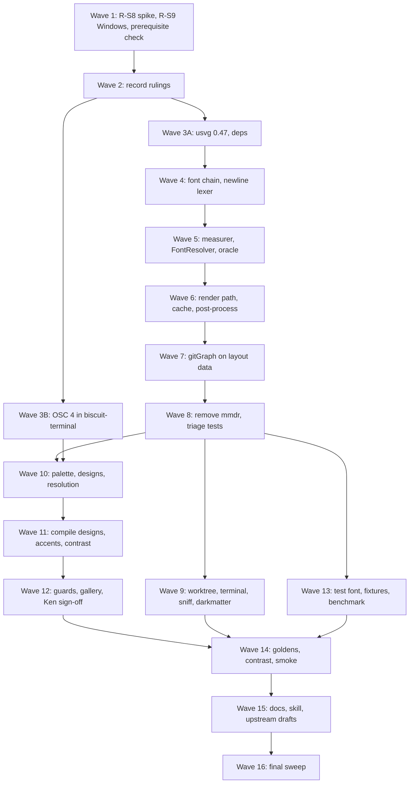

# Plan: Merman Rendering

Source: [spec.md](spec.md). Decision IDs (`D*`), requirements (`R-*`),
acceptance criteria (`AC-*`) and open questions (`Q*`) are the spec's.

## Summary and Definition of Done

### The work

Replace `mermaid-rs-renderer` (`mmdr`) with Merman behind the existing
`biscuit-visualized` public API (D4, D30), and make the result look and measure
correctly. Seven strands, in dependency order:

1. **Foundations.** Rulings the spec left open, the two spikes still owed
   (R-S8 gitGraph geometry from layout data; R-S9 Windows PNG leg), and a
   workspace upgrade to resvg/usvg 0.47 plus `fontique` (D31).
2. **Text.** One font-resolution chain (D32) shared by our rustybuzz
   `TextMeasurer` (D31) and the rasterizer's usvg `FontResolver`; Merman wraps.
3. **Cutover core.** Merman render path, time budget (D28), new cache identity
   (Q5), SVG post-process (D33), interim `\n` rewrite (D34), gitGraph geometry
   rebuilt on layout data (D5, D36), `mmdr` removed.
4. **Consumers.** `biscuit-terminal`, `sniff`, `worktree` unchanged-test
   verification, and `darkmatter`'s static-SVG path and sanitizer (D37).
5. **Terminal palette.** Internal OSC 4 query (D19) in `biscuit-terminal`
   (independent of the renderer, so it runs in parallel early).
6. **Styling.** Palette type, per-family compiled `ThemeDesignV1`, accent
   post-process, WCAG-aware text (D6, D17, D18), then Ken's gallery sign-off.
7. **Verification and close-out.** Golden SVG/PNG corpus, guard tests, local
   benchmark (D35), docs, skill, and the upstream Merman issues.

### Successful completion looks like

- Every AC in the spec holds: AC-C1–C13, AC-M1–M7, AC-T1–T7, AC-P1–P5,
  AC-V1–V2, AC-D1, and the open spike items AC-S6/AC-S8.
- `cargo tree -i mermaid-rs-renderer` is empty; one usvg (0.47) in `Cargo.lock`;
  Merman pinned to an exact `rev`, no ELK (AC-C2, AC-M5).
- `just test` passes in `biscuit-visualized`, `biscuit-terminal`, `darkmatter`,
  `sniff`, `worktree`; `just lint` is clean in each; `worktree`'s
  `git_graph/tests.rs` has no diff unless Ken approved edits (AC-C4).
- Docs, README, both `dependencies.md` files and the `biscuit-visualized` skill
  describe the new behavior and name no feature or fix.
- The terminal state is **"implementation complete, ready for review"**. The
  agent does not run `just complete`, does not move the spec to `_completed`,
  and does not commit unless explicitly told to.

### Working rules for every task

- This is a non-interactive session tree; sub-agents inherit that and must be
  told so in their briefs. Never run `cargo fmt`; never commit; US English.
- Terminal rendering goes through `biscuit-terminal` components; host discovery
  through `sniff`; hashing through `biscuit-hash`; file-format conversion and
  path resolution through `biscuit-file`.
- Tests are nextest (`just test`, `just test-l2`, `just lint`). L2/L3 tests
  must never take window focus. Load the `rust-testing`, `os`, and
  `biscuit-visualized` skills before test or OS-specific work.
- Any behavior change includes a pass over the symbol's `///`/`//!` docs and
  inline comments in the same change.
- An implementation log lives at `implementation-log.md` beside the spec;
  rulings, decisions Ken makes, departures from the spec, and sign-offs are
  recorded there.

### Input robustness (scope note)

Only two new pieces of code read structured input that changes what is
reported:

- **Merman `layout_json` → our gitGraph structs** (Phase 3, Wave 6).
- **Benchmark baseline JSON** (Phase 6, Wave 12).

The OSC 4 reply parser reads a terminal protocol, not a file or configuration;
its accepted forms are fixed by AC-P1 and its default outcome by R-P2, so the
matrix does not apply to it. `MERMAID_FONT` is a single env string with its
shapes fixed by R-M5/R-M6. Default outcome for both JSON loaders: **a located
error / fallback, nothing partially used**. Exceptions are listed at each task.

---

## Phase 1: Rulings and Remaining Spikes

Goal: no later phase is blocked on an unanswered question; the two open spike
requirements are answered; the prerequisite's state is known.

### Necessary Rules

Ken rules on each; until he does, the suggested default is what to plan
against, and any task that depends on a ruling says so. Record each ruling in
the implementation log. Rulings 1–9 are the spec's `required_rulings`; 10–19 are
gaps found while planning.

1. **Q5 – cache key and backend id.** Suggested: `merman@<12-char rev>+bv1`; key
   includes a hash of the compiled per-family design JSON, a content hash of
   every face file the chain can return for the stacks plus generic families,
   the post-process version, output format, and the *rewritten* source.
   Needed before Phase 3 Wave 5.
2. **Q8 – CI tiers.** Suggested: SVG goldens and OSC 4 parser tests at L1; PNG
   comparisons at L1 on Linux/macOS only; `gates = false` promotion stays its
   own change; fixtures added to `source-inputs` only if read via a path CI
   cannot see. Needed before Phase 6.
3. **Q11 – Unicode/ASCII text fallback.** Suggested: follow-up spec (out of
   scope). If Ken rules it in scope, add a Phase 3 wave; this plan assumes out.
4. **Q16 – benchmark details.** Suggested: release profile; Ken's macOS host is
   the reference; baseline JSON stored beside the benchmark; cache bypass via a
   fresh `BISCUIT_VISUALIZED_CACHE_DIR` per iteration outside the timed
   region. *Wider measurement (a Linux or Windows reference host for the 50 ms
   and 500 ms limits) is not scheduled; Ken decides whether he wants it.*
5. **Q18 – "large text".** Suggested: SVG user units before scaling (≥ 24 px,
   or ≥ 18.66 px bold); optionally treat all labels as normal (4.5:1).
6. **Q19 – OSC 4 on native Windows.** Suggested: only if the prerequisite's
   Windows query path carries it with no new Windows-specific code; otherwise
   background-derived accents on Windows, documented.
7. **Q20 – derived-palette goldens.** Suggested: yes, SVG only, for flowchart,
   sequence, gitGraph, with one ANSI-derived and one background-only palette.
8. **Q21 – fixtures location and cap.** Suggested:
   `biscuit-visualized/src/tests/fixtures/merman/`; ~20 MB cap applies to
   `spikes/` and to test fixtures separately.
9. **Q22 – pinned golden fonts.** Suggested: commit one freely licensed family
   (regular + bold), add a test-only internal way to put a font directory ahead
   of D32 step 1, set `MERMAID_FONT` to it in golden tests, keep mixed-script
   cases out of goldens (covered by the oracle test).
10. **D32 step 4 selection rule (R-M8).** The spec says the rule is "not yet
    written". Suggested: among installed faces whose OS/2 table classifies them
    as sans-serif, prefer a regular-weight, non-italic, non-condensed face;
    break ties by lexicographically smallest case-folded family name, then by
    file path. Deterministic and documented.
11. **Fallback-face load order (Design notes).** usvg takes the first face with
    the glyph. Suggested: load the chain's resolved face first, then installed
    faces sorted by case-folded family name, so fallback is deterministic per
    host; test per script that has a face on the CI hosts.
12. **Where the tag-spacing computation sits relative to the cache check.**
    Suggested: the cache key covers the *source after the `\n` rewrite* and the
    font-file hashes (ruling 1). Tag widths are a pure function of those, so
    commit spacing is computed *after* the cache check and needs no extra key
    input.
13. **How Darkmatter gets the measured face per label (D37, R-C9a).** Suggested:
    an additive library option on `mermaid::MermaidDiagram` selecting an
    HTML-static target; the post-process in `biscuit-visualized` rewrites each
    label's `font-family` and overflow, so Darkmatter only calls it and
    sanitizes. Rasterized output never receives either change.
14. **Merman feature set (Design notes).** Suggested
    `["svg", "all-diagrams", "layout-cytoscape"]`, `default-features = false`;
    `png` and `native-fonts` off; **`math` decided explicitly** (suggested off,
    math labels show as source, avoiding embedded fonts and licensing). Confirm
    no umbrella feature pulls `png`.
15. **Interim themes at cutover.** Suggested: Phase 3 maps the four
    `MermaidTheme` values to Merman's built-in theme names so the cutover is
    testable on its own; Phase 5 replaces this with compiled designs. The
    interim mapping is internal and never ships as the final behavior.
16. **`tag_gap` derivation.** Suggested: `tag_gap` = clearance between adjacent
    measured tag widths implied by the widened commit spacing; derived from the
    measurer and cross-checked against `pos` in layout data (AC-C12).
17. **D22 decision point.** After the R-S8 spike (Wave 1) Ken decides whether
    any `worktree` assertion that cannot hold may be edited. Until then AC-C4
    stands.
18. **Circles reporting `unsupported-paint` (Risks).** Suggested: allow-list the
    specific known-false diagnostic per family in R-V4's test, with a comment
    naming it; do not weaken the general "no `unsupported-*`" assertion.
19. **Prerequisite state.** Confirm whether
    `2026-10-13-graphics-where-possible` has delivered native Windows
    background detection. Release (not implementation) is blocked on it (D7).
    If it has not landed, the plan proceeds and the release note records it.

### Spikes

A spike runs once, here, and is not re-run later. No performance spike is
scheduled: S1 and S2 already measured warm and cold renders (D35 rationale), so
the benchmark (Phase 6) is a regression tool, not a spike. No further spike is
needed for fonts or palettes: S0 and S2 answer them.

### Tasks

**Wave 1 — parallel (independent; both inside `spikes/` only, R-S10).**

- [x] **gitGraph geometry spike (R-S8, AC-S6).** New standalone Cargo project
  under `spikes/s3-gitgraph-geometry/` (empty `[workspace]`, seeded with the
  workspace `Cargo.lock`, Merman at the pinned rev).
    - Deserialize `RenderRequest::layout_json` output
      (`layout.GitGraphDiagram`) into our own structs; build a
      `GitGraphGeometry` equivalent (tag bounds from our measurer approximated
      by SVG text widths for the spike).
    - Run a copy of `worktree/cli/src/commands/git_graph/tests.rs` against it
      (or a `[patch]`ed copy of `biscuit-visualized` inside `spikes/`); record
      *which copy ran*.
    - Output: pass/fail list per assertion, the line-2193 `commit_step` result,
      and the effect of widened commit spacing (D36) on spacing assertions.
- [x] **Windows PNG leg (R-S9, AC-S8).** On the Windows test host (see `os`
  skill for reach and traps), render the one S1 diagram with the S1 settings and
  record the pixel difference against the macOS and Linux PNGs with the metric
  used. One host, one diagram; this sets the D13 PNG tolerance. Reuse
  `spikes/s1-comparison` code; do not widen.
- [x] **Prerequisite check (ruling 19).** Read
  `2026-10-13-graphics-where-possible` state and `biscuit-terminal`'s Windows
  detection; record what exists, since Q19 and Phase 2's OSC 4 task depend on it.

**Wave 2 — after Wave 1.**

- [x] **Record rulings.** Write `implementation-log.md` with all 19 rulings, the
  value chosen (Ken's, or the suggested default flagged "assumed"), and the
  R-S8/R-S9 results. Ken decides D22 here (ruling 17).

### Validation checkpoint 1

- [x] `implementation-log.md` exists; every ruling has a value or is explicitly
  marked "assumed default".
- [x] AC-S6 and AC-S8 have recorded results; a go/no-go for "worktree tests
  unchanged" is stated.
- [x] No file outside `spikes/` and the log changed (`git status`).

---

## Phase 2: Workspace Upgrade, Fonts, Measurement, OSC 4

Goal: the text layer exists and is proven against usvg, and the terminal
palette query exists, before anything renders through Merman. Streams A and B
are independent.

### Tasks

**Wave 3 — parallel streams.**

*Stream A — dependencies*

- [ ] **resvg/usvg 0.47 upgrade (R-M3, AC-M5).** Find every crate using
  resvg/usvg/tiny-skia (`grep` across `Cargo.toml`s and `Cargo.lock`), bump
  repo-wide to the 0.47 line, fix API changes, and reach a single usvg in
  `Cargo.lock` (`cargo tree -d`). Run `just test` in each affected area and
  review changed PNG/SVG snapshots. This is the highest blast-radius task in
  the plan; do it alone in its own change.
    - Prerequisite for: font chain, measurer.
- [ ] **Add fontique, ttf-parser, rustybuzz, Merman (git, exact rev).**
  `biscuit-visualized` only; Merman per ruling 14 with `default-features =
  false`. `mmdr` stays until Phase 3 Wave 7 (both compile together). Check
  `cargo tree` for `png`/ELK/second usvg. Update root and area
  `docs/dependencies.md`. Sequenced after the usvg upgrade.

*Stream B — OSC 4 (independent of A)*

- [ ] **OSC 4 query in `biscuit-terminal` (R-P1, R-P2, R-P7, AC-P1, AC-P2,
  AC-P5).** In `discovery/osc_queries`, behind the existing gate, internal
  (D19, not public API).
    - Query indices 0–15, join the existing OSC 10/11 round trip, bounded
      timeout, per-process cache, never mutates the user's palette.
    - Parser accepts `rgb:rrrr/gggg/bbbb`, `rgb:rr/gg/bb`, `#rrggbb`, BEL and
      ST terminators. No/partial/malformed reply ⇒ `unknown` per missing
      entry, never an error (default outcome; no other exceptions).
    - Windows behavior follows ruling 6 and the prerequisite check.
    - Tests: parser unit tests (L1); silent fake TTY proving timeout and no
      re-send (call count); redirected stdout and `CI` set send no query. Use
      the Test Toolkit; L2 tests must not take focus.
    - Public-API exposure of any palette type is deliberately not added.

**Wave 4 — after Wave 3 Stream A (parallel streams).**

- [ ] **Font-resolution chain (D32, R-M4–M8, AC-M3, AC-M4).** New module in
  `biscuit-visualized`: one function used by measurer and rasterizer.
    - Steps: `MERMAID_FONT` → CSS stack (case-insensitive) → fontique generic
      → OS/2 sans-serif rule (ruling 10, documented).
    - `MERMAID_FONT` unset or empty: silent. Set but missing: exactly one
      warning per process (use a `Once`/atomic guard), then continue.
    - The font set is injectable for tests (internal, not public); fontdb
      holds the same faces in the deterministic order of ruling 11.
    - Tests: each step reachable with an injected set; case-insensitivity; the
      one-warning guarantee via captured logs; DejaVu-only host still resolves
      (AC-M4).
- [ ] **`\n` → ` ` label lexer (D34, R-M10, R-V9, AC-M6).** Pure
  string-to-string module, independent of fonts: class, ER, mindmap,
  requirement only, via a small per-family label lexer. Never touches
  `%%{init}%%`, `%%` comments, `click` URLs/tooltips, `classDef`/`style`
  values, `accTitle`/`accDescr`. Tests include one input with `\n` in *each*
  excluded construct, and one with `\n` in a non-listed family (unchanged).

**Wave 5 — after the font chain.**

- [ ] **rustybuzz `TextMeasurer` (D31, R-M1, R-M2, AC-M1, AC-M2).** Shape each
  label on the chain's face; mirror usvg 0.47 letter-spacing, word-spacing,
  kerning, small-caps and the per-character fallback rule; no SVG parsing;
  measure each candidate string exactly as given (no whitespace collapsing);
  wire through `DeterministicTextMeasurer::with_width_callback` so Merman wraps.
- [ ] **Rasterizer `FontResolver` (R-M4).** Replace the rasterizer's font setup
  in `raster/` with a usvg `FontResolver` calling the same chain, with the same
  fontdb faces.
- [ ] **Oracle test (R-V8).** Measured width equals usvg 0.47's laid-out width
  for the same chunk (within 1 px per AC-M1) across a Latin, RTL, CJK, emoji,
  combining-mark set, so a future usvg bump re-runs it.
- [ ] **Measure-vs-draw face test (AC-M3).** For every label of a wrapping
  corpus, measurer and resolver yield the same face.

### Validation checkpoint 2

- [ ] `just test` and `just lint` pass in `biscuit-terminal`,
  `biscuit-visualized`, and every area the usvg bump touched.
- [ ] `cargo tree -d` shows one usvg at 0.47; no ELK; no `png` feature pulled.
- [ ] Oracle test, font-chain tests, and `\n` lexer tests are green; the OSC 4
  silent-TTY test proves no re-send.

---

## Phase 3: Cutover Core (behind the existing API)

Goal: `MermaidDiagram`, `MermaidTheme`, `MermaidConfig`/`QuadrantTheme`, and the
gitGraph geometry API are backed by Merman; `mmdr` is gone; public signatures
only grow (R-C1, AC-C1). Themes use the interim mapping of ruling 15.

### Tasks

**Wave 6 — parallel (disjoint modules).**

- [ ] **Merman render path (R-C1, R-C6, R-C8, R-C10, R-C11, AC-C7, AC-C9,
  AC-C10).** In `mermaid/render.rs`: `RenderRequest` with
  `SvgPipeline::resvg_safe()`, our measurer (Wave 5), a **unique diagram id per
  document** (content hash + ordinal, never a fixed string — R-T7/AC-T2).
    - Time budget: `OperationControl::with_deadline`, default 2 s, builder
      option on **both** `mermaid::MermaidDiagram` and the component, which
      passes its value through. Exceeded ⇒ render failure ⇒ code-block
      fallback + a warning. Covers `layout_json` requests too. Covers Merman's
      share only (D28).
    - Parse error, unsupported family, ZenUML ⇒ code-block fallback (D20).
    - `MermaidConfig`/`QuadrantTheme` mapped to Merman equivalents (read
      `mermaid/config.rs`); families Merman adds need no family-specific code.
    - `MermaidTheme` uses the interim mapping (ruling 15).
    - Tests: budget test through each type's builder with a low budget,
      asserting fallback, warning, and elapsed time around the Merman call
      only; parse-error, unsupported, and ZenUML cases; no `foreignObject` in
      rasterized output.
- [ ] **Cache identity (R-C7, R-P6 prep, AC-C6, AC-P4).** Per ruling 1: new
  `MERMAID_BACKEND` value, key inputs (rewritten source, theme/design hash,
  font-file hashes, Merman rev, post-process version, output format). Use
  `biscuit-hash`. Cache check happens before parsing (pipeline step 4).
  Tests: an artifact keyed under the old backend id is not served; changing
  only one palette color / one font file / the post-process version changes
  the key.
- [ ] **SVG post-process module (D33, R-M9, AC-M7).** Keep the gradient-stroke
  fix and the `sans-serif` default; delete `apply_svg_overrides`,
  `fix_legend_text_baseline`, `fix_pie_text_contrast` when Merman does not
  need them (R-C4); no `overflow:visible` patch. Guard test (R-V10): class and
  ER dividers are painted in the dark theme.

**Wave 7 — after Wave 6.**

- [ ] **gitGraph on layout data (R-C4, R-C5, R-C5a, D5, D36, AC-C11, AC-C12,
  AC-C13).** Uses the R-S8 spike's result.
    - Deserialize `layout_json` into our own structs (Merman's typed structs
      are not re-exported). **Loader matrix** (default: located error,
      geometry not built, caller falls back):
        - *Control:* the unedited S0 `gitgraph-layout.json` builds geometry.
        - Field validators (one for the commit shape, one for the bounds
          shape; walk shapes once through each): `parents` absent, `null`,
          wrong type (whole field), wrong type (one element), `[]` (explicit
          root commit: **valid**, the one exception); `x`/`y`/`pos` absent,
          `null`, wrong type, empty string. `branch`/`tags` likewise.
          Other commit fields need a control plus one invalid shape.
        - Document shapes: trailing garbage after the JSON value; duplicate
          key (reject, do not last-wins).
        - Test in-process at the crate's public result (returned error with
          location), not by spawning a binary.
        - Grep before declaring done: `#[serde(default)]`, `Option<T>` where
          absent ≠ null, `filter_map(.. as_str())`, `unwrap_or_default()`,
          `.ok()` on these parses.
    - Re-implement `commit_step` and `default_gitgraph_commit_step()` on it;
      keep `tag_gap` (ruling 16); remove merge repair and the "empty branch"
      merge error (D36); implement tag spacing as wider commit spacing in the
      generated gitGraph config using measured tag widths (ruling 12), verified
      against layout data.
    - Replace the nine invalid test inputs (R-C5a); add a check of all test
      inputs against Mermaid.js 12.2.0 (D38) — reference tool is
      `mermaid@12.2.0` from `npm pack`, not the local `mmdc`.
- [ ] **`\n` rewrite wiring.** Apply the Wave 4 lexer before the cache key is
  computed (ruling 12).

**Wave 8 — after Wave 7.**

- [ ] **Remove `mmdr` (R-C3, AC-C2).** Drop the dependency, `image`-feature
  wiring (`dep:mermaid-rs-renderer`), and dead code; `cargo tree -i
  mermaid-rs-renderer` finds nothing; no ELK crate.
- [ ] **Triage `biscuit-visualized` tests and snapshots.** Update inline tests
  and the `tests/l1` layout-matrix / parity snapshots; every snapshot change is
  reviewed, not blanket-accepted. Fix `///`/`//!` drift in touched modules.

### Validation checkpoint 3

- [ ] `just test` and `just lint` pass in `biscuit-visualized`.
- [ ] AC-C1 (API diff vs `main`: additions only), AC-C2, AC-C6, AC-C7, AC-C9,
  AC-C10, AC-C11, AC-C12, AC-C13, AC-M6, AC-M7 verified.
- [ ] A smoke render of every family produces SVG and PNG with the interim
  themes.

---

## Phase 4: Consumers

Goal: every consumer works on the new backend with tests passing.

### Tasks

**Wave 9 — parallel (one area each).**

- [ ] **`worktree` (AC-C4).** Run `just test` in `worktree/`. Expect no edit to
  `git_graph/tests.rs`. If an assertion fails, stop and apply the Ken ruling
  from D22 (ruling 17); otherwise `git diff main --
  worktree/cli/src/commands/git_graph/tests.rs` must be empty. Edit only the
  gitGraph test *helper* if needed (pre-authorized).
- [ ] **`biscuit-terminal` lib and `bt` (AC-C3).** `just test` and `just test-l2`
  (no focus stealing); review changed render-tree/diagram-hook snapshots.
- [ ] **`sniff` (AC-C3).** `just test`; fix any diagram usage.
- [ ] **`darkmatter` static-SVG path (D14, D37, R-C8, R-C9, R-C9a, R-V7,
  AC-C8, AC-C8a).**
    - `MermaidMode::Off` unchanged: `<pre class="mermaid">`, no SVG.
    - `MermaidMode::Image` / `BrowserMermaidMode::StaticSvg`: embed the
      resvg-safe SVG from the HTML target option (ruling 13); label
      `font-family` starts with the measured face followed by the original
      stack; label overflow allowed in HTML only.
    - Extend `svg_sanitizer.rs` for Merman's elements only (its single
      `<style>`, text attributes). Decide `filter`/`fe*` admission here and
      assert the choice in R-V7's test; keep the block on external `url(...)`.
    - Tests: labels survive; external `url(...)` still rejected (negative
      case); per-mode HTML test; rasterized SVG carries neither HTML-only
      change. `darkmatter/lib/src/mermaid/theme.rs` is not touched (D23).

### Validation checkpoint 4

- [ ] `just test` and `just lint` pass in `biscuit-visualized`,
  `biscuit-terminal`, `darkmatter`, `sniff`, `worktree` (AC-C3).
- [ ] AC-C4, AC-C8, AC-C8a verified.

---

## Phase 5: Styling and Terminal-Derived Palettes

Goal: Zed-like accents and contrast, palette from the terminal, fixed palettes
for everything else. Clean-room: no reading of Zed's code, ideas only (R-T10).
Depends on Phase 3 (render path) and Phase 2 (OSC 4).

### Tasks

**Wave 10 — parallel.**

- [ ] **Palette type and fixed palettes (R-T1, R-T4, D17, R-T9).**
  Backend-neutral `Palette`; `Dark`, `Default`, `Forest`, `Neutral` as fixed
  palettes starting from Mermaid.js's same-named themes, then accent and
  contrast passes. Any font family set ends in `sans-serif`.
- [ ] **Per-family `ThemeDesignV1` builder (D6, R-T2, R-T3, AC-T1).** One design
  per family via `merman::diagram_theme`; emit only facets
  `describe_theme_support` reports `supported`/`conditional`; never set
  `styles.node.fill`; no `design.mermaid.variables` outside gitGraph, which
  uses them only for commit/tag/branch label colors; family id is `gitGraph`.
  Omit stroke widths on gitGraph `edge`/`node`.
- [ ] **Terminal palette resolution (D7, D8, R-P3–R-P5, AC-P3).** In
  `biscuit-visualized` (consumes `biscuit-terminal` detection, with injected
  detection results for tests): background + foreground + ANSI → palette; no
  ANSI ⇒ accents from background; nothing ⇒ fixed palette for the color mode;
  non-terminal output (files, Darkmatter, CI) ⇒ fixed palette. ANSI 1–6 as
  rotating accents (S0) unless Ken says otherwise. Palette colors enter the
  cache key (R-P6).

**Wave 11 — after Wave 10.**

- [ ] **Compile and apply designs.** Replace the interim theme mapping
  (ruling 15) with `DiagramThemeCompiler` + `RenderRequest::with_theme`.
- [ ] **Accent post-process (D6, R-T5, R-T6, AC-T3).** Attribute-rewrite keyed
  on **our palette colors only**, never Merman class names/ids: rotating
  accent strokes on un-styled flowchart nodes, per-actor sequence accents,
  class accents in document order; verify mindmap accents come from the
  compiled theme. `classDef`/`style` colors are never overridden; verify
  `%%{init}%%` behavior (unverified in S0) and record it.
- [ ] **Contrast-aware text (R-T8, D18).** Choose readable tints or rewrite per
  node so every text element meets WCAG AA per ruling 5.
- [ ] **Scoped CSS (R-T7, AC-T2).** Only for what themes do not set, every
  selector prefixed by the diagram's unique id; test with two diagrams in one
  document.

**Wave 12 — after Wave 11.**

- [ ] **Guard tests (R-V4, R-V5, AC-T6, AC-T7).** Per family: evidence status
  via `theme_evidence().status()` and no `unsupported-*` from
  `theme_diagnostics()` (ruling 18 for circles); three precedence guards from
  the Risks section (static node fill beats palettes; unsupported rule erases
  a supported one; variables override ordinal palette and downgrade sequence
  evidence from `Verified`).
- [ ] **Themed gallery for Ken (D9, AC-T5).** Re-run the HTML gallery with the
  new themes (macOS and Linux). Ken captures Zed screenshots and signs off;
  record sign-off in the log. **Human gate: Phase 6 goldens are generated only
  after this sign-off.**

### Validation checkpoint 5

- [ ] `just test` / `just lint` pass in `biscuit-visualized` and
  `biscuit-terminal`.
- [ ] AC-T1, AC-T2, AC-T3, AC-T6, AC-T7, AC-P3, AC-P4 verified.
- [ ] Ken's gallery sign-off (AC-T5) recorded.

---

## Phase 6: Goldens, Contrast, Benchmark

Goal: lock the signed-off look in with machine checks; add the local speed
guard. Depends on rulings 2, 4, 5, 7, 8, 9.

### Tasks

**Wave 13 — parallel.**

- [ ] **Pinned test font (Q22, D39, R-V2).** Commit the chosen family under the
  fixtures folder; add the internal test-only way to put a font directory ahead
  of D32 step 1; goldens set `MERMAID_FONT` to it. Counts against the fixture
  cap.
- [ ] **Fixtures (Q21, D13).** Copy one representative input per family from
  Merman's fixtures to the ruled location with `LICENSE-MIT`, `LICENSE-APACHE`,
  `THIRD_PARTY_LICENSES/mermaid`; exclude Merman's fonts; keep the size under
  the cap; Mermaid.js 12.2.0 references only (D38). Update
  `[package.metadata.ci.tests] source-inputs` only as ruling 2 requires.
- [ ] **Benchmark (D12, D35, R-V6, AC-V2).** Per ruling 4. Prefer a separate
  non-member crate or location that does not create a CI `bench` check cell
  (Design notes). Reports median and p95 per family for warm full render
  (measure, layout, SVG, post-process, raster) and cold one-shot; flags
  warm median > 50 ms, cold ≥ 500 ms, and > 25% over the stored baseline.
  Add the `just` recipe. **Baseline JSON loader matrix** (default: located
  error, nothing flagged or overwritten): control = real baseline; per-family
  `median_ms`/`p95_ms` absent, `null`, wrong type, `[]`/empty, negative, NaN;
  family missing from baseline (a distinct reported state, not silent pass);
  trailing garbage; duplicate key. Test in-process; spawn the recipe only for
  wiring (control + doctored baseline + doctored limit, per AC-V2).

**Wave 14 — after Wave 13 and checkpoint 5.**

- [ ] **Golden SVGs (D13, D27, R-V1, AC-V1, AC-C5).** `insta`: every family ×
  `Dark`/`Default`/`Forest`/`Neutral`, Merman-only families included; plus the
  ruling 7 derived-palette goldens. Every test pins its palette (R-V2).
- [ ] **Golden PNGs.** `Dark` and `Default` only, tolerance from R-S9;
  environments per ruling 2. Verify they pass on two hosts with different
  installed fonts.
- [ ] **Merman-only family smoke tests (D16, AC-C5).** Confirm the family list
  from Merman's registry at the pinned rev (the research list has 15 entries,
  counting railroad dialects); one smoke test each.
- [ ] **Corpus contrast test (R-V3, AC-T4).** Every text element in every
  golden meets WCAG AA against the fill behind it, per ruling 5.
- [ ] **Corpus checks.** No `foreignObject` in rasterized output (AC-C7);
  measured width = usvg width over the corpus (AC-M1); wrapping survey with
  zero measurer-attributable clips (AC-M2).

### Validation checkpoint 6

- [ ] `just test` and `just lint` pass; goldens pass on macOS and Linux.
- [ ] The benchmark recipe runs; a doctored baseline and a doctored limit each
  flag (AC-V2). The stored Merman baseline is committed.
- [ ] AC-V1, AC-C5, AC-T4, AC-M1, AC-M2 verified.

---

## Phase 7: Docs, Upstream Issues, Final Verification

Goal: the repo describes what exists; the spec reaches "implementation
complete, ready for review".

### Tasks

**Wave 15 — parallel.**

- [ ] **Docs (R-C12, AC-D1).** Update, in `biscuit-visualized/docs/`: the
  Mermaid behavior pages, `mermaid-gitgraph.md` (no claim that Mermaid.js
  refuses an empty-branch merge), a new page for the font chain and
  `MERMAID_FONT` (steps, ruling-10 rule, warning behavior), palettes and OSC 4
  (including the Windows behavior from ruling 6), the Merman-only family list,
  and the time budget. Pages lead with what a reader can do, give one compact
  example per rule, and use Mermaid diagrams for flows. Docs name no feature or
  fix. Behavior decided but not built is marked **planned**.
- [ ] **README, dependencies, skill.** README overview only (links into
  `docs/`); root and area `docs/dependencies.md` (Merman, fontique, ttf-parser,
  rustybuzz, criterion, usvg bump; `mmdr` removed); update the
  `biscuit-visualized` skill (and `biscuit-terminal` skill for OSC 4) in the
  same change.
- [ ] **Upstream issue drafts (D34, R-M11).** Finalize the four drafts
  (S1 findings issues 1–3; S2 `\n` survey for issue 4) and write them to a file
  beside the log. **Filing publishes outward-facing content: show the drafts to
  Ken and file only on his go-ahead**, recording issue URLs in the log. The
  interim `\n` rewrite stays until upstream fixes it.

**Wave 16 — after Wave 15.**

- [ ] **Final verification sweep.** `just test`, `just test-l2`, `just lint` in
  `biscuit-visualized`, `biscuit-terminal`, `darkmatter`, `sniff`, `worktree`;
  `cargo tree -i mermaid-rs-renderer` empty; `cargo tree -d` one usvg; Merman
  rev exact; run `just ci-local --plan` and review the scheduled cells before
  anyone pushes.
- [ ] **Comment-drift pass.** Re-read `///`/`//!` and inline comments in every
  touched file; code wins over comments; record any drift fixed.
- [ ] **Matrix smell grep.** `#[serde(default)]`, `unwrap_or_default()`,
  `filter_map(.. as_str())`, `.ok()` on load-bearing parses in the new loaders.
- [ ] **Close-out entry.** In the log, record: AC checklist status, AC-S4
  (Ken's decision D30), departures from the spec, open follow-ups
  (`2026-10-21-mermaid-embedded-font`, Q11 text fallback, `gates = false`
  promotion, prerequisite status). Leave the spec in place and do not run
  `just complete`.

### Validation checkpoint 7 (final)

- [ ] Every acceptance criterion in the spec is either verified with evidence in
  the log or listed with a reason it is human-gated (AC-T5, AC-S4) or
  release-gated (Windows detection prerequisite).
- [ ] State: **implementation complete, ready for review.**

---

## Dependency and Parallelism Overview

Phase 4 (Wave 9) and Phase 5 (Waves 10–12) both start after Wave 8 and may run
concurrently; the phase boundary is a validation checkpoint, not a hard barrier,
for those two. Everything else is ordered by the arrows above.

## Risks the Plan Manages

- **usvg bump blast radius** (Wave 3A): isolated, own change, reviewed
  snapshots.
- **Unreleased Merman `main`**: exact rev, guard tests (Wave 12), deliberate
  bumps only, each with goldens re-reviewed.
- **Host-font layout drift**: pinned test font (Wave 13), oracle test in Wave 5.
- **gitGraph vs `worktree` tests**: R-S8 spike first (Wave 1), then Ken's D22
  ruling, before Wave 7 touches the geometry.
- **Sanitizer stripping Merman output**: explicit tests both directions
  (Wave 9).
- **Late-arriving rulings**: each ruling names the wave that needs it; Phase 1
  is the single place they are collected.
