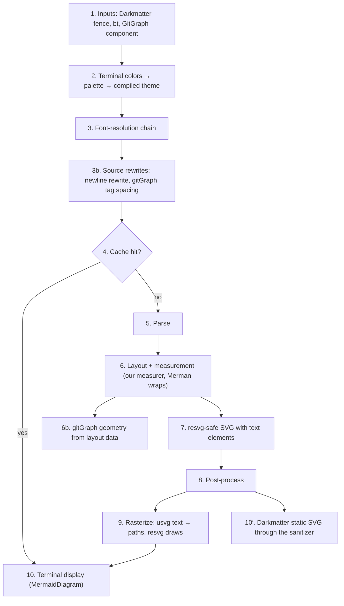
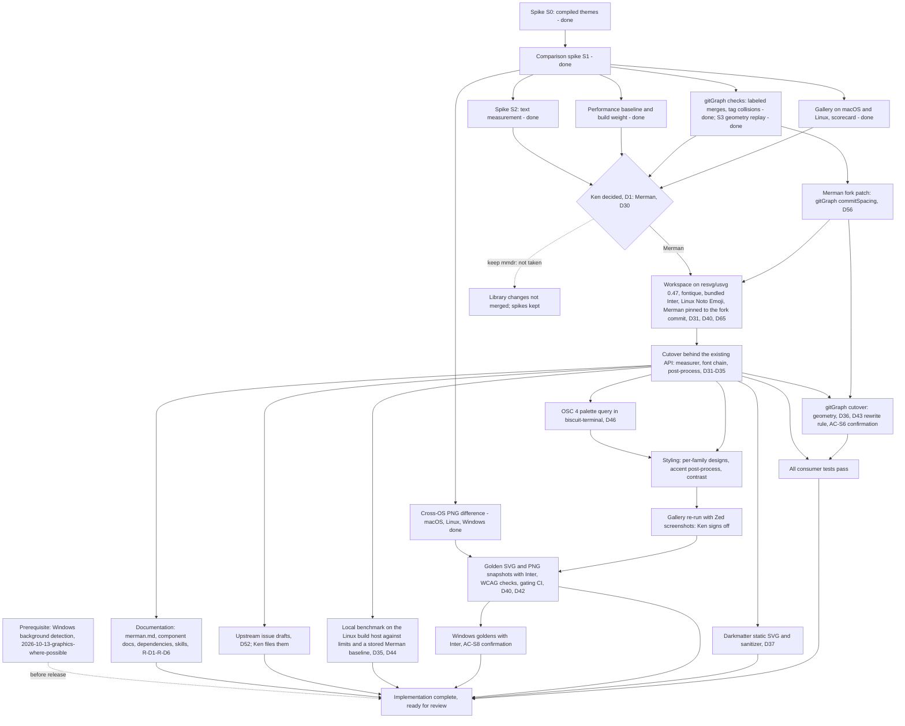

---
$schema:
    status: |-
        enum(
            draft-spec,
            finalized-spec,
            planned,
            implemented,
            review-findings,
            human-in-the-loop,
            completed,
            on-hold,
            abandoned
        ) -> an indicator of progress for this specification
    reviewed: boolean -> indicates whether the specification file has been reviewed by another agent from the one which created the spec
    reviewed_by: string -> the agent and model used in the spec review
    reviewed_on: date -> the date the spec was reviewed
    review_iterations: number -> the number of implementation reviews have taken place in the review/fix cycle
    clarified: boolean -> indicates whether the specification was built -- _in part_ -- with the clarify.md prompt
    implemented: boolean -> indicates whether this spec's plan has been implemented
    implemented_by: string -> the agent who implemented the plan
status: finalized-spec
clarified: true
clarified_by: claude/opus
reviewed: true
reviewed_by: claude/opus
reviewed_on: 2026-10-22
review_note: the clarification process served as a review
review_iterations: 0
needs_rulings: false
depends-on:
    - 2026-10-13-graphics-where-possible
related:
    - 2026-10-13-graphics-where-possible
    - 2026-10-21-mermaid-embedded-font
    - 2026-10-22-merman-text-fallback
references:
    biscuit-visualized/features/2026-10-21-merman/spikes/s3-gitgraph-geometry/FINDINGS.md: >-
        Findings of spike S3 (Phase 1, 2026-10-21): `GitGraphGeometry` rebuilt from
        Merman's layout data, `worktree`'s captured geometry inputs replayed through
        it, and the finding that Merman's commit step is a fixed 50 px.
    biscuit-visualized/features/2026-10-21-merman/spikes/s1-comparison/windows-leg.md: >-
        The R-S9 Windows leg (Phase 1, 2026-10-21): one diagram rendered on macOS,
        Linux, and Windows, with AE share and RMSE per pair.
    biscuit-visualized/features/2026-10-21-merman/spikes/s1-comparison/FINDINGS.md: >-
        Findings of spike S1 (2026-10-21): today's renderer against Merman across
        every shared and Merman-only family, with fidelity, defect survey,
        real-font measurement, timings, build weight, and cross-host PNG differences.
    biscuit-visualized/features/2026-10-21-merman/spikes/s1-comparison/gallery/index.html: >-
        The S1 gallery (macOS, dark): today's output, Merman, Merman with real
        fonts, and the Mermaid.js reference side by side per family.
    biscuit-visualized/features/2026-10-21-merman/spikes/s2-measurement/FINDINGS.md: >-
        Findings of spike S2 (2026-10-21): our rustybuzz measurer against Merman's
        native measurement, why Merman must own wrapping, and the `\n` survey.
    biscuit-visualized/features/2026-10-21-merman/spikes/s2-measurement/gallery/index.html: >-
        The S2 gallery: mixed-script and wrapping cases drawn by each measurer
        beside Mermaid.js, with measured widths outlined, and the `\n` table.
    biscuit-visualized/features/2026-10-21-merman/spikes/s2-measurement/results.json: >-
        S2's raw data: every host, font variant, label width, defect, line-break
        match, `\n` case, and timing sample behind its findings.
    biscuit-visualized/features/2026-10-21-merman/spikes/s0-compiled-theme/FINDINGS.md: >-
        Findings of spike S0 (2026-10-21): whether a terminal palette can be
        expressed as a Merman compiled theme, which styling must stay ours, the
        gitGraph layout data, and compile/dependency measurements at the pinned rev.
    biscuit-visualized/features/2026-10-21-merman/spikes/s0-compiled-theme/out/theme-design.json: >-
        The recommended flowchart/sequence `ThemeDesignV1` from spike S0, built
        from a Tokyo-Night-like palette; the wire shape our palette type would emit.
    biscuit-visualized/features/2026-10-21-merman/spikes/s0-compiled-theme/out/theme-design-gitgraph.json: >-
        The gitGraph variant of the S0 design, with full-strength accents and the
        Mermaid variables that reach commit and tag labels.
    biscuit-visualized/features/2026-10-21-merman/spikes/s0-compiled-theme/out/gitgraph-layout.json: >-
        Merman's `layout_json` output for the S0 gitGraph; the source shape for
        rebuilding `GitGraphGeometry` (D5).
    biscuit-visualized/features/2026-10-21-merman/spikes/s0-compiled-theme/out/theme-design-ordinal-stroke-rules.json: >-
        The S0 design variant with ordinal stroke rules; the probe showing an
        unsupported rule erasing a supported one (Risks, precedence surprise 2).
    biscuit-visualized/features/2026-10-21-merman/spikes/s0-compiled-theme/out/theme-design-with-vars.json: >-
        The S0 design variant with `design.mermaid.variables`; the probe showing
        variables overriding the ordinal palette (Risks, precedence surprise 3).
    biscuit-visualized/features/2026-10-21-merman/spikes/s0-compiled-theme/out: >-
        Every S0 render as SVG and PNG (baseline, themed, and probe variants for
        flowchart, sequence, and gitGraph), cited by the findings as evidence.
    biscuit-visualized/features/2026-10-21-merman/spikes/s0-compiled-theme/src/main.rs: >-
        The S0 spike program: builds the designs, renders through Merman at the
        pinned rev, rasterizes with resvg 0.45, and includes the accent
        post-process prototype (`accent_strokes()`).
    biscuit-visualized/docs/research/mermaid/merman.md: >-
        Research on Merman: family coverage, features, SVG pipelines, licensing,
        and the compiled-theme API.
    biscuit-visualized/docs/research/mermaid/zed-merman.md: >-
        Research on Zed's styling layer over Merman. GPL-3.0-or-later; ideas only,
        never code (D6).
---

# Merman Rendering

`biscuit-visualized` renders Mermaid diagrams to SVG and PNG with the
[mermaid-rs-renderer](https://github.com/1jehuang/mermaid-rs-renderer.git)
crate (`mmdr`). [Merman](https://github.com/Latias94/merman) was expected to be
the better option, and after spikes S1 and S2 Ken chose it (D30):

- it is much more up to date
- the Zed editor uses it as its Mermaid backend, with a styling layer of its
  own on top

> **Reader's note:** the original draft said Zed's developers *back* Merman.
> The research establishes that Zed *uses* Merman (since 2026-05-27) and that
> Merman is an independent project; it does not establish sponsorship.

This spec covers four steps:

1. a spike that renders every diagram through both renderers and compares them
2. a decision on whether Merman replaces `mmdr` (made: it does, D30)
3. a styling layer that makes diagrams look more like Zed's
   preview than Merman's defaults, including a palette taken from the user's
   terminal
4. the cutover to Merman for every consumer

Research this spec builds on:

- [mermaid-rs-renderer research](../../docs/research/mermaid/mermaid-rs-renderer.md)
- [Merman research](../../docs/research/mermaid/merman.md)
- [Zed's abstraction over Merman](../../docs/research/mermaid/zed-merman.md)
- [Mermaid.js](../../docs/research/mermaid/mermaid-js.md)
- [gitGraph corrections](../../docs/mermaid-gitgraph.md) (current behavior)
- [Terminal standards](../../../biscuit-terminal/docs/research/terminal-standards/SKILL.md),
  in particular [OSC 4/104](../../../biscuit-terminal/docs/research/terminal-standards/osc/osc-4-104.md),
  [OSC 10/11/12](../../../biscuit-terminal/docs/research/terminal-standards/osc/osc-10-11-12.md),
  and [mode 2031](../../../biscuit-terminal/docs/research/terminal-standards/modes/mode-2031.md)
  (palette change notifications)
- [Spike S0 findings](spikes/s0-compiled-theme/FINDINGS.md) (compiled themes,
  gitGraph layout data, build weight)
- [Spike S1 findings](spikes/s1-comparison/FINDINGS.md) and
  [gallery](spikes/s1-comparison/gallery/index.html) (comparison, defect
  survey, real-font measurement, timings, cross-host PNG differences)
- [Spike S2 findings](spikes/s2-measurement/FINDINGS.md) and
  [gallery](spikes/s2-measurement/gallery/index.html) (which text measurer,
  wrapping, `\n` in labels)

## Current state

As of 2026-10-21:

- **Renderer:** `mermaid-rs-renderer` 0.3.1 with `default-features = false`,
  behind `biscuit-visualized`'s `image` feature. PNG comes from our own
  `resvg` 0.45.
- **Public API consumers rely on:** the `MermaidDiagram` component
  (`components/mermaid.rs`), the `MermaidTheme` enum (`Dark`, `Default`,
  `Forest`, `Neutral`), `MermaidConfig`/`QuadrantTheme`, and the
  `#[doc(hidden)]` gitGraph geometry test API (`gitgraph_geometry()`,
  `GitGraphGeometry`, `default_gitgraph_commit_step()`).
- **Theme selection in a terminal** is binary: `terminal_theme()` picks
  `Dark` or `Default` from `biscuit_terminal::discovery::detection::color_mode()`,
  and an unknown mode is treated as dark. The four themes are `mmdr` `Theme`
  structs built in `mermaid/render.rs`.
- **Corrections we carry for `mmdr`:** gitGraph merge repair and tag spacing
  (`mermaid/gitgraph.rs`), plus string-level SVG fixes (`apply_svg_overrides`,
  `fix_legend_text_baseline`, `fix_pie_text_contrast`).
- **Cache identity:** the backend id in the artifact cache key is
  `mermaid-rs-renderer@0.3.x+bv3` (`cache::file_cache::MERMAID_BACKEND`).
- **Terminal colors:** `biscuit-terminal`'s `Terminal` exposes
  `background_color` and `text_color` (OSC 11/10, one cached round trip per
  process, Unix only). There is no Windows backend and no ANSI palette
  (OSC 4) query.
- **Consumers:** `biscuit-terminal` (lib and the `bt` CLI), `darkmatter`,
  `sniff`, and `worktree`. `worktree/cli/src/commands/git_graph/tests.rs`
  (about 2,250 lines) asserts on the gitGraph geometry API, including one
  assertion (line 2193) that a layout's `commit_step` equals
  `default_gitgraph_commit_step()`. Both are `mmdr` concepts.
- **Darkmatter HTML:** Darkmatter passes diagram SVG through its own sanitizer
  (`darkmatter/lib/src/markdown/render_tree/svg_sanitizer.rs`, an allow-list)
  and has its own `MermaidTheme` struct (`darkmatter/lib/src/mermaid/theme.rs`).
- **CI metadata:** `biscuit-visualized/src/Cargo.toml` sets `gates = false`
  (`promotion-pending`, expiry 2026-10-31) and `all-features = true` for tests.
- **No `.mmd` corpus exists.** The repo's Mermaid test inputs are inline in
  Rust tests.
- **Coverage gap:** Merman's primary matrix has 37 families against `mmdr`'s
  23. ZenUML is the exception in the other direction: `mmdr` detects it, while
  Merman renders it in a separate lane outside its primary matrix.
- **Spikes S0, S1, S2, and S3 are done**, each a standalone Cargo project
  under `spikes/` against Merman `main` at rev
  `482fcde7faffb05a466f198085d615e604075d97`:
    - S0 (`spikes/s0-compiled-theme/`): compiled themes.
    - S1 (`spikes/s1-comparison/`): the comparison spike of D2.
    - S2 (`spikes/s2-measurement/`): text measurement (D31) and `\n` in labels
      (D34).
    - S3 (`spikes/s3-gitgraph-geometry/`, Phase 1): gitGraph geometry from
      layout data, replaying `worktree`'s captured geometry inputs (R-S8). The
      R-S9 Windows leg also ran in Phase 1
      (`spikes/s1-comparison/windows-leg.md`). Both were replays and
      one-diagram checks, not the cutover implementation; the cutover
      confirms them (D54). See [Spike status](#spike-status).
- **Merman's gitGraph commit step is fixed.** S3 found it hard-coded at 50 px
  (`COMMIT_STEP` 40 + `LAYOUT_OFFSET` 10 in `merman-render/src/gitgraph.rs`),
  with no gitGraph config key for it; Mermaid.js has none either. D36's
  spacing mechanism cannot be built on stock Merman; D56 patches Merman on
  Ken's fork to add one.
- **Mermaid version.** Merman models Mermaid.js **12.2.0**. The local `mmdc`
  bundles Mermaid **11.12.2**, which differs (for example, flowchart labels
  wrap at 200 px there and at 120 px in 12.2.0). See D38.
- **Rasterizer version.** The workspace uses resvg/usvg 0.45; Merman uses
  0.47. D31 upgrades the workspace.

## Scope

**In scope**

- The comparison spike: gallery and scorecard (D2, D11), the gitGraph checks
  (D5), the cross-OS PNG measurement (D13), and the performance baseline (D12).
- Merman was chosen (D30), so: the renderer swap behind the existing public
  API, gitGraph geometry rebuilt on Merman's layout data, our own text
  measurer and font-resolution chain (D31, D32), the workspace upgrade to
  resvg/usvg 0.47 (D31), the SVG post-process (D33), the interim `\n` rewrite
  (D34), the styling layer, terminal-derived palettes, the OSC 4 query in
  `biscuit-terminal`, golden and contrast tests, a local benchmark with a
  stored Merman baseline (D35), and the consumer changes that the swap needs
  (Darkmatter's static-SVG path and sanitizer, D37; `worktree`'s gitGraph test
  helper; `biscuit-terminal`'s OSC 4 query).
- The `commitSpacing` gitGraph patch on a branch of Ken's Merman fork, pushed
  to his GitHub fork and pinned, with the upstream pull request text drafted
  for Ken to open (D56).
- Upstream issues for Merman, drafted by the implementation and filed by Ken
  (D34, D52, [Upstream issues](#upstream-issues)).
- The bundled font, Inter (D40), the Linux-only bundled emoji fallback font,
  Noto Emoji (D65), and promoting `biscuit-visualized` to a gating CI package
  (D42).
- ~~If `mmdr` is kept: library changes are not merged.~~ Moot since D30. The
  `spikes/` folder stays as the record of the decision (D11).

**Out of scope**

- Copying, translating, or closely adapting any of Zed's `mermaid_render`
  code (GPL-3.0-or-later). Ideas only; see D6.
- Editor-style machinery from Zed (zoom, debounce, fallback frames,
  source/preview toggle).
- Native Windows background/foreground detection. It is a **prerequisite**
  delivered by `2026-10-13-graphics-where-possible` (D7).
- Breaking changes to the existing public API (D4). Additive API is allowed.
- ELK layouts (D15).
- Darkmatter's own `MermaidTheme` struct (D23).
- OSC 4 indices 16–255, and OSC 4 as public `biscuit-terminal` API (D19).
- Running the benchmark in CI (D12, D35).
- Embedding a font in Darkmatter's static-SVG HTML output: a follow-up,
  `2026-10-21-mermaid-embedded-font` (D37).
- Drawing text as paths in the SVG itself (outlining labels before output);
  considered and deferred (D33).
- Merman's native font measurement (rejected, D31) and Merman's `parity`
  pipeline for HTML (rejected, D37).
- A Unicode/ASCII text fallback through Merman's text output: a follow-up,
  `2026-10-22-merman-text-fallback` (D48).

## Ownership

| Role | Who |
| --- | --- |
| Owns the spec and the work | `biscuit-visualized` |
| Decides Merman vs `mmdr`; signs off on themes; adjusts performance thresholds after the spike | Ken |
| Opens the upstream Merman pull request for `commitSpacing` from the drafted text (D56) | Ken |
| Files the drafted upstream Merman issues from his GitHub account during the cutover phase (D52) | Ken |
| Captures Zed screenshots for the theme review | Ken |
| Consumers whose tests must pass | `biscuit-terminal` (lib and `bt`), `darkmatter`, `sniff`, `worktree` |
| Gains the OSC 4 palette query | `biscuit-terminal`, as a dependency of this work |
| Consumer code changed by this work (pre-authorized, see below) | `darkmatter` (SVG sanitizer allow-list with the drop shadows of D64; selecting the "HTML static" target, D60), `worktree` (gitGraph test helper and the rewrites D43 allows), `biscuit-terminal` (OSC 4) |
| Delivers native Windows background detection (prerequisite) | `2026-10-13-graphics-where-possible` |

## Decisions

D1–D9 were confirmed by Ken on 2026-10-21; D5 and D6 were amended and D10–D25
added the same day after spike S0. D26–D29 record Ken's rulings on Q14, Q17,
Q15, and Q2, also on 2026-10-21. D30–D39 record Ken's rulings after spikes S1
and S2, also on 2026-10-21; they amend D1, D2, D5, D12, D13, D14, and D24 in
place, and each amended decision says which new decision superseded it.
D40–D62 record Ken's rulings of 2026-10-22, which close Q5, Q8, Q11, Q16,
and Q18–Q22 and settle the remaining unverified and Phase 1 items; they amend
D10, D13, D18, D22, D32, D34, D35, D36, D37, and D39 in place in the same way.
D63–D66 record Ken's further rulings of 2026-10-22 (the cache key's resolved
faces, drop shadows in Darkmatter's static SVG, a Linux-only emoji fallback
font, and a sixth upstream issue); they amend D32, D37, D40, D41, D52, D59,
and D60 in place. D67–D69 record Ken's rulings of 2026-10-22 on the
benchmark's placement, the measurer's direct crates, and a clean-room check;
D67 amends D44 in place. D70–D72 record Ken's rulings of 2026-10-22 after
Phase 2 (font identity in the cache key, the OSC 4 query on native Windows,
and bounded implementer autonomy); D70 amends D41 and D63, and D71 amends
D46, in place.

### D1. Decision rule: Ken decided from a scorecard, Merman favored *(amended 2026-10-21 by D30)*

> **Resolved by D30:** Ken chose Merman. The rule below is kept as the record
> of how the decision was made.

Ken chooses, informed by the spike's scorecard. Merman is chosen unless it is
**clearly worse** on fidelity (against Mermaid.js) or on performance. The
scorecard records, per diagram family:

- fidelity against the Mermaid.js reference
- aesthetics
- rendering bugs (for example `mmdr`'s labeled-merge parsing bug in gitGraph)
- measured render timings, which become the performance baseline (D12)
- build-weight delta: compile time and binary size; ELK measured once for
  information (D15). Build weight is information only, with no ceiling (D29).

For performance, "clearly worse" has a starting definition in D12. Fidelity,
aesthetics, and build weight remain a judgment.

*Rationale:* the comparison is partly a judgment of looks, which no threshold
captures; favoring Merman reflects its coverage, Mermaid parity goal, and
release activity. The rule is therefore not machine-testable; the scorecard's
contents are (AC-S1–AC-S4).

### D2. Comparison artifact: a static HTML gallery plus a one-page scorecard *(amended 2026-10-21 by D38)*

> **Amended by D38:** every Mermaid.js reference, our own test diagrams
> included, comes from Mermaid.js 12.2.0. The local `mmdc` bundles 11.12.2 and
> is no longer a reference source.

- One section per diagram family, showing today's `biscuit-visualized` PNG
  (on `mmdr`, with our corrections and themes; D26), the Merman PNG, and the
  Mermaid.js reference where one is available.
- Inputs: every family both renderers support, plus the diagrams in the
  repo's existing tests (extracted from inline Rust sources). The corpus starts
  from Merman's per-family fixtures.
- Mermaid.js references come from Merman's stored fixtures. `mmdc` (installed
  locally with Node 22) renders references only for our own test diagrams,
  which have none.
- Merman-only families appear in a separate bonus section.
- The gallery is rendered on macOS **and** Linux, since fonts differ.
- Output lives under `biscuit-visualized/features/2026-10-21-merman/spikes/`.

*Rationale:* side-by-side images are the fastest way to judge fidelity and
aesthetics; reusing Merman's fixtures avoids building a corpus and gives a
Mermaid.js reference for free. Rendering on Linux catches font fallback that
macOS hides.

### D3. Ownership

As in [Ownership](#ownership). *Rationale:* after
`2026-10-13-graphics-where-possible`, `biscuit-visualized` owns diagrams for
every target and `biscuit-terminal` owns detection.

### D4. Cutover: swap behind the existing public API

The renderer is replaced behind `MermaidDiagram`, `MermaidTheme`, and the
gitGraph geometry API, and every consumer's tests are verified. Families that
Merman supports and `mmdr` does not start working with no further feature
work. Additive API (the palette, D6–D8) is allowed.

*Rationale:* consumers should not have to change to get the new renderer;
keeping the API makes "every consumer's tests pass" a meaningful check.

### D5. gitGraph: drop the corrections if Merman makes them unnecessary; geometry from layout data *(amended after S0; amended 2026-10-21 by D36)*

> **Amended by D36:** S1 settled the conditional below. The merge repair is
> removed; tag spacing is kept, reimplemented as wider commit spacing in the
> generated Mermaid; the "empty branch" merge error is dropped. The
> layout-data approach to `GitGraphGeometry` stands; tag bounds now come from
> our measurer, verified against the layout data, not from the SVG.

- Drop merge repair and tag spacing **if** the spike confirms Merman handles
  labeled merges and tag collisions as Mermaid.js does.
- Build `GitGraphGeometry` from Merman's **layout data**:
  `RenderRequest::layout_json` → `layout.GitGraphDiagram` (branches; commits
  with `parents`, `x`, `y`, `pos`, `branch`, `tags`; arrows; bounds).
    - Merman's typed layout structs are not re-exported by the `merman` facade,
      so the JSON is deserialized into structs of our own.
    - Tag bounds are not in the layout data (tags are names only); they come
      from the SVG.
    - There is no `commit_step` field; spacing is derived from `pos`.
- `worktree`'s tests should pass unchanged. The assertion at
  `worktree/cli/src/commands/git_graph/tests.rs:2193`
  (`commit_step == default_gitgraph_commit_step()`) compares two `mmdr`
  concepts, so both must be re-implemented on top of Merman's data. If the
  spike shows any worktree assertion cannot hold, D22 applies.

The spike must verify these claims (AC-S5, AC-S6).

*Rationale:* the corrections exist only to work around `mmdr`; the worktree
suite is the strongest existing evidence of correct gitGraph layout. S0 showed
that layout data carries parents and positions, which SVG geometry does not.

### D6. Theme scope: a full Zed-like styling layer, written clean-room, on compiled themes *(amended)*

Goals (unchanged):

- Accent colors for un-styled nodes, at least in flowchart, class, sequence,
  and mindmap diagrams.
- Contrast-aware text color.
- A palette derived from the user's terminal colors (D7).

Mechanism (amended after S0):

1. **Compiled themes are the primary mechanism.** Our palette emits a
   `ThemeDesignV1` through the `merman::diagram_theme` facade, compiled by
   `DiagramThemeCompiler` and applied with `RenderRequest::with_theme`.
   **One design per diagram family**, generated from the palette.
    - Emit only the facets that `describe_theme_support` reports as `supported`
      or `conditional` for that family.
    - Leave the node base fill (`styles.node.fill`) unset, so the ordinal
      palette applies.
    - gitGraph uses its own design with full-strength accents, plus Mermaid
      variables (`commitLabelColor`, `tagLabel*`, `git0..7`,
      `gitBranchLabel0..7`) for commit and tag label colors.
2. **A small attribute-rewrite post-process** covers what compiled themes
   cannot do: rotating accent strokes on un-styled flowchart nodes, and
   per-actor accents in sequence diagrams. It is keyed on **our own palette
   colors**, never on Merman class names.
3. **Scoped CSS** (selectors scoped to the diagram's SVG id) is used only for
   things the theme does not set. It cannot override theme paint, because
   Merman writes that paint as inline `!important`.

Class and mindmap accents are still to be verified in the styling phase (see
[Design notes](#design-notes): class diagrams have no ordinal palette, so
their accents come from the post-process; mindmap has one).

Zed's `mermaid_render` is GPL-3.0-or-later and must not be copied.

*Rationale:* S0 showed compiled themes reach base colors in flowchart and
sequence and branch colors in gitGraph, with less CSS tied to Merman's class
names (which upgrades can break silently). The post-process keys on colors we
chose, so it does not depend on Merman's markup vocabulary. Clean-room keeps
`biscuit-visualized` free of copyleft obligations.

### D7. Terminal colors: detected background/foreground plus a new OSC 4 query

- Use the detected background and foreground. `biscuit-terminal` already
  detects them on macOS and Linux. Native Windows detection is a prerequisite
  delivered by `2026-10-13-graphics-where-possible`, recorded as `depends-on`
  in the frontmatter, and must land before this spec is released.
- Add an ANSI 16-color palette query (OSC 4) to `biscuit-terminal`, with a
  timeout and caching (scope: D19).
- Accents derive from the ANSI colors. When no ANSI palette is available,
  accents are computed from the background instead. That covers two cases:
    - **The query is never sent.** OSC 4 goes through the same gate as the
      existing OSC 10/11 queries (`biscuit-terminal`'s
      `discovery/osc_queries`): no query when stdout is not a TTY, in CI, or
      inside a terminal multiplexer (`TMUX`, `ZELLIJ`, or `STY` set). Under
      tmux, Zellij, or screen the palette is therefore always
      background-derived (or fixed, R-P5); this spec does not relax the gate.
    - **The terminal does not answer.** For example over SSH, where replies
      may be dropped; the query times out (R-P1, AC-P2).

*Rationale:* the ANSI palette is the user's chosen accent set; the background
fallback keeps results usable where queries are not sent or not answered.

### D8. Defaults and fallback

- In terminal contexts, the detected palette is the default.
- `Dark`, `Default`, `Forest`, and `Neutral` become fixed palettes (origin:
  D17), always available, and used when detection fails or the output is not
  for a terminal (files, Darkmatter HTML, CI).
- The cache key includes the palette colors.
- Tests pin a palette.

*Rationale:* detected colors make diagrams match the terminal; fixed palettes
keep non-terminal output and tests deterministic.

### D9. Theme acceptance: gallery review, then golden tests

1. Re-run the HTML gallery with the new themes alongside Zed screenshots of
   the same diagrams (captured by Ken), for Ken's sign-off.
2. Lock the result in with golden snapshot tests (corpus and formats: D13),
   plus automated WCAG contrast checks on text (D18).

*Rationale:* looks are signed off by a human once, then guarded by machines.

### D10. Merman version: git dependency on `main`, pinned to an exact rev *(amended 2026-10-22 by D56 and D57)*

> **Amended:** the pinned rev is a commit on a branch of Ken's Merman fork,
> the pinned upstream rev plus the `commitSpacing` patch (D56), until D57
> returns the dependency to stock Merman.

- Merman is a git dependency on `main` pinned to an exact `rev` (S0 used
  `482fcde7faffb05a466f198085d615e604075d97`), never a branch.
- The 0.9.1 tag sits on a side branch, about 1,690 commits behind `main`, and
  lacks the compiled-theme API.
- Nothing in the repo publishes (`publish = false` in `release-plz.toml`), so
  a git dependency costs nothing today.
- Move to a crates.io release once one ships the compiled-theme API.
- Rev bumps happen only deliberately, each in its own change, with the goldens
  re-reviewed.

*Rationale:* the compiled-theme API (D6) exists only on `main`, and the theme
area churns heavily there; an exact rev makes every change of behavior a
reviewed event.

### D11. Spike setup and rollback: a standalone Cargo project under `spikes/`

- The comparison spike is a standalone Cargo project under the spec's
  `spikes/` folder (empty `[workspace]`, not a workspace member). It calls
  Merman directly, as S0 does, and reaches `mmdr` through `biscuit-visualized`
  as a path dependency (D26).
- `biscuit-visualized` was untouched before Ken's decision (D1, D30).
- Rollback is not merging library changes. The `spikes/` folder is kept as the
  record of the decision.

*Rationale:* this keeps the workspace's CI `all-features` build from compiling
both renderers, and makes rollback free.

### D12. Performance test: a local in-process benchmark *(amended 2026-10-21 by D35)*

> **Amended by D35:** the "clearly worse" ratio rule and the comparison with
> `mmdr` are replaced by absolute limits and a regression rule against a
> stored Merman baseline. The benchmark stays local.

- An in-process benchmark (criterion) over the spike corpus, run locally
  through a `just` recipe. **Not run in CI.**
- Reports the median and p95 per family.
- The `mmdr` timings are taken through `biscuit-visualized` and so include our
  correction passes (D26).
- **"Clearly worse"** (for D1): Merman's median is more than 3× slower than
  `mmdr`'s, or exceeds 100 ms, on a family used by consumers.
- **Regression** (after cutover): more than 25% slower than a stored baseline
  JSON.
- Thresholds are Ken's to adjust after he sees the spike data.
- Modeled on Merman's `tools/bench/compare_mermaid_renderers.py`
  (MIT/Apache-2.0).

*Rationale:* timings on shared CI runners are noisy, and a local benchmark
answers the question without new CI cells.

### D13. Golden corpus: one input per family, SVG for every palette, PNG for two *(amended 2026-10-21 by D39; amended 2026-10-22 by D40, D47, and D49)*

> **Amended by D39:** the assumption below that SVG snapshots are
> OS-independent no longer holds. With real-font measurement (D31), layout
> depends on the fonts installed on the host. The corpus shape (one input per
> family, SVG for every palette, PNG for two) is unchanged.
>
> **Amended by D40:** goldens render with the bundled Inter
> (`MERMAID_FONT=Inter`), so they are deterministic on every host again.
> **D47** adds six derived-palette SVG goldens; **D49** fixes the fixtures
> folder as `biscuit-visualized/src/tests/fixtures/merman/`.
>
> **R-S9 result (Phase 1):** macOS and Windows PNGs of the same diagram are
> pixel-identical (both draw Arial); the whole Linux gap (AE share 0.27%
> dark, 0.74% light) is DejaVu substitution. With the bundled Inter as the
> golden font, the PNG tolerance is **AE share ≤ 0.1% and normalized RMSE ≤
> 0.005** per image (D42).

- One representative input per family, copied into a test fixtures folder
  with Merman's `LICENSE-MIT`, `LICENSE-APACHE`, and
  `THIRD_PARTY_LICENSES/mermaid` notices. Merman's bundled fonts are excluded.
- SVG snapshots for every family × the 4 fixed palettes, Merman-only families
  included (D27).
- PNG snapshots only for the `Dark` and `Default` palettes, compared within a
  tolerance, because fonts differ across macOS, Linux, and Windows.
- The spike records cross-OS PNG pixel differences for one diagram, to set
  that tolerance.

*Rationale:* SVG snapshots are exact and OS-independent; PNG snapshots catch
rasterizer regressions but need a tolerance, so they are kept to two palettes.

### D14. One SVG for every target; Darkmatter's sanitizer is extended *(amended 2026-10-21 by D37)*

> **Amended by D37:** Darkmatter's default HTML path never receives our SVG
> (it ships `<pre class="mermaid">` for Mermaid.js in the reader's browser).
> Only the static-SVG opt-in does, and it receives the resvg-safe SVG with two
> HTML-only changes: label `font-family` rewritten to lead with the measured
> face, and label overflow allowed. The sanitizer is extended only for
> Merman's elements.

- Every target, Darkmatter HTML included, gets Merman's resvg-safe SVG
  (`SvgPipeline::resvg_safe()`).
- Darkmatter's SVG sanitizer allow-list
  (`darkmatter/lib/src/markdown/render_tree/svg_sanitizer.rs`) is extended for
  Merman's output, with a test that labels survive into Darkmatter HTML.

*Rationale:* one output shape means one set of goldens; the sanitizer is the
known point where valid Merman output could be stripped.

### D15. ELK off, never exposed

Merman is built with `default-features = false`, without ELK. ELK is never
exposed as a feature of `biscuit-visualized`. The spike measures its build
weight once, for information.

*Rationale:* ELK is EPL-2.0 and heavy; no consumer needs its layouts.

### D16. Merman-only families: one smoke test, golden SVGs, one docs list *(amended by D27)*

Each family Merman supports and `mmdr` does not gets one smoke test, a golden
SVG under each of the 4 fixed palettes (D27), and an entry in one list in
`docs/`. The list is confirmed from Merman's
family registry at the pinned rev (the research's candidate list is in the
Design notes).

### D17. Fixed palettes start from Mermaid.js's named themes

`Dark`, `Default`, `Forest`, and `Neutral` start from Mermaid.js's themes of
the same name, then go through our accent and contrast passes. They do not
reproduce today's `mmdr` colors.

### D18. Contrast threshold: WCAG AA *(amended 2026-10-22 by D45)*

> **Amended by D45:** every text element must meet 4.5:1. The 3:1 large-text
> allowance below no longer applies.

Text meets WCAG AA: 4.5:1 for normal text and 3:1 for large text, measured
against the fill behind each text element.

### D19. OSC 4 query scope: indices 0–15, internal

The OSC 4 query covers ANSI indices 0–15. It is internal to palette resolution,
not public `biscuit-terminal` API yet.

### D20. Parse errors and unsupported families keep today's fallback

Parse errors and unsupported families, ZenUML included, keep today's fallback:
the source is shown as a code block. The scorecard records the ZenUML loss.

### D21. Per-render time budget: 2 s *(amended by D28)*

Each render has a default time budget of 2 s, enforced through Merman's
`OperationControl`. D28 sets what happens when it is exceeded, how it is
configured, and which requests it covers.

### D22. gitGraph decision point for `worktree` test edits *(amended 2026-10-22 by D43)*

> **Replaced by D43:** there is no decision point. A fixed rule says which
> `worktree` assertions must pass unchanged and which may be rewritten.

If the spike's gitGraph check shows that some `worktree` assertions cannot
hold against Merman, Ken was to rule at that decision point whether those
tests may be edited, with "unchanged" (AC-C4) standing until then.

### D23. Darkmatter's `MermaidTheme` is left alone

`darkmatter/lib/src/mermaid/theme.rs` is not changed by this spec.

### D24. Font family ends in `sans-serif` *(amended 2026-10-21 by D32)*

Any font family our designs set ends with a generic `sans-serif` fallback.

> **Amended by D32:** the rule stands, but the rationale below is superseded.
> Merman no longer measures with its own font-free model (D31), and a missing
> face is resolved by the font-resolution chain (D32), whose generic step is
> what keeps hosts without the named fonts readable. The generic name in the
> stack is what reaches that step.

*Rationale (original):* Merman measures unknown fonts narrowly, and S0 showed
the requested `"Recursive Variable",arial,sans-serif` falling back to Arial on
macOS; a generic fallback keeps hosts without the named fonts readable.

### D25. Pre-authorized preparatory work

See [Pre-authorized preparatory work](#pre-authorized-preparatory-work).

### D26. The gallery's `mmdr` column shows today's `biscuit-visualized` output

The column labeled `mmdr` (mermaid-rs-renderer) shows what users see today,
not raw `mmdr` output:

- The comparison spike depends on `biscuit-visualized` by path, still without
  changing it (R-S10), and renders through its current `MermaidDiagram`, with
  today's corrections (merge repair, tag spacing, the string-level SVG fixes)
  and themes.
- The `mmdr` timings (D12) are taken through the same path, so they include
  our correction passes.

*Rationale:* the decision (D1) is about what users would see, so the
comparison is against today's corrected output; the correction passes are part
of today's real cost. The spike is a non-member crate (D11), so the path
dependency adds no CI cost.

### D27. Every family gets golden SVGs under all 4 fixed palettes

The golden SVG rule of D13 applies to every family, Merman-only families
included: one SVG snapshot per family × `Dark`, `Default`, `Forest`, and
`Neutral`. This replaces D16's original "one golden SVG" for Merman-only
families.

*Rationale:* one rule for every family; a Merman-only family is as likely as
any other to regress under one palette only.

### D28. Time budget: exceeding it is a render failure; configurable; covers layout data

- A render that exceeds its time budget is treated like a render failure: the
  source is shown as a code block through the existing fallback (D20), and a
  warning is logged.
- The budget is a builder option on the `MermaidDiagram` component, defaulting
  to 2 s (D21). This is additive API (D4).
- The budget also bounds layout-data requests (`RenderRequest::layout_json`),
  which build the gitGraph geometry (D5).
- **Where the option lives.** The option exists on both types (Ken accepted
  this on 2026-10-21):
    - the library-level `mermaid::MermaidDiagram` (`mermaid/render.rs`), which
      `worktree` uses directly for gitGraph geometry, so geometry requests can
      be bounded without the terminal component;
    - the terminal `MermaidDiagram` component (`components/mermaid.rs`), which
      passes its value through to the library-level type rather than keeping
      a budget of its own.
- **What the budget measures.** The budget becomes a deadline on Merman's
  `OperationControl` (`OperationControl::with_deadline`). Merman checks that
  deadline only at its own checkpoints during parsing, layout, and SVG
  output. Our work after Merman returns runs outside it: the accent
  post-process (D6), any remaining SVG corrections (R-C4), building
  `GitGraphGeometry` from the layout JSON, and PNG rasterization through
  `resvg`. The budget therefore bounds Merman's share of a render, **not**
  total wall-clock time, and a render can finish later than the budget with
  no failure. (Ken accepted this on 2026-10-21.)

*Rationale:* a consumer gets the same readable output from a slow diagram as
from a broken one, rather than a new error path; the warning keeps the cause
visible; consumers with other latency needs can change the budget. Only
Merman's own checkpoints can stop its work early; the cost of our own passes
is measured by the benchmark (D12) instead.

### D29. Build weight is information only

The scorecard records the build-weight delta (compile time, binary size,
dependency count) for information. There is no ceiling; Ken weighs it in the
D1 judgment.

*Rationale:* no consumer has a stated compile-time or size budget, so a
threshold would be arbitrary; the S0 figures (23 s uncached debug, 18 MB
release, three families) gave no reason to set one.

### D30. Merman replaces mermaid-rs-renderer

Ken chose Merman on 2026-10-21. This resolves D1's decision point (AC-S4).

Evidence (S1):

- Fidelity against Mermaid.js 12.2.0 is better in about a dozen shared
  families. Today's renderer misreads journey, radar, packet, block, treemap,
  sankey, kanban, mindmap, sequence participant types, gantt, timeline, and
  gitGraph orientation.
- 14 families render only in Merman. Today's renderer errors on two and draws
  a wrong flowchart for the other twelve.
- Merman's label clipping (218 label renders on macOS, 268 on Linux) comes
  from its font-free default measurer; real-font measurement cut it to 2 per
  host in S1 and 3 in S2 (D31).

Costs, recorded for information (D29):

- Renders take milliseconds (the slowest S1 fixture took 6.1 ms) where
  today's renderer often takes under 0.3 ms.
- Uncached release build 18 s → 53 s; binary 8.1 MB → 27.3 MB (S1, macOS).

*Rationale:* D1's rule favored Merman unless clearly worse; it is better on
fidelity and coverage, and its absolute times are well inside the D35 limits.

### D31. Text measurement: our own measurer, Merman wraps

- `biscuit-visualized` implements a Merman `TextMeasurer` that shapes each
  label directly with rustybuzz on the face resolved by the font-resolution
  chain (D32). It must not parse SVG.
- It mirrors usvg 0.47's text pipeline where Merman's CSS uses it
  (letter-spacing, word-spacing, kerning, small-caps), and usvg's
  per-character fallback rule, so the measured face is the drawn face.
- Widths reach Merman through
  `DeterministicTextMeasurer::with_width_callback` (public, in the
  `merman::svg` facade), so **Merman does the wrapping**. The measurer
  measures each candidate string exactly as given (no whitespace collapsing).
- The workspace upgrades to resvg/usvg **0.47** (Merman's version), repo-wide,
  and adds `fontique` for the generic-family step of D32.

Rejected:

- **Merman's native measurement** (`native-fonts`). Its generic-family rule
  cannot be configured, so it measured `courier`, serif, and monospace text
  in a different face than resvg drew: 92 labels on Linux and 2 on macOS, up
  to 59.9 px off. Its font database is crate-private.
- **Our own greedy wrap.** Merman sizes each box from the measurer's wrap but
  draws the lines with its own line breaker; the two disagree (a 177 px clip
  on a class relationship label, 196 px on Linux).

*Rationale (S2):* with Merman wrapping, our widths matched usvg's laid-out
width exactly on all 1,321 compared labels on both hosts (RTL, CJK, emoji,
combining marks, fallback included); its defects were a strict subset of
native measurement's; it matched Mermaid.js 12.2.0's line breaks at least as
well; and it was faster cold (macOS 271 ms against 400 ms). It costs about 340
lines (a usvg mirror) plus the font chain, against about 20 for native.

### D32. One font-resolution chain for measuring and drawing *(amended 2026-10-22 by D40, D50, D51, and D65)*

> **Amended:** the font database also holds the bundled Inter, registered by
> name (D40), and on Linux builds the bundled Noto Emoji, used only as the
> last fallback face (D65); step 1's warning rule is D51; step 4's rule is
> D50. The steps below are written as amended.

One function resolves a label's face, and both the measurer (D31) and the
rasterizer's usvg `FontResolver` call it. The rasterizer's fontdb holds the
same faces, including the bundled Inter (D40). Steps, in order:

1. **`MERMAID_FONT`**: a single family name, matched case-insensitively
   against installed families and the bundled Inter. Unset or empty: skipped
   silently, no log. Set to a family that is neither installed nor bundled:
   a warning naming it, at most once per process (D51), then continue to
   step 2.
2. **The label's CSS font stack** (Mermaid's default is
   `"trebuchet ms", verdana, arial, sans-serif`), each name matched
   case-insensitively. Trebuchet MS is only Mermaid's first preference, not a
   requirement.
3. **The OS's own generic family** through fontique: fontconfig on Linux,
   CoreText on macOS, DirectWrite on Windows.
4. **An installed face whose OS/2 table classifies it as sans-serif** (read
   with ttf-parser), chosen by the rule of D50.

No dependency on `sniff`, and no catalog of font names.

*Rationale:* S1 found that without the generic step, Linux hosts with no
stack font installed lost **all** Merman text silently; fontdb's matching is
case-sensitive, so Mermaid's lowercase names never matched; and one chain
for both sides makes "measured face = drawn face" true by construction.

### D33. SVG post-processing: what stays and what goes

- **Removed:** the `overflow:visible` label patch. Ken rejected it as a hack
  that hides the measurement mismatch.
- **Kept:** the gradient-stroke fix. The neo look strokes nodes with an
  `objectBoundingBox` gradient, which per the SVG specification paints
  nothing on a zero-height path, so class and ER dividers vanish in the dark
  theme (36 lines in S1, in resvg and Chrome alike).
- **Kept:** a `sans-serif` default for text with no font set.
- **Deferred:** drawing text as paths in our SVG output (outlining). The
  rasterizer still converts text to paths internally (pipeline step 9).

### D34. `\n` in labels: upstream fix, interim rewrite for four families *(amended 2026-10-22 by D52 and D55)*

> **Amended:** the implementation drafts the upstream issues and Ken files
> them (D52); the rewrite runs in the pre-parse step 3b of the pipeline (D55).

- **Upstream.** File an issue with Merman: normalize `\n` like ` ` in the
  families where Merman already breaks at it; pie and gitGraph drop the
  backslash; block draws one-line-wide boxes and has no ` ` support. See
  [Upstream issues](#upstream-issues).
- **Interim rewrite.** Until upstream fixes it, `biscuit-visualized` rewrites
  `\n` to ` ` inside label text for **class, ER, mindmap, and requirement
  only**, using a small per-family label lexer. It is never a global replace:
  it must not touch `%%{init}%%` JSON, `%%` comments, `click` URLs and
  tooltips, `classDef`/`style` values, or `accTitle`/`accDescr`. The rewrite
  is removed when upstream fixes it.
- **No rewrite:**
    - flowchart, state, and kanban already break correctly;
    - sequence, journey, timeline, architecture, and C4 stay as Mermaid.js
      12.2.0 behaves (`\n` literal, except C4, which breaks);
    - gantt, quadrant, treemap, and xychart stay literal.
- Pie, gitGraph, and block wait for the upstream fix.

*Rationale (S2):* in class, ER, mindmap, and requirement Merman breaks at
`\n` but sizes the box for one line (the symptom Ken saw in Zed); ` `
makes the box fit. In the other families ` ` is either unnecessary or
drawn as text.

### D35. Speed rule *(replaces D12's "clearly worse" and regression rules; amended 2026-10-22 by D44)*

> **Amended by D44:** the profile, reference host, baseline storage, and
> cache bypass left open below are set by D44.

- **Warm:** no diagram family exceeds a **50 ms median** for a warm full
  render: measure + layout + SVG + post-process + raster.
- **Cold:** a one-shot render (a fresh process) takes **under 500 ms**.
- **Regression:** more than **25% slower** than the stored Merman baseline,
  per family.
- The benchmark stays local, not in CI.

The rule applies to every family, so the "used by consumers" list D12 needed
is no longer needed. Profile, reference host, baseline storage, and cache
bypass: D44.

*Rationale:* S1 showed the ratio rule flags most families only because the
old renderer often finishes in under 0.3 ms; absolute limits ask the question
that matters. For scale, S2 measured warm renders at about 2.3 ms median plus
about 10 ms rasterization, and cold renders at 271 ms (macOS) and 24 ms
(Linux); whether S2's cold figure includes rasterization is not stated in its
findings.

### D36. gitGraph after S1 *(amended 2026-10-22 by D53, D55, and D56)*

> **Amended:** D53 sets which of the nine invalid inputs stay as parse-error
> tests; D55 places tag spacing before parsing. **S3 found the "gitGraph
> config" route below does not exist** (Merman's commit step is a fixed
> 50 px with no config key). D56 adds a `commitSpacing` gitGraph config key
> in a patch on Ken's fork of Merman, and our pre-parse step sets it.

- **Merge repair: removed.** Merman keeps both parents of a labeled merge, as
  Mermaid.js does.
- **Tag spacing: kept**, by widening commit spacing in the generated Mermaid
  (gitGraph config). Tags are measured with our measurer (D31), and the
  result is verified against Merman's layout data. The spacing is
  diagram-wide, not per collision; Ken accepted that.
- **The "empty branch" merge error: dropped.** It rejects input that
  Mermaid.js and Merman both accept (S1).
- **Nine of `biscuit-visualized`'s own test inputs** are not valid Mermaid.js
  (`direction LR` inside gitGraph, branch names with spaces, a merge from an
  empty `main`, and two deliberately malformed flowcharts) and need new
  inputs.

This amends D5. R-S8 was not run by S1; S3 ran it in Phase 1 (see
[Spike status](#spike-status)), and D43 replaces the D22 decision point.

### D37. Darkmatter HTML *(amended 2026-10-22 by D60 and D64)*

> **Amended by D60:** the static-SVG changes are made by `biscuit-visualized`
> behind an additive "HTML static" target option; Darkmatter only selects it
> and sanitizes.
>
> **Amended by D64:** the sanitizer admits `<filter>` and `<feDropShadow>`
> only, with bounded numeric and color attributes, so Merman's drop shadows
> survive; every other filter primitive stays dropped.

- **Default path unchanged.** `MermaidMode::Off` emits `<pre class="mermaid">`
  and Mermaid.js renders in the reader's browser.
- **Static-SVG opt-in** (`MermaidMode::Image`, mapped to
  `BrowserMermaidMode::StaticSvg`):
    - embed the resvg-safe SVG, measured with our chain (D31, D32);
    - rewrite each label's `font-family` to start with the exact measured
      face, followed by the original stack;
    - allow label overflow **in HTML output only**, because the reader's fonts
      are unknowable (unlike D33's rejected patch, this does not hide a
      mismatch we could fix);
    - extend Darkmatter's SVG sanitizer only for Merman's elements; drop
      shadows (`<filter>` and `<feDropShadow>`) are admitted under the limits
      of D64, and every other `fe*` primitive stays dropped.
- **Rejected for HTML:** the `parity` pipeline (boxes are still sized at render
  time, and HTML inside SVG widens the sanitizer's attack surface) and
  embedding PNGs.
- **Font embedding** is an opt-in follow-up,
  `2026-10-21-mermaid-embedded-font`.

This amends D14.

### D38. Mermaid.js references come from 12.2.0

Merman models Mermaid.js 12.2.0. Every reference render, for fidelity,
wrapping, and goldens, comes from Mermaid.js 12.2.0. The local `mmdc` bundles
11.12.2 and is not used for references. S2 rendered 12.2.0 in Chrome from
`npm pack mermaid@12.2.0`.

This amends D2 and R-S4.

*Rationale:* the versions differ in ways that look like defects (11.12.2 wraps
flowchart labels at 200 px; 12.2.0 at 120 px).

### D39. Layout depends on the host's installed fonts *(amended 2026-10-22 by D40)*

With real-font measurement (D31), Merman's layout depends on the fonts
installed on the host, not on the OS. Between S1's two hosts, SVG width
changed by a median 0.5% (90th percentile 5.9%, largest 18.7%), and 122 of 188
PNGs changed size. This is expected, not a defect.

This supersedes D13's assumption that SVG geometry is OS-independent. Golden
tests therefore pin their font: the bundled Inter (D40), which makes goldens
deterministic on every host. Per-host baselines are not used.

### D40. A bundled font: Inter *(resolves Q22; amended 2026-10-22 by D65)*

> **Amended by D65:** Linux builds also bundle Noto Emoji, beside Inter, as
> the last fallback face. It is not registered for matching by name and plays
> no part in goldens.

- `biscuit-visualized` bundles one freely licensed family, **Inter** (SIL
  Open Font License 1.1), regular and bold, about 0.6–0.8 MB together. The
  files live in the library source, not in test fixtures, at
  `biscuit-visualized/src/assets/fonts/inter/`, and ship: they are compiled
  into the library (for example with `include_bytes!`), so every consumer
  binary has them.
- The OFL license text (`OFL.txt`) sits beside the font files, together with
  the Inter release they came from.
- At startup the faces are registered in the font database as the named
  family `Inter`, so the D32 chain matches them by name: through
  `MERMAID_FONT=Inter` (step 1) or a CSS stack naming Inter (step 2). They
  are not "installed" faces, so step 4 (D50) does not consider them.
- **Golden tests set `MERMAID_FONT=Inter`.** Goldens are therefore
  deterministic on every host (amends D13 and D39). Mixed-script labels stay
  out of the goldens; every code point in a golden input is one Inter maps,
  and mixed-script text is covered by the measured-vs-drawn oracle test
  (R-V8).
- The same face is what `2026-10-21-mermaid-embedded-font` embeds when the
  face the chain resolves may not be embedded or `MERMAID_FONT=Inter` selects
  it, and what terminal users select with `MERMAID_FONT=Inter`.
- Adding the files is pre-authorized (item 5 of
  [Pre-authorized preparatory work](#pre-authorized-preparatory-work)).

*Rationale:* a font that ships with the library is present on every host, CI
runners included, so goldens need neither a test-only font directory nor
per-host baselines; one free face serves goldens, the HTML embedding, and
users who want identical output everywhere.

### D41. Cache key *(resolves Q5; amended 2026-10-22 by D63 and D70)*

> **Amended by D63:** the key also carries the identity of the face the chain
> actually resolved for each requested family and fallback, so
> `MERMAID_FONT`, installed or removed fonts, and fallback order all reach the
> key.
>
> **Amended by D70:** only the faces the chain resolves for the design's
> stacks and the generic families, plus the bundled faces, are hashed by
> contents; every other font file fallback could reach is identified by path,
> size, modification time, and face index.

- The backend id is **`merman@<12-char rev>+bv1`**: the first 12 characters
  of the pinned Merman rev (D10), and `bv1`, our post-process version. It
  replaces `MERMAID_BACKEND`'s `mermaid-rs-renderer@0.3.x+bv3`, so no `mmdr`
  artifact is served after the cutover (R-C7).
- The key also includes:
    - the Mermaid source **as rewritten** by pipeline step 3b (D55);
    - the output format;
    - a biscuit-hash of the **compiled** per-family theme design JSON (this
      covers the palette, R-P6, and any change in how a design compiles);
    - a biscuit-hash of the **font set** the chain (D32) can return for the
      design's font stacks plus the generic families (D70): the **contents**
      of the faces the chain resolves for those stacks and generic families,
      of the bundled Inter, and, on Linux builds, of the bundled Noto Emoji
      (D65); and the **path, size, modification time, and face index** of
      every other font file fallback could reach. This covers fonts that a
      family's own CSS requests (railroad, treeView, and cynefin ask for
      `courier`) without parsing;
    - the **resolved-face identity** of D63: for each requested family and
      each fallback position, the D70 identity of the face the chain actually
      resolved.
- The font hash is computed **once per process**.
- The key is checked **before parsing** (pipeline step 4).
- Hashes use biscuit-hash's `xx_hash`, as the key itself does today.

*Rationale:* hashing compiled output rather than raw colors catches every
change that alters the theme, and hashing the contents of the faces the
stacks resolve to catches one of them upgraded in place; size and
modification time catch an install, removal, or upgrade of any other face
at a cost that fits D35 (D70).

### D42. CI tiers and promotion to gating *(resolves Q8)*

- With the bundled font (D40), the SVG goldens, the PNG goldens (within the
  R-S9 tolerance: AE share at most 0.1% and normalized RMSE at most 0.005 per
  image), and the OSC 4 parser tests are **L1 on every CI environment**.
  They run wherever that environment is scheduled (pull requests: Linux and
  macOS; nightly: native Windows and WSL2).
- This work **promotes `biscuit-visualized` to gating**: `gates = true` in
  `biscuit-visualized/src/Cargo.toml`, removing the `promotion-pending`
  exclusion (the `exclusion-class`, `owner`, `reason`, and `expiry` fields,
  which the CI planner rejects on a gating package).
- The exclusion's recorded reason is a missing canonical `just` recipe set.
  Promotion is therefore done in this order: first complete the canonical
  recipe set in `biscuit-visualized/justfile`, then verify with `just
  ci-local --plan` that the package's cells are planned on each environment,
  then set `gates = true` (item 11 of
  [Pre-authorized preparatory work](#pre-authorized-preparatory-work)).
- `biscuit-visualized/src/tests/fixtures/merman/` is added to
  `[package.metadata.ci.tests] source-inputs` only if tests read it through
  a path CI cannot otherwise see, following `docs/cicd/test-inputs.md` and
  the `rust-testing` skill's spelling of repository reads.
- These edits are pre-authorized (items 6 and 11 of
  [Pre-authorized preparatory work](#pre-authorized-preparatory-work)).

### D43. `worktree` test edits: a fixed rule *(replaces D22's decision point)*

`worktree/cli/src/commands/git_graph/tests.rs` is held to one rule:

- **Topology assertions pass unchanged.** Assertions about which commits are
  drawn, their parents, lanes, order, and tags. Examples (line numbers as of
  2026-10-22):
    - `a_direct_merge_into_the_default_branch_beats_the_parents_indirect_containment`
      (lines 776–779): the merge sits on `main`, has two parents, and its
      parents are `d[13]` and the `fix/sniff` tip.
    - `the_observed_graph_keeps_recent_commits_on_every_lane_at_200x60`
      (line 2226): `M104` carries exactly the tags `main` and
      `origin/main`.
- **Renderer-mechanics assertions may be rewritten** to Merman equivalents.
  Assertions about step constants, exact pixel spacing, or defaults of the
  old renderer. Examples:
    - the same test, line 2193: `geometry.commit_step ==
      default_gitgraph_commit_step()` compares two `mmdr` concepts; it may
      become a check that the step derived from layout `pos` equals Merman's
      step.
    - the same test, line 2199: `kept.len() >= 2` after each `+N` square at
      200 columns is a count of what fits a pixel budget, which follows from
      the commit step and the natural width (S3: Merman's natural width is a
      median 1.15× today's). It may be rewritten to a count derived from
      layout positions. The identity checks beside it (the tip is kept,
      line 2206; `W1` is drawn, line 2207) are topology and stay unchanged.
- An assertion that mixes both is split, and only its mechanics half is
  rewritten.
- Every rewritten assertion is listed in the implementation log with its
  category and the reason.
- `tag_overlaps()` being empty is the outcome D36 keeps; with D56's
  `commitSpacing` it passes unchanged, so it needs no rewrite. S3's evidence,
  with the fork patch, is that no topology assertion needs editing.

### D44. Benchmark details *(resolves Q16; amends D35; amended 2026-10-22 by D67)*

> **Amended by D67:** the benchmark is a separate non-member crate at
> `biscuit-visualized/bench/`, and the baseline JSON is stored there.

- **Profile:** release.
- **Reference host:** the **Linux build host** (see the `os` skill). The
  50 ms and 500 ms limits of D35 and the stored baseline apply to runs on
  it; a run elsewhere reports timings for information. S2 measured a cold
  render there at about 24 ms, so the 500 ms cold limit has wide headroom on
  that host.
- **Baseline:** a JSON file stored next to the benchmark, updated only by a
  change that knowingly accepts a slowdown and says so.
- **Cache bypass:** each iteration points `BISCUIT_VISUALIZED_CACHE_DIR`
  (`CACHE_DIR_ENV`) at a fresh temporary directory, outside the timed region.

### D45. Contrast: 4.5:1 for all text *(resolves Q18; amends D18)*

Every text element meets 4.5:1 (WCAG AA normal text) against the fill behind
it. There is no large-text exception, so text size is never measured.

### D46. OSC 4 on native Windows *(resolves Q19; amended 2026-10-22 by D71)*

> **Amended by D71:** Phase 2 found that the Windows query path exists and
> carries OSC 4 with no new Windows-specific code, so under the rule below
> the query runs on native Windows. The recorded outcome below is replaced.

- The OSC 4 query runs on native Windows **only if** the Windows query path
  carries it with no new Windows-specific code.
- Otherwise native Windows uses background-derived accents (R-P4), and the
  `docs/` palette page says so.
- **Recorded outcome (D71):** the condition holds. `biscuit-terminal`'s
  Windows console query backend
  (`biscuit-terminal/lib/src/discovery/tty_query/windows.rs`) already
  answers OSC 10/11 in the startup exchange, so **the OSC 4 query runs on
  native Windows** through that backend. Phase 5 enables it and verifies it
  on the Windows test host. A terminal that does not answer gets
  background-derived accents (R-P4), as on any other OS.

### D47. Derived-palette goldens *(resolves Q20)*

SVG goldens for **flowchart, sequence, and gitGraph** under two pinned
synthetic palettes:

- a full ANSI set: S0's Tokyo-Night-like palette (exercises R-P3);
- background only, with no ANSI colors (exercises R-P4).

That is **six** SVG snapshots (three families × two palettes), in addition
to the fixed-palette goldens of D13 and D27.

### D48. Text-art fallback: out of scope *(resolves Q11)*

This spec keeps the code-block fallback (D20). Merman's Unicode/ASCII output
as a fallback for terminals that cannot show images is the follow-up
`2026-10-22-merman-text-fallback`.

### D49. Fixtures location and size caps *(resolves Q21)*

- Test fixtures live in `biscuit-visualized/src/tests/fixtures/merman/`, with
  the license notices of D13.
- The ~20 MB cap applies **separately** to `spikes/` and to the test fixtures.
- The bundled font lives in library source (D40), not in fixtures, and does
  not count against the fixtures cap.
- Spike galleries are downscaled if `spikes/` exceeds its cap.

### D50. Font chain step 4: selection rule *(amends D32)*

Among installed faces whose own OS/2 classification says sans-serif
(`sFamilyClass` class 8), choose the family by these preferences, in order:

1. families with both a regular and a bold face;
2. then the widest Latin coverage (the count of code points in the Unicode
   Latin blocks that the face's `cmap` maps);
3. then proportional over monospace (the `post` table's `isFixedPitch`);
4. then the alphabetically first family name, compared case-insensitively.

There is no catalog of font names.

### D51. `MERMAID_FONT` warning *(amends D32)*

A warning is logged at most once per process, and only when `MERMAID_FONT`
is set to a family that is neither installed nor bundled. Unset or empty:
silent.

### D52. Upstream issues: drafted here, filed by Ken *(amends D34; amended 2026-10-22 by D66)*

- The implementation drafts each Merman issue as a ready-to-paste Markdown
  file in this spec's folder, `upstream-issues/NN-<slug>.md`:
    1. default text measurement assumes fonts the host may not have;
    2. wrapped labels lose their line breaks in resvg-safe output;
    3. the neo look's class and ER dividers vanish;
    4. normalize `\n` like ` ` where Merman already breaks at `\n`;
    5. `\n` handling in pie, gitGraph, and block;
    6. an ER attribute comment containing ` ` clips by 5–7 px under every
       measurer, so the defect is in Merman's ER layout (D66).
- Ken files them from his GitHub account during the cutover phase. Agents
  never file them.

### D53. Invalid test inputs *(amends D36)*

Of the nine `biscuit-visualized` test inputs that Mermaid.js 12.2.0 rejects,
the deliberately malformed ones (the two malformed flowcharts) stay as
parse-error tests: Merman rejects them too, and the tests assert the
code-block fallback (R-C10). The rest (`direction LR` inside gitGraph,
branch names with spaces, a merge from an empty `main`) get valid
replacement inputs that keep what each test checks.

### D54. Unverified items become implementation checks with fixed outcomes

- **`%%{init}%%` precedence (R-T5).** A test verifies whether an author's
  `%%{init}%%` theme keys survive our compiled theme. If Merman's compiled
  theme overrides them, our theme application yields to `%%{init}%%` for
  those keys, so the author's style wins as R-T5 requires.
- **gitGraph geometry (R-S8, AC-S6)** and the **Windows rendering leg
  (AC-S8)** are cutover-phase tasks with acceptance criteria. S3 and the
  Phase 1 Windows leg ran replays against today's plans and a host font
  (Arial); the cutover tasks confirm them on the real implementation. Their
  outcome rules are already set: D43 for `worktree`'s assertions, and the
  bundled font (D40) for Windows, whose goldens use Inter.

### D55. Pipeline: source rewrites before the cache check *(amends D34 and D36)*

Tag spacing moves out of post-processing (step 8) into a step between the
inputs and parsing: pipeline step 3b, after the font chain (tag widths need
it) and before the cache check, so the key covers the rewritten source
(D41). As ruled, it widens commit spacing in the generated Mermaid source
before parsing, through the `commitSpacing` key that D56 adds to Merman. The
`\n` rewrite (D34) runs in the same step.

### D56. gitGraph `commitSpacing`: a patch on Ken's Merman fork *(amends D10 and D36)*

Stock Merman cannot space commits wider: its gitGraph commit step is a
hard-coded 50 px (`COMMIT_STEP` 40 + `LAYOUT_OFFSET` 10 in
`merman-render/src/gitgraph.rs`), with no config key (S3).

- **The patch.** On a branch of Ken's fork (local clone
  `/Users/ken/coding/forks/merman`), based on the pinned rev of D10, add a
  gitGraph config key **`commitSpacing`** (px; default 50, today's behavior),
  read wherever the constant is used, with a test in Merman's own suite.
- **Publishing it.** The implementation pushes that branch to Ken's GitHub
  fork (pre-authorized, item 8 below) and pins the git dependency to that
  commit (D10). The local clone's only remote is upstream as of 2026-10-22,
  so the push adds Ken's fork as a remote first.
- **Upstream.** The implementation drafts the upstream pull request text as a
  ready-to-paste file next to the issue drafts
  (`upstream-issues/pr-01-gitgraph-commit-spacing.md`); Ken opens the pull
  request. Agents never post upstream.
- **Our use.** `biscuit-visualized` sets `commitSpacing` per diagram, in the
  pre-parse step 3b (D55), to the **smallest spacing that separates adjacent
  tags by at least 1 em**, using tag widths from our measurer (D31), and only
  when tags would collide at the default. A diagram without colliding tags
  gets no `commitSpacing`.
- **S3 evidence.** On Merman geometry every `worktree` topology assertion
  passes, the line-2193 `commit_step` check passes at 50, and only
  `gathered_graph_lays_out_long_labels`' no-overlap check fails without
  spacing. The steps S3 computed as required are 125.9
  (`gathered_graph_lays_out_long_labels`) and 64.2 (`observation_1` and
  `observation_2`). S3 also found Merman's gitGraph natural width is a median
  1.15× today's (range 0.52–1.17×); `worktree` trims to the viewport by
  natural size, so its generated Mermaid may change at cutover.

*Rationale:* Merman already lays out from one constant, so the patch is small
and reviewable; it keeps D36's behavior and `worktree`'s tests without making
our post-process own Merman's geometry.

### D57. Returning to stock Merman

When upstream merges a commit-spacing setting, or a release ships one, the
dependency moves back to upstream Merman (that commit or release) in its own
change, with the goldens re-reviewed (D10). If upstream's key differs in name
or semantics from `commitSpacing`, the step-3b code adapts in that same
change. The fork branch is then no longer referenced by the workspace.

### D58. Merman feature set

`default-features = false` with `["svg", "all-diagrams", "layout-cytoscape"]`.
`png`, `native-fonts`, ELK, and **`math` are off**: math labels show as their
source text. (Phase 1 confirmed this set pulls no resvg, usvg, png, or ELK
crate.)

### D59. Fallback face order *(amended 2026-10-22 by D65)*

For characters the resolved face lacks, the chain tries the resolved face
first, then installed faces sorted by case-folded family name, then, on Linux
builds only, the bundled Noto Emoji (D65), always last. The order is
deterministic per host, and the measurer and the rasterizer use the same
order (D32).

### D60. Darkmatter static-SVG API *(amends D37; amended 2026-10-22 by D64)*

- An additive option on `biscuit-visualized`'s library-level
  `mermaid::MermaidDiagram` selects an **"HTML static" target**.
- For that target only, the `biscuit-visualized` post-process rewrites each
  label's `font-family` (the measured face first, then the original stack)
  and allows label overflow.
- Darkmatter only selects the target and sanitizes the result. The
  sanitizer keeps Merman's drop shadows under the limits of D64.
- Raster output never receives either change.

### D61. Interim themes at cutover

Right after the cutover, the four existing themes (`Dark`, `Default`,
`Forest`, `Neutral`) map to Merman's built-in theme names, so the cutover is
testable before the palette phase. The palette phase replaces this mapping
with compiled designs (D6, D17); it never ships as final behavior.

### D62. Circles' `unsupported-paint` diagnostic

The R-V4 test allow-lists that specific known-false diagnostic per family,
with a comment naming it. The general "no `unsupported-*`" assertion is not
weakened.

### D63. Cache key: the faces actually resolved *(amends D41; amended 2026-10-22 by D70)*

> **Amended by D70:** a resolved face's identity is its content hash plus
> face index only for the faces D70 hashes by contents; any other face is
> identified by path, size, modification time, and face index.

- Besides the font-set hash of D41, the key includes the **identity of the
  face the chain actually resolved** for each requested family and for each
  fallback position: its D70 identity, which is the face file's content hash
  plus its face index for a face resolved for a stack or generic family or a
  bundled face, and the file's path, size, modification time, and face index
  for any other.
- This covers `MERMAID_FONT` (a different step-1 answer changes the key),
  fonts installed or removed between runs (a different step 2–4 answer), and
  the fallback order of D59 and D65.
- Like the rest of the font hash, it is computed once per process (D41).

*Rationale:* identifying every candidate file says which faces could be used,
not which were; two hosts, or two runs with different `MERMAID_FONT` values, can
hold the same files and still resolve different faces, and a cached artifact
must never be served across that difference.

### D64. Drop shadows in Darkmatter's static SVG *(amends D37 and D60)*

Darkmatter's SVG sanitizer
(`darkmatter/lib/src/markdown/render_tree/svg_sanitizer.rs`) admits exactly
two filter elements, `<filter>` and `<feDropShadow>`:

- Every attribute of these two elements other than `id` (which the local
  `url(#…)` reference needs) must be a number or a color. Merman emits the
  `<filter>` region as percentages (`width="130%"`), which count as numbers.
- `dx`, `dy`, and `stdDeviation` are capped at 20; `flood-opacity` is limited
  to 0–1. An element whose attribute breaks these limits is dropped.
- Every other filter primitive (`feImage`, `feTurbulence`, `feGaussianBlur`,
  and the rest of the `fe*` family) stays dropped.
- The existing local-only `url(#…)` rule is unchanged: a `filter="url(#…)"`
  reference survives only when it points inside the document.
- Tests: the caps (a value at the cap kept, a value above it rejected, an
  out-of-range `flood-opacity` rejected), a non-numeric, non-color attribute
  rejected, and `feImage` rejected.

*Rationale:* a drop shadow cannot execute code or fetch anything; the caps
prevent a crafted diagram from making the reader's browser render slowly.

### D65. Emoji fallback font on Linux: Noto Emoji *(amends D32, D40, and D59)*

- `biscuit-visualized` bundles **Noto Emoji** (the monochrome face, SIL Open
  Font License 1.1), regular weight only, as TrueType, about 1–1.5 MB. The
  exact size is recorded in the implementation log when the file is added.
  The file and its `OFL.txt` sit next to Inter, at
  `biscuit-visualized/src/assets/fonts/noto-emoji/`, together with the Noto
  Emoji release they came from.
- **Linux builds only:** the file is compiled in under
  `#[cfg(target_os = "linux")]`, which includes WSL2. macOS and Windows always
  have an emoji font installed, so they do not bundle it.
- It is registered as the **last** fallback face, after every installed face
  in D59's order, so a machine with an installed emoji font keeps drawing
  that font's (typically color) emoji. It is not a candidate for steps 1–4 of
  D32.
- The measurer and the rasterizer share it automatically, because both use
  the same chain and font database (D32).
- **Test (Linux):** with an injected font set that holds no system emoji
  face, an emoji label draws glyphs, not empty `.notdef` boxes.
- Goldens still exclude emoji (D40), so bundling it changes no golden.
- `biscuit-visualized/docs/dependencies.md` and the root
  `docs/dependencies.md` record it with its license (R-D5).

*Rationale:* S2's Linux host drew `.notdef` boxes for emoji; a monochrome
face is small, freely licensed, and only fills the gap where no emoji face is
installed.

### D66. Upstream issue 6: ER ` ` comment clip *(amends D52)*

The ER attribute comment containing ` ` (`"when it was created and
stored"`) clips by 5–7 px under every measurer (S1, S2), so the defect is in
Merman's ER layout, not in our measurement. It becomes upstream issue draft
6 in D52's list, drafted and filed like the other five.

### D67. Benchmark placement: a non-member crate *(amends D44)*

- The R-V6 benchmark is a standalone Cargo project at
  `biscuit-visualized/bench/` with an empty `[workspace]`, not a workspace
  member and not a `bench` target of `biscuit-visualized`, so CI schedules
  no `check` cell for it. Its baseline JSON (D44) is stored there.
- `just bench` in `biscuit-visualized/justfile` runs that crate directly; it
  does not delegate to the shared `_bench` recipe (the exception in item 11
  of [Pre-authorized preparatory work](#pre-authorized-preparatory-work)).

*Rationale:* the benchmark never runs in CI (D12, D35), so a compile-only
CI cell for it would answer no question.

### D68. Measurer crates are direct dependencies

`rustybuzz` (D31) and `ttf-parser` (D32) are direct dependencies of
`biscuit-visualized`, pinned to the versions resvg/usvg 0.47 uses (rustybuzz
0.20 and ttf-parser 0.25 in S2's `Cargo.lock`), so `Cargo.lock` keeps one
copy of each. Adding them is pre-authorized (item 1 of
[Pre-authorized preparatory work](#pre-authorized-preparatory-work)).

### D69. Clean-room check at final verification

R-T10 is verified at final verification (AC-T9): a reviewer confirms that
no file in the change carries a Zed copyright or a GPL header, and that a
repository search over the changed code for Zed-specific identifiers (at
least `zed-accent`, `mermaid_render`, `inject_css`, and `accent_colors`)
finds none. The implementation log records the check.

### D70. Font identity in the cache key *(amends D41 and D63)*

Ken ruled on 2026-10-22, after Phase 2, choosing option A of the Phase 2
review item.

- The once-per-process font hash (D41) reads and hashes the **contents**
  only of:
    - the faces the chain (D32) actually resolves for the design's font
      stacks and the generic families;
    - the bundled Inter (D40);
    - on Linux builds, the bundled Noto Emoji (D65).
- **Every other font file** that fallback (D59) could reach is identified by
  its **path, size, modification time, and face index**, not its contents.
- The resolved-face identity of D63 uses the same split.
- **Accepted residual risk:** a font file replaced in place with identical
  size and modification time is not detected.

*Evidence:* on macOS the chain can reach 2,986 font files (3,419 faces,
about 1.7 GB). Hashing all of their contents took 0.57 s and 0.95 s per
process with the files already in the OS cache, which alone breaks D35's
500 ms cold-render limit. Linux hosts hold far fewer fonts.

*Rationale:* the key still changes whenever a font is installed, removed, or
upgraded, since an upgrade changes the size or modification time, and the
faces that draw almost every label are still hashed by contents. A
persistent per-file hash index (option B) would keep exact semantics only
for the residual case, at the cost of a slow first run and an index with its
own invalidation.

### D71. OSC 4 on native Windows: carried *(amends D46)*

Ken ruled on 2026-10-22, after Phase 2, applying D46's own rule to the
evidence.

- D46 runs OSC 4 on native Windows if the existing Windows query path
  carries it with no new Windows-specific code. Phase 2 found that path
  exists (`biscuit-terminal/lib/src/discovery/tty_query/windows.rs`), so the
  query **runs on native Windows**.
- Phase 2 shipped it gated off there (`ASKS_PALETTE = cfg!(unix)`).
  **Phase 5 enables it on Windows through that backend**, adding no
  Windows-specific query code, and verifies it on the Windows test host
  (see the `os` skill).
- A terminal that does not answer gets background-derived accents (R-P4),
  as on any terminal.

### D72. Bounded implementer autonomy *(pre-authorization; item 12 of [Pre-authorized preparatory work](#pre-authorized-preparatory-work))*

Ken ruled on 2026-10-22. When implementation evidence invalidates a
decision's premise, the implementer may proceed with an option that meets
**all three** of these conditions:

1. it preserves the decision's stated purpose;
2. it stays within every other decision and limit of this spec;
3. it adds no new dependency, no outward-facing action (pushing, posting,
   filing), and no scope.

The implementer then:

- amends this spec (the decision is marked amended, as D41 is by D63);
- records the evidence and the choice under a **"Decided during
  implementation"** heading in the implementation log;
- flags the choice for the review cycle.

If no option meets all three conditions, or the options trade off things
Ken would weigh, the implementer stops and sets `human_review` in the
implementation log, as before.

## Rendering pipeline

The end-to-end path of one diagram after the cutover, as Ken laid it out on
2026-10-21 and amended on 2026-10-22 (D55). Step numbers are referenced
elsewhere in this spec.

| Step | What happens | Owner |
| --- | --- | --- |
| 1 | Inputs: a Darkmatter fence, `bt`, or the `GitGraph` component | consumers; `biscuit-visualized` |
| 2 | Terminal colors (`biscuit-terminal`) → palette → compiled theme. `biscuit-visualized` builds the `ThemeDesignV1`; Merman compiles it (D6, D7) | `biscuit-terminal`, `biscuit-visualized`, Merman |
| 3 | Font-resolution chain (D32), with the bundled Inter registered (D40) and, on Linux builds, the bundled Noto Emoji as the last fallback face (D65) | `biscuit-visualized` with fontique and ttf-parser |
| 3b | Source rewrites before parsing (D55): the `\n` rewrite (D34) and gitGraph `commitSpacing`, set only when tags would collide, from tag widths measured with our measurer (D36, D56) | `biscuit-visualized` |
| 4 | Cache check, **before parsing**. Key (D41): backend id `merman@<12-char rev>+bv1`, the rewritten source, output format, a hash of the compiled per-family design JSON, and a once-per-process font-set hash (contents of the faces resolved for the stacks and generic families and of the bundled faces; path, size, modification time, and face index for every other reachable file, D70) plus the identity of each face it actually resolved (D63) | `biscuit-visualized` |
| 5 | Parse | Merman |
| 6 | Layout, with measurement through our `TextMeasurer`; Merman wraps (D31). 6b: gitGraph geometry from the layout data (D5, D36) | Merman; `biscuit-visualized` (measurer, 6b) |
| 7 | resvg-safe SVG with `<text>` elements, not paths | Merman |
| 8 | Post-process: gradient-stroke fix and `sans-serif` default for unset fonts (D33), accent rewrite (D6) | `biscuit-visualized` |
| 9 | Rasterize: usvg converts text to paths using the same chain and fontdb (D32); resvg draws | `biscuit-visualized` (usvg/resvg 0.47) |
| 10 | Display through `MermaidDiagram` over `biscuit-terminal` | `biscuit-visualized`, `biscuit-terminal` |
| 10′ | Darkmatter static SVG: the "HTML static" target's font-family rewrite and label overflow (D37, D60), then Darkmatter's sanitizer | `biscuit-visualized`, `darkmatter` |

Two points the table settles:

- **Pre-parse work** sits in step 3b, after the font chain and before the
  cache check, so the key covers the source as rewritten (D41, D55).
- **Fonts known only after parsing.** Some families request fonts in their
  own CSS (railroad, treeView, and cynefin ask for `courier`). The key covers
  every file the chain can return for the design's stacks plus the generic
  families, by contents or by path, size, and modification time (D70), so
  those requests are covered without parsing (D41).

## Pre-authorized preparatory work

Ken approved the following on 2026-10-21. An agent may do these without asking
again; anything else still needs approval.

1. **Dependencies.** Add the Merman git dependency pinned to a rev (D10) and
   crates.io dev-dependencies such as `criterion`; upgrade resvg/usvg to 0.47
   repo-wide and add `fontique` (D31; Ken's ruling of 2026-10-21, which
   approves these two changes); add `rustybuzz` (D31) and `ttf-parser` (D32)
   as direct dependencies of `biscuit-visualized`, pinned to the versions
   resvg/usvg 0.47 uses so `Cargo.lock` keeps one copy of each (D68; Ken's
   ruling of 2026-10-22); bump the workspace's `serde_json` to the
   `^1.0.154` Merman requires (2026-10-22); use network access for
   cargo, the Merman repository, and npm; update `Cargo.lock`, the root
   `docs/dependencies.md`, and `biscuit-visualized/docs/dependencies.md`; remove
   `mermaid-rs-renderer` at cutover.
2. **Fixtures.** Copy Merman fixtures and Mermaid.js reference SVGs into
   `spikes/` and into test fixtures, with the license notices of D13 and
   without fonts, within a cap of about 20 MB.
3. **Reference renders.** Use the local Node, or install the Mermaid CLI or
   the `mermaid@12.2.0` package, for reference renders, which must come from
   Mermaid.js 12.2.0 (D38); commit gallery and golden PNGs within the size cap.
4. **CI and consumer code.** Edit `biscuit-visualized`'s CI metadata in its
   `Cargo.toml` (features, `source-inputs`); add a `just` benchmark recipe;
   change consumer code where needed (Darkmatter's sanitizer, `worktree`'s
   gitGraph helper, `biscuit-terminal` for the OSC 4 query); run checks on the
   Linux and Windows test hosts.

Ken approved the following on 2026-10-22:

5. **Bundled font.** Add Inter regular and bold, with the OFL 1.1 license
   text and a note of the Inter release they came from, under
   `biscuit-visualized/src/assets/fonts/inter/` (D40).
6. **CI gating metadata.** In `biscuit-visualized/src/Cargo.toml`, set
   `gates = true`, remove the `promotion-pending` exclusion fields
   (`exclusion-class`, `owner`, `reason`, `expiry`), and add the fixtures
   folder to `source-inputs` where D42 requires it.
7. **`worktree` test rewrites** that D43 allows, each listed in the
   implementation log.
8. **Merman fork.** Create the `commitSpacing` branch in
   `/Users/ken/coding/forks/merman`, add Ken's GitHub fork as a remote, push
   the branch there, and pin the git dependency to its commit (D56). Opening
   the upstream pull request, and filing any upstream issue, stay Ken's.
9. **Bundled emoji font.** Add Noto Emoji (monochrome, regular, TrueType),
   with its OFL 1.1 license text and a note of the release it came from,
   under `biscuit-visualized/src/assets/fonts/noto-emoji/`, compiled in on
   Linux builds only (D65).
10. **Darkmatter sanitizer drop shadows.** Admit `<filter>` and
    `<feDropShadow>` under the limits of D64 (within item 4's sanitizer
    change).

Ken approved the following on 2026-10-22, after the rulings above:

11. **Canonical `just` recipe set, then gating.** Add to
    `biscuit-visualized/justfile` every recipe of the canonical set that it
    lacks or defines only as a stub where a real recipe applies: the set the
    `rust-testing` skill's "Canonical Just Recipes" table lists (`sanity`,
    `test`, `slow-tests`, `test-l2`, `test-l3`, `test-browser`, `test-real`,
    `lint`, `bench`, `coverage`, `doctest`, `fuzz`, `all`) and the recipes
    other package areas define alongside it (`build`, `check`, `docs`,
    `lint-fix`), each delegating to the shared `_*` recipes in
    `just/devops.just` with `--all-features`; a tier the package has no tests
    for keeps an explicit "not applicable" recipe. Exception (D67): `bench`
    runs the out-of-package benchmark of R-V6 instead of delegating to
    `_bench`. Verify with `just ci-local
    --plan` that the package's L1 cells are planned on each environment and
    record the output in the implementation log; then make the item 6 edits
    (`gates = true`, exclusion fields removed). D42 holds the order.

Ken approved the following on 2026-10-22, after Phase 2:

12. **Bounded implementer autonomy (D72).** When implementation evidence
    invalidates a decision's premise, proceed with an option that preserves
    the decision's stated purpose, stays within every other decision and
    limit, and adds no new dependency, outward-facing action, or scope; then
    amend this spec, record the evidence and the choice under "Decided
    during implementation" in the implementation log, and flag it for the
    review cycle. Otherwise stop and set `human_review`.

## Phases

The order follows the original draft. Which Merman-path steps can run in
parallel is a planning question. As of 2026-10-22, S0–S3 and the Windows leg
are done, Ken has chosen Merman (D30), and the rulings of 2026-10-22
(D40–D72) are recorded. The gitGraph cutover starts with the `commitSpacing`
patch on Ken's fork (D56).

## Requirements

Requirements are normative. Implementation ideas are in
[Design notes](#design-notes), which are not.

### Spike

These requirements governed how the spikes were run, and the spikes are
complete (see [Spike status](#spike-status)). R-S8 and R-S9 are confirmed
again on the real implementation through AC-S6 and AC-S8 (D54). The others
have no implementation acceptance criterion by design: they constrained the
spikes only and have nothing left to govern.

- **R-S1.** Build the corpus from (a) Merman's per-family fixtures for every
  family both renderers support and (b) every Mermaid source in the repo's
  existing tests, extracted from inline Rust code.
- **R-S2.** Render the corpus to PNG with Merman and with today's
  `biscuit-visualized` (`mmdr` plus our corrections and themes, D26), using
  the same rasterizer (our `resvg` 0.45) and settings.
- **R-S3.** Produce the static HTML gallery and scorecard of D2 under
  `spikes/`, with Merman-only families in a bonus section, rendered on macOS
  and on Linux.
- **R-S4.** Take Mermaid.js references from Merman's stored fixtures, and use
  `mmdc` only for the repo's own test diagrams. *(Amended 2026-10-21 by D38:
  every reference, the repo's own diagrams included, comes from Mermaid.js
  12.2.0; the local `mmdc` bundles 11.12.2 and does not qualify.)*
- **R-S5.** Run the benchmark of D12 over the corpus for both renderers and
  record median and p95 per family in the scorecard; this is the performance
  baseline. The `mmdr` timings include our correction passes (D26).
- **R-S6.** Record the build-weight delta (compile time, binary size,
  dependency count) with ELK off, and once with ELK on, all for information
  (D29).
- **R-S7.** Determine whether Merman renders labeled merges
  (`merge feat id: "M" tag: "v1"`) with both parents, and tag collisions
  without overlap, as Mermaid.js does.
- **R-S8.** Demonstrate that `GitGraphGeometry` can be built from Merman's
  layout data (tag bounds from the SVG), and run `worktree`'s git graph tests
  against it, recording which assertions pass and which cannot hold.
- **R-S9.** Record the PNG pixel difference of one diagram rendered on macOS,
  Linux, and Windows, as input to the D13 PNG tolerance (set by D42).
- **R-S10.** The spike is a standalone Cargo project under `spikes/` (D11)
  that depends on `biscuit-visualized` by path (D26); no file outside
  `spikes/` changes before Ken's decision (D30).

#### Spike status

As of 2026-10-22 (S1, S2, and the Phase 1 records of S3 and the Windows leg):

| Requirement | Status |
| --- | --- |
| R-S1 | Done, short by the test sources built with `format!`, which cannot be extracted statically (S1) |
| R-S2, R-S3, R-S5, R-S6, R-S10 | Done (S1) |
| R-S4 | Done for Merman fixtures (12.2.0); S1's own-diagram references used `mmdc` 11.12.x, so they predate D38. S2 rendered 12.2.0 for its corpus. No follow-up: the decisions S1 informed did not rest on those references, and nothing after the spikes compares against Mermaid.js references (goldens snapshot our own output, D13) |
| R-S7 | Done: labeled merges keep both parents; adjacent tags overlap exactly as in Mermaid.js (D36) |
| R-S8 | Done as a replay (S3): 31 captured `worktree` geometry inputs replayed through Merman's layout data. Topology and the line-2193 step check pass; `gathered_graph_lays_out_long_labels`' no-overlap check fails at Merman's fixed 50 px step (fixed by D56). The replay used today's plans, so the cutover confirms it (D54, AC-S6) |
| R-S9 | Done on macOS, Linux, and Windows for one diagram with host fonts (macOS–Windows identical in Arial; Linux differs by DejaVu substitution). Sets the D42 tolerance; the cutover repeats it with Inter (D54, AC-S8) |

### Cutover

- **R-C1.** Merman replaces `mmdr` behind `MermaidDiagram`, `MermaidTheme`,
  `MermaidConfig`/`QuadrantTheme`, and the gitGraph geometry API, with no
  breaking change to their signatures.
- **R-C2.** Merman is a git dependency pinned to an exact `rev` (D10): the
  `commitSpacing` commit on Ken's fork until D57 applies (D56). It uses the
  feature set of D58: `default-features = false`, `["svg", "all-diagrams",
  "layout-cytoscape"]`, with `png`, `native-fonts`, ELK (D15), and `math`
  off.
- **R-C3.** `mermaid-rs-renderer` is removed from the dependency graph.
- **R-C4.** Corrections that existed only for `mmdr` (merge repair, tag
  spacing, the string-level SVG fixes) are removed when Merman does not need
  them, and kept or replaced when it does. Per D36, the merge repair and its
  "empty branch" merge error are removed, and tag spacing is kept, computed
  in pipeline step 3b (D55) from tag widths measured with our measurer and
  verified against Merman's layout data. The spacing reaches Merman's layout
  through the `commitSpacing` key of D56.
- **R-C5.** `GitGraphGeometry` is built from Merman's layout data (D5), with
  `commit_step` and `default_gitgraph_commit_step()` re-implemented on it.
- **R-C5a.** Of the nine `biscuit-visualized` test inputs that Mermaid.js
  rejects (D36), the deliberately malformed ones stay as parse-error tests
  asserting the code-block fallback, and the rest are replaced with valid
  inputs (D53).
- **R-C6.** Families Merman supports and `mmdr` does not render through
  `MermaidDiagram` with no family-specific code.
- **R-C7.** The cache key changes so no `mmdr` artifact is served after the
  cutover: backend id `merman@<12-char rev>+bv1`, plus the inputs of D41
  and the resolved-face identity of D63, with font identity per D70,
  checked before parsing, with the font hash computed once per process.
- **R-C8.** Every target that receives our SVG receives Merman's resvg-safe
  SVG; rasterized output contains no `foreignObject` HTML labels. Darkmatter's
  default HTML path (`MermaidMode::Off`) is unchanged and receives no SVG
  (D37).
- **R-C9.** Darkmatter's SVG sanitizer keeps every element and attribute
  Merman's resvg-safe output needs for labels and shapes to render (D14,
  D37). The extension covers Merman's elements only and keeps the
  sanitizer's block on external `url(...)` references. Of the filter
  family it admits only `<filter>` and `<feDropShadow>`, with attributes other
  than `id` limited to numbers and colors, `dx`, `dy`, and `stdDeviation`
  capped at 20, and `flood-opacity` within 0–1; every other `fe*` primitive is dropped
  (D64).
- **R-C9a.** In Darkmatter's static-SVG output (`BrowserMermaidMode::StaticSvg`),
  each label's `font-family` starts with the exact face it was measured with,
  followed by the original stack, and label overflow is allowed. Both are
  made by `biscuit-visualized` for the "HTML static" target of
  `mermaid::MermaidDiagram`; Darkmatter only selects it and sanitizes.
  Neither change applies to SVG that is rasterized (D37, D60).
- **R-C10.** Parse errors and unsupported families (ZenUML included) fall
  back to showing the source as a code block (D20).
- **R-C11.** Each Merman request, SVG render and `layout_json` alike, is
  bounded by a time budget through `OperationControl::with_deadline` (D21,
  D28). The budget defaults to 2 s and is set by a builder option on the
  library-level `mermaid::MermaidDiagram` and on the `MermaidDiagram`
  component, which passes its value through. A request that exceeds it is
  handled as a render failure: the source is shown as a code block (R-C10)
  and a warning is logged. The budget covers Merman's work only; our
  post-processing and PNG rasterization are outside it (D28).
- **R-C12.** `docs/` pages describing Mermaid behavior (including
  `docs/mermaid-gitgraph.md` unless R-D3 deletes it, and the Merman-only
  family list of D16), the
  README, the root and area `docs/dependencies.md`, and the
  `biscuit-visualized` skill are updated in the same change, as the
  [Documentation](#documentation) requirements (R-D1–R-D6) set out. The docs
  describe the font-resolution chain and `MERMAID_FONT` (D32), and
  `docs/mermaid-gitgraph.md`, if kept, no longer claims Mermaid.js refuses a
  merge of an empty branch (D36).
- **R-C13.** `worktree`'s gitGraph tests follow D43: topology assertions pass
  unchanged; renderer-mechanics assertions may be rewritten to Merman
  equivalents, and each rewrite is listed in the implementation log with its
  category.
- **R-C14.** The cutover confirms the Phase 1 replays on the real
  implementation (D54): `worktree`'s tests run against the cutover's
  geometry (AC-S6), and the cross-OS PNG difference is re-measured with Inter
  on macOS, Linux, and Windows (AC-S8).
- **R-C15.** Immediately after the cutover, `Dark`, `Default`, `Forest`, and
  `Neutral` map to Merman's built-in themes (D61), so consumer tests run
  before the palette phase; the palette phase removes the mapping.

### Text measurement and fonts

- **R-M1.** A Merman `TextMeasurer` in `biscuit-visualized` shapes each label
  with rustybuzz on the face the font chain resolves, mirroring usvg 0.47's
  text pipeline (letter-spacing, word-spacing, kerning, small-caps, and the
  per-character fallback rule). It parses no SVG (D31).
- **R-M2.** Widths reach Merman through
  `DeterministicTextMeasurer::with_width_callback`; Merman does all wrapping.
  The callback measures each candidate string as given (D31).
- **R-M3.** The workspace uses resvg/usvg 0.47, with a single usvg version in
  `Cargo.lock`, and adds `fontique` (D31).
- **R-M4.** One font-resolution function implements the four steps of D32 and
  is used by both the measurer and the rasterizer's usvg `FontResolver`; the
  rasterizer's fontdb holds the same faces, the bundled Inter included.
- **R-M5.** `MERMAID_FONT`: unset or empty produces no log; set to a family
  that is neither installed nor bundled produces a warning naming it, at most
  once per process, then resolution continues (D32, D51).
- **R-M6.** Matching of family names, in `MERMAID_FONT` and in CSS stacks, is
  case-insensitive (D32).
- **R-M7.** On a host with none of a stack's named fonts installed, labels are
  still drawn (the generic and OS/2 steps of D32).
- **R-M8.** Step 4 selects by the rule of D50 (regular and bold present, then
  widest Latin coverage, then proportional over monospace, then the
  alphabetically first family name), with no catalog of font names, and the
  rule is documented in `docs/`.
- **R-M9.** The SVG post-process keeps the gradient-stroke fix and the
  `sans-serif` default for unset fonts, and contains no `overflow:visible`
  label patch (D33).
- **R-M10.** The `\n` → ` ` rewrite applies inside label text only, for
  class, ER, mindmap, and requirement only, through a per-family label lexer;
  it leaves `%%{init}%%`, `%%` comments, `click` URLs and tooltips,
  `classDef`/`style` values, and `accTitle`/`accDescr` untouched (D34).
- **R-M11.** The six upstream Merman issues of D52 (D66) exist as ready-to-paste
  drafts in `upstream-issues/` in this spec's folder; Ken files them. The
  interim `\n` rewrite is removed once Merman fixes `\n` normalization (D34).
- **R-M12.** The bundled Inter (regular and bold) ships in the library
  source with its OFL 1.1 license text and is registered in the font
  database as the family `Inter` at startup (D40).
- **R-M13.** For characters the resolved face lacks, fallback tries the
  resolved face, then installed faces sorted by case-folded family name,
  then (Linux builds only) the bundled Noto Emoji, in the measurer and the
  rasterizer alike (D59, D65).
- **R-M14.** Linux builds (`#[cfg(target_os = "linux")]`, WSL2 included)
  bundle Noto Emoji (monochrome, regular, TrueType) with its OFL 1.1 license
  next to Inter and register it as the last fallback face; macOS and Windows
  builds do not bundle it. Goldens contain no emoji (D65).

### Styling

- **R-T1.** A palette type, backend-neutral, emits one `ThemeDesignV1` per
  diagram family (D6).
- **R-T2.** A design contains only facets that `describe_theme_support`
  reports as `supported` or `conditional` for its family, and never sets the
  node base fill.
- **R-T3.** The flowchart and sequence designs contain no
  `design.mermaid.variables`; the gitGraph design uses them only for commit,
  tag, and branch label colors.
- **R-T4.** `Dark`, `Default`, `Forest`, and `Neutral` are each expressed as a
  fixed palette, starting from Mermaid.js's same-named themes (D17).
- **R-T5.** Un-styled nodes receive accent colors in at least flowchart,
  class, sequence, and mindmap diagrams. Author-supplied styles (`classDef`,
  `style`, `%%{init}%%`) are not overridden. (S0 confirmed `classDef` and
  `style` keep their fill and stroke under a compiled theme; only the theme's
  stroke width reaches them. For `%%{init}%%`, a test verifies precedence,
  and if the compiled theme overrides those keys our theme application
  yields to `%%{init}%%` for them, D54.)
- **R-T6.** The accent post-process matches only colors our palette emitted,
  never Merman class names or ids.
- **R-T7.** Injected CSS, if any, is scoped to the diagram's own SVG id, so
  two diagrams in one document cannot restyle each other.
- **R-T8.** Text color is chosen for contrast against the fill behind it, and
  every text element meets 4.5:1, with no large-text exception (D18, D45).
- **R-T9.** Any font family our designs set ends with `sans-serif` (D24).
- **R-T10.** None of the styling layer is derived from Zed's code.

### Terminal palette

- **R-P1.** `biscuit-terminal` gains an internal OSC 4 query for ANSI colors
  0–15 (D19), with a bounded timeout and a per-process cache, and never
  changes the user's palette. It also runs on native Windows, through the
  existing Windows console query backend and with no Windows-specific query
  code (D46, D71); a terminal that does not answer gets background-derived
  accents (R-P4).
- **R-P2.** No reply, a partial reply, or a malformed reply yields "unknown"
  for the missing entries, never an error to the caller.
- **R-P3.** In a terminal context, the default palette is built from the
  detected background, foreground, and ANSI colors.
- **R-P4.** With no ANSI reply, accents are computed from the background.
- **R-P5.** With no background either, or for non-terminal output (files,
  Darkmatter HTML, CI), the matching fixed palette is used.
- **R-P6.** The palette's colors are part of the artifact cache key.
- **R-P7.** No query is sent when stdout is not a terminal, in CI, or where
  `biscuit-terminal` already declines to probe.

### Tests and performance

- **R-V1.** The golden corpus of D13 exists in
  `biscuit-visualized/src/tests/fixtures/merman/` (D49): one input per family
  with license notices and no fonts; SVG snapshots for every family × 4 fixed
  palettes; PNG snapshots for `Dark` and `Default`, compared within the R-S9
  tolerance of D42. Goldens are rendered with `MERMAID_FONT=Inter` (D40), and
  every code point in a golden input is one Inter maps.
- **R-V2.** Every test pins a palette; no result depends on the host
  terminal's colors. Golden tests also pin their font to the bundled Inter;
  no golden depends on the host's installed fonts (D39, D40).
- **R-V3.** Automated contrast checks cover the text in every golden snapshot.
- **R-V4.** For each family, a test asserts the compiled theme's evidence
  status (`theme_evidence().status()`) and the absence of `unsupported-*`
  diagnostics (`theme_diagnostics()`). The circles' known-false
  `unsupported-paint` is allow-listed per family with a comment naming it;
  nothing else is (D62).
- **R-V5.** Guard tests pin the precedence surprises in [Risks](#risks), so a
  rev bump that changes them fails a test rather than a look.
- **R-V6.** `just bench` in `biscuit-visualized` runs the benchmark (D12,
  D35), a non-member crate at `biscuit-visualized/bench/` (D67), and reports
  median and p95 per family for a warm full render (measure, layout, SVG,
  post-process, raster) and for a cold one-shot render, in the release
  profile. On the reference host (the Linux build host, D44) it flags any
  family over 50 ms warm median, a cold render of 500 ms or more, and any
  family more than 25% slower than the baseline JSON stored in
  `biscuit-visualized/bench/`. Each iteration uses a fresh `BISCUIT_VISUALIZED_CACHE_DIR`,
  set outside the timed region.
- **R-V7.** A Darkmatter test renders a diagram to HTML through the
  static-SVG opt-in and asserts its labels survive the sanitizer.
- **R-V8.** Tests cover the measurer and font chain: measured widths equal
  usvg 0.47's laid-out width for the same chunk (the S2 oracle check, kept as a
  repo test so a usvg bump re-runs it); each step of D32 is reachable with an
  injected font set; `MERMAID_FONT` unset, installed, and not installed.
- **R-V9.** Tests cover the `\n` rewrite: it applies in label text of the four
  families of D34, and leaves every excluded construct of R-M10 unchanged; no
  rewrite happens in any other family.
- **R-V10.** A guard test asserts that class and ER dividers are painted in
  the dark theme (the gradient-stroke fix, D33).
- **R-V11.** SVG goldens exist for flowchart, sequence, and gitGraph under
  the two synthetic palettes of D47 (full ANSI set; background only).
- **R-V12.** SVG goldens, PNG goldens, and OSC 4 parser tests are L1 on every
  CI environment, and `biscuit-visualized` is a gating package (D42).

### Documentation

Ken set these on 2026-10-22. The cutover's definition of done includes all
of them.

- **R-D1. `biscuit-visualized/docs/merman.md`**, a comprehensive developer
  document. It opens with an overview of Merman itself: what it is, the
  diagram types it draws, its relationship to Mermaid.js (it models 12.2.0),
  and its pre-1.0 status. Its main subject is how `biscuit-visualized` uses
  it:
    - the rendering pipeline, as a Mermaid diagram with its steps and owners;
    - a worked example from Mermaid text to a terminal image;
    - every design decision and its reason: real-font measurement, the font
      lookup and `MERMAID_FONT`, the bundled Inter font, the Linux-only Noto
      Emoji fallback, the gradient divider fix, `\n` handling,
      `commitSpacing` and the fork, the cache key (resolved faces included),
      Darkmatter's static SVG and its drop-shadow limits, the speed limits,
      and the feature set with `math` off;
    - what was tried and rejected, and why: the `overflow:visible` patch,
      Merman's native measurement, our own greedy wrap, the `parity` pipeline
      for HTML, and drawing text as paths;
    - future considerations: the upstream issues and pull request, and when
      each workaround can be removed; embedding a font in HTML and a text-art
      fallback as possible later work; Merman churn and rev bumps.
- **R-D2.** Every document in `biscuit-visualized/docs/components/`
  (`mermaid_diagram.md`, `git_graph.md`, `graph_expression.md`) describes the
  post-cutover behavior.
- **R-D3.** `biscuit-visualized/docs/mermaid-gitgraph.md` is evaluated for
  redundancy with `merman.md` and `components/git_graph.md`. If it is
  redundant, it is deleted and every link to it in the repository is
  repointed (a repository-wide search finds them; as of 2026-10-22 they
  include `biscuit-visualized/README.md`, `worktree/docs/git-graph.md`,
  `biscuit-visualized/docs/research/mermaid/mermaid-js.md`, and the
  `biscuit-visualized` skill). If not, it is updated. The decision is
  recorded in the implementation log.
- **R-D4. Audience and style**, for every document this work touches:
    - the reader is a developer **not** familiar with `biscuit-visualized` or
      `biscuit-terminal`;
    - examples wherever possible; no jargon;
    - the reader is not expected to know any code symbol. An important symbol may be named,
      but always with a Markdown link to its source and enough context about
      what it is and does that the reader never has to open the source;
    - Mermaid diagrams for flows;
    - per the repository rules, no document names or links a spec or plan.
- **R-D5.** `biscuit-visualized/docs/dependencies.md` and the root
  `docs/dependencies.md` record the Merman git dependency and the fork,
  `fontique`, `rustybuzz`, `ttf-parser` (D68), resvg/usvg 0.47, the Inter font with its license, and the
  Linux-only Noto Emoji font with its license (D65), and no longer list
  `mermaid-rs-renderer`. (`allsorts`, the font subsetter, belongs to
  `2026-10-21-mermaid-embedded-font`.) The `biscuit-visualized` and
  `biscuit-terminal` agent skills are updated where they describe Mermaid
  rendering.
- **R-D6. Sequencing.** Behavior that is decided but not yet built is
  written into the topic pages marked **planned**, and the change that lands
  it removes the marker. At the cutover's final verification no **planned**
  marker remains for shipped behavior.

## Acceptance criteria

| ID | Statement | Validated by |
| --- | --- | --- |
| AC-S1 | The gallery has one section per family both renderers support, each showing today's `biscuit-visualized` PNG (`mmdr` with our corrections and themes, D26), the Merman PNG, and the Mermaid.js reference when one exists | Opening the gallery; a script lists families in both renderers' support lists and checks each has a section |
| AC-S2 | Every Mermaid source in the repo's existing tests appears in the gallery | Extraction script's count equals gallery entries from that source |
| AC-S3 | The scorecard has a row per family with fidelity, aesthetics, bugs, median and p95 timings for both renderers, and the build-weight delta (ELK off; ELK on once) | Review of the one-page scorecard; no empty cell without a stated reason |
| AC-S4 | Ken's decision and its reason are recorded | Implementation log entry |
| AC-S5 | For each labeled-merge and tag-collision case in `docs/mermaid-gitgraph.md`, the spike records whether Merman matches Mermaid.js | Spike log with renders of each case |
| AC-S6 | *Cutover phase (D54).* `worktree`'s git graph tests run against the cutover's geometry built from Merman's layout data; every topology assertion passes unchanged, and each rewritten mechanics assertion is listed with its category (D43). S3's Phase 1 replay is the prior record | `just test` in `worktree/` on the cutover tree; the implementation log's rewrite list |
| AC-S7 | The gallery exists for both macOS and Linux renders | Two sets of PNGs in `spikes/` |
| AC-S8 | *Cutover phase (D54).* The cross-OS PNG difference is recorded for macOS, Linux, and Windows with `MERMAID_FONT=Inter`, and the PNG goldens pass on native Windows within the D42 tolerance. The Phase 1 host-font record is the prior one | Implementation log with AE share and RMSE per host pair; the golden suite on the Windows CI leg |
| AC-R1 | *Not applicable since D30 (Merman chosen).* If `mmdr` is kept, the tree outside `spikes/` has no Merman dependency and no spike code | — |
| AC-C1 | No public signature in `MermaidDiagram`, `MermaidTheme`, `MermaidConfig`, `QuadrantTheme`, or the geometry API changes incompatibly | API diff against `main` (for example `cargo public-api` or a review of the diff) |
| AC-C2 | `mermaid-rs-renderer` is absent from the dependency graph; Merman is pinned to an exact rev on Ken's fork carrying `commitSpacing`, with the D58 feature set (no ELK, `png`, `native-fonts`, or `math`) | `cargo tree -i mermaid-rs-renderer` finds nothing; `Cargo.toml` review; `cargo tree` shows no ELK crate and no resvg or usvg pulled by Merman; a math label renders as its source text |
| AC-C2a | The fork's `commitSpacing` key defaults to 50 px, with a test in the fork; the branch is pushed to Ken's GitHub fork; the upstream pull request text is drafted in `upstream-issues/`; no agent opened it | Fork test; `git ls-remote` on the fork; file check |
| AC-C3 | L1 tests pass for `biscuit-visualized`, `biscuit-terminal` (lib and CLI), `darkmatter`, `sniff`, and `worktree` | `just test` in each area; CI on Linux and macOS |
| AC-C4 | `worktree/cli/src/commands/git_graph/tests.rs` passes; no topology assertion (commits, parents, lanes, order, tags) is changed, and every changed assertion is a renderer-mechanics assertion listed in the implementation log with its category (D43) | `git diff main -- worktree/cli/src/commands/git_graph/tests.rs` reviewed against the log's list: every hunk is on the list and each listed assertion is mechanics; tests pass |
| AC-C5 | Each Merman-only family has a smoke test, a golden SVG under each of the 4 fixed palettes (D27), and an entry in the docs list; the list matches Merman's family registry at the pinned rev | One test per family; four golden files per family; review of the docs list against the registry |
| AC-C6 | An artifact cached before the cutover is not served after it; the backend id is `merman@<12-char rev>+bv1` | Cache test pinning the new backend id |
| AC-C6a | The key changes when the rewritten source, the output format, the compiled design JSON, the contents of a face the chain resolves for a stack or generic family or of a bundled face (Inter, and Noto Emoji on Linux), the path, size, modification time, or face index of any other font file fallback can reach (D70), or the face the chain resolves for a requested family or fallback (D63) change; only the resolved and bundled faces are read for hashing; it is computed before parsing; the font hash is computed once per process | Cache tests changing one input at a time; a test that changing only another reachable file's size or modification time changes the key and that its contents are not read; a test that a family's CSS-requested font changes the key without parsing; tests that changing only `MERMAID_FONT`, only the injected installed-font set, or only the fallback order changes the key; a counter on font hashing across two renders |
| AC-C7 | No rasterized SVG contains `foreignObject` | Test over the golden corpus |
| AC-C8 | Labels of a Merman-rendered diagram survive Darkmatter's sanitizer in the static-SVG opt-in, and the sanitizer still rejects an external `url(...)` | Darkmatter test (R-V7) plus a negative case with an external URL |
| AC-C8a | Darkmatter's default HTML (`MermaidMode::Off`) still emits `<pre class="mermaid">` with no SVG; in the static-SVG opt-in, every label's `font-family` starts with its measured face followed by the original stack, and label overflow is allowed only there | Darkmatter HTML test per mode; assertion that rasterized SVG carries neither change (R-C9a) |
| AC-C8b | The sanitizer keeps a Merman drop shadow (`<filter>` with `<feDropShadow>`) whose attributes other than `id` are numbers or colors within D64's limits; it drops a `<feDropShadow>` with `dx`, `dy`, or `stdDeviation` above 20, a `flood-opacity` outside 0–1, or a non-numeric, non-color attribute; it drops `feImage` and every other `fe*` primitive; an external `url(...)` on `filter=` is still dropped | Darkmatter sanitizer unit tests: one Merman shadow kept; one case per limit at and above the cap; `feImage` and `feTurbulence` rejected; the existing external-URL negative tests unchanged |
| AC-C9 | A parse error, an unsupported family, and ZenUML each yield the source as a code block | One test per case |
| AC-C10 | When Merman's part of a render exceeds the time budget, Merman stops within the budget plus a small margin (measured around the Merman call only, not post-processing or rasterization, D28), and the render yields the source as a code block and logs a warning; a `layout_json` (gitGraph geometry) request through the library-level `mermaid::MermaidDiagram` is bounded the same way; a budget set through either type's builder option replaces the 2 s default, and the component's value reaches the library-level type | Tests with a low budget set through the builder option, one on an SVG render through the component and one on a gitGraph geometry request through `mermaid::MermaidDiagram`, asserting the fallback, the warning, and the elapsed time of the Merman call |
| AC-C11 | The merge repair and its "empty branch" error are gone: a merge of a branch with no commit of its own renders, as in Mermaid.js; a labeled merge keeps both parents | gitGraph tests on the S1 input (`gitgraph_tests.rs:249` at the time of S1) and the S1 labeled-merge cases; layout data shows both parents |
| AC-C12 | Adjacent tags in gitGraph do not overlap; the spacing is computed in step 3b from tag widths measured with our measurer and agrees with Merman's layout data. The spacing is written as `commitSpacing` (D56): the smallest value that separates adjacent tags by at least 1 em, and only when tags would collide | Test over S1's colliding-tag case and `gathered_graph_lays_out_long_labels` asserting tag bounds do not intersect, that the value written is the smallest that gives 1 em clearance for the measured tag widths, and that a diagram without colliding tags sets no `commitSpacing` |
| AC-C13 | No `biscuit-visualized` test input is rejected by Mermaid.js 12.2.0 unless the test expects a rejection. The deliberately malformed inputs remain as parse-error tests that assert Merman rejects them and the code-block fallback appears; the other S1 inputs are replaced with valid ones (D53) | A check of test inputs against 12.2.0; the parse-error tests |
| AC-C15 | Right after the cutover, each of `Dark`, `Default`, `Forest`, and `Neutral` renders through a Merman built-in theme, and the consumer tests pass on it; after the palette phase no code maps them to built-in themes (D61) | Theme-mapping unit test at cutover; code search after the palette phase |
| AC-M1 | For every label in the golden corpus, the measured width equals usvg 0.47's laid-out width within 1 px (S2 was exact) | Oracle test (R-V8) |
| AC-M2 | Merman wraps: no label box is narrower than its drawn lines because of a measurer-side wrap | Survey-style test over the wrapping corpus: zero clipped labels attributable to wrapping |
| AC-M3 | The font chain resolves in D32 order: `MERMAID_FONT` (installed / bundled `Inter` / unset / empty / not installed), the CSS stack case-insensitively, the fontique generic answer, then the D50 rule; an uninstalled `MERMAID_FONT` warns at most once per process and unset or empty never logs (D51); measurer and rasterizer resolve to the same face for every label | Unit tests with an injected font set and captured logs, rendering twice in one process for the warning count; a test comparing the measurer's and resolver's faces |
| AC-M4 | On a host with only non-stack fonts (for example DejaVu only), every label is drawn | A test with a restricted font set; no label renders with zero glyphs |
| AC-M5 | The workspace has one resvg/usvg version, 0.47, and no `overflow:visible` label patch exists | `cargo tree -d` shows no second usvg; code review and a test over output |
| AC-M6 | The `\n` rewrite turns `\n` into a line break with a fitting box in class, ER, mindmap, and requirement; leaves other families unchanged; and does not alter `%%{init}%%`, comments, URLs, `classDef`/`style`, or accessibility text | R-V9 tests, including an input with `\n` in each excluded construct |
| AC-M7 | Class and ER dividers are visible in the dark theme | R-V10 guard test (painted pixels along each divider) |
| AC-M8 | Step 4 picks by D50's preferences in order: a family with regular and bold beats one without; then wider Latin coverage; then proportional over monospace; then the alphabetically first name; the bundled Inter is never a step-4 candidate | Unit tests with injected sans-serif faces that tie on every preference above the one under test |
| AC-M9 | Inter regular and bold and `OFL.txt` are in `biscuit-visualized/src/assets/fonts/inter/`; with no host font installed, `MERMAID_FONT=Inter` resolves to the bundled face | File check; a test with an empty host font set |
| AC-M10 | A character the resolved face lacks is drawn and measured in the first installed face, by case-folded family name, that has it; the measurer and the rasterizer pick the same face (D59) | Unit test with an injected font set in which two faces cover the character |
| AC-M11 | On Linux, with no system emoji face, an emoji label is drawn with Noto Emoji glyphs, not `.notdef` boxes; with an installed emoji face, that face wins over the bundled one; macOS and Windows builds contain no Noto Emoji bytes (D65) | Linux test with an injected font set holding no emoji face (no `.notdef` glyph ids in the shaped run, painted pixels in the glyph box); a Linux test with an injected emoji face asserting it is chosen; a `cfg` review of the asset inclusion |
| AC-T1 | Each fixed palette produces the expected per-family `ThemeDesignV1`, containing only supported or conditional facets, no node base fill, Mermaid variables only in gitGraph, and every font family it sets ending in `sans-serif` (R-T9) | Unit tests on the palette → design mapping, checked against `describe_theme_support` |
| AC-T2 | Two diagrams rendered into one HTML document keep their own styles | Test asserting every injected selector is prefixed by its diagram's id |
| AC-T3 | Un-styled nodes in flowchart, class, sequence, and mindmap receive accent colors, and `classDef`/`style` nodes keep the author's colors; the accent post-process rewrites no paint our palette did not emit (R-T6) | Golden snapshots plus targeted assertions on the SVG's paint attributes |
| AC-T4 | Every text element in the golden corpus, the derived-palette goldens included, meets 4.5:1 against the fill behind it, whatever its size | Automated contrast test (D18, D45) |
| AC-T5 | Ken signs off on the themed gallery beside Zed screenshots | Recorded sign-off in the implementation log (human check, not automatable) |
| AC-T6 | Each family's compiled theme has the expected evidence status and no `unsupported-*` diagnostic other than the circles' known-false `unsupported-paint`, which is allow-listed per family with a comment (D62) | Per-family test (R-V4); review that the allow-list names only that diagnostic |
| AC-T7 | The precedence surprises are pinned by guard tests | Guard tests (R-V5) |
| AC-T8 | A theme key the author sets in `%%{init}%%` wins over our compiled theme in the rendered SVG | Test rendering a diagram with an `%%{init}%%` theme variable and asserting the author's value appears (D54) |
| AC-T9 | No file in the change carries a Zed copyright or a GPL header, and a repository search over the changed code for Zed-specific identifiers (at least `zed-accent`, `mermaid_render`, `inject_css`, `accent_colors`) finds none (R-T10, D69) | Reviewer check at final verification, recorded in the implementation log |
| AC-P1 | OSC 4 parsing accepts the reply forms in the OSC 4 research (`rgb:rrrr/gggg/bbbb`, `rgb:rr/gg/bb`, `#rrggbb`, BEL and ST terminators); a partial or malformed reply yields "unknown" for the missing entries, never an error (R-P2) | Unit tests on the parser |
| AC-P2 | With no reply, the query returns within its timeout and is not re-sent in the same process | Test with a silent fake TTY; call count |
| AC-P3 | With no ANSI reply but a known background, accents come from the background; with neither, the fixed palette for the color mode is used | Unit tests on palette resolution with injected detection results |
| AC-P4 | Changing only a palette color changes the cache key | Cache test |
| AC-P5 | Non-terminal output and CI send no queries | Test with redirected stdout and `CI` set |
| AC-P6 | On native Windows the OSC 4 query is sent through the existing Windows console query backend with no Windows-specific query code (D46, D71); a terminal that answers yields its ANSI palette, and one that does not yields background-derived accents; the implementation log records the Windows test host run and the `docs/` palette page states the Windows behavior | Log entry with the Windows test host run; code review that no Windows-specific query code was added; docs review; on Windows, a palette-resolution test with a known background and no ANSI reply |
| AC-V1 | Golden SVG snapshots exist for every family × fixed palette, PNG snapshots for `Dark` and `Default`; SVG snapshots fail on any change and PNG snapshots on change beyond the D42 tolerance; they pass on every CI environment with `MERMAID_FONT=Inter`; every code point in a golden input is mapped by Inter | Snapshot suite (`insta`) on Linux, macOS, native Windows, and WSL2; a test comparing golden inputs' code points with Inter's `cmap` |
| AC-V2 | `just bench` in `biscuit-visualized` runs the non-member benchmark crate at `biscuit-visualized/bench/` (D67) locally in the release profile, reports median and p95 per family (warm full render and cold one-shot), and on the Linux build host flags a family over 50 ms warm median, a cold render of 500 ms or more, and a regression over 25% against the baseline JSON stored in `biscuit-visualized/bench/`; no iteration is a cache hit; CI plans no cell for the benchmark crate | Running `just bench` on the Linux build host; `just ci-local --plan` shows no benchmark cell; a doctored baseline and a doctored limit each make it flag; the per-iteration cache directory is empty when each timed region starts |
| AC-V3 | Six derived-palette SVG goldens exist: flowchart, sequence, and gitGraph under the full-ANSI palette and the background-only palette (D47) | Snapshot files; the suite fails on change |
| AC-V4 | `biscuit-visualized/justfile` defines the canonical recipe set (item 11 of the pre-authorized work); `biscuit-visualized/src/Cargo.toml` has `gates = true` and no `exclusion-class`, `owner`, `reason`, or `expiry`; the goldens and OSC 4 parser tests are L1; `source-inputs` names the fixtures folder only if D42 requires it | `just --list` in `biscuit-visualized/`; `just ci-local --plan` shows the package's L1 cells on each environment, recorded in the log before the gating edit; manifest review |
| AC-U1 | The six upstream issue drafts of D52 (D66) exist as ready-to-paste Markdown files in `upstream-issues/`; no agent has filed them | File check; Ken files them during the cutover phase |
| AC-D1 | `biscuit-visualized/docs/merman.md` exists and covers every topic R-D1 lists: the Merman overview, the pipeline diagram with steps and owners, the worked example, each listed decision with its reason, each rejected approach with its reason, and the future considerations | Review against the R-D1 list, one tick per item |
| AC-D2 | `mermaid_diagram.md`, `git_graph.md`, and `graph_expression.md` in `docs/components/` describe post-cutover behavior, including the font chain, `MERMAID_FONT` and the bundled Inter, palettes, OSC 4 with the native Windows case (D46), and the Merman-only families where relevant | Review of each page against the shipped behavior |
| AC-D3 | The fate of `docs/mermaid-gitgraph.md` is recorded in the implementation log; if deleted, a repository-wide search finds no link to it outside specs and plans; if kept, it describes post-cutover behavior (no claim that Mermaid.js refuses a merge of an empty branch) | Log entry; repository search; review |
| AC-D4 | Every touched document passes the R-D4 checklist: each code symbol named is linked to its source and explained in place; every section that describes behavior has at least one example; flows are Mermaid diagrams; all links resolve | Review checklist per document; a link check over the touched documents |
| AC-D5 | Both `docs/dependencies.md` files list Merman (fork and pin), `fontique`, `rustybuzz`, `ttf-parser`, resvg/usvg 0.47, Inter with OFL 1.1, and the Linux-only Noto Emoji with OFL 1.1, and do not list `mermaid-rs-renderer`; the two agent skills describe Merman rendering | Review; a search for `mermaid-rs-renderer` in docs and skills finds only historical research |
| AC-D6 | At final verification no **planned** marker remains for shipped behavior | Search of the touched documents for the marker, each hit checked against the shipped code |
| AC-D7 | No document under `docs/` names or links a spec or plan | Search for `features/`, `fixes/`, and `YYYY-MM-DD-name` patterns in the touched documents |

## Completion

The spikes have run and Merman is chosen (D30). The spec is done with:

- a full implementation on Merman (cutover, AC-C*), including our measurer
  and font chain (AC-M*)
- the styling work, so diagrams look as good as they can (AC-T*, AC-P*)
- golden tests with the bundled Inter, gating CI, and a local benchmark with
  a stored Merman baseline (AC-V*)
- the upstream issue drafts of D52 and the `commitSpacing` pull request
  text of D56 (AC-U1, AC-C2a); Ken files and opens them
- the documentation of R-D1–R-D6 (AC-D1–AC-D7)

The `mmdr`-kept branch (AC-R1) no longer applies. The gallery, scorecard, and
spike projects under `spikes/` remain as the record of the decision (D11).

Windows background detection (`2026-10-13-graphics-where-possible`) must have
landed before this spec is released (D7). An agent's terminal state is
"implementation complete, ready for review".

## Design notes

Non-normative. Each is an option or an observation from the research or S0, not
a decision.

- **Raster-safe SVG.** Merman's `SvgPipeline::resvg_safe()` replaces
  `foreignObject` labels with native text and drops CSS `resvg` cannot use. In
  S0, all 14 renders had no `foreignObject` and exactly one `<style>`, and
  rasterized with resvg 0.45.1 without error. Merman's `describe_theme_support`
  always returns `unverified` for `png`, so raster safety is proved by our own
  tests (AC-C7).
- **Merman features.** With Merman's `png` feature off, the tree holds a single
  `usvg` (0.45.1 before D31); with it on, Merman brings resvg/usvg 0.47. After
  the D31 upgrade the workspace is on 0.47 too, so `png` would no longer add a
  second version; it is still not needed, since we rasterize ourselves. S1
  used `["svg", "all-diagrams", "layout-cytoscape"]` successfully; S2 added
  `native-fonts`, which D31 rejects, so it is not part of the cutover set. S0 used
  `["svg", "diagram-flowchart", "diagram-sequence", "diagram-git-graph"]`; the
  cutover needs every diagram feature. The research proposed
  `["all-diagrams", "complete-svg"]`. D58 fixes the set as
  `["svg", "all-diagrams", "layout-cytoscape"]` with `default-features =
  false`, and `math` off: `math` embeds fonts (binary size and font
  licensing, see License in Risks), so math labels show as source.
- **Build weight at the S0 rev** (16-core Apple Silicon, three families only):
  uncached debug 23 s, uncached release 43 s, cached debug (kache) 19 s; about
  145 unique crates under `merman` (182 in the spike's `Cargo.lock`); 18 MB
  unstripped release binary; duplicate versions of base64, bitflags, kurbo,
  miniz_oxide, and phf (build). S1 re-measured with every family: uncached
  release 53 s, 27.3 MB (22.6 MB stripped), 174 packages; with ELK 59 s,
  29.7 MB (D30). fontique adds 11 crates (5.3 s uncached release on its own),
  scans fonts once per process (about 200 ms on macOS, 10 ms on Linux), and
  passed `cargo check --target x86_64-pc-windows-gnu` (S1).
- **Building the design.** S0 built the design as `serde_json` and
  deserialized it into `ThemeDesignV1`, the wire shape a palette type would
  emit; see `spikes/s0-compiled-theme/out/theme-design.json` and
  `theme-design-gitgraph.json`. Compiling a design takes 1–12 ms, so one per
  family per render is cheap. The gitGraph family id is `gitGraph`
  (`git-graph` returns `unknown-family`).
- **Styling that remains ours** (from S0):

  | Need | Why the theme cannot do it | Approach |
  | --- | --- | --- |
  | Accent stroke per un-styled flowchart node | ordinal `stroke` rules are unsupported | inline-style rewrite keyed on the palette fill |
  | Sequence actor accents | ordinal palette on `actor` is unsupported | same approach |
  | Class accents | class diagrams have no ordinal palette support | our post-process, rotating accents over classes in document order |
  | Mindmap accents | none needed: Merman supports a mindmap `node` ordinal palette | compiled theme; confirm in the styling phase |
  | Contrast-aware label over tints | one `node-label` color per design | pick readable tints, or rewrite per node |
  | Scoped CSS | cannot override inline `!important` | use only for things the theme does not set |
  | gitGraph commit and tag label colors | compiled styles did not reach them | Mermaid variables in the gitGraph design |

- **gitGraph layout data.** `RenderRequest::layout_json(src, control,
  SvgRequest)` returns `RenderOutput::LayoutJson(Some(SvgLayoutOutput))`, whose
  `.layout()` holds `meta`, `semantic`, and `layout`. Sample:
  `spikes/s0-compiled-theme/out/gitgraph-layout.json` (commit spacing in `pos`
  was 50 px there). Stroke widths on gitGraph `edge` or `node` give
  `unsupported-geometry`; omit them.
- **Cache key.** Hashing the compiled design JSON together with the Merman rev
  covers both R-C7 and R-P6 with one input; D41 adopts it.
- **Merman-only family candidates.** By the research's lists: `agentflow`,
  `usecase`, `info`, `treeView`, `ishikawa`, `eventmodeling`, `error`, `venn`,
  `swimlane`, `railroad` (with `railroadEbnf`, `railroadAbnf`, `railroadPeg`),
  `wardley`, and `cynefin`: 15 entries counting the railroad dialects, against
  the 14 named during scoping. D16 confirms the list from the registry.
- **OSC 4 timing.** The query could join the existing OSC 10/11 round trip,
  as `2026-10-13-graphics-where-possible` did for the Kitty query, so it adds
  no new probing moment. Joining that round trip also inherits its gate, so
  OSC 4 is never sent under a multiplexer, in CI, or without a TTY (D7, R-P7);
  whether tmux could answer OSC 4 itself or through passthrough is not
  explored here.
- **Accent mapping.** Which ANSI indices become which accents is a styling
  choice. S0 used ANSI 1–6 as rotating accents.
- **Palette changes mid-session.** Mode 2031 notifies of palette changes. Not
  needed for one-shot CLIs; noted for TUIs.
- **Font measurement** *(superseded by D31 and D32)*. S0 expected label widths
  measured by Merman and drawn by `resvg` to disagree on hosts without the
  requested fonts. S1 confirmed it: Merman's font-free default measurer
  clipped 218 label renders on macOS and 268 on Linux, and the same SVGs clip
  in Chrome. Real-font measurement through the D32 chain removes nearly all
  of it.
- **Measurer details from S2** (`spikes/s2-measurement/src/shaper.rs`,
  `measure_a.rs`):
    - `with_width_callback` returns widths only. Heights, baselines, and ink
      overhang stay Merman's deterministic approximations. No vertical
      defect showed up, but tall CJK and emoji lines were tested only in the
      mixed-script set.
    - Measure each candidate string as given. A first pass that collapsed
      whitespace inside the callback broke kanban lines one word late and
      clipped by 1 px.
    - Not mirrored from usvg: vertical text, `textPath`, `textLength`, and
      multi-span chunks; Merman's labels use none of them. Merman's
      `TextStyle` carries no letter-spacing, word-spacing, or small-caps, so a
      user `classDef` setting them is mismeasured by any measurer.
    - Merman's wrapping helpers are `pub` in `merman-render` but not
      re-exported by `merman`; porting them (about 2,000 lines) is unnecessary
      with the callback.
- **Fallback face order.** usvg's fallback takes the first face in database
  order that has the glyph and a loosely matching style, not a designated
  per-script face (Hebrew drew in Open Sans SemiBold on macOS in S2). D59
  therefore fixes the order: the resolved face, then installed faces sorted
  by case-folded family name.
- **Hosts without an emoji face** (S2's Linux host) draw `.notdef` boxes. Our
  measurer measures the boxes correctly. D65 bundles Noto Emoji on Linux
  builds as the last fallback face to close that gap.
- **Native measurement could become viable** if Merman let callers set generic
  families or pass a resolver (expose `configure_fontdb_generic_families`'s
  choices on `NativeFontOptions`, or accept a `FontResolver`). That would cut
  our code by about 320 lines; it is not planned.
- **Remaining Merman defects** after real-font measurement (S1, S2):
    - swimlane: a wrapped edge label ("Needs code change") is laid out on two
      lines but drawn on one in resvg-safe output, so it is cut whatever the
      measurer;
    - ER: an attribute comment containing ` ` (`"when it was created and
      stored"`) clips by 5–7 px with every measurer (upstream issue 6, D66);
    - the radar legend and one gitGraph tag are most likely false positives of
      the spike's detector.
- **Benchmark target and CI.** A `bench` target in `biscuit-visualized` makes
  CI schedule a compile-only `check` cell for it, though the benchmark itself
  never runs in CI. Placing the benchmark elsewhere (for example a separate
  non-member crate) avoids that cell; D67 places it at
  `biscuit-visualized/bench/`.
- **Drop shadows and Darkmatter's sanitizer.** Merman draws drop shadows with
  `<filter>` and `<feDropShadow>` (in the spikes: `dx`/`dy` of 2 or 4,
  `stdDeviation="0"`, `flood-opacity="0.06"`, and a percentage filter
  region). Darkmatter's sanitizer drops the whole `filter` and `fe*` family
  today. D64 admits exactly these two elements under numeric and color
  limits, keeps every other primitive dropped, and leaves the local-only
  `url(#…)` rule as it is; it applies to the static-SVG opt-in only.
- **Why Merman's playground looks clean** (S1). It mounts the SVG with the
  `parity` pipeline (HTML labels in `foreignObject`, no fixed-width clip box),
  browser text measurement, and the light theme. D37 rejects that pipeline for
  Darkmatter.
- **Diagram ids must be unique per document.** Merman scopes its single
  `<style>` block by `#<diagram_id>`. Two diagrams in one HTML document with
  the same id would restyle each other, so the id passed to Merman must be
  unique per document (for example derived from the content hash plus an
  ordinal), not a fixed string. This is the Merman side of R-T7 and AC-T2.
- **`GitGraphGeometry::tag_gap` must survive.** The `#[doc(hidden)]` geometry
  type has a public `tag_gap` field (the clearance given to colliding tags,
  used by `biscuit-visualized`'s own gitGraph tests). It is part of the
  geometry API that R-C1 keeps. Under D36 and D56 tag spacing remains ours,
  as the `commitSpacing` written before parsing; `tag_gap` reports the
  clearance between adjacent tags that results, read from the measured tag
  widths and Merman's layout positions (checked by AC-C12).
- **Running `worktree`'s tests against spike geometry (R-S8, AC-S6).** The
  spike is outside the workspace and must not change files outside `spikes/`
  (R-S10), so `worktree` cannot simply depend on the spike's geometry. Two
  ways to run its tests: a `[patch]`ed copy of `biscuit-visualized` inside
  `spikes/` that `worktree` is built against, or a copy of
  `worktree/cli/src/commands/git_graph/tests.rs` placed in the spike and
  pointed at the spike's geometry. Either way the record must say which
  copy ran. *(S3 found neither route could run: Cargo `[patch]` cannot
  replace a path dependency, and `tests.rs` is a private module of the `wt`
  binary. It captured the real tests' geometry inputs and replayed them
  instead; see the S3 findings.)*
- **Seed the spike's `Cargo.lock` from the workspace.** Copying the
  workspace's `Cargo.lock` into the comparison spike before the first build
  keeps shared crates (`resvg`, `usvg`, `biscuit-visualized`'s own
  dependencies) at the versions the workspace uses, so differences come from
  the renderer, not from drifted dependencies.

## Upstream issues

Issues for Merman (D34, D52, D66, R-M11). The implementation writes each as a
ready-to-paste Markdown file in `upstream-issues/` in this spec's folder
(`01-…md` to `06-…md`), and Ken files them from his GitHub account during the
cutover phase; agents never file them. None has been filed yet. The source
material for issues 1–3 is drafted in
[S1's findings](spikes/s1-comparison/FINDINGS.md#upstream-issue-draft-not-filed);
issues 4 and 5 come from [S2's `\n` survey](spikes/s2-measurement/FINDINGS.md).

1. **Default text measurement assumes fonts the host may not have.** The
   resvg-safe pipeline sizes each label's `<svg style="overflow:hidden">` from
   the font-free deterministic measurer, so real faces clip (208 of 1,416
   label renders across Merman's fixtures; Chrome clips too). Suggest
   documenting that raster output needs real-font measurement. Also: native
   measurement with system font discovery fails on macOS
   ("system-cmap-bytes exceeded"), and native measurement's generic families
   cannot be configured (S2).
2. **Wrapped labels lose their line breaks in resvg-safe output** (swimlane
   "Needs code change": a two-line box, one drawn line).
3. **The neo look's dark theme draws no class or ER dividers** (an
   `objectBoundingBox` gradient on zero-height paths). Suggest a solid stroke
   or `userSpaceOnUse` for divider paths.
4. **Normalize `\n` like ` `** in the families where Merman already breaks
   at `\n` (class, ER, mindmap, and requirement size the box for one line).
5. **`\n` in pie, gitGraph, and block:** pie and gitGraph drop the backslash
   ("Alpha onenBravo"); block draws a one-line-wide box and has no ` `
   support.
6. **An ER attribute comment containing ` ` clips** by 5–7 px under every
   measurer (`"when it was created and stored"`), so the defect is in
   Merman's ER layout (D66).

The pull request for the gitGraph `commitSpacing` key (D56) is drafted beside
them as `upstream-issues/pr-01-gitgraph-commit-spacing.md`; Ken opens it.
When it, or an equivalent, is merged or released, D57 returns the dependency
to stock Merman.

The ER ` ` comment clip (5–7 px, see [Design notes](#design-notes)) is
draft 6 (D66).

## Risks

- **Pre-1.0 churn on unreleased `main`.** The compiled-theme API is alpha and
  revision-scoped, the theme area churns heavily on `main`, and `main` is about
  1,690 commits ahead of the 0.9.1 tag. Each rev bump may change behavior.
  *Mitigation:* exact rev (D10), deliberate bumps with goldens re-reviewed,
  evidence and diagnostics assertions (R-V4), guard tests (R-V5).
- **Carrying a fork.** Until D57 applies, every Merman rev bump also rebases
  the `commitSpacing` patch onto the new rev. *Mitigation:* the patch is
  small and has its own test in the fork (AC-C2a); the upstream pull request
  (D56) aims to end the fork.
- **Behavior departs from Merman's docs.** S0 found three precedence
  surprises, each confirmed by a probe; each needs a guard test (R-V5):
    1. A static `styles.node.fill` beats `palettes.node`, although the guide
       says palettes apply last. *Guard:* designs never set the node base fill,
       and a test asserts un-styled nodes take the ordinal palette.
    2. An unsupported rule erases a supported one: unsupported ordinal stroke
       rules removed the static node stroke from every node, and unsupported
       gitGraph ordinal fill rules sent commits back to Mermaid's default
       colors. *Guard:* designs emit only supported or conditional facets
       (R-T2), and a test asserts no `unsupported-*` diagnostic (R-V4).
    3. `design.mermaid.variables` overrides the ordinal palette (every
       flowchart node took `primaryColor`) and turned the sequence diagram's
       evidence from `Verified` to `Residual`. *Guard:* no variables outside
       the gitGraph design (R-T3), and a test asserts the sequence evidence
       status.
- **Circles report `unsupported-paint`** for the palette and node rule but
  render painted. *Mitigation:* R-V4 allow-lists that one diagnostic per
  family (D62).
- **Darkmatter's sanitizer strips Merman output.** Its allow-list was built
  for `mmdr`'s SVG; elements or attributes Merman uses (its single `<style>`,
  text attributes) could be removed silently, leaving diagrams without labels
  or paint in HTML. *Mitigation:* D14, R-C9, R-V7; drop shadows are kept
  under D64's limits (AC-C8b).
- **ZenUML regression.** `mmdr` detects ZenUML; Merman renders it outside its
  primary matrix, and D20 keeps the code-block fallback. The scorecard records
  whether any consumer loses it.
- **gitGraph geometry.** Layout data has no tag bounds and no `commit_step`;
  if the derived spacing or measured tag bounds do not match what `worktree`
  expects, "worktree tests unchanged" may not hold (AC-S6, D43). The
  diagram-wide commit spacing of D36 changes `pos` for every commit in a
  diagram with colliding tags, which `worktree`'s spacing assertions may
  notice. S3's replay confirmed the topology holds and found the spacing
  mechanism missing in stock Merman (D56 adds it); D43 governs which
  assertions may change.
- **Host fonts move layout** (D39). Fonts differ between hosts, not only
  between OSes. *Mitigation:* goldens pin the bundled Inter (D40) and keep
  mixed-script text out; PNG goldens use the R-S9 tolerance (D42), measured
  at most 0.0008 RMSE between same-font hosts. Now that the goldens gate
  merges (D42), a flake on Linux or macOS blocks merges until fixed.
- **usvg mirror drift.** Our measurer copies usvg 0.47 text internals (D31).
  A usvg bump can change drawn widths silently; the oracle test (R-V8) must
  run on every bump.
- **Shared-face assumptions.** "Measured face = drawn face" holds only while
  the measurer and the rasterizer use the same chain and the same fontdb
  contents and order (D32). Any second font database (for example one built
  by a consumer) breaks it.
- **Darkmatter static SVG on readers' machines.** Label overflow is allowed in
  HTML (D37), so a reader whose fonts are wider than the measured face sees
  labels crowd or overrun their shapes. The follow-up
  `2026-10-21-mermaid-embedded-font` addresses this as an opt-in.
- **Upstream dependence.** The `\n` rewrite (D34) and the remaining Merman
  defects wait on upstream fixes; until then the per-family lexer is extra
  code to keep in step with each family's label grammar.
- **License.** Merman is MIT OR Apache-2.0; copied fixtures carry its notices
  and Mermaid's (D13). ELK (EPL-2.0) is off (D15). Merman's bundled fonts
  (possibly OFL-1.1) are not copied. The bundled Inter (OFL 1.1) ships with
  its license text (D40), as does the Linux-only Noto Emoji (OFL 1.1, D65). Zed's styling code is GPL.
- **Query exposure.** OSC 4 adds another reply that can land in the shell's
  input when a terminal answers late, the same exposure color queries have.

## Resolved questions

Resolved questions: Q1→D12, Q2→D15/D29, Q3→D10, Q4→D11, Q5→D41, Q6→D16, Q7→D7, Q8→D42, Q9→D17, Q10→D18, Q11→D48, Q12→D23, Q13→D19, Q14→D26, Q15→D28, Q16→D44, Q17→D27, Q18→D45, Q19→D46, Q20→D47, Q21→D49, Q22→D40.
