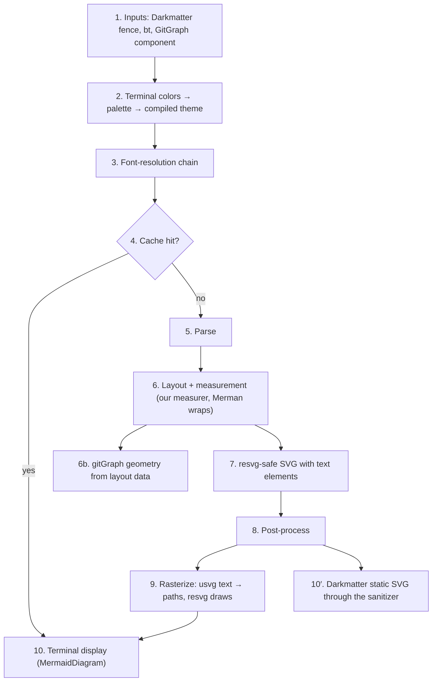
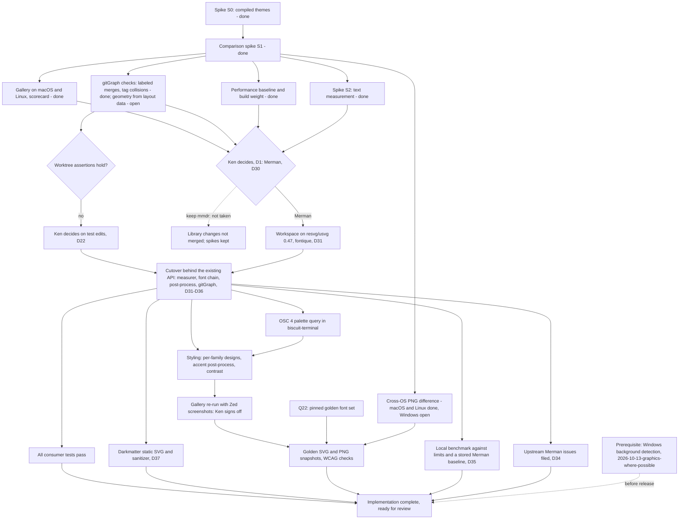

---
$schema:
    status: |-
        enum(
            draft-spec,
            finalized-spec,
            planned,
            implemented,
            review-findings,
            human-in-the-loop,
            completed,
            on-hold,
            abandoned
        ) -> an indicator of progress for this specification
    reviewed: boolean -> indicates whether the specification file has been reviewed by another agent from the one which created the spec
    reviewed_by: string -> the agent and model used in the spec review
    reviewed_on: date -> the date the spec was reviewed
    review_iterations: number -> the number of implementation reviews have taken place in the review/fix cycle
    clarified: boolean -> indicates whether the specification was built -- _in part_ -- with the clarify.md prompt
    implemented: boolean -> indicates whether this spec's plan has been implemented
    implemented_by: string -> the agent who implemented the plan
status: finalized-spec
clarified: true
clarified_by: claude/opus
reviewed: true
reviewed_by: claude/opus
reviewed_on: 2026-10-21
review_note: the clarification process served as a review
review_iterations: 0
needs_rulings: true
required_rulings:
    - "Q5 — cache key and backend id format, and how the palette enters the key (needed before cutover planning)"
    - "Q8 — CI tiers for goldens, PNG and OSC 4 tests, promotion from gates = false, and source-inputs changes (needed before tests-phase planning)"
    - "Q11 — Unicode/ASCII text fallback in scope or a follow-up (default follow-up; needed before cutover planning only if in scope)"
    - "Q16 — benchmark profile, reference host, baseline storage, and cache bypass (needed before the benchmark recipe, R-V6)"
    - "Q18 — how WCAG 'large text' is measured in SVG (needed in the tests phase, before AC-T4 is coded)"
    - "Q19 — whether the OSC 4 query runs on native Windows (needed before terminal-palette phase planning)"
    - "Q20 — goldens for a derived terminal palette (needed in the tests phase, before goldens are generated)"
    - "Q21 — test fixtures location and whether the ~20 MB cap is shared with spikes/ (needed before fixtures are copied into the test tree)"
    - "Q22 — the pinned font set for golden tests, now that layout depends on host fonts (needed before tests-phase planning)"
depends-on:
    - 2026-10-13-graphics-where-possible
related:
    - 2026-10-13-graphics-where-possible
    - 2026-10-21-mermaid-embedded-font
references:
    biscuit-visualized/features/2026-10-21-merman/spikes/s1-comparison/FINDINGS.md: >-
        Findings of spike S1 (2026-10-21): today's renderer against Merman across
        every shared and Merman-only family, with fidelity, defect survey,
        real-font measurement, timings, build weight, and cross-host PNG differences.
    biscuit-visualized/features/2026-10-21-merman/spikes/s1-comparison/gallery/index.html: >-
        The S1 gallery (macOS, dark): today's output, Merman, Merman with real
        fonts, and the Mermaid.js reference side by side per family.
    biscuit-visualized/features/2026-10-21-merman/spikes/s2-measurement/FINDINGS.md: >-
        Findings of spike S2 (2026-10-21): our rustybuzz measurer against Merman's
        native measurement, why Merman must own wrapping, and the `\n` survey.
    biscuit-visualized/features/2026-10-21-merman/spikes/s2-measurement/gallery/index.html: >-
        The S2 gallery: mixed-script and wrapping cases drawn by each measurer
        beside Mermaid.js, with measured widths outlined, and the `\n` table.
    biscuit-visualized/features/2026-10-21-merman/spikes/s2-measurement/results.json: >-
        S2's raw data: every host, font variant, label width, defect, line-break
        match, `\n` case, and timing sample behind its findings.
    biscuit-visualized/features/2026-10-21-merman/spikes/s0-compiled-theme/FINDINGS.md: >-
        Findings of spike S0 (2026-10-21): whether a terminal palette can be
        expressed as a Merman compiled theme, which styling must stay ours, the
        gitGraph layout data, and compile/dependency measurements at the pinned rev.
    biscuit-visualized/features/2026-10-21-merman/spikes/s0-compiled-theme/out/theme-design.json: >-
        The recommended flowchart/sequence `ThemeDesignV1` from spike S0, built
        from a Tokyo-Night-like palette; the wire shape our palette type would emit.
    biscuit-visualized/features/2026-10-21-merman/spikes/s0-compiled-theme/out/theme-design-gitgraph.json: >-
        The gitGraph variant of the S0 design, with full-strength accents and the
        Mermaid variables that reach commit and tag labels.
    biscuit-visualized/features/2026-10-21-merman/spikes/s0-compiled-theme/out/gitgraph-layout.json: >-
        Merman's `layout_json` output for the S0 gitGraph; the source shape for
        rebuilding `GitGraphGeometry` (D5).
    biscuit-visualized/features/2026-10-21-merman/spikes/s0-compiled-theme/out/theme-design-ordinal-stroke-rules.json: >-
        The S0 design variant with ordinal stroke rules; the probe showing an
        unsupported rule erasing a supported one (Risks, precedence surprise 2).
    biscuit-visualized/features/2026-10-21-merman/spikes/s0-compiled-theme/out/theme-design-with-vars.json: >-
        The S0 design variant with `design.mermaid.variables`; the probe showing
        variables overriding the ordinal palette (Risks, precedence surprise 3).
    biscuit-visualized/features/2026-10-21-merman/spikes/s0-compiled-theme/out: >-
        Every S0 render as SVG and PNG (baseline, themed, and probe variants for
        flowchart, sequence, and gitGraph), cited by the findings as evidence.
    biscuit-visualized/features/2026-10-21-merman/spikes/s0-compiled-theme/src/main.rs: >-
        The S0 spike program: builds the designs, renders through Merman at the
        pinned rev, rasterizes with resvg 0.45, and includes the accent
        post-process prototype (`accent_strokes()`).
    biscuit-visualized/docs/research/mermaid/merman.md: >-
        Research on Merman: family coverage, features, SVG pipelines, licensing,
        and the compiled-theme API.
    biscuit-visualized/docs/research/mermaid/zed-merman.md: >-
        Research on Zed's styling layer over Merman. GPL-3.0-or-later; ideas only,
        never code (D6).
---

# Merman Rendering

`biscuit-visualized` renders Mermaid diagrams to SVG and PNG with the
[mermaid-rs-renderer](https://github.com/1jehuang/mermaid-rs-renderer.git)
crate (`mmdr`). [Merman](https://github.com/Latias94/merman) was expected to be
the better option, and after spikes S1 and S2 Ken chose it (D30):

- it is much more up to date
- the Zed editor uses it as its Mermaid backend, with a styling layer of its
  own on top

> **Reader's note:** the original draft said Zed's developers *back* Merman.
> The research establishes that Zed *uses* Merman (since 2026-05-27) and that
> Merman is an independent project; it does not establish sponsorship.

This spec covers four steps:

1. a spike that renders every diagram through both renderers and compares them
2. a decision on whether Merman replaces `mmdr` (made: it does, D30)
3. a styling layer that makes diagrams look more like Zed's
   preview than Merman's defaults, including a palette taken from the user's
   terminal
4. the cutover to Merman for every consumer

Research this spec builds on:

- [mermaid-rs-renderer research](../../docs/research/mermaid/mermaid-rs-renderer.md)
- [Merman research](../../docs/research/mermaid/merman.md)
- [Zed's abstraction over Merman](../../docs/research/mermaid/zed-merman.md)
- [Mermaid.js](../../docs/research/mermaid/mermaid-js.md)
- [gitGraph corrections](../../docs/mermaid-gitgraph.md) (current behavior)
- [Terminal standards](../../../biscuit-terminal/docs/research/terminal-standards/SKILL.md),
  in particular [OSC 4/104](../../../biscuit-terminal/docs/research/terminal-standards/osc/osc-4-104.md),
  [OSC 10/11/12](../../../biscuit-terminal/docs/research/terminal-standards/osc/osc-10-11-12.md),
  and [mode 2031](../../../biscuit-terminal/docs/research/terminal-standards/modes/mode-2031.md)
  (palette change notifications)
- [Spike S0 findings](spikes/s0-compiled-theme/FINDINGS.md) (compiled themes,
  gitGraph layout data, build weight)
- [Spike S1 findings](spikes/s1-comparison/FINDINGS.md) and
  [gallery](spikes/s1-comparison/gallery/index.html) (comparison, defect
  survey, real-font measurement, timings, cross-host PNG differences)
- [Spike S2 findings](spikes/s2-measurement/FINDINGS.md) and
  [gallery](spikes/s2-measurement/gallery/index.html) (which text measurer,
  wrapping, `\n` in labels)

## Current state

As of 2026-10-21:

- **Renderer:** `mermaid-rs-renderer` 0.3.1 with `default-features = false`,
  behind `biscuit-visualized`'s `image` feature. PNG comes from our own
  `resvg` 0.45.
- **Public API consumers rely on:** the `MermaidDiagram` component
  (`components/mermaid.rs`), the `MermaidTheme` enum (`Dark`, `Default`,
  `Forest`, `Neutral`), `MermaidConfig`/`QuadrantTheme`, and the
  `#[doc(hidden)]` gitGraph geometry test API (`gitgraph_geometry()`,
  `GitGraphGeometry`, `default_gitgraph_commit_step()`).
- **Theme selection in a terminal** is binary: `terminal_theme()` picks
  `Dark` or `Default` from `biscuit_terminal::discovery::detection::color_mode()`,
  and an unknown mode is treated as dark. The four themes are `mmdr` `Theme`
  structs built in `mermaid/render.rs`.
- **Corrections we carry for `mmdr`:** gitGraph merge repair and tag spacing
  (`mermaid/gitgraph.rs`), plus string-level SVG fixes (`apply_svg_overrides`,
  `fix_legend_text_baseline`, `fix_pie_text_contrast`).
- **Cache identity:** the backend id in the artifact cache key is
  `mermaid-rs-renderer@0.3.x+bv3` (`cache::file_cache::MERMAID_BACKEND`).
- **Terminal colors:** `biscuit-terminal`'s `Terminal` exposes
  `background_color` and `text_color` (OSC 11/10, one cached round trip per
  process, Unix only). There is no Windows backend and no ANSI palette
  (OSC 4) query.
- **Consumers:** `biscuit-terminal` (lib and the `bt` CLI), `darkmatter`,
  `sniff`, and `worktree`. `worktree/cli/src/commands/git_graph/tests.rs`
  (about 2,250 lines) asserts on the gitGraph geometry API, including one
  assertion (line 2193) that a layout's `commit_step` equals
  `default_gitgraph_commit_step()`. Both are `mmdr` concepts.
- **Darkmatter HTML:** Darkmatter passes diagram SVG through its own sanitizer
  (`darkmatter/lib/src/markdown/render_tree/svg_sanitizer.rs`, an allow-list)
  and has its own `MermaidTheme` struct (`darkmatter/lib/src/mermaid/theme.rs`).
- **CI metadata:** `biscuit-visualized/src/Cargo.toml` sets `gates = false`
  (`promotion-pending`, expiry 2026-10-31) and `all-features = true` for tests.
- **No `.mmd` corpus exists.** The repo's Mermaid test inputs are inline in
  Rust tests.
- **Coverage gap:** Merman's primary matrix has 37 families against `mmdr`'s
  23. ZenUML is the exception in the other direction: `mmdr` detects it, while
  Merman renders it in a separate lane outside its primary matrix.
- **Spikes S0, S1, and S2 are done**, each a standalone Cargo project under
  `spikes/` against Merman `main` at rev
  `482fcde7faffb05a466f198085d615e604075d97`:
    - S0 (`spikes/s0-compiled-theme/`): compiled themes.
    - S1 (`spikes/s1-comparison/`): the comparison spike of D2. R-S8/AC-S6
      (gitGraph geometry and `worktree`'s tests) and the Windows leg of AC-S8
      were not run; see [Spike status](#spike-status).
    - S2 (`spikes/s2-measurement/`): text measurement (D31) and `\n` in labels
      (D34).
- **Mermaid version.** Merman models Mermaid.js **12.2.0**. The local `mmdc`
  bundles Mermaid **11.12.2**, which differs (for example, flowchart labels
  wrap at 200 px there and at 120 px in 12.2.0). See D38.
- **Rasterizer version.** The workspace uses resvg/usvg 0.45; Merman uses
  0.47. D31 upgrades the workspace.

## Scope

**In scope**

- The comparison spike: gallery and scorecard (D2, D11), the gitGraph checks
  (D5), the cross-OS PNG measurement (D13), and the performance baseline (D12).
- Merman was chosen (D30), so: the renderer swap behind the existing public
  API, gitGraph geometry rebuilt on Merman's layout data, our own text
  measurer and font-resolution chain (D31, D32), the workspace upgrade to
  resvg/usvg 0.47 (D31), the SVG post-process (D33), the interim `\n` rewrite
  (D34), the styling layer, terminal-derived palettes, the OSC 4 query in
  `biscuit-terminal`, golden and contrast tests, a local benchmark with a
  stored Merman baseline (D35), and the consumer changes that the swap needs
  (Darkmatter's static-SVG path and sanitizer, D37; `worktree`'s gitGraph test
  helper; `biscuit-terminal`'s OSC 4 query).
- Upstream issues filed with Merman (D34, [Upstream issues](#upstream-issues)).
- ~~If `mmdr` is kept: library changes are not merged.~~ Moot since D30. The
  `spikes/` folder stays as the record of the decision (D11).

**Out of scope**

- Copying, translating, or closely adapting any of Zed's `mermaid_render`
  code (GPL-3.0-or-later). Ideas only; see D6.
- Editor-style machinery from Zed (zoom, debounce, fallback frames,
  source/preview toggle).
- Native Windows background/foreground detection. It is a **prerequisite**
  delivered by `2026-10-13-graphics-where-possible` (D7).
- Breaking changes to the existing public API (D4). Additive API is allowed.
- ELK layouts (D15).
- Darkmatter's own `MermaidTheme` struct (D23).
- OSC 4 indices 16–255, and OSC 4 as public `biscuit-terminal` API (D19).
- Running the benchmark in CI (D12, D35).
- Embedding a font in Darkmatter's static-SVG HTML output: a follow-up,
  `2026-10-21-mermaid-embedded-font` (D37).
- Drawing text as paths in the SVG itself (outlining labels before output);
  considered and deferred (D33).
- Merman's native font measurement (rejected, D31) and Merman's `parity`
  pipeline for HTML (rejected, D37).

**Not yet decided whether in scope:** a Unicode/ASCII text fallback through
Merman's text output (Q11).

## Ownership

| Role | Who |
| --- | --- |
| Owns the spec and the work | `biscuit-visualized` |
| Decides Merman vs `mmdr`; signs off on themes; adjusts performance thresholds after the spike | Ken |
| Decides at the gitGraph decision point whether `worktree` tests may be edited (D22) | Ken |
| Captures Zed screenshots for the theme review | Ken |
| Consumers whose tests must pass | `biscuit-terminal` (lib and `bt`), `darkmatter`, `sniff`, `worktree` |
| Gains the OSC 4 palette query | `biscuit-terminal`, as a dependency of this work |
| Consumer code changed by this work (pre-authorized, see below) | `darkmatter` (SVG sanitizer allow-list), `worktree` (gitGraph test helper), `biscuit-terminal` (OSC 4) || Delivers native Windows background detection (prerequisite) | `2026-10-13-graphics-where-possible` |

## Decisions

D1–D9 were confirmed by Ken on 2026-10-21; D5 and D6 were amended and D10–D25
added the same day after spike S0. D26–D29 record Ken's rulings on Q14, Q17,
Q15, and Q2, also on 2026-10-21. D30–D39 record Ken's rulings after spikes S1
and S2, also on 2026-10-21; they amend D1, D2, D5, D12, D13, D14, and D24 in
place, and each amended decision says which new decision superseded it.

### D1. Decision rule: Ken decides from a scorecard, Merman favored *(amended 2026-10-21 by D30)*

> **Resolved by D30:** Ken chose Merman. The rule below is kept as the record
> of how the decision was made.

Ken chooses, informed by the spike's scorecard. Merman is chosen unless it is
**clearly worse** on fidelity (against Mermaid.js) or on performance. The
scorecard records, per diagram family:

- fidelity against the Mermaid.js reference
- aesthetics
- rendering bugs (for example `mmdr`'s labeled-merge parsing bug in gitGraph)
- measured render timings, which become the performance baseline (D12)
- build-weight delta: compile time and binary size; ELK measured once for
  information (D15). Build weight is information only, with no ceiling (D29).

For performance, "clearly worse" has a starting definition in D12. Fidelity,
aesthetics, and build weight remain a judgment.

*Rationale:* the comparison is partly a judgment of looks, which no threshold
captures; favoring Merman reflects its coverage, Mermaid parity goal, and
release activity. The rule is therefore not machine-testable; the scorecard's
contents are (AC-S1–AC-S4).

### D2. Comparison artifact: a static HTML gallery plus a one-page scorecard *(amended 2026-10-21 by D38)*

> **Amended by D38:** every Mermaid.js reference, our own test diagrams
> included, comes from Mermaid.js 12.2.0. The local `mmdc` bundles 11.12.2 and
> is no longer a reference source.

- One section per diagram family, showing today's `biscuit-visualized` PNG
  (on `mmdr`, with our corrections and themes; D26), the Merman PNG, and the
  Mermaid.js reference where one is available.
- Inputs: every family both renderers support, plus the diagrams in the
  repo's existing tests (extracted from inline Rust sources). The corpus starts
  from Merman's per-family fixtures.
- Mermaid.js references come from Merman's stored fixtures. `mmdc` (installed
  locally with Node 22) renders references only for our own test diagrams,
  which have none.
- Merman-only families appear in a separate bonus section.
- The gallery is rendered on macOS **and** Linux, since fonts differ.
- Output lives under `biscuit-visualized/features/2026-10-21-merman/spikes/`.

*Rationale:* side-by-side images are the fastest way to judge fidelity and
aesthetics; reusing Merman's fixtures avoids building a corpus and gives a
Mermaid.js reference for free. Rendering on Linux catches font fallback that
macOS hides.

### D3. Ownership

As in [Ownership](#ownership). *Rationale:* after
`2026-10-13-graphics-where-possible`, `biscuit-visualized` owns diagrams for
every target and `biscuit-terminal` owns detection.

### D4. Cutover: swap behind the existing public API

The renderer is replaced behind `MermaidDiagram`, `MermaidTheme`, and the
gitGraph geometry API, and every consumer's tests are verified. Families that
Merman supports and `mmdr` does not start working with no further feature
work. Additive API (the palette, D6–D8) is allowed.

*Rationale:* consumers should not have to change to get the new renderer;
keeping the API makes "every consumer's tests pass" a meaningful check.

### D5. gitGraph: drop the corrections if Merman makes them unnecessary; geometry from layout data *(amended after S0; amended 2026-10-21 by D36)*

> **Amended by D36:** S1 settled the conditional below. The merge repair is
> removed; tag spacing is kept, reimplemented as wider commit spacing in the
> generated Mermaid; the "empty branch" merge error is dropped. The
> layout-data approach to `GitGraphGeometry` stands; tag bounds now come from
> our measurer, verified against the layout data, not from the SVG.

- Drop merge repair and tag spacing **if** the spike confirms Merman handles
  labeled merges and tag collisions as Mermaid.js does.
- Build `GitGraphGeometry` from Merman's **layout data**:
  `RenderRequest::layout_json` → `layout.GitGraphDiagram` (branches; commits
  with `parents`, `x`, `y`, `pos`, `branch`, `tags`; arrows; bounds).
    - Merman's typed layout structs are not re-exported by the `merman` facade,
      so the JSON is deserialized into structs of our own.
    - Tag bounds are not in the layout data (tags are names only); they come
      from the SVG.
    - There is no `commit_step` field; spacing is derived from `pos`.
- `worktree`'s tests should pass unchanged. The assertion at
  `worktree/cli/src/commands/git_graph/tests.rs:2193`
  (`commit_step == default_gitgraph_commit_step()`) compares two `mmdr`
  concepts, so both must be re-implemented on top of Merman's data. If the
  spike shows any worktree assertion cannot hold, D22 applies.

The spike must verify these claims (AC-S5, AC-S6).

*Rationale:* the corrections exist only to work around `mmdr`; the worktree
suite is the strongest existing evidence of correct gitGraph layout. S0 showed
that layout data carries parents and positions, which SVG geometry does not.

### D6. Theme scope: a full Zed-like styling layer, written clean-room, on compiled themes *(amended)*

Goals (unchanged):

- Accent colors for un-styled nodes, at least in flowchart, class, sequence,
  and mindmap diagrams.
- Contrast-aware text color.
- A palette derived from the user's terminal colors (D7).

Mechanism (amended after S0):

1. **Compiled themes are the primary mechanism.** Our palette emits a
   `ThemeDesignV1` through the `merman::diagram_theme` facade, compiled by
   `DiagramThemeCompiler` and applied with `RenderRequest::with_theme`.
   **One design per diagram family**, generated from the palette.
    - Emit only the facets that `describe_theme_support` reports as `supported`
      or `conditional` for that family.
    - Leave the node base fill (`styles.node.fill`) unset, so the ordinal
      palette applies.
    - gitGraph uses its own design with full-strength accents, plus Mermaid
      variables (`commitLabelColor`, `tagLabel*`, `git0..7`,
      `gitBranchLabel0..7`) for commit and tag label colors.
2. **A small attribute-rewrite post-process** covers what compiled themes
   cannot do: rotating accent strokes on un-styled flowchart nodes, and
   per-actor accents in sequence diagrams. It is keyed on **our own palette
   colors**, never on Merman class names.
3. **Scoped CSS** (selectors scoped to the diagram's SVG id) is used only for
   things the theme does not set. It cannot override theme paint, because
   Merman writes that paint as inline `!important`.

Class and mindmap accents are still to be verified in the styling phase (see
[Design notes](#design-notes): class diagrams have no ordinal palette, so
their accents come from the post-process; mindmap has one).

Zed's `mermaid_render` is GPL-3.0-or-later and must not be copied.

*Rationale:* S0 showed compiled themes reach base colors in flowchart and
sequence and branch colors in gitGraph, with less CSS tied to Merman's class
names (which upgrades can break silently). The post-process keys on colors we
chose, so it does not depend on Merman's markup vocabulary. Clean-room keeps
`biscuit-visualized` free of copyleft obligations.

### D7. Terminal colors: detected background/foreground plus a new OSC 4 query

- Use the detected background and foreground. `biscuit-terminal` already
  detects them on macOS and Linux. Native Windows detection is a prerequisite
  delivered by `2026-10-13-graphics-where-possible`, recorded as `depends-on`
  in the frontmatter, and must land before this spec is released.
- Add an ANSI 16-color palette query (OSC 4) to `biscuit-terminal`, with a
  timeout and caching (scope: D19).
- Accents derive from the ANSI colors. When no ANSI palette is available,
  accents are computed from the background instead. That covers two cases:
    - **The query is never sent.** OSC 4 goes through the same gate as the
      existing OSC 10/11 queries (`biscuit-terminal`'s
      `discovery/osc_queries`): no query when stdout is not a TTY, in CI, or
      inside a terminal multiplexer (`TMUX`, `ZELLIJ`, or `STY` set). Under
      tmux, Zellij, or screen the palette is therefore always
      background-derived (or fixed, R-P5); this spec does not relax the gate.
    - **The terminal does not answer.** For example over SSH, where replies
      may be dropped; the query times out (R-P1, AC-P2).

*Rationale:* the ANSI palette is the user's chosen accent set; the background
fallback keeps results usable where queries are not sent or not answered.

### D8. Defaults and fallback

- In terminal contexts, the detected palette is the default.
- `Dark`, `Default`, `Forest`, and `Neutral` become fixed palettes (origin:
  D17), always available, and used when detection fails or the output is not
  for a terminal (files, Darkmatter HTML, CI).
- The cache key includes the palette colors.
- Tests pin a palette.

*Rationale:* detected colors make diagrams match the terminal; fixed palettes
keep non-terminal output and tests deterministic.

### D9. Theme acceptance: gallery review, then golden tests

1. Re-run the HTML gallery with the new themes alongside Zed screenshots of
   the same diagrams (captured by Ken), for Ken's sign-off.
2. Lock the result in with golden snapshot tests (corpus and formats: D13),
   plus automated WCAG contrast checks on text (D18).

*Rationale:* looks are signed off by a human once, then guarded by machines.

### D10. Merman version: git dependency on `main`, pinned to an exact rev

- Merman is a git dependency on `main` pinned to an exact `rev` (S0 used
  `482fcde7faffb05a466f198085d615e604075d97`), never a branch.
- The 0.9.1 tag sits on a side branch, about 1,690 commits behind `main`, and
  lacks the compiled-theme API.
- Nothing in the repo publishes (`publish = false` in `release-plz.toml`), so
  a git dependency costs nothing today.
- Move to a crates.io release once one ships the compiled-theme API.
- Rev bumps happen only deliberately, each in its own change, with the goldens
  re-reviewed.

*Rationale:* the compiled-theme API (D6) exists only on `main`, and the theme
area churns heavily there; an exact rev makes every change of behavior a
reviewed event.

### D11. Spike setup and rollback: a standalone Cargo project under `spikes/`

- The comparison spike is a standalone Cargo project under the spec's
  `spikes/` folder (empty `[workspace]`, not a workspace member). It calls
  Merman directly, as S0 does, and reaches `mmdr` through `biscuit-visualized`
  as a path dependency (D26).
- `biscuit-visualized` is untouched until Ken decides (D1).
- Rollback is not merging library changes. The `spikes/` folder is kept as the
  record of the decision.

*Rationale:* this keeps the workspace's CI `all-features` build from compiling
both renderers, and makes rollback free.

### D12. Performance test: a local in-process benchmark *(amended 2026-10-21 by D35)*

> **Amended by D35:** the "clearly worse" ratio rule and the comparison with
> `mmdr` are replaced by absolute limits and a regression rule against a
> stored Merman baseline. The benchmark stays local.

- An in-process benchmark (criterion) over the spike corpus, run locally
  through a `just` recipe. **Not run in CI.**
- Reports the median and p95 per family.
- The `mmdr` timings are taken through `biscuit-visualized` and so include our
  correction passes (D26).
- **"Clearly worse"** (for D1): Merman's median is more than 3× slower than
  `mmdr`'s, or exceeds 100 ms, on a family used by consumers.
- **Regression** (after cutover): more than 25% slower than a stored baseline
  JSON.
- Thresholds are Ken's to adjust after he sees the spike data.
- Modeled on Merman's `tools/bench/compare_mermaid_renderers.py`
  (MIT/Apache-2.0).

*Rationale:* timings on shared CI runners are noisy, and a local benchmark
answers the question without new CI cells.

### D13. Golden corpus: one input per family, SVG for every palette, PNG for two *(amended 2026-10-21 by D39)*

> **Amended by D39:** the assumption below that SVG snapshots are
> OS-independent no longer holds. With real-font measurement (D31), layout
> depends on the fonts installed on the host, so goldens need a pinned font
> set (Q22). The corpus shape (one input per family, SVG for every palette,
> PNG for two) is unchanged.

- One representative input per family, copied into a test fixtures folder
  with Merman's `LICENSE-MIT`, `LICENSE-APACHE`, and
  `THIRD_PARTY_LICENSES/mermaid` notices. Merman's bundled fonts are excluded.
- SVG snapshots for every family × the 4 fixed palettes, Merman-only families
  included (D27).
- PNG snapshots only for the `Dark` and `Default` palettes, compared within a
  tolerance, because fonts differ across macOS, Linux, and Windows.
- The spike records cross-OS PNG pixel differences for one diagram, to set
  that tolerance.

*Rationale:* SVG snapshots are exact and OS-independent; PNG snapshots catch
rasterizer regressions but need a tolerance, so they are kept to two palettes.

### D14. One SVG for every target; Darkmatter's sanitizer is extended *(amended 2026-10-21 by D37)*

> **Amended by D37:** Darkmatter's default HTML path never receives our SVG
> (it ships `<pre class="mermaid">` for Mermaid.js in the reader's browser).
> Only the static-SVG opt-in does, and it receives the resvg-safe SVG with two
> HTML-only changes: label `font-family` rewritten to lead with the measured
> face, and label overflow allowed. The sanitizer is extended only for
> Merman's elements.

- Every target, Darkmatter HTML included, gets Merman's resvg-safe SVG
  (`SvgPipeline::resvg_safe()`).
- Darkmatter's SVG sanitizer allow-list
  (`darkmatter/lib/src/markdown/render_tree/svg_sanitizer.rs`) is extended for
  Merman's output, with a test that labels survive into Darkmatter HTML.

*Rationale:* one output shape means one set of goldens; the sanitizer is the
known point where valid Merman output could be stripped.

### D15. ELK off, never exposed

Merman is built with `default-features = false`, without ELK. ELK is never
exposed as a feature of `biscuit-visualized`. The spike measures its build
weight once, for information.

*Rationale:* ELK is EPL-2.0 and heavy; no consumer needs its layouts.

### D16. Merman-only families: one smoke test, golden SVGs, one docs list *(amended by D27)*

Each family Merman supports and `mmdr` does not gets one smoke test, a golden
SVG under each of the 4 fixed palettes (D27), and an entry in one list in
`docs/`. The list is confirmed from Merman's
family registry at the pinned rev (the research's candidate list is in the
Design notes).

### D17. Fixed palettes start from Mermaid.js's named themes

`Dark`, `Default`, `Forest`, and `Neutral` start from Mermaid.js's themes of
the same name, then go through our accent and contrast passes. They do not
reproduce today's `mmdr` colors.

### D18. Contrast threshold: WCAG AA

Text meets WCAG AA: 4.5:1 for normal text and 3:1 for large text, measured
against the fill behind each text element.

### D19. OSC 4 query scope: indices 0–15, internal

The OSC 4 query covers ANSI indices 0–15. It is internal to palette resolution,
not public `biscuit-terminal` API yet.

### D20. Parse errors and unsupported families keep today's fallback

Parse errors and unsupported families, ZenUML included, keep today's fallback:
the source is shown as a code block. The scorecard records the ZenUML loss.

### D21. Per-render time budget: 2 s *(amended by D28)*

Each render has a default time budget of 2 s, enforced through Merman's
`OperationControl`. D28 sets what happens when it is exceeded, how it is
configured, and which requests it covers.

### D22. gitGraph decision point for `worktree` test edits

If the spike's gitGraph check shows that some `worktree` assertions cannot
hold against Merman, Ken decides at that decision point whether those tests may
be edited. Until he does, "unchanged" (AC-C4) stands.

### D23. Darkmatter's `MermaidTheme` is left alone

`darkmatter/lib/src/mermaid/theme.rs` is not changed by this spec.

### D24. Font family ends in `sans-serif` *(amended 2026-10-21 by D32)*

Any font family our designs set ends with a generic `sans-serif` fallback.

> **Amended by D32:** the rule stands, but the rationale below is superseded.
> Merman no longer measures with its own font-free model (D31), and a missing
> face is resolved by the font-resolution chain (D32), whose generic step is
> what keeps hosts without the named fonts readable. The generic name in the
> stack is what reaches that step.

*Rationale (original):* Merman measures unknown fonts narrowly, and S0 showed
the requested `"Recursive Variable",arial,sans-serif` falling back to Arial on
macOS; a generic fallback keeps hosts without the named fonts readable.

### D25. Pre-authorized preparatory work

See [Pre-authorized preparatory work](#pre-authorized-preparatory-work).

### D26. The gallery's `mmdr` column shows today's `biscuit-visualized` output

The column labeled `mmdr` (mermaid-rs-renderer) shows what users see today,
not raw `mmdr` output:

- The comparison spike depends on `biscuit-visualized` by path, still without
  changing it (R-S10), and renders through its current `MermaidDiagram`, with
  today's corrections (merge repair, tag spacing, the string-level SVG fixes)
  and themes.
- The `mmdr` timings (D12) are taken through the same path, so they include
  our correction passes.

*Rationale:* the decision (D1) is about what users would see, so the
comparison is against today's corrected output; the correction passes are part
of today's real cost. The spike is a non-member crate (D11), so the path
dependency adds no CI cost.

### D27. Every family gets golden SVGs under all 4 fixed palettes

The golden SVG rule of D13 applies to every family, Merman-only families
included: one SVG snapshot per family × `Dark`, `Default`, `Forest`, and
`Neutral`. This replaces D16's original "one golden SVG" for Merman-only
families.

*Rationale:* one rule for every family; a Merman-only family is as likely as
any other to regress under one palette only.

### D28. Time budget: exceeding it is a render failure; configurable; covers layout data

- A render that exceeds its time budget is treated like a render failure: the
  source is shown as a code block through the existing fallback (D20), and a
  warning is logged.
- The budget is a builder option on the `MermaidDiagram` component, defaulting
  to 2 s (D21). This is additive API (D4).
- The budget also bounds layout-data requests (`RenderRequest::layout_json`),
  which build the gitGraph geometry (D5).
- **Where the option lives.** The option exists on both types (Ken accepted
  this on 2026-10-21):
    - the library-level `mermaid::MermaidDiagram` (`mermaid/render.rs`), which
      `worktree` uses directly for gitGraph geometry, so geometry requests can
      be bounded without the terminal component;
    - the terminal `MermaidDiagram` component (`components/mermaid.rs`), which
      passes its value through to the library-level type rather than keeping
      a budget of its own.
- **What the budget measures.** The budget becomes a deadline on Merman's
  `OperationControl` (`OperationControl::with_deadline`). Merman checks that
  deadline only at its own checkpoints during parsing, layout, and SVG
  output. Our work after Merman returns runs outside it: the accent
  post-process (D6), any remaining SVG corrections (R-C4), building
  `GitGraphGeometry` from the layout JSON, and PNG rasterization through
  `resvg`. The budget therefore bounds Merman's share of a render, **not**
  total wall-clock time, and a render can finish later than the budget with
  no failure. (Ken accepted this on 2026-10-21.)

*Rationale:* a consumer gets the same readable output from a slow diagram as
from a broken one, rather than a new error path; the warning keeps the cause
visible; consumers with other latency needs can change the budget. Only
Merman's own checkpoints can stop its work early; the cost of our own passes
is measured by the benchmark (D12) instead.

### D29. Build weight is information only

The scorecard records the build-weight delta (compile time, binary size,
dependency count) for information. There is no ceiling; Ken weighs it in the
D1 judgment.

*Rationale:* no consumer has a stated compile-time or size budget, so a
threshold would be arbitrary; the S0 figures (23 s uncached debug, 18 MB
release, three families) gave no reason to set one.

### D30. Merman replaces mermaid-rs-renderer

Ken chose Merman on 2026-10-21. This resolves D1's decision point (AC-S4).

Evidence (S1):

- Fidelity against Mermaid.js 12.2.0 is better in about a dozen shared
  families. Today's renderer misreads journey, radar, packet, block, treemap,
  sankey, kanban, mindmap, sequence participant types, gantt, timeline, and
  gitGraph orientation.
- 14 families render only in Merman. Today's renderer errors on two and draws
  a wrong flowchart for the other twelve.
- Merman's label clipping (218 label renders on macOS, 268 on Linux) comes
  from its font-free default measurer; real-font measurement cut it to 2 per
  host in S1 and 3 in S2 (D31).

Costs, recorded for information (D29):

- Renders take milliseconds (the slowest S1 fixture took 6.1 ms) where
  today's renderer often takes under 0.3 ms.
- Uncached release build 18 s → 53 s; binary 8.1 MB → 27.3 MB (S1, macOS).

*Rationale:* D1's rule favored Merman unless clearly worse; it is better on
fidelity and coverage, and its absolute times are well inside the D35 limits.

### D31. Text measurement: our own measurer, Merman wraps

- `biscuit-visualized` implements a Merman `TextMeasurer` that shapes each
  label directly with rustybuzz on the face resolved by the font-resolution
  chain (D32). It must not parse SVG.
- It mirrors usvg 0.47's text pipeline where Merman's CSS uses it
  (letter-spacing, word-spacing, kerning, small-caps), and usvg's
  per-character fallback rule, so the measured face is the drawn face.
- Widths reach Merman through
  `DeterministicTextMeasurer::with_width_callback` (public, in the
  `merman::svg` facade), so **Merman does the wrapping**. The measurer
  measures each candidate string exactly as given (no whitespace collapsing).
- The workspace upgrades to resvg/usvg **0.47** (Merman's version), repo-wide,
  and adds `fontique` for the generic-family step of D32.

Rejected:

- **Merman's native measurement** (`native-fonts`). Its generic-family rule
  cannot be configured, so it measured `courier`, serif, and monospace text
  in a different face than resvg drew: 92 labels on Linux and 2 on macOS, up
  to 59.9 px off. Its font database is crate-private.
- **Our own greedy wrap.** Merman sizes each box from the measurer's wrap but
  draws the lines with its own line breaker; the two disagree (a 177 px clip
  on a class relationship label, 196 px on Linux).

*Rationale (S2):* with Merman wrapping, our widths matched usvg's laid-out
width exactly on all 1,321 compared labels on both hosts (RTL, CJK, emoji,
combining marks, fallback included); its defects were a strict subset of
native measurement's; it matched Mermaid.js 12.2.0's line breaks at least as
well; and it was faster cold (macOS 271 ms against 400 ms). It costs about 340
lines (a usvg mirror) plus the font chain, against about 20 for native.

### D32. One font-resolution chain for measuring and drawing

One function resolves a label's face, and both the measurer (D31) and the
rasterizer's usvg `FontResolver` call it. The rasterizer's fontdb holds the
same faces. Steps, in order:

1. **`MERMAID_FONT`**: a single family name, matched case-insensitively.
   Unset or empty: skipped silently, no log. Set but not installed: one
   warning naming it, then continue to step 2.
2. **The label's CSS font stack** (Mermaid's default is
   `"trebuchet ms", verdana, arial, sans-serif`), each name matched
   case-insensitively. Trebuchet MS is only Mermaid's first preference, not a
   requirement.
3. **The OS's own generic family** through fontique: fontconfig on Linux,
   CoreText on macOS, DirectWrite on Windows.
4. **An installed face whose OS/2 table classifies it as sans-serif** (read
   with ttf-parser), chosen by a documented, deterministic rule. *(The rule
   itself is not yet written; step 4 was not reached on either spike host.)*

No dependency on `sniff`, and no catalog of font names.

*Rationale:* S1 found that without the generic step, Linux hosts with no
stack font installed lost **all** Merman text silently; fontdb's matching is
case-sensitive, so Mermaid's lowercase names never matched; and one chain
for both sides makes "measured face = drawn face" true by construction.

### D33. SVG post-processing: what stays and what goes

- **Removed:** the `overflow:visible` label patch. Ken rejected it as a hack
  that hides the measurement mismatch.
- **Kept:** the gradient-stroke fix. The neo look strokes nodes with an
  `objectBoundingBox` gradient, which per the SVG specification paints
  nothing on a zero-height path, so class and ER dividers vanish in the dark
  theme (36 lines in S1, in resvg and Chrome alike).
- **Kept:** a `sans-serif` default for text with no font set.
- **Deferred:** drawing text as paths in our SVG output (outlining). The
  rasterizer still converts text to paths internally (pipeline step 9).

### D34. `\n` in labels: upstream fix, interim rewrite for four families

- **Upstream.** File an issue with Merman: normalize `\n` like ` ` in the
  families where Merman already breaks at it; pie and gitGraph drop the
  backslash; block draws one-line-wide boxes and has no ` ` support. See
  [Upstream issues](#upstream-issues).
- **Interim rewrite.** Until upstream fixes it, `biscuit-visualized` rewrites
  `\n` to ` ` inside label text for **class, ER, mindmap, and requirement
  only**, using a small per-family label lexer. It is never a global replace:
  it must not touch `%%{init}%%` JSON, `%%` comments, `click` URLs and
  tooltips, `classDef`/`style` values, or `accTitle`/`accDescr`. The rewrite
  is removed when upstream fixes it.
- **No rewrite:**
    - flowchart, state, and kanban already break correctly;
    - sequence, journey, timeline, architecture, and C4 stay as Mermaid.js
      12.2.0 behaves (`\n` literal, except C4, which breaks);
    - gantt, quadrant, treemap, and xychart stay literal.
- Pie, gitGraph, and block wait for the upstream fix.

*Rationale (S2):* in class, ER, mindmap, and requirement Merman breaks at
`\n` but sizes the box for one line (the symptom Ken saw in Zed); ` `
makes the box fit. In the other families ` ` is either unnecessary or
drawn as text.

### D35. Speed rule *(replaces D12's "clearly worse" and regression rules)*

- **Warm:** no diagram family exceeds a **50 ms median** for a warm full
  render: measure + layout + SVG + post-process + raster.
- **Cold:** a one-shot render (a fresh process) takes **under 500 ms**.
- **Regression:** more than **25% slower** than the stored Merman baseline,
  per family.
- The benchmark stays local, not in CI.

The rule applies to every family, so the "used by consumers" list D12 needed
is no longer needed. Profile, reference host, baseline storage, and cache
bypass are still open (Q16).

*Rationale:* S1 showed the ratio rule flags most families only because the
old renderer often finishes in under 0.3 ms; absolute limits ask the question
that matters. For scale, S2 measured warm renders at about 2.3 ms median plus
about 10 ms rasterization, and cold renders at 271 ms (macOS) and 24 ms
(Linux); whether S2's cold figure includes rasterization is not stated in its
findings.

### D36. gitGraph after S1

- **Merge repair: removed.** Merman keeps both parents of a labeled merge, as
  Mermaid.js does.
- **Tag spacing: kept**, by widening commit spacing in the generated Mermaid
  (gitGraph config). Tags are measured with our measurer (D31), and the
  result is verified against Merman's layout data. The spacing is
  diagram-wide, not per collision; Ken accepted that.
- **The "empty branch" merge error: dropped.** It rejects input that
  Mermaid.js and Merman both accept (S1).
- **Nine of `biscuit-visualized`'s own test inputs** are not valid Mermaid.js
  (`direction LR` inside gitGraph, branch names with spaces, a merge from an
  empty `main`, and two deliberately malformed flowcharts) and need new
  inputs.

This amends D5. R-S8 (geometry from layout data and `worktree`'s tests) was
not run by S1 and still governs the D22 decision point.

### D37. Darkmatter HTML

- **Default path unchanged.** `MermaidMode::Off` emits `<pre class="mermaid">`
  and Mermaid.js renders in the reader's browser.
- **Static-SVG opt-in** (`MermaidMode::Image`, mapped to
  `BrowserMermaidMode::StaticSvg`):
    - embed the resvg-safe SVG, measured with our chain (D31, D32);
    - rewrite each label's `font-family` to start with the exact measured
      face, followed by the original stack;
    - allow label overflow **in HTML output only**, because the reader's fonts
      are unknowable (unlike D33's rejected patch, this does not hide a
      mismatch we could fix);
    - extend Darkmatter's SVG sanitizer only for Merman's elements; whether
      `filter`/`fe*` are admitted is decided in that change (see
      [Design notes](#design-notes)).
- **Rejected for HTML:** the `parity` pipeline (boxes are still sized at render
  time, and HTML inside SVG widens the sanitizer's attack surface) and
  embedding PNGs.
- **Font embedding** is an opt-in follow-up,
  `2026-10-21-mermaid-embedded-font`.

This amends D14.

### D38. Mermaid.js references come from 12.2.0

Merman models Mermaid.js 12.2.0. Every reference render, for fidelity,
wrapping, and goldens, comes from Mermaid.js 12.2.0. The local `mmdc` bundles
11.12.2 and is not used for references. S2 rendered 12.2.0 in Chrome from
`npm pack mermaid@12.2.0`.

This amends D2 and R-S4.

*Rationale:* the versions differ in ways that look like defects (11.12.2 wraps
flowchart labels at 200 px; 12.2.0 at 120 px).

### D39. Layout depends on the host's installed fonts

With real-font measurement (D31), Merman's layout depends on the fonts
installed on the host, not on the OS. Between S1's two hosts, SVG width
changed by a median 0.5% (90th percentile 5.9%, largest 18.7%), and 122 of 188
PNGs changed size. This is expected, not a defect.

This supersedes D13's assumption that SVG geometry is OS-independent. Golden
tests therefore need a pinned font set or per-host baselines (Q22).

## Rendering pipeline

The end-to-end path of one diagram after the cutover, as Ken laid it out on
2026-10-21. Step numbers are referenced elsewhere in this spec.

| Step | What happens | Owner |
| --- | --- | --- |
| 1 | Inputs: a Darkmatter fence, `bt`, or the `GitGraph` component | consumers; `biscuit-visualized` |
| 2 | Terminal colors (`biscuit-terminal`) → palette → compiled theme. `biscuit-visualized` builds the `ThemeDesignV1`; Merman compiles it (D6, D7) | `biscuit-terminal`, `biscuit-visualized`, Merman |
| 3 | Font-resolution chain (D32) | `biscuit-visualized` with fontique and ttf-parser |
| 4 | Cache check, **before parsing**. Key: source + theme + resolved font files + Merman rev + post-process version + output format (exact encoding open, Q5) | `biscuit-visualized` |
| 5 | Parse | Merman |
| 6 | Layout, with measurement through our `TextMeasurer`; Merman wraps (D31). 6b: gitGraph geometry from the layout data (D5, D36) | Merman; `biscuit-visualized` (measurer, 6b) |
| 7 | resvg-safe SVG with `<text>` elements, not paths | Merman |
| 8 | Post-process: gradient-stroke fix (D33), accent rewrite (D6), tag-spacing input (D36) | `biscuit-visualized` |
| 9 | Rasterize: usvg converts text to paths using the same chain and fontdb (D32); resvg draws | `biscuit-visualized` (usvg/resvg 0.47) |
| 10 | Display through `MermaidDiagram` over `biscuit-terminal` | `biscuit-visualized`, `biscuit-terminal` |
| 10′ | Darkmatter static SVG: font-family rewrite and HTML-only label overflow (D37), then Darkmatter's sanitizer | `biscuit-visualized`, `darkmatter` |

Points the table leaves open or implies:

- **Pre-parse work.** Two steps change the Mermaid source before step 5: the
  `\n` rewrite (D34) and the commit spacing written into the gitGraph config
  (D36). Ken listed tag spacing under step 8; since its output feeds the
  generated source, where it sits relative to the cache check (step 4) is to
  be settled in planning. Either way the cache key must cover the source as
  rewritten.
- **"Resolved font files" before parsing.** Some families request fonts in
  their own CSS (railroad, treeView, and cynefin ask for `courier`), which is
  only known after parsing. Which files the key names when it is computed
  before parsing is part of Q5.

## Pre-authorized preparatory work

Ken approved the following on 2026-10-21. An agent may do these without asking
again; anything else still needs approval.

1. **Dependencies.** Add the Merman git dependency pinned to a rev (D10) and
   crates.io dev-dependencies such as `criterion`; upgrade resvg/usvg to 0.47
   repo-wide and add `fontique` (D31; Ken's ruling of 2026-10-21, which
   approves these two changes); use network access for
   cargo, the Merman repository, and npm; update `Cargo.lock`, the root
   `docs/dependencies.md`, and `biscuit-visualized/docs/dependencies.md`; remove
   `mermaid-rs-renderer` at cutover.
2. **Fixtures.** Copy Merman fixtures and Mermaid.js reference SVGs into
   `spikes/` and into test fixtures, with the license notices of D13 and
   without fonts, within a cap of about 20 MB.
3. **Reference renders.** Use the local Node, or install the Mermaid CLI or
   the `mermaid@12.2.0` package, for reference renders, which must come from
   Mermaid.js 12.2.0 (D38); commit gallery and golden PNGs within the size cap.
4. **CI and consumer code.** Edit `biscuit-visualized`'s CI metadata in its
   `Cargo.toml` (features, `source-inputs`); add a `just` benchmark recipe;
   change consumer code where needed (Darkmatter's sanitizer, `worktree`'s
   gitGraph helper, `biscuit-terminal` for the OSC 4 query); run checks on the
   Linux and Windows test hosts.

## Phases

The order follows the original draft. Which Merman-path steps can run in
parallel is a planning question. As of 2026-10-21, S0, S1, and S2 are done and
Ken has chosen Merman (D30); the gitGraph geometry check (R-S8) and the
Windows leg of the cross-OS measurement (R-S9) are still open.

## Requirements

Requirements are normative. Implementation ideas are in
[Design notes](#design-notes), which are not.

### Spike

- **R-S1.** Build the corpus from (a) Merman's per-family fixtures for every
  family both renderers support and (b) every Mermaid source in the repo's
  existing tests, extracted from inline Rust code.
- **R-S2.** Render the corpus to PNG with Merman and with today's
  `biscuit-visualized` (`mmdr` plus our corrections and themes, D26), using
  the same rasterizer (our `resvg` 0.45) and settings.
- **R-S3.** Produce the static HTML gallery and scorecard of D2 under
  `spikes/`, with Merman-only families in a bonus section, rendered on macOS
  and on Linux.
- **R-S4.** Take Mermaid.js references from Merman's stored fixtures, and use
  `mmdc` only for the repo's own test diagrams. *(Amended 2026-10-21 by D38:
  every reference, the repo's own diagrams included, comes from Mermaid.js
  12.2.0; the local `mmdc` bundles 11.12.2 and does not qualify.)*
- **R-S5.** Run the benchmark of D12 over the corpus for both renderers and
  record median and p95 per family in the scorecard; this is the performance
  baseline. The `mmdr` timings include our correction passes (D26).
- **R-S6.** Record the build-weight delta (compile time, binary size,
  dependency count) with ELK off, and once with ELK on, all for information
  (D29).
- **R-S7.** Determine whether Merman renders labeled merges
  (`merge feat id: "M" tag: "v1"`) with both parents, and tag collisions
  without overlap, as Mermaid.js does.
- **R-S8.** Demonstrate that `GitGraphGeometry` can be built from Merman's
  layout data (tag bounds from the SVG), and run `worktree`'s git graph tests
  against it, recording which assertions pass and which cannot hold.
- **R-S9.** Record the PNG pixel difference of one diagram rendered on macOS,
  Linux, and Windows, as input to the D13 tolerance.
- **R-S10.** The spike is a standalone Cargo project under `spikes/` (D11)
  that depends on `biscuit-visualized` by path (D26); no file outside
  `spikes/` changes before Ken decides.

#### Spike status

As of 2026-10-21 (S1 and S2 findings):

| Requirement | Status |
| --- | --- |
| R-S1 | Done, short by the test sources built with `format!`, which cannot be extracted statically (S1) |
| R-S2, R-S3, R-S5, R-S6, R-S10 | Done (S1) |
| R-S4 | Done for Merman fixtures (12.2.0); S1's own-diagram references used `mmdc` 11.12.x, so they predate D38. S2 rendered 12.2.0 for its corpus |
| R-S7 | Done: labeled merges keep both parents; adjacent tags overlap exactly as in Mermaid.js (D36) |
| R-S8 | **Not done.** Still needed before the D22 decision point |
| R-S9 | macOS and Linux done; **Windows not run** |

### Cutover

- **R-C1.** Merman replaces `mmdr` behind `MermaidDiagram`, `MermaidTheme`,
  `MermaidConfig`/`QuadrantTheme`, and the gitGraph geometry API, with no
  breaking change to their signatures.
- **R-C2.** Merman is a git dependency pinned to an exact `rev` (D10), with
  `default-features = false` and no ELK (D15).
- **R-C3.** `mermaid-rs-renderer` is removed from the dependency graph.
- **R-C4.** Corrections that existed only for `mmdr` (merge repair, tag
  spacing, the string-level SVG fixes) are removed when Merman does not need
  them, and kept or replaced when it does. Per D36, the merge repair and its
  "empty branch" merge error are removed, and tag spacing is replaced by
  wider commit spacing in the generated gitGraph config, computed from tag
  widths measured with our measurer and verified against Merman's layout
  data.
- **R-C5.** `GitGraphGeometry` is built from Merman's layout data (D5), with
  `commit_step` and `default_gitgraph_commit_step()` re-implemented on it.
- **R-C5a.** The nine `biscuit-visualized` test inputs that Mermaid.js
  rejects (D36) are replaced with valid inputs.
- **R-C6.** Families Merman supports and `mmdr` does not render through
  `MermaidDiagram` with no family-specific code.
- **R-C7.** The cache key changes so no `mmdr` artifact is served after the
  cutover (format of the new backend id open, Q5).
- **R-C8.** Every target that receives our SVG receives Merman's resvg-safe
  SVG; rasterized output contains no `foreignObject` HTML labels. Darkmatter's
  default HTML path (`MermaidMode::Off`) is unchanged and receives no SVG
  (D37).
- **R-C9.** Darkmatter's SVG sanitizer keeps every element and attribute
  Merman's resvg-safe output needs for labels and shapes to render (D14,
  D37). The extension covers Merman's elements only and keeps the
  sanitizer's block on external `url(...)` references.
- **R-C9a.** In Darkmatter's static-SVG output (`BrowserMermaidMode::StaticSvg`),
  each label's `font-family` starts with the exact face it was measured with,
  followed by the original stack, and label overflow is allowed. Neither
  change applies to SVG that is rasterized (D37).
- **R-C10.** Parse errors and unsupported families (ZenUML included) fall
  back to showing the source as a code block (D20).
- **R-C11.** Each Merman request, SVG render and `layout_json` alike, is
  bounded by a time budget through `OperationControl::with_deadline` (D21,
  D28). The budget defaults to 2 s and is set by a builder option on the
  library-level `mermaid::MermaidDiagram` and on the `MermaidDiagram`
  component, which passes its value through. A request that exceeds it is
  handled as a render failure: the source is shown as a code block (R-C10)
  and a warning is logged. The budget covers Merman's work only; our
  post-processing and PNG rasterization are outside it (D28).
- **R-C12.** `docs/` pages describing Mermaid behavior (including
  `docs/mermaid-gitgraph.md` and the Merman-only family list of D16), the
  README, the root and area `docs/dependencies.md`, and the
  `biscuit-visualized` skill are updated in the same change. The docs
  describe the font-resolution chain and `MERMAID_FONT` (D32), and
  `docs/mermaid-gitgraph.md` no longer claims Mermaid.js refuses a merge of an
  empty branch (D36).

### Text measurement and fonts

- **R-M1.** A Merman `TextMeasurer` in `biscuit-visualized` shapes each label
  with rustybuzz on the face the font chain resolves, mirroring usvg 0.47's
  text pipeline (letter-spacing, word-spacing, kerning, small-caps, and the
  per-character fallback rule). It parses no SVG (D31).
- **R-M2.** Widths reach Merman through
  `DeterministicTextMeasurer::with_width_callback`; Merman does all wrapping.
  The callback measures each candidate string as given (D31).
- **R-M3.** The workspace uses resvg/usvg 0.47, with a single usvg version in
  `Cargo.lock`, and adds `fontique` (D31).
- **R-M4.** One font-resolution function implements the four steps of D32 and
  is used by both the measurer and the rasterizer's usvg `FontResolver`; the
  rasterizer's fontdb holds the same faces.
- **R-M5.** `MERMAID_FONT`: unset or empty produces no log; set but not
  installed produces exactly one warning naming it per process, then
  resolution continues (D32).
- **R-M6.** Matching of family names, in `MERMAID_FONT` and in CSS stacks, is
  case-insensitive (D32).
- **R-M7.** On a host with none of a stack's named fonts installed, labels are
  still drawn (the generic and OS/2 steps of D32).
- **R-M8.** The step-4 selection rule (OS/2 sans-serif classification) is
  deterministic and documented in `docs/` (D32).
- **R-M9.** The SVG post-process keeps the gradient-stroke fix and the
  `sans-serif` default for unset fonts, and contains no `overflow:visible`
  label patch (D33).
- **R-M10.** The `\n` → ` ` rewrite applies inside label text only, for
  class, ER, mindmap, and requirement only, through a per-family label lexer;
  it leaves `%%{init}%%`, `%%` comments, `click` URLs and tooltips,
  `classDef`/`style` values, and `accTitle`/`accDescr` untouched (D34).
- **R-M11.** The upstream Merman issues of D34 are filed. The interim `\n`
  rewrite is removed once Merman fixes `\n` normalization (D34).

### Styling

- **R-T1.** A palette type, backend-neutral, emits one `ThemeDesignV1` per
  diagram family (D6).
- **R-T2.** A design contains only facets that `describe_theme_support`
  reports as `supported` or `conditional` for its family, and never sets the
  node base fill.
- **R-T3.** The flowchart and sequence designs contain no
  `design.mermaid.variables`; the gitGraph design uses them only for commit,
  tag, and branch label colors.
- **R-T4.** `Dark`, `Default`, `Forest`, and `Neutral` are each expressed as a
  fixed palette, starting from Mermaid.js's same-named themes (D17).
- **R-T5.** Un-styled nodes receive accent colors in at least flowchart,
  class, sequence, and mindmap diagrams. Author-supplied styles (`classDef`,
  `style`, `%%{init}%%`) are not overridden. (S0 confirmed `classDef` and
  `style` keep their fill and stroke under a compiled theme; only the theme's
  stroke width reaches them. `%%{init}%%` is unverified.)
- **R-T6.** The accent post-process matches only colors our palette emitted,
  never Merman class names or ids.
- **R-T7.** Injected CSS, if any, is scoped to the diagram's own SVG id, so
  two diagrams in one document cannot restyle each other.
- **R-T8.** Text color is chosen for contrast against the fill behind it, and
  every text element meets WCAG AA (D18).
- **R-T9.** Any font family our designs set ends with `sans-serif` (D24).
- **R-T10.** None of the styling layer is derived from Zed's code.

### Terminal palette

- **R-P1.** `biscuit-terminal` gains an internal OSC 4 query for ANSI colors
  0–15 (D19), with a bounded timeout and a per-process cache, and never
  changes the user's palette.
- **R-P2.** No reply, a partial reply, or a malformed reply yields "unknown"
  for the missing entries, never an error to the caller.
- **R-P3.** In a terminal context, the default palette is built from the
  detected background, foreground, and ANSI colors.
- **R-P4.** With no ANSI reply, accents are computed from the background.
- **R-P5.** With no background either, or for non-terminal output (files,
  Darkmatter HTML, CI), the matching fixed palette is used.
- **R-P6.** The palette's colors are part of the artifact cache key.
- **R-P7.** No query is sent when stdout is not a terminal, in CI, or where
  `biscuit-terminal` already declines to probe.

### Tests and performance

- **R-V1.** The golden corpus of D13 exists: one input per family with license
  notices and no fonts; SVG snapshots for every family × 4 fixed palettes; PNG
  snapshots for `Dark` and `Default`, compared within the tolerance set from
  R-S9. Goldens are rendered with the pinned font set that Q22 decides (D39).
- **R-V2.** Every test pins a palette; no result depends on the host
  terminal's colors. Golden tests also pin their fonts; no golden depends on
  the host's installed fonts (D39, Q22).
- **R-V3.** Automated contrast checks cover the text in every golden snapshot.
- **R-V4.** For each family, a test asserts the compiled theme's evidence
  status (`theme_evidence().status()`) and the absence of `unsupported-*`
  diagnostics (`theme_diagnostics()`).
- **R-V5.** Guard tests pin the precedence surprises in [Risks](#risks), so a
  rev bump that changes them fails a test rather than a look.
- **R-V6.** A local `just` recipe runs the benchmark (D12, D35) and reports
  median and p95 per family for a warm full render (measure, layout, SVG,
  post-process, raster) and for a cold one-shot render. It flags any family
  over 50 ms warm median, a cold render of 500 ms or more, and any family more
  than 25% slower than the stored Merman baseline JSON.
- **R-V7.** A Darkmatter test renders a diagram to HTML through the
  static-SVG opt-in and asserts its labels survive the sanitizer.
- **R-V8.** Tests cover the measurer and font chain: measured widths equal
  usvg 0.47's laid-out width for the same chunk (the S2 oracle check, kept as a
  repo test so a usvg bump re-runs it); each step of D32 is reachable with an
  injected font set; `MERMAID_FONT` unset, installed, and not installed.
- **R-V9.** Tests cover the `\n` rewrite: it applies in label text of the four
  families of D34, and leaves every excluded construct of R-M10 unchanged; no
  rewrite happens in any other family.
- **R-V10.** A guard test asserts that class and ER dividers are painted in
  the dark theme (the gradient-stroke fix, D33).

## Acceptance criteria

| ID | Statement | Validated by |
| --- | --- | --- |
| AC-S1 | The gallery has one section per family both renderers support, each showing today's `biscuit-visualized` PNG (`mmdr` with our corrections and themes, D26), the Merman PNG, and the Mermaid.js reference when one exists | Opening the gallery; a script lists families in both renderers' support lists and checks each has a section |
| AC-S2 | Every Mermaid source in the repo's existing tests appears in the gallery | Extraction script's count equals gallery entries from that source |
| AC-S3 | The scorecard has a row per family with fidelity, aesthetics, bugs, median and p95 timings for both renderers, and the build-weight delta (ELK off; ELK on once) | Review of the one-page scorecard; no empty cell without a stated reason |
| AC-S4 | Ken's decision and its reason are recorded | Implementation log entry |
| AC-S5 | For each labeled-merge and tag-collision case in `docs/mermaid-gitgraph.md`, the spike records whether Merman matches Mermaid.js | Spike log with renders of each case |
| AC-S6 | `worktree`'s git graph tests run against geometry built from Merman's layout data, and the result (pass, or the list of failing assertions) is recorded | `just test` in `worktree/` against the spike's geometry |
| AC-S7 | The gallery exists for both macOS and Linux renders | Two sets of PNGs in `spikes/` |
| AC-S8 | The cross-OS PNG difference for one diagram is recorded for macOS, Linux, and Windows | Spike log with the measured difference and the metric used |
| AC-R1 | *Not applicable since D30 (Merman chosen).* If `mmdr` is kept, the tree outside `spikes/` has no Merman dependency and no spike code | — |
| AC-C1 | No public signature in `MermaidDiagram`, `MermaidTheme`, `MermaidConfig`, `QuadrantTheme`, or the geometry API changes incompatibly | API diff against `main` (for example `cargo public-api` or a review of the diff) |
| AC-C2 | `mermaid-rs-renderer` is absent from the dependency graph; Merman is pinned to an exact rev with no ELK | `cargo tree -i mermaid-rs-renderer` finds nothing; `Cargo.toml` review; `cargo tree` shows no ELK crate |
| AC-C3 | L1 tests pass for `biscuit-visualized`, `biscuit-terminal` (lib and CLI), `darkmatter`, `sniff`, and `worktree` | `just test` in each area; CI on Linux and macOS |
| AC-C4 | `worktree/cli/src/commands/git_graph/tests.rs` passes with no edits, unless Ken approved specific edits at the D22 decision point, in which case only those edits appear | `git diff main -- worktree/cli/src/commands/git_graph/tests.rs` is empty, or matches the approved list recorded in the implementation log; tests pass |
| AC-C5 | Each Merman-only family has a smoke test, a golden SVG under each of the 4 fixed palettes (D27), and an entry in the docs list; the list matches Merman's family registry at the pinned rev | One test per family; four golden files per family; review of the docs list against the registry |
| AC-C6 | An artifact cached before the cutover is not served after it | Cache test pinning the new backend id |
| AC-C7 | No rasterized SVG contains `foreignObject` | Test over the golden corpus |
| AC-C8 | Labels of a Merman-rendered diagram survive Darkmatter's sanitizer in the static-SVG opt-in, and the sanitizer still rejects an external `url(...)` | Darkmatter test (R-V7) plus a negative case with an external URL |
| AC-C8a | Darkmatter's default HTML (`MermaidMode::Off`) still emits `<pre class="mermaid">` with no SVG; in the static-SVG opt-in, every label's `font-family` starts with its measured face followed by the original stack, and label overflow is allowed only there | Darkmatter HTML test per mode; assertion that rasterized SVG carries neither change (R-C9a) |
| AC-C9 | A parse error, an unsupported family, and ZenUML each yield the source as a code block | One test per case |
| AC-C10 | When Merman's part of a render exceeds the time budget, Merman stops within the budget plus a small margin (measured around the Merman call only, not post-processing or rasterization, D28), and the render yields the source as a code block and logs a warning; a `layout_json` (gitGraph geometry) request through the library-level `mermaid::MermaidDiagram` is bounded the same way; a budget set through either type's builder option replaces the 2 s default, and the component's value reaches the library-level type | Tests with a low budget set through the builder option, one on an SVG render through the component and one on a gitGraph geometry request through `mermaid::MermaidDiagram`, asserting the fallback, the warning, and the elapsed time of the Merman call |
| AC-C11 | The merge repair and its "empty branch" error are gone: a merge of a branch with no commit of its own renders, as in Mermaid.js; a labeled merge keeps both parents | gitGraph tests on the S1 input (`gitgraph_tests.rs:249` at the time of S1) and the S1 labeled-merge cases; layout data shows both parents |
| AC-C12 | Adjacent tags in gitGraph do not overlap, through widened commit spacing in the generated config; the widths used come from our measurer and agree with Merman's layout data | Test over S1's colliding-tag case asserting tag bounds do not intersect, and that the spacing written matches the measured tag widths |
| AC-C13 | No `biscuit-visualized` test input is rejected by Mermaid.js 12.2.0 unless the test expects a rejection | The nine inputs from S1 replaced; a check of test inputs against 12.2.0 |
| AC-M1 | For every label in the golden corpus, the measured width equals usvg 0.47's laid-out width within 1 px (S2 was exact) | Oracle test (R-V8) |
| AC-M2 | Merman wraps: no label box is narrower than its drawn lines because of a measurer-side wrap | Survey-style test over the wrapping corpus: zero clipped labels attributable to wrapping |
| AC-M3 | The font chain resolves in D32 order: `MERMAID_FONT` (installed / unset / empty / not installed with exactly one warning), the CSS stack case-insensitively, the fontique generic answer, then the OS/2 rule; measurer and rasterizer resolve to the same face for every label | Unit tests with an injected font set and captured logs; a test comparing the measurer's and resolver's faces |
| AC-M4 | On a host with only non-stack fonts (for example DejaVu only), every label is drawn | A test with a restricted font set; no label renders with zero glyphs |
| AC-M5 | The workspace has one resvg/usvg version, 0.47, and no `overflow:visible` label patch exists | `cargo tree -d` shows no second usvg; code review and a test over output |
| AC-M6 | The `\n` rewrite turns `\n` into a line break with a fitting box in class, ER, mindmap, and requirement; leaves other families unchanged; and does not alter `%%{init}%%`, comments, URLs, `classDef`/`style`, or accessibility text | R-V9 tests, including an input with `\n` in each excluded construct |
| AC-M7 | Class and ER dividers are visible in the dark theme | R-V10 guard test (painted pixels along each divider) |
| AC-T1 | Each fixed palette produces the expected per-family `ThemeDesignV1`, containing only supported or conditional facets, no node base fill, and Mermaid variables only in gitGraph | Unit tests on the palette → design mapping, checked against `describe_theme_support` |
| AC-T2 | Two diagrams rendered into one HTML document keep their own styles | Test asserting every injected selector is prefixed by its diagram's id |
| AC-T3 | Un-styled nodes in flowchart, class, sequence, and mindmap receive accent colors, and `classDef`/`style` nodes keep the author's colors | Golden snapshots plus targeted assertions on the SVG's paint attributes |
| AC-T4 | Every text element in the golden corpus meets WCAG AA against the fill behind it | Automated contrast test (D18) |
| AC-T5 | Ken signs off on the themed gallery beside Zed screenshots | Recorded sign-off in the implementation log (human check, not automatable) |
| AC-T6 | Each family's compiled theme has the expected evidence status and no `unsupported-*` diagnostic | Per-family test (R-V4) |
| AC-T7 | The precedence surprises are pinned by guard tests | Guard tests (R-V5) |
| AC-P1 | OSC 4 parsing accepts the reply forms in the OSC 4 research (`rgb:rrrr/gggg/bbbb`, `rgb:rr/gg/bb`, `#rrggbb`, BEL and ST terminators) | Unit tests on the parser |
| AC-P2 | With no reply, the query returns within its timeout and is not re-sent in the same process | Test with a silent fake TTY; call count |
| AC-P3 | With no ANSI reply but a known background, accents come from the background; with neither, the fixed palette for the color mode is used | Unit tests on palette resolution with injected detection results |
| AC-P4 | Changing only a palette color changes the cache key | Cache test |
| AC-P5 | Non-terminal output and CI send no queries | Test with redirected stdout and `CI` set |
| AC-V1 | Golden SVG snapshots exist for every family × fixed palette, PNG snapshots for `Dark` and `Default`, and both fail on change beyond tolerance; they pass on two hosts with different installed fonts | Snapshot suite (`insta`) run on macOS and Linux with the Q22 font set |
| AC-V2 | The benchmark recipe runs locally, reports median and p95 per family (warm full render and cold one-shot), and flags a family over 50 ms warm median, a cold render of 500 ms or more, and a regression over 25% against the stored Merman baseline JSON | Running the `just` recipe; a doctored baseline and a doctored limit each make it flag |
| AC-D1 | Docs, README, `docs/dependencies.md` (root and area), and the skill describe Merman, the font chain and `MERMAID_FONT`, palettes, OSC 4, and the Merman-only families | Review; `docs/` pages name no feature or fix |

## Completion

The spikes have run and Merman is chosen (D30). The spec is done with:

- a full implementation on Merman (cutover, AC-C*), including our measurer
  and font chain (AC-M*)
- the styling work, so diagrams look as good as they can (AC-T*, AC-P*)
- golden tests and a local benchmark with a stored Merman baseline (AC-V*)
- the upstream issues of D34 filed

The `mmdr`-kept branch (AC-R1) no longer applies. The gallery, scorecard, and
spike projects under `spikes/` remain as the record of the decision (D11).

Windows background detection (`2026-10-13-graphics-where-possible`) must have
landed before this spec is released (D7). An agent's terminal state is
"implementation complete, ready for review".

## Design notes

Non-normative. Each is an option or an observation from the research or S0, not
a decision.

- **Raster-safe SVG.** Merman's `SvgPipeline::resvg_safe()` replaces
  `foreignObject` labels with native text and drops CSS `resvg` cannot use. In
  S0, all 14 renders had no `foreignObject` and exactly one `<style>`, and
  rasterized with resvg 0.45.1 without error. Merman's `describe_theme_support`
  always returns `unverified` for `png`, so raster safety is proved by our own
  tests (AC-C7).
- **Merman features.** With Merman's `png` feature off, the tree holds a single
  `usvg` (0.45.1 before D31); with it on, Merman brings resvg/usvg 0.47. After
  the D31 upgrade the workspace is on 0.47 too, so `png` would no longer add a
  second version; it is still not needed, since we rasterize ourselves. S1
  used `["svg", "all-diagrams", "layout-cytoscape"]` successfully; S2 added
  `native-fonts`, which D31 rejects, so it is not part of the cutover set. S0 used
  `["svg", "diagram-flowchart", "diagram-sequence", "diagram-git-graph"]`; the
  cutover needs every diagram feature. The research suggests
  `["all-diagrams", "complete-svg"]`; whether those features pull in `png` is
  to be checked. A suggested starting set is
  `["svg", "all-diagrams", "layout-cytoscape"]` with `default-features =
  false` (so no ELK, D15, and no `png`). The `math` feature must be decided
  explicitly, not inherited from an umbrella feature: it embeds fonts, which
  adds binary size and font licensing (see License in Risks), and it decides
  whether math labels render or show as source.
- **Build weight at the S0 rev** (16-core Apple Silicon, three families only):
  uncached debug 23 s, uncached release 43 s, cached debug (kache) 19 s; about
  145 unique crates under `merman` (182 in the spike's `Cargo.lock`); 18 MB
  unstripped release binary; duplicate versions of base64, bitflags, kurbo,
  miniz_oxide, and phf (build). S1 re-measured with every family: uncached
  release 53 s, 27.3 MB (22.6 MB stripped), 174 packages; with ELK 59 s,
  29.7 MB (D30). fontique adds 11 crates (5.3 s uncached release on its own),
  scans fonts once per process (about 200 ms on macOS, 10 ms on Linux), and
  passed `cargo check --target x86_64-pc-windows-gnu` (S1).
- **Building the design.** S0 built the design as `serde_json` and
  deserialized it into `ThemeDesignV1`, the wire shape a palette type would
  emit; see `spikes/s0-compiled-theme/out/theme-design.json` and
  `theme-design-gitgraph.json`. Compiling a design takes 1–12 ms, so one per
  family per render is cheap. The gitGraph family id is `gitGraph`
  (`git-graph` returns `unknown-family`).
- **Styling that remains ours** (from S0):

  | Need | Why the theme cannot do it | Approach |
  | --- | --- | --- |
  | Accent stroke per un-styled flowchart node | ordinal `stroke` rules are unsupported | inline-style rewrite keyed on the palette fill |
  | Sequence actor accents | ordinal palette on `actor` is unsupported | same approach |
  | Class accents | class diagrams have no ordinal palette support | our post-process, rotating accents over classes in document order |
  | Mindmap accents | none needed: Merman supports a mindmap `node` ordinal palette | compiled theme; confirm in the styling phase |
  | Contrast-aware label over tints | one `node-label` color per design | pick readable tints, or rewrite per node |
  | Scoped CSS | cannot override inline `!important` | use only for things the theme does not set |
  | gitGraph commit and tag label colors | compiled styles did not reach them | Mermaid variables in the gitGraph design |

- **gitGraph layout data.** `RenderRequest::layout_json(src, control,
  SvgRequest)` returns `RenderOutput::LayoutJson(Some(SvgLayoutOutput))`, whose
  `.layout()` holds `meta`, `semantic`, and `layout`. Sample:
  `spikes/s0-compiled-theme/out/gitgraph-layout.json` (commit spacing in `pos`
  was 50 px there). Stroke widths on gitGraph `edge` or `node` give
  `unsupported-geometry`; omit them.
- **Cache key.** Hashing the compiled design JSON together with the Merman rev
  would cover both R-C7 and R-P6 with one input (Q5).
- **Merman-only family candidates.** By the research's lists: `agentflow`,
  `usecase`, `info`, `treeView`, `ishikawa`, `eventmodeling`, `error`, `venn`,
  `swimlane`, `railroad` (with `railroadEbnf`, `railroadAbnf`, `railroadPeg`),
  `wardley`, and `cynefin`: 15 entries counting the railroad dialects, against
  the 14 named during scoping. D16 confirms the list from the registry.
- **OSC 4 timing.** The query could join the existing OSC 10/11 round trip,
  as `2026-10-13-graphics-where-possible` did for the Kitty query, so it adds
  no new probing moment. Joining that round trip also inherits its gate, so
  OSC 4 is never sent under a multiplexer, in CI, or without a TTY (D7, R-P7);
  whether tmux could answer OSC 4 itself or through passthrough is not
  explored here.
- **Accent mapping.** Which ANSI indices become which accents is a styling
  choice. S0 used ANSI 1–6 as rotating accents.
- **Palette changes mid-session.** Mode 2031 notifies of palette changes. Not
  needed for one-shot CLIs; noted for TUIs.
- **Font measurement** *(superseded by D31 and D32)*. S0 expected label widths
  measured by Merman and drawn by `resvg` to disagree on hosts without the
  requested fonts. S1 confirmed it: Merman's font-free default measurer
  clipped 218 label renders on macOS and 268 on Linux, and the same SVGs clip
  in Chrome. Real-font measurement through the D32 chain removes nearly all
  of it.
- **Measurer details from S2** (`spikes/s2-measurement/src/shaper.rs`,
  `measure_a.rs`):
    - `with_width_callback` returns widths only. Heights, baselines, and ink
      overhang stay Merman's deterministic approximations. No vertical
      defect showed up, but tall CJK and emoji lines were tested only in the
      mixed-script set.
    - Measure each candidate string as given. A first pass that collapsed
      whitespace inside the callback broke kanban lines one word late and
      clipped by 1 px.
    - Not mirrored from usvg: vertical text, `textPath`, `textLength`, and
      multi-span chunks; Merman's labels use none of them. Merman's
      `TextStyle` carries no letter-spacing, word-spacing, or small-caps, so a
      user `classDef` setting them is mismeasured by any measurer.
    - Merman's wrapping helpers are `pub` in `merman-render` but not
      re-exported by `merman`; porting them (about 2,000 lines) is unnecessary
      with the callback.
- **Fallback face order.** usvg's fallback takes the first face in database
  order that has the glyph and a loosely matching style, not a designated
  per-script face (Hebrew drew in Open Sans SemiBold on macOS in S2). The
  order in which fallback faces are loaded is therefore a design choice, to be
  made deliberately and tested per script.
- **Hosts without an emoji face** (S2's Linux host) draw `.notdef` boxes. Our
  measurer measures the boxes correctly. Bundling an emoji face is a separate
  decision, not made here.
- **Native measurement could become viable** if Merman let callers set generic
  families or pass a resolver (expose `configure_fontdb_generic_families`'s
  choices on `NativeFontOptions`, or accept a `FontResolver`). That would cut
  our code by about 320 lines; it is not planned.
- **Remaining Merman defects** after real-font measurement (S1, S2):
    - swimlane: a wrapped edge label ("Needs code change") is laid out on two
      lines but drawn on one in resvg-safe output, so it is cut whatever the
      measurer;
    - ER: an attribute comment containing ` ` (`"when it was created and
      stored"`) clips by 5–7 px with every measurer;
    - the radar legend and one gitGraph tag are most likely false positives of
      the spike's detector.
- **Benchmark target and CI.** A `bench` target in `biscuit-visualized` makes
  CI schedule a compile-only `check` cell for it, though the benchmark itself
  never runs in CI. Placing the benchmark elsewhere (for example a separate
  non-member crate) avoids that cell.
- **Drop shadows and Darkmatter's sanitizer.** Merman draws drop shadows with
  `<filter>` and `<feDropShadow>`. Darkmatter's sanitizer deliberately drops
  the `filter` and `fe*` element families today, so in Darkmatter HTML the
  shadows are stripped (the diagram still renders, flatter) unless both are
  allow-listed. Allow-listing them must keep the sanitizer's existing block
  on external `url(...)` references. Adding them falls
  within the pre-authorized sanitizer change (item 4 of
  [Pre-authorized preparatory work](#pre-authorized-preparatory-work)); the
  R-V7 test is the place to assert the choice either way. Per D37, this
  choice is made in that sanitizer change and applies to the static-SVG
  opt-in only.
- **Why Merman's playground looks clean** (S1). It mounts the SVG with the
  `parity` pipeline (HTML labels in `foreignObject`, no fixed-width clip box),
  browser text measurement, and the light theme. D37 rejects that pipeline for
  Darkmatter.
- **Diagram ids must be unique per document.** Merman scopes its single
  `<style>` block by `#<diagram_id>`. Two diagrams in one HTML document with
  the same id would restyle each other, so the id passed to Merman must be
  unique per document (for example derived from the content hash plus an
  ordinal), not a fixed string. This is the Merman side of R-T7 and AC-T2.
- **`GitGraphGeometry::tag_gap` must survive.** The `#[doc(hidden)]` geometry
  type has a public `tag_gap` field (the clearance given to colliding tags,
  used by `biscuit-visualized`'s own gitGraph tests). It is part of the
  geometry API that R-C1 keeps. Under D36 tag spacing remains ours (as
  commit spacing in the generated config); how `tag_gap` is derived from that
  spacing and Merman's layout data is a planning detail.
- **Running `worktree`'s tests against spike geometry (R-S8, AC-S6).** The
  spike is outside the workspace and must not change files outside `spikes/`
  (R-S10), so `worktree` cannot simply depend on the spike's geometry. Two
  ways to run its tests: a `[patch]`ed copy of `biscuit-visualized` inside
  `spikes/` that `worktree` is built against, or a copy of
  `worktree/cli/src/commands/git_graph/tests.rs` placed in the spike and
  pointed at the spike's geometry. Either way the record must say which
  copy ran.
- **Seed the spike's `Cargo.lock` from the workspace.** Copying the
  workspace's `Cargo.lock` into the comparison spike before the first build
  keeps shared crates (`resvg`, `usvg`, `biscuit-visualized`'s own
  dependencies) at the versions the workspace uses, so differences come from
  the renderer, not from drifted dependencies.

## Upstream issues

Drafts to file with Merman (D34, R-M11). None has been filed yet. Issues 1–3
are drafted in full in
[S1's findings](spikes/s1-comparison/FINDINGS.md#upstream-issue-draft-not-filed);
issue 4 comes from [S2's `\n` survey](spikes/s2-measurement/FINDINGS.md).

1. **Default text measurement assumes fonts the host may not have.** The
   resvg-safe pipeline sizes each label's `<svg style="overflow:hidden">` from
   the font-free deterministic measurer, so real faces clip (208 of 1,416
   label renders across Merman's fixtures; Chrome clips too). Suggest
   documenting that raster output needs real-font measurement. Also: native
   measurement with system font discovery fails on macOS
   ("system-cmap-bytes exceeded"), and native measurement's generic families
   cannot be configured (S2).
2. **Wrapped labels lose their line breaks in resvg-safe output** (swimlane
   "Needs code change": a two-line box, one drawn line).
3. **The neo look's dark theme draws no class or ER dividers** (an
   `objectBoundingBox` gradient on zero-height paths). Suggest a solid stroke
   or `userSpaceOnUse` for divider paths.
4. **Normalize `\n` like ` `** in the families where Merman already breaks
   at `\n` (class, ER, mindmap, requirement size the box for one line); pie
   and gitGraph drop the backslash ("Alpha onenBravo"); block draws a
   one-line-wide box and has no ` ` support.

The ER ` ` comment clip (5–7 px, see [Design notes](#design-notes)) is
not in a draft yet.

## Risks

- **Pre-1.0 churn on unreleased `main`.** The compiled-theme API is alpha and
  revision-scoped, the theme area churns heavily on `main`, and `main` is about
  1,690 commits ahead of the 0.9.1 tag. Each rev bump may change behavior.
  *Mitigation:* exact rev (D10), deliberate bumps with goldens re-reviewed,
  evidence and diagnostics assertions (R-V4), guard tests (R-V5).
- **Behavior departs from Merman's docs.** S0 found three precedence
  surprises, each confirmed by a probe; each needs a guard test (R-V5):
    1. A static `styles.node.fill` beats `palettes.node`, although the guide
       says palettes apply last. *Guard:* designs never set the node base fill,
       and a test asserts un-styled nodes take the ordinal palette.
    2. An unsupported rule erases a supported one: unsupported ordinal stroke
       rules removed the static node stroke from every node, and unsupported
       gitGraph ordinal fill rules sent commits back to Mermaid's default
       colors. *Guard:* designs emit only supported or conditional facets
       (R-T2), and a test asserts no `unsupported-*` diagnostic (R-V4).
    3. `design.mermaid.variables` overrides the ordinal palette (every
       flowchart node took `primaryColor`) and turned the sequence diagram's
       evidence from `Verified` to `Residual`. *Guard:* no variables outside
       the gitGraph design (R-T3), and a test asserts the sequence evidence
       status.
- **Circles report `unsupported-paint`** for the palette and node rule but
  render painted. A guard on "no `unsupported-*` diagnostics" may fail on
  shapes that look correct; to be resolved in the styling phase.
- **Darkmatter's sanitizer strips Merman output.** Its allow-list was built
  for `mmdr`'s SVG; elements or attributes Merman uses (its single `<style>`,
  text attributes) could be removed silently, leaving diagrams without labels
  or paint in HTML. *Mitigation:* D14, R-C9, R-V7.
- **ZenUML regression.** `mmdr` detects ZenUML; Merman renders it outside its
  primary matrix, and D20 keeps the code-block fallback. The scorecard records
  whether any consumer loses it.
- **gitGraph geometry.** Layout data has no tag bounds and no `commit_step`;
  if the derived spacing or measured tag bounds do not match what `worktree`
  expects, "worktree tests unchanged" may not hold (AC-S6, D22). The
  diagram-wide commit spacing of D36 changes `pos` for every commit in a
  diagram with colliding tags, which `worktree`'s spacing assertions may
  notice. R-S8 has not run.
- **Host fonts move layout** (D39). Fonts differ between hosts, not only
  between OSes, so both SVG and PNG goldens shift unless the font set is
  pinned (Q22). PNG goldens additionally need a tolerance (D13). Too loose
  hides regressions; too tight flakes on one host.
- **usvg mirror drift.** Our measurer copies usvg 0.47 text internals (D31).
  A usvg bump can change drawn widths silently; the oracle test (R-V8) must
  run on every bump.
- **Shared-face assumptions.** "Measured face = drawn face" holds only while
  the measurer and the rasterizer use the same chain and the same fontdb
  contents and order (D32). Any second font database (for example one built
  by a consumer) breaks it.
- **Darkmatter static SVG on readers' machines.** Label overflow is allowed in
  HTML (D37), so a reader whose fonts are wider than the measured face sees
  labels crowd or overrun their shapes. The follow-up
  `2026-10-21-mermaid-embedded-font` addresses this as an opt-in.
- **Upstream dependence.** The `\n` rewrite (D34) and the remaining Merman
  defects wait on upstream fixes; until then the per-family lexer is extra
  code to keep in step with each family's label grammar.
- **License.** Merman is MIT OR Apache-2.0; copied fixtures carry its notices
  and Mermaid's (D13). ELK (EPL-2.0) is off (D15). Merman's bundled fonts
  (possibly OFL-1.1) are not copied. Zed's styling code is GPL.
- **Query exposure.** OSC 4 adds another reply that can land in the shell's
  input when a terminal answers late, the same exposure color queries have.

## Open questions

Resolved on 2026-10-21 and removed: Q1 (D12), Q2 (D15, D29), Q3 (D10), Q4
(D11), Q6 (D16), Q7 (D7), Q9 (D17), Q10 (D18), Q12 (D23), Q13 (D19), Q14
(D26), Q15 (D28), Q17 (D27). The remaining numbers are kept for traceability.

Ken's rulings after S1 and S2 (D30–D39) resolve no remaining question in
full. They narrow two: Q5 (the pipeline fixes the key's inputs; their
encoding is still open) and Q16 (D35 makes the "used by consumers" list
unnecessary). They add one: Q22.

Ken chose on 2026-10-21 to leave the questions below open for later rulings
(`required_rulings` in the frontmatter). Each states what is undecided, why
it matters, which phase needs the answer, and a suggested default. A
suggested default is not a decision; it is what an agent should propose, and
it applies only once Ken rules.

1. **Q5. Cache key and backend id.**
    - *Undecided:* the format of the new backend id in the artifact cache key
      (today `mermaid-rs-renderer@0.3.x+bv3`, the `MERMAID_BACKEND` constant
      in `cache/file_cache.rs`), and how the palette enters the key: as its
      raw colors, or as a hash of the compiled per-family `ThemeDesignV1`.
    - *Narrowed 2026-10-21* by [Rendering pipeline](#rendering-pipeline) step
      4: the key covers source, theme, resolved font files, Merman rev,
      post-process version, and output format, and is checked before parsing.
      Still open: the backend id format; how the theme and the font files are
      encoded (paths, content hashes, or face identities); and which font
      files count when a family's own CSS requests fonts that are only known
      after parsing.
    - *Why it matters:* the cache stores rendered SVG/PNG by key. If the key
      does not change at cutover, users are served old `mmdr` images (R-C7,
      AC-C6); if the palette is not in the key, a terminal color change
      serves a diagram in the old colors (R-P6, AC-P4). Hashing the compiled
      design also catches changes that raw colors miss, such as a new
      accent mapping or a Merman rev bump that changes compilation.
    - *Needed by:* planning of the cutover phase. The spike does not use the
      cache key.
    - *Suggested default:* `merman@<12-char rev>+bv1`, and the key includes
      a hash of the compiled design JSON for the diagram's family, which
      covers both R-C7 and R-P6 with one input (see the Cache key design
      note). For fonts: a hash of the content of every face file the chain
      can return for the design's stacks plus the generic families, so a
      family's own CSS request is covered without parsing.
2. **Q8. CI implications.** The benchmark is local only (D12), and the spike
   is outside the workspace (D11), so neither adds CI work. Still open:
    - *Undecided (tiers):* which test tier (L1 or L2; see the `rust-testing`
      skill) the golden SVG snapshots, the PNG comparisons, and the OSC 4
      tests take, and whether PNG comparisons run on every CI environment
      or only some. PNG and, since D39, SVG output depend on host fonts
      (D13, D39); the answer depends on Q22.
    - *Undecided (promotion):* `biscuit-visualized/src/Cargo.toml` sets
      `gates = false` with reason `promotion-pending` and an expiry of
      2026-10-31, meaning its CI failures do not block merges yet. Does
      this work promote it to gating, or wait for that separate promotion?
    - *Undecided (inputs):* which `[package.metadata.ci.tests]
      source-inputs` entries change once fixtures copied from Merman are
      read by tests, so that changing a fixture schedules the tests that
      read it (`docs/cicd/test-inputs.md`).
    - *Why it matters:* the tier decides whether the goldens run on every
      pull request; running font-sensitive PNG comparisons everywhere risks
      one-OS flakes, while running them nowhere leaves the rasterizer
      unguarded. Promoting while the suite is new could block merges on
      flakes; not promoting lets regressions merge.
    - *Needed by:* planning of the tests phase (R-V1–R-V7). Not the spike.
    - *Suggested default:* SVG goldens and OSC 4 parser tests at L1 (pure,
      no terminal); PNG comparisons at L1 on Linux and macOS only, within
      the R-S9 tolerance; leave the `gates = false` promotion to its own
      change; add the copied fixture folder to `source-inputs` only if a
      test reads it through a path CI cannot otherwise see.
3. **Q11. Unicode text fallback.**
    - *Undecided:* Merman can render some families to Unicode/ASCII text
      (flowchart support is "partial"). `2026-10-13-graphics-where-possible`
      left room for a text fallback in terminals that cannot show images. Is
      that fallback in scope here, or a follow-up?
    - *Why it matters:* today a terminal without image support shows the
      Mermaid source as a code block. A text rendering would be more
      readable, but adds a new output shape with its own goldens and
      per-family gaps.
    - *Needed by:* nothing in this spec if it defaults to a follow-up; if in
      scope, it must be decided before cutover planning.
    - *Suggested default:* a follow-up spec; this spec keeps the code-block
      fallback (D20).
4. **Q16. Benchmark details.**
    - *Undecided:* for the benchmark (D12, D35): release or debug profile;
      which host is the reference (for the 50 ms and 500 ms limits as well as
      the baseline); where the baseline JSON is stored and who refreshes it;
      and how each iteration bypasses the artifact cache. *(Narrowed
      2026-10-21: D35 applies to every family, so the "used by consumers"
      list is no longer needed.)*
    - *Why it matters:* timings differ several-fold between debug and
      release and between hosts (S2's cold render was 271 ms on macOS and
      24 ms on Linux, mostly font discovery), so a baseline or a limit is only
      meaningful on a stated profile and host. `biscuit-visualized` caches
      rendered artifacts on disk; without a bypass, every iteration after
      the first measures a cache hit, not a render.
    - *Needed by:* before the benchmark recipe (R-V6) is built.
    - *Suggested default:* release profile; Ken's macOS development host as
      the reference, since its cold time is the largest measured; the
      baseline JSON next to the benchmark, refreshed by the change that
      accepts a slowdown; cache bypass by pointing `CACHE_DIR_ENV`
      (`BISCUIT_VISUALIZED_CACHE_DIR`) at a fresh temporary directory per
      iteration, outside the timed region, as the test helper in
      `biscuit-visualized/src/src/tests/mod.rs` already does for tests.
5. **Q18. "Large text" in SVG.**
    - *Undecided:* WCAG AA allows 3:1 contrast for large text (at least
      18 pt, or 14 pt bold) instead of 4.5:1 (D18). In SVG, is "large"
      measured as `font-size` of at least 24 px (18.66 px bold) in the SVG's
      own user units, or after the diagram is scaled for display (a wide
      diagram shrunk to a terminal or page width has smaller text)?
    - *Why it matters:* it decides which text elements pass at 3:1. Measuring
      before scaling is deterministic and testable from the SVG alone, but
      can pass text that is small on screen; measuring after scaling depends
      on the display width, which goldens do not have.
    - *Needed by:* the tests phase, before AC-T4's contrast test is coded.
      Does not block planning.
    - *Suggested default:* user units before scaling, which is
      deterministic; optionally treat every label as normal text (4.5:1),
      the stricter choice, if the palettes can meet it.
6. **Q19. OSC 4 on native Windows.**
    - *Undecided:* does the OSC 4 query run on native Windows once
      `2026-10-13-graphics-where-possible` supplies a Windows color query
      path, or does native Windows always use background-derived accents
      (R-P4)?
    - *Why it matters:* it sets R-P1's supported platforms and whether OSC 4
      tests must run on Windows. Native Windows console input differs from
      a Unix TTY, so a Windows query path is extra work and extra test
      surface.
    - *Needed by:* planning of the terminal palette phase. Does not block
      the spike or the cutover.
    - *Suggested default:* run OSC 4 on native Windows only if the
      prerequisite's Windows query path can carry it with no new
      Windows-specific code; otherwise background-derived accents on native
      Windows, recorded in the `docs/` palette page.
7. **Q20. A derived-palette golden.**
    - *Undecided:* every golden pins one of the four fixed palettes (R-V2).
      Should one pinned synthetic terminal palette (for example S0's
      Tokyo-Night-like palette in
      `spikes/s0-compiled-theme/out/theme-design.json`) also get goldens?
    - *Why it matters:* the fixed palettes never exercise the ANSI-accent
      path (R-P3) or the background-derived path (R-P4), which are the
      default in terminals (D8). Without a golden there, a regression in the
      palette derivation is caught only by unit tests on colors, not by the
      rendered output.
    - *Needed by:* the tests phase, before the golden corpus is generated.
      Does not block planning.
    - *Suggested default:* yes, for a small subset (flowchart, sequence,
      gitGraph): one synthetic ANSI palette and one background-only palette,
      SVG only.
8. **Q21. Fixtures location and size cap.**
    - *Undecided:* D13 says "a test fixtures folder". Is that
      `biscuit-visualized/src/tests/fixtures/` (assumed)? And is the ~20 MB
      cap in the pre-authorized work shared between `spikes/` and the test
      fixtures, or 20 MB for each location?
    - *Why it matters:* the location decides the CI test inputs (Q8) and
      which package a fixture change schedules. The cap decides how many
      Mermaid.js reference SVGs and gallery PNGs (for two OSes) can be
      committed; two OSes' gallery PNGs plus reference SVGs may come close to
      20 MB on their own.
    - *Needed by:* the tests phase, before fixtures are copied into the test
      tree (the location and the cap). The spikes have already written
      their corpora and galleries under `spikes/` (not yet committed); the
      shared-or-separate cap decides whether those fit as they are.
    - *Suggested default:* `biscuit-visualized/src/tests/fixtures/merman/`,
      and the cap applies to each location separately (about 20 MB in
      `spikes/`, about 20 MB in test fixtures), with gallery PNGs
      downscaled if `spikes/` approaches it. If Q22 adds a test font, it
      counts against the test-fixtures cap.
9. **Q22. A pinned font set for golden tests.**
    - *Undecided:* layout now depends on the fonts installed on the host
      (D39), so the same golden renders differently on two hosts (S1: median
      0.5% width change, largest 18.7%; 122 of 188 PNGs changed size). How
      do goldens get a fixed font set? Options:
        - **a pinned test font:** a freely licensed font (for example DejaVu
          Sans, Inter, or Noto Sans) committed in a fixed test directory and
          selected through `MERMAID_FONT`. This requires the D32 chain to
          admit a test font directory, which it does not today (it
          resolves only installed faces), and the fallback faces for
          non-Latin scripts would still come from the host unless also
          pinned;
        - **per-host baselines:** one golden set per reference host, with
          host fonts left free.
    - *Why it matters:* without one of these, goldens fail on every host but
      the one that produced them, or need a tolerance loose enough to hide
      layout regressions. It also decides Q8's tiers, the fixture size (Q21),
      and whether `2026-10-21-mermaid-embedded-font`'s pinned font can be the
      same one.
    - *Needed by:* before tests-phase planning (R-V1, R-V2, AC-V1).
    - *Suggested default:* a pinned test font. Commit one freely licensed
      family (regular and bold) under the test fixtures folder; give the font
      chain an internal (test-only, not public) way to add a font directory
      ahead of step 1; set `MERMAID_FONT` to that family in golden tests; and
      keep the mixed-script cases out of the golden corpus, testing them with
      the oracle test (R-V8) instead, since their fallback faces stay
      host-dependent.
