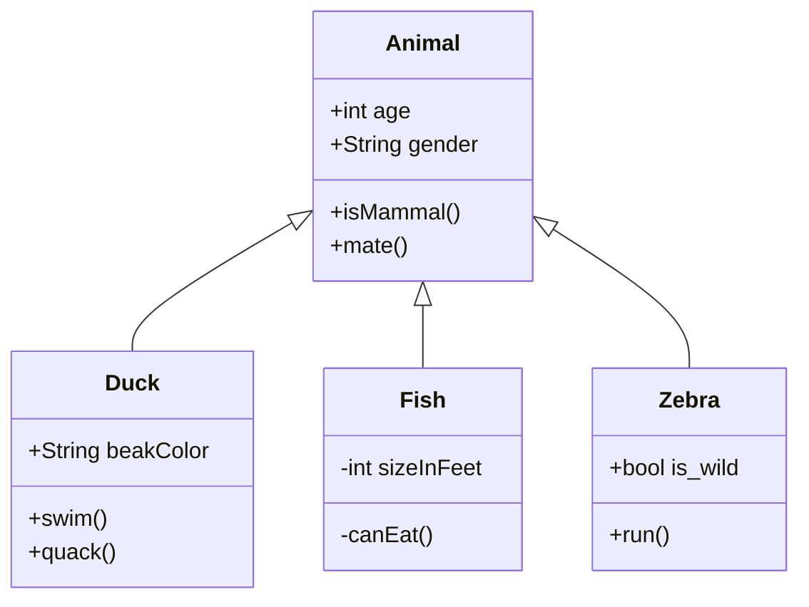

# Upstream issue draft 1: default measurement clips resvg-safe labels

> Agents do not file this issue; Ken does. Everything below the rule is ready
> to paste into a new issue on `Latias94/merman`.

- **Repository:** `Latias94/merman`
- **Observed at:** `482fcde7faffb05a466f198085d615e604075d97` (0.9.1)
- **Open it at:** https://github.com/Latias94/merman/issues/new

---

## Title

Default text measurement assumes fonts the host may not have, so resvg-safe labels clip

## Body

### Summary

With the resvg-safe pipeline, each label sits in a nested
`<svg style="overflow:hidden">` whose size comes from the built-in
deterministic measurer. That measurer models no particular font, and any real
face drawing Mermaid's default stack (`"trebuchet ms", verdana, arial,
sans-serif`) is wider, so the ends of labels are cut off. The SVG clips the same
way in Chrome, so this is in the SVG output, not in resvg.

### Reproduction

Merman's own fixture `fixtures/class/upstream_examples_class_basic_class_inheritance_001.mmd`:



```sh
echo '{"theme":"dark"}' > dark.json
merman-cli render fixtures/class/upstream_examples_class_basic_class_inheritance_001.mmd --format png -c dark.json
merman-cli render fixtures/er/upstream_examples_er_basic_er_schema_001.mmd --format png -c dark.json
```

### Expected

Full labels, as in Mermaid.js 12.2.0's reference SVGs for these fixtures.

### Actual

Labels lose their last characters: "Anima", "ıame", "rderDate".

### Evidence

- **merman-cli, default measurement:** 208 of 1,416 label renders are clipped
  across the fixtures, in class, state, ER, kanban, block, requirement,
  mindmap, swimlane, and usecase.
- **Chrome:** the same resvg-safe SVG clips identically. "Animal" is 51.3 px
  of text, drawn in real Trebuchet MS, in a 44.8 px box.
- **Measuring with the faces actually drawn removes it.** With
  `--font-measurement native` and explicit `--font-file`s, clipped labels drop
  to 4. In an embedding that installs a host `TextMeasurer` (or a width
  callback through `DeterministicTextMeasurer::with_width_callback`) that
  shapes with the drawn faces, a 43-fixture sample in both themes went from 218
  clipped labels to 2 on macOS and from 268 to 2 on Linux. The two that remain
  are separate bugs (wrapped swimlane edge labels, and an ER attribute comment
  containing `<br/>`), filed separately.
- **Case-insensitive font matching alone does not fix it.** fontdb matches
  family names case-sensitively, so `"trebuchet ms"` and `"courier"` never
  match by default, but matching them (218 → 214 on macOS) leaves the
  clipping in place, because the deterministic measurer models no font.

### Related: native measurement

Native measurement is the obvious fix, but two things stop an embedder from
relying on it:

- **System font discovery fails on macOS** with "system-cmap-bytes exceeded".
  Passing explicit font files works.
- **Generic families cannot be configured.** `configure_fontdb_generic_families`
  makes serif and sans-serif the first non-monospace face loaded (unless a face
  named "Times New Roman" or "Arial" exists), makes monospace the first face
  flagged fixed-pitch (Apple's Courier is not flagged), and sends a name that is
  not installed to serif before any monospace check. When the drawing side
  resolves fonts through the OS (CoreText, fontconfig), the two disagree:

    | Host | Request | Native measured with | Drawn with | Labels | Worst error |
    |---|---|---|---|---|---|
    | macOS | `monospace` (eventmodeling code spans) | Helvetica | Courier | 2 | 59.9 px |
    | Linux | `courier` (railroad, treeView, cynefin) | DejaVu Sans | DejaVu Sans Mono | 83 | 28.1 px |
    | Linux | `Helvetica, Verdana, serif` (zenuml) | DejaVu Sans | DejaVu Serif | 9 | 1.7 px |

    Which fallback files are passed, and in what order, does not change this.
    Drawing with `NativeFontContext::apply_to_usvg_options` agrees with itself
    but draws `courier` in a proportional face.

### Suggested fix

Any of:

- document that raster output needs real-font measurement;
- make native measurement the default for PNG export;
- let the label viewport not clip.

For native measurement: expose the generic-family choices that
`configure_fontdb_generic_families` makes on `NativeFontOptions`, or accept a
`FontResolver`, and fix system font discovery on macOS.

### Environment

- Merman `482fcde7faffb05a466f198085d615e604075d97` (0.9.1),
  `default-features = false`, features `svg`, `all-diagrams`,
  `layout-cytoscape` (plus `native-fonts` for the native comparison),
  `SvgPipeline::resvg_safe()`, site config `{"theme": "dark"}`, ELK off.
- Rasterizer: resvg/usvg 0.47.0, fontdb 0.23.0, rustybuzz 0.20.1. The
  43-fixture before/after counts were taken with resvg 0.45.1; the merman-cli
  and Chrome results do not depend on our rasterizer.
- Hosts: macOS 27.2 (Apple M4 Max); Debian 13, whose only fonts are DejaVu.
- Reference: Mermaid.js 12.2.0, the SVGs stored with Merman's fixtures.
