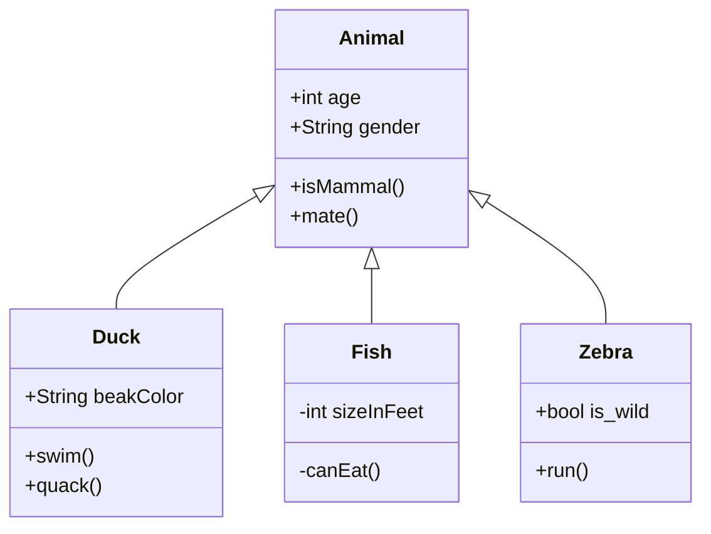

# Upstream issue draft 3: neo look's dark-theme dividers vanish

> Agents do not file this issue; Ken does. Everything below the rule is ready
> to paste into a new issue on `Latias94/merman`.

- **Repository:** `Latias94/merman`
- **Observed at:** `482fcde7faffb05a466f198085d615e604075d97` (0.9.1)
- **Open it at:** https://github.com/Latias94/merman/issues/new

---

## Title

Neo look, dark theme: class and ER dividers are not drawn (`objectBoundingBox` gradient on zero-height paths)

## Body

### Summary

Merman emits the class and ER compartment dividers
(`<g class="divider"><path …>`), but in the dark theme its stylesheet strokes
them with a gradient that, per the SVG specification, cannot paint them:

```css
[data-look="neo"].node path { stroke: url(#<id>-gradient); }
```

The gradient uses `gradientUnits="objectBoundingBox"`. A perfectly horizontal
divider has a zero-height bounding box, and an object-bounding-box paint server
does not paint an element whose bounding box has zero width or height, so the
line disappears. resvg and Chrome both leave it out.

The same gradient also makes node outlines fade from light on the left to dark
on the right.

### Reproduction

Merman's own fixture `fixtures/class/upstream_examples_class_basic_class_inheritance_001.mmd`
(`fixtures/er/upstream_examples_er_basic_er_schema_001.mmd` shows the same for
ER), with site config `{"theme":"dark"}`:



### Expected

Each class box shows its dividers between the name, attribute, and method
compartments, as it does in the default theme.

### Actual

No dividers in the dark theme; node outlines fade toward the background.

### Evidence

- 36 invisible divider lines across the fixtures we rendered, all in class and
  ER, and only in the dark theme. The default theme uses no gradient.
- Identical in resvg and in headless Chrome.
- Replacing every `stroke:url(#<id>-gradient)` with the theme's solid node
  stroke (read from the same stylesheet) restores all 36.

### Suggested fix

Stroke divider paths with the solid node stroke, or give the node gradient
`gradientUnits="userSpaceOnUse"` for divider paths.

### Environment

- Merman `482fcde7faffb05a466f198085d615e604075d97` (0.9.1),
  `default-features = false`, features `svg`, `all-diagrams`,
  `layout-cytoscape`, `SvgPipeline::resvg_safe()`, site config
  `{"theme": "dark"}`, ELK off.
- Rasterizer: resvg/usvg 0.45.1 (fontdb 0.23.0) and headless Chrome. merman-cli
  at the same rev reports the same 36 lines.
- Hosts: macOS 27.2 (Apple M4 Max); Debian 13.
