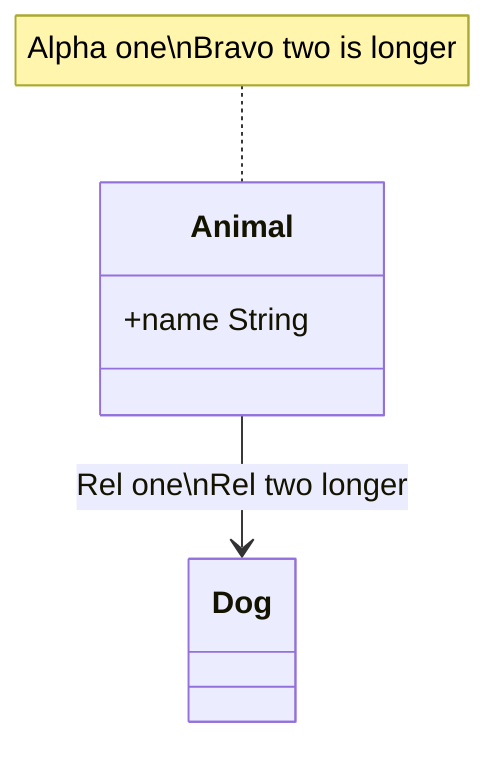
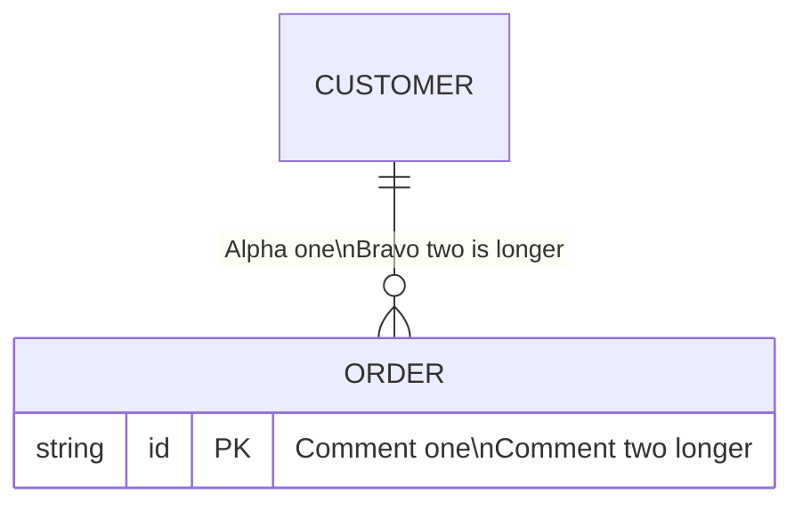
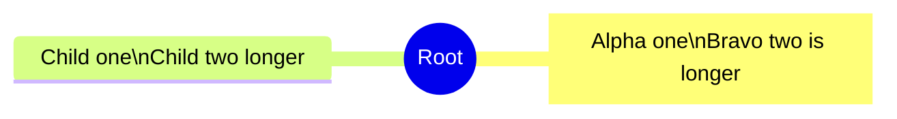
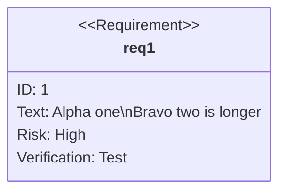

# Upstream issue draft 4: normalize `\n` like ` `

> Agents do not file this issue; Ken does. Everything below the rule is ready
> to paste into a new issue on `Latias94/merman`.

- **Repository:** `Latias94/merman`
- **Observed at:** `482fcde7faffb05a466f198085d615e604075d97` (0.9.1)
- **Open it at:** https://github.com/Latias94/merman/issues/new

---

## Title

class, ER, mindmap, requirement: `\n` breaks the line but the box is sized for one line

## Body

### Summary

In class, ER, mindmap, and requirement diagrams, Merman breaks a label at a
literal `\n` (backslash-n), but sizes the label box as if the text were still on
one line. The result is two short lines in a box much wider than either. Writing
` ` instead gives the same two lines in a box that fits them.

Mermaid.js 12.2.0 keeps `\n` literal in all four families, so Merman already
departs from it by breaking. Since it does break, the box should be measured
from the broken lines.

### Reproduction

Each label holds the literal string `Alpha one\nBravo two is longer`.

### Expected

Since Merman breaks at `\n`, the box fits the widest broken line, exactly as it
does when the same label is written with ` `.

### Actual

The lines break, but the label box keeps roughly the width of the whole text on
one line.

### Evidence

Label box widths for the `Alpha one\nBravo two is longer` label (the class
note, the ER relationship label, the mindmap node, the requirement text),
measured with the faces resvg draws with. "One line" is the control with `\n`
replaced by a space.

**macOS, Trebuchet MS**

| Family | Widest broken line | Box, `\n` | Box, ` ` | Box, one line |
|---|---|---|---|---|
| class | 137.5 px | 235.0 px | 149.5 px | 225.4 px |
| ER | 120.3 px | 195.1 px | 120.3 px | 186.7 px |
| mindmap | 137.5 px | 240.0 px | 177.5 px | 240.0 px (wraps) |
| requirement | 137.5 px | 283.2 px | 157.5 px | 273.6 px |

**Linux, DejaVu Sans**

| Family | Widest broken line | Box, `\n` | Box, ` ` | Box, one line |
|---|---|---|---|---|
| class | 154.8 px | 262.6 px | 166.8 px | 252.2 px |
| ER | 135.4 px | 219.3 px | 135.4 px | 210.2 px |
| mindmap | 154.8 px | 240.0 px | 194.8 px | 240.0 px (wraps) |
| requirement | 154.8 px | 313.5 px | 176.5 px | 303.0 px |

The results are the same with Merman's native measurement and with a host
measurer, so this is not a measurement difference.

For comparison, the other families with a box behave consistently today:
flowchart and state break at `\n` and size the box from the wrap width, and
kanban breaks inside a fixed-width card.

### Suggested fix

In the families where Merman already breaks at `\n`, have the label normalizer
treat `\n` as it treats ` `, so the box is measured from the broken lines.

Rewriting `\n` to ` ` in the source before parsing works around it, but
only with a per-family label lexer: a global replace also hits `\n` in
`%%{init}%%` JSON, `%%` comments, `click` URLs and tooltips, `classDef` and
`style` values, and `accTitle`/`accDescr`.

### Environment

- Merman `482fcde7faffb05a466f198085d615e604075d97` (0.9.1),
  `default-features = false`, features `svg`, `all-diagrams`,
  `layout-cytoscape` (plus `native-fonts` for the native comparison),
  `SvgPipeline::resvg_safe()`, site config `{"theme": "dark"}`, ELK off.
- Rasterizer: resvg/usvg 0.47.0, fontdb 0.23.0, rustybuzz 0.20.1.
- Hosts: macOS 27.2 (Apple M4 Max); Debian 13, whose only fonts are DejaVu.
- Reference: Mermaid.js 12.2.0 (and 11.12.2) in headless Chrome 131: `\n`
  stays literal in all four families.
