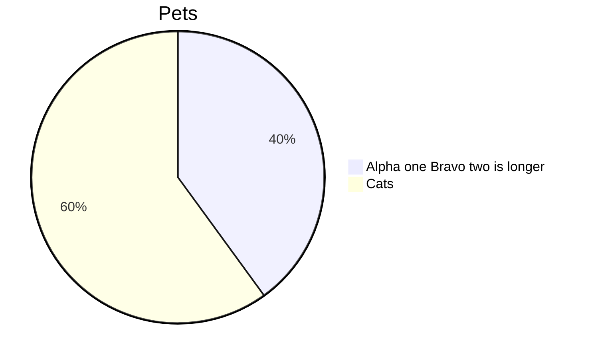
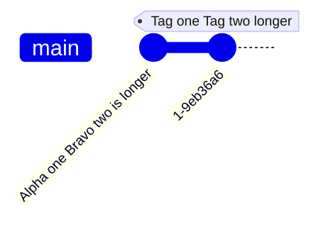
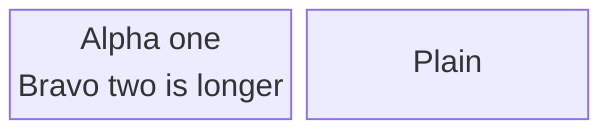

# Upstream issue draft 5: `\n` in pie, gitGraph, and block

> Agents do not file this issue; Ken does. Everything below the rule is ready
> to paste into a new issue on `Latias94/merman`.

- **Repository:** `Latias94/merman`
- **Observed at:** `482fcde7faffb05a466f198085d615e604075d97` (0.9.1)
- **Open it at:** https://github.com/Latias94/merman/issues/new

---

## Title

`\n` in labels: pie and gitGraph drop the backslash; block sizes for one line and has no ` `

## Body

### Summary

A literal `\n` (backslash-n) in a label goes wrong in three families, in ways
` ` cannot work around:

- **pie** and **gitGraph** drop the backslash and draw the `n`:
  `Alpha one\nBravo two is longer` becomes `Alpha onenBravo two is longer`.
- **block** breaks at `\n`, as Mermaid.js does, but sizes the box for one line.
  Writing ` ` instead draws ` ` as text.

### Reproduction

### Expected (Mermaid.js 12.2.0)

- **pie:** `\n` becomes a newline character, drawn as a space: one line,
  `Alpha one Bravo two is longer`.
- **gitGraph:** `\n` becomes a newline character in the commit label.
- **block:** two lines, `Alpha one` / `Bravo two is longer`. Merman should then
  size the box from those lines, as it does for ` ` in other families.

Mermaid.js 11.12.2 behaves the same in all three.

### Actual

- **pie:** `Alpha onenBravo two is longer`.
- **gitGraph:** the commit label reads `Alpha onenBravo two is longer`.
- **block:** two lines in a box sized for one; with ` `, the text
  `Alpha one Bravo two is longer` on one line.

### Evidence

Measured with the faces resvg draws with (macOS, Trebuchet MS; Linux, DejaVu
Sans). Merman's native measurement and a host measurer give the same results.

**block**

| Host | Widest broken line | Box, `\n` | Box, one line (`\n` as a space) | ` `: drawn text width / box |
|---|---|---|---|---|
| macOS | 137.5 px | 255.0 px | 245.4 px | 240.5 px / 169.5 px |
| Linux | 154.8 px | 282.6 px | 272.2 px | 278.7 px / 186.8 px |

With ` `, the literal-text line is wider than its box.

**pie and gitGraph** draw one line with the `n` in it, on both hosts. Writing
` ` draws it as text in both families, so it is no workaround either.

### Suggested fix

- pie and gitGraph: keep the `\n` escape as Mermaid.js does, instead of
  dropping the backslash.
- block: measure the box from the broken lines (the same defect as `\n` in
  class, ER, mindmap, and requirement, reported separately), and support
  ` ` in block labels.

### Environment

- Merman `482fcde7faffb05a466f198085d615e604075d97` (0.9.1),
  `default-features = false`, features `svg`, `all-diagrams`,
  `layout-cytoscape` (plus `native-fonts` for the native comparison),
  `SvgPipeline::resvg_safe()`, site config `{"theme": "dark"}`, ELK off.
- Rasterizer: resvg/usvg 0.47.0, fontdb 0.23.0, rustybuzz 0.20.1.
- Hosts: macOS 27.2 (Apple M4 Max); Debian 13, whose only fonts are DejaVu.
- Reference: Mermaid.js 12.2.0 and 11.12.2 in headless Chrome 131.
