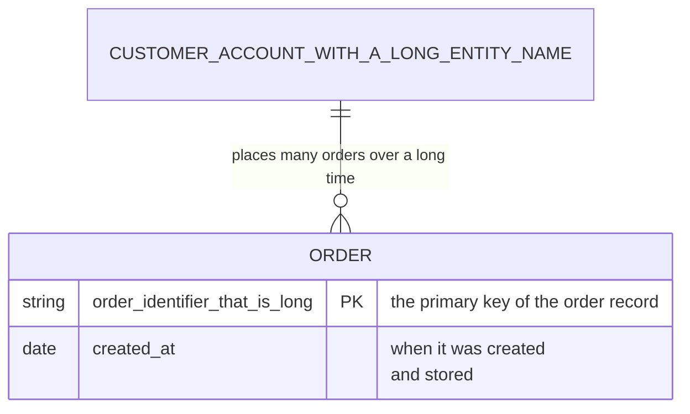

# Upstream issue draft 6: ER attribute comment with ` ` clips

> Agents do not file this issue; Ken does. Everything below the rule is ready
> to paste into a new issue on `Latias94/merman`.

- **Repository:** `Latias94/merman`
- **Observed at:** `482fcde7faffb05a466f198085d615e604075d97` (0.9.1), and
  again at `6e6b1e6554e8e75d468c1f991652c1c53a85bace` (a fork commit that only
  adds a gitGraph `commitSpacing` config key)
- **Open it at:** https://github.com/Latias94/merman/issues/new

---

## Title

ER: an attribute comment containing ` ` is clipped by its label viewport (about 6 px, any measurer)

## Body

### Summary

In an ER entity, an attribute comment that contains ` ` breaks onto two lines
with the same breaks as Mermaid.js, but both lines are clipped by the label's
`<svg style="overflow:hidden">` viewport, by roughly 5 to 7 px. The clip is the
same with every text measurer we tried, including ones whose widths match what
resvg draws exactly, so it points at the ER layout of the comment cell rather
than at measurement. A single-line comment in the same entity is not clipped.

### Reproduction

Render with `SvgPipeline::resvg_safe()` and a measurer that uses the drawn
faces.

### Expected

As in Mermaid.js 12.2.0, the comment is drawn on two lines,
`when it was created` / `and stored`, entirely inside its cell. Mermaid.js
12.2.0's label box is 145.5 px wide on macOS (Trebuchet MS) and 161.4 px on
Linux (DejaVu Sans).

### Actual

Merman breaks at the same place (`when it was created` / `and stored`), but
both lines extend past the label viewport and are clipped.

### Evidence

"Clipped by" is how far each line's glyph outline box extends past the
enclosing label viewport, in canvas coordinates.

| Host | Face | `when it was created` | `and stored` |
|---|---|---|---|
| macOS | Trebuchet MS (Mermaid's default stack) | 6.1 px (4%) | 5.9 px (8%) |
| macOS | Helvetica | 7.2 px (5%) | 4.6 px (6%) |
| Linux | DejaVu Sans (stack falls through to it) | 6.6 px (4%) | 5.8 px (7%) |
| Linux | DejaVu Serif | 6.6 px (4%) | 5.8 px (7%) |

- **Identical across three measurers** in every row: Merman's native
  measurement (`native-fonts`, given the exact font files), a host
  `TextMeasurer` that shapes with rustybuzz, and
  `DeterministicTextMeasurer::with_width_callback` with the same widths. The
  rustybuzz widths match usvg's laid-out text exactly on every label of our
  sample (1,321 labels across both hosts), and native measurement uses the same
  faces as the drawing for this diagram.
- **Reproduced at `6e6b1e6`** with the same width-callback measurer, using the
  Inter font and the host's fonts: both lines clip by about 6.0 to 6.2 px.
- The cut is nearly the same in pixels on both lines, though
  `when it was created` is about twice as wide as `and stored`. That suggests
  the viewport's height or the lines' position, rather than its width, but we
  have not confirmed which axis overflows.

### Environment

- Merman `482fcde7faffb05a466f198085d615e604075d97` (0.9.1),
  `default-features = false`, features `svg`, `all-diagrams`,
  `layout-cytoscape` (plus `native-fonts` for the native comparison),
  `SvgPipeline::resvg_safe()`, site config `{"theme": "dark"}`, ELK off.
  Also `6e6b1e6554e8e75d468c1f991652c1c53a85bace` with `svg`, `all-diagrams`,
  `layout-cytoscape`.
- Rasterizer: resvg/usvg 0.47.0, fontdb 0.23.0, rustybuzz 0.20.1.
- Hosts: macOS 27.2 (Apple M4 Max); Debian 13, whose only fonts are DejaVu.
- Reference: Mermaid.js 12.2.0 in headless Chrome 131, with `fontFamily` set
  to the face each host draws with.
