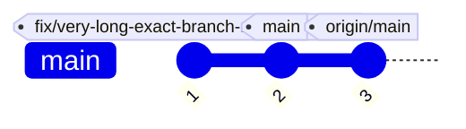

# Upstream PR draft: gitGraph `commitSpacing`

> Agents do not open this pull request; Ken does. Everything below the rule
> is ready to paste into a pull request against `Latias94/merman`.

- **Base:** `Latias94/merman` `main` (branched from `482fcde7faffb05a466f198085d615e604075d97`)
- **Head:** `yankeeinlondon:gitgraph-commit-spacing`
- **Head SHA:** `6e6b1e6554e8e75d468c1f991652c1c53a85bace`
- **Open it at:** https://github.com/Latias94/merman/compare/main...yankeeinlondon:merman:gitgraph-commit-spacing

---

## Title

feat(gitgraph): add `commitSpacing` config for the commit-axis step

## Body

### Motivation

gitGraph lays commits out on a fixed 50 px step (`COMMIT_STEP` 40 +
`LAYOUT_OFFSET` 10 in `merman-render/src/gitgraph.rs`). When adjacent commits
carry long tag or branch-reference labels, those labels overlap, and there is no
configuration that can widen the step. Mermaid.js has no such key either, so this
is a Merman extension rather than a parity fix.

We hit this rendering generated git graphs: consecutive commit `pos` values
differ by exactly 50 in every input we captured, and a graph whose commit carries
a long reference such as `fix/very-long-exact-branch-reference-beta` overlaps the
`main` and `origin/main` tags on the next two commits. The smallest step that
gives every colliding pair a 16 px gap in that graph is about 126 px, which no
config could express.

### What this adds

`gitGraph.commitSpacing` (number, px): the distance between consecutive commit
positions along the commit axis.



- **Default:** `50`, which reproduces the current layout exactly.
- **Scope:** every orientation (`LR`, `TB`, `BT`), with and without
  `parallelCommits`. It replaces each place where `COMMIT_STEP + LAYOUT_OFFSET`
  set the step (the sequential advance, and the parent-relative steps in
  `parallelCommits` mode, which subtract `LAYOUT_OFFSET` because parent positions
  already include it). The first-commit offset and the mirrored-`BT` axis
  adjustment still use `LAYOUT_OFFSET` and are unchanged.
- **Invalid values:** read with the same numeric reader as `diagramPadding`, so
  numbers and numeric strings (`"80"`) are accepted. Zero, negative,
  non-numeric, `null`, and boolean values fall back to the default `50`.
- **Config sources:** site config, `%%{init}%%` directives, and frontmatter
  `config:`. Directive sanitization drops every key that is not in Mermaid's
  generated default-config shape, so `merman-core/src/preprocess/mod.rs` gains a
  one-entry `MERMAN_EXTENSION_CONFIG_KEYS` allowlist (`["commitSpacing"]`) next
  to that check. The generated shape files are untouched.

### Tests

- `merman-render/src/gitgraph.rs` unit tests:
  - `commit_spacing_defaults_to_mermaid_fixed_step`: 50 px between consecutive
    commit `pos` for `LR`/`TB`/`BT`, with and without `parallelCommits`.
  - `commit_spacing_sets_the_step_between_consecutive_commits`: `120` gives
    exactly 120 px in the same six cases.
  - `commit_spacing_keeps_the_first_commit_offset`: first commit still at
    `x = 10`, second at `130`, `max_pos` 480 for four commits.
  - `commit_spacing_accepts_numeric_strings_and_ignores_invalid_values`.
- `merman-render/tests/gitgraph_svg_test.rs`:
  `gitgraph_commit_spacing_reaches_layout_from_every_config_source` checks
  commit `cx` in the rendered SVG for the default, site config, init directive,
  and frontmatter.
- `merman-core` `sanitize_directive_keeps_merman_extension_config_keys`.
- The existing layout goldens (`layout_snapshots_test` with
  `all-diagrams,layout-elk,layout-cytoscape`) pass unchanged, so the default
  layout is identical.

Commands run:

```sh
cargo test -p merman-render --features all-diagrams --lib gitgraph
cargo test -p merman-render --features all-diagrams --test gitgraph_svg_test
cargo test -p merman-render --features all-diagrams,layout-elk,layout-cytoscape --test layout_snapshots_test
cargo test -p merman-core --lib
cargo clippy -p merman-core --all-features --all-targets -- -D warnings
cargo clippy -p merman-render --all-features --lib --test gitgraph_svg_test -- -D warnings
```
