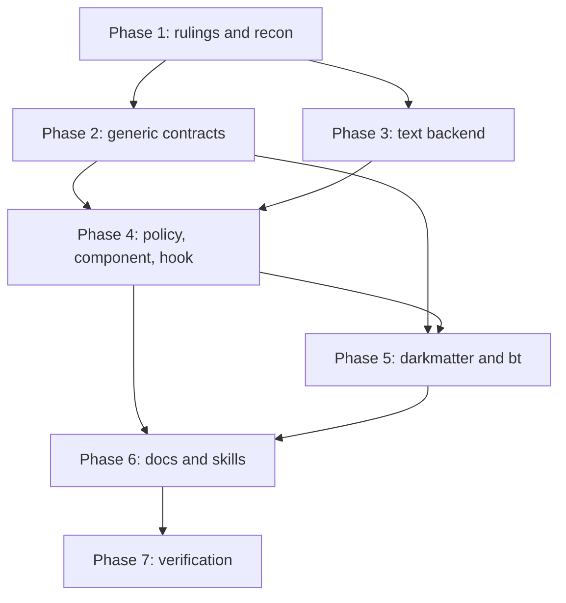

# Plan: Merman Text Fallback

Source: [spec.md](spec.md). Decision IDs (`D*`), requirements (`R-F*`) and
acceptance criteria (`AC-F*`) are the spec's. The spec is the source of truth;
where this plan and the spec disagree, the spec wins and this plan is
corrected.

## Summary and Definition of Done

### The work

When a terminal cannot show images, a Mermaid diagram renders as a readable
text drawing from Merman's `ascii` target instead of raw source, provided
Merman's own metadata says the result is a faithful-enough drawing (D1). Seven
strands:

1. **Generic contracts.** `renderable` gains `TerminalMermaidMode::Automatic`
   (D5). biscuit-terminal's diagram hook gains the graphics ceiling in its
   request, a *declined* outcome, and a way to return render-tree code and
   block-quote nodes instead of a pre-formatted string (D5, D9).
2. **Text backend** in `biscuit-visualized`: eligibility from
   `merman::ascii::ascii_capabilities()` (D1), one bounded text request, the
   `auto`/canonical layout rule (D7), display-cell fit checking, no SVG/PNG/font
   work (R-F10).
3. **Policy and presentation** in `biscuit-visualized`: the fallback policy and
   `MERMAID_FALLBACK` (D3), `txt`/`mermaid` code nodes and the partial note
   (D2, D9), the standalone component's infallible fallback, and the Markdown
   hook's automatic mode.
4. **darkmatter:** vendored flattened Mermaid syntax (D8), `md --mermaid` →
   automatic mode (D5), `--feature` including `no-mermaid-rendering` (D4, D6).
5. **bt:** `--feature` flags on every Mermaid subcommand (D4) and
   darkmatter-backed code highlighting (D9).
6. **Docs and skills** (R-F11, AC-F16).
7. **Final verification** across the four changed areas plus the dependency
   graph (AC-F17).

### Definition of done

- AC-F1 … AC-F17 pass, each at L1 with explicit terminal capabilities; no test
  gives a real terminal or browser window focus.
- `just test` and `just lint` are green in `biscuit-visualized`,
  `biscuit-terminal`, `renderable` and `darkmatter`; the workspace `cargo check`
  proves every `TerminalMermaidMode` match handles `Automatic` (AC-F15).
- A text selection writes no artifact, initializes no font chain, and makes at
  most one Merman text request (AC-F13), proved by counters, not timing.
- `cargo tree` shows no darkmatter or syntect below `biscuit-visualized` or
  `biscuit-terminal`'s library (R-F12).
- Every doc in the spec's Documentation list describes shipped behavior and
  names no feature or fix.
- The spec stays in place; the implementer's terminal state is "implementation
  complete, ready for review".

### Skills the implementers load

`biscuit-visualized`, `biscuit-terminal`, `renderable`, `darkmatter`, `cli`,
`rust-testing`, `os` (before touching path or cfg code), `biscuit-file` (only if
touching file references), `clap`, `syntect`/`two-face`, `just`.

### Working rules

- Evidence that invalidates a decision's premise is handled under the spec's
  D10 (bounded implementer autonomy): proceed only with an option that meets
  its three conditions, then amend the spec, log it under "Decided during
  implementation", and flag it for review; otherwise stop and set
  `human_review`.

## Phase 1: Rulings, Prerequisite Gate, API Recon

Nothing in this phase changes shipped code. It removes the guesses that would
otherwise be baked into Phases 2–5.

### Necessary Rules

The spec leaves these open. Each carries a recommendation so the author can
accept with one word; implementers may not start the affected phase until it
is decided. Record each ruling (and its date) in the implementation log.

- [ ] **Rule A — the hook's success shape (blocks Phase 2).** Today
  `DiagramRenderer::render_terminal_diagram` returns
  `Result<String, DiagramRenderError>` and the renderer prints the string. D9
  requires fallbacks to be render-tree code and block-quote *nodes* so the
  program's `code_renderer` highlights them, and D5 requires a *declined*
  outcome. Recommendation: change the return to
  `Result<DiagramOutcome, DiagramRenderError>` where `DiagramOutcome` is a
  generic, Mermaid-agnostic `#[non_exhaustive]` enum:
  `Rendered(String)` (image bytes already formatted, today's behavior),
  `Nodes(Vec<RenderNode>)` (fragment the renderer lays out in place), and
  `Declined`. Alternative (rejected unless the author prefers it): keep the
  string return and add a second trait method for node output. Pre-release, so
  the signature change is acceptable; update the one in-tree implementor and
  the test doubles.
- [ ] **Rule B — `MermaidMode` in darkmatter's output options.** Its
  `Image`/`Text`/`Off` variants map onto `TerminalMermaidMode` (`Text` maps to
  `Code` today). Recommendation: add `MermaidMode::Automatic`, map it to
  `TerminalMermaidMode::Automatic`, and have `md --mermaid` pass `Automatic`;
  leave `Image` meaning image-only so library callers keep today's behavior
  (the spec's "callers that set nothing keep today's behavior").
- [ ] **Rule C — where the `--feature` parsing lives (D4).** Two CLIs (`bt`,
  `md`) share three fallback features and `md` adds a fourth.
  Recommendation: define a `MermaidFallbackFeature` clap `ValueEnum`
  (`no-mermaid-fallbacks`, `no-mermaid-partial-fallbacks`,
  `no-mermaid-partial-warning`) plus the "fold to a `FallbackPolicy`, most
  restrictive wins" function in `biscuit-visualized` behind its `clap` feature,
  next to the policy type it produces. `md` wraps it with its own enum that adds
  `no-mermaid-rendering`. No new shared crate (two consumers).
- [ ] **Rule D — empty and unknown names.** Confirm clap's `ValueEnum` with
  `value_delimiter(',')` and `ignore_case` rejects `--feature a,,b` with a
  usage error that lists the valid names; if it does not, Rule C's helper adds a
  custom `value_parser`. This is verified in Wave 1 task 1.3, not guessed.
- [ ] **Rule E — what "available image support" means in Automatic mode.**
  Spec: image at `Rich` when graphics are allowed; text at `Vector`; code at
  `Off`. Recommendation: the hook trusts the request's `graphics_mode` and
  `terminal` capabilities (no probing) and also chooses text at `Rich` when
  biscuit-terminal's effective route says no image route exists
  (`AC-F1`'s "explicit no-image capabilities").
- [ ] **Rule F — drawing character set source.** The spec says use the existing
  `Terminal` capability for Unicode vs ASCII drawing. Recommendation: use the
  terminal's existing Unicode-support capability; add no new capability. Wave 1
  task 1.2 names the exact accessor.
- [ ] **Rule G — `bt git-graph` and features.** `GitGraph` text is
  `StructuredText` and is never used (D1), but D4 lists `git-graph` among
  commands that accept `--feature`. Recommendation: accept the flags, apply
  them to any Mermaid-component path they reach, and document that they have no
  visible effect on the typed Git graph.
- [ ] **Rule H — wider measurement.** The spec requires no spike and no
  benchmark. No wider measurement is proposed; if the author wants text-render
  cost sampled, that is a separate, one-host quick sample.

### Spike decision

No spike. The spec's own figures answer the questions a spike would ask: the
eligibility table is published data (R-F2 snapshots it), layout behavior is
specified by D7, and performance is explicitly out of scope. Do not schedule a
re-check in later phases.

### Wave 1 (parallel recon; read-only, then record in the implementation log)

- [ ] **1.1 Prerequisite gate.**
    - Confirm `2026-10-21-merman` has landed: `biscuit-visualized/src/Cargo.toml`
      depends on `merman` at a pinned rev, the old renderer is gone, and
      `src/src/mermaid/render.rs` exposes the prerequisite's parse/config/
      deadline entry points. At plan time the Cargo manifest still lists the
      old renderer, so **Phase 3 onward is blocked until it lands.**
    - Record the delivered Merman rev. Re-read
      `docs/rendering/ASCII_SUPPORT_MATRIX.md` at that rev; if it is not
      `482fcde`, the spec's table figures (AC-F3, AC-F6, AC-F11) are updated by
      the author before implementation, not silently by the implementer.
- [ ] **1.2 Merman ascii API recon.**
    - From the delivered rev's source, write down the exact names and shapes of
      `ascii_capabilities`, `AsciiCapability` (`diagram_type`,
      `primary_projection`, `semantic_coverage`, `layout_profiles`),
      `AsciiOutput` (`projection`, overflow/layout reporting), the
      request/options type (plain vs styled output, charset, max width, layout
      profile, display-width profile), and how a deadline/limit/cancellation is
      reported.
    - Name the biscuit-terminal accessor for Unicode drawing support and the
      display-width function (Rule F).
- [ ] **1.3 CLI and workspace recon.**
    - Enumerate `bt` subcommands that render through Mermaid
      (`biscuit-terminal/cli/src/commands/`) and where each builds its component.
    - Locate `md render` and the implicit `md <INPUT>` path
      (`darkmatter/cli/src/render.rs`, `cli.mermaid`) and confirm `--feature`
      works for both.
    - Prove the Rule D clap behavior with a throwaway test (not committed).
    - Grep every `TerminalMermaidMode` and `MermaidMode` match
      (`renderable/src/tree/mod.rs`, `darkmatter/lib/src/markdown/render_tree/
      entrypoints.rs`, `biscuit-terminal/lib/src/render_tree/{options,render}.rs`,
      `biscuit-visualized/src/tests/l1/*`, `biscuit-terminal/lib/tests/l1/*`)
      into the AC-F15 audit list in the implementation log.
    - Confirm how `bt` currently renders code blocks and which commands do, so
      Phase 5 installs the code renderer in each.

### Validation checkpoint 1

Rulings A–H are recorded; the prerequisite state and delivered rev are
recorded; the API names Phases 2–5 use are written down.

## Phase 2: Generic Contracts (`renderable`, `biscuit-terminal` library)

Pure-generic work. Must not name Mermaid in `biscuit-terminal`'s library.
Requires Rule A.

### Wave 1 (parallel; disjoint crates)

- [ ] **2.1 Automatic variant.**
    - Add `TerminalMermaidMode::Automatic` to `renderable/src/tree/mod.rs`
      with docs saying: image when graphics allow, eligible text otherwise,
      code when not eligible. `Code` stays the default.
    - Fix every exhaustive match found in task 1.3 so `cargo check --workspace`
      compiles (AC-F15). Darkmatter's mapping is done in Phase 5.
    - Update `renderable/docs/tree-rendering.md` for the variant.
- [ ] **2.2 Hook contract.**
    - Per Rule A: introduce the generic outcome type and change
      `DiagramRenderer`'s return; add `graphics_mode` to
      `DiagramRenderRequest` (it is `#[non_exhaustive]`, so additive).
    - In `render.rs`, consult the hook for a `mermaid` fence in `Image` mode at
      `Rich` (as today) and in `Automatic` mode at `Rich` and `Vector`, never
      at `Off`.
    - `Rendered` prints as today. `Nodes` lays out the fragment in place with
      the node's indent and width, through the installed `code_renderer` for
      code nodes. `Declined` renders the ordinary code block with **no
      diagnostic** under Strict, Warn and Lossy. `Err` follows strictness as
      today.
    - Update the existing test doubles (`render.rs` ~5563,
      `render_tree_diagram_hook.rs`) to the new signature.
    - Docs: `biscuit-terminal` render-tree topic page and the `renderable`
      code-renderer page: fallbacks arrive as code nodes; the program supplies
      `code_renderer` (spec Documentation list).

### Validation checkpoint 2

`just test` and `just lint` in `renderable` and `biscuit-terminal`. New L1
tests in `biscuit-terminal/lib/tests/l1/render_tree_diagram_hook.rs`, one per
row: Image mode unchanged; Automatic at Rich/Vector/Off; `Declined` silent under
Strict/Warn/Lossy; `Err` rejected/recorded/silent per strictness; `Nodes`
output passes through an installed code renderer; no hook means ordinary code.

## Phase 3: Text Backend (`biscuit-visualized`)

Gated on the prerequisite (task 1.1). The backend takes explicit options and
never discovers a terminal (spec: Ownership).

### Wave 1

- [ ] **3.1 Enable ascii.** Enable Merman's `ascii` feature at the same pinned
  rev as the SVG backend; no second version, no CLI shell-out, no default
  features. Update `biscuit-visualized/docs/dependencies.md`.
- [ ] **3.2 Eligibility.**
    - A function that takes the parsed diagram's `diagram_type`, looks it up in
      `ascii_capabilities()`, and returns an eligibility value carrying
      coverage (`Full`/`Partial`) and whether `Auto` layout is admitted.
    - Missing entry, unknown `#[non_exhaustive]` value, `None`, or
      `StructuredText` primary projection → not eligible. A `Diagrammatic`
      family with no coverage value → partial. No family-name list anywhere in
      this path.
    - Uses the parsed model, never a keyword or regex scan.
    - Tests: the R-F2 snapshot of the derived table (family, projection,
      coverage, layout profiles) asserting exactly flowchart, sequence, state,
      class, ER and XY chart at rev `482fcde`; a mindmap and a pie are not
      eligible (AC-F1, AC-F3). Control row: the unedited fixture is eligible;
      each ineligible case differs by one edit.

### Wave 2 (depends on Wave 1; tasks 3.3 and 3.4 are independent of each other)

- [ ] **3.3 Text render operation.**
    - A fallible operation on the artifact `MermaidDiagram` in `mermaid/render.rs`
      taking explicit options: drawing charset (Unicode/ASCII), maximum
      columns, display-width profile, deadline, and a show-partial flag is *not*
      here (presentation belongs to Phase 4).
    - Requests plain output; passes `auto` + max columns when eligibility says
      `Auto` is admitted, otherwise the canonical profile (D7). One Merman text
      request per call; no retry after cancellation or a limit failure; the
      prerequisite's configurable deadline and warning behavior apply.
    - Same parse/config/label normalization as the prerequisite; no SVG, font
      chain, rasterization or artifact write.
    - Returns a result carrying: the text, the reported `projection`, the
      reported layout profile, overflow, and the family's coverage. A result
      whose `projection` is not `Diagrammatic`, that overflows, whose any row's
      display width exceeds the columns, or that is empty for nonempty content is
      reported as a distinct "use source" outcome. Errors (parse, Merman,
      deadline, limit, cancellation) stay errors for fallible callers.
    - Width is measured with biscuit-terminal's display-cell function. Zero
      columns returns "use source" without a layout attempt.
    - ASCII drawing changes connectors and borders only; authored Unicode
      labels are preserved. Control characters from labels are neutralized so
      they cannot reach the terminal (AC-F14).
- [ ] **3.4 Test seams.** Counters (test-only or injectable) for artifact
  writes, font-chain initialization and Merman text requests, so AC-F13 is
  deterministic; an injectable failure for limit/cancellation so AC-F14 never
  sleeps.

### Validation checkpoint 3 (L1 in `biscuit-visualized`)

- [ ] AC-F11: flowchart too wide canonically but fit compactly → compact;
  too wide for both → source outcome; state diagram too wide canonically →
  source outcome with exactly one request (no compact attempt). Assert the
  requested and reported layout profile.
- [ ] AC-F2: dense class/ER diagram at a narrow width whose reported projection
  is `StructuredText` → source outcome (assert the reported projection).
- [ ] AC-F14: exact snapshots in both drawing charsets, authored Unicode,
  significant spaces, multiline labels, nested available width, label control
  characters; unsupported family, invalid source, over-wide output, injected
  limit and cancellation each yield source/error as the table specifies.
- [ ] AC-F13 (backend half): zero artifact writes, zero font-chain inits, at
  most one text request.
- [ ] `just test`, `just lint` in `biscuit-visualized`.

## Phase 4: Policy, Presentation, Component and Hook (`biscuit-visualized`)

Requires Phases 2 and 3.

### Wave 1

- [ ] **4.1 Fallback policy (D3).**
    - Public policy type with two independently settable options:
      text fallback (`Allowed` default, `NoPartial`, `Never`) and
      `show_partial_note` (default `true`).
    - Resolution per setting: explicit caller value → `MERMAID_FALLBACK`
      (`code-block`, case-insensitive, text-fallback only) → default. The
      variable is read in policy resolution at render time through an injectable
      seam, never in the Merman backend, never for `show_partial_note`.
    - "No partial text" excludes partial coverage; "never" excludes all.
    - Rule C's `MermaidFallbackFeature` enum and the fold-to-policy function
      (most restrictive wins), behind the `clap` feature; unset flags leave
      settings unset so the environment applies.
    - Tests (AC-F5, AC-F6): explicit setting ignores the env; unset +
      `Code-Block` → never; another value or unset → allowed; a flag beats the
      variable; the variable never changes the note; every eligible family under
      "no partial" → source. Overlap (`no-mermaid-fallbacks` with
      `no-mermaid-partial-fallbacks`) → never. The env value shapes
      (unset, empty, other, mixed case) each get one test; no matrix beyond that.

### Wave 2 (depends on 4.1; 4.2 and 4.3 are parallel, both touching different files)

- [ ] **4.2 Component presentation (D2, D9).**
    - In `components/mermaid.rs`, selection per the Selection table: decide
      image availability first from biscuit-terminal's effective capabilities
      and route policy (including caller overrides), before any SVG
      measurement, font load or artifact write.
    - Image route unchanged (a failure there never retries through text).
      Text route: emit a `txt` code node, then for partial coverage with the
      note enabled a blank line and the block-quote node with the exact D2 text
      (`Note:` bold, bracketed id dim, id italic) built through BlockQuote and
      Prose. Source route: a `mermaid` code node. Explicit title preserved
      once, including on source. Margins and alignment applied once.
    - Infallible render gains text fallback; the fallible image-only operation
      and its result (real PNG path, cache status, width) are unchanged and
      never fabricate image metadata from text.
    - The note appears with text only: never with source or an image.
    - Source fallback is never fed back into Mermaid promotion.
    - Text width bound = columns at the actual nested position less the `txt`
      code block's padding and borders; explicit cell/percentage/fill limits
      respected; the image scale factor does not trigger SVG measurement.
- [ ] **4.3 Markdown hook (D5).**
    - In `components/render_hook.rs`, honor the request's `graphics_mode` and
      the Rule E decision: at `Rich` with a usable image route, image; at
      `Rich` without one, or at `Vector`, eligible text as `Nodes`; otherwise
      `Declined` (ineligible, does not fit, policy forbids). Real failures
      (parse error, Merman error, deadline/limit, image failure after choosing
      the image route) return `Err` and follow strictness; the hook never
      returns a successful source block to bypass it.
    - Expose the D3 policy on the hook's builder.
    - Success output is identical to the component's, including the note.

### Validation checkpoint 4 (L1)

- [ ] AC-F1: flowchart → text with explicit no-image capabilities; mindmap and
  pie → source.
- [ ] AC-F4: node kinds and languages (`txt`, `mermaid`), exact plain text
  snapshots, style assertions on bold/dim/italic spans, no note when
  `show_partial_note = false`, blank line before the note.
- [ ] AC-F8: the real hook through biscuit-terminal's generic renderer, one case
  per row: image at Rich with image support, text at Vector, code at Off,
  ineligible → code with no diagnostic under strict/warn/permissive, parse
  error rejected under strict / recorded under warn / silent under permissive,
  no hook → code, `Code` and `Image` modes unchanged.
- [ ] AC-F13 (full): existing image tests pass untouched; counters show text
  selection bypasses image generation.
- [ ] `just test`, `just lint` in `biscuit-visualized`; `cargo check
  --workspace` still compiles.

## Phase 5: darkmatter and `bt`

Requires Phases 2 and 4. The two waves touch different crates and run in
parallel; both depend on the vendored syntax only for highlighting assertions,
so the syntax task is first in Wave 1 and `bt` highlighting tests wait for it.

### Wave 1 (darkmatter; 5.1 is independent of 5.2)

- [ ] **5.1 Vendored Mermaid syntax (D8).**
    - Fetch SublimeText/Mermaid at commit
      `a5c6d45d1b0a99f8d4e0fdb2b5ccd7fd07809859` into a fresh empty directory
      (untrusted download; no interpreter run from inside it). Flatten the base
      syntax, `Mermaid Flowchart` and `Mermaid SequenceDiagram` into one
      `darkmatter/lib/assets/syntaxes/mermaid/Mermaid.sublime-syntax` with no
      `extends` and no `version: 2`; drop the CSS extension. Add the upstream
      MIT `LICENSE` and a note of the source commit beside it.
    - Add it to darkmatter's syntax set so the `mermaid` and `mmd` tokens
      resolve to it, in terminal and HTML output, source fallbacks and
      `no-mermaid-rendering` included.
    - Record the MIT notice in `darkmatter/docs/dependencies.md` and the root
      `docs/dependencies.md`.
    - Tests (AC-F12): the file has no `extends` key; loads with syntect; a
      gantt block highlights header, comment and `%%{init}%%`; flowchart and
      sequence blocks highlight nodes and arrows; terminal and HTML both.
- [ ] **5.2 Automatic mode and features in `md`.**
    - Rule B: add `MermaidMode::Automatic`, map it in `entrypoints.rs`, and
      switch `md --mermaid` to it (AC-F9). Install the Phase 4 hook with the
      policy folded from `--feature`.
    - `--feature` on `md render` and the implicit `md <INPUT>` form: repeatable,
      comma-separated, case-insensitive, completion offering names, unknown or
      empty name → usage error listing valid names; the three fallback features
      take effect with `--mermaid` and are accepted without effect otherwise.
    - `no-mermaid-rendering` (D6): every fence is a code block in terminal, HTML,
      Markdown and JSON (Markdown/JSON keep the `mermaid` fence), no Mermaid.js
      injected in HTML, wins over `--mermaid`, static SVG and
      `--embed-mermaid-font` when present.
    - Tests: AC-F7 (equivalence of `a,b` and repeated flags, case, unknown/empty,
      completion), AC-F9, AC-F10 per output target including with `--mermaid`,
      AC-F5's CLI half for `md render`.

### Wave 1 (bt; parallel with the darkmatter tasks)

- [ ] **5.3 `bt` features.**
    - Add `--feature` to `flowchart`, `state-diagram`, `erd`, `pie`, `quadrant`,
      `timeline`, `xy-chart`, `git-graph` (Rule G) and `mermaid`, using Rule C's
      enum; `no-mermaid-rendering` is rejected by `bt` (AC-F7).
    - Explicit image-export failure still exits unsuccessfully and the JSON
      image-metadata contract is unchanged; text never converts an explicit
      export failure into success.
    - CLI tests for `bt mermaid`: flag beats variable (AC-F5), usage errors,
      completion.
- [ ] **5.4 `bt` highlighting (D9).**
    - Add darkmatter's library as a `biscuit-terminal/cli` dependency (check
      its default features for avoidable weight) and install darkmatter's code
      renderer, backed by its public `CodeBlock`, through
      `TerminalRenderOptions::with_code_renderer` in every `bt` command that
      renders code blocks (list from task 1.3).
    - Tests (AC-F17): an L1 test with explicit capability (color on, images off)
      asserting a Mermaid source fallback and a `txt` text fallback both contain
      ANSI SGR sequences; `cargo tree -p biscuit-visualized -p biscuit-terminal`
      shows no darkmatter or syntect.
    - Update `biscuit-terminal/docs/dependencies.md` and the root
      `docs/dependencies.md`.

### Validation checkpoint 5

`just test` and `just lint` in `darkmatter` and `biscuit-terminal`; the
workspace `cargo check`; the AC-F15 audit list is complete in the implementation
log.

## Phase 6: Documentation and Skills

Every doc describes shipped behavior with one example per topic and names no
feature or fix (R-F11). Audience: a developer new to the repository. Use a
Mermaid diagram for the selection flow and the automatic-mode decision.

### Wave 1 (parallel; disjoint files)

- [ ] **6.1 biscuit-visualized docs.**
  `docs/components/mermaid_diagram.md`: eligibility rule, the two example
  projections, the partial note, policy and `MERMAID_FALLBACK`, width behavior,
  Unicode behavior, error behavior, each with an example; README overview if
  public behavior changed; `docs/dependencies.md` already updated in 3.1.
- [ ] **6.2 renderable and biscuit-terminal docs.**
  `renderable/docs/tree-rendering.md` (automatic mode, graphics ceiling,
  declined outcome); render-tree code-renderer pages in both areas;
  new `biscuit-terminal/docs/cli.md` (`--feature` flags, darkmatter-backed
  highlighting) linked from bt's README, which stays an overview.
- [ ] **6.3 darkmatter docs.**
  `darkmatter/docs/cli/render.md`: `--feature`, automatic mode behind
  `--mermaid`, `no-mermaid-rendering`, Mermaid highlighting; README overview.
- [ ] **6.4 Skills.**
  `.claude/skills/cli/`: the D4 convention. Update the `biscuit-visualized`,
  `biscuit-terminal`, `renderable` and `darkmatter` agent skills for changed
  architecture (fallbacks as code nodes, hook outcome, policy, `bt` → darkmatter
  edge).

### Validation checkpoint 6

Search the touched docs for spec/feature names and `{date}-{name}` patterns
(AC-F16); confirm each required topic has an example; diagrams render.
Comment-drift pass: every behavior-changing symbol's `///` and inline comments
match the code.

## Phase 7: Final Verification

### Wave 1 (parallel)

- [ ] **7.1 Per-area gates.** `just test` and `just lint` in
  `biscuit-visualized`, `biscuit-terminal`, `renderable`, `darkmatter`; run
  `just test-l2` only where those areas' existing L2 suites touch the changed
  hook (and never with a window taking focus).
- [ ] **7.2 Acceptance sweep.** Walk AC-F1 … AC-F17 against the passing tests
  and record the mapping in the implementation log; any acceptance row without
  an automated check is called out.
- [ ] **7.3 Smell grep.** Grep the new code for a hand-kept family-name list in
  the eligibility path, `unwrap_or_default()`/`.ok()` on load-bearing parses
  (capability lookup, env value, `--feature` fold), and `#[serde(default)]`
  on policy fields.
- [ ] **7.4 Cross-OS check.** The CLI, env-var and path-free logic compiles
  everywhere; confirm no `#[cfg(unix)]`-only code was added. Windows/WSL2 are
  proved by the nightly per repository CI policy; run `just ci-local --plan`
  before pushing and read the executing-cell count against the duration band.

### Validation checkpoint 7

All gates green; the implementation log records rulings, the AC-F15 audit, the
AC mapping, and any departures from the spec (docs corrected, spec untouched).
State: implementation complete, ready for review. Do not move the spec and do
not run `just complete`.

## Dependency and Parallelism Overview

- Phases 2 and 3 run concurrently (different crates); Phase 3 is gated on the
  prerequisite landing.
- Inside Phase 5, darkmatter (5.1, 5.2) and `bt` (5.3, 5.4) run concurrently;
  5.4's highlighting assertions need 5.1.
- Phase 6's four tasks touch disjoint files.

## Risks the Plan Manages

| Risk | Handling |
| --- | --- |
| The prerequisite has not landed and its Merman API differs from the spec's assumptions | Task 1.1 gate; Phase 3 blocked until it lands; API names recorded in 1.2 |
| Hook contract change ripples through consumers | Rule A decided up front; one in-tree implementor; Phase 2 checkpoint |
| A Merman rev bump silently changes eligibility | R-F2 snapshot test makes the change reviewable |
| Spec table figures differ from the delivered rev | 1.1: author updates the spec, implementer does not |
| `bt` build time and binary size grow from darkmatter | Accepted by the author (D9); 5.4 checks default features for avoidable weight |
| Tests that sleep or open windows | Injected failures (3.4); L1 only with explicit capabilities |
