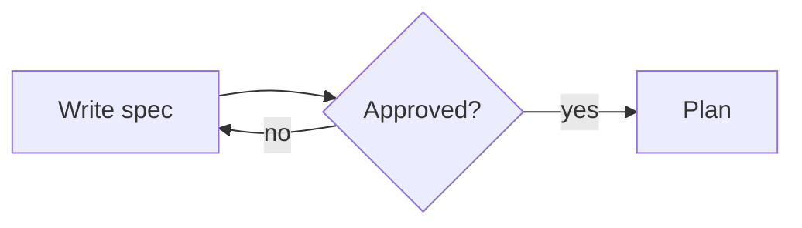
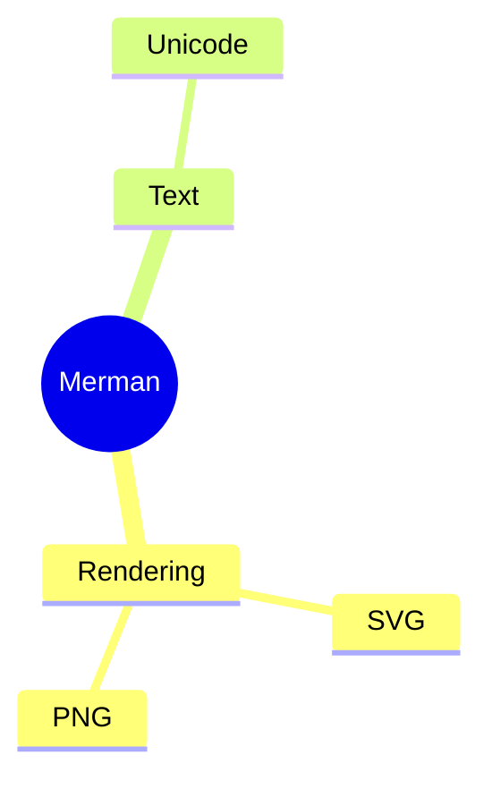

---
$schema:
    status: |-
        enum(
            draft-spec,
            finalized-spec,
            planned,
            implemented,
            review-findings,
            human-in-the-loop,
            completed,
            on-hold,
            abandoned
        ) -> an indicator of progress for this specification
    reviewed: boolean -> indicates whether the specification file has been reviewed by another agent from the one which created the spec
    reviewed_by: string -> the agent and model used in the spec review
    reviewed_on: date -> the date the spec was reviewed
    review_iterations: number -> the number of implementation reviews have taken place in the review/fix cycle
    clarified: boolean -> indicates whether the specification was built -- _in part_ -- with the 'clarify.md' prompt
    implemented: boolean -> indicates whether this spec's plan has been implemented
    implemented_by: string -> the agent who implemented the plan
status: finalized-spec
clarified: true
clarified_by: claude/opus
reviewed: true
reviewed_by: codex/gpt-6.1-sol
reviewed_on: 2026-10-22
review_note: "architect review accepted; remaining rulings made by Ken 2026-10-22"
review_iterations: 0
implemented: false
needs_rulings: false
depends-on:
    - 2026-10-21-merman
related:
    - 2026-10-21-merman
    - 2026-10-21-mermaid-embedded-font
references:
    biscuit-visualized/docs/research/mermaid/merman.md: >-
        Research on Merman, including its Unicode/ASCII output and the coverage
        recorded in Merman's `docs/rendering/ASCII_SUPPORT_MATRIX.md`.
    https://github.com/SublimeText/Mermaid: >-
        MIT-licensed Sublime Text syntax for Mermaid, vendored flattened (D8).
---

# Merman text fallback

> **Finalized 2026-10-22.** The architect review of 2026-10-22 is accepted as
> written in the sections from [Evidence](#evidence-and-the-meaning-of-complete)
> through [Dependency and compatibility boundaries](#dependency-and-compatibility-boundaries),
> as amended by the decisions. Ken made the remaining rulings on 2026-10-22;
> they are D1–D9 below.

## Goal

Show a readable text rendering of a Mermaid diagram when a terminal cannot
show images, while retaining the original source whenever text output would
lose meaning. For example, a supported `flowchart LR` containing `A --> B`
should show connected labeled nodes rather than requiring the reader to
interpret Mermaid syntax.

This follows `2026-10-21-merman`, which replaces the image renderer but
explicitly leaves text fallback for this work. That prerequisite is a finalized
specification, not evidence that its implementation has landed. Implement
against the Merman revision and public contracts it actually delivers.

## Evidence and the meaning of complete

The [repository research](../../docs/research/mermaid/merman.md) identifies
Merman's text target, but does not establish which inputs are safe replacements
for source. Review checked the
[pinned upstream support matrix](https://github.com/Latias94/merman/blob/482fcde7faffb05a466f198085d615e604075d97/docs/rendering/ASCII_SUPPORT_MATRIX.md)
at revision `482fcde7faffb05a466f198085d615e604075d97`, used by the prerequisite:

| Output (`primary_projection`) | Families | Upstream semantic coverage |
| --- | --- | --- |
| Box-and-line diagrams (`Diagrammatic`) | Flowchart, sequence, state, class, ER, XY chart | Partial for every family |
| Reports or outlines (`StructuredText`) | Gantt, gitGraph, journey, kanban, mindmap, packet, timeline, treeView | Partial for every family |
| No text output (`None`) | Other families, including pie, quadrant, architecture, and ZenUML | Unsupported |

Merman publishes this classification as data, not only as a document:
`merman::ascii::ascii_capabilities()` returns one `AsciiCapability` per family,
with a `primary_projection` (`Diagrammatic`, `StructuredText`, or `None`) and a
`semantic_coverage` (`Full` or `Partial`), and
`merman::ascii::ascii_diagrammatic_diagram_types()` lists the `Diagrammatic`
families. Each render result (`AsciiOutput`) also reports the `projection` it
actually produced: a dense class or ER diagram whose drawing overflows can come
back as a `relations:` list (`StructuredText`) even though its family is
`Diagrammatic`.

"Partial" means some features of the family are dropped or approximated in
text. A successful render does not prove that all labels, relationships, or
authored metadata survived: flowchart click links vanish silently and icons
print as raw codes such as `fa:fa-book`; sequence diagrams can omit actor
presentation metadata and links. D1 and D2 make that loss visible rather than
claiming completeness.

### What the two projections look like

A diagrammatic result is a drawing. This flowchart:



renders with Unicode drawing characters, through Merman's own CLI
(`merman-cli` 0.9.1, the version at rev `482fcde`), as:

```txt
┌────────────┐       ╭───────────╮        ┌──────┐
│            │       ╱           ╲        │      │
│ Write spec ├──────►< Approved? >──yes──►│ Plan │
│            │       ╲           ╱        │      │
└────────────┘       ╰───────────╯        └──────┘
       ▲                   │
       └────────no─────────┘
```

The `click C` link is gone, with no marker; this is what "partial" means in
practice, and why D2 adds a note.

A structured-text result is a report about the diagram, not a drawing. This
mindmap:



renders as:

```txt
node(bytes=6)="Merman" id(bytes=4)="root" shape(bytes=13)="mindmapCircle"
├── node(bytes=9)="Rendering" id(bytes=9)="Rendering" section=0
│   ├── node(bytes=3)="SVG" id(bytes=3)="SVG" section=0
│   └── node(bytes=3)="PNG" id(bytes=3)="PNG" section=0
└── node(bytes=4)="Text" id(bytes=4)="Text" section=1
    └── node(bytes=7)="Unicode" id(bytes=7)="Unicode" section=1
```

That report is faithful but is not a more readable substitute for the source,
so `StructuredText` output never replaces the source (D1).

Recheck capabilities at the exact revision delivered by the prerequisite. Use
upstream `primary_projection` and `semantic_coverage` metadata (D1), not its
legacy support-level label or the list of parsable families. Because Merman is
pinned to an exact rev, a change in eligibility arrives only with a reviewed
rev bump, and the eligibility snapshot test (R-F2) makes it visible in that
review.

## Ownership and existing contracts

| Package | Responsibility |
| --- | --- |
| `biscuit-visualized` | Text rendering, input eligibility (D1), presentation and the partial note (D2), emitting fallbacks as render-tree code and block quote nodes (D9), the fallback policy and its environment variable (D3), source fallback, diagram components, and its terminal rendering hook |
| `biscuit-terminal` (library) | Terminal capabilities, literal block layout, the Prose and BlockQuote components the note uses, the generic `code_renderer` slot of `TerminalRenderOptions` that a program fills to highlight code nodes (D9), and generic hook dispatch and error handling (including the generic declined outcome of D5) |
| `bt` CLI (`biscuit-terminal/cli`) | The `--feature` flags (D4), and installing darkmatter's code renderer for every command that renders code blocks (D9) |
| `renderable` | Shared rendering policy types, including the new automatic terminal Mermaid mode (D5) |
| `darkmatter` | The `md` CLI's `--feature` flags (D4), automatic mode behind `--mermaid` (D5), `no-mermaid-rendering` (D6), the vendored Mermaid syntax (D8), and the code renderer, backed by `CodeBlock`, that `md` and `bt` install (D9) |

The original ownership table assigned fallback selection to biscuit-terminal.
That conflicts with the established one-way dependency: biscuit-visualized
depends on biscuit-terminal, whose library must know nothing about Mermaid.
Any generic hook change must preserve that boundary. The `bt` CLI depends on
biscuit-visualized and may name Mermaid features; biscuit-terminal's library
may not. darkmatter depends on biscuit-visualized, so biscuit-visualized must
never depend on darkmatter; the `bt` CLI may depend on darkmatter's library
(D9), because `bt` → darkmatter → biscuit-visualized → biscuit-terminal's
library has no cycle.

The two diagram APIs serve different purposes:

- In biscuit-visualized, the artifact
  [MermaidDiagram](../../src/src/mermaid/render.rs) produces SVG/PNG. Add a
  separate fallible text-rendering operation here, taking explicit options
  rather than discovering a terminal. Preserve its existing image methods and
  source-code fallback method.
- In biscuit-visualized, the terminal
  [MermaidDiagram](../../src/src/components/mermaid.rs) chooses presentation.
  Its infallible render operation gains the text fallback described below.
  Preserve its image-only fallible operation and result: callers rely on a
  successful result containing a real PNG path, cache status, and image width.
  Text success must not fabricate image metadata.
- In biscuit-visualized,
  [TerminalDiagramRenderer](../../src/src/components/render_hook.rs) handles
  Mermaid fences passed from the generic Markdown renderer. D5 defines its
  integration; changing only the standalone component would leave Markdown
  consumers with source fallback.

## Scope and requirements

### Selection and failures

The following policy applies to the standalone component's infallible terminal
rendering. The Markdown hook keeps its separate strict error contract (D5).

| Condition | Output |
| --- | --- |
| Images are usable and rendering succeeds | Existing image output |
| Images are unavailable; the input is eligible (D1), the policy allows it (D3), and the result fits the available width (D7) | Text diagram in a `txt` code block, followed by the partial note when the coverage is partial and the note is enabled (D2) |
| The family is not eligible, the result's projection is not diagrammatic, or the policy forbids it (D1, D3) | Original Mermaid source code block |
| The result does not fit, after the layouts D7 allows | Original Mermaid source code block |
| Parsing fails, output is empty for nonempty content, or text rendering fails | Original Mermaid source code block |
| Image generation or display fails after selecting the image route | Existing error/source behavior; do not retry through text |
| Deadline, cancellation, or resource limit is reached | Preserve the failure for fallible callers; infallible rendering uses source |

Determine image availability before measuring SVG, loading fonts, rasterizing,
or writing an image artifact. Use biscuit-terminal's existing effective
capabilities and route policy, including caller overrides, rather than adding
a terminal probe or inspecting environment variables in the diagram backend to
decide image availability. (The one environment variable this spec reads,
`MERMAID_FALLBACK`, selects the fallback policy, never image availability; D3.)

Attempt at most one text request after eligibility checking. Merman's `auto`
layout profile (D7) is one request, inside which Merman tries a second layout
once; it is not a second request. Do not start a fresh request after
cancellation or a limit failure. Apply the prerequisite's configurable Merman
deadline (default two seconds) to text requests as well; this bounds Merman's
checked work, not total wall-clock time. Preserve its warning behavior on
deadline failures.

Keep the original, unmodified source reachable through existing source and
code-block methods. Do not append it to every successful text rendering, which
would duplicate the diagram. Explicit source/code mode must continue to show
source, and source fallback must never be passed back into Mermaid promotion.
Use the same parsing/configuration and applicable label normalization as the
prerequisite; image-only styling and font measurement do not belong in text
rendering. Eligibility checks must use the parsed diagram model and Merman's
metadata, not a keyword or regular-expression scan that can mistake a comment
for a construct.

### Text presentation

- Select Unicode or ASCII drawing characters using the existing
  [Terminal capability](../../../biscuit-terminal/lib/src/terminal.rs) in
  biscuit-terminal. ASCII changes generated connectors and borders; it must
  not transliterate or delete authored Unicode labels. Do not confuse
  upstream's Unicode/CJK display-width profiles with its drawing character set.
- Request plain output from Merman. Emit it as a render-tree code node with
  language `txt` (D2, D9), rendered by biscuit-terminal's code-block layout
  and highlighted by whatever code renderer the rendering program installs,
  not as Markdown or rich prose. Preserve spaces and hard line breaks, and apply outer margins
  and alignment once. Text derived from labels must not execute terminal
  control sequences.
- Bound output by the columns available at the diagram's actual nested
  position, less the `txt` code block's own padding and borders. Respect
  explicit cell/percentage/fill width limits. An image scale factor does not
  scale text cells and must not trigger SVG measurement on the text route; use
  available columns for that case.
- Lay out as D7 rules. Measure fit in terminal display cells, with
  biscuit-terminal's own display-width measurement, not bytes or Unicode
  scalar count. If the result cannot fit, show source rather than clipping,
  wrapping finished diagram rows, dropping labels, or changing graph
  direction. A zero-width content area also selects source without attempting
  text layout. Source retains the existing code renderer's overflow behavior.
- Never substitute Merman's structured report for a diagram, whether the
  family is `StructuredText` or a `Diagrammatic` family's result fell back to
  a `relations:` list (D1). An unsupported request combination selects source.
- Preserve an explicitly supplied component title once, including when source
  is selected. Do not invent a second title when the diagram already supplies
  the same title. Image palette, raster scale, and transparency settings do
  not add color or pixel semantics to text output.

### Dependency and compatibility boundaries

Enable Merman's `ascii` feature at the same pinned revision as its SVG backend;
do not add a second Merman version, shell out to its CLI, or enable all of its
default features. Keep the existing biscuit-visualized feature layout for this
work; a separate text-only build without the `image` feature is out of scope.
biscuit-visualized gains no dependency on darkmatter or syntect for
highlighting; the `bt` CLI gains a dependency on darkmatter's library (D9).
Text rendering should not create SVG/PNG artifacts or initialize the font
chain. No persistent text cache is needed initially.

SVG/PNG exports, browser and Markdown source serialization, graph-expression
rendering, and the existing typed Git graph's history/geometry rules retain
their current behavior. gitGraph's text output is `StructuredText`, so D1
never uses it; the typed Git graph's layout and image-result assumptions are
untouched.

The `bt` CLI currently reports rendering failures and exits unsuccessfully.
Preserve that behavior and its JSON/image metadata contract. This feature must
not turn an explicit image-export failure into successful text output.

Existing callers that set nothing keep today's behavior except where this
spec says otherwise: the standalone component's infallible render gains text
fallback (D1, D3 default), and `md --mermaid` moves from image mode to
automatic mode (D5). `TerminalMermaidMode::Code` and `::Image`, and every
`BrowserMermaidMode`, keep their meaning.

## Decisions

Ken made D1–D9 on 2026-10-22. They replace the draft's two open questions
(which inputs may replace source; how Markdown consumers opt in) and add the
fallback policy, the CLI convention, Mermaid highlighting, and highlighting in
`bt`. D10, also of 2026-10-22, pre-authorizes bounded implementer autonomy.

### D1. Eligibility comes from Merman's metadata

- Text fallback is used only when **both**:
    1. the family's `AsciiCapability.primary_projection` is `Diagrammatic`; and
    2. the specific render result's `AsciiOutput.projection` is
       `Diagrammatic`.
- If a `Diagrammatic` family's result came back as `StructuredText` (for
  example a dense class or ER diagram's `relations:` list), show the source.
- `StructuredText` and `None` families always show the source code block.
- Both `full` and `partial` semantic coverage are eligible by default. The
  policy of D3 can exclude partial results.
- Eligibility is read from Merman's public metadata
  (`merman::ascii::ascii_capabilities()`, matched on the parsed family's
  `diagram_type`), never from a hand-kept list of family names. A family with
  no capability entry, or with an enum value this code does not know (the
  enums are `#[non_exhaustive]`), is not eligible. A `Diagrammatic` family
  with no `semantic_coverage` value is treated as partial.
- At rev `482fcde` this admits flowchart, sequence, state, class, ER, and
  XY chart, all partial.

### D2. Presentation: a `txt` code block, then the partial note

- Fallback text is always rendered inside a code block with language `txt`,
  emitted as a render-tree code node (D9).
- If the result's coverage is partial (its family's `semantic_coverage` is
  `Partial`, or absent per D1), then after the code block and a blank line,
  render exactly this note:

  ```markdown
  > **Note:** this textual representation is provided because the current terminal settings do not allow for a graphical image to be used. This fallback representation, while never arbitrary or speculative, might be missing attributes that would have been visible in the image's representation [<dim>id: <i>mermaid-partial-warning</i></dim>].
  ```

- The note is emitted as the render-tree block quote node that follows the
  code node (D9), and is rendered through biscuit-terminal's BlockQuote and
  Prose components: `Note:` bold, the bracketed `id: mermaid-partial-warning`
  dimmed, and the id itself italic. Where the terminal lacks bold, dim, or
  italic, those components degrade as they already do. The note wraps to the
  available width like any prose; the no-wrapping rule applies to diagram
  rows only.
- The note is shown by default; D3's `show_partial_note` turns it off.
- The note appears identically on the standalone component and on the
  Markdown hook's successful output (D5). It is never shown with the source
  code block or with an image.

### D3. Fallback policy, and its precedence

- biscuit-visualized's terminal Mermaid component gets a public
  fallback-policy option with two settings:
    - **text fallback:** text allowed (**default**) / no partial text / never
      text;
    - **show partial note:** `true` (**default**) / `false`.
- Each setting is set independently through the component's builder (and the
  same option on the Markdown hook). A setting the caller sets explicitly is
  final: **library callers that pass it are unaffected by the environment.**
- When the text-fallback setting is not set, `MERMAID_FALLBACK=code-block`
  (value compared case-insensitively) means **never text**. Any other value,
  or the variable unset, leaves the default. The variable does not affect
  `show_partial_note`.
- The variable is read by biscuit-visualized's policy resolution at render
  time, through a seam tests can inject; it is not read by the Merman text
  backend.
- **Precedence, per setting: flag > env > default.** CLIs translate their
  `--feature` flags (D4) into explicit settings, so a flag beats the
  environment, and a CLI that receives no relevant flag leaves the setting
  unset so the environment applies.
- "No partial text" behaves like "never text" at rev `482fcde`, because every
  family is partial; it diverges once a family reaches full coverage.

### D4. The `--feature` CLI convention

A new, repository-wide CLI convention, introduced here and intended to spread
to other CLIs:

- `--feature <NAME>` is repeatable and comma-separated: `--feature a
  --feature b` and `--feature a,b` are equivalent. Names are
  case-insensitive. Repeating a name is harmless.
- Each CLI declares the names it accepts. An unknown name (including an empty
  one, as in `--feature a,,b`) is a usage error that lists the valid names,
  and shell completion offers them.
- When two named features overlap, the more restrictive one wins
  (`no-mermaid-fallbacks` with `no-mermaid-partial-fallbacks` means never
  text).
- Features in this spec:

  | Feature | Meaning | Accepted by |
  | --- | --- | --- |
  | `no-mermaid-fallbacks` | Never fall back to text (D3 "never text") | `bt` Mermaid subcommands, `md render` |
  | `no-mermaid-partial-fallbacks` | Never fall back to partial text (D3 "no partial text"); today this behaves like `no-mermaid-fallbacks` because every family is partial, but that may change | `bt` Mermaid subcommands, `md render` |
  | `no-mermaid-partial-warning` | Hide the partial note (D3 `show_partial_note = false`) | `bt` Mermaid subcommands, `md render` |
  | `no-mermaid-rendering` | Every Mermaid fence stays a code block (D6) | `md render` only |

- Commands: every `bt` subcommand that renders through Mermaid
  (`flowchart`, `state-diagram`, `erd`, `pie`, `quadrant`, `timeline`,
  `xy-chart`, `git-graph`, `mermaid`) plus `md render`, including its
  equivalent implicit form `md <INPUT>`. On `md`, the three fallback features
  take effect when Mermaid promotion is on (`--mermaid`, D5) and are accepted
  without effect otherwise.
- The convention is documented in the repository's `cli` skill
  (`.claude/skills/cli/`) and in each CLI's docs: `darkmatter/docs/cli/render.md`
  for `md`, and a new `biscuit-terminal/docs/cli.md` for `bt`, which has no
  CLI reference page today (its README links to it and stays an overview).

### D5. Markdown integration: an explicit automatic mode

- `renderable`'s `TerminalMermaidMode` gains an `Automatic` variant. `Code`
  (the default) and `Image` keep their meaning.
- **Automatic** means: an image when graphics are allowed; an eligible text
  fallback (D1, under the policy of D3) otherwise; the source code block when
  not eligible.
- The graphics ceiling is carried through the generic hook: the generic
  renderer passes `GraphicsMode` in its request, so the hook cannot emit an
  image when only text is allowed. In automatic mode the hook is called at
  `Rich` (image or text) and at `Vector` (text only); at `Off` it is not
  called and the fence renders as code, as for `Code` mode.
- Strict/warn/permissive failure handling is unchanged. A real failure (a
  parse error, a Merman error, a deadline or limit, or an image failure after
  the image route was chosen) is a hook error and follows that policy. The
  hook never returns a successful source block to bypass it.
- When automatic mode selects the source because the input is not eligible,
  the result does not fit (D7), or the policy forbids text (D3), the hook
  returns a **declined** outcome: a generic, Mermaid-agnostic result,
  distinct from success and from error, on biscuit-terminal's hook contract.
  The generic renderer then renders the ordinary code block with no
  diagnostic in every strictness mode, exactly as when the hook is not
  called. This keeps automatic mode's normal "show source" outcome from
  failing a strict render.
- No hook installed still means ordinary code rendering.
- Darkmatter's `md` uses automatic mode behind its existing `--mermaid` flag.
- Adding the variant requires auditing every exhaustive match on
  `TerminalMermaidMode` in the workspace.

### D6. `--feature no-mermaid-rendering` (`md render`)

- Every Mermaid fence is emitted as a code block in every output target:
  terminal and HTML render it as a highlighted Mermaid code block (D8);
  Markdown and JSON output keep it as a `mermaid` fenced code block.
- In HTML this also disables the interactive default: no Mermaid.js script is
  injected.
- It wins over every other Mermaid option on the same command (`--mermaid`,
  static SVG, and `--embed-mermaid-font` of `2026-10-21-mermaid-embedded-font`,
  which then has nothing to embed).

### D7. Width and layout

- Families whose capability admits Merman's `auto` layout profile
  (`AsciiCapability.layout_profiles` contains `Auto`; at rev `482fcde`,
  flowchart and sequence) are requested with `auto` and the available content
  columns as the maximum width: Merman renders the canonical layout first and
  tries the compact layout once if it is wider than the available columns. If
  the result is still wider, or reports overflow, show the source code block.
- Other diagrammatic families use the canonical layout, then the source code
  block if it does not fit.
- The architect's no-clipping, no-wrapping, and display-cell rules (in
  [Text presentation](#text-presentation)) stand.

### D8. Mermaid syntax highlighting for code blocks

_Amended 2026-10-22 by D9: highlighting now reaches `bt`._

- Vendor the MIT-licensed [SublimeText/Mermaid](https://github.com/SublimeText/Mermaid)
  syntax, pinned to commit `a5c6d45d1b0a99f8d4e0fdb2b5ccd7fd07809859`
  (2025-12-03), **flattened** into one syntect-compatible `.sublime-syntax`:
    - merge the base syntax (`mermaid.sublime-syntax`), `Mermaid
      Flowchart.sublime-syntax`, and `Mermaid SequenceDiagram.sublime-syntax`;
    - no `extends`, and no `version: 2` feature syntect does not support;
    - drop the CSS extension (`CSS (for Mermaid).sublime-syntax`).
- Add it to darkmatter's syntax set, which today is two-face's extended
  syntect set and has no Mermaid syntax, so the `mermaid` and `mmd` tokens
  resolve to it. The file lives at
  `darkmatter/lib/assets/syntaxes/mermaid/Mermaid.sublime-syntax`, with the
  upstream MIT `LICENSE` beside it and a note of the source commit. It is
  recorded, with its MIT notice, in `darkmatter/docs/dependencies.md` and the
  root `docs/dependencies.md`.
- It gives every Mermaid block header, comment, and `%%{init}%%` highlighting,
  and full highlighting for flowchart and sequence. It applies wherever
  darkmatter's highlighter renders a code block, in terminal and HTML output,
  including source fallbacks and `no-mermaid-rendering`. Through D9 that
  includes every code block `bt` renders.
- Merman's tree-sitter grammar does not fit, because darkmatter highlights
  with syntect.

### D9. Fallbacks are code nodes; `bt` highlights through darkmatter

Ken ruled on 2026-10-22 that `bt` gets highlighted code blocks through
darkmatter's highlighter. This amends D8, which had left `bt` unhighlighted.

- biscuit-visualized's terminal Mermaid component emits its fallbacks as
  render-tree **code nodes**, not pre-formatted strings: language `mermaid`
  for the source code block and `txt` for the text drawing. The partial note
  (D2) is emitted as the block quote node that follows the code node. The
  same applies to the Markdown hook's successful text output (D5).
- The program doing the rendering supplies highlighting through the
  `code_renderer` slot of biscuit-terminal's `TerminalRenderOptions`
  (`with_code_renderer`), which takes any `renderable::tree::CodeRenderer`.
  biscuit-terminal's library and biscuit-visualized stay unaware of syntect;
  with no code renderer installed, code nodes render unhighlighted as they do
  today.
- `md` already installs darkmatter's code renderer.
- The `bt` CLI adds a dependency on darkmatter's library and installs
  darkmatter's code renderer, backed by darkmatter's public `CodeBlock`
  component (`darkmatter/lib/src/markdown/code_block.rs`, syntect plus
  two-face), for every `bt` command that renders code blocks. `bt` and `md`
  therefore highlight identically, including the vendored Mermaid syntax of
  D8.
- biscuit-visualized must not depend on darkmatter, since darkmatter depends
  on biscuit-visualized. The chain `bt` → darkmatter → biscuit-visualized →
  biscuit-terminal's library has no cycle.
- Cost, accepted by Ken: `bt` now compiles darkmatter, which lengthens its
  build and enlarges its binary.

### D10. Bounded implementer autonomy *(pre-authorization)*

Ken ruled on 2026-10-22 that the rule `2026-10-21-merman` records as its
D72 applies to this work too. When implementation evidence invalidates a
decision's premise, the implementer may proceed with an option that meets
**all three** of these conditions:

1. it preserves the decision's stated purpose;
2. it stays within every other decision and limit of this spec and of the specs it depends on;
3. it adds no new dependency, no outward-facing action (pushing, posting,
   filing), and no scope.

The implementer then amends this spec (marking the decision amended),
records the evidence and the choice under a **"Decided during
implementation"** heading in the implementation log, and flags the choice
for the review cycle. If no option meets all three conditions, or the
options trade off things Ken would weigh, the implementer stops and sets
`human_review` in the implementation log.

## Requirements

- **R-F1.** Text fallback is chosen only when the family's
  `primary_projection` and the result's `projection` are both `Diagrammatic`;
  every other case shows the source code block (D1).
- **R-F2.** Eligibility is derived at run time from
  `merman::ascii::ascii_capabilities()`; a test snapshots the derived
  eligibility table (family, projection, coverage, layout profiles) at the
  pinned rev so a rev bump that changes it shows in review (D1).
- **R-F3.** Fallback text is emitted as a render-tree code node with language
  `txt` and source fallback as one with language `mermaid`; partial results
  are followed by a blank line and the exact note of D2, emitted as the
  following block quote node and rendered through BlockQuote and Prose with
  the specified emphasis (D2, D9).
- **R-F4.** The component and the Markdown hook expose the D3 policy;
  explicitly set settings ignore the environment; an unset text-fallback
  setting honors `MERMAID_FALLBACK=code-block` case-insensitively; precedence
  is flag > env > default, per setting (D3).
- **R-F5.** `bt`'s Mermaid subcommands and `md render` accept `--feature` per
  D4, with case-insensitive, repeatable, comma-separated names, a usage error
  listing valid names for an unknown name, and completion of valid names (D4).
- **R-F6.** `TerminalMermaidMode::Automatic` exists; the hook receives the
  graphics ceiling; real failures follow strictness; ineligible, unfitting, or
  policy-forbidden inputs return the generic declined outcome and render as
  code without a diagnostic; `md --mermaid` uses automatic mode (D5).
- **R-F7.** `md render --feature no-mermaid-rendering` emits every Mermaid
  fence as a code block in every target, and HTML output contains no
  Mermaid.js script (D6).
- **R-F8.** `auto`-capable families are requested with the `auto` profile and
  the content columns as maximum width; others with canonical; an unfitting
  result shows the source (D7).
- **R-F9.** The flattened Mermaid syntax loads in darkmatter's syntax set and
  highlights Mermaid code blocks in terminal and HTML output, in `md` and in
  `bt` (D8, D9).
- **R-F10.** Text selection creates no SVG/PNG artifact, initializes no font
  chain, and leaves image results and their metadata unchanged
  ([Selection and failures](#selection-and-failures)).
- **R-F11.** The docs listed in [Documentation](#documentation) describe the
  shipped behavior and name no spec.
- **R-F12.** The `bt` CLI depends on darkmatter's library and installs
  darkmatter's code renderer in every command that renders code blocks;
  biscuit-visualized and biscuit-terminal's library gain no darkmatter or
  syntect dependency (D9).

## Acceptance and verification

| ID | Statement | Validated by |
| --- | --- | --- |
| AC-F1 | A flowchart renders as text on a terminal without images; a mindmap (`StructuredText`) and a pie chart (`None`) render as source | Component tests with explicit no-image capabilities |
| AC-F2 | A class or ER input whose result's `projection` is `StructuredText` renders as source | Component test with a dense class diagram at a narrow width; assertion on the reported projection |
| AC-F3 | Eligibility comes from Merman's metadata; the snapshot lists exactly flowchart, sequence, state, class, ER, and XY chart as eligible at rev `482fcde` | Snapshot test over the derived table (R-F2); code review finds no family-name list in the eligibility path |
| AC-F4 | Fallback text is a render-tree code node with language `txt`, and source fallback one with language `mermaid`; a partial result is followed by a blank line and the exact note text, with `Note:` bold, the bracketed id dimmed, and the id italic; with `show_partial_note = false` there is no note | Exact text snapshots (plain), style assertions on the rendered spans, and assertions on the emitted node kinds and languages |
| AC-F5 | Policy precedence: an explicit library setting ignores `MERMAID_FALLBACK`; with nothing set, `MERMAID_FALLBACK=Code-Block` yields source; another value yields text; a CLI flag beats the variable; the variable does not change the note | Unit tests through the injected environment seam; CLI tests for `bt mermaid` and `md render` |
| AC-F6 | "No partial text" yields source for every family at rev `482fcde` | Component test per eligible family |
| AC-F7 | `--feature a,b` equals `--feature a --feature b`; names match case-insensitively; an unknown or empty name exits with a usage error listing the valid names; completion offers them; `no-mermaid-rendering` is rejected by `bt` | CLI tests on `bt` and `md`; a completion test |
| AC-F8 | Automatic mode: an image at `Rich` with image support; text at `Vector`; code at `Off`; an ineligible input renders as code without a diagnostic under strict, warn, and permissive; a parse error is rejected under strict, recorded under warn, silent under permissive; no hook means code; `Code` and `Image` modes are unchanged | The real biscuit-visualized hook through biscuit-terminal's generic renderer, one case per row |
| AC-F9 | `md --mermaid` selects automatic mode | darkmatter CLI test |
| AC-F10 | With `--feature no-mermaid-rendering`, terminal and HTML output show a highlighted Mermaid code block, Markdown and JSON keep the `mermaid` fence, and the HTML contains no Mermaid.js script, also with `--mermaid` | darkmatter tests per output target |
| AC-F11 | A flowchart too wide canonically but narrow enough compactly renders compactly; one too wide for both renders as source; a state diagram too wide canonically renders as source without a compact attempt | Component tests at fixed widths; assertions on the requested and reported layout profile |
| AC-F12 | The vendored syntax has no `extends` key, loads with syntect, and highlights a header, a comment, and `%%{init}%%` in a gantt block, and nodes and arrows in flowchart and sequence blocks, in terminal and HTML output; its MIT notice is in darkmatter's and the root dependency docs | darkmatter highlighting tests; a test parsing the file; docs review |
| AC-F13 | Existing image rendering and image-result metadata are unchanged; text selection bypasses image generation and font initialization; at most one text request is made | Existing image tests; counters on artifact writes, font-chain initialization, and Merman text requests |
| AC-F14 | Text snapshots cover spatial output in both drawing character sets, with authored Unicode, significant spaces, multiline labels, nested available width, and label control characters; an unsupported family, invalid source, over-wide output, and an injected limit or cancellation failure each select source | Exact text snapshots and focused assertions; the limit failure is injected, not provoked by sleeping |
| AC-F15 | Every `TerminalMermaidMode` exhaustive match in the workspace handles `Automatic` | `cargo check` of the workspace; the audit list in the implementation log |
| AC-F16 | The docs describe the eligibility rule, the note, the policy and `MERMAID_FALLBACK`, `--feature`, automatic mode, `no-mermaid-rendering`, width behavior, and highlighting (in `md` and `bt`), with an example each, and name no spec | Review; search for spec names in the touched docs |
| AC-F17 | In `bt`, a Mermaid source fallback and a `txt` text fallback are both highlighted, through the same darkmatter code renderer `md` uses | L1 test in the `bt` CLI with an explicit terminal capability (color on, images off), asserting that each fallback's code block contains ANSI SGR sequences; `cargo tree` (or a dependency-graph test) shows no darkmatter or syntect under biscuit-visualized or biscuit-terminal's library |

Keep these tests at L1 with explicit terminal capabilities; real windows and
focus changes are unnecessary. Use the repository Test Toolkit and existing
consolidated test binaries. Store fixtures under the prerequisite's
`biscuit-visualized/src/tests/fixtures/merman/` location with required license
notices and repository-readable paths. Run `just test` in changed package
areas (biscuit-visualized, biscuit-terminal, renderable, darkmatter), using
nextest through the recipes.

No performance spike or new benchmark gate is required. Prove bypassed image
work and bounded request counts with deterministic assertions. If an actual
text-rendering cost warrants investigation, a quick sample on one host is
sufficient unless a known OS-specific cost is identified.

## Documentation

At implementation time, update:

- the Mermaid component topic page
  (`biscuit-visualized/docs/components/mermaid_diagram.md`): eligibility, the
  two example projections, the note, the policy and `MERMAID_FALLBACK`, width
  behavior, Unicode behavior, and error behavior, with examples;
- the rendering-policy docs (`renderable/docs/tree-rendering.md`): automatic
  mode, the graphics ceiling in the hook request, and the declined outcome;
- `darkmatter/docs/cli/render.md`: `--feature`, automatic mode behind
  `--mermaid`, `no-mermaid-rendering`, and Mermaid highlighting;
- a new `biscuit-terminal/docs/cli.md` for `bt`'s `--feature` flags and its
  darkmatter-backed code highlighting, linked from bt's README;
- the render-tree code-renderer docs (in `renderable` and biscuit-terminal's
  topic pages): fallbacks arrive as code nodes and the rendering program
  supplies highlighting through the `code_renderer` slot;
- the `cli` skill (`.claude/skills/cli/`): the `--feature` convention of D4;
- package README overviews where public behavior changes;
- `biscuit-visualized/docs/dependencies.md` for Merman's `ascii` feature;
  `darkmatter/docs/dependencies.md` and the root `docs/dependencies.md` for
  the vendored syntax and its MIT notice;
  `biscuit-terminal/docs/dependencies.md` for the `bt` CLI's new dependency
  on darkmatter's library (D9), with the root `docs/dependencies.md`
  updated to match;
- affected agent skills (`biscuit-visualized`, `biscuit-terminal`,
  `renderable`, `darkmatter`).

Keep this specification in place for author review; do not move it to the
completed directory.

## Resolved questions

The draft's question "Which inputs may replace source in the first release?"
→ D1 and D2. "How should Markdown consumers opt into text fallback?" → D5.
The fallback policy → D3; the CLI convention → D4; `no-mermaid-rendering` →
D6; width and layout → D7; Mermaid highlighting → D8, amended by D9 to reach
`bt`.
