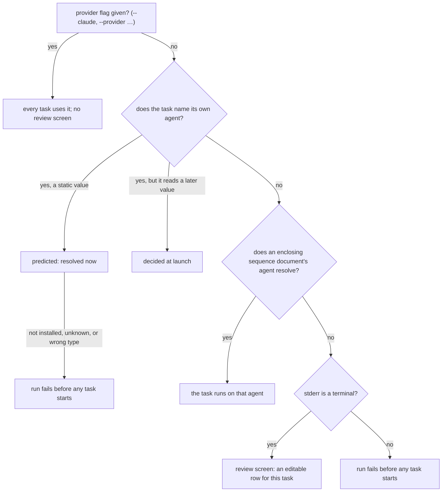

# Claudine's `sequence` command

`claudine sequence` runs a document whose frontmatter has a `sequence:` list,
one step at a time. Each step composes and runs one unit of work, such as a
prompt document, a shell command, or a group of tasks. Later steps can read
what earlier steps produced.

This page covers the command: how to call it, how it chooses providers, and
its flags. How steps, tasks, state, groups, and `seq.outputs` behave is in
[Sequences](../topics/flow-control/sequences.md).

## Usage

```bash
claudine sequence [flags] <file> [key=value ...]
```

Pass exactly **one file reference**. Any number of `key=value` setters can go
before or after it:

```bash
claudine sequence @research.md topic="async traits" retries=3
claudine sequence topic="async traits" @research.md
```

A command with setters but no file fails:

```text
Error: missing file reference: expected exactly one file reference plus optional key=value setters
```

### Setters

- A token is a setter when the part before the first `=` starts with an ASCII
  letter or `_` and contains only letters, digits, `_`, or `-`. Anything else,
  such as `foo.bar=baz` or `./x=1`, is treated as the file reference.
- The value is parsed as JSON5, and falls back to a plain string when it
  doesn't parse: `retries=3` is a number, `tags=[a,b]` is a string, and
  `tags='["a","b"]'` is an array.
- `--set '{"key": "value"}'` sets several values at once. An inline setter
  wins over `--set` for the same key.
- Setters sit above the document's frontmatter and below runtime mutations.
  The read-only `seq` root carries the current row, neighbors, outputs, and
  run ID separately from frontmatter. See
  [Phase 2 — Just-in-time composition](../topics/flow-control/sequences.md#phase-2--just-in-time-composition)
  for the full order.

## The sequence file

The file can be either of these:

- a **Markdown document** whose frontmatter has a `sequence:` key;
- a **`.yaml` / `.yml` file**, whose top-level mapping is read as frontmatter
  with no body. Every step then needs an executable, because there is no body
  for a plain step to compose.

```markdown
---
agent: claude
sequence:
    - name: research
      topic: parsing
    - name: review
      prompt: "@prompts/review.md"
      with:
          topic: "{{ seq.topic }}"
    - name: stage
      shell: git add .
---
Research {{ seq.topic }} and write up what you find.
```

The `research` step has no executable, so it composes this document's body.
`review` composes `prompts/review.md` with `topic` set, and `stage` runs a
shell command. The step fields, the ways to supply a list (`sources`), and
groups are covered in [Sequences](../topics/flow-control/sequences.md).

## Choosing providers

Every task that launches a provider (a `prompt:` task, or a step that runs
the sequence body) chooses its own. Before any task starts, preflight
predicts each one's provider from its own `agent`, the same way its launch
will choose it:



A task's own `agent` comes, lowest first, from its prompt document's
frontmatter, its `with:`, and a caller setter (`agent=…` or
`--set '{"agent": …}'`, which therefore overrides every task). A runtime
`set` of `agent` outranks all three when the task runs. `--claude`,
`--codex`, …, or `--provider <name>` decides every task and skips the rest.

```yaml
# No document `agent`: every task names its own, so the run just starts.
sequence:
    - name: implement
      prompt: "@prompts/implement.md"
      with: { agent: codex }          # runs on Codex
    - name: review
      prompt: "@prompts/review.md"    # declares agent: opencode, so it runs on OpenCode
    - name: stage
      shell: git add .                # launches no provider, needs none
```

Each task falls into one of three classes:

| Class | When | What happens |
| :--- | :--- | :--- |
| **predicted** | its `agent` is known now | checked now; an unusable one fails the run, naming the task, the property, and the enclosing containers |
| **decided at launch** | its `agent` reads `seq.outputs`, `loop.*`, `group.*`, `current.*`, a key a lifecycle `set` writes (even one with no value before that write), or a `$( … )` | evaluated when the task is prepared; an unusable value fails that task before it spawns, after earlier tasks ran |
| **missing a provider** | no `agent` of its own: absent, or `null` in whichever layer decides it (a caller's `agent=[]` too) | takes the nearest enclosing sequence document's `agent` (a referenced sequence file's own first, then outward to the root); with none, a terminal reviews it and anything else fails |

`null` is not a hint, so an `agent: null` in a task's `with:` or a caller's
`agent=null` hides a lower layer's `agent` and leaves the task missing one.
An empty string `""` is an invalid provider name, not an empty hint. A caller
setter also applies to the sequence document, so `agent=null` or `agent=[]`
leaves nothing to inherit.

`agent: []` in a task's prompt frontmatter or its `with:` is not an empty
hint: the [launch schema](../topics/schemas.md#when-the-schemas-apply) requires
an agent list to have at least one entry, so the run fails before any task
launches, naming where the list was written (`tasks[1].with.agent`, or
`agent` in the prompt file). A body step of a referenced sequence file whose
`agent` is `[]` fails the same way, naming that file, unless a caller's
`agent=` replaces it. A root sequence document's `agent: []` fails its own
schema check before any task launches. `model: []` is valid and means no model.

A task naming a provider that isn't installed fails before any task
launches, even when its `when:` is false:

```text
⤫ CompositionError: task provider selection failed
  step 2 (`later`) in seq.md names its provider with tasks[1].with.agent in seq.md.
```

A hint that reads the provider it selects (`agent: "{{ env.AGENT }}"`, or
`env.MODEL` for `model`) is rejected the same way, unless something above it
decides that key. Provider and model are decided separately:

| Hint | Made irrelevant by |
| :--- | :--- |
| `agent: "{{ env.AGENT }}"` (or `ctx.agent`) | `--claude`, `--provider claude`, or a caller's `agent=` |
| `model: "{{ env.MODEL }}"` (or `ctx.model`) | `--model`, a `MODEL` or provider-specific model variable (`CLAUDE_MODEL` for Claude), or a caller's `model=` |

So `claudine sequence seq.md --claude` runs a task whose prompt says
`agent: "{{ env.AGENT }}"` on Claude, and the prompt reads `claude` there.
A provider flag does not excuse a circular `model`.

An `agent` or `model` whose expression is simply wrong is rejected too,
under any flag, because the task's prompt still evaluates it when it
composes; so is an `agent: []`. Wherever it is written, a typo is not a
later value, so `with: { agent: "{{ no_such_function() }}" }` on the second
task stops the run before the first launches, naming `tasks[1].with.agent`.
A document hint reading a `with` entry that fails is located at that entry. Prediction runs no shell,
lifecycle event, or `prep` target, composes no prompt body, and refreshes no
model catalog. A graph of only `shell:` and `side_effect:` tasks needs no
provider at all.

A body step composes the sequence document itself, so its `agent` is the
document's. A group has no `agent`: each task in it chooses its own.

**The model** follows its own order: `--model` first, then the selected
provider's model environment variable (for example, `CLAUDE_MODEL`), then
the generic `MODEL`, then the task's own `model`, then a compatible inherited
or review-selected model, and finally the provider's default. Environment
values come from the map captured for that document, so a later task can see
a file-backed environment change without changing an earlier task's choice.
An inherited model goes only with the provider it belongs to: a
task that switches provider gets that provider's own default, and its
process gets no stale `MODEL`.

```yaml
agent: claude
model: claude-opus-4-8              # Claude's model
sequence:
    - name: draft
      prompt: "@prompts/draft.md"   # runs claude-opus-4-8
    - name: other
      prompt: "@prompts/draft.md"
      with: { agent: codex }        # Codex's default model, not Claude's
```

**What a step reports is what launched.** The step's status line names the
provider that spawned, and lists every attempt when a `retry` or `proxy`
switched provider:

```text
✓ step 1/2 succeeded (via Codex)
✓ step 2/2 succeeded (via Codex; attempts: Claude → Codex)
```

A skipped task, a preview, and a task that launched nothing claim no
provider. `{{ env.AGENT }}` and `{{ env.MODEL }}` in a task's composed
prompt name the provider and model the task launches with, and so does the
child's environment. That holds for a task decided at launch too: its
document's frontmatter is evaluated first, the provider is chosen from it,
and only then does the body render. It holds when an earlier task rewrote the
prompt document to name another provider: the task launches on the fresh
`agent`, and its prompt says so.

```yaml
sequence:
  - name: pick
    shell: echo goose
  - name: run
    prompt: report.md              # body: "You are {{ env.AGENT }}."
    with: { agent: "{{ seq.outputs[0] }}" }
# Goose launches, with AGENT=goose, and reads "You are goose."
```

An `agent` or `model` that comes from a `$( … )` in the prompt's
frontmatter agrees too. The command runs once; its answer chooses the
provider and model after the frontmatter resolves and before the body
renders, and a retry of the task rereads the document under that choice.
A task's `with:` value that only looks like a command, such as
`model: "$(echo x)"`, is data: nothing runs it, and the body and the child
both receive it as written.

```markdown
---
agent: '$(echo goose)'
---
You are {{ env.AGENT }}.
```

The task above launches Goose, with `AGENT=goose`, and its prompt reads
"You are goose." A frontmatter value that itself reads `env.AGENT` resolves
before that command runs, so it sees the identity the rest of the
frontmatter names without the command's answer.

### The review screen

The screen opens only on a terminal, and only when some task is missing a
provider (or names a list with more than one installed provider). It shows
one row per provider-launching task, labeled with its root step's position
and its name:

| Task | Row |
| :--- | :--- |
| missing a provider | editable: a provider picker and a model picker |
| names its own provider | read-only, showing it |
| decided at launch | read-only, showing `decided at launch` |
| `shell`, `side_effect` | no row |

```yaml
sequence:
    - name: implement
      prompt: "@prompts/implement.md"   # row "1 implement", editable
    - name: stage
      shell: git add .                  # no row
    - name: review
      prompt: "@prompts/review.md"      # declares agent: codex: row "3 review" shows Codex, read-only
```

A choice is stored for that one task, so two tasks with the same name in
different containers never share it. It is a fallback, not an `agent`: if
the task's document names an `agent` when it launches (a `proxy` target,
say), that wins.

- `Ctrl+S` accepts every row and starts the run.
- `Esc` or Ctrl+C leaves the screen, starts no task, and exits `130`.
- Shell commands are approved before the screen opens, and `--dry-run` never
  opens it.

## Failures and exit codes

An unhandled failing step stops the run. The old `--fail-fast` flag and a
sequence document's `fail_fast:` key are rejected with a replacement hint.
Use `failure:` lifecycle handling for recovery; `fail_fast` belongs only to
group objects. Claudine no longer injects `CLAUDINE_FAIL_FAST` into a step.

The exit code is `0` when every executed step succeeded, `1` after an
unhandled failure, and `130` after Ctrl+C, including cancellation on the
provider review screen. A preflight failure starts no step.

## Interactive sessions

A sequence document may not set `interactive: true`. A run is serial
automation, and a document-level default would be ambiguous across steps, so
`interactive: true` is a hard error. `interactive: false`, `null`, or no key
at all is fine.

To run the steps interactively anyway, pass `--interactive` (`-i`).
`--timeout` and `--step-timeout` cannot be combined with it.

## Environment of each step

Each step's provider session gets these variables:

| Variable | Value |
|---|---|
| `AGENT` | the provider that launched, such as `codex` |
| `MODEL` | the model that launched, when one was chosen |
| `YOLO` | `true` when `--yolo` is set |
| `OPERATION` | the step's `operation`, or `--operation` |

## Dry run

`--dry-run` runs the full preflight and then composes every step against the
starting state, without launching a provider. It runs no lifecycle event and
no `prep` target, previews each loop body once with pass 1's `loop` values,
and shows each task guard instead of evaluating it. `shell:` and
`side_effect:` tasks are rendered, not run:

```text
ℹ rendered (dry-run): would run `git add .`
ℹ rendered (dry-run): would run `{"append_line":["note.txt","noted {{ loop.count }}"]}`
```

Before the steps, a preview lists each provider-launching task and its
predicted provider (`--verbose` lists them for a live run too):

```text
ℹ Providers:
ℹ implement → Codex
ℹ notes → Claude (from the sequence)
ℹ review → decided at launch
```

**Composition still runs its `$( … )` expansions**, so their side effects
happen. `--dry-run --dry-run-shell` also runs each `shell:` task once during
the preview, for real (`git add` stages); it never launches a provider, runs
no `side_effect:` task, and turns no loop or lifecycle event back on.
`--dry-run-shell` without `--dry-run` is a usage error.

## Flags

Flags shared with `compose`:

| Group | Flags |
|---|---|
| Provider | `--claude`, `--codex`, `--gemini`, `--goose`, `--kimi`, `--opencode`, `--qwen`, `--provider <NAME>`, `--exclude <PROVIDER>`, `-m`/`--model <MODEL>` |
| Session | `-y`/`--yolo` (the provider's auto-approval mode, also set by `CLAUDINE_YOLO`), `-i`/`--interactive`, `--no-interactive`, `--sandbox`, `--include <ENV_NAME>` |
| Timeouts | `-t`/`--timeout <DURATION>`, `--step-timeout <DURATION>`, `--stall-timeout <DURATION>` |
| Resources | `--mcp`, `--use <ID,…>`, `--strict`, `--repo` |
| System prompt | `--append-system-prompt`/`--asp <FILE>`, `--replace-system-prompt`/`--rsp <FILE>` |
| Output | `-o`/`--output <FORMAT>`, `-q`/`--quiet`, `--silent`, `--perf` |
| Values | `--set <JSON>`, `--operation`/`--op <OP>` |
| Rehearsal | `--dry-run`, `--dry-run-shell` |

`-y` is `--yolo`, not "answer yes". It turns on each provider's own
auto-approval mode, and it approves every shell command during preflight
without prompting. Blocked commands are still refused. It does not skip the
provider review screen.

## Performance report

`--perf` prints one combined report after the sequence summary:

- **CLI Overhead**: startup timings captured when the sequence starts.
- **Composition Report**: merged across every step that composed a document.
- **Agent Execution**: total launches and time, with first-response latency
  averaged across steps. The note line gives both the average and the
  minimum latency.

An interrupted run, or one stopped by a step failure, still prints the report,
with a `partial sequence metrics` note. `--perf` overrides `--quiet` and
`--silent`.
