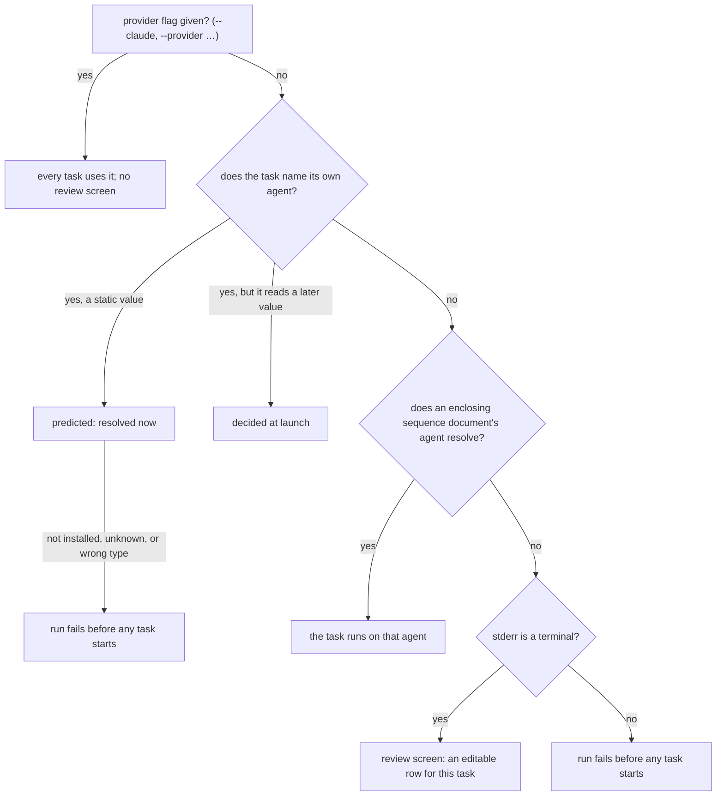
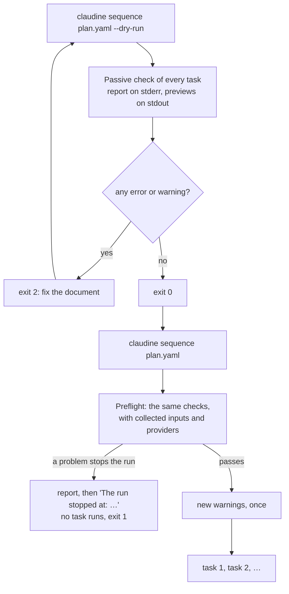

# Claudine's `sequence` command

`claudine sequence` runs a document whose frontmatter has a `sequence:` list,
one step at a time. Each step composes and runs one unit of work, such as a
prompt document, a shell command, or a group of tasks. Later steps can read
what earlier steps produced.

This page covers the command: how to call it, how it chooses providers, and
its flags. How steps, tasks, state, groups, and `seq.outputs` behave is in
[Sequences](../topics/flow-control/sequences.md).

## Usage

```bash
claudine sequence [flags] <file> [key=value ...]
```

Pass exactly **one file reference**. Any number of `key=value` setters can go
before or after it:

```bash
claudine sequence @research.md topic="async traits" retries=3
claudine sequence topic="async traits" @research.md
```

A command with setters but no file fails:

```text
Error: missing file reference: expected exactly one file reference plus optional key=value setters
```

### Setters

- A token is a setter when the part before the first `=` starts with an ASCII
  letter or `_` and contains only letters, digits, `_`, or `-`. Anything else,
  such as `foo.bar=baz` or `./x=1`, is treated as the file reference.
- The value is parsed as JSON5, and falls back to a plain string when it
  doesn't parse: `retries=3` is a number, `tags=[a,b]` is a string, and
  `tags='["a","b"]'` is an array.
- `--set '{"key": "value"}'` sets several values at once. An inline setter
  wins over `--set` for the same key.
- Setters sit above the document's frontmatter and below runtime mutations.
  The read-only `seq` root carries the current row, neighbors, outputs, and
  run ID separately from frontmatter. See
  [Phase 2 — Just-in-time composition](../topics/flow-control/sequences.md#phase-2--just-in-time-composition)
  for the full order.

## The sequence file

The file can be either of these:

- a **Markdown document** whose frontmatter has a `sequence:` key;
- a **`.yaml` / `.yml` file**, whose top-level mapping is read as frontmatter
  with no body. Every step then needs an executable, because there is no body
  for a plain step to compose.

```markdown
---
agent: claude
sequence:
    - name: research
      topic: parsing
    - name: review
      prompt: "@prompts/review.md"
      with:
          topic: "{{ seq.topic }}"
    - name: stage
      shell: git add .
---
Research {{ seq.topic }} and write up what you find.
```

The `research` step has no executable, so it composes this document's body.
`review` composes `prompts/review.md` with `topic` set, and `stage` runs a
shell command. The step fields, the ways to supply a list (`sources`), and
groups are covered in [Sequences](../topics/flow-control/sequences.md).

### Inputs and step types

A sequence file's `$schema` describes the file itself, in YAML as in
Markdown: its required properties are inputs you supply as setters. `$state`
types each step, and `template:` fills every step:

```yaml
# colors.yaml
kind: sequence
$schema:
    reviewer: string(required) -> who signs off
$state:
    color: string(required)
template:
    desc: "{{ color }} for {{ reviewer }}"
sequence:
    - { name: blue, color: blue, shell: "echo {{ seq.desc }}" }
```

```sh
claudine sequence colors.yaml reviewer=ada
claudine sequence reviewer=ada colors.yaml   # the same run
```

Without `reviewer`, a terminal asks for it once, together with every other
missing input of the sequence's documents and steps; anything else fails
with one report listing them all and starts no step. A setter may not name
`$state` or `template`. See
[Sequences → Sequence documents](../topics/flow-control/sequences.md#sequence-documents-schema-state-and-template)
and [Requiring caller input](../topics/flow-control/sequences.md#requiring-caller-input).

## Choosing providers

Every task that launches a provider (a `prompt:` task, or a step that runs
the sequence body) chooses its own. Before any task starts, preflight
predicts each one's provider from its own `agent`, the same way its launch
will choose it:



A task's own `agent` comes, lowest first, from its prompt document's
frontmatter, its `with:`, and a caller setter (`agent=…` or
`--set '{"agent": …}'`, which therefore overrides every task). A runtime
`set` of `agent` outranks all three when the task runs. `--claude`,
`--codex`, …, or `--provider <name>` decides every task and skips the rest.

```yaml
# No document `agent`: every task names its own, so the run just starts.
sequence:
    - name: implement
      prompt: "@prompts/implement.md"
      with: { agent: codex }          # runs on Codex
    - name: review
      prompt: "@prompts/review.md"    # declares agent: opencode, so it runs on OpenCode
    - name: stage
      shell: git add .                # launches no provider, needs none
```

Each task falls into one of three classes:

| Class | When | What happens |
| :--- | :--- | :--- |
| **predicted** | its `agent` is known now | checked now; an unusable one fails the run, naming the task, the property, and the enclosing containers |
| **decided at launch** | its `agent` reads `seq.outputs`, `loop.*`, `group.*`, `current.*`, a key a lifecycle `set` writes (even one with no value before that write), or a `$( … )` | evaluated when the task is prepared; an unusable value fails that task before it spawns, after earlier tasks ran |
| **missing a provider** | no `agent` of its own: absent, or `null` in whichever layer decides it (a caller's `agent=[]` too) | takes the nearest enclosing sequence document's `agent` (a referenced sequence file's own first, then outward to the root); with none, a terminal reviews it and anything else fails |

`null` is not a hint, so an `agent: null` in a task's `with:` or a caller's
`agent=null` hides a lower layer's `agent` and leaves the task missing one.
An empty string `""` is an invalid provider name, not an empty hint. A caller
setter also applies to the sequence document, so `agent=null` or `agent=[]`
leaves nothing to inherit.

`agent: []` in a task's prompt frontmatter or its `with:` is not an empty
hint: the [launch schema](../topics/schemas.md#when-the-schemas-apply) requires
an agent list to have at least one entry, so the run fails before any task
launches, naming where the list was written (`tasks[1].with.agent`, or
`agent` in the prompt file). A body step of a referenced sequence file whose
`agent` is `[]` fails the same way, naming that file, unless a caller's
`agent=` replaces it. A root sequence document's `agent: []` fails its own
schema check before any task launches. `model: []` is valid and means no model.

A task naming a provider that isn't installed fails before any task
launches, even when its `when:` is false:

```text
⤫ CompositionError: task provider selection failed
  step 2 (`later`) in seq.md names its provider with tasks[1].with.agent in seq.md.
```

A hint that reads the provider it selects (`agent: "{{ env.AGENT }}"`, or
`env.MODEL` for `model`) is rejected the same way, unless something above it
decides that key. That includes a read through another value: with
`who: "{{ ctx.agent }}"` in the sequence, a task's
`with: { agent: "{{ who }}" }` is rejected before any task starts. Provider and model are decided separately:

| Hint | Made irrelevant by |
| :--- | :--- |
| `agent: "{{ env.AGENT }}"` (or `ctx.agent`) | `--claude`, `--provider claude`, or a caller's `agent=` |
| `model: "{{ env.MODEL }}"` (or `ctx.model`) | `--model`, a `MODEL` or provider-specific model variable (`CLAUDE_MODEL` for Claude), or a caller's `model=` |

So `claudine sequence seq.md --claude` runs a task whose prompt says
`agent: "{{ env.AGENT }}"` on Claude, and the prompt reads `claude` there.
A provider flag does not excuse a circular `model`.

An `agent` or `model` whose expression is simply wrong is rejected too,
under any flag, because the task's prompt still evaluates it when it
composes; so is an `agent: []`. Wherever it is written, a typo is not a
later value, so `with: { agent: "{{ no_such_function() }}" }` on the second
task stops the run before the first launches, naming `tasks[1].with.agent`.
A document hint reading a `with` entry that fails is located at that entry. Prediction runs no shell,
lifecycle event, or `prep` target, composes no prompt body, and refreshes no
model catalog.

A hint written as a plain value, with no `{{ … }}` and no `$( … )`, is
taken as written: `agent: codex` in any layer is predicted without
evaluating anything. Only a hint that reads another value is evaluated, and
only against what is known before the run: the prompt document's
frontmatter under the task's evaluated `with:` and the caller's setters. A
plain value is still decided at launch when a lifecycle `set` writes that
key, and a hint that reads a plain-text key a lifecycle `set` writes is
decided at launch too, whatever that key holds now. That second rule covers
the task as a whole: once either hint reads a key a lifecycle `set` writes,
both `agent` and `model` are decided at launch, plain values included:

```yaml
# prompts/review.md
pick: codex
agent: "{{ pick }}"   # decided at launch if any lifecycle `set` writes `pick`
model: big            # predicted as written, unless `agent` is decided at launch
```

A hint is followed through every value it reads, in the place that value
is evaluated, however many derived values lie between it and the write. A
task's `with:` values read the enclosing sequence's properties, so here
the reader's `agent` is decided at launch: `choice` reads `mid`, which reads
`pick`, which the writer's `success` sets.

```yaml
# seq.yaml
pick: claude
mid: "{{ pick }}"
choice: "{{ mid }}"
sequence:
  - { name: writer, prompt: writes.md }   # success: [{ set: { pick: goose } }]
  - { name: reader, prompt: plain.md, with: { agent: "{{ choice }}" } }
```

A prompt's own properties are its own. A prompt whose frontmatter says
`choice: claude` and `agent: "{{ choice }}"` is predicted as `claude` even
when the sequence, or any other document in the run, has a `choice` that
reads a written key; if Claude is not installed, the run fails before the
writer starts. A prompt hint that reads a `with:` key (`agent: "{{ who }}"`
with `with: { who: "{{ choice }}" }`) follows that key into the sequence's
properties, where `with:` is evaluated.

A graph of only `shell:` and `side_effect:` tasks needs no
provider at all.

A body step composes the sequence document itself, so its `agent` is the
document's. A group has no `agent`: each task in it chooses its own.

**The model** follows its own order: `--model` first, then the selected
provider's model environment variable (for example, `CLAUDE_MODEL`), then
the generic `MODEL`, then the task's own `model`, then a compatible inherited
or review-selected model, and finally the provider's default. Environment
values come from the map captured for that document, so a later task can see
a file-backed environment change without changing an earlier task's choice.
An inherited model goes only with the provider it belongs to: a
task that switches provider gets that provider's own default, and its
process gets no stale `MODEL`.

```yaml
agent: claude
model: claude-opus-4-8              # Claude's model
sequence:
    - name: draft
      prompt: "@prompts/draft.md"   # runs claude-opus-4-8
    - name: other
      prompt: "@prompts/draft.md"
      with: { agent: codex }        # Codex's default model, not Claude's
```

**What a step reports is what launched.** The step's status line names the
provider that spawned, and lists every attempt when a `retry` or `proxy`
switched provider:

```text
✓ step 1/2 succeeded (via Codex)
✓ step 2/2 succeeded (via Codex; attempts: Claude → Codex)
```

A skipped task, a preview, and a task that launched nothing claim no
provider. `{{ env.AGENT }}` and `{{ env.MODEL }}` in a task's composed
prompt name the provider and model the task launches with, and so does the
child's environment. That holds for a task decided at launch too: its
document's frontmatter is evaluated first, the provider is chosen from it,
and only then does the body render. It holds when an earlier task rewrote the
prompt document to name another provider: the task launches on the fresh
`agent`, and its prompt says so.

```yaml
sequence:
  - name: pick
    shell: echo goose
  - name: run
    prompt: report.md              # body: "You are {{ env.AGENT }}."
    with: { agent: "{{ seq.outputs[0] }}" }
# Goose launches, with AGENT=goose, and reads "You are goose."
```

An `agent` or `model` that comes from a `$( … )` in the prompt's
frontmatter agrees too. The command runs once; its answer chooses the
provider and model after the frontmatter resolves and before the body
renders, and a retry of the task rereads the document under that choice.
A task's `with:` value that only looks like a command, such as
`model: "$(echo x)"`, is data: nothing runs it, and the body and the child
both receive it as written.

```markdown
---
agent: '$(echo goose)'
---
You are {{ env.AGENT }}.
```

The task above launches Goose, with `AGENT=goose`, and its prompt reads
"You are goose." A frontmatter value that itself reads `env.AGENT` resolves
before that command runs, so it sees the identity the rest of the
frontmatter names without the command's answer.

### The review screen

The screen opens only on a terminal, and only when some task is missing a
provider (or names a list with more than one installed provider). It shows
one row per provider-launching task, labeled with its root step's position
and its name:

| Task | Row |
| :--- | :--- |
| missing a provider | editable: a provider picker and a model picker |
| names its own provider | read-only, showing it |
| decided at launch | read-only, showing `decided at launch` |
| `shell`, `side_effect` | no row |

```yaml
sequence:
    - name: implement
      prompt: "@prompts/implement.md"   # row "1 implement", editable
    - name: stage
      shell: git add .                  # no row
    - name: review
      prompt: "@prompts/review.md"      # declares agent: codex: row "3 review" shows Codex, read-only
```

A choice is stored for that one task, so two tasks with the same name in
different containers never share it. It is a fallback, not an `agent`: if
the task's document names an `agent` when it launches (a `proxy` target,
say), that wins.

- `Ctrl+S` accepts every row and starts the run.
- `Esc` or Ctrl+C leaves the screen, starts no task, and exits `130`.
- Shell commands are approved before the screen opens, and `--dry-run` never
  opens it; it reports each task the screen would ask about instead.

## Failures and exit codes

An unhandled failing step stops the run. The old `--fail-fast` flag and a
sequence document's `fail_fast:` key are rejected with a replacement hint.
Use `failure:` lifecycle handling for recovery; `fail_fast` belongs only to
group objects. Claudine no longer injects `CLAUDINE_FAIL_FAST` into a step.

The exit code is `0` when every executed step succeeded, `1` after an
unhandled failure, and `130` after Ctrl+C, including cancellation on the
provider review screen. A looping root sequence that ends through `break`
exits with that `break`'s `code` (default `0`); see
[Looping — Breaking out of a loop](../topics/flow-control/looping.md#breaking-out-of-a-loop). A preflight failure starts no step.

A run that stops at preflight (a missing `prompt:` or `sequence:` file, an
invalid group, a task without a usable provider, a missing input) prints the
same report a [dry run](#dry-run) prints, with every error and warning it can
prove at that point, instead of a single error block. The last line names
the error the run returned, unless a row already says it:

```text
Sequence preflight found 2 errors and 0 warnings; no task ran

task one (sequence[0])
  ✗ `topic` (string) is required and has no value; a non-interactive run fails
    here
      in needs.md
      hint: add `topic` to the task's `with:`, or pass `topic=<value>`
            after the file

task two (sequence[1])
  ✗ the prompt file does not exist
      prompt: ./missing.md
      resolved to missing.md (relative to seq.md)
      at seq.md:7:13
      hint: create missing.md before a real run, or correct the reference

The run stopped at: <the error the run returned>
```

The exit status is still `1`, and the root's `blocked`, `failure`, and
`finalize` handlers see that returned error in `err.*`, not the report's
first row. Here the run met task two's missing file while loading the task
graph, before it collected inputs, so `err.*` describes the missing file.
See [Pre-Flight Checks — When preflight stops a sequence](../topics/pre-flight-checks.md#when-preflight-stops-a-sequence).

When preflight passes, warnings that no earlier stage showed (a step's own
`agent:` or `model:`, a misspelled step key) are printed once, under
`Sequence preflight found 0 errors and 1 warning; the sequence runs`, before
the first task starts. `--silent` leaves them out.

## Interactive sessions

A sequence document may not set `interactive: true`. A run is serial
automation, and a document-level default would be ambiguous across steps, so
`interactive: true` is a hard error. `interactive: false`, `null`, or no key
at all is fine.

To run the steps interactively anyway, pass `--interactive` (`-i`).
`--timeout` and `--step-timeout` cannot be combined with it.

## Environment of each step

Each step's provider session gets these variables:

| Variable | Value |
|---|---|
| `AGENT` | the provider that launched, such as `codex` |
| `MODEL` | the model that launched, when one was chosen |
| `YOLO` | `true` when `--yolo` is set |
| `OPERATION` | the step's `operation`, or `--operation` |

## Dry run

`--dry-run` checks the sequence and previews what composes, without running
anything: no provider, shell command, lifecycle event, prompt for input, or
write. It reports every problem in one pass instead of stopping at the
first.

A sequence is checked in two stages. The dry run is the first: it sees
everything it can without an effect, so you can fix the document before
anything runs. The real run is the second: its preflight runs the same
checks with the values it has collected, and either stops before the first
task, with the same report, or warns once and runs.



Given this sequence, where `_find.md` exists and names no `agent`:

```yaml
# renderers/_fleet.yaml
kind: sequence
sequence:
    - name: find
      description: Find the Mermaid renderers and provide basic research
      agent: opencode
      model: gemini/neon
      prompt: ./_find.md
      with:
          output: "./overview.md"
    - name: metadata
      description: extract metadata
```

a dry run, with stderr redirected, reports every problem of both tasks:

```text
Dry run of renderers/_fleet.yaml (no commands run)

task find (sequence[0])
  ⚠ `agent: opencode` is step data (read as `seq.agent`), not the task's
    provider
      at renderers/_fleet.yaml:5:7
      hint: to choose the provider, move it into the task's inputs:
            `with: { agent: opencode }`
  ⚠ `model: gemini/neon` is step data (read as `seq.model`), not the task's
    model
      at renderers/_fleet.yaml:6:7
      hint: to choose the model, move it into the task's inputs: `with: {
            model: gemini/neon }`
  ✗ no provider for this task; a non-interactive run fails here
      1. --provider flag             not given
      2. agent= setter               not given
      3. with.agent                  not set (see `agent:` above)
      4. _find.md frontmatter agent  not set
      5. _fleet.yaml agent           not set
      hint: add `with: { agent: opencode }`, or run with `--provider
            opencode`
  ℹ not checked: model requirement (no provider)

task metadata (sequence[1])
  ✗ this task has no executable, so it would compose the body of
    renderers/_fleet.yaml, and a YAML file has no body
      at renderers/_fleet.yaml:10:7
      hint: add an executable such as `prompt: ./metadata.md`
  ℹ not checked: provider, inputs (no executable)

Dry run found 2 errors and 2 warnings; 3 checks not run. Previewed 1 of 2 tasks.
```

The exit status is `2`, and `find`'s composed prompt follows on stdout. Add
`prompt: ./_frontmatter.md` to `metadata` before that file exists, and the
`find` rows are unchanged while `metadata` reports the missing file:

```text
task metadata (sequence[1])
  ✗ the prompt file does not exist
      prompt: ./_frontmatter.md
      resolved to renderers/_frontmatter.md (relative to renderers/_fleet.yaml)
      at renderers/_fleet.yaml:12:15
      hint: create renderers/_frontmatter.md before a real run, or
            correct the reference
  ℹ not checked: provider, inputs (the prompt file could not be read)
```

Each row has a severity (`✗` error, `⚠` warning, `ℹ` info), a message that
names what failed and why, the place it was written when that is known, and
a hint with the next step. A check that could not run is an `ℹ not checked`
row that says what blocked it, instead of silence.

What the check does:

- No command runs, even with `--yolo`: `$( … )` values, `::shell` lines, and
  `shell:` and `side_effect:` tasks are skipped and reported as not checked,
  no approval is asked for, and no cache is read or written. A remote read
  the configuration allows is fetched without being stored; one it denies is
  refused. No lifecycle event, `prep` target, or loop pass runs.
- Each task is checked for a step-level `agent:`/`model:` (step data, not the
  provider), a missing executable over a body-less document, a missing
  `prompt:` file (with the resolved path and up to three nearby files), the
  provider, and a model the provider requires.
- The provider is chosen by the same rules a real run uses, and the finding
  lists each source it read, in order, up to the one that decided:

  ```text
  task find (sequence[0])
    ✗ no provider for this task; a non-interactive run fails here
        1. --provider flag             not given
        2. agent= setter               not given
        3. with.agent                  not set (see `agent:` above)
        4. _find.md frontmatter agent  not set
        5. _fleet.yaml agent           not set
        hint: add `with: { agent: opencode }`, or run with `--provider opencode`
  ```

  On a terminal the same finding is a warning, because a real run opens the
  provider review screen and asks. An unknown provider name, or a provider
  whose program is not on `PATH`, is an error either way.
- The whole tree is read the way a real run's preflight reads it: every root
  task, group leg, nested or referenced sequence, `task:` file, and selected
  catalog entry. A problem is reported under the task or leg it belongs to,
  and the check goes on with that task's siblings, so one bad leg does not
  hide the others. A task inside a group or sequence is labeled by the tasks
  around it, and a file referenced twice is checked at each reference:

  ```text
  task first → inner (sequence[0])
    ✗ the prompt file does not exist
        prompt: ./gone.md
        resolved to gone.md (relative to child.yaml)
        at child.yaml:4:13

  task again → inner (sequence[0])
    ✗ the prompt file does not exist
    ...
  ```

  A list built by `$( … )` is reported as not checked, since only running its
  command can produce it.
- Every task, group, catalog, and sequence file the check reads is judged
  against its kind's definition, so a removed or misspelled key is reported in
  any of them.
- Each missing required input is one `composition.missing_properties` finding
  under its task: a warning when an interactive run could ask for every
  missing value (`prompt_for_missing` is on, both stdin and stderr are
  terminals, and every missing value has a type the input prompt can
  collect), otherwise an error, since a run that cannot ask fails there.
  A value that comes from a skipped command still counts as given. A task
  whose sequence is missing an input waits for it: its inputs and preview
  are reported as not checked instead of naming the same input again.
- Each prompt is prepared exactly as the real command prepares it, including
  `inline-compose`'s check that it could edit the file, but without any
  effect. Whatever needs an effect is left as written in the preview, marked
  `[not evaluated in a dry run]`, and reported as its own not-checked row,
  while everything that does not depend on it is composed as usual:

  ```text
  doc.md
    ℹ not checked: frontmatter value (needs the output of `git branch
      --show-current`, which a dry run does not run)
    ℹ not checked: `::block` condition, interpolation (reads `branch`, which is
      not known until the document runs)
  ```

  ```text
  # Release
  On {{ branch }} [not evaluated in a dry run].
  ::block when="branch == 'main'" [not evaluated in a dry run]
  ...
  ```

  This covers a `$( … )` value and anything that reads it, a body `::shell`
  line or `::shell-block`, a `::block` whose condition reads such a value, a
  function that would start the login shell, send network packets, or query
  a provider's API (`has_alias`, `ping`, `pr`, …), and a `$schema` slot whose
  read would need approval. A task's `with:` values known at launch are
  passed to its prompt as its turn would pass them. A prompt that composes
  to nothing is an error that says why: no body, only whitespace, or each
  `::block` left out by a false condition, with its line.
- An invalid configuration file is reported as an error, and the check goes
  on with the defaults.
- No configuration, cache, or other file is created, and nothing is
  migrated.

The report goes to stderr and each composed preview to stdout, so
`claudine sequence plan.md --dry-run > previews.md` keeps only the previews.
With `--json`, stdout holds one JSON report and nothing else, and stderr is
empty:

```json
{
  "file": "/work/renderers/_fleet.yaml",
  "outcome": "failure",
  "diagnostics": [{ "code": "composition.provider_unresolved", "severity": "error", "...": "..." }],
  "summary": { "errors": 1, "warnings": 0, "info": 1 }
}
```

`outcome` is `failure` when any finding is an error or a warning, else
`success`; `file` is `null` when the root document could not be resolved. Each entry of
`diagnostics` is the record Darkmatter's `md --output json` uses (see
[Darkmatter's data contracts](darkmatter/docs/cli/data-contracts.md)), so a
script tells findings apart by `code`, never by message text. Every failure
the check meets, even a root document that cannot be read or an invalid
configuration, is a finding in this one report.

| Situation | Exit | Output |
|---|---|---|
| No finding, or only `info` findings | `0` | report and previews (or one JSON report) |
| Any `error` or `warning` finding | `2` | the full report and previews (or one JSON report) |
| A refused command line (`--json` without `--dry-run`, `--dry-run-shell`, a provider switch before the file) | `2` | the usage message on stderr; no report and no JSON |

A dry run never exits `1`: tell a usage error apart from a report by
whether a report (or JSON) was printed.

`--dry-run-shell` was removed. It is a usage error, with or without
`--dry-run`:

```text
error: `--dry-run-shell` was removed. Dry runs skip commands.
  hint: use `--dry-run` to check and preview, or run the command without it
```

## Flags

Flags shared with `compose`:

| Group | Flags |
|---|---|
| Provider | `--claude`, `--codex`, `--gemini`, `--goose`, `--kimi`, `--opencode`, `--qwen`, `--provider <NAME>`, `--exclude <PROVIDER>`, `-m`/`--model <MODEL>` |
| Session | `-y`/`--yolo` (the provider's auto-approval mode, also set by `CLAUDINE_YOLO`), `-i`/`--interactive`, `--no-interactive`, `--sandbox`, `--include <ENV_NAME>` |
| Timeouts | `-t`/`--timeout <DURATION>`, `--step-timeout <DURATION>`, `--stall-timeout <DURATION>` |
| Loops | `--max-iterations <N>` (caps every loop's iterations, overriding `loop.max`; `CLAUDINE_MAX_ITERATIONS` applies when the flag is absent), `--on-rate-limit pause\|abort\|continue` (overrides `loop.on_rate_limit` in a looping prompt document) |
| Resources | `--mcp`, `--use <ID,…>`, `--strict`, `--repo` |
| System prompt | `--append-system-prompt`/`--asp <FILE>`, `--replace-system-prompt`/`--rsp <FILE>` |
| Output | `-q`/`--quiet`, `--silent`, `--perf` (`-o`/`--output` is refused; see [What Claudine Writes](../topics/output.md)) |
| Values | `--set <JSON>`, `--operation`/`--op <OP>` |
| Rehearsal | `--dry-run`, `--json` (with `--dry-run`) |

`-y` is `--yolo`, not "answer yes". It turns on each provider's own
auto-approval mode, and it approves every shell command during preflight
without prompting. Blocked commands are still refused. It does not skip the
provider review screen.

## Performance report

`--perf` prints one combined report after the sequence summary:

- **CLI Overhead**: startup timings captured when the sequence starts.
- **Composition Report**: merged across every step that composed a document.
- **Agent Execution**: total launches and time, with first-response latency
  averaged across steps. The note line gives both the average and the
  minimum latency.

An interrupted run, or one stopped by a step failure, still prints the report,
with a `partial sequence metrics` note. `--perf` overrides `--quiet` and
`--silent`.
